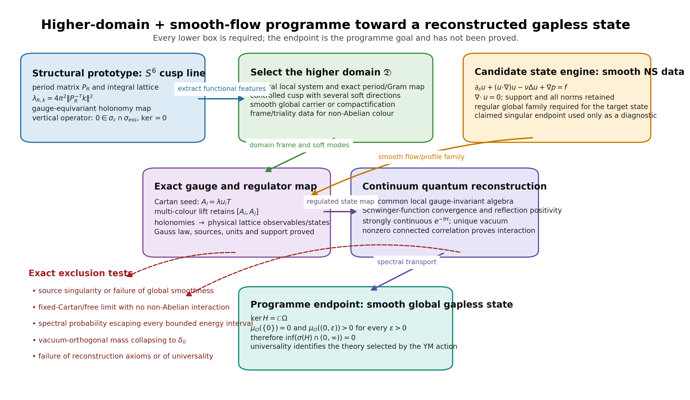
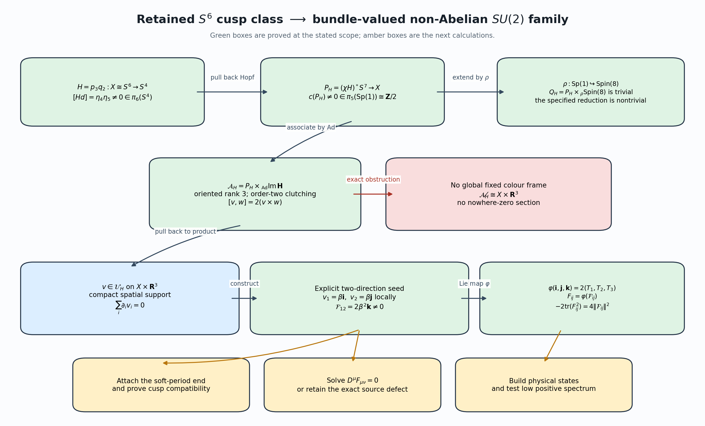
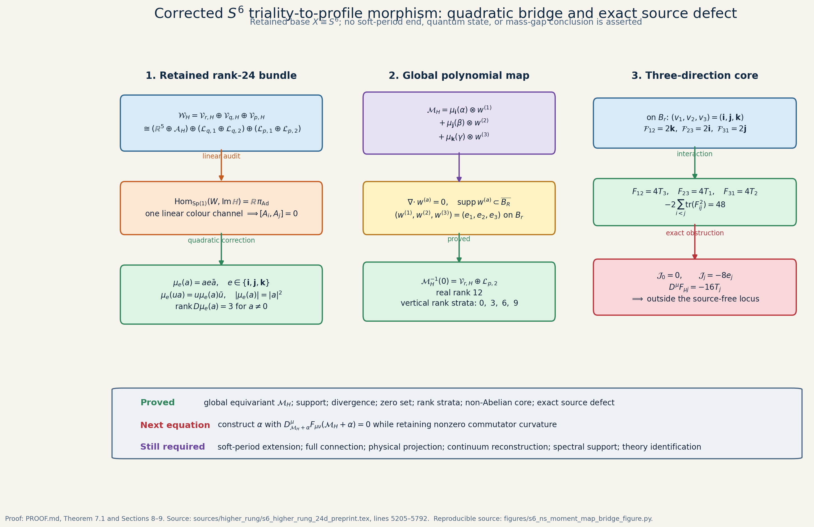
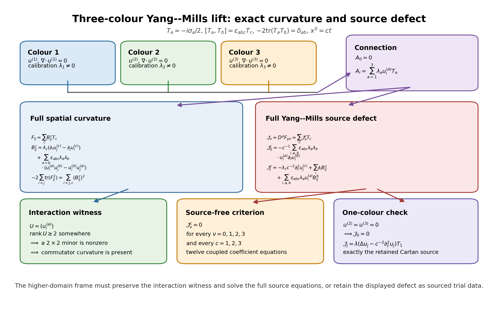

# A higher-domain and smooth-flow program for a global no-gap Yang--Mills state

## Research program extracted from the \(S^6\), Navier--Stokes, higher-rung, and Yang--Mills records

**Status, 2026-09-29.**  This document formulates the research direction in
the form intended by the user:

\[
 \boxed{
 \text{(S^6)-type structural prototype}
 \longrightarrow
 \text{right higher domain}
 \longrightarrow
 \text{exact gauge/state map}
 \longrightarrow
 \text{smooth global continuum}
 \longrightarrow
 \text{no positive gap}.}
\]

Navier--Stokes data enter as a possible mechanism for constructing the
smooth state family.  The domain need not be \(S^6\), need not be a sphere,
and need not be complex.  It must perform the same mathematical jobs that
make the \(S^6\) cusp line useful: carry an integral lattice or local system,
produce controlled soft spectral directions, admit an exact gauge map, and
extend to a globally defined geometric object.

This is a well-posed counterexample-search program.  No present source proves
a completed counterexample.  The program below records the exact intermediate
objects, the already proved maps, the required new maps, and the tests that
separate a genuine quantum no-gap result from a classical or finite-regulator
analogy.

**Programme goal.**  Construct a globally smooth, interacting state within
the stated four-dimensional Yang--Mills axioms, prove that its reconstructed
Hamiltonian has no positive mass gap, and derive the resulting contradiction
of the stated mass-gap claim.  An intermediate gapless model that has not yet
been identified with that Yang--Mills theory is unfinished work, not an
alternative conclusion of this programme.

**Audit correction, 2026-09-30.**  The 29 September text correctly proved
the retained \(\operatorname{Sp}(1)\) reduction and a local interaction
seed, but overstated that seed as a completed map from the rank-\(24\)
triality bundle.  The corrected global map is the quadratic morphism \(\mathcal M_H\)
proved in Section 3.4 and in
`PROOF.md`.  Its top-rank core is interacting
and has exact nonzero Yang--Mills source.  The source-free correction,
soft-period extension, physical state map, reconstruction, and contradiction
remain programme tasks.

*Figure 1.  The structural \(S^6\) input, the higher-domain search, and the
smooth-flow state engine meet in an exact gauge and regulator map.  The
spectral conclusion is reached only after continuum reconstruction,
interaction, unique-vacuum, and universality proofs.  The source is
`figures/s6_ns_no_gap_program_figure.py`.*

## 1. The research thesis

The thesis is not that the \(S^6\) construction itself is a Yang--Mills
counterexample.  It is that the \(S^6\) line reveals a reusable mechanism:

1. a family of integral period lattices has a controlled degeneration;
2. the dual lattice develops positive eigenvalues that approach zero;
3. a gauge-equivariant holonomy map transports the geometric data into
   lattice gauge variables;
4. retaining the degeneration parameter as part of one operator produces
   continuous spectrum at zero without a zero eigenvector;
5. a higher domain with more interacting directions may transport this
   mechanism into a non-Abelian, globally smooth state rather than the
   present scalar or free comparison sector;
6. Navier--Stokes or a related smooth-flow system may generate the required
   spatial profiles and concentration scales;
7. if the resulting quantum continuum satisfies the reconstruction axioms,
   is interacting, has a unique vacuum, and has spectral support reaching
   zero, then its Hamiltonian has no positive mass gap.

The mathematical problem is to construct and prove every arrow.  The
existing sources already prove substantial parts of arrows 1--4 and an exact
but restricted version of arrow 6.

## 2. What the \(S^6\) prototype actually supplies

The exact cusp-to-gauge source works with a radial cusp parameter (R>R_0),
the regular-fibre real period matrix

\[
 P_R=
 \begin{pmatrix}
  6a_R&u_R&1&0\\
  6m_R&T_R&0&0\\
  c_R^{\mathrm{re}}&a_R&0&1\\
  p_R&m_R&0&0
 \end{pmatrix},
\]

and the positive determinant quantity

\[
 \delta_R=6m_R^2-p_RT_R
 =R^2+(2h_0-d_0)R+
   (h_0^2-d_0h_0+6m_0^2)+O(Re^{-2\pi R}).
\]

It proves all of the following maps and formulas.

### 2.1 Marked fibres and holonomy

The marked fibre is

\[
 F_R=\mathbb R^4/P_R\mathbb Z^4,
 \qquad G_R=P_R^{\mathsf T}P_R,
 \qquad \operatorname{Vol}(F_R,G_R)=\delta_R.
\]

For every division order \(N\ge2\), the source gives the exact bijection

\[
 (\mathbb Z/N\mathbb Z)^4\longrightarrow F_R[N],
 \qquad [n]\longmapsto[P_Rn/N],
\]

and the gauge-equivariant holonomy law

\[
 \operatorname{Hol}_{R,N}(A^g)_j(n)=
 g(n)^{-1}\operatorname{Hol}_{R,N}(A)_j(n)g(n+e_j).
\]

This is the first feature that the higher domain must retain: an exact map
into finite gauge variables, including the gauge action at both endpoints.

### 2.2 Soft dual spectrum

The dual lattice is identified by

\[
 k\longmapsto P_R^{-\mathsf T}k.
\]

For the two soft coordinates,

\[
 P_R^{-\mathsf T}(r,s,0,0)=
 \left(0,\frac{m_Rr-p_Rs}{\delta_R},0,
          \frac{-T_Rr+6m_Rs}{\delta_R}\right).
\]

The scalar eigenvalues are

\[
 \lambda_{R,k}=4\pi^2\|P_R^{-\mathsf T}k\|^2,
\]

and the first positive one satisfies

\[
 \lambda_1(F_R,G_R)=\frac{4\pi^2}{R^2}
 \left[1+
 \frac{\min\{2(d_0-h_0),-2h_0\}}{R}+O(R^{-2})\right].
\]

The low-energy mode count at fixed \(0<E<4\pi^2\) is

\[
 N_R(E)=\frac{E}{4\pi}\delta_R+O_E(R).
\]

Thus the prototype has both a closing first eigenvalue and a growing number
of low-energy modes.

### 2.3 Exact continuous threshold

The source retains (R) as a noncompact measure variable and defines

\[
 \mathscr H_{\mathrm v}=
 L^2([R_0,\infty),dR;L^2_0(\mathbb R^4/\mathbb Z^4)),
\]

with

\[
 (H_{\mathrm v}f)_k(R)=\lambda_{R,k}f_k(R).
\]

It proves

\[
 0\in\operatorname{Spec}_{\mathrm c}(H_{\mathrm v})
    \cap\operatorname{Spec}_{\mathrm{ess}}(H_{\mathrm v}),
 \qquad \ker H_{\mathrm v}=\{0\}.
\]

The proof uses the exact orthonormal Weyl sequence

\[
 \Psi_j(R,y)=\mathbf1_{[j,j+1]}(R)e_{(1,0,0,0)}(y),
 \qquad \|H_{\mathrm v}\Psi_j\|=O(j^{-2}).
\]

This is already an exact no-gap theorem for the explicitly defined
vertical decomposable operator.  It is not yet a theorem about the
four-dimensional Yang--Mills Hamiltonian.  In particular, the source states
that \(H_{\mathrm v}\) contains no derivative in \(R\) and imposes no
boundary condition at the completed cusp.

### 2.4 Finite gauge Hessian and Gaussian quantization

The same source constructs the flat Yang--Mills Hessian after the exact gauge
quotient, its metric cubical discretization, and the Gaussian Hamiltonian

\[
 \widehat H^{\mathrm{quad}}_{R,N}=
 -\frac{g_{\mathrm{YM}}^2}{2}\Delta_{\mathscr C_{R,N}}
 +\frac1{2g_{\mathrm{YM}}^2}
  \langle a,L_{R,N}a\rangle_{1,R,N}.
\]

Its finite gap is

\[
 \operatorname{gap}(\widehat H^{\mathrm{quad}}_{R,N})
 =\sqrt{\lambda_{1,R,N}^{\mathrm{coch}}}
 =\frac{s_N}{R}
 \left[1+\frac{\min\{d_0-h_0,-h_0\}}{R}+O(R^{-2})\right],
\]

where \(s_N=2N\sin(\pi/N)\) and \(4\le s_N<2\pi\).  Every finite
quadratic regulator is gapped and the gaps close as \(R\to\infty\).

This establishes the structural prototype sought by the user.

## 3. Why the higher domain should be functionally similar rather than identical

The higher-rung source proves that a literal complex-sphere continuation is
the wrong requirement.  A smooth homotopy sphere of dimension greater than
six admits no almost-complex structure under the stated theorem, and the
direct rank-three toroidal attempt has an Euler mismatch.  These obstructions
do not end the program.  They define the correct search space: higher domains
with the required lattice, cusp, smooth carrier, and interaction maps, without
requiring another complex sphere.

The same source constructs a strong alternative carrier:

\[
 \operatorname{Fl}(\mathbb O)=F_4/\operatorname{Spin}(8),
 \qquad
 T\operatorname{Fl}(\mathbb O)\cong
 V_8\oplus S_8^+\oplus S_8^-.
\]

It is a smooth (24)-dimensional object with three exact rank-eight
triality sectors.  The source also constructs:

- the Albert algebra \(\mathfrak h_3(\mathbb O)\) and its determinant;
- a spectral graph identifying \(\mathbb O^3\) with the equal-diagonal
  positive determinant boundary;
- an explicit degree-\(+1\) collapse
  \(F_4/\operatorname{Spin}(8)\to S^{24}\);
- exact marked Niemeier/Leech lattice intersections and a triality cubic;
- ordered eigenvalues, spectral projectors, and inverse maps on the regular
  orbit family.

It also states the present limit exactly: no interacting quantum Hamiltonian
has been specified on this carrier.  The (24)-dimensional object is therefore
a candidate **global and three-directional carrier**, not yet the required
soft-period gauge domain.

### 3.1 The full triality stabilizer cannot become three ordinary frames

There is an additional exact obstruction before a domain-to-flow map can be
claimed.

**Proposition 3.1 (full-stabilizer low-dimensional target obstruction).**
Let \(G\) be a finite-dimensional Lie group with \(\dim G<28\).  Every
continuous group homomorphism

\[
 \rho:\operatorname{Spin}(8)\longrightarrow G
\]

is trivial.  In particular this holds for \(G=SO(3)^3\) and for
\(G=SO(3)_{\mathrm{space}}\times SO(3)_{\mathrm{colour}}\).

**Proof.**  A continuous homomorphism between finite-dimensional Lie groups is
smooth.  Its differential is a Lie-algebra homomorphism

\[
 d\rho:\mathfrak{so}(8)\longrightarrow\mathfrak g.
\]

Its kernel is an ideal.  Since \(\mathfrak{so}(8)\) is simple, the kernel is
either zero or all of \(\mathfrak{so}(8)\).  A zero kernel would give an
injective linear map from a space of dimension \(28\) to one of dimension
less than \(28\), which is impossible.  Hence \(d\rho=0\).  For every
\(X\in\mathfrak{so}(8)\),
\(\rho(\exp X)=\exp(d\rho X)=e\).  Thus the kernel contains an identity
neighborhood and is an open subgroup.  The connected group
\(\operatorname{Spin}(8)\) has no proper open subgroup, so the kernel is the
whole group.
\(\square\)

Thus the three triality sectors cannot be relabelled directly as three
spatial or colour frames while retaining the full stabilizer action.  The
obstruction defines the replacement search space.  Let

\[
 \mathcal V_{\mathrm{div}}
 =\{u\in C_c^\infty(\mathbb R^3,\mathbb R^3):\nabla\cdot u=0\}.
\]

Define \(\mathfrak R_{\mathrm{red}}^{\mathrm{fix}}\) to be the initial
fixed-colour search space of tuples

\[
 (K,\mathcal P_K,\rho_K,q),
\]

where \(K\subsetneq\operatorname{Spin}(8)\) is a stated closed subgroup,
\(\mathcal P_K\) is a proved \(K\)-reduction of the relevant triality-frame
bundle, \(\rho_K:K\to
SO(3)_{\mathrm{space}}\times SO(3)_{\mathrm{colour}}\) is explicit, and

\[
 q:\mathcal P_K\times_K(V_8\oplus S_8^+\oplus S_8^-)
 \longrightarrow
 \mathcal V_{\mathrm{div}}\otimes\mathbb R^3_{\mathrm{colour}}
\]

is a smooth \(K\)-equivariant map with its kernel, rank, support, and cusp
behavior proved.  A lattice marking may supply the reduction by breaking the
full stabilizer to a marked subgroup.  The first higher-domain calculation is
therefore the construction or exclusion of members of
\(\mathfrak R_{\mathrm{red}}^{\mathrm{fix}}\), or construction of its
bundle-valued replacement, rather than an impossible full-
\(\operatorname{Spin}(8)\) frame homomorphism.

### 3.2 The retained cusp already selects a proper subgroup reduction

The higher-rung source contains more than the full-stabilizer obstruction.
For the exact retained map \(H=p_3q_2:X\cong S^6\to S^4\), it pulls back the
right quaternionic Hopf bundle to

\[
 P_H=(\chi H)^*S^7\longrightarrow X
\]

and proves

\[
 c(P_H)=\partial[\chi Hd]\ne0
 \quad\text{in}\quad
 \pi_5(\operatorname{Sp}(1))\cong\mathbb Z/2.
\]

The associated bundle

\[
 \mathcal A_H=P_H\times_{\operatorname{Ad}}\operatorname{Im}\mathbb H
\]

is an oriented nontrivial real three-plane bundle with no nowhere-zero
section and with fibre bracket

\[
 [v,w]_{\mathcal A_H}=2(v\times w).
\]

The same source proves the explicit injection

\[
 \rho:\operatorname{Sp}(1)\hookrightarrow\operatorname{Spin}(8),
 \qquad
 \rho(u)=(B_u,A_u,D_u),
\]

where, for \(\mathbb O=\mathbb H\oplus\mathbb H\ell\),

\[
 B_u(a,b)=(ua\bar u,b),\qquad
 A_u(a,b)=(ua,b\bar u),\qquad
 D_u(a,b)=(a\bar u,b\bar u).
\]

Although

\[
 Q_H=P_H\times_\rho\operatorname{Spin}(8)
\]

is trivial, the specified \(\rho(\operatorname{Sp}(1))\)-reduction is
nontrivial.  It determines a non-null map

\[
 f_H:X\longrightarrow
 \operatorname{Spin}(8)/\rho(\operatorname{Sp}(1))
\]

and a non-null oriented Grassmannian map whose pulled-back tautological
three-plane is exactly \(\mathcal A_H\).  Thus one explicit candidate in the
subgroup-selection problem has been proved:

\[
 K=\rho(\operatorname{Sp}(1)).
\]

The nonzero clutching class also sharpens the target.  A global fixed colour
frame \(\mathcal A_H\cong X\times\mathbb R^3\) is impossible.  Write
\(\mathfrak R_{\mathrm{fix}}\) for reductions with such a fixed frame.  The
retained reduction is excluded from \(\mathfrak R_{\mathrm{fix}}\).  After
the quadratic map in Section 3.4 is included, it belongs to the corrected
bundle-valued candidate space
\(\mathfrak R_{\mathrm{bun}}^{X,\mathrm{poly}}\).  This is a reduction over
\(X\cong S^6\) of the extended bundle \(Q_H\); it is not yet a reduction of
the tangent frame bundle of the \(24\)-dimensional flag manifold.

### 3.3 Exact bundle-to-gauge morphism and a non-Abelian seed

Define

\[
 \varphi:\operatorname{Im}\mathbb H\longrightarrow\mathfrak{su}(2),
 \qquad
 \varphi(\mathbf i)=2T_1,
 \quad
 \varphi(\mathbf j)=2T_2,
 \quad
 \varphi(\mathbf k)=2T_3.
\]

Since \([\mathbf i,\mathbf j]=2\mathbf k\) and
\([2T_1,2T_2]=4T_3\), with the cyclic identities retained,
\(\varphi\) is a Lie-algebra isomorphism.  Its exact metric factor is

\[
 -2\operatorname{tr}(\varphi(v)\varphi(w))
 =4\langle v,w\rangle_{\mathbb H}.
\]

It integrates to \(\Phi:\operatorname{Sp}(1)\to SU(2)\), and

\[
 \varphi(uv\bar u)=
 \Phi(u)\varphi(v)\Phi(u)^{-1}.
\]

Consequently an \(\mathcal A_H\)-valued spatial one-form on
\(X\times\mathbb R^3\) gives local \(SU(2)\) gauge potentials.  Their
transition functions depend only on the parameter in \(X\), so their
spatial derivative term vanishes on overlaps.  The bundle-valued profile
space is

\[
 \begin{aligned}
 \mathcal U_H=\bigl\{v={}&\sum_i v_i(d,x)\,dx^i\in
 \Gamma^\infty(\operatorname{pr}_X^*\mathcal A_H\otimes
 \operatorname{pr}_{\mathbb R^3}^*T^*\mathbb R^3):\\
 &\operatorname{supp}v\subset X\times K
 \text{ for some compact }K\subset\mathbb R^3,
 \quad \sum_i\partial_i v_i=0\bigr\}.
 \end{aligned}
\]

Its curvature and the local \(SU(2)\) curvature are

\[
 \mathcal F_{ij}=\partial_i v_j-\partial_jv_i+[v_i,v_j],
 \qquad
 F_{ij}=\varphi(\mathcal F_{ij}),
\]

with

\[
 -2\operatorname{tr}(F_{ij}^2)=4\lVert\mathcal F_{ij}\rVert^2.
\]

**Proposition 3.2 (nonzero commutator curvature on the retained
reduction).**  There is a smooth \(v\in\mathcal U_H\) for which
\([v_1,v_2]\ne0\) on a nonempty open subset of
\(X\times\mathbb R^3\).

**Proof.**  Choose a trivializing open set \(U\subset X\), an oriented local
frame \((\mathbf i_U,\mathbf j_U,\mathbf k_U)\), and
\(0\le\beta\in C_c^\infty(U)\) positive on an open
\(U_0\Subset U\).  Choose \(\chi\in C_c^\infty(\mathbb R^3)\) equal to one
on \(B_r(0)\), and put

\[
 w=\nabla\times(0,0,\chi x_2),
 \qquad
 z=\nabla\times(0,0,-\chi x_1).
\]

Both fields are compactly supported and divergence-free.  On \(B_r(0)\),
\(w=(1,0,0)\) and \(z=(0,1,0)\).  Set

\[
 v_i(d,x)=\beta(d)
 \bigl(w_i(x)\mathbf i_U(d)+z_i(x)\mathbf j_U(d)\bigr)
\]

on \(U\times\mathbb R^3\), and extend by zero.  The compact support of
\(\beta\) inside \(U\) makes the extension smooth, and

\[
 \sum_i\partial_i v_i
 =\beta\bigl((\nabla\cdot w)\mathbf i_U
             +(\nabla\cdot z)\mathbf j_U\bigr)=0.
\]

For \(d\in U_0\) and \(x\in B_r(0)\),
\(v_1=\beta\mathbf i_U\), \(v_2=\beta\mathbf j_U\), and their spatial
derivatives vanish.  Hence

\[
 \mathcal F_{12}=[v_1,v_2]
 =2\beta^2\mathbf k_U\ne0,
 \qquad
 F_{12}=4\beta^2T_{3,U}\ne0.
\]

\(\square\)

This proves that the selected reduction supports a global smooth
bundle-valued profile with a genuine non-Abelian interaction witness.  The
profile is supported in one parameter chart, and the Yang--Mills source
equations have not yet been solved.  Those two facts fix the next
calculation.  `checks/SP1_BUNDLE_BRIDGE_CHECK.json` independently verifies the local
bracket, metric factor, divergence, core-field, and curvature identities.
Figure 4 records the exact bridge and its remaining boundary.

### 3.4 Corrected global triality-to-profile morphism

Proposition 3.2 proves that the receiving profile space contains an
interacting element.  Its field was chosen in a parameter chart and did not
depend on the rank-\(24\) triality coordinates.  It therefore did not prove
the required domain-to-profile arrow.

The retained source splitting is

\[
 \mathcal W_H\cong
 (\mathbb R^5\oplus\mathcal A_H)
 \oplus(\mathcal L_{q,1}\oplus\mathcal L_{q,2})
 \oplus(\mathcal L_{p,1}\oplus\mathcal L_{p,2}).
\]

Fibrewise,

\[
 \operatorname{Hom}_{\operatorname{Sp}(1)}
 \bigl(W,\operatorname{Im}\mathbb H_{\operatorname{Ad}}\bigr)
 =\mathbb R\,\pi_{\operatorname{Ad}}.
\]

Indeed, the trivial summands have no fixed vector in the adjoint target,
\(\mathbb H_L\) and \(\operatorname{Im}\mathbb H_{\operatorname{Ad}}\) are
nonisomorphic irreducible real representations, and the commutant of the
standard \(SO(3)\)-representation consists of real scalars.  Consequently
every linear equivariant profile map has one colour direction and zero
commutator curvature.  This obstruction requires a nonlinear map.

For \(e\in\{\mathbf i,\mathbf j,\mathbf k\}\), define

\[
 \mu_e(a)=ae\bar a.
\]

It obeys

\[
 \mu_e(ua)=u\mu_e(a)\bar u,\qquad
 |\mu_e(a)|=|a|^2,
\]

and hence descends to

\[
 \boldsymbol\mu_e:\mathcal L_H\longrightarrow\mathcal A_H.
\]

The differential

\[
 d\mu_e|_a(h)=he\bar a+ae\bar h
\]

has rank \(3\) for \(a\ne0\) and rank \(0\) for \(a=0\).  To see this, write
\(a=ru\) and \(h=u(t+\xi)\); after conjugation and multiplication by the
nonzero scalar \(r\), the image is
\[
 2te+[\xi,e]=\mathbb Re\oplus e^\perp.
\]

Choose \(\chi\in C_c^\infty(\mathbb R^3)\), equal to one on \(B_r(0)\), and
put

\[
 \begin{aligned}
 w^{(1)}&=\nabla\times(0,0,\chi x_2),\\
 w^{(2)}&=\nabla\times(0,0,-\chi x_1),\\
 w^{(3)}&=\nabla\times(0,\chi x_1,0).
 \end{aligned}
\]

These fields are divergence-free and equal \(e_1,e_2,e_3\) on \(B_r(0)\).
For ordered fibre coordinates
\((\zeta;\alpha,\beta;\gamma,\delta)\) in the displayed splitting, define

\[
 \boxed{
 \mathcal M_H=
 \boldsymbol\mu_{\mathbf i}(\alpha)\otimes w^{(1)}
 +\boldsymbol\mu_{\mathbf j}(\beta)\otimes w^{(2)}
 +\boldsymbol\mu_{\mathbf k}(\gamma)\otimes w^{(3)}.}
\]

This is a global smooth fibrewise quadratic bundle map

\[
 \mathcal M_H:\mathcal W_H\longrightarrow
 \mathcal A_H\otimes\underline{\mathcal V_{\mathrm{div},R}}.
\]

The independence of the three spatial fields and the identity
\(\mu_e(a)=0\Longleftrightarrow a=0\) give

\[
 \mathcal M_H^{-1}(0)
 =\mathcal V_{r,H}\oplus\mathcal L_{p,2},
\]

with zero in the three selected quaternionic lines.  This zero set has real
rank \(12\).  If exactly \(m\) of \(\alpha,\beta,\gamma\) are nonzero, the
vertical derivative has rank \(3m\), so the strata have ranks
\(0,3,6,9\).

At a fibre point represented by
\(\alpha=\beta=\gamma=1\), the core \(B_r(0)\) has

\[
 v_1=\mathbf i,\qquad v_2=\mathbf j,\qquad v_3=\mathbf k.
\]

Therefore

\[
 \mathcal F_{12}=2\mathbf k,\qquad
 \mathcal F_{23}=2\mathbf i,\qquad
 \mathcal F_{31}=2\mathbf j,
\]

and

\[
 F_{12}=4T_3,\qquad F_{23}=4T_1,\qquad F_{31}=4T_2,
\qquad
 -2\sum_{i<j}\operatorname{tr}(F_{ij}^2)=48.
\]

The same core is not source-free.  Since its spatial derivatives vanish,

\[
 \mathcal J_j=\sum_i[v_i,\mathcal F_{ij}],
\]

and direct bracket calculation gives

\[
 \boxed{
 \mathcal J_0=0,\qquad
 \mathcal J_1=-8\mathbf i,\qquad
 \mathcal J_2=-8\mathbf j,\qquad
 \mathcal J_3=-8\mathbf k.}
\]

After \(\varphi\),

\[
 D^\mu F_{\mu j}=-16T_j.
\]

Thus \(\mathcal M_H\) repairs the missing global classical map and simultaneously
defines the next obstruction: its explicit interacting core lies outside
the source-free locus.  The complete proof, including well-definedness,
zero-set and rank arguments, is in
PROOF.md.  The exact symbolic receipt is
checks/SP1_MOMENT_MAP_BRIDGE_CHECK.json.

*Figure 5.  The linear obstruction, the quadratic map \(\mathcal M_H\), its rank
strata, and its exact core curvature and source.  The reproducible source is
figures/s6_ns_moment_map_bridge_figure.py.*

## 4. Definition of the domain being sought

Call a tuple

\[
 \mathfrak D=
 (B^\circ,\overline B,\Lambda_{\mathbb Z},\rho,P,
  \gamma,\mathcal C,\Phi,\mathcal F,\eta)
\]

an **admissible soft-period gauge domain** when every item below is proved.
Its point space is denoted by

\[
 \lvert\mathfrak D\rvert:=B^\circ.
\]

1. **Parameter space.**  \(B^\circ\) is a connected smooth noncompact
   manifold and \(\overline B\) is a stated smooth, stratified, or analytic
   compactification.  The exact category is part of the data.
2. **Integral structure.**  \(\Lambda_{\mathbb Z}\) is an integral local
   system of fixed rank and
   \(\rho:\pi_1(B^\circ)\to\operatorname{Aut}(\Lambda_{\mathbb Z})\)
   is its full monodromy.
3. **Period or Gram map.**  \(P_b\) is an invertible real period, metric, or
   Gram map on every regular point.  Its domain, codomain, determinant,
   orientation, and transformation under \(\rho\) are explicit.
4. **Controlled cusp.**  A ray \(\gamma(R)\), \(R\to\infty\), has a proved
   asymptotic singular-value decomposition of
   \(P_{\gamma(R)}^{-\mathsf T}\).
   At least two soft directions are retained for a genuinely multi-directional
   construction.
5. **Spectral density.**  The eigenvalues and their counting measure along
   the soft sector are computed with errors uniform on the intended joint
   regulator path.
6. **Finite gauge map.**  A cellulation or graph and its holonomy map are
   gauge equivariant, have physical mesh tending to zero, and preserve every
   metric factor.
7. **Global carrier.**  \(\mathcal C\) receives the regular family through
   \(\Phi\), and the image extends across all stated boundary strata in the
   declared smoothness class.
8. **Interaction frame.**  \(\mathcal F\) produces at least three typed
   directions whose image in \(\mathfrak{su}(2)\) is not confined to one
   Cartan line.  The bracket is preserved by a proved map, and every metric
   scaling factor is computed and retained.  For the present \(\varphi\),
   the factor is exactly \(4\).
9. **Internal parameter.**  The measure \(\eta\) and the domain coordinate
   define states or observables inside one Yang--Mills theory.  They do not
   merely form a direct sum of different couplings, backgrounds, or theories.
10. **Reconstruction compatibility.**  The maps produce a common local
    gauge-invariant observable algebra on which all Euclidean correlations
    and refinement maps are defined.

The \(S^6\) cusp line proves concrete models for items 2--6 and a vertical
version of item 5.  The octonionic flag and Albert spectral graph give a
concrete candidate for items 7--8.  Their exact joining map is the first
domain problem.

## 5. Candidate-domain ladder

| Candidate | Exact strength already present | Exact defect that remains |
|---|---|---|
| \(S^6\) regular-fibre cusp | Period matrix, integral lattice, dual spectrum, holonomy, continuous vertical threshold | Existing Yang--Mills use reduces the period data to one positive scalar \(D\); the vertical operator is not the interacting quantum Hamiltonian |
| Direct rank-three toroidal successor | Local lattice, kernel/quotient, and filling maps exist | Literal complex higher-sphere globalization is obstructed; the global filling data do not close |
| \(F_4/\operatorname{Spin}(8)\) carrier together with the separate retained \(S^6\)-based \(\operatorname{Sp}(1)\) reduction | The flag manifold supplies the global smooth \(24\)-manifold, triality sectors, determinant, projectors, and degree-one map to \(S^{24}\).  Over \(X\cong S^6\), the retained class supplies \(P_H\), \(\mathcal A_H\), the rank-\(24\) bundle \(\mathcal W_H\), and the quadratic map \(\mathcal M_H\) with a three-direction interaction core | No fibre product identifies the two bases; no reduction of the flag tangent frame bundle, soft-period degeneration, source-free correction, gauge Hamiltonian, or continuum state has been constructed.  The explicit \(\mathcal M_H\) core has nonzero source |
| Marked Niemeier/Leech sector | Exact integral lattices, intersections, cyclic actions, and cubic data occur in the higher-rung corpus | The displayed common intersection relevant to the marked construction is rank four; a rank-(24) period-to-gauge map is not supplied by that fact alone |
| \(\operatorname{Sp}(1)\)-reduced Leech/triality soft-period hybrid | It combines the proved candidate in \(\mathfrak R_{\mathrm{bun}}^{X,\mathrm{poly}}\), the three-sector carrier, and the exact map \(\mathcal M_H\) with the arithmetic and \(S^6\)-type soft-spectrum targets | This is the lead search class, not yet an admissible domain; its fibre product, cusp, monodromy, source-free correction, and quantum map must be constructed |

The selection rule is now precise: retain the first candidate that satisfies
all ten clauses of Section 4.  A dimension match, a sphere map, or the presence
of a Leech lattice is insufficient by itself.

## 6. What Navier--Stokes contributes

For every regular smooth incompressible profile in the retained class, the
existing source proves the exact Cartan-valued connection map

\[
 A_0=0,
 \qquad A_i=\lambda u_iT,
 \qquad T=-i\sigma_3/2,
\]

with inverse on the displayed image and curvature

\[
 F_{0i}=\frac\lambda c\partial_tu_iT,
 \qquad
 F_{ij}=\lambda(\partial_i u_j-\partial_j u_i)T.
\]

It follows exactly that

\[
 -2\sum_{i<j}\operatorname{tr}(F_{ij}^2)
 =\lambda^2|\nabla\times u|^2.
\]

The complete classical Yang--Mills source defect is also retained:

\[
 j_0=0,
 \qquad
 j_i=\frac\lambda{g^2}
 \left(\Delta u_i-c^{-2}\partial_t^2u_i\right)T.
\]

Thus Navier--Stokes supplies three useful ingredients:

1. smooth divergence-free spatial profiles;
2. exact energy and vorticity identities with all scales retained;
3. a gauge-invariant classical curvature density that is finite locally for
   the stated smooth profiles.

The displayed current is covariantly conserved because it is
\(g^{-2}D^\mu F_{\mu\nu}\).  This does not define a quantum state or make the
current vanish.

It does not yet supply the target state.  The map is restricted to one Cartan
direction, so all commutators vanish.  It is generally sourced.  The fluid
time is not the quantum Hamiltonian time.  The reported singular endpoint is
especially unsuitable as the globally smooth target under this map: the
spatial gauge current must be singular there, as the source proves from

\[
 \int_0^1(1-s)\|J(s)\|_\infty\,ds=\infty.
\]

The claimed Navier--Stokes breakdown may still reveal concentration scales
and profiles.  The target construction must use a regular global family, a
different desingularized map, or a state-space limit in which smoothness and
all quantum axioms are proved.

## 7. First attempted synthesis: the exact three-colour lift

The fixed-Cartan defect identifies the next object.  Let

\[
 T_a=-\frac{i}{2}\sigma_a,
 \qquad [T_a,T_b]=\varepsilon_{abc}T_c,
 \qquad -2\operatorname{tr}(T_aT_b)=\delta_{ab}.
\]

Take three smooth real vector fields

\[
 u^{(a)}=(u_1^{(a)},u_2^{(a)},u_3^{(a)}),
 \qquad \nabla\cdot u^{(a)}=0,
 \qquad a=1,2,3,
\]

and retain three nonzero calibrations \(\lambda_a\).  Define

\[
 A_0=0,
 \qquad
 A_i=\sum_{a=1}^3\lambda_a u_i^{(a)}T_a.
\]

Direct substitution into \(F_{ij}=\partial_iA_j-\partial_jA_i+[A_i,A_j]\)
gives

\[
 F_{ij}=\sum_{c=1}^3 B_{ij}^cT_c,
\]

where every derivative and commutator term is

\[
 B_{ij}^c=
 \lambda_c(\partial_i u_j^{(c)}-\partial_j u_i^{(c)})
 +\sum_{1\le a<b\le3}
  \varepsilon_{abc}\lambda_a\lambda_b
  \bigl(u_i^{(a)}u_j^{(b)}-u_i^{(b)}u_j^{(a)}\bigr).
\]

Consequently the complete magnetic density is

\[
 \boxed{
 -2\sum_{i<j}\operatorname{tr}(F_{ij}^2)
 =\sum_{i<j}\sum_{c=1}^3(B_{ij}^c)^2.}
\]

This is the first new calculation in the combined program.  It retains a
genuine non-Abelian term.  If the \(3\times3\) profile matrix
\(U=(u_i^{(a)})\) has rank at least two at a point, then some two-by-two
minor

\[
 u_i^{(a)}u_j^{(b)}-u_i^{(b)}u_j^{(a)}
\]

is nonzero there; hence the commutator contribution is not identically zero
for nonzero corresponding calibrations.  Rank-one profile matrices recover
the reducible Cartan-like sector.

This calculation defines two exact spaces of objects:

\[
 \mathfrak N_{\mathrm{int}}=
 \{(u^{(1)},u^{(2)},u^{(3)}):
   \nabla\cdot u^{(a)}=0,
   \operatorname{rank}U\ge2\text{ somewhere}\},
\]

and

\[
 \mathfrak Z_{\mathrm{YM}}=
 \{(u^{(1)},u^{(2)},u^{(3)}):
   D^\mu F_{\mu\nu}=0\text{ for the displayed }A\}.
\]

The first is the smooth non-Abelian trial-profile space.  The second is the
source-free defect-zero space.  Their intersection is the classical
source-free candidate space.  The map from the higher domain must land in
\(\mathfrak N_{\mathrm{int}}\); whether it can land in
\(\mathfrak Z_{\mathrm{YM}}\) is a concrete nonlinear calculation.  Landing
outside \(\mathfrak Z_{\mathrm{YM}}\) still permits quantum trial states, but
the classical source cannot then be hidden.

### 7.1 The full source defect

The next calculation can also be completed before a higher-domain frame is
chosen.  Use Minkowski coordinates \(x^0=ct\), metric
\(\eta=\operatorname{diag}(-1,1,1,1)\), and

\[
 D_\mu X=\partial_\mu X+[A_\mu,X],
 \qquad \partial_0=c^{-1}\partial_t.
\]

Write

\[
 \mathcal J_\nu:=D^\mu F_{\mu\nu}
 =\sum_{c=1}^3\mathcal J_\nu^cT_c.
\]

**Proposition 7.1 (exact three-colour Yang--Mills source).**  For the
connection in Section 7, with each \(u^{(a)}\) divergence free, the complete
source coefficients are

\[
 \boxed{
 \mathcal J_0^c
 =-\frac1c\sum_{i=1}^3\sum_{a,b=1}^3
   \varepsilon_{abc}\lambda_a\lambda_b
   u_i^{(a)}\partial_tu_i^{(b)}}
\]

and, for \(j=1,2,3\),

\[
 \boxed{
 \mathcal J_j^c
 =-\frac{\lambda_c}{c^2}\partial_t^2u_j^{(c)}
   +\sum_{i=1}^3\partial_iB_{ij}^c
   +\sum_{i=1}^3\sum_{a,b=1}^3
      \varepsilon_{abc}\lambda_a u_i^{(a)}B_{ij}^b.}
\]

If the source convention is
\(D^\mu F_{\mu\nu}=g^2j_\nu\), then

\[
 j_\nu=\frac1{g^2}\sum_{c=1}^3\mathcal J_\nu^cT_c.
\]

**Proof.**  Since \(A_0=0\),

\[
 F_{0i}=\frac1c\partial_tA_i,
 \qquad F_{i0}=-\frac1c\partial_tA_i.
\]

The time component is therefore

\[
 \begin{aligned}
 D^\mu F_{\mu0}
 &=\sum_{i=1}^3D_iF_{i0}\\
 &=-\frac1c\sum_i
   \bigl(\partial_i\partial_tA_i+[A_i,\partial_tA_i]\bigr).
 \end{aligned}
\]

The derivative term vanishes because

\[
 \sum_i\partial_i\partial_tA_i
 =\sum_a\lambda_a\partial_t(\nabla\cdot u^{(a)})T_a=0.
\]

Expanding the remaining bracket with
\([T_a,T_b]=\varepsilon_{abc}T_c\) gives the displayed
\(\mathcal J_0^c\).  For a spatial index \(j\), raising the time index gives
\(D^0=-D_0\), so

\[
 \begin{aligned}
 D^\mu F_{\mu j}
 &=D^0F_{0j}+\sum_{i=1}^3D_iF_{ij}\\
 &=-\frac1{c^2}\partial_t^2A_j
   +\sum_i\bigl(\partial_iF_{ij}+[A_i,F_{ij}]\bigr).
 \end{aligned}
\]

Substitution of
\(A_i=\sum_a\lambda_a u_i^{(a)}T_a\) and
\(F_{ij}=\sum_bB_{ij}^bT_b\) gives the displayed
\(\mathcal J_j^c\), with no discarded term.  Finally, if only
\(u^{(1)}=u\) and \(\lambda_1=\lambda\) are nonzero, then every bracket term
vanishes and

\[
 \mathcal J_0=0,
 \qquad
 \mathcal J_j
 =\lambda\bigl(\Delta u_j-c^{-2}\partial_t^2u_j\bigr)T_1,
\]

which recovers the retained one-colour source exactly.  \(\square\)

The matrix expansion was checked independently in
`checks/verify_three_colour_curvature.py`.  Its machine receipt
`checks/THREE_COLOUR_CURVATURE_CHECK.json` records exact symbolic equality for all
nine \(\mathfrak{su}(2)\) brackets, all three curvature coefficients, the
magnetic-density identity, all six source coefficients, and the one-colour
reduction; every recorded check passed under SymPy 1.13.1.

*Figure 2.  The three divergence-free colour profiles, their non-Abelian
curvature, the full time and spatial source defects, the rank interaction
witness, and the exact one-colour reduction.  The reproducible source is
`figures/three_colour_source_figure.py`.*

Consequently the defect-zero space introduced above has the explicit form

\[
 \mathfrak Z_{\mathrm{YM}}
 =\left\{(u^{(1)},u^{(2)},u^{(3)}):
   \nabla\cdot u^{(a)}=0,
   \ \mathcal J_\nu^c=0
   \text{ for every }\nu=0,1,2,3\text{ and }c=1,2,3\right\}.
\]

The new time component is decisive: three divergence-free colour profiles do
not generally have zero colour charge.  A higher-domain frame must solve all
twelve coefficient equations, or its nonzero \(\mathcal J\) must remain
visible as a source or as a correction defect.

## 8. What “globally smooth state” must mean

Four different requirements must be separated and then proved together.

### 8.1 Smooth domain geometry

The map from the regular parameter space extends across every designated
boundary stratum of \(\overline B\) in the claimed category.  A cusp may stay
at infinite metric distance; its treatment and measure are explicit.

### 8.2 Smooth classical input

Every \(u^{(a)}(d,s,x)\), connection coefficient, curvature component, and
gauge transformation used before quantization is smooth on its stated
domain, with support and growth uniform enough for the regulator limit.  The
singular endpoint in the claimed blowup construction does not satisfy this
condition under the current gauge map.

### 8.3 One quantum theory

The domain parameter \(d\) cannot merely label different couplings or
different theories.  The resulting vectors or observables must live in one
physical Hilbert space at every regulator and in one reconstructed continuum
theory.  If

\[
 d\longmapsto\Psi_{j,d}\in\mathcal H_j^{\mathrm{phys}},
\]

then the full kernels

\[
 G_j(d,d')=\langle\Psi_{j,d},\Psi_{j,d'}\rangle,
 \qquad
 K_j(d,d')=\langle\Psi_{j,d},A_j\Psi_{j,d'}\rangle
\]

must be calculated.  Replacing them by a direct integral with artificially
orthogonal fibres would manufacture continuous spectrum and would not prove a
property of one Yang--Mills theory.

### 8.4 Quantum fields remain distributions

Global smoothness of the generating geometry does not require pointwise
quantum fields.  The continuum observables may be operator-valued
distributions.  Their smeared Euclidean correlations, reflection positivity,
and reconstructed positive-time vectors must be well defined.  This is the
appropriate sense in which smooth classical input can produce a valid
quantum state.

There is also a basic geometric constraint: an elliptic operator on one fixed
compact smooth manifold has discrete spectrum.  The no-gap mechanism must
therefore come from the infinite-volume/continuum limit, a genuine internal
continuous variable, or a noncompact end.  A smooth compact carrier alone
cannot be cited as the source of continuous spectrum at zero.

## 9. The complete composite map

The program seeks the following proved chain:

\[
 \begin{aligned}
 d\in\lvert\mathfrak D\rvert
 &\longmapsto
   (P_d,\Lambda_d,\mathcal F_d)\\
 &\longmapsto
   (u_d^{(1)},u_d^{(2)},u_d^{(3)})\\
 &\longmapsto
   A_i(d)=\sum_a\lambda_a u_{d,i}^{(a)}T_a\\
 &\longmapsto
   U_{j,e}(d)=\mathcal P\exp\left(-\int_eA(d)\right)\\
 &\longmapsto
   O_{j,d}\psi_j\in\mathcal H_j^{\mathrm{phys}}\\
 &\longmapsto
   S^{(n)}(O_1,t_1;\ldots;O_n,t_n)\\
 &\longmapsto
   (\mathcal H,\mathcal A,\Omega,H)\\
 &\longmapsto
   \mu_O,\qquad
   \mu_O(\{0\})=0,
   \quad\mu_O((0,\varepsilon))>0
   \quad(\varepsilon>0).
 \end{aligned}
\]

Every arrow has a separate injectivity, gauge, support, smoothness, and limit
question.  No arrow is supplied by similarity of formulas.

## 10. Work program

### Phase A: select the higher domain

1. Express the \(S^6\) prototype as the ten-clause object of Section 4.
2. Apply the same clauses to the direct rank-three toroidal successor,
   \(F_4/\operatorname{Spin}(8)\), the Albert determinant carrier, and the
   marked Niemeier/Leech data.
3. Retain the proved subgroup
   \(K=\rho(\operatorname{Sp}(1))\), its nontrivial reduction \(P_H\), and
   the bundle-valued profile space \(\mathcal U_H\).  Determine whether the
   profile can remain nonzero along the whole intended parameter path and
   whether the reduction extends through the soft-period end.  Test another
   marked subgroup only if this exact reduction fails one of those clauses.
4. Construct an actual period or Gram degeneration over the three-sector
   carrier.  Compute its determinant, inverse transpose, soft singular values,
   monodromy, and boundary maps.
5. Prove whether the Leech marking extends over the cusp and whether the full
   rank-(24) lattice, rather than only the proved rank-four intersection,
   participates in the map.
6. Compute the low-energy mode-counting law and identify the multiplicity of
   independent soft directions.

**Exit criterion:** one object satisfies all ten clauses of Section 4, or a
proved obstruction defines a narrower replacement class and the calculation
continues there.

### Phase B: construct the smooth-flow family

1. Use regular smooth Navier--Stokes profiles first; do not take the singular
   endpoint as the desired state.
2. Build three divergence-free profiles from domain data and compute the map
   from the domain frame to the coefficient matrix (U=(u_i^{(a)})).
3. Prove global smoothness and uniform support or decay on the full parameter
   path.
4. Calculate the full fluid energy, vorticity, and higher derivative bounds
   needed by holonomy and quantum-state limits.
5. Compare the claimed Navier--Stokes construction with the regular family.
   Its theorem remains an external, incompletely verified input; none of its
   singular conclusions enters a proved Yang--Mills statement until the
   original source argument is independently established.

**Exit criterion:** a regulator-independent smooth family lands in
\(\mathfrak N_{\mathrm{int}}\) and has the uniform estimates required by the
next phase.

### Phase C: solve the gauge-source and Gauss-law problems

1. Use the exact formulas in Proposition 7.1 for
   \(D^\mu F_{\mu\nu}\), with all derivative and commutator terms retained.
2. Determine the zero set \(\mathfrak Z_{\mathrm{YM}}\) and its tangent
   complex at each constructed solution.
3. If the image is sourced, decide explicitly whether it is used only as
   quantum trial data or whether a domain-dependent correction
   \(A\mapsto A+\alpha\) cancels the current.
4. On every finite lattice, prove the Gauss constraint by the actual physical
   projection and calculate any lost norm.  Do not infer survival merely from
   the classical gauge law.
5. Prove that at least one non-Abelian commutator contribution survives the
   physical projection and the intended joint limit.

**Exit criterion:** a nonzero physical state family exists with a proved
non-Abelian interaction witness and with every classical source identified.

### Phase D: internalize the higher-domain parameter

1. At fixed regulator, place all \(O_{j,d}\psi_j\) in the same physical
   Hilbert space.
2. Compute the exact Gram and Hamiltonian kernels \(G_j(d,d')\) and
   \(K_j(d,d')\).
3. Construct smooth compactly supported coefficient functions (f(d)) and
   the actual superpositions

   \[
    \Psi_{j,f}=\int_{\lvert\mathfrak D\rvert}
      f(d)O_{j,d}\psi_j\,d\eta(d),
   \]

   first as Bochner integrals on a bounded domain and then by a proved limit.
4. Calculate their raw spectral measures.  Determine whether the soft-domain
   modes create low positive energy, high-energy escape, or a zero atom.
5. Prove that \(d\) is an internal state coordinate or observable label, not
   an external coupling or a superselection mixture.

**Exit criterion:** one family has nonzero locally finite raw mass in every
\((0,\varepsilon)\) without a zero atom at the regulator limit.

### Phase E: use a prescribed Yang--Mills continuum path

Retain

\[
 L_j=j^2,
 \qquad a_j=(100j)^{-1},
 \qquad \ell_j=a_j(2L_j+1)\to\infty,
\]

and replace posterior selected dyadics by a prescribed running coupling.  The
current candidates are

\[
 g_j^2=\frac1{\log j},
 \qquad
 g_j^2=\frac{\kappa_*}{200j},
\]

together with a step-scaling coupling defined by one exact gauge-invariant
renormalization condition.  Prove all domain, NS, holonomy, state, and spectral
estimates uniformly on the same path.

The Section 24 directional-electric density remains the strongest present
infrared comparison:

\[
 \rho_h^E(\omega)>0\quad(\omega>0),
 \qquad \nu_h^E(\{0\})=0.
\]

Use it as a benchmark for the domain-generated states and as a candidate
continuum observable if its positive-time correlations can be transported on
the prescribed path.

### Phase F: reconstruct the continuum theory

1. Build one common local gauge-invariant algebra with exact refinement maps.
2. Prove convergence of every required Euclidean (n)-point function.
3. Prove reflection positivity, Euclidean covariance, regularity, locality,
   and clustering in the chosen reconstruction system.
4. Construct the Hilbert space, the strongly continuous semigroup, and its
   nonnegative generator \(H\).
5. Prove

   \[
    \ker H=\mathbb C\Omega.
   \]

6. Prove nontriviality by a positive local variance and interaction by a
   connected correlation that differs from all Wick pairings.

**Exit criterion:** a single nontrivial interacting Yang--Mills continuum
theory with a unique vacuum has been constructed from the stated regulator
path.

### Phase G: transport the no-gap measure

Construct a local or positive-time vector \(v=O\Omega\), or its rigorously
smeared counterpart, and prove that its spectral measure satisfies

\[
 \mu_v(\{0\})=0,
 \qquad
 \mu_v((0,\varepsilon))>0
 \quad\text{for every }\varepsilon>0.
\]

The spectral theorem then gives

\[
 \inf(\operatorname{Spec}(H)\cap(0,\infty))=0.
\]

High-energy escape does not meet this condition.  A limit
\(d\delta_0\) for a vacuum-orthogonal state also does not meet it; it creates
a second vacuum.  These are exact exclusion tests inherited from the current
spatial source.

### Phase H: establish the logical relation to the four-dimensional mass-gap statement

A gapless model satisfying broad axioms does not by itself complete the
intended contradiction.  The program must identify the reconstructed object
as the continuum theory selected by the original four-dimensional
Yang--Mills action and regulator, and prove the necessary universality or
uniqueness statement.  Completion requires one of the following exact
theorems:

1. the canonical prescribed Wilson-lattice continuum is gapless and every
   admissible construction of that same theory is equivalent to it; or
2. the axioms plus the Yang--Mills action force the constructed spectral
   sector in every admissible theory.

If neither theorem has yet been proved, the programme remains incomplete.
Any distinguished gapless branch found at that stage becomes the next object
whose exact comparison or universality morphism must be constructed; it does
not replace the goal.

## 11. Immediate calculations

The broad outline now yields four concrete calculations in dependency order.

### Calculation 1: retained reduction to a soft-period gauge family

The flag source has the exact tangent splitting

\[
 T(F_4/\operatorname{Spin}(8))\cong V_8\oplus S_8^+\oplus S_8^-
\]

Separately, over \(X\cong S^6\), the retained cusp data prove
\(K=\rho(\operatorname{Sp}(1))\), the nontrivial reduction \(P_H\), the
adjoint bundle \(\mathcal A_H\), and the pulled-back rank-\(24\) bundle
\(\mathcal W_H\).  Section 3.4 now constructs the global polynomial
triality-to-profile map \(\mathcal M_H\), whose zero set has rank \(12\) and whose
vertical rank strata are \(0,3,6,9\).  Its top stratum contains a
three-direction interaction core.

No base map or fibre product yet identifies this \(S^6\)-based reduction
with the tangent frame bundle of the flag manifold.  A
full-\(\operatorname{Spin}(8)\) frame map is excluded by Proposition 3.1,
and a fixed global colour frame is excluded by the clutching class.  The
remaining calculation constructs the exact base relation, attaches the
\(S^6\) period degeneration to \(P_H\), follows the clutching data and the
map \(\mathcal M_H\) along the complete cusp, and proves the monodromy and
boundary laws.

### Calculation 2: solve the explicit full source equations

Section 7 has already reduced the full source map to the coefficient equations
\(\mathcal J_\nu^c=0\).  Section 3.4 inserts an explicit top-rank
\(\mathcal M_H\)-profile and proves

\[
 \mathcal J_0=0,\qquad
 \mathcal J_j=-8e_j.
\]

The first generated core therefore lies outside the source-free locus.  Its
obstruction defines the correction problem

\[
 D_{\mathcal M_H+\alpha}^{\mu}F_{\mu\nu}(\mathcal M_H+\alpha)=0.
\]

Derive this equation on every rank stratum, impose its Gauss and support
conditions, and construct a solution that retains nonzero commutator
curvature.  The calculation remains unfinished until such a solution is
proved or the exact empty locus is proved and its stronger replacement space
is constructed.

### Calculation 3: finite physical-state kernel

Map the resulting connections to link holonomies, form the chosen
gauge-invariant observable or projected state, and compute

\[
 G_j(d,d'),\qquad K_j(d,d'),
\]

without making distinct parameter values orthogonal by definition.

### Calculation 4: low-energy measure on one prescribed path

For compactly supported domain coefficients \(f\), compute the spectral
measure of \(\Psi_{j,f}\) on bounded energy intervals and compare it with the
known Section 24 density.  This decides whether the domain produces the
desired continuous accumulation, high-energy escape, or zero collapse.

The remaining parts of Calculations 1--2 are the next mathematical step.
They test the proposed (S^6+)NS synergy before the much larger reconstruction
effort begins.

## 12. Exact failure spaces

Every failed route defines a new space of objects.

- **External-parameter space:** the domain coordinate labels different
  theories rather than states of one theory.
- **Reducible-flow space:** the profile matrix has rank at most one and the
  commutator curvature vanishes.
- **Sourced-flow space:** \(D^\mu F_{\mu\nu}\ne0\) with the exact current
  retained.
- **Singular-current space:** the classical state cannot extend smoothly
  across its endpoint.
- **Gauge-kernel space:** physical projection annihilates the proposed state.
- **High-energy escape space:** normalized spectral mass leaves every bounded
  interval.
- **Zero-collapse space:** a nonzero vacuum-orthogonal mass converges to an
  atom at zero.
- **Free-limit space:** all higher connected correlations reduce to Wick
  pairings.
- **Nonuniversal space:** different prescribed regulator paths yield
  inequivalent local correlation theories.

Each space has an exact defining map or spectral condition.  None is a reason
to discard the underlying geometry.

## 13. Underclaims and overclaims found while constructing the program

| ID | Finding | Exact correction or strengthening |
|---|---|---|
| S6NS-20260929-001 | Claude compresses the idea to closing gaps and spectral escape | The user's direction is a domain-selection and state-construction program; high-energy escape is an exclusion test |
| S6NS-20260929-002 | The \(S^6\) role is described through the scalar \(D\) entering a background angle | The full source also has a marked period matrix, exact dual spectrum, gauge holonomy, a continuous-threshold vertical operator, and a closing finite Gaussian gap |
| S6NS-20260929-003 | A literal higher complex sphere might appear to be the intended generalization | The higher-rung obstruction rules out that route; the desired object is functionally similar and may be noncomplex and nonspherical |
| S6NS-20260929-004 | The claimed Navier--Stokes singularity may seem to supply the globally smooth state | Under the current exact map its gauge current cannot remain smooth through the singular endpoint; regular profiles remain useful state generators |
| S6NS-20260929-005 | The Cartan fluid map transfers curvature | It is reducible and sourced; the three-colour formula in Section 7 is the first exact non-Abelian extension |
| S6NS-20260929-006 | The (24)-dimensional triality carrier may appear to finish the higher-domain step | It supplies a global three-sector carrier and exact lattice maps, but no soft-period gauge family or interacting quantum Hamiltonian |
| S6NS-20260929-007 | A smooth compact higher object may appear to imply continuous spectrum | A fixed compact elliptic problem has discrete spectrum; the soft variable must be internalized through a genuine continuum or noncompact mechanism |
| S6NS-20260929-008 | A gapless admissible theory may appear to complete the contradiction before its relation to the stated Yang--Mills theory is proved | Universality or uniqueness is a required part of the programme goal; a distinguished branch without that identification is an intermediate object whose comparison morphism remains to be constructed |
| S6NS-20260929-009 | Three divergence-free profiles may appear to preserve the zero charge density of the one-colour map | Proposition 7.1 shows the new charge defect \(\mathcal J_0=-c^{-1}\sum_i[A_i,\partial_tA_i]\); source freedom requires all twelve displayed coefficient equations |
| S6NS-20260929-010 | The three triality sectors may appear to map directly to three spatial or colour frames with full stabilizer symmetry | Proposition 3.1 proves the stronger statement that every continuous \(\operatorname{Spin}(8)\to G\) homomorphism is trivial when \(\dim G<28\); the first replacement is the fixed-colour proper-subgroup search space \(\mathfrak R_{\mathrm{red}}^{\mathrm{fix}}\), followed by the proved bundle-valued candidate space \(\mathfrak R_{\mathrm{bun}}^{X,\mathrm{poly}}\) |
| S6NS-20260929-011 | The proper subgroup and non-Abelian classical map appeared to remain wholly unconstructed | The retained class supplies the candidate \(K=\rho(\operatorname{Sp}(1))\), the nontrivial adjoint bundle \(\mathcal A_H\), and the rank-\(24\) bundle \(\mathcal W_H\).  The corrected quadratic map \(\mathcal M_H\) now gives a global domain-to-profile morphism; the clutching class excludes a fixed global colour frame |
| S6NS-20260930-012 | The chart-supported bump profile was promoted to a map from the triality carrier | The bump proves only that the receiving space is nonempty.  The actual map is \(\mathcal M_H\), built from three equivariant quadratic quaternionic moment maps |
| S6NS-20260930-013 | The subgroup-selection and classical bundle-map calculation was called complete | One candidate subgroup and one polynomial map over \(X\cong S^6\) are now proved.  Final domain selection, the soft end, source-free correction, and the base relation to \(F_4/\operatorname{Spin}(8)\) remain open calculations |
| S6NS-20260930-014 | The retained \(S^6\)-based reduction was presented as a reduction of the \(24\)-dimensional flag carrier | The proved \(P_H\) is a reduction over \(X\) of the extended bundle \(Q_H=P_H\times_\rho\operatorname{Spin}(8)\).  No reduction of the flag manifold's tangent frame bundle has been constructed |
| S6NS-20260930-015 | The spatial coefficients were called a full connection on \(X\times\mathbb R^3\) | They define a partial connection along the spatial fibres.  Components in the \(X\)-directions remain to be supplied for a full connection |
| S6NS-20260930-016 | Classical curvature was said to map directly into finite Yang--Mills local-energy states | The proved object is a classical curvature density.  The holonomy, physical projection, and nonzero quantum-state map remain unconstructed |
| S6NS-20260930-017 | The first global \(\mathcal M_H\) profile might appear to solve the source equations | Its three-direction core has \(\mathcal J_j=-8e_j\) and \(D^\mu F_{\mu j}=-16T_j\).  It defines the correction equation for \(\mathcal M_H+\alpha\) |

## 14. Source witnesses and exact reading scope

1. **Exact \(S^6\) cusp-to-gauge chain.**
   `sources/s6_cusp/tex/satellites/29_s6_cusp_gauge_spectral_chain.tex`,
   SHA-256
   `1c09f1847ed5e2c907a02c13f1b63df2174f10afc51749ecfdd8299e5abec47b`.
   Exact locators read: Proposition
   `prop:s6cusp-determinant-expansion` (lines 74--136), Proposition
   `prop:s6cusp-marking-cellulation` and equations
   `eq:s6cusp-holonomy-map`--`eq:s6cusp-holonomy-gauge-equivariance`
   (lines 146--210), Theorem `thm:s6cusp-dual-isomorphism` and Theorem
   `thm:s6cusp-sharp-scalar-spectrum` (lines 221--350), Proposition
   `prop:s6cusp-low-energy-count` (lines 351--375), Theorem
   `thm:s6cusp-vertical-continuous-threshold` (lines 420--490), and Theorems
   `thm:s6cusp-discrete-gauge-spectrum`,
   `thm:s6cusp-sharp-discrete-cusp-scale`, and
   `thm:s6cusp-gaussian-quantization` (lines 747--1018).
2. **Higher-rung (24)-dimensional source.**
   `sources/higher_rung/s6_higher_rung_24d_preprint.tex`,
   SHA-256
   `8c526746de9b56a4fcd0a274df0c470092cc82a16e49857df539a1c9d033956f`.
   Exact locators read: Theorem `thm:all-higher-spheres` and Proposition
   `prop:euler-mismatch` (lines 316--376), Theorem
   `thm:octonionic-triality` (lines 1538--1622), Theorem
   `thm:octonionic-determinant-S24` (lines 1977--2045), Theorem
   `fc:collapse` and Corollary `fc:boundary-composite` (lines 3434--3580),
   the common marked-lattice spectral map (lines 6906--7263), and the scope
   statement excluding an interacting quantum Hamiltonian (lines 7265--7288).
   This is a derivative research source in the preserved S6 corpus; its
   external citations were not all re-read for this outline.
3. **Higher-rung continuation.**
   `sources/higher_rung/supporting_materials/workbench/research/higher_rung_24d_continuation.tex`,
   SHA-256
   `2cdee1e5882ec08191a55cdd652c1a24f6556517fdcd9c267c3262322f41c481`.
   Exact locators read: full higher toroidal wrap definition (lines 116--185),
   complete higher-sphere exclusion and Euler mismatch (lines 223--286),
   octonionic flag and triality tangent theorem (lines 1406--1529), degree-one
   collapse (lines 3341--3475), common marked-lattice spectral map (lines
   6815--7188), and the no-Hamiltonian scope statement (lines 7191--7195).
4. **Spatial Yang--Mills source.**
   `sources/spatial/spatial_continuum.tex`,
   SHA-256
   `e035407b59854b77307ad1bb0021a4f834aa13231ca6028f2b8de5409ab5aba4`.
   Exact locators read: Sections 17--18 (lines 3562--4558), zero-collapse
   Section 20 (lines 4559--4668), fluid-to-gauge Section 21 (lines
   4669--5047), radial raw-measure Sections 22--23 (lines 5048--6294), the
   directional-electric spectrum in Section 24 (lines 6295--7088), prescribed
   path Sections 25--26 (lines 7089--8753), and the current conclusion in
   Section 28 (lines 8825--8991).
5. **Gauge and Navier--Stokes bridge.**
   `sources/navier_stokes/GAUGE_AND_NAVIER_STOKES_BRIDGE.md`,
   SHA-256
   `c674559b58bc8fc6d519d9484fa6c8752fdb21cb716468b4ecaf0359e279e002`.
   Whole file read for the physical projection, curvature map, exact source,
   and gap criterion.
6. **Claude formulation.**
   `sources/claude/y9a_directions.tex`
   and `sources/claude/y9_open.tex`, whole files read.  The relevant passage is
   `y9a_directions.tex`, lines 5--7, and the corresponding question is
   `y9_open.tex`, line 12.  Their assessment motivated the axiomatic endpoint;
   the user's clarifications determine the domain and smooth-state structure
   of this program.
7. **Claude side-branch scope.**
   `sources/claude/y6_side.tex`, whole
   file read.  Lines 23--29 state that the retained Yang--Mills calculation
   uses the regular-fibre period data only through
   \(D=L_Tq_T+6m_T^2\) and \(\theta=2\pi a^2/D\), and does not derive a
   mass-gap conclusion from the global \(S^6\) claim.  Lines 14--21 record the
   Cartan fluid map and the conditional, incompletely audited status of the
   imported Navier--Stokes theorem.
8. **Sol 6 redo and corrected domain-to-profile proof.**
   `PROOF.md`, whole file.  Sections 4--7
   prove the exact retained splitting, the linear equivariant obstruction,
   the quadratic moment maps, and Theorem 7.1.  Sections 8--9 compute the
   three core curvatures, magnetic density \(48\), and source
   \(\mathcal J_j=-8e_j\).  The machine calculation is
   `checks/verify_sp1_moment_map_bridge.py`; its passing receipt is
   `checks/SP1_MOMENT_MAP_BRIDGE_CHECK.json`.

The higher-rung source gives the following human references for the specific
topological and triality inputs used here: D. Husemoller, *Fibre Bundles*,
Chapter 17, Section 7, Theorem 7.2
([DOI](https://doi.org/10.1007/978-1-4757-2261-1)); A. Borel and J.-P. Serre,
*Groupes de Lie et puissances réduites de Steenrod*, Sections 12 and 15
([DOI](https://doi.org/10.2307/2372495)); A.-L. Mare and M. Willems,
*Topology of the octonionic flag manifold*, especially pp. 489--492
([arXiv source record](https://arxiv.org/abs/0809.4318)); I. Yokota,
*Exceptional Lie groups*
([arXiv source record](https://arxiv.org/abs/0902.0431)); and R. A. Wilson,
*Octonions and the Leech lattice*, Sections 2--4
([DOI](https://doi.org/10.1016/j.jalgebra.2009.03.021)).  These references are
citation provenance inherited from the retained source; the exact claims used
in this program were checked in the local theorem source at the locators above.

The OpenAI Navier--Stokes existence manuscript remains under independent
validation in its own main.  This program uses only the fluid-to-gauge
identities proved directly for smooth inputs.  A claimed singular solution is
not treated as an established input.

## 15. Completion certificate

The research direction succeeds only after one admissible higher domain has
been constructed, its smooth three-directional state family has been mapped
into one prescribed sequence of physical Yang--Mills regulators, the common
interacting continuum has been reconstructed with a unique vacuum, and one
local or positive-time observable has nonzero spectral mass in every
\((0,\varepsilon)\) with no zero atom.  The required universality or
identification theorem must then connect this reconstructed theory to the
four-dimensional Yang--Mills theory named in the mass-gap statement.  The
completion certificate is the resulting contradiction; without that final
map, the goal has not yet been reached.

## Higher carrier and source evolution — proved continuation

The complete derivation is in [HIGHER_CARRIER_AND_EVOLUTION.md](HIGHER_CARRIER_AND_EVOLUTION.md).
Its Theorem 2.1 constructs the exact map \(r_H:X\to D=F_4/\rho(\operatorname{Sp}(1))\),
with \(r_H^*(F_4\to D)\cong P_H\), \(\pi r_H\) constant, and
\(E_D\cong\pi^*T(F_4/\operatorname{Spin}(8))\). The dimensions are
\(\dim D=49\), \(\dim(F_4/\operatorname{Spin}(8))=24\), and fibre dimension 25.
The profile map extends to \(E_D\); its pullback is exactly \(\mathcal M_H\).
Section 4 supplies a full parameter-space connection and retains its mixed curvature.

For the original compactly supported profile \(C=\mathcal M_H(v)\), the source
\(S_j=\sum_iD_iF_{ij}(C)\) is a permitted initial acceleration with zero
initial electric field. Proposition 6.1 proves that \(A=C+s^2S/2\) preserves
Gauss's law exactly, retains the support, and has the complete residual
\(s^2L/2+s^4Q/4+s^6N/8\). Theorem 7.1 constructs the exact source-free
homogeneous core evolution for every input and every initial rank stratum.
For the equal-colour core, \(f''+8f^3=0\) has
\(f'^2+4f^4=4\) and physical energy density \(24/g^2\).

The homogeneous solution has finite energy on each stated spatial torus and
infinite total energy on \(\mathbb R^3\) when it is nontrivial. The original
cutoff boundary still requires the full PDE correction. Proposition 9.1 proves
that a nonzero-curvature compactly supported correction cannot remain static.
At this earlier checkpoint the next calculation retained time evolution, the support boundary,
and the full soft-period data. The quantum-state and reconstruction goal remains active.

## Global compact-support Cauchy continuation

The complete proof is [COMPACT_SUPPORT_CAUCHY_EVOLUTION.md](COMPACT_SUPPORT_CAUCHY_EVOLUTION.md).
Theorem 2.1 applies Oh's established global theorem to the original cutoff
data with zero electric field, checking every hypothesis and the metric,
trace, coupling and time conventions. Proposition 3.1 gives the support
bound \(R+|s|\), and Corollary 3.2 proves exact agreement with the
homogeneous solution on \(|x|+|s|<r\). The gauge-invariant core witness
in CE17 is at least 128, including at magnetic zeros.

Proposition 4.1 identifies the energy-zero inputs exactly with the original
rank-12 subbundle. CE22 retains all cutoff energy terms. Sections 5–6 prove
smooth parameter dependence, exact solution-map ranks and fibres, bundle
descent and every mixed curvature component. CE38–CE45 retain dilation,
support, energy and the ordered gauge-equivariant link-holonomy map.

The classical finite-energy Cauchy step is now supplied. The complete
period and monodromy coupling, physical gauge projection, actual Gram and
Hamiltonian kernels, quantum spectrum and continuum reconstruction remain
active. Classical energies tending to zero are not quantum spectral weight.

## Finite physical-state continuation, 8 October 2026

The [complete period and physical-kernel proof](https://github.com/KokunoYumeto/yang-mills-interacting-workbench/blob/main/yang-mills/continuations/20260930-s6-ns-moment-map-bridge/PERIOD_COUPLING_AND_PHYSICAL_KERNELS.md) now supplies the
full angular pullback, exact physical gauge projection, actual Gram and
Hamiltonian kernels, and a nonzero vector orthogonal to the interacting
finite-lattice vacuum. Equations PK43–PK43g correct the joint path while
retaining the same coupling and every original cutoff energy term.

Theorem 9.1 identifies the complete first electric layer. Equations PK47–PK49
strengthen the raw norm using all faces in both reflected core cubes.
Equations PK50–PK54 retain the full magnetic operator, calculate its first
compression and the exact complementary resolvent return. The continuum
spectral measure, reconstruction and theory identification remain the active
calculation; decreasing classical energy does not settle them.

## Complete complementary moment, 9 October 2026

The [full complementary calculation](https://github.com/KokunoYumeto/yang-mills-interacting-workbench/blob/main/yang-mills/continuations/20260930-s6-ns-moment-map-bridge/PERIOD_COUPLING_AND_PHYSICAL_KERNELS.md) evaluates the second
electric moment and fourth magnetic compression, including every six-face
cube term. Theorem 9.2 and PK55–PK62 give the original C*B^2C, the nonzero
next map, its complete Gram and bounds, an exact second return, and a stronger
finite-volume upper resolvent bound. The vacuum shift, both coupling factors,
all face labels and boundary counts remain explicit. The next calculation is
the full second-complement return and actual heat-packet coefficients; the
continuum endpoint remains active.

## Full packet and complete cutoff, 9 October 2026

The [full packet calculation](https://github.com/KokunoYumeto/yang-mills-interacting-workbench/blob/main/yang-mills/continuations/20260930-s6-ns-moment-map-bridge/PERIOD_COUPLING_AND_PHYSICAL_KERNELS.md) gives both exact complementary
returns for the actual heat packet, with every cross term. PK65–PK75
give a finite electric cutoff, a proved interval for the actual vacuum
energy, and an explicit error for the full raw spectral transform.
The cutoff is specified on the original regulator path with error at most
Gamma_j/(kappa_* j). PK76–PK78 evaluate the whole first cutoff and the
original smallest-box example. A positive lower spectral mass and the
interacting continuum state remain active research calculations.

## Actual packet moments and spectral escape, 9 October 2026

The [complete PK79–PK100 calculation](https://github.com/KokunoYumeto/yang-mills-interacting-workbench/blob/main/yang-mills/continuations/20260930-s6-ns-moment-map-bridge/PERIOD_COUPLING_AND_PHYSICAL_KERNELS.md) evaluates the actual
first and second interacting moment kernels, with every shared-link
contraction and vacuum-shift term. A sharper variational vacuum bound
and an original-graph Haar estimate prove that the fixed-heat packet
loses its spectral-weight fraction even below the expanding threshold
kappa_* j. Its accurate finite cutoff is not the reason the low-mass
test failed: the actual fraction tends to zero.

The next state map is constructed using the full interacting semigroup.
Its raw norms, decreasing relative energy and preserved spectral support
are proved. The scale of its supported bottom and the required continuum
construction remain active research. This result concerns the specified
packet family; it does not settle the spectrum of other states.

## Actual odd vacuum observable, 9 October 2026

The [complete PK101–PK131 proof](https://github.com/KokunoYumeto/yang-mills-interacting-workbench/blob/main/yang-mills/continuations/20260930-s6-ns-moment-map-bridge/PERIOD_COUPLING_AND_PHYSICAL_KERNELS.md) constructs a bounded
smooth reflection-odd observable on the actual interacting vacuum.
At each fixed box its raw first-cluster weight tends to 3/32, and its
supported bottom is the actual lowest odd excitation. All limiting
raw spectral weights and the Euclidean-time correlation are evaluated.
The entire higher-carrier total space receives a global smooth map
through its three selected quaternionic squared norms, with the exact
original zero subbundle and parameter-dependent weights retained.

The original simultaneous path still needs estimates for its actual
odd energy and raw weights. The full continuum construction remains
the research target. The earlier vacuum upper bound is now linked
to its retained spatial-continuum proof with an exact parameter map.

## Joint-path raw mass and global replacement, 9 October 2026

The [complete PK132–PK157 proof](https://github.com/KokunoYumeto/yang-mills-interacting-workbench/blob/main/yang-mills/continuations/20260930-s6-ns-moment-map-bridge/PERIOD_COUPLING_AND_PHYSICAL_KERNELS.md) settles the original
chart-supported odd observable's raw mass as zero along the prescribed
joint path. The result uses the actual vacuum and retains the complete
Haar dimension, graph counts and coupling factors. It extends to a
precisely defined class of growing chart supports.

A global smooth group-coordinate observable is then constructed. It is
nonzero at every finite regulator, retains the full higher-carrier domain
with its exact original zero subbundle, and has the earlier fixed-box
spectral limit. Complete ordered word derivatives and actual-vacuum
moments are calculated. Its joint-path mass and energy remain the next
estimates; the full interacting continuum endpoint is still the target.

## Global fourth moment and energy estimates, 9 October 2026

The [complete PK158–PK177 proof](https://github.com/KokunoYumeto/yang-mills-interacting-workbench/blob/main/yang-mills/continuations/20260930-s6-ns-moment-map-bridge/PERIOD_COUPLING_AND_PHYSICAL_KERNELS.md) evaluates the original
chord Gram matrix and full Haar fourth moment, and gives the exact
four-loop formula in the actual vacuum. The original raw norm is bounded
by the actual fourth moment times the squared phase. On the unchanged
path, retaining positive limiting raw weight requires growth on at least
the j^6 scale. Actual first and second energy-moment bounds retain every
word occurrence, coupling, colour and boundary contribution. Calculating
the actual four-loop growth and closing odd energy remains active work
towards the full interacting continuum state.

## Actual phase limits and variational space, 9 October 2026

The [complete PK177a–PK206 proof](https://github.com/KokunoYumeto/yang-mills-interacting-workbench/blob/main/yang-mills/continuations/20260930-s6-ns-moment-map-bridge/PERIOD_COUPLING_AND_PHYSICAL_KERNELS.md) evaluates every original
chord-face weight and the resulting actual fourth-moment bound. An exact
two-link configuration identifies the nonlinear reflection defect.
At each finite regulator the actual large-amplitude raw mass tends to
1/4, while the opposite iterated weak-coupling limit is 1/2. The actual
energy moments and high-energy escape are proved, including an amplitude
sequence on the unchanged regulator path.

The next state space is constructed through the actual joint phase
measure. Its exact physical isometry, closed energy form, full residual
interaction and convergent finite variational matrices retain the
original vacuum and all mixed terms. Their actual low-energy path
estimates are the next calculation toward the full continuum endpoint.

The same phase construction now has [proved full rank, an actual phase density, positive finite matrices and a complete distributional boundary identity](https://github.com/KokunoYumeto/yang-mills-interacting-workbench/blob/main/yang-mills/continuations/20260930-s6-ns-moment-map-bridge/PERIOD_COUPLING_AND_PHYSICAL_KERNELS.md). These are exact finite-regulator results; their original-path coefficients remain to calculate.

## Actual vacuum and certified phase matrices, 9 October 2026

The [complete PK207–PK227 proof](https://github.com/KokunoYumeto/yang-mills-interacting-workbench/blob/main/yang-mills/continuations/20260930-s6-ns-moment-map-bridge/PERIOD_COUPLING_AND_PHYSICAL_KERNELS.md) bounds the actual vacuum mass
below an electric cutoff proportional to the full face count and proves
its vanishing on the original path. It retains the full vacuum energy
and derives an explicit lower bound for that energy.

Complete vacuum-cutoff comparisons now give finite original-word
enclosures for the actual Gram, energy and second-moment matrices,
including their full Hamiltonian residual. An explicit cutoff controls
all three matrix errors on the unchanged path. The certified raw
low-energy expression is now the next calculation toward the interacting
continuum endpoint; positivity in a shrinking window is not assumed.

## Phase moments and central link symmetry, 11 October 2026

The [new continuation](https://github.com/KokunoYumeto/yang-mills-interacting-workbench/blob/main/yang-mills/continuations/20261011-central-signs-shrinking-window/README.md) proves exact original-word bounds for the
shrinking-window expression and controls every polynomial phase multiplier
at fixed box. Its original first polynomial has raw limiting norm squared
12 and first odd-cluster weight 12. The complete Gram and energy limits
retain their rank degeneration and volume-dependent tail constants.

An exact central-link involution also settles the third and every higher
odd Jacobian return, with full complementary-inverse and even-tail bounds.
The boundary proof classifies all admissible open and periodic central
sign maps, including winding signs and the full Hamiltonian scalar.
The actual growing-box low-energy weight and interacting continuum
endpoint remain the continuing research calculation.

The [complete phase spectral weights](https://github.com/KokunoYumeto/yang-mills-interacting-workbench/blob/main/yang-mills/continuations/20261011-central-signs-shrinking-window/PHASE_SPECTRAL_WEIGHTS.md) now evaluate every fixed-box polynomial cluster and the exact radial direction outside the earlier phase compression (SP1–SP16). The original raw states and full vacuum factors are retained; the joint-path estimate remains the next spectral calculation.

The [exact boundary reflection and two-link harmonic](https://github.com/KokunoYumeto/yang-mills-interacting-workbench/blob/main/yang-mills/continuations/20261011-central-signs-shrinking-window/BOUNDARY_REFLECTION_AND_RAW_ENDPOINT.md) now give actual-vacuum raw mass and energy bounds on the unchanged regulator path, with exponential loss of order j². The [complete fourth Jacobian coefficient](https://github.com/KokunoYumeto/yang-mills-interacting-workbench/blob/main/yang-mills/continuations/20261011-central-signs-shrinking-window/fourth_return/FOURTH_SCHUR_COEFFICIENT.md) includes its boundary skew matrix, full degree-six remainder and exact map to physical susceptibility. Positive spectral mass in the shrinking window and the interacting continuum endpoint remain the active targets.

The [global finite-source continuation](https://github.com/KokunoYumeto/yang-mills-interacting-workbench/blob/main/yang-mills/continuations/20261011-central-signs-shrinking-window/GLOBAL_PHYSICAL_RESPONSE.md) proves the exact physical and original assembly-quotient inverses at every finite real source, strict physical susceptibility, and the global Wilson expectation coordinates. Its unchanged-path inverse susceptibility bound is O(j⁴⁰), with all constants and domains retained. The low-window spectral measure and continuum reconstruction remain active calculations.

The [polynomial conditional comparison](https://github.com/KokunoYumeto/yang-mills-interacting-workbench/blob/main/yang-mills/continuations/20261011-central-signs-shrinking-window/POLYNOMIAL_CONDITIONAL_BOUNDS.md) replaces the prior exponential density loss by explicit polynomial bounds and proves the exact larger receiving-link coefficient inside the unchanged phase. Its complete raw-mass, energy and endpoint formulas retain every affine remainder and physical factor. They sharpen the finite-path estimates while leaving the actual shrinking-window cancellation as the next spectral calculation.

The [complete union-labelled inverse](https://github.com/KokunoYumeto/yang-mills-interacting-workbench/blob/main/yang-mills/continuations/20261011-central-signs-shrinking-window/union_label_global/FULL_UNION_LABEL_INVERSE.md) is now proved at all finite real sources, including every assembly relation direction and every vacuum scalar. Its [connected-support consequences](https://github.com/KokunoYumeto/yang-mills-interacting-workbench/blob/main/yang-mills/continuations/20261011-central-signs-shrinking-window/SUPPORT_AND_SCALAR_FACTORIZATION.md) prove exact factorization and strengthen the original transformation constants. These results complete a finite-source inverse step; quantitative connected-coefficient decay and the physical shrinking-window spectral calculation remain active.

The [full cap and boundary calculation](https://github.com/KokunoYumeto/yang-mills-interacting-workbench/blob/main/yang-mills/continuations/20261011-central-signs-shrinking-window/POLYNOMIAL_SCORE_AND_ORIGINAL_ENDPOINT.md) and [complete gradient/bulk calculation](https://github.com/KokunoYumeto/yang-mills-interacting-workbench/blob/main/yang-mills/continuations/20261011-central-signs-shrinking-window/POLYNOMIAL_GRADIENT_BOUNDS.md) now give explicit optimal score exponents and evaluate every retained physical derivative sum. On the unchanged path the odd-energy lower bound improves to order j^(-30), while the even endpoint correction has order j^(-33) with a strengthened coefficient. The actual shrinking-window sign, spectral weight and interacting continuum construction remain the research target.

The [complete square-root score and receiving proofs](https://github.com/KokunoYumeto/yang-mills-interacting-workbench/blob/main/yang-mills/continuations/20261011-central-signs-shrinking-window/SQUARE_ROOT_SCORE_RECEIVING_MAPS.md) improve actual-vacuum control uniformly in the finite volume. They retain every physical bulk and boundary derivative, give an explicit positive endpoint correction of order j^(-25), and improve the finite face-response inverse bound to O(j^32). The [full response identity](https://github.com/KokunoYumeto/yang-mills-interacting-workbench/blob/main/yang-mills/continuations/20261011-central-signs-shrinking-window/PHASE_RESPONSE_AND_ENDPOINT.md) retains the unresolved joint spectral cancellation. The globally smooth interacting no-gap state, reconstruction and theory identification remain the research goal.

The [exact rooted-curvature calculation, CW1–CW49](https://github.com/KokunoYumeto/yang-mills-interacting-workbench/blob/main/yang-mills/continuations/20261011-central-signs-shrinking-window/CURVATURE_ROOTED_WORDS.md) strengthens the actual-vacuum phase bounds using the original signed coefficients and retains the full quadratic nonabelian remainder. Its explicit configuration family shows why mean curvature and cube symmetry alone cannot decide the original joint spectral endpoint. Complete proofs, finite checks and a reproducible illustration accompany the calculation.

The [coupled signed-endpoint calculation](https://github.com/KokunoYumeto/yang-mills-interacting-workbench/blob/main/yang-mills/continuations/20261011-central-signs-shrinking-window/ACTUAL_PHASE_CANCELLATION.md) retains the mixed mass–energy covariance and the complete finite-cutoff residual. The [ordered Wilson-action calculation](https://github.com/KokunoYumeto/yang-mills-interacting-workbench/blob/main/yang-mills/continuations/20261011-central-signs-shrinking-window/ORDERED_WILSON_ACTION.md) gives the exact cubic term, explicit integral-remainder bounds and a local repair of its source proof. Both are applied to the original objects; neither establishes the unresolved endpoint sign.

The [actual-vacuum limit](https://github.com/KokunoYumeto/yang-mills-interacting-workbench/blob/main/yang-mills/continuations/20261011-central-signs-shrinking-window/ACTUAL_SEMIGROUP_LIMIT.md) constructs the continuous generator, full spectral escape space and exact Wilson observable representation. The [time-regularity proof](https://github.com/KokunoYumeto/yang-mills-interacting-workbench/blob/main/yang-mills/continuations/20261011-central-signs-shrinking-window/WILSON_TIME_REGULARITY.md) gives continuous histories for the stated countable Wilson family, while retaining the unresolved growing-loop and raw-phase spectral weights. The [ordered-action supplement](https://github.com/KokunoYumeto/yang-mills-interacting-workbench/blob/main/yang-mills/continuations/20261011-central-signs-shrinking-window/ORDERED_WILSON_INDEPENDENT_REVIEW.md) strengthens the complete remainder estimates. These are intermediate results in the original smooth global no-gap research programme.

The [quantitative temporal bridge](https://github.com/KokunoYumeto/yang-mills-interacting-workbench/blob/main/yang-mills/continuations/20261011-central-signs-shrinking-window/ANISOTROPIC_TEMPORAL_BRIDGE.md) supplies an explicit finite Wilson-integral sequence for the original shrinking-window test. The [spectral receiving maps](https://github.com/KokunoYumeto/yang-mills-interacting-workbench/blob/main/yang-mills/continuations/20261011-central-signs-shrinking-window/ACTUAL_LOW_ENERGY_MAPS.md) retain zero-energy collapse, cyclic visibility, positive-energy detectors and endpoint atoms. The [stronger path estimates](https://github.com/KokunoYumeto/yang-mills-interacting-workbench/blob/main/yang-mills/continuations/20261011-central-signs-shrinking-window/WILSON_TIME_REVIEW.md) refine the actual Wilson histories. These are proved intermediate calculations; the original endpoint sign and interacting four-dimensional identification remain open.

The [local actual-vacuum curvature proof](https://github.com/KokunoYumeto/yang-mills-interacting-workbench/blob/main/yang-mills/continuations/20261011-central-signs-shrinking-window/LOCAL_CURVATURE_BUDGET.md) retains the inside kinetic and potential contributions, all crossing faces and their exact gauge cancellation. It evaluates the original physical face quadratures as scalar observables in the reconstruction, with complete finite-volume and temporal bounds. The programme continues with candidate fluctuations and their actual spectral weights.

The [actual curvature source calculation](https://github.com/KokunoYumeto/yang-mills-interacting-workbench/blob/main/yang-mills/continuations/20261011-central-signs-shrinking-window/PHYSICAL_LOCAL_COVARIANCE.md) proves lower mean and energy bounds and exact covariance receiving maps. The [bounded curvature-phase construction](https://github.com/KokunoYumeto/yang-mills-interacting-workbench/blob/main/yang-mills/continuations/20261011-central-signs-shrinking-window/CURVATURE_PHASE_RECONSTRUCTION.md) adds a continuous cyclic representation and real anchored time histories, retaining the initial-character and spectral-loss maps. Evaluating the original covariance and surviving positive-energy weight remains part of the smooth interacting no-gap research goal.

The [original-source Hessian calculation](https://github.com/KokunoYumeto/yang-mills-interacting-workbench/blob/main/yang-mills/continuations/20261011-central-signs-shrinking-window/ORIGINAL_SOURCE_COVARIANCE.md) and [sharper raw-moment receiving bounds](https://github.com/KokunoYumeto/yang-mills-interacting-workbench/blob/main/yang-mills/continuations/20261011-central-signs-shrinking-window/HESSIAN_RECEIVING_REVIEW.md) establish actual-vacuum lower variance bounds and exact spectral and heat estimates. [Spatial distribution histories](https://github.com/KokunoYumeto/yang-mills-interacting-workbench/blob/main/yang-mills/continuations/20261011-central-signs-shrinking-window/DISTRIBUTION_CURVATURE_HISTORIES.md) and [interior recovery](https://github.com/KokunoYumeto/yang-mills-interacting-workbench/blob/main/yang-mills/continuations/20261011-central-signs-shrinking-window/DISTRIBUTION_HISTORY_REVIEW.md) construct and identify the corresponding continuous distribution paths. The smooth interacting no-gap target still requires nonzero weight in the original shrinking energy window and the full four-dimensional reconstruction.

The [full raw S6 calculation](https://github.com/KokunoYumeto/yang-mills-interacting-workbench/blob/main/yang-mills/continuations/20261011-central-signs-shrinking-window/RAW_S6_HESSIAN_RECEIVING.md) proves sharper conjugate estimates and exact signed covariance receiving blocks. The [actual-source kinetic square](https://github.com/KokunoYumeto/yang-mills-interacting-workbench/blob/main/yang-mills/continuations/20261011-central-signs-shrinking-window/SOURCE_ZERO_COVARIANCE_UPPER.md) strengthens upper covariance constants with complete nonnegative remainders; [potential covariance identities](https://github.com/KokunoYumeto/yang-mills-interacting-workbench/blob/main/yang-mills/continuations/20261011-central-signs-shrinking-window/POTENTIAL_VARIANCE_IDENTITIES.md) specify the remaining sign question. The original shrinking-window spectral weight and smooth four-dimensional reconstruction remain the programme target.

The [bounded-phase calculation](https://github.com/KokunoYumeto/yang-mills-interacting-workbench/blob/main/yang-mills/continuations/20261011-central-signs-shrinking-window/BOUNDED_PHASE_SPECTRAL_RECEIVING.md) quantifies actual high-energy norm loss and constructs its exact continuous-representation defect space. The [soft-direction calculation](https://github.com/KokunoYumeto/yang-mills-interacting-workbench/blob/main/yang-mills/continuations/20261011-central-signs-shrinking-window/DIRECTIONAL_POTENTIAL_AND_ROOT_DEFECT.md) proves full root commutators and transported-curl covariance maps. They retain the actual vacuum and original regulator path; low-energy survival and smooth four-dimensional reconstruction remain the research target.

The [actual potential-law calculation](https://github.com/KokunoYumeto/yang-mills-interacting-workbench/blob/main/yang-mills/continuations/20261011-central-signs-shrinking-window/ACTUAL_PUSHFORWARD_OPTIMIZATION.md) controls its upper covariance endpoint and identifies the exact central-range integral. The [independent derivation](https://github.com/KokunoYumeto/yang-mills-interacting-workbench/blob/main/yang-mills/continuations/20261011-central-signs-shrinking-window/ACTUAL_PUSHFORWARD.md) and [complete operator map](https://github.com/KokunoYumeto/yang-mills-interacting-workbench/blob/main/yang-mills/continuations/20261011-central-signs-shrinking-window/PUSHFORWARD_OPERATOR_RECEIVING.md) retain critical-value fluxes, the scalar form domain and the full second-energy residual in the original interacting vacuum. These results advance the spectral calculation toward the smooth gapless continuum target.

The [two-tail and retained-energy proof](https://github.com/KokunoYumeto/yang-mills-interacting-workbench/blob/main/yang-mills/continuations/20261011-central-signs-shrinking-window/LOWER_SIDE_RETAINED_ENERGY.md) adds exact lower-tail and inverse-moment bounds and evaluates the complete inside-energy covariance. Its [independent marginal derivation](https://github.com/KokunoYumeto/yang-mills-interacting-workbench/blob/main/yang-mills/continuations/20261011-central-signs-shrinking-window/INSIDE_MARGINAL_ENERGY.md) retains the full physical operator residual and signed map to the original curvature. The research continues toward nonzero low-energy spectral weight and smooth four-dimensional reconstruction.

The [actual transported-curl calculation](https://github.com/KokunoYumeto/yang-mills-interacting-workbench/blob/main/yang-mills/continuations/20261011-central-signs-shrinking-window/ACTUAL_WILSON_COVARIANCE.md) proves a positive original-path lower bound from conditional Haar geometry and the actual ground-state score. It retains all root-word derivatives and the full spectral maps. The smooth interacting four-dimensional no-gap construction remains the research goal.

The [signed kinetic calculation](https://github.com/KokunoYumeto/yang-mills-interacting-workbench/blob/main/yang-mills/continuations/20261011-central-signs-shrinking-window/SIGNED_KINETIC_TRACE.md) sharpens the original-path upper function to order j^5. The [bounded energy construction](https://github.com/KokunoYumeto/yang-mills-interacting-workbench/blob/main/yang-mills/continuations/20261011-central-signs-shrinking-window/BOUNDED_ENERGY_MULTIPLIER.md), with its [independent proof](https://github.com/KokunoYumeto/yang-mills-interacting-workbench/blob/main/yang-mills/continuations/20261011-central-signs-shrinking-window/BOUNDED_MULTIPLIER_RECEIVING.md), identifies the original shrinking-window and full signed-covariance maps. The actual limiting variance and globally smooth interacting four-dimensional no-gap construction remain active research calculations.

The [exact negative-trace calculation](https://github.com/KokunoYumeto/yang-mills-interacting-workbench/blob/main/yang-mills/continuations/20261011-central-signs-shrinking-window/NEGATIVE_TRACE_COMPRESSION.md) now retains an evaluated actual root-cell contraction. The [smooth holonomy construction](https://github.com/KokunoYumeto/yang-mills-interacting-workbench/blob/main/yang-mills/continuations/20261011-central-signs-shrinking-window/HOLONOMY_CURVATURE_RECEIVING.md) and its [independent strengthening](https://github.com/KokunoYumeto/yang-mills-interacting-workbench/blob/main/yang-mills/continuations/20261011-central-signs-shrinking-window/HOLONOMY_CURVATURE_REVIEW.md) identify the actual curvature scale, explicit non-Abelian receiving families and their fixed-time behavior. The globally smooth interacting four-dimensional no-gap state and reconstruction remain the research goal.

The [simultaneous spatial-measure proof](https://github.com/KokunoYumeto/yang-mills-interacting-workbench/blob/main/yang-mills/continuations/20261011-central-signs-shrinking-window/SIMULTANEOUS_CENTRAL_MEASURE.md) constructs one actual central measure for all original orientations. The [current and fluctuation proof](https://github.com/KokunoYumeto/yang-mills-interacting-workbench/blob/main/yang-mills/continuations/20261011-central-signs-shrinking-window/CURRENT_COVARIANCE_EQUALITY.md) evaluates its current defect and proves a surviving heat fluctuation for every positive parameter, with exact maps to the original shrinking energy window. Actual window weight, four-dimensional reconstruction and the smooth no-gap endpoint remain active calculations.

## Global source-free evolution of the measure-realizing data

[GM1–GM28](https://github.com/KokunoYumeto/yang-mills-interacting-workbench/blob/main/yang-mills/continuations/20261011-central-signs-shrinking-window/GLOBAL_MEASURE_EVOLUTION.md) apply Sung-Jin Oh's global Cauchy theorem to the exact smooth compact data, construct continuous solution laws from the actual central spatial measure, and prove their zero-time Wilson and energy receiving maps. The complete time expansion, a strict electric-field stationarity defect, and time averages with an explicit invariance error are calculated. The exact virial proves that any stationary probability on conserved finite-total-energy smooth trajectories is supported on flat fields, without an energy-moment assumption. Its receiving space must therefore be enlarged to allow infinite total energy for a nonflat stationary classical law. Quantum reconstruction and the actual low-window coefficients remain to be established.

## Stationary phase laws and exact quantum receiving tests

[HP1–HP40](https://github.com/KokunoYumeto/yang-mills-interacting-workbench/blob/main/yang-mills/continuations/20261011-central-signs-shrinking-window/STATIONARY_PHASE_RECEIVING.md) construct stationary global smooth homogeneous Yang–Mills laws and calculate their complete phase, spatial and time correlations. The actual CM lower bounds exclude this isotropic phase family, with an explicit continuous witness and a uniform interval-defect probability. The original finite Wilson observations retain a fully calculated shrinking-window weight under the specified auxiliary positive generator: the coefficient decays as j^(-63/4) for aC and j^(-55/4) for raw C, with a relative norm error of order j^(-4). Complete energy matrices and HP37 contrast this auxiliary spectrum with the actual quantum leading receiver, whose original first energy tends to zero. HP38–HP40 prove the exact composition-generator restriction and reflection-form comparisons, keeping the direct Euclidean interpretation distinct from analytic continuation. These comparisons do not assign the actual quantum window weight or establish the interacting no-gap endpoint.

## Actual energy vectors and bounded phase history maps

[EF1–EF27](https://github.com/KokunoYumeto/yang-mills-interacting-workbench/blob/main/yang-mills/continuations/20261011-central-signs-shrinking-window/ENERGY_ROOT_AND_ANCHORED_HISTORIES.md) prove that all actual CE heat-increment vectors have one continuous-time receiver, with their complete escaped Gram retained. A bounded sine-cylinder approximation receives every positive-energy component of the actual energy-root vector in an explicitly enlarged curvature-phase cyclic space. The proof preserves the smaller CM space and every zero-energy, original-window and cyclic-compression defect. Exact anchored variance and reflection formulas retain both spectral endpoints; a quantitative original-energy window bound uses the actual variance and the full fourth-moment remainder. EF25–EF27 additionally prove that the actual small-phase energy measures receive the complete finite-energy spectral measure, including its zero endpoint, and give a quantitative bound for positive windows. No actual coefficient is assigned a positive value merely from whole-vector survival.

## Positive-time covariance and the full resolvent tail

[PT1–PT36](https://github.com/KokunoYumeto/yang-mills-interacting-workbench/blob/main/yang-mills/continuations/20261011-central-signs-shrinking-window/POSITIVE_TIME_COVARIANCE.md) prove the actual energy correlation’s exact weighted one-form representation on the original SU(2) lattice, including the radius-two Ricci term, gauge constraints and complete exterior Hessian inverse. The two-time current cancellation is evaluated. The full Hessian expansion has a proved finite-regulator remainder bound, and every truncation with a_j(N_j+1) tending to zero is proved to vanish. Any surviving response is received by its complete tail, whose spectral concentration near one and exact unitary map to the physical resolvent vector are established. The raw and energy-weighted original shrinking windows remain explicit. No positive value of an unfinished limiting coefficient is assumed.

The primary-source comparison uses original author TeX by Jon Johnsen and Assane Lo, with exact versions and bounded reading coverage. The compact-domain convexity obstruction is proved together with the curved weighted-form map that remains available. Complete proofs, reproducible figures and checks are included.

## Actual ground-gradient trials and complete variational residual

[SG1–SG33](https://github.com/KokunoYumeto/yang-mills-interacting-workbench/blob/main/yang-mills/continuations/20261011-central-signs-shrinking-window/ACTUAL_GROUND_GRADIENT_TRIAL.md) construct edge-weighted gradients of the actual logarithmic ground density and compute their complete energy, current covariance, source overlap and exterior Hessian contributions. Exact optimization over every deterministic edge weight gives a strictly positive finite matrix and an explicit residual mapping its value to the full physical resolvent. A forced equation relates the trial directly to the derivative of the original plaquette potential. For the unchanged three-orientation tent test, the sign trial improves the previous proved lower-bound coefficient by more than ten thousand; its lattice-spacing scale is retained. The remaining signed contraction and full residual have not been assigned limiting values. Complete proofs, exact coefficient comparisons and reproducible inspected figures are included. The physical exact projection removes the entire nonnegative Hessian graph energy while preserving source overlap. Its improved current-covariance matrix retains both full residual norms. Every exterior graph connection and the complete kernel of the removed defect are specified.

## Conditional ground currents and independent fluctuation weights

[CG1–CG34](https://github.com/KokunoYumeto/yang-mills-interacting-workbench/blob/main/yang-mills/continuations/20261011-central-signs-shrinking-window/CONDITIONAL_GROUND_CURRENT_TRIAL.md) split the actual ground-gradient trial into orthogonal marginal and conditional-fluctuation parts. The fluctuation has zero source overlap, so its independent weight can be optimized. The complete current matrix, including exterior drift and all zero directions, gives an exact nonnegative improvement over the previous SG matrix and an explicit additional lower-bound term. The physical resolvent retains both full residual norms. The conditional ground equation evaluates the remaining marginal contribution while preserving outside energy, crossing faces and conditional kinetic derivatives. Complete proofs, reproducible diagnostics and an inspected figure are included; no positive value of the limiting gain is assumed. A further exact minimization over every outside one-form replaces the conditional noise by its full outside resolvent multiplier, without an exterior-mode cutoff. Its original-Hamiltonian map, additional nonnegative gain, zero space, mixed derivatives and both physical residual norms are proved in CG23–CG34. Fixed-regulator small-z limits are not interchanged with the regulator limit.

## Retained derivatives and actual good boundary cubes

[RD1–RD22](https://github.com/KokunoYumeto/yang-mills-interacting-workbench/blob/main/yang-mills/continuations/20261011-central-signs-shrinking-window/RETAINED_DERIVATIVE_AND_GOOD_BOUNDARIES.md) evaluate the derivative retained in CG22 using the full ground equation, marginal equation, conditional variance and both Hessian contractions. The original supported sign and continuous weights have exactly zero direct crossing trace. For unit edge magnitudes, deterministic boundary selection in the actual ground gives a vanishing scaled crossing potential while the full Laplacian trace tends to \(9R^2/\kappa_*\). The original square-root collar and an additional logarithmic collar have complete finite bounds and different proved error rates. Every scalar, outside energy and conditional-current term remains in the calculation; no limiting spectral weight is assumed.

## Wilson covariance and ground-current signs

[GS1–GS12](https://github.com/KokunoYumeto/yang-mills-interacting-workbench/blob/main/yang-mills/continuations/20261011-central-signs-shrinking-window/WILSON_AND_CURRENT_COVARIANCE_SIGNS.md) construct a smooth gauge-invariant comparison on two disjoint original plaquettes with strictly positive Wilson-trace covariance and strictly negative distinct-edge ground-current covariance. Complete analytic constants, partition factors and the comparison Hamiltonian are retained. The exact unitary, full potential difference, vacuum change and current transformation connect it to the original Yang–Mills ground. The comparison rules out an inference from Wilson positivity alone; the specific actual-current contractions remain to be evaluated.

## Conditional outside forcing and current moments

[OC1–OC24](https://github.com/KokunoYumeto/yang-mills-interacting-workbench/blob/main/yang-mills/continuations/20261011-central-signs-shrinking-window/OUTSIDE_FORCE_AND_CURRENT_MOMENTS.md) derive the actual conditional score equation, positive averaged potential Hessian and complete outside-current forcing, preserving the entire original kinetic quotient and every mixed Hessian. Exact first and second moments give a quantified resolvent improvement with both physical residuals. A crossing plaquette proves that the full-cube positive-weight current is nonzero, so the specified finite-regulator improvement is strictly positive. The full covariance, Hessian and force kernels coincide and retain inside gauge directions. The global oscillation comparison is evaluated on the original path; it supplies no vanishing filter coefficient. The limiting current moments and smooth interacting no-gap endpoint remain open calculations.

## Exact boundary projection and actual current-moment bounds

[BQ1–BQ18](https://github.com/KokunoYumeto/yang-mills-interacting-workbench/blob/main/yang-mills/continuations/20261011-central-signs-shrinking-window/BOUNDARY_FORCE_PROJECTION.md) prove that the derivative of the original inside kinetic quotient is the full weighted exact projection of the inside potential gradient. Every wholly inside face derivative cancels from the conditional force; the complete crossing field and original ground-state projection remain. Exact projection and Casimir-gradient remainders give actual force and mixed-Hessian bounds on both established collars, including \(a_j^6\|F_j\|^2\to0\) and \(a_j^5\mathcal O_{Q_j}\to0\). The first current moment is computed without third kinetic derivatives and has a quantitative upper estimate. The second moment retains its weighted boundary divergence and all six signed covariance terms. Unscaled limiting spectral mass and the smooth interacting no-gap endpoint remain active calculations.

## Boundary divergence and marginal second moments

[BD1–BD19](https://github.com/KokunoYumeto/yang-mills-interacting-workbench/blob/main/yang-mills/continuations/20261011-central-signs-shrinking-window/BOUNDARY_DIVERGENCE_AND_MARGINAL_MOMENTS.md) prove an exact mixed derivative and two-square identity for the full projected boundary field. Weighted integration removes its mixed-Hessian contraction from the divergence estimate while retaining the inside score and every original crossing derivative. Both established collars give \(\smash{a_j^7\|J_j\|^2\to0}\) with explicit rates. The existing marginal-gradient block has complete first and second moments and \(\smash{a_j^{11}m_{2,j}^\gamma\to0}\), again with explicit collar constants. The arbitrary-weight force map, full scalar trial line, signed second-moment cross term, exact scalar optimizer and both physical residuals remain. The full-gradient mixed-Hessian fluctuation and limiting physical spectral weight still require evaluation.

## Original kinetic current and its full physical energy

[KC1–KC28](https://github.com/KokunoYumeto/yang-mills-interacting-workbench/blob/main/yang-mills/continuations/20261011-central-signs-shrinking-window/KINETIC_CURRENT_AND_PHYSICAL_ENERGY.md) retain the original kinetic quotient and its complete conditional mean, and decompose the full current into kinetic and score fluctuations. The actual kinetic variance has a boundary-count bound with all nonnegative energy remainders. Its first two moments control the full kinetic column of the conditional inverse at the original shrinking energy. Differentiating its conditional mean gives the exact full physical energy, including a retained conditional covariance. That covariance supplies an explicit enlargement of the physical scalar trial space, an exact Green-function gain and its full residual. The source gain and limiting physical spectral weight remain unevaluated; the complete earlier current family remains available.

## Complete local energy and physical spectral windows

[LE1–LE23](https://github.com/KokunoYumeto/yang-mills-interacting-workbench/blob/main/yang-mills/continuations/20261011-central-signs-shrinking-window/LOCAL_ENERGY_PHYSICAL_WINDOWS.md) add the entire retained inside-energy fluctuation to the conditional kinetic vector. Its full physical gradient is the original projected boundary field. Complete norm, first-moment and second-moment identities retain all scalar energies and cross terms; explicit upper and lower bounds are proved. The original supported observable has zero mixed first energy but a retained ordinary covariance and mixed second moment. Its full two-vector Green calculation includes the complementary physical residual. An invertible coefficient map proves that the complete inside-function trial space is the existing KC space, preventing a spurious additional gain. The original full-Hamiltonian shrinking-window tails are bounded; the actual surviving norm and source mass remain unevaluated.

## Smooth spatial energy and exact sector covariances

[WH1–WH33](https://github.com/KokunoYumeto/yang-mills-interacting-workbench/blob/main/yang-mills/continuations/20261011-central-signs-shrinking-window/SMOOTH_WEIGHTED_LOCAL_ENERGY.md) construct the complete original energy with smooth spatial weights and calculate its full physical forcing, including exact face-trace cancellation. A comparison for every actual edge subset and an exact finite level decomposition prove a variance bound while retaining all nested-sector covariances. The noncommuting weighted-sector defect is computed explicitly. The original observable trace has an evaluated limit; its subtracting covariance and all distinct-face energy contractions remain. Complete norm, first-energy and second-moment matrices give the scalar Green gain and full physical residual, including dependent-vector cases. Original shrinking-window upper functions improve. The exact one-face physical vector vanishes, demonstrating why surviving mass requires the actual coupling between faces. No limiting spectral mass is assigned.

## Shared-face physical coupling and the complete exterior state

[SF1–SF27](https://github.com/KokunoYumeto/yang-mills-interacting-workbench/blob/main/yang-mills/continuations/20261011-central-signs-shrinking-window/SHARED_FACE_WORDS_AND_PHYSICAL_COUPLING.md) evaluate the original shared-edge contraction as an exact difference of six-edge and eight-factor Wilson words, with every traversal sign and enlarged support count. The seven-edge two-face graph has an explicit physical Haar isometry and a retained mixed Casimir. Its weighted-energy fluctuation has strictly positive norm for every positive coupling whenever the two face averages do not sum to twice the shared-edge weight. The full original lattice marginal has an exact receiving equation that retains the exterior energy, conditional kinetic contribution and complete variance. These formulas connect the finite interaction mechanism to the original state without assuming a surviving continuum spectral mass.

## Actual-vacuum edge variance and surrounding-loop energy

[EV1–EV29](https://github.com/KokunoYumeto/yang-mills-interacting-workbench/blob/main/yang-mills/continuations/20261011-central-signs-shrinking-window/ACTUAL_EDGE_ENERGY_VARIANCE.md) prove strictly positive edge-energy variance for every edge in the original full vacuum, including boundary edges. The exact decomposition retains the raw fiber-ground overlap, its full mass, the mean square and the entire excited remainder. Original surrounding paths determine six-edge loops and an explicit conditional-energy profile with all scalar and metric factors. The local vacuum budget proves averaged alignment of those paths and shows that one extreme-configuration lower estimate decays; it does not prove decay of the actual variance. Complete original-source, cross-edge and smooth-weight maps and full physical moments remain available for the shrinking-window calculation.

## Full ground-family coupling and positive actual raw overlap

[GF1–GF31](https://github.com/KokunoYumeto/yang-mills-interacting-workbench/blob/main/yang-mills/continuations/20261011-central-signs-shrinking-window/FULL_HAMILTONIAN_GROUND_FIBER.md) compute the complete original full-Hamiltonian coupling to the positive one-edge ground family, including every outside derivative, potential scalar, complementary inverse and source correction. [RO1–RO17](https://github.com/KokunoYumeto/yang-mills-interacting-workbench/blob/main/yang-mills/continuations/20261011-central-signs-shrinking-window/RAW_OVERLAP_AND_ORIGINAL_METRIC.md) retain the exact radius-two metric, Haar prefactor and Jacobian to prove a positive local raw overlap and derivative contribution in the actual vacuum. Separate kinetic and potential limits give the exact aligned derivative constant 9/(8 sqrt(m)) and strengthen the local marginal lower coefficient to 27R³/16. The variational overlap constant is proved positive and retained explicitly. The full complementary interaction and original shrinking spectral window remain active calculations; no continuum no-gap endpoint is asserted.

## Full physical lift and original-source spectral windows

[PLF1–PLF26](https://github.com/KokunoYumeto/yang-mills-interacting-workbench/blob/main/yang-mills/continuations/20261011-central-signs-shrinking-window/FULL_PHYSICAL_LIFT_AND_SOURCE.md) calculate the complete physical norm, vacuum subtraction and first two energy moments of the coupled ground-family lift. The original Wilson observable differs from an outside multiplier by a proved spectral-amplitude error at most16a_j M_f. At the original scale s_j=100kappa_*a_j, the complete corrected-source error also tends to zero. A three-scale resolvent estimate subtracts low- and high-energy contributions and gives an exact lower bound for the original physical window, with no bounded total source-norm assumption. Every complementary term is retained. The actual signed three-scale value remains to be evaluated; these formulas do not assert a continuum no-gap result.

## Actual filtered currents and the complete inverse contribution

[FTC1–FTC33](https://github.com/KokunoYumeto/yang-mills-interacting-workbench/blob/main/yang-mills/continuations/20261011-central-signs-shrinking-window/ACTUAL_FILTERED_CURRENT_AND_TAIL.md) transfer the original positive first energy to the outside Wilson source and prove a positive filtered-response bound with its original vanishing scale retained. The complete inverse contribution is located through an exact map from the physical window, including its full metric. Direct optimization of the filtered response retains the original force, every mixed Hessian and all exterior rows in a complete second-moment matrix. Both physical residual norms remain. An explicit comparison measure shows why the moment bounds alone do not establish surviving low-energy weight. The signed three-scale interacting response and the continuum no-gap endpoint remain active calculations.

## Actual score moments and the full second-energy matrix

[SOM1–SOM24](https://github.com/KokunoYumeto/yang-mills-interacting-workbench/blob/main/yang-mills/continuations/20261011-central-signs-shrinking-window/ACTUAL_SCORE_MOMENTS_AND_SECOND_ENERGY.md) prove all even moments and an exponential tail for the actual conditional ground-state score at every outside configuration. A full weighted score/Hessian identity controls the second-energy matrix with all exterior rows and force cross terms retained. Its original source-vector norm is evaluated with explicit removed-face and lattice-sampling errors. The matrix trace bound is sufficient for a fully evaluated filter estimate at its stated vanishing scale; it does not improve the earlier filter bound or establish surviving low-energy weight. Source-directed inverse and residual calculations, reconstruction and the smooth no-gap endpoint remain active.

## Stronger source energy and retained current inverses

[CTI1–CTI39](https://github.com/KokunoYumeto/yang-mills-interacting-workbench/blob/main/yang-mills/continuations/20261011-central-signs-shrinking-window/CURRENT_TAILS_AND_RETAINED_SOURCE.md) prove exponential tails for the complete ground-state current and a stronger lower energy for the unchanged Wilson source:
\[
\begin{gathered}
e'_{\mathbf f}=\max\{e_{\mathbf f},3\kappa_*^2J_t/4\},\qquad
J_t=\sum_d\int t_d^2,\\
\liminf_jE_{h,j}\ge e'_{\mathbf f},\quad
\liminf_jE_{F,j}\ge e'_{\mathbf f},\qquad
\liminf_j\frac{\mathcal W_{h_{e_0}\psi_j}(\theta s_j)}{a_j^3}
\ge\frac{100\theta\kappa_*(e'_{\mathbf f})^3}{D_{\mathbf f}^2}.
\end{gathered}
\]
The full original upper constants and previous lower bound remain; CTI23–CTI26 give the complete formulas and exact strict improvement for the three-orientation tent. CTI24 also proves the finite-source matrix-order bound. This strengthens CE7–CE10, EF3 and FTC4–FTC12 without changing their source, metric or regulator. CTI27–CTI37 retain asymptotically all of the original source-vector norm in a set with a proved lower trial norm and explicit inverse accuracy. The complete omitted-direction Schur term and physical residual remain in CTI32–CTI33. Their signed three-shift contribution, reconstruction and the smooth no-gap endpoint remain active calculations.

## Original source Hessian and the stronger full-source response

[HSF1–HSF17](https://github.com/KokunoYumeto/yang-mills-interacting-workbench/blob/main/yang-mills/continuations/20261011-central-signs-shrinking-window/ORIGINAL_SOURCE_HESSIAN_AND_FILTER.md) evaluate the actual source-Hessian limit and retain the original energy inside the finite filter denominator. For both the full original Wilson observable \(X_j=F_j\) and its outside source \(X_j=h_{e_0,j}\), they prove
\[
\begin{gathered}
a_j\mu_j\|\nabla^2X_j\|^2\longrightarrow3J_t+9J_2^\Sigma,\\
\liminf_j\frac{\mathcal W_{X_j\psi_j}(\theta s_j)}{a_j^3}
\ge\frac{100\theta\kappa_*(e'_{\mathbf f})^3}
{\{\kappa_*^2(3J_t+9J_2^\Sigma)+4e'_{\mathbf f}\}^2}.
\end{gathered}
\]
HSF1–HSF6 retain all signed Hessian terms, original face counts and finite errors. HSF7–HSF9 prove the complete energy-dependent comparison; every original upper and lower constant remains available. HSF10 gives coefficient \(100\theta\kappa_*^3R^3/363\) for the unchanged three-orientation tent. HSF11–HSF15 apply the bound directly to the full original observable and retain every cross term in its exact relation to the outside source. This strengthens FTC12 and CTI23 while keeping the factor \(a_j^3\). The signed original-window response, full inverse and residual contributions, reconstruction and the smooth no-gap endpoint remain active calculations.

## Complete residual and exact stereographic current

[TCR1–TCR21](https://github.com/KokunoYumeto/yang-mills-interacting-workbench/blob/main/yang-mills/continuations/20261011-central-signs-shrinking-window/TWO_SIDED_CURRENT_RESIDUAL.md) give complete two-sided bounds for the original filtered response and its signed three-shift window. They retain the actual least-squares defect and the original uncut trial metric. Projection orthogonality and a direct singular-value estimate prove
\[
\|\widetilde c\|\le\sqrt{2q_R/\gamma},\qquad
\sqrt{\kappa_*/z}\,\epsilon_R\|\widetilde c\|
=O\!\left(a_j^{\rho-3}\sqrt{\log(1/a_j)}\right).
\]
With the original CTI13 cutoff, every \(\rho>9/2\) makes this cutoff contribution \(o(a_j^{3/2})\); the interacting residual remains to be evaluated.

[SC1–SC24](https://github.com/KokunoYumeto/yang-mills-interacting-workbench/blob/main/yang-mills/continuations/20261011-central-signs-shrinking-window/STEREOGRAPHIC_CURRENT_AND_CUBIC.md) supply the exact stereographic coordinate, density, radius-two metric and state maps for those integrals. Gauge invariance proves that each unfixed original link has a Haar marginal: its stereographic moments are finite exactly below order three. SC8–SC15 retain every rational face term and prove that the local density approximation in Chatterjee, [arXiv:2401.10507v4](https://arxiv.org/abs/2401.10507v4), label “approxdens”, omits a cubic nonabelian contribution. The full-density counterexample and corrected expression are proved without claiming that the source's main scaling theorem fails. This extends OW's ordered-action comparison and prevents an invalid polynomial-moment substitution in the current calculation. Actual window values, reconstruction, intended-theory identification and the smooth global no-gap endpoint remain active work.

The subsequent calculation [SC18–SC24](https://github.com/KokunoYumeto/yang-mills-interacting-workbench/blob/main/yang-mills/continuations/20261011-central-signs-shrinking-window/STEREOGRAPHIC_CURRENT_AND_CUBIC.md) evaluates all five rational action terms in the actual vacuum, including with bounded gauge-invariant score multipliers. Its original four-link tensor average is
\[
\mu(q_1^a q_2^b q_3^c q_4^d)
=\frac{\mu\operatorname{Tr}U_p}{128}\,
\frac12\operatorname{Tr}(E_aE_bE_cE_d).
\]
This determines every signed term in SC10 and their exact cancellation on the original coupling path. SC24 also gives the full force pairing in original staple-loop and two-plaquette expectations, with all orientations, original coefficients and remaining mixed score moments retained. These identities evaluate gauge averages; they do not yet evaluate the complete residual or establish the no-gap endpoint.

## Positive current measures and individual plaquette means

[CFC1–CFC26](https://github.com/KokunoYumeto/yang-mills-interacting-workbench/blob/main/yang-mills/continuations/20261011-central-signs-shrinking-window/CENTERED_CURRENT_COVARIANCE.md) construct the positive original-configuration measure
\[
d\nu_e=\frac{\kappa(2R_e+G_e)+(3b/4)\sum_{p\ni e}D_p}{6b}\,d\mu .
\]
Its exact mixture and full source retain twice the force pairing. A deterministic subset carrying at least three quarters of the original squared source-norm limit has uniform tilted score tails and a trial inverse lower bound without the earlier logarithmic loss. The full complementary block and physical residual remain.

CFC22–CFC26 prove an individual-face lower mean, the resulting lower density \(3\kappa_*/16\) for every orientation of the limiting spatial vacuum mean, and
\[
K_R^{\rm kin}=\min\{K_R,\mathsf L_R-9\kappa_*R^3/16\},\qquad
\limsup a_j^2(\Lambda_Q-d_Q)\le K_R^{\rm kin}.
\]
This strictly improves the kinetic ceiling when \(\kappa_*R<128/3\), and the original gradient-trial response constants are rederived. All finite roots, counts and crossing terms remain. The force upper bound uses the original \(K_R\), not this kinetic ceiling. Spatial mean domination is not an operator lower bound for every vector or a smooth continuum field. The signed interacting source/Gram evaluation, reconstruction and smooth global no-gap endpoint remain active calculations.

## Exact density flux and stronger physical residual

[DF1–DF21](https://github.com/KokunoYumeto/yang-mills-interacting-workbench/blob/main/yang-mills/continuations/20261011-central-signs-shrinking-window/CURRENT_DENSITY_FLUX_AND_PROJECTED_RESIDUAL.md) evaluate the positive-density potential and its original-observable receiver:
\[
Y_e=\frac{\Delta_ew+2T_e}{6b},\qquad
\nu_eX-\mu X=\frac{\kappa}{6b}\mu\langle d\Delta_ew,dX\rangle .
\]
The proved mean difference is uniformly \(O(\sqrt{a_j})\) on the retained source set, using the unchanged bounded energy of the full growing observable. This requires no uniform spectral gap and retains every outside derivative.

The full collective calculation also gives
\[
\mathsf B_zc=(PD_z\mathsf Cc,zP^\perp\mathsf Cc),\qquad
z^2\mathsf N\le\mathsf Z_\star=\mathsf B_z^*\mathsf B_z\le\mathsf Z .
\]
The original force graph proves strict removal of the curl cost on every nonempty proper trial patch. The optimized augmented residual is strictly improved at at least two of the three original window shifts for all sufficiently large regulators. Complete gain formulas, projected physical norms, complementary penalties and actual cutoff errors remain in the two-sided spectral bounds. The signed window still requires the collective moments and full residual; no limiting spectral weight or smooth interacting no-gap endpoint is assumed.

## Quantitative force curl on the original patch

[QCF1–QCF16](https://github.com/KokunoYumeto/yang-mills-interacting-workbench/blob/main/yang-mills/continuations/20261011-central-signs-shrinking-window/QUANTITATIVE_FORCE_CURL.md) calculate the full ordered SU(2) mixed-face Hessian and weighted codifferential. They retain both inverse signs, the complete second face moment, every coface neighbor and outside score. The complete original face graph has the exact patch constant
\[
\mathcal G(c)\ge16\sin^2\!\left(\frac{\pi}{2q}\right)\|c\|^2,
\qquad q=\lceil R/a\rceil+3,
\]
with an explicit unscaled attaining field. The actual projected-current matrix then satisfies
\[
\mathsf Z-\mathsf Z_\star\ge m_{C,Q}(a)I,\qquad
\frac{m_{C,Q_j}(a_j)}{a_j^3}
\longrightarrow\frac{\pi^2}{32\kappa_*R^2}.
\]
The finite constant is given completely in QCF14, and the limit concerns that proved lower bound. QCF16 propagates it into the exact optimized residual gain while retaining its raw coefficient norm and both remaining positive terms. The collective signed source and physical residual still determine the original spectral window; no limiting mass or smooth interacting no-gap endpoint is assumed.

## Joint source graph and spatial force bounds

[QG1–QG20](https://github.com/KokunoYumeto/yang-mills-interacting-workbench/blob/main/yang-mills/continuations/20261011-central-signs-shrinking-window/THREE_SHIFT_GAINS_AND_SOURCE_GRAPH.md) quantify the original three-shift augmented gains and evaluate the actual raw-source graph:
\[
a_j^{-3}\mathcal G(\mathsf b_{I_j})\longrightarrow9J_{\rm an},
\qquad
J_{\rm an}=\int\sum_{d<k}(t_d-t_k)^2.
\]
The complete face incidence improves the graph-norm constant from24 to16 and strengthens the retained-source estimates. The exact joint leading matrix has the equal-component test space as its kernel. On that space, the full original summation-by-parts calculation gives
\[
\mathbf f=(\varphi,\varphi,\varphi):\qquad
\liminf a_j^{-5}\mathcal G(\mathsf b_{I_j})
\ge36\mathcal E(\varphi),
\]
where \(\mathcal E\) is the extended Dirichlet energy. No derivative regularity of the vacuum means is assumed. QG18–QG20 propagate these results into the full joint source-force matrices at their original \(a_j^4\) and \(a_j^6\) scales, preserving mixed entries, raw coefficient norms and the complete Hessian-pair term. The noncommuting inverse and signed physical residual still determine the spectral window; no limiting mass or smooth interacting no-gap endpoint is assumed.

## Exact source Green limit and physical inverse receiver

[GG1–GG15](https://github.com/KokunoYumeto/yang-mills-interacting-workbench/blob/main/yang-mills/continuations/20261011-central-signs-shrinking-window/EXACT_PATCH_GREEN_AND_PHYSICAL_RECEIVER.md) give the complete original patch Green matrix, including every longitudinal boundary mode and its raw sine norm. They evaluate the actual interacting source form:
\[
a_j^{-1}\mathsf b_{I_j}^*\mathsf G_{I_j}^{-1}\mathsf b_{I_j}
\longrightarrow
\frac94\langle h,\mathcal T_Rh\rangle,
\qquad h=f_{12}+f_{13}+f_{23},
\]
where \(\mathcal T_R\) is the fully specified Dirichlet inverse on the original physical support cube. The proof retains the full vacuum error and bounds every high and boundary mode before taking the limit. Together with QG's angular graph form, the joint limit detects every original test combination except exact zero relations. GG6–GG8 and GG14 construct the exact noncommuting map through the actual physical matrix \(Z\), preserving its nine shift-moment terms, dependent-frame kernel, graph projection residual, full Hessian-pair term and remaining optimized residual. The retained-set correction is explicit in GG13. Evaluation of the signed physical window and construction of the smooth interacting no-gap state continue.

## Actual kinetic profiles and joint shift moments

[KP1–KP17](https://github.com/KokunoYumeto/yang-mills-interacting-workbench/blob/main/yang-mills/continuations/20261011-central-signs-shrinking-window/ACTUAL_KINETIC_PROFILE_AND_SHIFT_MOMENTS.md) construct actual subsequential kinetic profiles and prove
\[
0<\tau_d\le3/\kappa_*,\qquad
\sum_d\int_{\mathcal Q}\tau_d^{-1}\le16K_R/9.
\]
The full first current-energy matrix obeys
\[
0\le Q_j\le15a_j^2/\kappa_*,
\]
with its entire positive Hessian remainder retained. One constructed actual subsequence carries the kinetic profiles, a bounded first-energy operator and every member of a finite original test family. KP11 evaluates four joint Green moments, including both mixed entries, at their unchanged \(a_j^5,a_j^6,a_j^7\) scales. KP16 gives the original source norm and energy matrices; KP15 proves their local relation to the plaquette-mean measures. The five remaining moments retain the complete current-span residual in KP13, and KP17 identifies the exact remainder-saturation space for further calculation. All raw coefficient factors, shift powers and physical residuals remain; the smooth interacting no-gap goal continues.

## Full current complement and its relative-energy measure

[CSR1–CSR21](https://github.com/KokunoYumeto/yang-mills-interacting-workbench/blob/main/yang-mills/continuations/20261011-central-signs-shrinking-window/FULL_CURRENT_SCHUR_AND_ENERGY_MEASURE.md) construct the full current-span Schur response with its corrected source and both physical solution components. The actual complementary coupling measure satisfies
\[
M_j([0,\theta s_j])\le1500\theta a_j^3I,\qquad
\int\lambda^{-1}dM_j(\lambda)\le Q_j .
\]
A common actual subsequence gives a bounded relative-energy measure with both endpoint atoms retained. It evaluates the effective current energy and the full complementary lift's norm and energy at their original \(a_j^4,a_j^5\) scales. The exact effective kernel includes KP17's current-trial kernel; the full physical projection and source cross measure remain in the response. All three original shifts, raw coefficient norms and complementary contributions are preserved. The signed physical window and smooth interacting no-gap endpoint remain active calculations.

## Exact physical scalar receiver and stronger original-state bounds

[PFR1–PFR19](https://github.com/KokunoYumeto/yang-mills-interacting-workbench/blob/main/yang-mills/continuations/20261011-central-signs-shrinking-window/PHYSICAL_SCALAR_RECEIVER_AND_CURRENT_COVARIANCE.md) prove the full scalar receiver for the physical current Schur lift, including both density/score-fluctuation mixed terms. The exact diagonal Hessian defect, with all exterior rows retained, improves the actual state bounds to
\[
a_jT_e\le\Theta_0(a_j)<\frac3{2\kappa_*},\qquad
\liminf_j\frac{\mu_jD_p}{a_j}\ge\frac{3\kappa_*}{8},\qquad
0\le Q_j<\frac{9a_j^2}{\kappa_*}I .
\]
The plaquette inequality uses PFR12's uniform finite lower root; it holds along any sequence of original faces. PFR13–PFR16 strengthen the finite local budget, spatial mean floors and original observable's first-energy and resolvent coefficients. The force/source upper constant \(K_R\) is unchanged.

The KP kinetic profiles now have ceiling \(3/(2\kappa_*)\). CSR10's complementary low-energy bound is \(900\theta a_j^3I\), CSR13's measure total is at most \(9/\kappa_*\), and CSR16's derivative ceiling is \(9m!/(\kappa_*\theta^m)\). The retained finite norm terms in CSR15 and CSR19 are bounded by \(150\theta a_j^2\) and \(150a_j^2\). Earlier weaker bounds remain valid. PFR17–PFR19 supply the complete equal-time scalar covariance, inverse-energy bound and explicit positive trace defect. All raw coefficient errors, original shifts, cross covariances and physical complementary components remain. Positive first energy does not yet establish positive mass in the original shrinking spectral window; that calculation and the smooth interacting continuum endpoint remain active.

## Actual physical spectral measure and its total kernel

[PSC1–PSC10](https://github.com/KokunoYumeto/yang-mills-interacting-workbench/blob/main/yang-mills/continuations/20261011-central-signs-shrinking-window/ACTUAL_PHYSICAL_SCORE_SPECTRAL_MEASURE.md) construct the actual physical current-norm measure and its complete joint source/energy measure on the original relative-energy interval. They prove
\[
\ker\mathcal M([0,\infty])\cap L^2(\mathcal Q;\mathbb C^3)=\{0\},
\qquad
d\mathcal C_j(r)=100a_j^2r\,d\mathcal M_j(r).
\]
The first statement concerns the total physical measure, including both endpoint atoms. The second preserves the exact map to the leading score covariance, whose original-scale limit is \(\mathcal G\delta_\infty\). Its possible zero coefficient is retained.

PSC7 keeps the surviving original source in one positive block measure. PSC8–PSC9 give all physical cross-shift norm, energy, source and original signed-window limits with their full factors and signs. PSC10 identifies the different kernels obtained when infinity or both endpoints are excluded. Thus total injectivity is proved without assigning it to finite relative energies. The actual allocation of mass and the sign of the original three-shift window remain active calculations toward the smooth interacting continuum no-gap goal.

## Original gauge constraints and stronger actual-state bounds

[GWH1–GWH15](https://github.com/KokunoYumeto/yang-mills-interacting-workbench/blob/main/yang-mills/continuations/20261011-central-signs-shrinking-window/GAUGE_HESSIAN_AND_COVARIANT_GRAPH.md) differentiate the original vertex gauge invariance with its full connection term, apply both endpoint constraints, and retain every outside Hessian row. They prove the stronger actual ceiling and the physical norm correction
\[
\begin{gathered}
\Theta_G(a)=\frac{-3a/2+\sqrt{9a^2/4+144/[\kappa_*^2(7/5)]}}8,
\qquad a_jT_e\le\Theta_G(a_j)<\frac3{2\kappa_*}\sqrt{\frac57},\\
\mathsf C_j^*P\mathsf C_j+\mathsf V_{g,j}\le\mathsf N_j,\qquad
c^*\mathsf V_{g,j}c
=a_j^4\mu\langle K_U^*D_cg,(K_U^*K_U)^\dagger K_U^*D_cg\rangle .
\end{gathered}
\]
The original full gauge graph, holonomy transports and all gauge zero modes remain. Horizontality of the physical exact-current columns follows from their proved gauge invariance and projection equivariance. The full row minimum and its complete residual are GWH8–GWH9.

GWH6 and GWH12–GWH15 propagate the finite root through the complete current and scalar covariance bounds, complementary spectral measure and derivatives, original cube budget and oriented means, first-energy and both original resolvent trials, and the exact density variance. The scalar-score low-energy ceiling is \(100\theta\Theta_G(a_j)\); the current energy ceiling is \(a_j^2(3/\kappa_*+4\Theta_G(a_j))\). The complete four mixed density/score terms, raw coefficient errors and source upper constant \(K_R\) remain. The actual physical total satisfies
\(\mathcal M([0,\infty])+\mathcal V_g\le M_{\mathbf1_{\mathcal Q}\tau}\).
These strengthen the existing receivers without assigning physical mass to a spectral interval. The original window and interacting smooth global no-gap endpoint remain active.

## Full gauge-current matrix and exact dynamic curl

[GCM1–GCM16](https://github.com/KokunoYumeto/yang-mills-interacting-workbench/blob/main/yang-mills/continuations/20261011-central-signs-shrinking-window/GAUGE_CURRENT_COVARIANCE_AND_DYNAMIC_CURL.md) retain the complete vertex cross covariance and prove the full matrix lower bound
\[
\mathsf V_g\ge a_j^4\mathsf A_0\mathsf A_1^\dagger\mathsf A_0
\ge\frac{a_j^4}{12}\mathsf A_0,\qquad
\mathsf A_0=\mu B_U^*B_U,\quad
\mathsf A_1=\mu B_U^*(K_U^*K_U)B_U .
\]
The physical source-energy receiver keeps this entire correction. Its scalar inverse and continuum inverse-half domains are proved in GCM6–GCM9. The single-edge bound \((\mathsf V_g)_{ee}\ge2\mathsf N_{ee}/7\) is a diagonal statement: the full original constant list has \(\mathsf V_g\mathbf1=0\) and \(P\mathsf C\mathbf1=\mathsf C\mathbf1\). No factor inferred from the diagonal replaces the actual matrix.

The original contraction \(\mathscr T\alpha=K_U^*\alpha^\sharp\) satisfies
\[
\mathscr T L_1-L_0^{\mathbb V}\mathscr T
=\kappa_*\mathscr R\,d,\qquad
\mathscr R\omega=\mathscr S_U((*_e\omega_{ee})_e).
\]
GCM13–GCM16 prove every connection sign, the \(12\) degree bounds, the current identity with zero initial diagonal curl, and the complete two-form resolvent correction. GCM10–GCM12 construct the graph-energy receiver for a common smooth spatial weight, with no infinity atom at \(\lambda/a_j^2\). Its connection to physical time energy \(\lambda/s_j\) remains the exact norm and dynamic maps above. All endpoint atoms in the physical measure, original raw coefficients, mixed scalar kernels and the signed physical window remain.

## Exact force receiver and common physical source

[TFC1–TFC26](https://github.com/KokunoYumeto/yang-mills-interacting-workbench/blob/main/yang-mills/continuations/20261011-central-signs-shrinking-window/TWO_FORM_FORCE_AND_COMMON_SPECTRUM.md) prove the full original force-curl receiver, including
\[
L_2d\mathsf Cc=-a_j^2d(D_cdV),\qquad
\mathsf N^\perp=\kappa_*a_j^4
\int_{(0,\infty)}\lambda^{-3}\,d\Omega_j(\lambda).
\]
The actual force covariance tends strongly to \(9/\kappa_*^2\) times the direction-difference projection on the original support cube. Its kernel is exactly the common-coefficient subspace. For a common \(C_c^1\) coefficient, TFC15 evaluates the next spatial term and TFC21–TFC22 prove a uniform removed-current second moment at the unchanged energy. All face deficits, their second moments, outside neighbors and limiting zero atoms remain.

The original common plaquette observable \(X_{\varphi,j}\) and the explicitly defined centered squared-score observable \(Q_{\varphi,j}\) satisfy
\[
dX_{\varphi,j}+dQ_{\varphi,j}
=-\frac{\kappa_*a_j}{2}L_1P\mathsf Cc_j+Pe_{\varphi,j},
\qquad \|e_{\varphi,j}\|=O(a_j).
\]
TFC23–TFC25 prove the complete low-band and original three-shift comparisons. The displayed scaled response error is \(O(a_j)\); its unscaled error is only \(O(1)\), and no positive window sign is inferred. TFC26 proves that the leading full Hessian-pair remainder kills the common subspace, with \(\mathcal Qh=\kappa_*\mathcal Gh\) there. These formulas strengthen the existing physical, score and force receivers while leaving the actual spectral allocation and interacting smooth global no-gap construction active.

## Exact scalar source and full positive-energy band

[TSC1–TSC12](https://github.com/KokunoYumeto/yang-mills-interacting-workbench/blob/main/yang-mills/continuations/20261011-central-signs-shrinking-window/SCALAR_COMMON_SOURCE_RECONSTRUCTION.md) integrate the common-source gradient identity with every original centering constant:
\[
X_{\varphi,j}+Q_{\varphi,j}
=\frac{\kappa_*^2a_j^3}{2}B_{c_j}+r_{\varphi,j},
\qquad r_{\varphi,j}=\kappa_*L_0^{-1}\delta_\mu e_{\varphi,j}.
\]
The full scalar score term has norm \(O(\sqrt{a_j})\). For every Borel subset \(B\subset[\epsilon s_j,\infty)\), the exact finite estimate proves
\[
\|E_0(B)(X_{\varphi,j}+Q_{\varphi,j})\|
\le d_{\varphi,j}(\epsilon s_j)=O(\sqrt{a_j}).
\]
Consequently the original \(X\) and squared-score \(Q\) masses have equal extended liminf and limsup on every such sequence of bands, including the original shrinking annulus. This compares the actual unweighted physical masses without assigning a positive value to either one. TSC8–TSC9 retain all three original response shifts and give explicit signed bounds. TSC10–TSC12 evaluate the actual mixed density/score covariance combination and give a whole-variance floor of order \(a_j\). The weighted Poisson residual at zero, all mixed terms and original coefficient norms remain. The spectral allocation and smooth interacting continuum no-gap construction continue.

## Scalar residual and original local-energy moments

[SLE1–SLE24](https://github.com/KokunoYumeto/yang-mills-interacting-workbench/blob/main/yang-mills/continuations/20261011-central-signs-shrinking-window/SCALAR_RESIDUAL_AND_LOCAL_ENERGY.md) identify the full scalar residual with the original centered weighted energy:
\[
r_{\varphi,j}=D_{\varphi,j}
-\frac{\kappa_*^2a_j^3}{2}\upsilon_{c_{\varphi,j}},
\qquad \|D_{\varphi,j}\|=o(1)\quad(\varphi\in C_c^1).
\]
The original interpolation covariance gives the sharper \(O(a_j)\) error for \(C_c^2\), with both cell and face terms retained. SLE8 compares the full spectral roots on every Borel set, including energy approaching zero. For \(v_e=(A_e-m_e)\psi\), the first energy matrix satisfies
\[
\mathsf E_{ef}=\tfrac12\langle\psi,[A_e,[H,A_f]]\psi\rangle,
\qquad \operatorname{dist}_{\rm coface}(e,f)>2\Longrightarrow\mathsf E_{ef}=0.
\]
SLE17 retains the exact six/eight-edge Wilson difference at distance two; the ordinary and second-energy covariance matrices retain every spatial pair. SLE19–SLE22 derive all three original inverse moments from the same actual score-contracted source measure. SLE23–SLE24 prove that the geometric field kernel consists exactly of constants and characterize the remaining energy-vector kernel by ground-density-preserving flows. These complete finite-regulator results strengthen the original receiver without assigning a positive shrinking-annulus mass. The interacting smooth global no-gap construction remains the goal.

## Face action and the exact ground-density receiver

[FPA1–FPA11](https://github.com/KokunoYumeto/yang-mills-interacting-workbench/blob/main/yang-mills/continuations/20261011-central-signs-shrinking-window/FACE_FIELD_PHYSICAL_ACTION.md) calculate the original field action on every elementary face:
\[
Y_cD_q=\sum_{\substack{p\ne q\\p\cap q=\{g\}}}
(c_g-\bar c_p)\theta_{pq,g}.
\]
Independent central link characters isolate every term. Their exact Haar coefficient is \(3/16\), giving
\[
\sum_q\|Y_cD_q\|_{\rm Haar}^2
=\frac3{16}\sum_p\sum_{g\in\partial p}(m_g-1)|c_g-\bar c_p|^2 .
\]
Every nonconstant original coefficient array therefore changes at least one gauge-invariant face observable. The actual interacting form retains all cross terms through the exact density component \(\Pi_{\partial p\triangle\partial r}(\psi^2)\); it has not been replaced by Haar measure. FPA9–FPA11 derive the full score-source equation and kinetic-deformation cancellation, including the original Ricci coefficient \(1/2\). A possible nonconstant energy-kernel field preserves the ground density while acting on observables. Its density contributions and physical-window inverse moments remain the next calculation toward the smooth interacting global no-gap goal.

## Actual density characters and central-reversal spectral weight

[DCH1–DCH22](https://github.com/KokunoYumeto/yang-mills-interacting-workbench/blob/main/yang-mills/continuations/20261011-central-signs-shrinking-window/ACTUAL_DENSITY_CHARACTERS.md) derive the complete original density-character equations, including the kinetic-density and weighted local-energy sources. For every original face collection \(A\), the exact map satisfies
\[
\begin{gathered}
\|\rho_{S_A}-\sigma_A\rho_\varnothing\|_1
=2\mu(\mathcal T_A<0)\le\sum_{p\in A}\mu D_p,\\
[1-\tfrac12\sum_{p\in A}\mu D_p]_+
\le\|\rho_{S_A}\|_1\le1 .
\end{gathered}
\]
All physical face cross terms retain their actual central density and a proved mixed-deficit error. For the original common smooth coefficients, DCH15 bounds the actual face-action form uniformly, while DCH16 gives its full Haar comparison \(9(16a_j)^{-1}\int|\nabla\varphi|^2+o(a_j^{-1})\). DCH17–DCH22 calculate the original central-reversed ground's spectral weight: it concentrates near the full energy \(4b_jM_j\), and its mass in each fixed multiple of the original shrinking window is \(O(a_j^2)\). The original scalar observable and squared-score source retain their own unresolved signed response. The even-density Gram and complete kinetic-density sources are the next receiving calculation toward the smooth interacting global no-gap goal.

## Central kinetic source and complete physical resolvent

[CK1–CK24](https://github.com/KokunoYumeto/yang-mills-interacting-workbench/blob/main/yang-mills/continuations/20261011-central-signs-shrinking-window/CENTRAL_KINETIC_SOURCE.md) calculate the complete central-orbit kinetic source and its exact original-Hamiltonian representation. The actual marginal amplitude \(A=\sqrt{\rho_\varnothing}\), probabilities \(p_\tau=\rho_\tau/(2^{N_j}\rho_\varnothing)\), and \(h_\tau=\sqrt{p_\tau}\) satisfy
\[
\Pi_\varnothing|d\psi|^2=|dA|^2+A^2\sum_\tau|dh_\tau|^2 .
\]
All nonempty-character cross terms are retained. The full physical operator couples the central-average component to its fluctuation through
\[
Bf=-2\kappa_*(\langle dh_\tau,df\rangle)_\tau .
\]
CK19–CK24 prove the complete two-component resolvent on its exact form domains, retaining both source components, their cross terms, shift derivatives and the nonnegative residual gain over the central-average trial. The original squared-resolvent response is \(z\mathcal G_Z(z)-z^2\|(\mathcal M+z)^{-1}\mathbf Z\|^2\); all three original shifts and signs remain. The actual gain at one shift does not assign a positive signed three-shift limit. That joint evaluation, reconstruction and the smooth interacting global no-gap endpoint remain active.

## Exact central fluctuation energy and full response residual

[CFE1–CFE14](https://github.com/KokunoYumeto/yang-mills-interacting-workbench/blob/main/yang-mills/continuations/20261011-central-signs-shrinking-window/CENTRAL_FLUCTUATION_ENERGY.md) compute the original conditional mean-gradient defect \(t_Z=dx-\sum_\tau p_\tau dZ_\tau\), its complete adjoint coupling, and the full positive fluctuation energy
\[
q(y,y)=\kappa_*\int A^2\left[
\sum_\tau p_\tau|dZ_\tau-v_Z|^2+|t_Z|^2\right]dU,
\quad v_Z=\sum_\tau p_\tau dZ_\tau .
\]
Every nonempty original character is retained in \(C_{S,T}=r_{S\triangle T}-r_Sr_T\). Its exact inverse contains \(n^{-2}\sum_\tau\chi_S\chi_T/p_\tau\). The full physical residual \(\eta_z=y-B(L_A+z)^{-1}x\) has the exact Gram square in CFE13, including its possible cross-term cancellation. CFE7–CFE8 bound all three original signed responses, and CFE14 derives the density-character derivative source from the original Wilson ground equation. These formulas keep every raw coefficient, metric, boundary and inverse probability. The actual derivative estimates and nonzero shrinking-window weight, followed by reconstruction and the smooth global no-gap endpoint, remain the active calculation.

## Central configurations and strict physical resolvent gain

[FPR1–FPR8](https://github.com/KokunoYumeto/yang-mills-interacting-workbench/blob/main/yang-mills/continuations/20261011-central-signs-shrinking-window/CENTRAL_FIXED_POINT_RESIDUAL.md) prove that global gauge isotropy makes every first derivative of a smooth physical scalar vanish at each original central configuration. Thus \(Bf_z^0(I)=0\), and every nonzero original sampled face test has the strictly positive residual
\[
\sum_\tau|\eta_{z,\tau}(I)|^2
=a_j^2\sum_{p,r}\overline{\varphi(x_p)}\varphi(x_r)
C_{\partial p,\partial r}(I)>0.
\]
The full original norm has the explicit radius-two product-ball bounds FPR4/FPR7. With \(m_z=\|\eta_z\|^2\) and the complete residual energy \(e_z\) in FPR5,
\[
\mathcal G_{X_\varphi}(z)-\langle x,(L_A+z)^{-1}x\rangle
\ge\frac{m_z^2}{e_z+zm_z}>0.
\]
FPR6–FPR8 calculate the exact covariance and residual-density curvature, retaining the original potential, vacuum energy, Casimir factor and Hessian cross term. This strengthens CK24 at each finite regulator. The product volumes and derivative maxima retain their full regulator dependence; the signed three-shift limit and the smooth global no-gap endpoint remain active.

## Actual central Hessians and their full original face maps

[CHM1–CHM13](https://github.com/KokunoYumeto/yang-mills-interacting-workbench/blob/main/yang-mills/continuations/20261011-central-signs-shrinking-window/CENTRAL_HESSIAN_FACE_MAP.md) prove the complete central Hessian form \(\mathscr H^f=K^f\otimes I_3\), all original vertex constraints, an explicit integer face filling and the exact map \(K^f=R(FK^fF^{\mathsf T})R^{\mathsf T}\). Both face Gram factors and the full colour factor \(3\) remain in the FPR8 receiving contraction. The actual original conditional ground Hessians satisfy
\[
K^{\mathcal F}=2\mathfrak V,\qquad
\mathfrak V=\sum_\tau p_\tau(K_\tau-\overline K)^2\ge0,
\quad \Delta\mathcal F(\mathbf I)=6\operatorname{Tr}\mathfrak V.
\]
CHM9 proves its strict original-state curvature bound with the complete face covariance and circulation dimension. CHM10–CHM13 calculate every original second/fourth-derivative ground, marginal, test-source, resolvent and character term, including both matrix product orders. The global Wilson-word realization CHM6 does not assign an actual ground state. The actual matrix estimates and signed shrinking-window response, followed by reconstruction and the smooth global no-gap construction, remain active.

## Actual conditional Hessian bounds and complete response terms

[HCB1–HCB10](https://github.com/KokunoYumeto/yang-mills-interacting-workbench/blob/main/yang-mills/continuations/20261011-central-signs-shrinking-window/ACTUAL_HESSIAN_BOUNDS.md) apply the original global log-Hessian bound to every actual central translation. The resulting matrix and trace bounds retain all gauge directions, the full original potential, vacuum energy and a nonnegative remainder. The exact traceless defect strengthens CHM9, and the full face-covariance projection bounds the original FPR8 source contraction without assigning its remaining resolvent Hessian. PVI7's existing weighted identity gives the complete global conditional Hessian mean and variance squares, bounded by
\[
\frac{3b_jM_j}{\kappa_*}
=\frac{720000j^{14}+360000j^{10}}{\kappa_*^2}.
\]
Both localization derivatives are proved and retained. Every displayed growth rate belongs to an upper-bound function; the actual signed shrinking-window mass and smooth interacting no-gap state remain the continuing calculation.

## Actual resolvent derivatives and explicit residual gain

[RHB1–RHB13](https://github.com/KokunoYumeto/yang-mills-interacting-workbench/blob/main/yang-mills/continuations/20261011-central-signs-shrinking-window/ACTUAL_RESOLVENT_HESSIAN.md) evaluate the actual marginal resolvent derivatives using the original closed-geodesic, full-dimensional Hessian and weighted Bochner calculations. The heat-semigroup gradient estimate and original conditional-state derivatives remove the unevaluated maxima from a positive residual-mass bound. Every original source sample, vacuum-energy term, density factor and radius-two Haar-ball volume is retained. The resulting full residual energy and mass give
\[
\mathcal G_{X_\varphi}(z)-\langle x,(L_A+z)^{-1}x\rangle
\ge\frac{(m^-_{j,z})^2}{\mathcal E^+_{j,z}+z\,m^-_{j,z}}>0
\]
for nonzero original face samples. All constants are explicitly given in RHB9–RHB13. This is a finite-regulator gain; its signed differentiated three-shift response, limiting annular mass and the smooth interacting global no-gap state remain the continuing calculation.

## Full differentiated residual and original scalar overlap

[SDR1–SDR13](https://github.com/KokunoYumeto/yang-mills-interacting-workbench/blob/main/yang-mills/continuations/20261011-central-signs-shrinking-window/SIGNED_RESIDUAL_RESPONSE.md) retain the full differentiated original residual, its exact cross-shift map, every signed coefficient and the common raw source norm. The central-invariant marginal has Haar gap eight; the full physical Haar gap remains three. The complete correction is
\[
\Delta\mathcal W(z)=P_z-2z^2\operatorname{Re}\langle f_z^0,\bar v_z\rangle_A,
\qquad
\langle f_z^0,\bar v_z\rangle_A=\mu[\overline{f_z^0}Z_z].
\]
SDR10 gives an exact finite example with positive resolvent gain at all shifts and negative signed correction. SDR11 proves that the independent norm lower function is eventually negative on the original path. SDR12–SDR13 retain the actual original ground diffusion and conditional covariance in the mixed overlap, supplying the next calculation without replacing the state. The actual joint overlap, limiting annular mass and smooth global no-gap state remain active.
