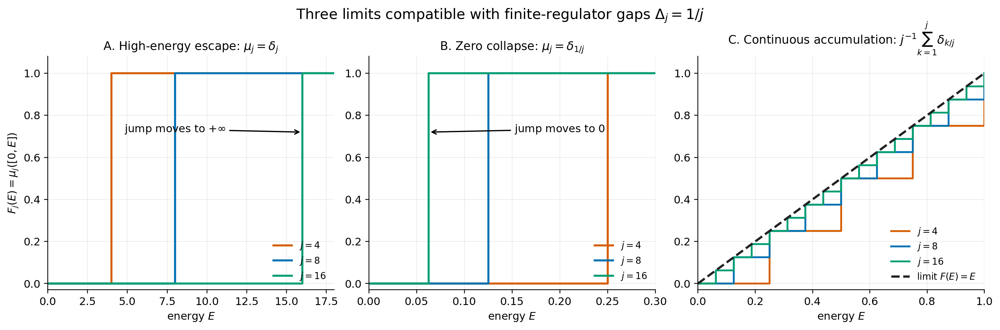

# Locally gapped, globally gapless Yang--Mills limits

## A research program extracted from the current source record

**Status:** research-program document, 2026-09-29.  It contains two proved
spectral propositions, an exact toy realization, a correction to the Claude
assessment, a map of the results already established in the spatial source,
and a sequence of calculations needed to decide whether the mechanism can
occur in a reconstructed Yang--Mills continuum.  It does **not** claim that
four-dimensional Yang--Mills has been constructed or shown to be gapless.

**Audit, 2026-09-30.**  The consistency model and Propositions 1--2 were
rechecked and remain valid at their stated abstract spectral scope.  They do
not turn a comparison measure into a gauge-theory state.  The corrected
classical domain map \(\mathcal M_H\) in
`PROOF.md` also does not meet the entry
conditions here: its first explicit interaction core has nonzero
Yang--Mills source, and no physical projection or continuum reconstruction
has been constructed.

*Figure 1.  Three mathematically different limits can accompany finite gaps
\(\Delta_j=1/j\).  In A, the observed unit mass leaves every bounded energy
interval.  In B, a vacuum-orthogonal unit mass becomes a zero-energy atom.  In
C, the measures converge to a continuous measure with support reaching zero
and with no atom at zero.  Only C has the spectral shape required for a
unique-vacuum, gapless limit.  The reproducible source is
`figures/locally_gapped_spectral_limits.py`.*

## 1. Decision

The direction is well posed after one essential sharpening.  The phrase
"finite gaps close while spectral weight escapes" joins two different
phenomena.  Closing finite gaps is compatible with a gapless continuum.
Escape of a normalized state's spectral mass to arbitrarily high energy is an
obstruction to using that state as a continuum vector.  The desired mechanism
is instead **nonzero continuum spectral weight in every interval
\((0,\varepsilon)\), no extra atom at zero, and a common continuum
reconstruction in which those measures are spectral measures of local
gauge-invariant observables**.

This is a precise construction problem.  If it succeeds for a nontrivial
four-dimensional \(SU(2)\) theory satisfying reconstruction axioms and having
a unique vacuum, it produces a gapless continuum Yang--Mills theory.  A
counterexample claim additionally requires identification with the theory
selected by the Yang--Mills action through a universality or uniqueness
theorem.  That identification is part of the programme goal rather than an
optional classification after the spectral construction.  The research
direction is therefore scientifically sharp and exceptionally
demanding.  The likely failure modes are also mathematically informative:
triviality, a free massless limit, vacuum degeneracy, loss of strong
continuity, path dependence, or failure of the reconstruction axioms.

## 2. The formulation found in Claude's paper

Claude's assessment occurs in `y9a_directions.tex`, lines 5--7, under
"Locally gapped, globally gapless sequences."  It says that the direction is
well posed and identifies the next requirement as a sequence whose limit
satisfies the reconstruction axioms.  The corresponding exact question is
`y9_open.tex`, line 12:

> Can a sequence of the spatial line's kind, in which finite gaps close while
> spectral weight escapes to high energy, be realised along a path whose limit
> satisfies the reconstruction axioms of the continuum problem?

That question is the right starting point, but two corrections are needed.

1. High-energy escape is a negative control, not the desired continuum
   spectral behavior.  The spatial source itself proves that the selected
   normalized magnetic state loses all probability on bounded energies and
   that its positive-time autocorrelation tends to zero while its norm at
   time zero stays one.  Such data do not define a strongly continuous
   Hamiltonian orbit of a nonzero limiting vector.
2. Claude's preceding description says that Section 20 has a
   "unique-vacuum realisation" of the second observable.  The source proves
   the opposite.  Equations (251)--(256), especially lines 4639--4657, give
   \(\nu_{g_j,j}\Rightarrow d\delta_0\),
   \(d=1-2^{-3/2}>0\), for nonzero vacuum-orthogonal vectors.  Any continuum
   realization preserving the centering then has a second zero-energy vector
   and cannot have a unique vacuum.

Claude's verdict survives both corrections.  They make the target more
specific and turn the existing failures into exact tests for every proposed
construction.

## 3. Exact object to be constructed

For each regulator index \(j\), retain the full data

\[
 \mathcal R_j=
 (\Lambda_j,a_j,g_j,\mathcal H_j^{\mathrm{phys}},\mathcal A_j,
  H_j,\psi_j,E_j,\Delta_j),
\]

where

\[
 \Lambda_j=\{-L_j,\ldots,L_j\}^3,\qquad
 A_j=H_j-E_j\ge 0,
\]

and the Hamiltonian is retained in its original normalization,

\[
 H_j=\frac{2g_j^2}{a_j}\sum_e E_e+
     \frac{1}{2g_j^2a_j}\sum_p(2-W_p).
\]

The physical Hilbert space is the gauge-invariant subspace, including gauge
transformations at boundary vertices.  The finite gap is

\[
 \Delta_j=\inf\bigl(\operatorname{spec}(A_j)\setminus\{0\}\bigr)>0.
\]

The existing spatial diagonal uses

\[
 L_j=j^2,\qquad a_j=\frac1{100j},\qquad
 \ell_j=a_j(2L_j+1)=\frac{2j^2+1}{100j}\longrightarrow\infty.
\]

A **locally gapped, globally gapless Yang--Mills limit** consists of these
regulator data together with exact refinement or comparison maps for a common
algebra of bounded, gauge-invariant, physically supported observables and a
reconstructed limit

\[
 (\mathcal H,\mathcal A,\Omega,A),\qquad A\ge0,
\]

with all of the following properties established:

1. every \(A_j\) has a unique vacuum and \(\Delta_j>0\);
2. the finite Euclidean correlation functions converge on the common
   observable algebra, with support, adjoint, gauge action, time ordering,
   and every renormalization factor specified;
3. the limiting correlations satisfy the chosen Osterwalder--Schrader or an
   equally strong reconstruction system, yielding \(\mathcal H\), \(\Omega\),
   and the strongly continuous semigroup \(e^{-tA}\);
4. the limit is nontrivial and interacting, proved by a nonzero local
   variance and at least one connected correlation that is not a Wick
   contraction of a free field;
5. \(\ker A=\mathbb C\Omega\);
6. \(\inf(\operatorname{spec}(A)\cap(0,\infty))=0\).

Items 2--6 prevent a closing finite-volume eigenvalue from being mistaken for
a continuum field theory.

## 4. The concept is mathematically consistent

The following construction proves that "gapped at every finite regulator,
gapless with a unique vacuum in the limit" is not internally contradictory.

For \(j\ge1\), let

\[
 \mathcal K_j=\mathbb C\Omega_j\oplus\mathbb C^j,
 \qquad
 B_j\Omega_j=0,
 \qquad
 B_je_{j,k}=\frac{k}{j}e_{j,k}\quad(1\le k\le j).
\]

Then \(\ker B_j=\mathbb C\Omega_j\) and the finite gap is exactly
\(1/j\).  Put

\[
 v_j=\frac1{\sqrt j}\sum_{k=1}^j e_{j,k}.
\]

Its spectral measure is

\[
 \mu_j=\frac1j\sum_{k=1}^j\delta_{k/j}.
\]

Define

\[
 \mathcal K=\mathbb C\Omega\oplus L^2((0,1),dE),
 \qquad B\Omega=0,\qquad (Bf)(E)=Ef(E),
\]

and define the exact isometry

\[
 I_j\Omega_j=\Omega,
 \qquad
 I_je_{j,k}=\sqrt j\,\mathbf 1_{((k-1)/j,k/j]}.
\]

The images of the \(e_{j,k}\) are orthonormal, \(I_jv_j=\mathbf1_{(0,1)}\),
and on \(I_j\mathcal K_j\)

\[
 \left\|I_jB_jI_j^*-B\right\|\le\frac1j.
\]

Indeed, on the \(k\)-th interval the two multiplication functions are
\(k/j\) and \(E\), whose difference lies in \([0,1/j]\).  Hence the
spectral measures converge by the Riemann-sum identity

\[
 \int f\,d\mu_j=\frac1j\sum_{k=1}^j f(k/j)
 \longrightarrow\int_0^1 f(E)\,dE
\]

for every continuous \(f\) on \([0,1]\).  Multiplication by \(E\) has no
nonzero \(L^2\) vector supported at the measure-zero set \(\{0\}\), so

\[
 \ker B=\mathbb C\Omega,
 \qquad \operatorname{spec}(B)=\{0\}\cup[0,1],
 \qquad \inf(\operatorname{spec}(B)\cap(0,\infty))=0.
\]

This exact morphism proves logical consistency.  It contains no gauge fields,
locality, or interaction, so it supplies a model for the spectral mechanism
and nothing more.

## 5. Two proved spectral criteria

### Proposition 1: a continuum spectral detector

Let \(A\ge0\) be self-adjoint on \(\mathcal H\), let
\(\ker A=\mathbb C\Omega\), and let \(v\perp\Omega\) be nonzero.  Write
\(\mu_v(S)=\langle v,\mathbf1_S(A)v\rangle\).  If

\[
 \mu_v((0,\varepsilon))>0\qquad\text{for every }\varepsilon>0,
\]

then \(A\) has no positive spectral gap.

**Proof.**  If a gap \(m>0\) existed, the spectral projection
\(\mathbf1_{(0,m)}(A)\) would vanish.  This would give
\(\mu_v((0,m))=0\), contrary to the stated property.  The condition
\(v\perp\Omega\) and the identity \(\ker A=\mathbb C\Omega\) also give
\(\mu_v(\{0\})=0\).  Thus the measure reaches arbitrarily low positive
energy without producing a second vacuum.  \(\square\)

### Proposition 2: the positive-time form needed for distributional fields

Let \(\nu\) be a nonzero, locally finite positive measure on
\([0,\infty)\) such that

\[
 C(t)=\int_0^\infty e^{-tE}\,d\nu(E)<\infty
 \qquad(t>0).
\]

For any \(s>0\), the finite measure
\(d\mu_s(E)=e^{-sE}d\nu(E)\) has exactly the same support as \(\nu\).
If \(\nu(\{0\})=0\) and \(\nu((0,\varepsilon))>0\) for every
\(\varepsilon>0\), then every positive-time vector represented by
\(\mu_s\) detects gaplessness by Proposition 1.  Moreover,

\[
 \lim_{t\to\infty}-\frac1t\log C(t)=0.
\]

**Proof.**  The multiplier \(e^{-sE}\) is strictly positive at every
finite \(E\), so it neither removes nor adds support.  For the decay rate,
fix \(\varepsilon>0\).  Positivity on \((0,\varepsilon)\) gives

\[
 C(t)\ge e^{-t\varepsilon}\nu((0,\varepsilon)).
\]

Consequently

\[
 \limsup_{t\to\infty}-t^{-1}\log C(t)\le\varepsilon.
\]

The expression has nonnegative limit inferior because \(C(t)\le C(s)\)
for \(t\ge s>0\), and the constant \(C(s)\) disappears after division by
\(t\).  Sending \(\varepsilon\downarrow0\) proves the limit.  \(\square\)

Proposition 2 is important for the directional-electric source.  Its raw
time-zero norm diverges, but its positive-time spectral measures are finite.
Ultraviolet divergence of a field at a sharp time does not by itself remove
the low-energy support.  What remains to be proved is that these positive-time
vectors belong to one reconstructed interacting Yang--Mills Hilbert space.

## 6. Three obstruction spaces

Every obstruction defines a precise space of regulator sequences.

### 6.1 High-energy escape space \(\mathfrak E_\infty\)

A normalized sequence \(v_j\perp\psi_j\) belongs to
\(\mathfrak E_\infty\) when

\[
 \mu_{v_j}([0,R])\longrightarrow0
 \qquad\text{for every }R<\infty.
\]

Then
\(\langle v_j,e^{-tA_j}v_j\rangle\to0\) for every fixed \(t>0\), while
the value at \(t=0\) remains one.  Any proposed nonzero vector limit with
these correlations violates strong continuity at zero.  Sections 18 and 26
provide Yang--Mills examples of this type.

### 6.2 Zero-collapse space \(\mathfrak E_0\)

A centered sequence belongs to \(\mathfrak E_0\) when its nonzero raw mass
converges to \(d\delta_0\), \(d>0\).  If centering and norm survive, the
limit contains a nonzero vector orthogonal to the vacuum in \(\ker A\).
Section 20 and the radial vacuum image in Section 22 provide exact examples.

### 6.3 Continuous-accumulation space \(\mathfrak E_{\mathrm{cont}}\)

The desired spectral sequences have a common continuum interpretation and a
locally finite limiting measure \(\nu\) satisfying

\[
 \nu(\{0\})=0,
 \qquad
 0<\nu((0,\varepsilon))<\infty
 \quad(\varepsilon>0),
 \qquad
 \int e^{-tE}\,d\nu(E)<\infty
 \quad(t>0).
\]

These conditions distinguish continuous infrared accumulation from both
escape and vacuum degeneracy.  They are spectral conditions; the common
observable algebra and reconstruction work is what turns them into a field
theory.

## 7. What is already available in the Yang--Mills source

The current spatial manuscript supplies much more than the phrase "closing
gaps."  The following table records the exact role of each family.

| Source object | Established behavior | Role in this program |
|---|---|---|
| Weighted electric covariance \(\Gamma=\sum_{e=(n,1)}n_2^2E_e\), Sections 17--18 and 25 | Fixed-box oscillator transfer; exact raw measure; on \(L_j=j^2\), \(a_j=(100j)^{-1}\), bounded-energy probability has order \(j^{-5}\); selected actual sequence and native magnetic transfer are proved | Negative control for normalized probabilities; source of exact raw finite-energy scaling |
| Bounded low-mode observable, Section 20 | \(\nu_{g_j,j}\Rightarrow (1-2^{-3/2})\delta_0\) on a separately selected sequence | Exact test for vacuum degeneracy |
| Radial family, Sections 22--23 | Raw mass occurs in every \((0,\varepsilon)\), but the centered vacuum image produces a nonzero zero-energy limit; an exact finite-band correspondence to local curvature profiles is proved with leakage retained | Bridge between phase directions and local profiles; zero-collapse control |
| Direction-one electric family, Section 24 | For nonzero compact smooth \(h\), the exact density \(\rho_h^E(\omega)\) is positive for every \(\omega>0\), has no zero atom, and has finite positive-time Laplace transforms; actual selected positive couplings give vague raw convergence on bounded energies | Strongest present seed for \(\mathfrak E_{\mathrm{cont}}\) |
| Original noncompact weighted trace, Section 25 | \(a^2\ell^{-7}m_{L,a}^\Gamma\to \omega^4(102400\pi^2)^{-1}d\omega\) locally; total mass and finite-energy fraction are computed; transfer is on a selected coupling and strengthened cusp | Exact macroscopic scaling benchmark |
| Original finite-angle native state, Section 26 | Low-energy probability is smaller than every power of the selected positive coupling; the original-depth selected sequence has maximal spectral separation | Negative control for finite-angle native continuation |

The key positive density is equation (381):

\[
 \rho^E_h(\omega)=\frac1{2560\pi^5}
 \int_{|k|<\omega}|\widehat h(k)|^2
 \left[(\omega^2-|k|^2)^2+
       (\omega^2-|k|^2)(|k|^2-k_1^2)+
       (|k|^2-k_1^2)^2\right]dk.
\]

For every nonzero \(h\in C_c^\infty(\mathbb R^3;\mathbb R)\), the source
proves

\[
 \rho_h^E(\omega)>0\quad(\omega>0),
 \qquad \nu_h^E(\{0\})=0,
 \qquad \nu_h^E((0,\varepsilon))>0\quad(\varepsilon>0).
\]

Near zero, if \(m\) is the first nonzero homogeneous Taylor degree of
\(\widehat h\), equation (392) gives

\[
 \rho_h^E(\omega)=A^E_{h,m}\omega^{7+2m}
                  +O_h(\omega^{8+2m}),
 \qquad A^E_{h,m}>0.
\]

This already has the required infrared shape.  Its present common Hilbert
representation is the explicitly free transverse two-particle
multiplication representation of Section 24.6.  The source expressly does
not identify it with the full interacting continuum theory or establish the
products of several local observables.  Those are the central missing maps.

## 8. The research program

### Work package A: freeze the directed regulator category

Retain the exact finite Hamiltonians and construct explicit refinement maps
between physically supported gauge-invariant observable algebras.  For a
bounded physical region \(O\subset\mathbb R^3\), define
\(\mathcal A_j(O)\) from Wilson loops, electric-energy insertions, and bounded
functional calculus of those operators whose lattice support lies in \(O\).
For \(j<k\), construct

\[
 \iota_{j,k,O}:\mathcal A_j(O)\longrightarrow\mathcal A_k(O^{+r_{j,k}})
\]

with the support enlargement \(r_{j,k}\) stated exactly and tending to zero.
Prove compatibility with adjoints, gauge invariance, disjoint supports, and
composition.  Record the exact defect when strict composition fails; that
defect defines the corresponding enlarged observable space.

The output is a common local algebra on which correlation convergence has a
meaning independent of changing Hilbert-space dimension.

### Work package B: replace selected diagonals by prescribed trajectories

The source selects \(g_j\) after asking that finitely many stage-\(j\) tests
hold.  This proves existence of useful diagonals but does not define a
renormalization trajectory.  Carry both stated trajectories until one is
excluded by proof:

\[
 g_j^2=\frac1{\log j},
 \qquad
 g_j^2=\frac{\kappa_*}{200j}.
\]

Also formulate a step-scaling trajectory by fixing one gauge-invariant
finite-volume observable at a reference physical scale.  The observable, its
boundary conditions, and the equation determining \(g_j\) must be exact.
Prove existence and uniqueness of the chosen bare coupling at each stage,
then compare that trajectory with the two displayed paths.

The first concrete estimate should concern the Section 24 positive-time
covariances.  For compact profiles \(h,k\) and \(t\ge t_0>0\), derive a
growing-volume bound for

\[
 \left|C^E_{g_j;h,k}(t)-C^{E,L_j,a_j}_{0;h,k}(t)\right|.
\]

The fixed-box convergence used to select dyadics is insufficient.  The needed
bound must display its dependence on \(L_j,a_j,g_j,t_0\) and the exact
seminorms of \(h,k\).  Positive-time damping is retained because it controls
the ultraviolet mass without altering the infrared support.

### Work package C: multiscale control of the actual vacuum

The strong-coupling local expansion does not persist automatically toward
\(g_j\downarrow0\).  Use the exact ground-state transform together with the
blocking maps to prove scale-dependent bounds for actual-vacuum connected
correlations.  The required estimates include:

\[
 \left|\langle X_1\cdots X_n\rangle_{\psi_j}^{\mathrm{conn}}\right|
\]

for bounded gauge-invariant operators with specified supports and, separately,
the weighted fourth and sixth moments entering the exact finite-angle
remainder.

The source isolates the latter obstruction in equations (P1)--(P6).  Its
exact relative remainder is bounded by

\[
 \frac13\theta_j^2
 \frac{\|\Gamma^2\psi_j\|}{\|v_{\Gamma,j}\|},
\]

and the available estimate grows like \(j^4g_j^{-2}\).  What would close the
calculation is control of the **centered** fourth and sixth fluctuations at
their natural covariance scale, rather than control by the full
\(\|\Gamma^2\psi_j\|\).  In the comparison scaling

\[
 g_j^4\|v_{\Gamma,j}\|^2\asymp L_j^7,
\]

a centered fourth-order norm of order \(g_j^{-4}L_j^7\) would make the
relative fourth-order contribution scale as

\[
 \theta_j^2g_j^{-2}L_j^{7/2}.
\]

With \(L_j=j^2\) and \(\theta_j\asymp j^{-6}\), this is
\(j^{-5}g_j^{-2}\), hence \(j^{-5}\log j\) on the logarithmic path and a
constant multiple of \(j^{-4}\) on the fixed-electric-coefficient path.
This calculation identifies the exact gain required from a connected-moment
theorem.  It does not assert that the theorem already holds.

The directional-electric route should be pursued first because it avoids
expanding the finite-angle magnetic operator and already has an exact positive
infrared density.  The finite-angle route remains an independent comparison
and universality test.

### Work package D: construct Euclidean correlation limits

For ordered Euclidean times \(t_1\le\cdots\le t_n\) and bounded members of
the common algebra, retain the exact finite-regulator functions

\[
 S_j(O_1,t_1;\ldots;O_n,t_n)=
 \left\langle\psi_j,
 O_1e^{-(t_2-t_1)A_j}O_2\cdots
 e^{-(t_n-t_{n-1})A_j}O_n\psi_j\right\rangle.
\]

Establish convergence jointly in insertion times and spatial translations on
a countable dense test algebra, then extend by the proved bounds.  Keep the
renormalization factor of every unbounded or distributional field explicit.
For the Section 24 field, use positive-time insertions first; its raw norm is
known to diverge.

The limit must retain:

- Euclidean-time translation and reflection;
- spatial translation and the restoration of rotations, including rotation
  of the preferred direction-one axis used in the source calculation;
- reflection positivity;
- symmetry under permutation of spacelike-separated gauge-invariant
  insertions;
- the regularity needed for reconstruction;
- clustering in the vacuum sector;
- projective consistency as the physical box grows.

Reflection positivity at each regulator is useful only after the observable
maps and limiting topology are fixed.  Prove that the positivity cone is
closed in that topology.

### Work package E: reconstruct and prove uniqueness

Apply the chosen reconstruction theorem to the completed limiting Schwinger
functional.  Construct the Hilbert space as the quotient by its exact null
space, prove strong continuity of time translations, and identify their
nonnegative generator \(A\).

Prove vacuum uniqueness from a cluster theorem on the completed local
algebra.  Test every candidate field against the zero-collapse criterion:
any nonzero centered vector with constant positive-time autocorrelation must
be exhibited as a second kernel vector and excludes that branch.

Nontriviality requires a gauge-invariant local observable with strictly
positive limiting variance.  Interaction requires more: calculate a
connected four-point function and prove that it differs from the sum of Wick
pairings.  Without this step, the Section 24 representation may describe only
a free transverse massless sector.

### Work package F: transport the infrared density into the reconstructed theory

For a fixed nonzero \(h\in C_c^\infty(\mathbb R^3;\mathbb R)\), construct
the reconstructed positive-time vector \(v_{h,s}\) whose finite-regulator
spectral measures are

\[
 d\mu_{j,h,s}(E)=e^{-sE}\,d\nu^E_{j,h}(E).
\]

Prove convergence against every compactly supported continuous energy test
and identify

\[
 d\mu_{h,s}(E)=e^{-sE}\rho_h^E(E)\,dE
\]

or compute the exact interacting replacement.  Then prove

\[
 \mu_{h,s}(\{0\})=0,
 \qquad
 \mu_{h,s}((0,\varepsilon))>0
 \quad(\varepsilon>0).
\]

Proposition 1 then proves gaplessness in the reconstructed Hilbert space.
If interaction changes the density, the program needs only the two displayed
support properties, but every changed coefficient and threshold must be
derived.

### Work package G: determine the role of the \(S^6\) period data

The current bridge uses the full regular-fibre expression

\[
 D=L_Tq_T+6m_T^2>0,
 \qquad \theta=\frac{2\pi a^2}{D},
\]

to define a magnetic background.  Keep \(D\) explicit.  Run the continuum
construction for two distinct admissible period data and compare all local
gauge-invariant Schwinger functions.

There are two mathematically distinct outcomes:

1. the limits agree, in which case the period data select regulator
   representatives but disappear from local continuum observables;
2. the limits differ, in which case construct the exact map from period data
   to superselection or background sectors and prove the reconstruction
   axioms in each sector.

The proposed higher-dimensional or Leech-lattice extension begins only after
this dichotomy is decided.  It is not needed to establish the core spectral
mechanism.

### Work package H: universality and comparison of paths

Repeat the reconstructed local correlations and infrared spectral measure on
the prescribed paths that survive Work package B.  Construct an isomorphism
of the resulting local nets, vacua, and time-translation generators.  If an
exact invariant distinguishes the limits, record it as the definition of the
remaining comparison space and continue by constructing the morphism needed
to identify the intended Yang--Mills theory.  Matching only a gap sequence is
insufficient; the comparison must include products of local observables and
the interaction witness.

## 9. Milestones and dependency order

1. **R1 -- Exact regulator morphisms.**  Complete Work package A and verify
   the maps on Wilson loops, electric energies, and the Section 24 profiles.
2. **R2 -- Prescribed-path two-point estimate.**  Prove the growing-volume
   positive-time bound in Work package B on at least one prescribed path.
3. **R3 -- Multiscale vacuum bounds.**  Establish the connected local bounds
   needed for all \(n\)-point functions; separately settle the centered
   fourth/sixth-moment estimate for the native magnetic route.
4. **R4 -- Limiting Schwinger functional.**  Construct all mixed local
   correlations on a dense algebra and prove reflection positivity,
   regularity, Euclidean covariance, and clustering.
5. **R5 -- Reconstruction.**  Build \((\mathcal H,\mathcal A,\Omega,A)\),
   prove \(\ker A=\mathbb C\Omega\), and prove nontriviality.
6. **R6 -- Interaction witness.**  Prove a nonzero connected local
   correlation beyond Wick pairings.
7. **R7 -- Infrared transport.**  Identify the spectral measure of one
   reconstructed local positive-time vector and prove that it has positive
   mass in every \((0,\varepsilon)\) and no atom at zero.
8. **R8 -- Gaplessness conclusion.**  Apply Proposition 1 only after R4--R7
   are complete.
9. **R9 -- Period and path comparison.**  Decide whether \(D\) and the
   prescribed bare-coupling path disappear, label sectors, or produce
   inequivalent limits.

R2 is the next calculation.  It attacks the strongest existing candidate
measure without waiting for the harder native finite-angle moment problem.

## 10. Exact failure certificates

Each unsuccessful branch must end with one of the following proved records,
not with an informal statement that the limit "does not work."

- **Escape certificate:** a compact-energy probability tends to zero and the
  time-zero/positive-time correlation discontinuity is shown.
- **Zero-collapse certificate:** a centered nonzero vector converges to an
  atom at zero, producing a second kernel vector.
- **Triviality certificate:** every bounded gauge-invariant local observable
  acts by a scalar in the limiting vacuum sector.
- **Free-limit certificate:** all connected correlations above order two
  vanish and the two-point function identifies the free transverse
  representation.
- **Axiom certificate:** name the failed reconstruction property and exhibit
  the exact test functions for which it fails.
- **Path certificate:** two prescribed trajectories give different local
  correlation invariants.
- **Gauge certificate:** the proposed observable or comparison map fails to
  preserve the physical gauge-invariant space.

These spaces of failed limits remain mathematical outputs and guide the next
construction.

## 11. Underclaims, overclaims, and propagation

| ID | Finding | Correction or strengthening | Propagation |
|---|---|---|---|
| LGGG-20260929-001 | Claude calls the direction well posed | Agreed after separating high-energy escape from continuous infrared accumulation | Definition in Sections 3 and 6; milestones R4--R8 |
| LGGG-20260929-002 | Claude describes a unique-vacuum realization in Section 20 | Overclaim: the source proves a second zero-energy vector if centering survives | Exclusion test in Work package E and failure certificates |
| LGGG-20260929-003 | Claude emphasizes escape as the distinguishing phenomenon | Strengthening: Section 24 already proves an exact locally finite density with positive mass in every positive interval and no zero atom | Directional-electric route becomes the first positive candidate |
| LGGG-20260929-004 | The spatial source treats diverging unfiltered mass as part of its limit analysis | Proposition 2 shows that finite positive-time measures preserve the full infrared support; divergence at sharp time is compatible with a distributional field | Work packages D and F |
| LGGG-20260929-005 | Selected dyadic couplings establish many simultaneous tests | They do not define a prescribed renormalization trajectory | Work package B and universality milestone R9 |
| LGGG-20260929-006 | The \(S^6\) number \(D\) drives the magnetic background | The abstract spectral mechanism does not require \(D\); its continuum role must be proved by a two-background comparison | Work package G |

## 12. Source witnesses and reading scope

1. **Claude assessment.**
   `sources/claude/y9a_directions.tex`,
   SHA-256
   `2a1a53ad2245a2ead619b038efd55eca7de1b7a8e48eb08d22ad0df6737fc8eb`,
   whole file read; exact locator lines 5--7.
2. **Claude open question.**
   `sources/claude/y9_open.tex`,
   SHA-256
   `a21350081133a66ea6e0c0720848c50831a893a29f2777dc0ec66dfba46985c0`,
   whole file read; exact locator line 12.
3. **Spatial source.**
   `sources/spatial/spatial_continuum.tex`,
   SHA-256
   `e035407b59854b77307ad1bb0021a4f834aa13231ca6028f2b8de5409ab5aba4`.
   Passages used here: Sections 17--18; equations (251)--(256); Sections
   22--26; equations (378)--(417), (418)--(448), (P1)--(P6); and the
   conclusion in Section 28.  This reading does not certify every other
   theorem in the 8,991-line manuscript.
4. **Official problem target.**  The
   [Clay Mathematics Institute problem page](https://www.claymath.org/millennium/yang-mills-the-maths-gap/),
   checked on 30 September 2026, identifies the problem as unsolved and links
   the official problem description by Arthur Jaffe and Edward Witten.  That
   official description requires a nontrivial quantum Yang--Mills theory on
   \(\mathbb R^4\) for every compact simple gauge group, a positive mass gap,
   and axiomatic properties at least as strong as the cited systems.  No
   author TeX source is offered there; the HTML page and its linked official
   description are therefore recorded as the accessible primary statement.
   The programme's reconstruction and theory-identification requirements are
   tied to this target.

## 13. Completion condition

The program is complete only when one prescribed regulator trajectory has a
common gauge-invariant local observable algebra, convergent Euclidean
correlations satisfying the reconstruction axioms, a nontrivial interacting
reconstructed theory with a unique vacuum, and a reconstructed local
positive-time vector whose spectral measure has no zero atom and positive
mass in every \((0,\varepsilon)\).  It must also prove the universality or
identification theorem connecting that reconstruction to the
four-dimensional Yang--Mills theory in the mass-gap statement and derive the
contradiction.  Closing finite gaps, selected-diagonal convergence, a
spectral density living only in the free comparison space, or an unidentified
gapless branch does not meet this condition.

## Higher carrier and source evolution — proved continuation

The complete derivation is in [HIGHER_CARRIER_AND_EVOLUTION.md](HIGHER_CARRIER_AND_EVOLUTION.md).
Its Theorem 2.1 constructs the exact map \(r_H:X\to D=F_4/\rho(\operatorname{Sp}(1))\),
with \(r_H^*(F_4\to D)\cong P_H\), \(\pi r_H\) constant, and
\(E_D\cong\pi^*T(F_4/\operatorname{Spin}(8))\). The dimensions are
\(\dim D=49\), \(\dim(F_4/\operatorname{Spin}(8))=24\), and fibre dimension 25.
The profile map extends to \(E_D\); its pullback is exactly \(\mathcal M_H\).
Section 4 supplies a full parameter-space connection and retains its mixed curvature.

For the original compactly supported profile \(C=\mathcal M_H(v)\), the source
\(S_j=\sum_iD_iF_{ij}(C)\) is a permitted initial acceleration with zero
initial electric field. Proposition 6.1 proves that \(A=C+s^2S/2\) preserves
Gauss's law exactly, retains the support, and has the complete residual
\(s^2L/2+s^4Q/4+s^6N/8\). Theorem 7.1 constructs the exact source-free
homogeneous core evolution for every input and every initial rank stratum.
For the equal-colour core, \(f''+8f^3=0\) has
\(f'^2+4f^4=4\) and physical energy density \(24/g^2\).

The homogeneous solution has finite energy on each stated spatial torus and
infinite total energy on \(\mathbb R^3\) when it is nontrivial. The original
cutoff boundary still requires the full PDE correction. Proposition 9.1 proves
that a nonzero-curvature compactly supported correction cannot remain static.
At this earlier checkpoint the next calculation retained time evolution, the support boundary,
and the full soft-period data. The quantum-state and reconstruction goal remains active.

## Global compact-support Cauchy continuation

The complete proof is [COMPACT_SUPPORT_CAUCHY_EVOLUTION.md](COMPACT_SUPPORT_CAUCHY_EVOLUTION.md).
Theorem 2.1 applies Oh's established global theorem to the original cutoff
data with zero electric field, checking every hypothesis and the metric,
trace, coupling and time conventions. Proposition 3.1 gives the support
bound \(R+|s|\), and Corollary 3.2 proves exact agreement with the
homogeneous solution on \(|x|+|s|<r\). The gauge-invariant core witness
in CE17 is at least 128, including at magnetic zeros.

Proposition 4.1 identifies the energy-zero inputs exactly with the original
rank-12 subbundle. CE22 retains all cutoff energy terms. Sections 5–6 prove
smooth parameter dependence, exact solution-map ranks and fibres, bundle
descent and every mixed curvature component. CE38–CE45 retain dilation,
support, energy and the ordered gauge-equivariant link-holonomy map.

The classical finite-energy Cauchy step is now supplied. The complete
period and monodromy coupling, physical gauge projection, actual Gram and
Hamiltonian kernels, quantum spectrum and continuum reconstruction remain
active. Classical energies tending to zero are not quantum spectral weight.

## Finite physical-state continuation, 8 October 2026

The [complete period and physical-kernel proof](https://github.com/KokunoYumeto/yang-mills-interacting-workbench/blob/main/yang-mills/continuations/20260930-s6-ns-moment-map-bridge/PERIOD_COUPLING_AND_PHYSICAL_KERNELS.md) now supplies the
full angular pullback, exact physical gauge projection, actual Gram and
Hamiltonian kernels, and a nonzero vector orthogonal to the interacting
finite-lattice vacuum. Equations PK43–PK43g correct the joint path while
retaining the same coupling and every original cutoff energy term.

Theorem 9.1 identifies the complete first electric layer. Equations PK47–PK49
strengthen the raw norm using all faces in both reflected core cubes.
Equations PK50–PK54 retain the full magnetic operator, calculate its first
compression and the exact complementary resolvent return. The continuum
spectral measure, reconstruction and theory identification remain the active
calculation; decreasing classical energy does not settle them.

## Complete complementary moment, 9 October 2026

The [full complementary calculation](https://github.com/KokunoYumeto/yang-mills-interacting-workbench/blob/main/yang-mills/continuations/20260930-s6-ns-moment-map-bridge/PERIOD_COUPLING_AND_PHYSICAL_KERNELS.md) evaluates the second
electric moment and fourth magnetic compression, including every six-face
cube term. Theorem 9.2 and PK55–PK62 give the original C*B^2C, the nonzero
next map, its complete Gram and bounds, an exact second return, and a stronger
finite-volume upper resolvent bound. The vacuum shift, both coupling factors,
all face labels and boundary counts remain explicit. The next calculation is
the full second-complement return and actual heat-packet coefficients; the
continuum endpoint remains active.

## Full packet and complete cutoff, 9 October 2026

The [full packet calculation](https://github.com/KokunoYumeto/yang-mills-interacting-workbench/blob/main/yang-mills/continuations/20260930-s6-ns-moment-map-bridge/PERIOD_COUPLING_AND_PHYSICAL_KERNELS.md) gives both exact complementary
returns for the actual heat packet, with every cross term. PK65–PK75
give a finite electric cutoff, a proved interval for the actual vacuum
energy, and an explicit error for the full raw spectral transform.
The cutoff is specified on the original regulator path with error at most
Gamma_j/(kappa_* j). PK76–PK78 evaluate the whole first cutoff and the
original smallest-box example. A positive lower spectral mass and the
interacting continuum state remain active research calculations.

## Actual packet moments and spectral escape, 9 October 2026

The [complete PK79–PK100 calculation](https://github.com/KokunoYumeto/yang-mills-interacting-workbench/blob/main/yang-mills/continuations/20260930-s6-ns-moment-map-bridge/PERIOD_COUPLING_AND_PHYSICAL_KERNELS.md) evaluates the actual
first and second interacting moment kernels, with every shared-link
contraction and vacuum-shift term. A sharper variational vacuum bound
and an original-graph Haar estimate prove that the fixed-heat packet
loses its spectral-weight fraction even below the expanding threshold
kappa_* j. Its accurate finite cutoff is not the reason the low-mass
test failed: the actual fraction tends to zero.

The next state map is constructed using the full interacting semigroup.
Its raw norms, decreasing relative energy and preserved spectral support
are proved. The scale of its supported bottom and the required continuum
construction remain active research. This result concerns the specified
packet family; it does not settle the spectrum of other states.

## Actual odd vacuum observable, 9 October 2026

The [complete PK101–PK131 proof](https://github.com/KokunoYumeto/yang-mills-interacting-workbench/blob/main/yang-mills/continuations/20260930-s6-ns-moment-map-bridge/PERIOD_COUPLING_AND_PHYSICAL_KERNELS.md) constructs a bounded
smooth reflection-odd observable on the actual interacting vacuum.
At each fixed box its raw first-cluster weight tends to 3/32, and its
supported bottom is the actual lowest odd excitation. All limiting
raw spectral weights and the Euclidean-time correlation are evaluated.
The entire higher-carrier total space receives a global smooth map
through its three selected quaternionic squared norms, with the exact
original zero subbundle and parameter-dependent weights retained.

The original simultaneous path still needs estimates for its actual
odd energy and raw weights. The full continuum construction remains
the research target. The earlier vacuum upper bound is now linked
to its retained spatial-continuum proof with an exact parameter map.

## Joint-path raw mass and global replacement, 9 October 2026

The [complete PK132–PK157 proof](https://github.com/KokunoYumeto/yang-mills-interacting-workbench/blob/main/yang-mills/continuations/20260930-s6-ns-moment-map-bridge/PERIOD_COUPLING_AND_PHYSICAL_KERNELS.md) settles the original
chart-supported odd observable's raw mass as zero along the prescribed
joint path. The result uses the actual vacuum and retains the complete
Haar dimension, graph counts and coupling factors. It extends to a
precisely defined class of growing chart supports.

A global smooth group-coordinate observable is then constructed. It is
nonzero at every finite regulator, retains the full higher-carrier domain
with its exact original zero subbundle, and has the earlier fixed-box
spectral limit. Complete ordered word derivatives and actual-vacuum
moments are calculated. Its joint-path mass and energy remain the next
estimates; the full interacting continuum endpoint is still the target.

## Global fourth moment and energy estimates, 9 October 2026

The [complete PK158–PK177 proof](https://github.com/KokunoYumeto/yang-mills-interacting-workbench/blob/main/yang-mills/continuations/20260930-s6-ns-moment-map-bridge/PERIOD_COUPLING_AND_PHYSICAL_KERNELS.md) evaluates the original
chord Gram matrix and full Haar fourth moment, and gives the exact
four-loop formula in the actual vacuum. The original raw norm is bounded
by the actual fourth moment times the squared phase. On the unchanged
path, retaining positive limiting raw weight requires growth on at least
the j^6 scale. Actual first and second energy-moment bounds retain every
word occurrence, coupling, colour and boundary contribution. Calculating
the actual four-loop growth and closing odd energy remains active work
towards the full interacting continuum state.

## Actual phase limits and variational space, 9 October 2026

The [complete PK177a–PK206 proof](https://github.com/KokunoYumeto/yang-mills-interacting-workbench/blob/main/yang-mills/continuations/20260930-s6-ns-moment-map-bridge/PERIOD_COUPLING_AND_PHYSICAL_KERNELS.md) evaluates every original
chord-face weight and the resulting actual fourth-moment bound. An exact
two-link configuration identifies the nonlinear reflection defect.
At each finite regulator the actual large-amplitude raw mass tends to
1/4, while the opposite iterated weak-coupling limit is 1/2. The actual
energy moments and high-energy escape are proved, including an amplitude
sequence on the unchanged regulator path.

The next state space is constructed through the actual joint phase
measure. Its exact physical isometry, closed energy form, full residual
interaction and convergent finite variational matrices retain the
original vacuum and all mixed terms. Their actual low-energy path
estimates are the next calculation toward the full continuum endpoint.

The same phase construction now has [proved full rank, an actual phase density, positive finite matrices and a complete distributional boundary identity](https://github.com/KokunoYumeto/yang-mills-interacting-workbench/blob/main/yang-mills/continuations/20260930-s6-ns-moment-map-bridge/PERIOD_COUPLING_AND_PHYSICAL_KERNELS.md). These are exact finite-regulator results; their original-path coefficients remain to calculate.

## Actual vacuum and certified phase matrices, 9 October 2026

The [complete PK207–PK227 proof](https://github.com/KokunoYumeto/yang-mills-interacting-workbench/blob/main/yang-mills/continuations/20260930-s6-ns-moment-map-bridge/PERIOD_COUPLING_AND_PHYSICAL_KERNELS.md) bounds the actual vacuum mass
below an electric cutoff proportional to the full face count and proves
its vanishing on the original path. It retains the full vacuum energy
and derives an explicit lower bound for that energy.

Complete vacuum-cutoff comparisons now give finite original-word
enclosures for the actual Gram, energy and second-moment matrices,
including their full Hamiltonian residual. An explicit cutoff controls
all three matrix errors on the unchanged path. The certified raw
low-energy expression is now the next calculation toward the interacting
continuum endpoint; positivity in a shrinking window is not assumed.

## Phase moments and central link symmetry, 11 October 2026

The [new continuation](https://github.com/KokunoYumeto/yang-mills-interacting-workbench/blob/main/yang-mills/continuations/20261011-central-signs-shrinking-window/README.md) proves exact original-word bounds for the
shrinking-window expression and controls every polynomial phase multiplier
at fixed box. Its original first polynomial has raw limiting norm squared
12 and first odd-cluster weight 12. The complete Gram and energy limits
retain their rank degeneration and volume-dependent tail constants.

An exact central-link involution also settles the third and every higher
odd Jacobian return, with full complementary-inverse and even-tail bounds.
The boundary proof classifies all admissible open and periodic central
sign maps, including winding signs and the full Hamiltonian scalar.
The actual growing-box low-energy weight and interacting continuum
endpoint remain the continuing research calculation.

The [complete phase spectral weights](https://github.com/KokunoYumeto/yang-mills-interacting-workbench/blob/main/yang-mills/continuations/20261011-central-signs-shrinking-window/PHASE_SPECTRAL_WEIGHTS.md) now evaluate every fixed-box polynomial cluster and the exact radial direction outside the earlier phase compression (SP1–SP16). The original raw states and full vacuum factors are retained; the joint-path estimate remains the next spectral calculation.

The [exact boundary reflection and two-link harmonic](https://github.com/KokunoYumeto/yang-mills-interacting-workbench/blob/main/yang-mills/continuations/20261011-central-signs-shrinking-window/BOUNDARY_REFLECTION_AND_RAW_ENDPOINT.md) now give actual-vacuum raw mass and energy bounds on the unchanged regulator path, with exponential loss of order j². The [complete fourth Jacobian coefficient](https://github.com/KokunoYumeto/yang-mills-interacting-workbench/blob/main/yang-mills/continuations/20261011-central-signs-shrinking-window/fourth_return/FOURTH_SCHUR_COEFFICIENT.md) includes its boundary skew matrix, full degree-six remainder and exact map to physical susceptibility. Positive spectral mass in the shrinking window and the interacting continuum endpoint remain the active targets.

The [global finite-source continuation](https://github.com/KokunoYumeto/yang-mills-interacting-workbench/blob/main/yang-mills/continuations/20261011-central-signs-shrinking-window/GLOBAL_PHYSICAL_RESPONSE.md) proves the exact physical and original assembly-quotient inverses at every finite real source, strict physical susceptibility, and the global Wilson expectation coordinates. Its unchanged-path inverse susceptibility bound is O(j⁴⁰), with all constants and domains retained. The low-window spectral measure and continuum reconstruction remain active calculations.

The [polynomial conditional comparison](https://github.com/KokunoYumeto/yang-mills-interacting-workbench/blob/main/yang-mills/continuations/20261011-central-signs-shrinking-window/POLYNOMIAL_CONDITIONAL_BOUNDS.md) replaces the prior exponential density loss by explicit polynomial bounds and proves the exact larger receiving-link coefficient inside the unchanged phase. Its complete raw-mass, energy and endpoint formulas retain every affine remainder and physical factor. They sharpen the finite-path estimates while leaving the actual shrinking-window cancellation as the next spectral calculation.

The [complete union-labelled inverse](https://github.com/KokunoYumeto/yang-mills-interacting-workbench/blob/main/yang-mills/continuations/20261011-central-signs-shrinking-window/union_label_global/FULL_UNION_LABEL_INVERSE.md) is now proved at all finite real sources, including every assembly relation direction and every vacuum scalar. Its [connected-support consequences](https://github.com/KokunoYumeto/yang-mills-interacting-workbench/blob/main/yang-mills/continuations/20261011-central-signs-shrinking-window/SUPPORT_AND_SCALAR_FACTORIZATION.md) prove exact factorization and strengthen the original transformation constants. These results complete a finite-source inverse step; quantitative connected-coefficient decay and the physical shrinking-window spectral calculation remain active.

The [full cap and boundary calculation](https://github.com/KokunoYumeto/yang-mills-interacting-workbench/blob/main/yang-mills/continuations/20261011-central-signs-shrinking-window/POLYNOMIAL_SCORE_AND_ORIGINAL_ENDPOINT.md) and [complete gradient/bulk calculation](https://github.com/KokunoYumeto/yang-mills-interacting-workbench/blob/main/yang-mills/continuations/20261011-central-signs-shrinking-window/POLYNOMIAL_GRADIENT_BOUNDS.md) now give explicit optimal score exponents and evaluate every retained physical derivative sum. On the unchanged path the odd-energy lower bound improves to order j^(-30), while the even endpoint correction has order j^(-33) with a strengthened coefficient. The actual shrinking-window sign, spectral weight and interacting continuum construction remain the research target.

The [complete square-root score and receiving proofs](https://github.com/KokunoYumeto/yang-mills-interacting-workbench/blob/main/yang-mills/continuations/20261011-central-signs-shrinking-window/SQUARE_ROOT_SCORE_RECEIVING_MAPS.md) improve actual-vacuum control uniformly in the finite volume. They retain every physical bulk and boundary derivative, give an explicit positive endpoint correction of order j^(-25), and improve the finite face-response inverse bound to O(j^32). The [full response identity](https://github.com/KokunoYumeto/yang-mills-interacting-workbench/blob/main/yang-mills/continuations/20261011-central-signs-shrinking-window/PHASE_RESPONSE_AND_ENDPOINT.md) retains the unresolved joint spectral cancellation. The globally smooth interacting no-gap state, reconstruction and theory identification remain the research goal.

The [exact rooted-curvature calculation, CW1–CW49](https://github.com/KokunoYumeto/yang-mills-interacting-workbench/blob/main/yang-mills/continuations/20261011-central-signs-shrinking-window/CURVATURE_ROOTED_WORDS.md) strengthens the actual-vacuum phase bounds using the original signed coefficients and retains the full quadratic nonabelian remainder. Its explicit configuration family shows why mean curvature and cube symmetry alone cannot decide the original joint spectral endpoint. Complete proofs, finite checks and a reproducible illustration accompany the calculation.

The [coupled signed-endpoint calculation](https://github.com/KokunoYumeto/yang-mills-interacting-workbench/blob/main/yang-mills/continuations/20261011-central-signs-shrinking-window/ACTUAL_PHASE_CANCELLATION.md) retains the mixed mass–energy covariance and the complete finite-cutoff residual. The [ordered Wilson-action calculation](https://github.com/KokunoYumeto/yang-mills-interacting-workbench/blob/main/yang-mills/continuations/20261011-central-signs-shrinking-window/ORDERED_WILSON_ACTION.md) gives the exact cubic term, explicit integral-remainder bounds and a local repair of its source proof. Both are applied to the original objects; neither establishes the unresolved endpoint sign.

The [actual-vacuum limit](https://github.com/KokunoYumeto/yang-mills-interacting-workbench/blob/main/yang-mills/continuations/20261011-central-signs-shrinking-window/ACTUAL_SEMIGROUP_LIMIT.md) constructs the continuous generator, full spectral escape space and exact Wilson observable representation. The [time-regularity proof](https://github.com/KokunoYumeto/yang-mills-interacting-workbench/blob/main/yang-mills/continuations/20261011-central-signs-shrinking-window/WILSON_TIME_REGULARITY.md) gives continuous histories for the stated countable Wilson family, while retaining the unresolved growing-loop and raw-phase spectral weights. The [ordered-action supplement](https://github.com/KokunoYumeto/yang-mills-interacting-workbench/blob/main/yang-mills/continuations/20261011-central-signs-shrinking-window/ORDERED_WILSON_INDEPENDENT_REVIEW.md) strengthens the complete remainder estimates. These are intermediate results in the original smooth global no-gap research programme.

The [quantitative temporal bridge](https://github.com/KokunoYumeto/yang-mills-interacting-workbench/blob/main/yang-mills/continuations/20261011-central-signs-shrinking-window/ANISOTROPIC_TEMPORAL_BRIDGE.md) supplies an explicit finite Wilson-integral sequence for the original shrinking-window test. The [spectral receiving maps](https://github.com/KokunoYumeto/yang-mills-interacting-workbench/blob/main/yang-mills/continuations/20261011-central-signs-shrinking-window/ACTUAL_LOW_ENERGY_MAPS.md) retain zero-energy collapse, cyclic visibility, positive-energy detectors and endpoint atoms. The [stronger path estimates](https://github.com/KokunoYumeto/yang-mills-interacting-workbench/blob/main/yang-mills/continuations/20261011-central-signs-shrinking-window/WILSON_TIME_REVIEW.md) refine the actual Wilson histories. These are proved intermediate calculations; the original endpoint sign and interacting four-dimensional identification remain open.

The [local actual-vacuum curvature proof](https://github.com/KokunoYumeto/yang-mills-interacting-workbench/blob/main/yang-mills/continuations/20261011-central-signs-shrinking-window/LOCAL_CURVATURE_BUDGET.md) retains the inside kinetic and potential contributions, all crossing faces and their exact gauge cancellation. It evaluates the original physical face quadratures as scalar observables in the reconstruction, with complete finite-volume and temporal bounds. The programme continues with candidate fluctuations and their actual spectral weights.

The [actual curvature source calculation](https://github.com/KokunoYumeto/yang-mills-interacting-workbench/blob/main/yang-mills/continuations/20261011-central-signs-shrinking-window/PHYSICAL_LOCAL_COVARIANCE.md) proves lower mean and energy bounds and exact covariance receiving maps. The [bounded curvature-phase construction](https://github.com/KokunoYumeto/yang-mills-interacting-workbench/blob/main/yang-mills/continuations/20261011-central-signs-shrinking-window/CURVATURE_PHASE_RECONSTRUCTION.md) adds a continuous cyclic representation and real anchored time histories, retaining the initial-character and spectral-loss maps. Evaluating the original covariance and surviving positive-energy weight remains part of the smooth interacting no-gap research goal.

The [original-source Hessian calculation](https://github.com/KokunoYumeto/yang-mills-interacting-workbench/blob/main/yang-mills/continuations/20261011-central-signs-shrinking-window/ORIGINAL_SOURCE_COVARIANCE.md) and [sharper raw-moment receiving bounds](https://github.com/KokunoYumeto/yang-mills-interacting-workbench/blob/main/yang-mills/continuations/20261011-central-signs-shrinking-window/HESSIAN_RECEIVING_REVIEW.md) establish actual-vacuum lower variance bounds and exact spectral and heat estimates. [Spatial distribution histories](https://github.com/KokunoYumeto/yang-mills-interacting-workbench/blob/main/yang-mills/continuations/20261011-central-signs-shrinking-window/DISTRIBUTION_CURVATURE_HISTORIES.md) and [interior recovery](https://github.com/KokunoYumeto/yang-mills-interacting-workbench/blob/main/yang-mills/continuations/20261011-central-signs-shrinking-window/DISTRIBUTION_HISTORY_REVIEW.md) construct and identify the corresponding continuous distribution paths. The smooth interacting no-gap target still requires nonzero weight in the original shrinking energy window and the full four-dimensional reconstruction.

The [full raw S6 calculation](https://github.com/KokunoYumeto/yang-mills-interacting-workbench/blob/main/yang-mills/continuations/20261011-central-signs-shrinking-window/RAW_S6_HESSIAN_RECEIVING.md) proves sharper conjugate estimates and exact signed covariance receiving blocks. The [actual-source kinetic square](https://github.com/KokunoYumeto/yang-mills-interacting-workbench/blob/main/yang-mills/continuations/20261011-central-signs-shrinking-window/SOURCE_ZERO_COVARIANCE_UPPER.md) strengthens upper covariance constants with complete nonnegative remainders; [potential covariance identities](https://github.com/KokunoYumeto/yang-mills-interacting-workbench/blob/main/yang-mills/continuations/20261011-central-signs-shrinking-window/POTENTIAL_VARIANCE_IDENTITIES.md) specify the remaining sign question. The original shrinking-window spectral weight and smooth four-dimensional reconstruction remain the programme target.

The [bounded-phase calculation](https://github.com/KokunoYumeto/yang-mills-interacting-workbench/blob/main/yang-mills/continuations/20261011-central-signs-shrinking-window/BOUNDED_PHASE_SPECTRAL_RECEIVING.md) quantifies actual high-energy norm loss and constructs its exact continuous-representation defect space. The [soft-direction calculation](https://github.com/KokunoYumeto/yang-mills-interacting-workbench/blob/main/yang-mills/continuations/20261011-central-signs-shrinking-window/DIRECTIONAL_POTENTIAL_AND_ROOT_DEFECT.md) proves full root commutators and transported-curl covariance maps. They retain the actual vacuum and original regulator path; low-energy survival and smooth four-dimensional reconstruction remain the research target.

The [actual potential-law calculation](https://github.com/KokunoYumeto/yang-mills-interacting-workbench/blob/main/yang-mills/continuations/20261011-central-signs-shrinking-window/ACTUAL_PUSHFORWARD_OPTIMIZATION.md) controls its upper covariance endpoint and identifies the exact central-range integral. The [independent derivation](https://github.com/KokunoYumeto/yang-mills-interacting-workbench/blob/main/yang-mills/continuations/20261011-central-signs-shrinking-window/ACTUAL_PUSHFORWARD.md) and [complete operator map](https://github.com/KokunoYumeto/yang-mills-interacting-workbench/blob/main/yang-mills/continuations/20261011-central-signs-shrinking-window/PUSHFORWARD_OPERATOR_RECEIVING.md) retain critical-value fluxes, the scalar form domain and the full second-energy residual in the original interacting vacuum. These results advance the spectral calculation toward the smooth gapless continuum target.

The [two-tail and retained-energy proof](https://github.com/KokunoYumeto/yang-mills-interacting-workbench/blob/main/yang-mills/continuations/20261011-central-signs-shrinking-window/LOWER_SIDE_RETAINED_ENERGY.md) adds exact lower-tail and inverse-moment bounds and evaluates the complete inside-energy covariance. Its [independent marginal derivation](https://github.com/KokunoYumeto/yang-mills-interacting-workbench/blob/main/yang-mills/continuations/20261011-central-signs-shrinking-window/INSIDE_MARGINAL_ENERGY.md) retains the full physical operator residual and signed map to the original curvature. The research continues toward nonzero low-energy spectral weight and smooth four-dimensional reconstruction.

The [actual transported-curl calculation](https://github.com/KokunoYumeto/yang-mills-interacting-workbench/blob/main/yang-mills/continuations/20261011-central-signs-shrinking-window/ACTUAL_WILSON_COVARIANCE.md) proves a positive original-path lower bound from conditional Haar geometry and the actual ground-state score. It retains all root-word derivatives and the full spectral maps. The smooth interacting four-dimensional no-gap construction remains the research goal.

The [signed kinetic calculation](https://github.com/KokunoYumeto/yang-mills-interacting-workbench/blob/main/yang-mills/continuations/20261011-central-signs-shrinking-window/SIGNED_KINETIC_TRACE.md) sharpens the original-path upper function to order j^5. The [bounded energy construction](https://github.com/KokunoYumeto/yang-mills-interacting-workbench/blob/main/yang-mills/continuations/20261011-central-signs-shrinking-window/BOUNDED_ENERGY_MULTIPLIER.md), with its [independent proof](https://github.com/KokunoYumeto/yang-mills-interacting-workbench/blob/main/yang-mills/continuations/20261011-central-signs-shrinking-window/BOUNDED_MULTIPLIER_RECEIVING.md), identifies the original shrinking-window and full signed-covariance maps. The actual limiting variance and globally smooth interacting four-dimensional no-gap construction remain active research calculations.

The [exact negative-trace calculation](https://github.com/KokunoYumeto/yang-mills-interacting-workbench/blob/main/yang-mills/continuations/20261011-central-signs-shrinking-window/NEGATIVE_TRACE_COMPRESSION.md) now retains an evaluated actual root-cell contraction. The [smooth holonomy construction](https://github.com/KokunoYumeto/yang-mills-interacting-workbench/blob/main/yang-mills/continuations/20261011-central-signs-shrinking-window/HOLONOMY_CURVATURE_RECEIVING.md) and its [independent strengthening](https://github.com/KokunoYumeto/yang-mills-interacting-workbench/blob/main/yang-mills/continuations/20261011-central-signs-shrinking-window/HOLONOMY_CURVATURE_REVIEW.md) identify the actual curvature scale, explicit non-Abelian receiving families and their fixed-time behavior. The globally smooth interacting four-dimensional no-gap state and reconstruction remain the research goal.

The [simultaneous spatial-measure proof](https://github.com/KokunoYumeto/yang-mills-interacting-workbench/blob/main/yang-mills/continuations/20261011-central-signs-shrinking-window/SIMULTANEOUS_CENTRAL_MEASURE.md) constructs one actual central measure for all original orientations. The [current and fluctuation proof](https://github.com/KokunoYumeto/yang-mills-interacting-workbench/blob/main/yang-mills/continuations/20261011-central-signs-shrinking-window/CURRENT_COVARIANCE_EQUALITY.md) evaluates its current defect and proves a surviving heat fluctuation for every positive parameter, with exact maps to the original shrinking energy window. Actual window weight, four-dimensional reconstruction and the smooth no-gap endpoint remain active calculations.

## Global source-free evolution of the measure-realizing data

[GM1–GM28](https://github.com/KokunoYumeto/yang-mills-interacting-workbench/blob/main/yang-mills/continuations/20261011-central-signs-shrinking-window/GLOBAL_MEASURE_EVOLUTION.md) apply Sung-Jin Oh's global Cauchy theorem to the exact smooth compact data, construct continuous solution laws from the actual central spatial measure, and prove their zero-time Wilson and energy receiving maps. The complete time expansion, a strict electric-field stationarity defect, and time averages with an explicit invariance error are calculated. The exact virial proves that any stationary probability on conserved finite-total-energy smooth trajectories is supported on flat fields, without an energy-moment assumption. Its receiving space must therefore be enlarged to allow infinite total energy for a nonflat stationary classical law. Quantum reconstruction and the actual low-window coefficients remain to be established.

## Stationary phase laws and exact quantum receiving tests

[HP1–HP40](https://github.com/KokunoYumeto/yang-mills-interacting-workbench/blob/main/yang-mills/continuations/20261011-central-signs-shrinking-window/STATIONARY_PHASE_RECEIVING.md) construct stationary global smooth homogeneous Yang–Mills laws and calculate their complete phase, spatial and time correlations. The actual CM lower bounds exclude this isotropic phase family, with an explicit continuous witness and a uniform interval-defect probability. The original finite Wilson observations retain a fully calculated shrinking-window weight under the specified auxiliary positive generator: the coefficient decays as j^(-63/4) for aC and j^(-55/4) for raw C, with a relative norm error of order j^(-4). Complete energy matrices and HP37 contrast this auxiliary spectrum with the actual quantum leading receiver, whose original first energy tends to zero. HP38–HP40 prove the exact composition-generator restriction and reflection-form comparisons, keeping the direct Euclidean interpretation distinct from analytic continuation. These comparisons do not assign the actual quantum window weight or establish the interacting no-gap endpoint.

## Actual energy vectors and bounded phase history maps

[EF1–EF27](https://github.com/KokunoYumeto/yang-mills-interacting-workbench/blob/main/yang-mills/continuations/20261011-central-signs-shrinking-window/ENERGY_ROOT_AND_ANCHORED_HISTORIES.md) prove that all actual CE heat-increment vectors have one continuous-time receiver, with their complete escaped Gram retained. A bounded sine-cylinder approximation receives every positive-energy component of the actual energy-root vector in an explicitly enlarged curvature-phase cyclic space. The proof preserves the smaller CM space and every zero-energy, original-window and cyclic-compression defect. Exact anchored variance and reflection formulas retain both spectral endpoints; a quantitative original-energy window bound uses the actual variance and the full fourth-moment remainder. EF25–EF27 additionally prove that the actual small-phase energy measures receive the complete finite-energy spectral measure, including its zero endpoint, and give a quantitative bound for positive windows. No actual coefficient is assigned a positive value merely from whole-vector survival.

## Positive-time covariance and the full resolvent tail

[PT1–PT36](https://github.com/KokunoYumeto/yang-mills-interacting-workbench/blob/main/yang-mills/continuations/20261011-central-signs-shrinking-window/POSITIVE_TIME_COVARIANCE.md) prove the actual energy correlation’s exact weighted one-form representation on the original SU(2) lattice, including the radius-two Ricci term, gauge constraints and complete exterior Hessian inverse. The two-time current cancellation is evaluated. The full Hessian expansion has a proved finite-regulator remainder bound, and every truncation with a_j(N_j+1) tending to zero is proved to vanish. Any surviving response is received by its complete tail, whose spectral concentration near one and exact unitary map to the physical resolvent vector are established. The raw and energy-weighted original shrinking windows remain explicit. No positive value of an unfinished limiting coefficient is assumed.

The primary-source comparison uses original author TeX by Jon Johnsen and Assane Lo, with exact versions and bounded reading coverage. The compact-domain convexity obstruction is proved together with the curved weighted-form map that remains available. Complete proofs, reproducible figures and checks are included.

## Actual ground-gradient trials and complete variational residual

[SG1–SG33](https://github.com/KokunoYumeto/yang-mills-interacting-workbench/blob/main/yang-mills/continuations/20261011-central-signs-shrinking-window/ACTUAL_GROUND_GRADIENT_TRIAL.md) construct edge-weighted gradients of the actual logarithmic ground density and compute their complete energy, current covariance, source overlap and exterior Hessian contributions. Exact optimization over every deterministic edge weight gives a strictly positive finite matrix and an explicit residual mapping its value to the full physical resolvent. A forced equation relates the trial directly to the derivative of the original plaquette potential. For the unchanged three-orientation tent test, the sign trial improves the previous proved lower-bound coefficient by more than ten thousand; its lattice-spacing scale is retained. The remaining signed contraction and full residual have not been assigned limiting values. Complete proofs, exact coefficient comparisons and reproducible inspected figures are included. The physical exact projection removes the entire nonnegative Hessian graph energy while preserving source overlap. Its improved current-covariance matrix retains both full residual norms. Every exterior graph connection and the complete kernel of the removed defect are specified.

## Conditional ground currents and independent fluctuation weights

[CG1–CG34](https://github.com/KokunoYumeto/yang-mills-interacting-workbench/blob/main/yang-mills/continuations/20261011-central-signs-shrinking-window/CONDITIONAL_GROUND_CURRENT_TRIAL.md) split the actual ground-gradient trial into orthogonal marginal and conditional-fluctuation parts. The fluctuation has zero source overlap, so its independent weight can be optimized. The complete current matrix, including exterior drift and all zero directions, gives an exact nonnegative improvement over the previous SG matrix and an explicit additional lower-bound term. The physical resolvent retains both full residual norms. The conditional ground equation evaluates the remaining marginal contribution while preserving outside energy, crossing faces and conditional kinetic derivatives. Complete proofs, reproducible diagnostics and an inspected figure are included; no positive value of the limiting gain is assumed. A further exact minimization over every outside one-form replaces the conditional noise by its full outside resolvent multiplier, without an exterior-mode cutoff. Its original-Hamiltonian map, additional nonnegative gain, zero space, mixed derivatives and both physical residual norms are proved in CG23–CG34. Fixed-regulator small-z limits are not interchanged with the regulator limit.

## Retained derivatives and actual good boundary cubes

[RD1–RD22](https://github.com/KokunoYumeto/yang-mills-interacting-workbench/blob/main/yang-mills/continuations/20261011-central-signs-shrinking-window/RETAINED_DERIVATIVE_AND_GOOD_BOUNDARIES.md) evaluate the derivative retained in CG22 using the full ground equation, marginal equation, conditional variance and both Hessian contractions. The original supported sign and continuous weights have exactly zero direct crossing trace. For unit edge magnitudes, deterministic boundary selection in the actual ground gives a vanishing scaled crossing potential while the full Laplacian trace tends to \(9R^2/\kappa_*\). The original square-root collar and an additional logarithmic collar have complete finite bounds and different proved error rates. Every scalar, outside energy and conditional-current term remains in the calculation; no limiting spectral weight is assumed.

## Wilson covariance and ground-current signs

[GS1–GS12](https://github.com/KokunoYumeto/yang-mills-interacting-workbench/blob/main/yang-mills/continuations/20261011-central-signs-shrinking-window/WILSON_AND_CURRENT_COVARIANCE_SIGNS.md) construct a smooth gauge-invariant comparison on two disjoint original plaquettes with strictly positive Wilson-trace covariance and strictly negative distinct-edge ground-current covariance. Complete analytic constants, partition factors and the comparison Hamiltonian are retained. The exact unitary, full potential difference, vacuum change and current transformation connect it to the original Yang–Mills ground. The comparison rules out an inference from Wilson positivity alone; the specific actual-current contractions remain to be evaluated.

## Conditional outside forcing and current moments

[OC1–OC24](https://github.com/KokunoYumeto/yang-mills-interacting-workbench/blob/main/yang-mills/continuations/20261011-central-signs-shrinking-window/OUTSIDE_FORCE_AND_CURRENT_MOMENTS.md) derive the actual conditional score equation, positive averaged potential Hessian and complete outside-current forcing, preserving the entire original kinetic quotient and every mixed Hessian. Exact first and second moments give a quantified resolvent improvement with both physical residuals. A crossing plaquette proves that the full-cube positive-weight current is nonzero, so the specified finite-regulator improvement is strictly positive. The full covariance, Hessian and force kernels coincide and retain inside gauge directions. The global oscillation comparison is evaluated on the original path; it supplies no vanishing filter coefficient. The limiting current moments and smooth interacting no-gap endpoint remain open calculations.

## Exact boundary projection and actual current-moment bounds

[BQ1–BQ18](https://github.com/KokunoYumeto/yang-mills-interacting-workbench/blob/main/yang-mills/continuations/20261011-central-signs-shrinking-window/BOUNDARY_FORCE_PROJECTION.md) prove that the derivative of the original inside kinetic quotient is the full weighted exact projection of the inside potential gradient. Every wholly inside face derivative cancels from the conditional force; the complete crossing field and original ground-state projection remain. Exact projection and Casimir-gradient remainders give actual force and mixed-Hessian bounds on both established collars, including \(a_j^6\|F_j\|^2\to0\) and \(a_j^5\mathcal O_{Q_j}\to0\). The first current moment is computed without third kinetic derivatives and has a quantitative upper estimate. The second moment retains its weighted boundary divergence and all six signed covariance terms. Unscaled limiting spectral mass and the smooth interacting no-gap endpoint remain active calculations.

## Boundary divergence and marginal second moments

[BD1–BD19](https://github.com/KokunoYumeto/yang-mills-interacting-workbench/blob/main/yang-mills/continuations/20261011-central-signs-shrinking-window/BOUNDARY_DIVERGENCE_AND_MARGINAL_MOMENTS.md) prove an exact mixed derivative and two-square identity for the full projected boundary field. Weighted integration removes its mixed-Hessian contraction from the divergence estimate while retaining the inside score and every original crossing derivative. Both established collars give \(\smash{a_j^7\|J_j\|^2\to0}\) with explicit rates. The existing marginal-gradient block has complete first and second moments and \(\smash{a_j^{11}m_{2,j}^\gamma\to0}\), again with explicit collar constants. The arbitrary-weight force map, full scalar trial line, signed second-moment cross term, exact scalar optimizer and both physical residuals remain. The full-gradient mixed-Hessian fluctuation and limiting physical spectral weight still require evaluation.

## Original kinetic current and its full physical energy

[KC1–KC28](https://github.com/KokunoYumeto/yang-mills-interacting-workbench/blob/main/yang-mills/continuations/20261011-central-signs-shrinking-window/KINETIC_CURRENT_AND_PHYSICAL_ENERGY.md) retain the original kinetic quotient and its complete conditional mean, and decompose the full current into kinetic and score fluctuations. The actual kinetic variance has a boundary-count bound with all nonnegative energy remainders. Its first two moments control the full kinetic column of the conditional inverse at the original shrinking energy. Differentiating its conditional mean gives the exact full physical energy, including a retained conditional covariance. That covariance supplies an explicit enlargement of the physical scalar trial space, an exact Green-function gain and its full residual. The source gain and limiting physical spectral weight remain unevaluated; the complete earlier current family remains available.

## Complete local energy and physical spectral windows

[LE1–LE23](https://github.com/KokunoYumeto/yang-mills-interacting-workbench/blob/main/yang-mills/continuations/20261011-central-signs-shrinking-window/LOCAL_ENERGY_PHYSICAL_WINDOWS.md) add the entire retained inside-energy fluctuation to the conditional kinetic vector. Its full physical gradient is the original projected boundary field. Complete norm, first-moment and second-moment identities retain all scalar energies and cross terms; explicit upper and lower bounds are proved. The original supported observable has zero mixed first energy but a retained ordinary covariance and mixed second moment. Its full two-vector Green calculation includes the complementary physical residual. An invertible coefficient map proves that the complete inside-function trial space is the existing KC space, preventing a spurious additional gain. The original full-Hamiltonian shrinking-window tails are bounded; the actual surviving norm and source mass remain unevaluated.

## Smooth spatial energy and exact sector covariances

[WH1–WH33](https://github.com/KokunoYumeto/yang-mills-interacting-workbench/blob/main/yang-mills/continuations/20261011-central-signs-shrinking-window/SMOOTH_WEIGHTED_LOCAL_ENERGY.md) construct the complete original energy with smooth spatial weights and calculate its full physical forcing, including exact face-trace cancellation. A comparison for every actual edge subset and an exact finite level decomposition prove a variance bound while retaining all nested-sector covariances. The noncommuting weighted-sector defect is computed explicitly. The original observable trace has an evaluated limit; its subtracting covariance and all distinct-face energy contractions remain. Complete norm, first-energy and second-moment matrices give the scalar Green gain and full physical residual, including dependent-vector cases. Original shrinking-window upper functions improve. The exact one-face physical vector vanishes, demonstrating why surviving mass requires the actual coupling between faces. No limiting spectral mass is assigned.

## Shared-face physical coupling and the complete exterior state

[SF1–SF27](https://github.com/KokunoYumeto/yang-mills-interacting-workbench/blob/main/yang-mills/continuations/20261011-central-signs-shrinking-window/SHARED_FACE_WORDS_AND_PHYSICAL_COUPLING.md) evaluate the original shared-edge contraction as an exact difference of six-edge and eight-factor Wilson words, with every traversal sign and enlarged support count. The seven-edge two-face graph has an explicit physical Haar isometry and a retained mixed Casimir. Its weighted-energy fluctuation has strictly positive norm for every positive coupling whenever the two face averages do not sum to twice the shared-edge weight. The full original lattice marginal has an exact receiving equation that retains the exterior energy, conditional kinetic contribution and complete variance. These formulas connect the finite interaction mechanism to the original state without assuming a surviving continuum spectral mass.

## Actual-vacuum edge variance and surrounding-loop energy

[EV1–EV29](https://github.com/KokunoYumeto/yang-mills-interacting-workbench/blob/main/yang-mills/continuations/20261011-central-signs-shrinking-window/ACTUAL_EDGE_ENERGY_VARIANCE.md) prove strictly positive edge-energy variance for every edge in the original full vacuum, including boundary edges. The exact decomposition retains the raw fiber-ground overlap, its full mass, the mean square and the entire excited remainder. Original surrounding paths determine six-edge loops and an explicit conditional-energy profile with all scalar and metric factors. The local vacuum budget proves averaged alignment of those paths and shows that one extreme-configuration lower estimate decays; it does not prove decay of the actual variance. Complete original-source, cross-edge and smooth-weight maps and full physical moments remain available for the shrinking-window calculation.

## Full ground-family coupling and positive actual raw overlap

[GF1–GF31](https://github.com/KokunoYumeto/yang-mills-interacting-workbench/blob/main/yang-mills/continuations/20261011-central-signs-shrinking-window/FULL_HAMILTONIAN_GROUND_FIBER.md) compute the complete original full-Hamiltonian coupling to the positive one-edge ground family, including every outside derivative, potential scalar, complementary inverse and source correction. [RO1–RO17](https://github.com/KokunoYumeto/yang-mills-interacting-workbench/blob/main/yang-mills/continuations/20261011-central-signs-shrinking-window/RAW_OVERLAP_AND_ORIGINAL_METRIC.md) retain the exact radius-two metric, Haar prefactor and Jacobian to prove a positive local raw overlap and derivative contribution in the actual vacuum. Separate kinetic and potential limits give the exact aligned derivative constant 9/(8 sqrt(m)) and strengthen the local marginal lower coefficient to 27R³/16. The variational overlap constant is proved positive and retained explicitly. The full complementary interaction and original shrinking spectral window remain active calculations; no continuum no-gap endpoint is asserted.

## Full physical lift and original-source spectral windows

[PLF1–PLF26](https://github.com/KokunoYumeto/yang-mills-interacting-workbench/blob/main/yang-mills/continuations/20261011-central-signs-shrinking-window/FULL_PHYSICAL_LIFT_AND_SOURCE.md) calculate the complete physical norm, vacuum subtraction and first two energy moments of the coupled ground-family lift. The original Wilson observable differs from an outside multiplier by a proved spectral-amplitude error at most16a_j M_f. At the original scale s_j=100kappa_*a_j, the complete corrected-source error also tends to zero. A three-scale resolvent estimate subtracts low- and high-energy contributions and gives an exact lower bound for the original physical window, with no bounded total source-norm assumption. Every complementary term is retained. The actual signed three-scale value remains to be evaluated; these formulas do not assert a continuum no-gap result.

## Actual filtered currents and the complete inverse contribution

[FTC1–FTC33](https://github.com/KokunoYumeto/yang-mills-interacting-workbench/blob/main/yang-mills/continuations/20261011-central-signs-shrinking-window/ACTUAL_FILTERED_CURRENT_AND_TAIL.md) transfer the original positive first energy to the outside Wilson source and prove a positive filtered-response bound with its original vanishing scale retained. The complete inverse contribution is located through an exact map from the physical window, including its full metric. Direct optimization of the filtered response retains the original force, every mixed Hessian and all exterior rows in a complete second-moment matrix. Both physical residual norms remain. An explicit comparison measure shows why the moment bounds alone do not establish surviving low-energy weight. The signed three-scale interacting response and the continuum no-gap endpoint remain active calculations.

## Actual score moments and the full second-energy matrix

[SOM1–SOM24](https://github.com/KokunoYumeto/yang-mills-interacting-workbench/blob/main/yang-mills/continuations/20261011-central-signs-shrinking-window/ACTUAL_SCORE_MOMENTS_AND_SECOND_ENERGY.md) prove all even moments and an exponential tail for the actual conditional ground-state score at every outside configuration. A full weighted score/Hessian identity controls the second-energy matrix with all exterior rows and force cross terms retained. Its original source-vector norm is evaluated with explicit removed-face and lattice-sampling errors. The matrix trace bound is sufficient for a fully evaluated filter estimate at its stated vanishing scale; it does not improve the earlier filter bound or establish surviving low-energy weight. Source-directed inverse and residual calculations, reconstruction and the smooth no-gap endpoint remain active.

## Stronger source energy and retained current inverses

[CTI1–CTI39](https://github.com/KokunoYumeto/yang-mills-interacting-workbench/blob/main/yang-mills/continuations/20261011-central-signs-shrinking-window/CURRENT_TAILS_AND_RETAINED_SOURCE.md) prove exponential tails for the complete ground-state current and a stronger lower energy for the unchanged Wilson source:
\[
\begin{gathered}
e'_{\mathbf f}=\max\{e_{\mathbf f},3\kappa_*^2J_t/4\},\qquad
J_t=\sum_d\int t_d^2,\\
\liminf_jE_{h,j}\ge e'_{\mathbf f},\quad
\liminf_jE_{F,j}\ge e'_{\mathbf f},\qquad
\liminf_j\frac{\mathcal W_{h_{e_0}\psi_j}(\theta s_j)}{a_j^3}
\ge\frac{100\theta\kappa_*(e'_{\mathbf f})^3}{D_{\mathbf f}^2}.
\end{gathered}
\]
The full original upper constants and previous lower bound remain; CTI23–CTI26 give the complete formulas and exact strict improvement for the three-orientation tent. CTI24 also proves the finite-source matrix-order bound. This strengthens CE7–CE10, EF3 and FTC4–FTC12 without changing their source, metric or regulator. CTI27–CTI37 retain asymptotically all of the original source-vector norm in a set with a proved lower trial norm and explicit inverse accuracy. The complete omitted-direction Schur term and physical residual remain in CTI32–CTI33. Their signed three-shift contribution, reconstruction and the smooth no-gap endpoint remain active calculations.

## Original source Hessian and the stronger full-source response

[HSF1–HSF17](https://github.com/KokunoYumeto/yang-mills-interacting-workbench/blob/main/yang-mills/continuations/20261011-central-signs-shrinking-window/ORIGINAL_SOURCE_HESSIAN_AND_FILTER.md) evaluate the actual source-Hessian limit and retain the original energy inside the finite filter denominator. For both the full original Wilson observable \(X_j=F_j\) and its outside source \(X_j=h_{e_0,j}\), they prove
\[
\begin{gathered}
a_j\mu_j\|\nabla^2X_j\|^2\longrightarrow3J_t+9J_2^\Sigma,\\
\liminf_j\frac{\mathcal W_{X_j\psi_j}(\theta s_j)}{a_j^3}
\ge\frac{100\theta\kappa_*(e'_{\mathbf f})^3}
{\{\kappa_*^2(3J_t+9J_2^\Sigma)+4e'_{\mathbf f}\}^2}.
\end{gathered}
\]
HSF1–HSF6 retain all signed Hessian terms, original face counts and finite errors. HSF7–HSF9 prove the complete energy-dependent comparison; every original upper and lower constant remains available. HSF10 gives coefficient \(100\theta\kappa_*^3R^3/363\) for the unchanged three-orientation tent. HSF11–HSF15 apply the bound directly to the full original observable and retain every cross term in its exact relation to the outside source. This strengthens FTC12 and CTI23 while keeping the factor \(a_j^3\). The signed original-window response, full inverse and residual contributions, reconstruction and the smooth no-gap endpoint remain active calculations.

## Complete residual and exact stereographic current

[TCR1–TCR21](https://github.com/KokunoYumeto/yang-mills-interacting-workbench/blob/main/yang-mills/continuations/20261011-central-signs-shrinking-window/TWO_SIDED_CURRENT_RESIDUAL.md) give complete two-sided bounds for the original filtered response and its signed three-shift window. They retain the actual least-squares defect and the original uncut trial metric. Projection orthogonality and a direct singular-value estimate prove
\[
\|\widetilde c\|\le\sqrt{2q_R/\gamma},\qquad
\sqrt{\kappa_*/z}\,\epsilon_R\|\widetilde c\|
=O\!\left(a_j^{\rho-3}\sqrt{\log(1/a_j)}\right).
\]
With the original CTI13 cutoff, every \(\rho>9/2\) makes this cutoff contribution \(o(a_j^{3/2})\); the interacting residual remains to be evaluated.

[SC1–SC24](https://github.com/KokunoYumeto/yang-mills-interacting-workbench/blob/main/yang-mills/continuations/20261011-central-signs-shrinking-window/STEREOGRAPHIC_CURRENT_AND_CUBIC.md) supply the exact stereographic coordinate, density, radius-two metric and state maps for those integrals. Gauge invariance proves that each unfixed original link has a Haar marginal: its stereographic moments are finite exactly below order three. SC8–SC15 retain every rational face term and prove that the local density approximation in Chatterjee, [arXiv:2401.10507v4](https://arxiv.org/abs/2401.10507v4), label “approxdens”, omits a cubic nonabelian contribution. The full-density counterexample and corrected expression are proved without claiming that the source's main scaling theorem fails. This extends OW's ordered-action comparison and prevents an invalid polynomial-moment substitution in the current calculation. Actual window values, reconstruction, intended-theory identification and the smooth global no-gap endpoint remain active work.

The subsequent calculation [SC18–SC24](https://github.com/KokunoYumeto/yang-mills-interacting-workbench/blob/main/yang-mills/continuations/20261011-central-signs-shrinking-window/STEREOGRAPHIC_CURRENT_AND_CUBIC.md) evaluates all five rational action terms in the actual vacuum, including with bounded gauge-invariant score multipliers. Its original four-link tensor average is
\[
\mu(q_1^a q_2^b q_3^c q_4^d)
=\frac{\mu\operatorname{Tr}U_p}{128}\,
\frac12\operatorname{Tr}(E_aE_bE_cE_d).
\]
This determines every signed term in SC10 and their exact cancellation on the original coupling path. SC24 also gives the full force pairing in original staple-loop and two-plaquette expectations, with all orientations, original coefficients and remaining mixed score moments retained. These identities evaluate gauge averages; they do not yet evaluate the complete residual or establish the no-gap endpoint.

## Positive current measures and individual plaquette means

[CFC1–CFC26](https://github.com/KokunoYumeto/yang-mills-interacting-workbench/blob/main/yang-mills/continuations/20261011-central-signs-shrinking-window/CENTERED_CURRENT_COVARIANCE.md) construct the positive original-configuration measure
\[
d\nu_e=\frac{\kappa(2R_e+G_e)+(3b/4)\sum_{p\ni e}D_p}{6b}\,d\mu .
\]
Its exact mixture and full source retain twice the force pairing. A deterministic subset carrying at least three quarters of the original squared source-norm limit has uniform tilted score tails and a trial inverse lower bound without the earlier logarithmic loss. The full complementary block and physical residual remain.

CFC22–CFC26 prove an individual-face lower mean, the resulting lower density \(3\kappa_*/16\) for every orientation of the limiting spatial vacuum mean, and
\[
K_R^{\rm kin}=\min\{K_R,\mathsf L_R-9\kappa_*R^3/16\},\qquad
\limsup a_j^2(\Lambda_Q-d_Q)\le K_R^{\rm kin}.
\]
This strictly improves the kinetic ceiling when \(\kappa_*R<128/3\), and the original gradient-trial response constants are rederived. All finite roots, counts and crossing terms remain. The force upper bound uses the original \(K_R\), not this kinetic ceiling. Spatial mean domination is not an operator lower bound for every vector or a smooth continuum field. The signed interacting source/Gram evaluation, reconstruction and smooth global no-gap endpoint remain active calculations.

## Exact density flux and stronger physical residual

[DF1–DF21](https://github.com/KokunoYumeto/yang-mills-interacting-workbench/blob/main/yang-mills/continuations/20261011-central-signs-shrinking-window/CURRENT_DENSITY_FLUX_AND_PROJECTED_RESIDUAL.md) evaluate the positive-density potential and its original-observable receiver:
\[
Y_e=\frac{\Delta_ew+2T_e}{6b},\qquad
\nu_eX-\mu X=\frac{\kappa}{6b}\mu\langle d\Delta_ew,dX\rangle .
\]
The proved mean difference is uniformly \(O(\sqrt{a_j})\) on the retained source set, using the unchanged bounded energy of the full growing observable. This requires no uniform spectral gap and retains every outside derivative.

The full collective calculation also gives
\[
\mathsf B_zc=(PD_z\mathsf Cc,zP^\perp\mathsf Cc),\qquad
z^2\mathsf N\le\mathsf Z_\star=\mathsf B_z^*\mathsf B_z\le\mathsf Z .
\]
The original force graph proves strict removal of the curl cost on every nonempty proper trial patch. The optimized augmented residual is strictly improved at at least two of the three original window shifts for all sufficiently large regulators. Complete gain formulas, projected physical norms, complementary penalties and actual cutoff errors remain in the two-sided spectral bounds. The signed window still requires the collective moments and full residual; no limiting spectral weight or smooth interacting no-gap endpoint is assumed.

## Quantitative force curl on the original patch

[QCF1–QCF16](https://github.com/KokunoYumeto/yang-mills-interacting-workbench/blob/main/yang-mills/continuations/20261011-central-signs-shrinking-window/QUANTITATIVE_FORCE_CURL.md) calculate the full ordered SU(2) mixed-face Hessian and weighted codifferential. They retain both inverse signs, the complete second face moment, every coface neighbor and outside score. The complete original face graph has the exact patch constant
\[
\mathcal G(c)\ge16\sin^2\!\left(\frac{\pi}{2q}\right)\|c\|^2,
\qquad q=\lceil R/a\rceil+3,
\]
with an explicit unscaled attaining field. The actual projected-current matrix then satisfies
\[
\mathsf Z-\mathsf Z_\star\ge m_{C,Q}(a)I,\qquad
\frac{m_{C,Q_j}(a_j)}{a_j^3}
\longrightarrow\frac{\pi^2}{32\kappa_*R^2}.
\]
The finite constant is given completely in QCF14, and the limit concerns that proved lower bound. QCF16 propagates it into the exact optimized residual gain while retaining its raw coefficient norm and both remaining positive terms. The collective signed source and physical residual still determine the original spectral window; no limiting mass or smooth interacting no-gap endpoint is assumed.

## Joint source graph and spatial force bounds

[QG1–QG20](https://github.com/KokunoYumeto/yang-mills-interacting-workbench/blob/main/yang-mills/continuations/20261011-central-signs-shrinking-window/THREE_SHIFT_GAINS_AND_SOURCE_GRAPH.md) quantify the original three-shift augmented gains and evaluate the actual raw-source graph:
\[
a_j^{-3}\mathcal G(\mathsf b_{I_j})\longrightarrow9J_{\rm an},
\qquad
J_{\rm an}=\int\sum_{d<k}(t_d-t_k)^2.
\]
The complete face incidence improves the graph-norm constant from24 to16 and strengthens the retained-source estimates. The exact joint leading matrix has the equal-component test space as its kernel. On that space, the full original summation-by-parts calculation gives
\[
\mathbf f=(\varphi,\varphi,\varphi):\qquad
\liminf a_j^{-5}\mathcal G(\mathsf b_{I_j})
\ge36\mathcal E(\varphi),
\]
where \(\mathcal E\) is the extended Dirichlet energy. No derivative regularity of the vacuum means is assumed. QG18–QG20 propagate these results into the full joint source-force matrices at their original \(a_j^4\) and \(a_j^6\) scales, preserving mixed entries, raw coefficient norms and the complete Hessian-pair term. The noncommuting inverse and signed physical residual still determine the spectral window; no limiting mass or smooth interacting no-gap endpoint is assumed.

## Exact source Green limit and physical inverse receiver

[GG1–GG15](https://github.com/KokunoYumeto/yang-mills-interacting-workbench/blob/main/yang-mills/continuations/20261011-central-signs-shrinking-window/EXACT_PATCH_GREEN_AND_PHYSICAL_RECEIVER.md) give the complete original patch Green matrix, including every longitudinal boundary mode and its raw sine norm. They evaluate the actual interacting source form:
\[
a_j^{-1}\mathsf b_{I_j}^*\mathsf G_{I_j}^{-1}\mathsf b_{I_j}
\longrightarrow
\frac94\langle h,\mathcal T_Rh\rangle,
\qquad h=f_{12}+f_{13}+f_{23},
\]
where \(\mathcal T_R\) is the fully specified Dirichlet inverse on the original physical support cube. The proof retains the full vacuum error and bounds every high and boundary mode before taking the limit. Together with QG's angular graph form, the joint limit detects every original test combination except exact zero relations. GG6–GG8 and GG14 construct the exact noncommuting map through the actual physical matrix \(Z\), preserving its nine shift-moment terms, dependent-frame kernel, graph projection residual, full Hessian-pair term and remaining optimized residual. The retained-set correction is explicit in GG13. Evaluation of the signed physical window and construction of the smooth interacting no-gap state continue.

## Actual kinetic profiles and joint shift moments

[KP1–KP17](https://github.com/KokunoYumeto/yang-mills-interacting-workbench/blob/main/yang-mills/continuations/20261011-central-signs-shrinking-window/ACTUAL_KINETIC_PROFILE_AND_SHIFT_MOMENTS.md) construct actual subsequential kinetic profiles and prove
\[
0<\tau_d\le3/\kappa_*,\qquad
\sum_d\int_{\mathcal Q}\tau_d^{-1}\le16K_R/9.
\]
The full first current-energy matrix obeys
\[
0\le Q_j\le15a_j^2/\kappa_*,
\]
with its entire positive Hessian remainder retained. One constructed actual subsequence carries the kinetic profiles, a bounded first-energy operator and every member of a finite original test family. KP11 evaluates four joint Green moments, including both mixed entries, at their unchanged \(a_j^5,a_j^6,a_j^7\) scales. KP16 gives the original source norm and energy matrices; KP15 proves their local relation to the plaquette-mean measures. The five remaining moments retain the complete current-span residual in KP13, and KP17 identifies the exact remainder-saturation space for further calculation. All raw coefficient factors, shift powers and physical residuals remain; the smooth interacting no-gap goal continues.
