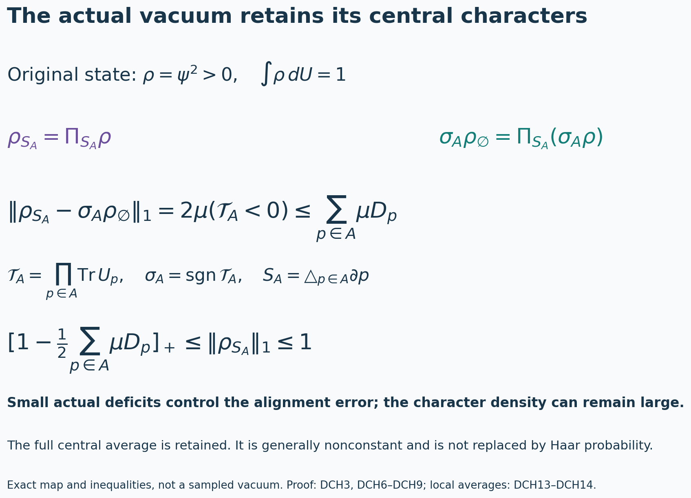
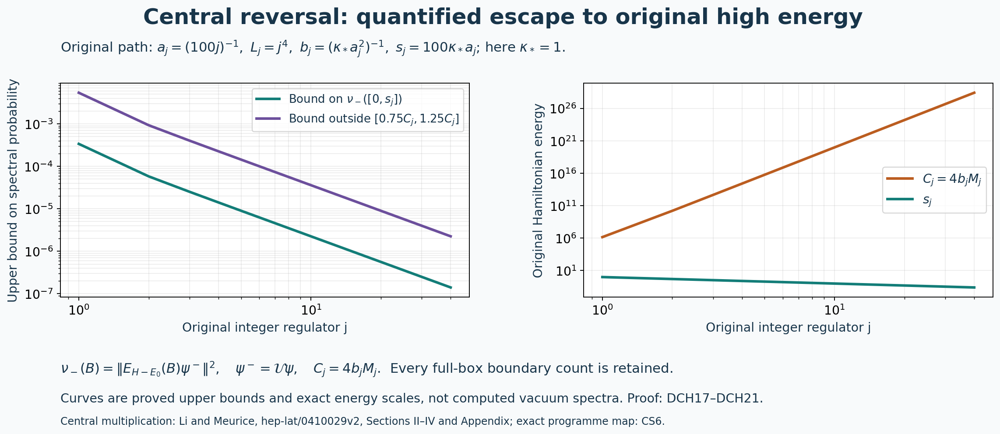

# Actual density characters, complete source equations and physical face covariance

Derivation begun 13 October 2026; complete proof review 14 October 2026. All statements below concern the original interacting finite-regulator ground and the unchanged regulator path. The smooth interacting global no-gap state remains the research goal.

The exact providers are [FPA1–FPA11](https://github.com/KokunoYumeto/yang-mills-interacting-workbench/blob/fdc6940a40e748cdff14ebb7e70df5a655c5f18e/yang-mills/continuations/20261011-central-signs-shrinking-window/FACE_FIELD_PHYSICAL_ACTION.md), [SLE1–SLE24](https://github.com/KokunoYumeto/yang-mills-interacting-workbench/blob/fdc6940a40e748cdff14ebb7e70df5a655c5f18e/yang-mills/continuations/20261011-central-signs-shrinking-window/SCALAR_RESIDUAL_AND_LOCAL_ENERGY.md), [LC1–LC20](https://github.com/KokunoYumeto/yang-mills-interacting-workbench/blob/fdc6940a40e748cdff14ebb7e70df5a655c5f18e/yang-mills/continuations/20261011-central-signs-shrinking-window/LOCAL_CURVATURE_BUDGET.md), and [CS1–CS19](https://github.com/KokunoYumeto/yang-mills-interacting-workbench/blob/fdc6940a40e748cdff14ebb7e70df5a655c5f18e/yang-mills/continuations/20261011-central-signs-shrinking-window/CENTRAL_SIGNS_AND_BOUNDARIES.md). The inherited human source for central multiplication is L. Li and Y. Meurice, [arXiv:hep-lat/0410029v2](https://arxiv.org/abs/hep-lat/0410029v2), Sections II–IV and Appendix, with author-source coverage retained in CS. No new reading of that paper or novelty claim is made.

## 1. Original density and its complete central equations

The map and inequalities are proved in DCH3 and DCH6–DCH9, with the original probability Haar measure, full trace product and actual vacuum density. The image represents exact formulas, not a vacuum sample. Figure source: figure_density_characters.py.

Keep
\[
\begin{gathered}
L_j=j^4,\quad a_j=(100j)^{-1},\quad
g_j^2=\kappa_*a_j/2,\quad
b_j=(\kappa_*a_j^2)^{-1},\quad s_j=100\kappa_*a_j,\\
V_j=\{0,\ldots,2L_j\}^3,\quad
N_j=3(2L_j)(2L_j+1)^2,\quad
M_j=3(2L_j)^2(2L_j+1),\\
U_p=U_d(z)U_k(z+e_d)U_d(z+e_k)^{-1}U_k(z)^{-1}\quad(d<k),\\
T_p=\operatorname{Tr}U_p,\quad D_p=2-T_p,\quad
W=\sum_pD_p,\quad V=b_jW=2b_jM_j-b_j\sum_pT_p,\\
H=-\kappa_*\Delta+V,\quad H\psi=E_0\psi,\quad
\psi>0,\quad\int\psi^2dU=1,\quad \rho=\psi^2,\quad
w=\log\psi,\quad d\mu=\rho\,dU .
\end{gathered}
\]
Every original edge, face and boundary gauge action is retained. The configuration manifold is \(SU(2)^{\mathcal E_j}\), with probability Haar measure and the radius-two product metric, with \(T_\alpha=-i\sigma_\alpha/2\) orthonormal. The positive ground is smooth and gauge invariant by LC3. At fixed \(j\), write \(\kappa=\kappa_*\), \(b=b_j\).

For every original complex edge array \(c\), keep
\[
\begin{gathered}
\bar c_p=\tfrac14\sum_{e\in\partial p}c_e,\quad
\Delta_c=\sum_ec_e\Delta_e,\quad W_c=\sum_p\bar c_pD_p,\quad
H_c=-\kappa\Delta_c+bW_c,\quad m_c=\langle\psi,H_c\psi\rangle,\\
G_c=\sum_ec_e|d_ew|^2,\quad
J_c=\sum_ec_e|d_e\psi|^2=\rho G_c,\quad
B_c=\sum_ec_e(\Delta_ew+2|d_ew|^2),\\
\upsilon_c=-\kappa^{-1}(\psi^{-1}H_c\psi-m_c),\quad
\alpha_{c,e}=\sum_{p\ni e}(c_e-\bar c_p)d_eD_p,\quad
Y_cf=\sum_e\langle\alpha_{c,e},d_ef\rangle,\quad z_c=Y_cw .
\end{gathered}
\]
The differential contractions here are complex bilinear extensions, while Hilbert norms use conjugation on the first entry. All arrays retain their actual amplitudes. The full scalar in \(H_c\) is \(2b\sum_p\bar c_p\).

For \(\tau\in\{1,-1\}^{\mathcal E_j}\) and any edge subset \(S\), use the original central map and projection
\[
(D_\tau U)_e=\tau_eU_e,\quad
\chi_S(\tau)=\prod_{e\in S}\tau_e,\quad
\Pi_SF=2^{-N_j}\sum_\tau\chi_S(\tau)F\circ D_\tau .
\]
Let \(\psi_S=\Pi_S\psi\), \(\rho_S=\Pi_S\rho\), and \(J_{c,S}=\Pi_SJ_c\). FPA2 proves the mutually orthogonal Haar projections. Their sum is the identity: summing the characters over all \(S\) leaves only \(\tau_e=1\) on every edge. Derivatives commute with the central maps, including the derivatives of inverse link factors. Hence
\[
\begin{gathered}
\psi=\sum_S\psi_S,\qquad \rho=\sum_S\rho_S,\\
\Pi_S(T_pF)=T_p\Pi_{S\triangle\partial p}F,\\
\left(-\kappa\Delta+2bM_j-E_0\right)\psi_S
-b\sum_pT_p\psi_{S\triangle\partial p}=0 .
\end{gathered}\tag{DCH1}
\]
The multiplier identity follows by inserting \(T_p(D_\tau U)=\chi_{\partial p}(\tau)T_p(U)\) into the finite sum. Applying it to the full ground equation proves the last line, with its entire potential scalar and vacuum energy.

The squared ground gives a different equation, with its kinetic-density source:
\[
\begin{gathered}
\Delta\rho=2\psi\Delta\psi+2|d\psi|^2,\\
\left(-\tfrac\kappa2\Delta+2bM_j-E_0\right)\rho_S
-b\sum_pT_p\rho_{S\triangle\partial p}
=-\kappa J_{\mathbf1,S}.
\end{gathered}\tag{DCH2}
\]
Multiply \(H\psi=E_0\psi\) by \(\psi\), insert the first identity, and apply \(\Pi_S\). In particular the density does not satisfy the source-free equation for the ground amplitude.

All sources have their exact finite convolution:
\[
\begin{gathered}
\rho_S=\sum_T\psi_T\psi_{S\triangle T},\\
J_{c,S}=\sum_e c_e\sum_T
\langle d_e\psi_T,d_e\psi_{S\triangle T}\rangle,\\
J_c=\frac1{4\rho}\sum_ec_e|d_e\rho|^2 .
\end{gathered}\tag{DCH3}
\]
Products of characters multiply by symmetric difference. Expanding the finite amplitude sum and projecting proves the first two identities, including every cross term. The last follows from \(d_e\rho=2\psi\,d_e\psi\), using the actual positive \(\rho\); no component \(\rho_S\) is used in its place. Thus (DCH1)–(DCH3) are exact coupled equations for the existing state. They have not been solved by assuming an independent-sign invariant density.

The weighted equation retains its entire local-energy fluctuation:
\[
\begin{split}
\left(-\tfrac\kappa2\Delta_c
+2b\sum_p\bar c_p-m_c\right)\rho_S
&-b\sum_p\bar c_pT_p\rho_{S\triangle\partial p}\\
&=-\kappa J_{c,S}-\kappa\Pi_S(\rho\upsilon_c).
\end{split}\tag{DCH4}
\]
Indeed \(H_c\psi=m_c\psi-\kappa\upsilon_c\psi\). Multiply by \(\psi\) and use \(\Delta_c\rho=2\psi\Delta_c\psi+2J_c\). For \(c=\mathbf1\), the exact identities \(H_c=H\), \(m_c=E_0\), and \(\upsilon_c=0\) recover (DCH2). For other coefficients the last source remains.

There are two useful derivative receivers, without dividing by a character component:
\[
\begin{gathered}
\Pi_S(\rho B_c)=\tfrac12\Delta_c\rho_S,\\
2\Pi_S(\rho z_c)
=\sum_p\sum_{e\in\partial p}
(c_e-\bar c_p)\langle d_eD_p,d_e\rho_{S\triangle\partial p}\rangle .
\end{gathered}\tag{DCH5}
\]
The first follows from
\(\Delta_e\rho=2\rho\Delta_ew+4\rho|d_ew|^2\).
For the second, \(Y_c\rho=2\rho z_c\), and \(d_eD_p\) has character \(\partial p\), so the same multiplier-and-derivative calculation as in (DCH1) proves every term. These are the actual density maps for the TSC scalar source and SLE spectral source.

Pointwise, the full matrix of character components is positive:
\[
\mathcal R(U)_{S,T}=\rho_{S\triangle T}(U),\quad
\operatorname{spec}\mathcal R(U)
=\{\rho(D_\tau U):\tau\in\{1,-1\}^{\mathcal E_j}\},\quad
|\rho_S|\le\rho_\varnothing .
\tag{DCH6}
\]
The matrix with entries \(2^{-N_j/2}\chi_S(\tau)\) is unitary by character orthogonality. Conjugating \(\mathcal R\) by it gives the displayed diagonal values, by the full finite inversion formula. These values are strictly positive. The last inequality also follows directly by taking absolute values in \(\Pi_S\rho\). Integration gives \(\int\rho_\varnothing=1\); \(\rho_\varnothing\) is generally a nonconstant central average. Gauge invariance forces \(\rho_S=0\) for odd degree at any vertex, as in FPA8. Even-cycle components are retained.

## 2. A quantitative map to the signed central average

For a finite collection \(A\) of original faces let
\[
\mathcal T_A=\prod_{p\in A}T_p,\quad
S_A=\mathop{\triangle}_{p\in A}\partial p,\quad
\sigma_A=\operatorname{sgn}\mathcal T_A,\quad
d_p=\mu D_p .
\]
The product is the full original trace product; no trace is divided by two. Put \(\sigma_A=0\) on its zero set. Each nonempty face trace has Haar-null zero set: fix its other three links and integrate the remaining Haar link; the trace-zero equator of \(SU(2)\) has measure zero. A finite union proves the assertion for \(\mathcal T_A\), and the actual smooth density gives the same null set. For \(A=\varnothing\), the product and sign are one.

The sign has character \(S_A\), including its zero set. Directly in the full central sum,
\[
\Pi_{S_A}(\sigma_A\rho)=\sigma_A\rho_\varnothing,\qquad
\rho_{S_A}-\sigma_A\rho_\varnothing
=\Pi_{S_A}[(1-\sigma_A)\rho].
\tag{DCH7}
\]
Unlike an independence approximation, this retains the actual central average on its right.

There is an exact original \(L^1(dU)\) error identity and an actual-deficit bound:
\[
\boxed{
\|\rho_{S_A}-\sigma_A\rho_\varnothing\|_{L^1(dU)}
=2\mu(\mathcal T_A<0)
\le\sum_{p\in A}d_p .
}
\tag{DCH8}
\]
Off the null set, \(|\rho_{S_A}|\le\rho_\varnothing\) and \(\sigma_A=\pm1\), so the pointwise absolute difference equals
\(\rho_\varnothing-\sigma_A\rho_{S_A}\).
Integrate; self-adjointness of the Haar projection and the character of \(\sigma_A\) give
\(\int\sigma_A\rho_{S_A}=\mu\sigma_A\).
Since \(\int\rho_\varnothing=1\), the difference is exactly \(2\mu(\mathcal T_A<0)\).
A negative product has at least one negative trace. On that event \(D_p>2\), so
\[
2\mu(\mathcal T_A<0)
\le2\sum_{p\in A}\mu(D_p>2)
\le\sum_{p\in A}\mu D_p .
\]
All probabilities refer to the original interacting vacuum. No pointwise small-curvature assumption has been made.

The character components themselves satisfy
\[
\left[1-\tfrac12\sum_{p\in A}d_p\right]_+
\le\|\rho_{S_A}\|_{L^1(dU)}\le1 .
\tag{DCH9}
\]
For \(k=|A|\), expand \(\mathcal T_A-2^k\) by changing the trace factors one at a time. Each term contains its full \(T_p-2=-D_p\), at most \(k-1\) other factors of magnitude at most two, and the retained powers of two. Thus
\[
|\mathcal T_A-2^k|\le2^{k-1}\sum_{p\in A}D_p .
\]
The character identity gives \(\int\mathcal T_A\rho_{S_A}=\mu\mathcal T_A\), while \(|\mathcal T_A|\le2^k\). Therefore
\[
2^k\|\rho_{S_A}\|_1
\ge\mu\mathcal T_A
\ge2^k-2^{k-1}\sum_{p\in A}d_p .
\]
Divide this numerical inequality by its explicit constant \(2^k\), and combine with nonnegativity of the norm and (DCH6). The empty collection gives equality one. In particular the relevant character densities need not become small when their underlying plaquette deficits become small.

## 3. Every mixed face term retains its actual density

Let \(p\ne q\), \(r\ne q\), with original common edges \(g=p\cap q\) and \(h=r\cap q\). Use
\(\theta_{pq,g}=\langle d_gD_p,d_gD_q\rangle\) and
\(\gamma_p=D_p-D_p^2/4\in[0,1]\).
Put \(\sigma_p=\operatorname{sgn}T_p\).
Then
\[
\begin{gathered}
\mu(\theta_{pq,g}\theta_{rq,h})
=\int\theta_{pq,g}\theta_{rq,h}
\,\rho_{\partial p\triangle\partial r}\,dU,\\
=\int \sigma_p\sigma_r\theta_{pq,g}\theta_{rq,h}
\,\rho_\varnothing\,dU+\mathcal E_{pqr},\\
\mathcal E_{pqr}
=\mu[(1-\sigma_p\sigma_r)\theta_{pq,g}\theta_{rq,h}],\\
|\mathcal E_{pqr}|
\le2\mu\!\left(\gamma_q\mathbf1_{\{\sigma_p\sigma_r=-1\}}\right)
\le\mu[\gamma_q(D_p+D_r)] .
\end{gathered}\tag{DCH10}
\]
For \(p=r\), \(\mathcal E_{pqr}=0\) exactly off the null set. The first line is FPA8. For the second, (DCH7) applies to the pair \(p,r\); the product
\(\sigma_p\sigma_r\theta_{pq,g}\theta_{rq,h}\) has empty central character, so its Haar pairing against \(\rho_\varnothing\) equals its expectation under \(\rho\). This proves the third line.

The exact edge norm gives
\[
|\theta_{pq,g}\theta_{rq,h}|
\le\gamma_q\sqrt{\gamma_p\gamma_r}\le\gamma_q .
\]
Here the two derivatives of \(D_q\) can be on different edges, but their norm squares are both the same \(\gamma_q\). A negative sign product requires \(D_p>2\) or \(D_r>2\). The resulting indicators are bounded by \(D_p/2\) and \(D_r/2\); this proves the final inequality, retaining the actual mixed deficits and the negative square in \(\gamma_q\).

For arbitrary original complex arrays \(c,d\), retain
\[
\begin{gathered}
a_{pq}(c)=c_g-\bar c_p\quad(p\cap q=\{g\},\ p\ne q),\\
F_q(c)=Y_cD_q=\sum_{p\sim q}a_{pq}(c)\theta_{pq,g},\\
\widehat F_q(c)=\sum_{p\sim q}a_{pq}(c)\sigma_p\sigma_q\theta_{pq,g},\\
\mathcal F_\mu(c,d)=\sum_q\mu(\overline{F_q(c)}F_q(d)),\quad
\widehat{\mathcal F}(c,d)
=\sum_q\int\overline{\widehat F_q(c)}\widehat F_q(d)
\,\rho_\varnothing\,dU .
\end{gathered}\tag{DCH11}
\]
Each \(\widehat F_q\) has empty central character and is bounded at fixed finite graph; its sign discontinuities lie on the already specified null sets. The complete cross formula is
\[
\begin{gathered}
\mathcal F_\mu(c,d)-\widehat{\mathcal F}(c,d)
=\sum_q\sum_{p,r\sim q}
\overline{a_{pq}(c)}a_{rq}(d)\mathcal E_{pqr},\\
|\mathcal F_\mu(c,d)-\widehat{\mathcal F}(c,d)|
\le\sum_q\sum_{p,r\sim q}
|a_{pq}(c)|\,|a_{rq}(d)|\,\mu[\gamma_q(D_p+D_r)] .
\end{gathered}\tag{DCH12}
\]
Expanding both forms in (DCH11) and applying (DCH10) proves the result with every original coefficient, sign and mixed term. The aligned form is positive semidefinite because it is the Gram form against the positive \(\rho_\varnothing\). It has not been replaced by Haar probability.

## 4. Original local scales and every boundary incidence

For a fixed physical support cube \(\mathcal Q=\prod_d[c_d,c_d+R]\), use the original fitting cube
\[
\begin{gathered}
q_j=\lceil R/a_j\rceil+3,\quad
(v_Q)_d=L_j+\lfloor(c_d-o_d)/a_j\rfloor-1,\quad
Q=v_Q+\{0,\ldots,q_j\}^3,\\
N_Q=3q_j(q_j+1)^2,\quad M_Q=3q_j^2(q_j+1),\\
C_Q=2q_j(q_j+1)\sum_d
[\mathbf1_{\{(v_Q)_d>0\}}+\mathbf1_{\{(v_Q)_d+q_j<2L_j\}}],\\
W_Q=\sum_{p\subset Q}D_p,\quad d_Q=\mu W_Q,\quad
\Lambda_Q=\min(2M_Q,6g_j^2\sqrt{N_QM_Q})+2C_Q,\\
\kappa_*T_Q+b_jd_Q\le E_0-E_{\rm out}\le b_j\Lambda_Q,\qquad
\mu W_Q^2\le\Lambda_Qd_Q+4\kappa_*^2a_j^2 .
\end{gathered}
\]
LC14–LC19 prove these inequalities in the actual full vacuum, retaining the outside energy and crossing cost. The second follows from LC18 with \(f=(W_Q+\delta)^{1/2}\), the full \(\Gamma(W_Q)\le16W_Q\), and \(\delta\downarrow0\); the kinetic contribution is \(4\kappa_*/b_j=4\kappa_*^2a_j^2\).

Apply (DCH8)–(DCH9) to every individual original face inside \(Q\):
\[
\begin{gathered}
\frac1{M_Q}\sum_{p\subset Q}
\|\rho_{\partial p}-\sigma_p\rho_\varnothing\|_1
\le\frac{d_Q}{M_Q}=O(a_j),\\
1-\frac{d_Q}{2M_Q}
\le\frac1{M_Q}\sum_{p\subset Q}\|\rho_{\partial p}\|_1\le1,\\
\frac{d_Q}{M_Q}
\le\min\!\left(4,\,
\min\!\left(2,3\kappa_*a_j\sqrt{\frac{q_j+1}{q_j}}\right)
+\frac8{q_j}\right)
\quad\text{for strict }Q .
\end{gathered}\tag{DCH13}
\]
For a non-strict fitting cube the exact \(2C_Q/M_Q\) replaces \(8/q_j\). The asymptotic statements concern the eventually strict original cube. These are averages over all actual faces; equality of individual face expectations, spatial translation invariance and regulator-uniform pointwise control have not been inserted.

Let \(\mathcal B_Q\) be the ordered distinct face pairs \((p,r)\) inside \(Q\) sharing an edge. Its exact cardinality is
\[
\begin{gathered}
|\mathcal B_Q|
=24q_j+72q_j(q_j-1)+36q_j(q_j-1)^2
=12q_j(3q_j^2-1),\\
\frac1{|\mathcal B_Q|}\sum_{(p,r)\in\mathcal B_Q}
\|\rho_{\partial p\triangle\partial r}
-\sigma_p\sigma_r\rho_\varnothing\|_1
\le\frac{24d_Q}{|\mathcal B_Q|}=O(a_j),\\
1-\frac{12d_Q}{|\mathcal B_Q|}
\le\frac1{|\mathcal B_Q|}\sum_{(p,r)\in\mathcal B_Q}
\|\rho_{\partial p\triangle\partial r}\|_1\le1 .
\end{gathered}\tag{DCH14}
\]
For each of the three edge directions, the edge has \(q_j\) possible longitudinal positions. Its two transverse coordinates are both on the patch boundary in four cases, exactly one is on that boundary in \(4(q_j-1)\) cases, and neither is in \((q_j-1)^2\) cases. The numbers of incident inside faces are respectively two, three and four, yielding ordered pair counts \(2,6,12\). Multiplying by the original longitudinal and direction counts gives the first line. Each face has at most twelve neighbors. Therefore the sum of \(d_p+d_r\) over ordered pairs is at most \(24d_Q\); (DCH8) and (DCH9) give the remaining two lines. Every patch-boundary class remains in the first formula.

Now fix \(\varphi\in C_c^1(\mathcal Q;\mathbb C)\) and use precisely the original cell averages:
\[
\begin{gathered}
x_e=o+a_j(z-L_j\mathbf1+e_d/2),\quad
x_p=o+a_j(z-L_j\mathbf1+(e_d+e_k)/2),\\
c_e=a_j^{-3}\int_{x_e+[-a_j/2,a_j/2)^3}\varphi(x)\,dx,\quad
h_\varphi=(\varphi,\varphi,\varphi),\\
M_\varphi=\|D\varphi\|_\infty,\qquad
c_\varphi=(1+\sqrt2)M_\varphi/4,\qquad
|c_e-\bar c_p|\le c_\varphi a_j .
\end{gathered}
\]
The zero extension outside \(E_Q^\circ\) agrees with these averages for large \(j\), as in SLE1. The four distances from one edge center are \(0,a_j,a_j/\sqrt2,a_j/\sqrt2\); averaging the Lipschitz bounds proves the last inequality with its original constant. Any face \(p\) with nonzero coefficient in \(a_{pq}(c)\) is inside \(Q\); its neighboring \(q\) may be outside \(Q\), and is retained.

Both complete actual forms have the bound
\[
\begin{gathered}
0\le\mathcal F_\mu(c,c)\le144c_\varphi^2a_j^2d_Q,\qquad
0\le\widehat{\mathcal F}(c,c)\le144c_\varphi^2a_j^2d_Q,\\
|\mathcal F_\mu(c,c)-\widehat{\mathcal F}(c,c)|
\le288c_\varphi^2a_j^2d_Q .
\end{gathered}\tag{DCH15}
\]
There are at most twelve \(p\)'s in each \(q\)-sum. Before bounding, retain the full squares in (DCH11). Cauchy gives
\[
|F_q(c)|^2,\ |\widehat F_q(c)|^2
\le12c_\varphi^2a_j^2
\sum_{\substack{p\sim q\\a_{pq}(c)\ne0}}\theta_{pq,g}^2 .
\]
The exact square bound is \(\theta_{pq,g}^2\le\gamma_p\gamma_q\le D_p\). In the aligned form the square \(\theta_{pq,g}^2\) is central-even, so its \(\rho_\varnothing\) integral is exactly its actual \(\mu\) expectation. Each inside \(p\) has at most twelve original neighbors, including the outside ones. Summation proves \(12\cdot12=144\), using \(d_Q\) rather than an outside-state replacement. The last line follows by the sum of the two bounds; the finer full mixed-deficit error is still (DCH12).

The original kinetic/curvature bound gives a quantitative constant. In the conventions above,
\[
\Delta W_Q=6M_Q-3W_Q,\quad
\mu|\nabla_Qw|^2\le(b_j/\kappa_*)(\Lambda_Q-d_Q),\quad
\Gamma(W_Q)\le16W_Q .
\]
Integration against \(\rho=\psi^2\) gives
\(6M_Q-3d_Q=-2\mu\langle\nabla_Qw,\nabla W_Q\rangle\).
Consequently
\[
(6M_Q-3d_Q)^2
\le64(b_j/\kappa_*)d_Q(\Lambda_Q-d_Q).
\]
This is the full polynomial in [HVR17–HVR22](https://github.com/KokunoYumeto/yang-mills-interacting-workbench/blob/fdc6940a40e748cdff14ebb7e70df5a655c5f18e/yang-mills/continuations/20261011-central-signs-shrinking-window/HESSIAN_RECEIVING_REVIEW.md), with all counts and couplings retained. Here \(a_j^3M_Q\to3R^3\), \(a_j^2\Lambda_Q\to\mathsf L_R=9\kappa_*R^3+24R^2\), and \(a_j^2d_Q\) is bounded by \(a_j^2\Lambda_Q\). Along every convergent subsequence \(a_j^2d_Q\to x\), multiplication of the displayed polynomial by \(a_j^6\) therefore yields
\[
x(\mathsf L_R-x)\ge81\kappa_*^2R^6/16 .
\]
Solving this quadratic inequality and taking the largest possible subsequential limit proves
\[
\limsup_j a_j^2d_Q\le K_R,\quad
K_R=\frac{\mathsf L_R+
\sqrt{\mathsf L_R^2-81\kappa_*^2R^6/4}}2,\quad
\mathsf L_R=9\kappa_*R^3+24R^2 .
\]
Thus the two actual forms in (DCH15) are \(O(1)\) on the original raw common coefficients.

Their exact Haar comparison has a different leading value:
\[
\boxed{
\mathcal F_{\rm Haar}(c_{\varphi,j},c_{\eta,j})
=\frac9{16a_j}\int_{\mathbb R^3}
\overline{\nabla\varphi(x)}\cdot\nabla\eta(x)\,dx
+o(a_j^{-1})
}
\tag{DCH16}
\]
for fixed \(\varphi,\eta\in C_c^1\) in a common cube. All nonzero coefficients are eventually on full-graph edges with \(m_g=4\), so FPA5 has factor \(9/16\).
At an original \((d,k)\)-face, the four edge-center offsets from \(x_p\) are
\(\pm a_je_d/2,\pm a_je_k/2\).
The exact box-average error is \(o(a_j)\) uniformly by SLE4. Taylor's formula with the derivative modulus therefore gives
\[
\begin{split}
\sum_{g\in\partial p}
\overline{(c_{\varphi,g}-\bar c_{\varphi,p})}
(c_{\eta,g}-\bar c_{\eta,p})
={}&\tfrac{a_j^2}{2}
[\overline{\partial_d\varphi(x_p)}\partial_d\eta(x_p)\\
&+\overline{\partial_k\varphi(x_p)}\partial_k\eta(x_p)]
+o(a_j^2)
\end{split}
\]
uniformly over a fixed compact support enlargement. There are \(O(a_j^{-3})\) such faces. The translated, orientation-specific Riemann sums converge with their original cell volume \(a_j^3\). Each derivative direction appears in two of the three orientation pairs; their two factors \(1/2\) add to one. Multiplying by \(9/16\) gives (DCH16), with all orientations and cell factors. In particular (DCH15) and (DCH16) prove the actual comparison rather than identifying the two measures. For nonzero compactly supported \(\varphi\), the integral of \(|\nabla\varphi|^2\) is positive: zero would force its derivative to vanish everywhere, hence a constant compactly supported function and therefore zero.

## 5. The original central reversal and its actual spectral weight

The central map reversing every face is explicitly
\[
\tau_i^0(z)=(-1)^{\sum_{k<i}z_k},\qquad
\mathcal U F=F\circ D_{\tau^0},\qquad
\psi^-=\mathcal U\psi,\quad f_j=\langle\psi,\psi^-\rangle .
\]
The CS6 coordinate proof applies to every original boundary face: in a \((d,k)\)-face with \(d<k\), a step in direction \(d\) reverses \(\tau_k^0\) and a step in direction \(k\) leaves \(\tau_d^0\) unchanged. Their product is \(-1\). Hence
\[
\begin{gathered}
\mathcal U^2=I,\quad \mathcal U^*=\mathcal U,\quad
T_p\circ D_{\tau^0}=-T_p,\quad
W\circ D_{\tau^0}=4M_j-W,\\
H^-:=\mathcal U H\mathcal U
=-\kappa\Delta+4bM_j-bW,\qquad H^-\psi^-=E_0\psi^- .
\end{gathered}\tag{DCH17}
\]
Central multiplication is a metric and Haar isometry and commutes with every vertex gauge action. Thus \(\psi^-\) is an actual smooth unit physical vector in the original Hilbert space. Its energy under \(H\) is calculated below. No negative value of the original real coupling is substituted.

Let \(K=H-E_0\), \(d_{\rm all}=\mu W\), \(m_{2,\rm all}=\mu W^2\), and \(C_j=4b_jM_j\). The full identities are
\[
\begin{gathered}
K\psi^-=\mathcal U(C_j-2b_jW)\psi,\qquad
(K-C_j)\psi^-=-2b_j\mathcal U(W\psi),\\
\langle\psi^-,K\psi^-\rangle=C_j-2b_jd_{\rm all},\\
\|K\psi^-\|^2
=C_j^2-4b_jC_jd_{\rm all}+4b_j^2m_{2,\rm all},\\
\|(K-C_j)\psi^-\|^2=4b_j^2m_{2,\rm all}.
\end{gathered}\tag{DCH18}
\]
From \(K\mathcal U=\mathcal U(H^--E_0)\), apply the full ground equation to obtain the first line. Expanding the squares proves the remaining formulas, with the energy center and all cross terms retained.

For the entire original box there are no crossing faces or outside energy. LC14 and LC19 give
\[
\begin{gathered}
\Lambda_{\rm all}=\min(2M_j,3\kappa_*a_j\sqrt{N_jM_j}),\\
0\le d_{\rm all}\le E_0/b_j\le\Lambda_{\rm all},\qquad
m_{2,\rm all}\le\Lambda_{\rm all}d_{\rm all}
+4\kappa_*^2a_j^2,\\
0<f_j^2\le\frac{m_{2,\rm all}}{4M_j^2}
\le\frac{9\kappa_*^2a_j^2N_j}{4M_j}
+\frac{\kappa_*^2a_j^2}{M_j^2}.
\end{gathered}\tag{DCH19}
\]
Strict positivity of \(f_j\) follows from the positive ground functions. To prove its upper bound, take the inner product of the second identity of (DCH18) with \(\psi\). Since \(K\psi=0\), the left side is \(-C_j f_j\). Cauchy bounds the right side by \(2b_j\sqrt{m_{2,\rm all}}\); division by the retained \(C_j=4b_jM_j\) gives the result. The last bound uses \(d_{\rm all}\le\Lambda_{\rm all}\le3\kappa_*a_j\sqrt{N_jM_j}\).

Let \(\nu_-(B)=\|E_K(B)\psi^-\|^2\). For any original energy cutoff \(0\le u<C_j\), the spectral theorem applied to the full last line of (DCH18) proves
\[
\begin{gathered}
\nu_-([0,u])
\le\frac{4b_j^2m_{2,\rm all}}{(C_j-u)^2},\\
\nu_-\{\lambda:|\lambda-C_j|\ge\delta C_j\}
\le\frac{m_{2,\rm all}}{4\delta^2M_j^2}\quad(\delta>0),\\
\limsup_j a_j^{-2}\nu_-([0,R_{\rm win}s_j])
\le\frac{9\kappa_*^2}{4}\qquad(R_{\rm win}>0\text{ fixed}).
\end{gathered}\tag{DCH20}
\]
Indeed \(|\lambda-C_j|\ge C_j-u\) on the first set and at least \(\delta C_j\) on the second. For the last line,
\(N_j/M_j=(2L_j+1)/(2L_j)\to1\), and the complete original ratio
\[
\frac{R_{\rm win}s_j}{C_j}
=\frac{25R_{\rm win}\kappa_*^2a_j^3}{M_j}\longrightarrow0 .
\]
Insert (DCH19) without changing the spectral units. In particular this unit physical vector concentrates in relative neighborhoods of the diverging original energy \(4b_jM_j\); its original shrinking-window mass tends to zero with the stated bound.

For its exact centered physical vector
\[
v^-=\psi^--f_j\psi,\qquad
\|v^-\|^2=1-f_j^2,\qquad
v^-\perp\psi ,
\tag{DCH21}
\]
the full first and second energy moments remain those of (DCH18). On every positive-energy Borel set its measure equals \(\nu_-\); at zero its measure is zero. Thus \(\|v^-\|^2\to1\), whereas its mass in every fixed multiple of the original shrinking window is \(O(a_j^2)\). The center-character decomposition also gives
\[
f_j=\sum_S\chi_S(\tau^0)\|\psi_S\|_{L^2(dU)}^2,\qquad
\sum_{\chi_S(\tau^0)=\pm1}\|\psi_S\|^2=\frac{1\pm f_j}{2}.
\tag{DCH22}
\]
The central unitary acts on each character sector by its displayed sign; Haar orthogonality and \(\|\psi\|=1\) prove both identities. Therefore its two total amplitude-sector masses tend to \(1/2\), while (DCH13)–(DCH14) retain the large density-character components and their actual signs. These are different explicit maps, with the full amplitude-to-density convolution given in (DCH3).

## Receiving calculation

This figure evaluates the upper bounds in DCH19–DCH20 for \(\kappa_*=1\), \(R_{\rm win}=1\), \(\delta=1/4\), and integer \(1\le j\le40\). The right panel shows the exact original energies \(4b_jM_j\) and \(s_j\). No plotted curve is a sampled Yang–Mills vacuum spectrum. The original full-box counts are retained; the plotted second-moment bound uses \(\Lambda_{\rm all}^2+4\kappa_*^2a_j^2\). Figure source and exact parameter ledger: figure_density_characters.py and CENTRAL_REVERSAL_FIGURE_DATA.json. Human source for the central multiplication is Li and Meurice, hep-lat/0410029v2, cited above.

The quantitative density alignment, complete mixed covariance error and actual common-field bound now supplement the exact equations. The central reversal is a completely evaluated physical comparison vector whose spectral mass escapes to the displayed original high energy. It is not substituted for the original common scalar observable \(X_\varphi\) or squared-score source \(Q_\varphi\).

Their remaining physical-window calculation receives (DCH2)–(DCH5), the full central-even density in (DCH10)–(DCH12), and the original FPA10 Hessian and score contributions. In particular the \(O(a_j)\) averaged density alignment does not by itself make the raw weighted error in (DCH12) vanish. The next calculation must evaluate that retained even-density form and the complete \(J_{c,S}\) sources, or produce an exact bound strong enough for the original signed three-shift response. The interacting continuum state, reconstruction, intended-theory identification, five Green moments and J5 comparison remain part of the same active programme.

## Central kinetic source and complete physical resolvent

[CK1–CK24](https://github.com/KokunoYumeto/yang-mills-interacting-workbench/blob/main/yang-mills/continuations/20261011-central-signs-shrinking-window/CENTRAL_KINETIC_SOURCE.md) calculate the complete central-orbit kinetic source and its exact original-Hamiltonian representation. The actual marginal amplitude \(A=\sqrt{\rho_\varnothing}\), probabilities \(p_\tau=\rho_\tau/(2^{N_j}\rho_\varnothing)\), and \(h_\tau=\sqrt{p_\tau}\) satisfy
\[
\Pi_\varnothing|d\psi|^2=|dA|^2+A^2\sum_\tau|dh_\tau|^2 .
\]
All nonempty-character cross terms are retained. The full physical operator couples the central-average component to its fluctuation through
\[
Bf=-2\kappa_*(\langle dh_\tau,df\rangle)_\tau .
\]
CK19–CK24 prove the complete two-component resolvent on its exact form domains, retaining both source components, their cross terms, shift derivatives and the nonnegative residual gain over the central-average trial. The original squared-resolvent response is \(z\mathcal G_Z(z)-z^2\|(\mathcal M+z)^{-1}\mathbf Z\|^2\); all three original shifts and signs remain. The actual gain at one shift does not assign a positive signed three-shift limit. That joint evaluation, reconstruction and the smooth interacting global no-gap endpoint remain active.

## Exact central fluctuation energy and full response residual

[CFE1–CFE14](https://github.com/KokunoYumeto/yang-mills-interacting-workbench/blob/main/yang-mills/continuations/20261011-central-signs-shrinking-window/CENTRAL_FLUCTUATION_ENERGY.md) compute the original conditional mean-gradient defect \(t_Z=dx-\sum_\tau p_\tau dZ_\tau\), its complete adjoint coupling, and the full positive fluctuation energy
\[
q(y,y)=\kappa_*\int A^2\left[
\sum_\tau p_\tau|dZ_\tau-v_Z|^2+|t_Z|^2\right]dU,
\quad v_Z=\sum_\tau p_\tau dZ_\tau .
\]
Every nonempty original character is retained in \(C_{S,T}=r_{S\triangle T}-r_Sr_T\). Its exact inverse contains \(n^{-2}\sum_\tau\chi_S\chi_T/p_\tau\). The full physical residual \(\eta_z=y-B(L_A+z)^{-1}x\) has the exact Gram square in CFE13, including its possible cross-term cancellation. CFE7–CFE8 bound all three original signed responses, and CFE14 derives the density-character derivative source from the original Wilson ground equation. These formulas keep every raw coefficient, metric, boundary and inverse probability. The actual derivative estimates and nonzero shrinking-window weight, followed by reconstruction and the smooth global no-gap endpoint, remain the active calculation.
