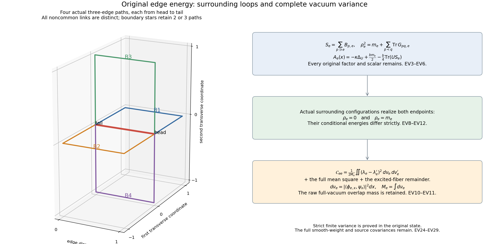
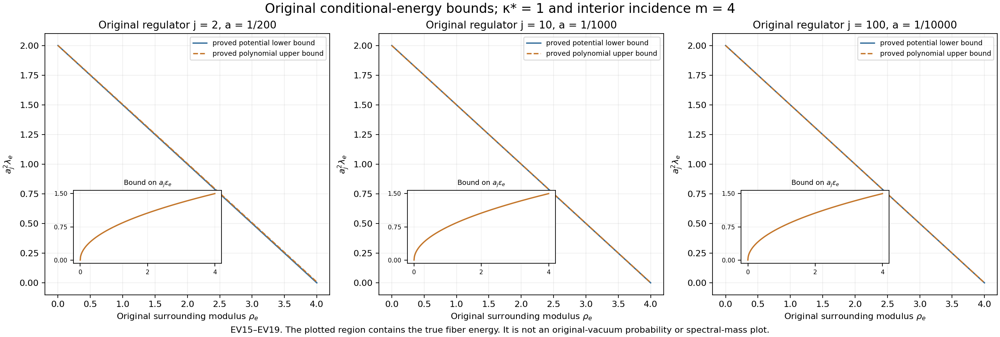

# Actual-vacuum edge-energy variance, surrounding loops and physical covariances

This calculation continues [WH14–WH24](https://github.com/KokunoYumeto/yang-mills-interacting-workbench/blob/1aa2538481a26e270732cafdbd629cdfe15c2847/yang-mills/continuations/20261011-central-signs-shrinking-window/SMOOTH_WEIGHTED_LOCAL_ENERGY.md) and [SF1–SF27](https://github.com/KokunoYumeto/yang-mills-interacting-workbench/blob/1aa2538481a26e270732cafdbd629cdfe15c2847/yang-mills/continuations/20261011-central-signs-shrinking-window/SHARED_FACE_WORDS_AND_PHYSICAL_COUPLING.md). The compact ground construction and local budget are [LC1–LC3 and LC14–LC20](https://github.com/KokunoYumeto/yang-mills-interacting-workbench/blob/1aa2538481a26e270732cafdbd629cdfe15c2847/yang-mills/continuations/20261011-central-signs-shrinking-window/LOCAL_CURVATURE_BUDGET.md). It proves strict edge-energy variance in the original full vacuum, supplies its complete raw projection remainder, and evaluates the surrounding-path energy profile on the original regulator path. All source, cross-edge and exterior-state contributions remain.

## 1. The original edge energy and its surrounding paths

Retain the original open box with vertices \(\{0,\ldots,2L_j\}^3\), all positive edges and vertex gauge transformations, probability Haar on every \(\mathrm{SU}(2)\) factor, and the radius-two metric with orthonormal \(T_\alpha=-i\sigma_\alpha/2\). Keep
\[
\begin{gathered}
L_j=j^4,\quad a_j=(100j)^{-1},\quad
g_j^2=\kappa_*a_j/2,\quad b_j=(\kappa_*a_j^2)^{-1},\quad
s_j=100\kappa_*a_j,\\
D_p=2-\operatorname{Tr}U_p,\quad
H=-\kappa\Delta+b\sum_pD_p,\quad
H\psi=E_0\psi,\quad\psi>0,\quad\int\psi^2dU=1,\quad d\mu=\psi^2dU,\\
A_e=-\kappa\Delta_e+\frac b4\sum_{p\ni e}D_p,\quad
c_e=\langle\psi,A_e\psi\rangle,\quad v_e=(A_e-c_e)\psi,\quad
\mathcal C_{ef}=\langle v_e,v_f\rangle,\quad
\upsilon_e=-\kappa^{-1}\psi^{-1}v_e .
\end{gathered}\tag{EV1}
\]
Here \(\kappa=\kappa_*\) on the original path; only finite-regulator equations omit \(j\).
The full potential scalar in \(A_e\) is \(bm_e/2\), where
\[
m_e=|\{p:p\ni e\}|\in\{2,3,4\},\qquad
W_e=\sum_{p\ni e}D_p,\quad
\kappa^2\|\upsilon_e\|_{L^2(\mu)}^2=\mathcal C_{ee},\quad
\sum_eA_e=H .
\tag{EV2}
\]
For an edge along coordinate \(d\), each of the two other coordinate directions supplies one incident face on a box side and two otherwise. This proves the three possible counts, including every original boundary edge.

Fix all other actual links \(x\). In the notation and traversal convention of SF1 and SF10, let
\[
B_{p,e}(x)=A_{p,e}(x)^{\epsilon_{p,e}},\quad
X_{p,e}=U_eB_{p,e}(x),\quad
S_e(x)=\sum_{p\ni e}B_{p,e}(x).
\]
Each \(B_{p,e}\) is the actual three-edge path from the head to the tail of \(e\), with its original order and inverses. Then
\[
A_e(x)=-\kappa\Delta_U+\frac{bm_e}{2}
-\frac b4\operatorname{Tr}(US_e(x)).
\tag{EV3}
\]
This follows from \(D_p=2-\operatorname{Tr}(U_eB_{p,e})\); reversing an \(\mathrm{SU}(2)\) loop preserves its trace. The other edge variables have not been replaced by independent holonomies.

The three-edge paths for distinct incident faces have disjoint edge sets. In coordinates along \(e\), the four possible faces choose one of the two transverse axes and one of its two sides. Their noncommon vertices and edges lie on different transverse sides, exactly as in SF5. On each available path, fix two links to \(I\) and choose the remaining link or its inverse to realize any specified path product. Thus these \(m_e\) path products can be prescribed independently by actual outside-link configurations.

## 2. Exact energy profile and six-edge loops

Write the full matrix \(S_e=s_0I+i\sum_{\alpha=1}^3s_\alpha\sigma_\alpha\), with real coefficients. Matrix multiplication gives
\[
\begin{gathered}
S_e^\dagger S_e=\rho_e^2I,\quad
\rho_e=\sqrt{s_0^2+s_1^2+s_2^2+s_3^2}
=\sqrt{\det S_e},\quad 0\le\rho_e\le m_e,\\
Q_e=S_e/\rho_e\in\mathrm{SU}(2)\quad(\rho_e>0),\qquad
S_e=\rho_eQ_e,\\
A_e(x)=-\kappa\Delta_U+\frac{b(m_e-\rho_e)}2
+\frac{b\rho_e}{4}(2-\operatorname{Tr}(UQ_e)).
\end{gathered}\tag{EV4}
\]
The triangle inequality for the Euclidean four-vector of \(S_e\) gives the bound by \(m_e\). The factor \(\rho_e\), both original scalar contributions, and their sum \(bm_e/2\) remain. At \(\rho_e=0\), the operator is \(-\kappa\Delta_U+bm_e/2\); no choice of \(Q_e\) is needed.

Right translation \(U\mapsto UQ_e\) is a Haar and metric isometry, so the fiber ground energy is
\[
\lambda_e(x)=\frac{bm_e}{2}+\mathcal E_\kappa(b\rho_e/4),\qquad
\mathcal E_\kappa(t)=\inf_{\|f\|_2=1}
\left\{\kappa\int|df|^2dU-t\int\operatorname{Tr}U\,|f|^2dU\right\}.
\tag{EV5}
\]
This is an exact unitary comparison, with the original coupling \(b\rho_e/4\) explicit.
The original surrounding six-edge loops \(G_{pq,e}\) of SF4 satisfy
\[
\rho_e^2=m_e+\sum_{\substack{p<q\\p,q\ni e}}\operatorname{Tr}G_{pq,e},
\qquad
m_e^2-\rho_e^2
=\sum_{\substack{p<q\\p,q\ni e}}(2-\operatorname{Tr}G_{pq,e}).
\tag{EV6}
\]
Indeed \(\frac12\operatorname{Tr}S_e^\dagger S_e
=m_e+\sum_{p<q}\operatorname{Tr}(B_{p,e}^\dagger B_{q,e})\).
The latter trace equals
\(\operatorname{Tr}(B_{p,e}B_{q,e}^{-1})
=\operatorname{Tr}(X_{p,e}X_{q,e}^{-1})\):
trace of an \(\mathrm{SU}(2)\) inverse and cyclic trace give these equalities. SF4–SF5 identify this with the actual glued loop for each traversal sign. Counting \(m_e(m_e-1)/2\) pairs proves the second identity with every scalar \(2\).

The compact elliptic construction in LC3 gives each \(A_e(x)\) a unique positive Haar-unit ground \(\phi_{e,x}\), including \(S_e=0\). Its domain is the original second Sobolev space. The potential is continuous in \(x\) in sup norm, and
\[
|\lambda_e(x)-\lambda_e(x')|
\le\|V_{e,x}-V_{e,x'}\|_\infty,\qquad
|\lambda_m(\rho)-\lambda_m(\rho')|\le\frac b2|\rho-\rho'|.
\tag{EV7}
\]
Both follow by using any unit Rayleigh vector in the two variational formulas, interchanging them and taking infima. Here \(\lambda_m(\rho)=bm/2+\mathcal E_\kappa(b\rho/4)\).

For the exact Haar trial span \(\{1,\chi\}\), \(\chi(U)=\operatorname{Tr}U\),
\[
\int\chi=0,\quad \int\chi^2=1,\quad \int\chi^3=0,\quad
\Delta\chi=-3\chi/4 .
\]
To verify the integrals, write \(U=q_0I+i\sum q_\alpha\sigma_\alpha\) on the Haar unit three-sphere: odd terms change sign under \(U\mapsto-U\), and coordinate symmetry with \(\sum_{\alpha=0}^3q_\alpha^2=1\) gives \(\int q_0^2=1/4\). The original generator matrices, or differentiation of their exponentials twice, give the Casimir value \(3/4\). Therefore the full trial matrix and its smaller eigenvalue yield
\[
\begin{gathered}
\begin{pmatrix}bm/2&-b\rho/4\\-b\rho/4&bm/2+3\kappa/4\end{pmatrix},\\
\lambda_m(\rho)\le bm/2-\delta_\kappa(b,\rho),\qquad
\delta_\kappa(b,\rho)
=\sqrt{9\kappa^2/64+b^2\rho^2/16}-3\kappa/8>0
\quad(\rho>0).
\end{gathered}\tag{EV8}
\]
No change of the metric or of the potential constant has been made.

The function \(\mathcal E_\kappa(t)\) is concave as the infimum of affine functions of \(t\). It is even because \(U\mapsto-U\) preserves the kinetic form and reverses \(\chi\), and \(\mathcal E_\kappa(0)=0\). Formula (EV8) gives \(\mathcal E_\kappa(t)<0\) for \(t>0\). Concavity between \(0\) and \(t_2\) now proves, for \(0\le\rho_1<\rho_2\),
\[
\lambda_m(\rho_1)-\lambda_m(\rho_2)
\ge(1-\rho_1/\rho_2)\delta_\kappa(b,\rho_2)>0.
\tag{EV9}
\]
Specifically \(\mathcal E_\kappa(t_1)\ge(t_1/t_2)\mathcal E_\kappa(t_2)\), and subtracting \(\mathcal E_\kappa(t_2)\) gives the displayed bound. Thus the surrounding-loop energy profile is strictly decreasing throughout its actual range.

## 3. Strict variance in the original vacuum and its entire remainder

The function \(x\mapsto\phi_{e,x}\) is continuous in the Haar \(L^2\) norm, with its positive sign fixed. To prove this, take \(x_n\to x\). The uniform potential bound and (EV7) bound the ground kinetic energies. Compactness of the first Sobolev embedding into \(L^2\) on the fixed compact three-sphere gives an \(L^2\)-convergent subsequence with weak first derivatives. Its limit has norm one and is nonnegative. In the weak ground equation, the potentials converge uniformly; testing against a smooth function and moving its Laplacian onto the test function shows that the limit solves the ground equation at \(x\). Uniqueness and positivity identify it with \(\phi_{e,x}\). Every subsequence has the same possible limit, so the entire sequence converges. Elliptic regularity supplies the smooth representative in the \(U\) variable. This proof also covers \(S_e=0\), avoiding any singular polar-coordinate choice.

The full operator \(A_e\) is the direct integral of (EV3). Its kinetic part acts in the one edge factor; its potential is a bounded real multiplier. The original smooth \(\psi\) lies in its domain, and the displayed fiber actions are square integrable. Define the original slices and raw overlap measure by
\[
\begin{gathered}
\psi_x(U)=\psi(U,x),\quad
P_{e,0}(x)f=\phi_{e,x}\langle\phi_{e,x},f\rangle_{L^2(dU)},\\
a_e(x)=\langle\phi_{e,x},\psi_x\rangle>0,\quad
d\nu_e(x)=a_e(x)^2dx,\quad
M_e=\int d\nu_e\in(0,1],\\
r_e(x)=(I-P_{e,0}(x))\psi_x .
\end{gathered}\tag{EV10}
\]
The raw mass \(M_e\) is retained; this measure is not substituted for the original state. Continuity of both positive factors makes \(a_e\) continuous and strictly positive. Therefore \(\nu_e\) has full support on the original compact outside configuration space. Cauchy's inequality gives
\(a_e(x)^2\le\int\psi(U,x)^2dU\); integration proves \(M_e\le1\).
The ground component belongs to the fiber operator domain and has uniformly bounded energy \(\lambda_e\). Subtracting it from the smooth slice proves that all terms below belong to the required domains and are integrable.

Ground and excited fiber subspaces are orthogonal and invariant under \(A_e(x)\). Thus the complete original variance, with every nonnegative remainder, is
\[
\begin{split}
\mathcal C_{ee}={}&
\int(\lambda_e(x)-c_e)^2d\nu_e(x)
+\int\|(A_e(x)-c_e)r_e(x)\|^2d x\\
={}&\frac1{2M_e}\iint(\lambda_e(x)-\lambda_e(x'))^2
\,d\nu_e(x)d\nu_e(x')\\
&+\frac1{M_e}\left(\int\lambda_e\,d\nu_e-c_eM_e\right)^2
+\int\|(A_e(x)-c_e)r_e(x)\|^2dx .
\end{split}\tag{EV11}
\]
The first line is the squared norm of the two orthogonal fiber components. For the second line, expand the double integral as
\(2M_e\int\lambda_e^2d\nu_e-2(\int\lambda_e d\nu_e)^2\), then expand the retained square. The result is exactly \(\int(\lambda_e-c_e)^2d\nu_e\).

The two required energy regions occur in actual configurations. Prescribe
\[
B_{k,e}=\operatorname{diag}(e^{2\pi i k/m_e},e^{-2\pi i k/m_e}),
\quad k=0,\ldots,m_e-1,
\]
on the disjoint paths to obtain \(S_e=0\), by the finite geometric sum for \(m_e\ge2\). Prescribe every \(B_{p,e}=I\) to obtain \(S_e=m_eI\).
The open sets
\[
\begin{gathered}
\Omega_{e,0}=\{x:\rho_e<m_e/4\},\quad
\Omega_{e,1}=\{x:\rho_e>3m_e/4\},\\
\nu_{e,0}=\nu_e(\Omega_{e,0})>0,\quad
\nu_{e,1}=\nu_e(\Omega_{e,1})>0,\quad
d_e^{\,\mathrm{sep}}=\tfrac23\delta_\kappa(b,3m_e/4),\\
\mathcal C_{ee}\ge
\ell_e:=\frac{\nu_{e,0}\nu_{e,1}}{M_e}(d_e^{\,\mathrm{sep}})^2>0
\end{gathered}\tag{EV12}
\]
have positive raw measure by continuity and full support. Formula (EV9) bounds every energy difference between the two regions below by \(d_e^{\,\mathrm{sep}}\). The two ordered cross rectangles in (EV11)'s double integral give the coefficient \(\nu_{e,0}\nu_{e,1}/M_e\). Configurations at isolated points have not been assigned probability mass.

This establishes strict variance for every original edge of the three-dimensional box. Since \(\sum_fv_f=0\), the original covariance matrix obeys
\[
\mathcal C=\mathcal C^T\ge0,\quad
\mathcal C_{ee}>0,\quad
\sum_f\mathcal C_{ef}=0,\quad
\sum_{f\ne e}\mathcal C_{ef}=-\mathcal C_{ee}<0 .
\tag{EV13}
\]
In particular every row has at least one negative off-diagonal entry. It does not follow that every off-diagonal entry is negative or that the matrix has finite range.

For a finite upper bound, WH19 with the actual subset \(\{e\}\) gives a centered kinetic standard deviation at most \(2bm_e\): there are exactly \(m_e\) mixed faces and no wholly inside face. Also \(0\le W_e\le4m_e\) gives
\(\operatorname{Var}_\mu W_e\le4m_e^2\), since
\(\operatorname{Var}W_e=\mu(W_e-2m_e)^2-(\mu W_e-2m_e)^2\).
The triangle inequality for the centered kinetic and potential vectors therefore proves
\[
\sqrt{\mathcal C_{ee}}\le2bm_e+\frac b4\sqrt{\operatorname{Var}_\mu W_e}
\le\frac52bm_e,\qquad
0<\|\upsilon_e\|^2\le\frac{25b^2m_e^2}{4\kappa^2}.
\tag{EV14}
\]
The full kinetic-potential covariance remains in (EV11) and in the original squared norm; the inequality does not set it to zero.

## 4. An explicit original-metric trial and the regulator path

For a sharper profile bound, take the actual one-group polynomial
\(f_n(U)=(2+\operatorname{Tr}U)^n\), integer \(n\ge0\), retaining its full norm
\[
\|f_n\|_2^2=4^{2n}\frac8\pi
\mathrm B(2n+\tfrac32,\tfrac32).
\tag{EV15}
\]
Here \(\mathrm B(\alpha,\beta)=\int_0^1t^{\alpha-1}(1-t)^{\beta-1}dt\).
Indeed the Haar coordinate \(\chi=\operatorname{Tr}U\) has density
\(\sqrt{4-\chi^2}/(2\pi)\) on \([-2,2]\), obtained from the three-sphere latitude measure. Under \(t=(2+\chi)/4\), that measure is
\((8/\pi)t^{1/2}(1-t)^{1/2}dt\), and \(f_n=4^nt^n\). This change of integration variable preserves the full original polynomial and its prefactor.
The original edge derivative satisfies \(|d\chi|^2=1-\chi^2/4=4t(1-t)\). Consequently
\[
\frac{\int|df_n|^2}{\|f_n\|^2}
=\frac{3n^2}{4(4n+1)},\qquad
\frac{\int(2-\chi)f_n^2}{\|f_n\|^2}
=\frac6{2n+3}.
\tag{EV16}
\]
For the first ratio at \(n\ge1\), the numerator is
\(n^2 4^{2n-1}(8/\pi)\mathrm B(2n+\tfrac12,\tfrac52)\).
The beta recurrence, obtained by one integration by parts, gives its ratio to (EV15) as stated. At \(n=0\) the kinetic numerator is zero directly. The second ratio follows from
\(\mathrm B(\alpha,\beta+1)/\mathrm B(\alpha,\beta)=\beta/(\alpha+\beta)\); the same integration-by-parts identity proves this recurrence.
In the full potential (EV4), Rayleigh comparison gives
\[
\lambda_m(\rho)\le\frac{b(m-\rho)}2+
\frac{3\kappa n^2}{4(4n+1)}+\frac{3b\rho}{2(2n+3)}
\quad(n\ge0).
\tag{EV17}
\]
For \(\rho>0\), choose the actual integer \(n=\lceil2\sqrt{b\rho/\kappa}\rceil\). Then
\(n\le2\sqrt{b\rho/\kappa}+1\),
\(n^2/(4n+1)\le n/4\), and
\(3b\rho/[2(2n+3)]\le3b\rho/(4n)\).
The potential minimum gives the lower bound, while \(n=0\) gives the other upper bound:
\[
0\le\lambda_m(\rho)-\frac{b(m-\rho)}2
\le\min\left\{\frac{b\rho}2,\frac34\sqrt{\kappa b\rho}+\frac{3\kappa}{16}\right\}.
\tag{EV18}
\]
At \(\rho=0\), the remainder is exactly zero, so the formula covers the exceptional point.
On the original path, this is
\[
\begin{gathered}
\lambda_e=\frac{m_e-\rho_e}{2\kappa_*a_j^2}+\varepsilon_e,\qquad
0\le\varepsilon_e\le
\min\left\{\frac{\rho_e}{2\kappa_*a_j^2},
\frac{3\sqrt{\rho_e}}{4a_j}+\frac{3\kappa_*}{16}\right\},\\
\delta_{\kappa_*}(b_j,\rho)
=\sqrt{\frac{9\kappa_*^2}{64}
+\frac{\rho^2}{16\kappa_*^2a_j^4}}-\frac{3\kappa_*}{8},\qquad
a_j^2d_e^{\,\mathrm{sep}}\longrightarrow\frac{m_e}{8\kappa_*}.
\end{gathered}\tag{EV19}
\]
The last limit is for any fixed incidence class \(m_e=2,3,4\); the finite formula keeps its actual value. The remainder \(\varepsilon_e\) is defined by the exact difference on the first line, with a proved bound. It is not an assumed expansion or an omitted vacuum-energy term.

## 5. The actual local distribution and the limitation of extreme configurations

The original star potential itself has the exact decomposition
\[
W_e=2(m_e-\rho_e)+\rho_e(2-\operatorname{Tr}(U_eQ_e)),\qquad
0\le m_e-\rho_e\le W_e/2 .
\tag{EV20}
\]
At \(\rho_e=0\), the second term is defined as zero and the equation reads \(W_e=2m_e\). At positive \(\rho_e\), substitute the full matrix sum into \(W_e=2m_e-\operatorname{Tr}(U_eS_e)\). Positivity of the second deficit proves the inequality. All three original scalar contributions sum correctly.

Use the original strict fitting cube from WH7,
\[
\begin{gathered}
q=\lceil R/a_j\rceil+3,\quad
v_{j,d}=L_j+\lfloor(c_d-o_d)/a_j\rfloor-1,\quad Q=v_j+\{0,\ldots,q\}^3,\\
N_Q=3q(q+1)^2,\quad M_Q=3q^2(q+1),\quad C_Q=12q(q+1),\\
\Lambda_Q=\min\{2M_Q,6g_j^2\sqrt{N_QM_Q}\}+2C_Q,\qquad
\mu W_Q\le\Lambda_Q .
\end{gathered}
\]
Let \(E_Q^\circ\) consist of edges whose two transverse vertex coordinates are strictly between the sides of \(Q\). Along the edge direction there are \(q\) positions, and in each transverse direction \(q-1\), so
\[
|E_Q^\circ|=3q(q-1)^2,\quad m_e=4\ (e\in E_Q^\circ),\qquad
\sum_{e\in E_Q^\circ}W_e\le4W_Q .
\tag{EV21}
\]
Every face incident on such an edge lies in \(Q\); each face is counted at most on its four original edges. No exterior face is used in the last inequality.
Therefore, for every fixed \(\eta>0\),
\[
\begin{gathered}
\sum_{e\in E_Q^\circ}\mu(4-\rho_e)\le2\Lambda_Q,\\
a_j^3\sum_{e\in E_Q^\circ}
\mu\{\rho_e\le4-\eta\}
\le\frac{2a_j^3}{\eta}\Lambda_Q\longrightarrow0,\\
a_j^2\Lambda_Q\longrightarrow9\kappa_*R^3+24R^2,\qquad
a_j^3|E_Q^\circ|\longrightarrow3R^3 .
\end{gathered}\tag{EV22}
\]
The probability estimate follows by integrating
\(\eta\mathbf1_{\{4-\rho_e\ge\eta\}}\le4-\rho_e\).
This is a proved local averaged concentration in the actual vacuum, without translation invariance or a pointwise statement for every edge sequence.

It also quantifies the specific lower estimate in (EV12). The overlap measure is bounded by the actual outside marginal, and on \(\Omega_{e,0}\) one has \(m_e-\rho_e>3m_e/4\). Thus
\[
\nu_{e,0}\le\frac{2}{3m_e}\mu W_e,\qquad
d_e^{\,\mathrm{sep}}\le bm_e/8,\qquad
\ell_e\le\frac{b^2m_e^2}{64}\nu_{e,0}.
\]
For \(e\in E_Q^\circ\), \(m_e=4\), so on the original path
\[
0<a_j^7\sum_{e\in E_Q^\circ}\ell_e
\le\frac{a_j^3}{6\kappa_*^2}\Lambda_Q\longrightarrow0 .
\tag{EV23}
\]
Here \(\delta_\kappa(b,\rho)\le b\rho/4\) follows from
\(\sqrt{A^2+B^2}\le A+B\) for nonnegative \(A,B\).
Also \(\nu_{e,1}\le M_e\). Insert these inequalities, the raw-measure bound, and (EV21) to obtain the exact coefficient \(1/(6\kappa_*^2)\).
This proves decay of this particular extreme-configuration lower estimate; it does not prove decay of the larger actual variance \(\mathcal C_{ee}\). The aligned surrounding region and the excited-fiber remainder in (EV11) remain actual contributions. Formula (EV19) identifies their original energy scale.

## 6. Full source and smooth-weight receiving formulas

There is an exact connection to the original source
\(C=C_{\mathbf f,j}=a_j\sum_{\sigma,p}f_\sigma(x_{p,j})D_p\).
Let \(f_p\) be its actual face coefficient and, on every original edge, retain
\[
\begin{gathered}
\overline f_e=\frac1{m_e}\sum_{p\ni e}f_p,\qquad
S_e^{\,f}=\sum_{p\ni e}f_pB_{p,e},\qquad
S_e^{\,f,\perp}=\sum_{p\ni e}(f_p-\overline f_e)B_{p,e},\\
C=\frac{a_j}{4}\sum_e
\left\{2\sum_{p\ni e}f_p-\operatorname{Tr}(U_eS_e^{\,f})\right\}\\
=\frac{a_j}{4}\sum_e
\left\{2\overline f_e(m_e-\rho_e)
+\overline f_e\rho_e(2-\operatorname{Tr}(U_eQ_e))
-\operatorname{Tr}(U_eS_e^{\,f,\perp})\right\}.
\end{gathered}\tag{EV24}
\]
Every original face has four edges, proving the first sum. The decomposition
\(S_e^{\,f}=\overline f_eS_e+S_e^{\,f,\perp}\) and (EV20) prove the second. The residual path matrix is retained, including for different orientation tests or signed coefficients. At \(\rho_e=0\), its weighted deficit term is zero; the residual matrix need not vanish. No original source is replaced by a scalar profile.

For an exact source projection, put \(F=C-\mu C\) and
\[
\begin{gathered}
b_{F,e}(x)=\langle\phi_{e,x},F(\cdot,x)\psi_x\rangle,\qquad
z_{F,e}(x)=(I-P_{e,0}(x))(F\psi)_x,\\
\langle F,\upsilon_e\rangle_{L^2(\mu)}
=-\frac1\kappa\left\{
\int(\lambda_e-c_e)a_e b_{F,e}\,dx
+\int\langle z_{F,e},(A_e(x)-c_e)r_e\rangle\,dx\right\}.
\end{gathered}\tag{EV25}
\]
Project both vectors in \(\langle F\psi,(A_e-c_e)\psi\rangle\) into the same fiber ground and its orthogonal complement, then use (EV10). This proves the formula and retains the entire signed excited contribution.
Likewise, define
\[
\begin{gathered}
b_{f,e}(x)=\langle\phi_{e,x},(v_f)_x\rangle,\quad
z_{f,e}(x)=(I-P_{e,0}(x))(v_f)_x,\\
\mathcal C_{ef}=
\int(\lambda_e-c_e)a_eb_{f,e}\,dx
+\int\langle(A_e(x)-c_e)r_e,z_{f,e}\rangle\,dx .
\end{gathered}\tag{EV26}
\]
For \(f\ne e\), the original operator \(A_f\) differentiates outside variables. It has not been commuted through \(P_{e,0}(x)\); its full projected vector is retained in the definition.
Gauge transformations intertwine (EV3) on corresponding outside configurations and preserve Haar, the metric and positivity. Uniqueness of the positive fiber ground implies the corresponding covariance law for \(\phi_{e,x}\). Changing the edge integration variable therefore proves that the direct-integral projection \(P_{e,0}\) preserves the original physical subspace. The receiving formulas are physical maps, although a tensor factorization of physical states is never assumed.

For all real original edge weights \(h\), set \(v_h=\sum_fh_fv_f\).
Projection on any fixed edge gives the complete norm identity
\[
\begin{gathered}
\kappa^2n_h
=\int\left|\sum_fh_fb_{f,e}(x)\right|^2dx
+\int\left\|\sum_fh_fz_{f,e}(x)\right\|^2dx\\
=\sum_{f,g}h_fh_g\mathcal C_{fg}
=-\frac12\sum_{f,g}(h_f-h_g)^2\mathcal C_{fg}.
\end{gathered}\tag{EV27}
\]
The first line is orthogonality of the two fiber components; the last identity uses both zero row and column sums in (EV13). Projections for different edges are not asserted to commute, and their first-line identities must not be added as though their ranges were orthogonal. A smooth spatial weight still requires the complete covariance in this formula.

## 7. Full physical moments of the edge fluctuation

The WH3 field for the actual single-edge weight is supported on its original \(1+3m_e\) edge star:
\[
\begin{gathered}
\alpha^{(e)}_e=\tfrac34 d_eW_e,\qquad
\alpha^{(e)}_\ell=-\tfrac14d_\ell D_p
\quad(\ell\ne e,\ \ell\in p,\ p\ni e),\\
\alpha^{(e)}_\ell=0\quad\text{on every other edge},\\
|\alpha^{(e)}|^2
=\frac9{16}|d_eW_e|^2+\frac3{16}\sum_{p\ni e}(D_p-D_p^2/4)\\
=\frac9{16}\left\{\rho_e^2-\frac14(\operatorname{Tr}(U_eS_e))^2\right\}
+\frac3{16}\sum_{p\ni e}(D_p-D_p^2/4)
\le\frac{9m_e+3}{16}W_e .
\end{gathered}\tag{EV28}
\]
Each noncommon edge belongs to one of the disjoint three-edge paths, proving the coefficients and their sum. The shared-edge derivative square follows from the full matrix \(S_e=\rho_eQ_e\) and the original trace derivative, and remains valid at \(S_e=0\). Cauchy's inequality
\(|\sum_p d_eD_p|^2\le m_e\sum_p|d_eD_p|^2\) proves the last bound. This retains the entire shared-face contraction before it is bounded.
The full Haar divergence vanishes by the face-edge coefficient sum \(3/4-3(1/4)=0\). Write \(g_\ell=d_\ell\log\psi\), retain the original score bound
\[
G(a)=\min\{8/(\kappa_*^2a^2),C_{\rm heat}/(\kappa_*a)\},
\qquad C_{\rm heat}=2+2\sqrt{4+2\pi},
\]
from SR65 as used in WH7. The full physical generator
\(\mathscr L_0=\psi^{-1}(H-E_0)\psi=\kappa\delta_\mu d\) therefore satisfies
\[
\begin{gathered}
d\upsilon_e=(b/\kappa)P\alpha^{(e)},\quad
\mathscr L_0\upsilon_e=-2b\sum_\ell g_\ell\cdot\alpha^{(e)}_\ell,\\
0<\mathfrak e_e:=\langle\upsilon_e,\mathscr L_0\upsilon_e\rangle
=\frac{b^2}{\kappa}\|P\alpha^{(e)}\|^2
\le\frac{b^2(9m_e+3)}{16\kappa}\mu W_e,\\
\mathfrak q_e:=\|\mathscr L_0\upsilon_e\|^2
=4b^2\mu\left(\sum_\ell g_\ell\cdot\alpha^{(e)}_\ell\right)^2
\le\frac{b^2(1+3m_e)(9m_e+3)}4G(a_j)^2\mu W_e,\\
\|\mathbf1_{(s_j,\infty)}(\mathscr L_0)\upsilon_e\|^2
\le\mathfrak e_e/s_j
\le\frac{9m_e+3}{1600\kappa_*^4a_j^5}\mu W_e .
\end{gathered}\tag{EV29}
\]
The projection \(P\) is the full original weighted exact-gradient projection. Positivity of \(\mathfrak e_e\) follows from \(\|\upsilon_e\|>0\), its zero mean, and the ground-transform identity: a zero first energy would make its gradient zero, hence the scalar constant on the connected configuration product, hence zero. The second-moment estimate uses only the \(1+3m_e\) actual edge blocks and \(|g_\ell|\le G(a_j)\); every cross term remains in the preceding square. The final inequality is the spectral theorem at the original energy \(s_j\), with no finite-mode compression.

The original covariance has now been proved to have strictly positive diagonal entries, together with exact raw lower remainders and full physical moments. The particular lower estimate based on far-apart surrounding configurations has the decay (EV23), while the aligned region and all cross-edge terms remain in (EV11), (EV26) and (EV27). The next calculation must evaluate their actual contribution to smooth spatial weights and the original observable, using the energy profile (EV19), exact surrounding loops (EV6), source map (EV24), and full physical residual. No regulator-uniform surviving spectral mass, continuum reconstruction, global smoothness or no-gap endpoint has been supplied by strict finite variance alone.

Reproducible original SU(2) geometry, Haar-integral, character-compression and fiber-projection diagnostics and figure sources are in [check_edge_variance.py](check_edge_variance.py). They do not sample the original full vacuum. Exact source versions and reading coverage are in [the source-use ledger](EDGE_VARIANCE_SOURCE_USE_LEDGER.json).
