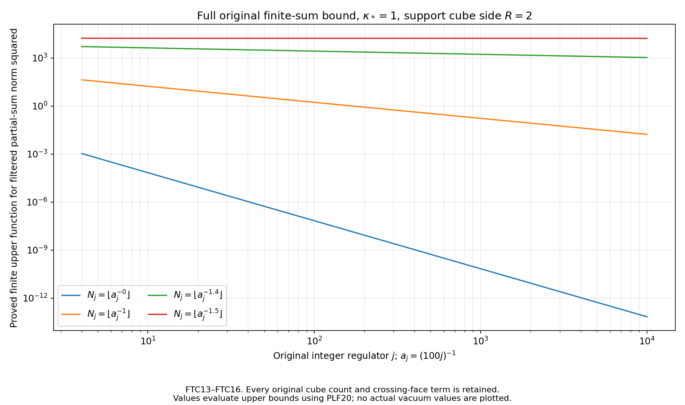
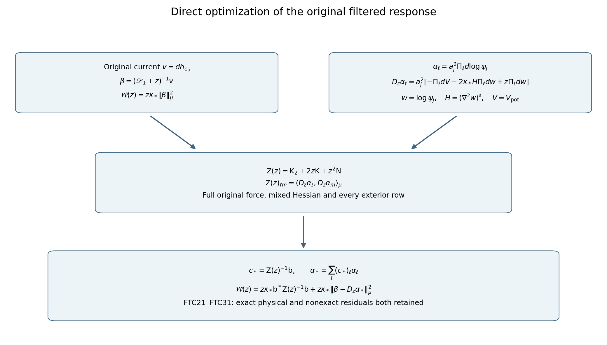

# Actual filtered currents and the complete inverse contribution

This calculation continues PLF1–PLF26 and PT14–PT36. It transfers the positive original first-energy bound to the outside Wilson source, derives its full filtered-current response and inverse remainder, and calculates an optimization directed at that response itself. Every estimate uses the original regulator, complete raw norms, full actual vacuum and all Hessian contributions. The actual signed three-scale response remains to be evaluated.

The weighted-operator human sources retained through PT are Jon Johnsen, *On the spectral properties of Witten-Laplacians, their range projections and Brascamp-Lieb’s inequality*, [arXiv:1703.10011v2](https://arxiv.org/abs/1703.10011v2), and Assane Lo, *Witten Laplacian Methods for the Decay of Correlations*, [arXiv:math-ph/0611002v9](https://arxiv.org/abs/math-ph/0611002v9). Original author sources and their exact bounded reading coverage are retained in the cited source-use ledger. No additional reading or external theorem is asserted here.

## 1. The actual outside source retains the positive first energy

Use the original real continuous nonzero orientation triple \(\mathbf f\), the exact splitting \(F=h_e+q_e\), and
\[
E_F=\kappa_*\mu|dF|^2,\quad E_h=\kappa_*\mu|dh_e|^2,\quad
E_q=\kappa_*\mu|dq_e|^2.
\tag{FTC1}
\]
PLF18 and \(0\le W_e\le4m_e\) prove
\[
E_q\le4\kappa_*a_j^2m_e(m_e+3)M_f^2
\le112\kappa_*a_j^2M_f^2.
\tag{FTC2}
\]
The triangle inequality in the full weighted one-form space gives
\[
|\sqrt{E_h}-\sqrt{E_F}|
\le\sqrt{E_q}\le4\sqrt{7\kappa_*}\,a_jM_f.
\tag{FTC3}
\]
This is uniform over the choice of the original edge; it has no raw source-norm factor. EF3 therefore transfers unchanged:
\[
e_{\mathbf f}\le\liminf_j E_{h,j}
\le\limsup_j E_{h,j}\le U_{\mathbf f}.
\tag{FTC4}
\]
Here all original constants are
\[
\begin{gathered}
\mathsf L_R=9\kappa_*R^3+24R^2,\quad
K_R=\frac{\mathsf L_R+
\sqrt{\mathsf L_R^2-81\kappa_*^2R^6/4}}2,\\
t_1=f_{12}+f_{13},\quad t_2=f_{12}+f_{23},\quad
t_3=f_{13}+f_{23},\quad J_{\rm edge}=\sum_d\int|t_d|,\\
F_\sigma=\|f_\sigma\|_\infty,\quad M_f=\max_\sigma F_\sigma,\quad
\chi=4+4\sum_\sigma F_\sigma/M_f,\\
e_{\mathbf f}=\frac{9\kappa_*^3J_{\rm edge}^2}{4K_R}>0,\quad
U_{\mathbf f}=\kappa_*\chi M_f^2K_R,\quad
D_{\mathbf f}=21\kappa_*^2J_2^\Sigma+4U_{\mathbf f},\\
J_2^\Sigma=\sum_\sigma\int f_\sigma^2 .
\end{gathered}
\tag{FTC5}
\]
In these constants \(R\) is the original side of the cube containing the support, as in EF3, not the upper window ratio used below. Invertibility of the map \(\mathbf f\mapsto(t_1,t_2,t_3)\), explicitly inverted in CE7–CE9, makes \(J_{\rm edge}>0\) for a nonzero test.

## 2. Complete current representation of the filter

Let \(U_0h=h\psi_j\). PT14–PT17 prove the exact physical unitary
\[
V=\sqrt{\kappa_*}\,d\,\mathscr L_0^{-1/2}:
L^2_0(\mu_j)_{\rm gauge}\longrightarrow\mathcal G_j,
\tag{FTC6}
\]
where \(\mathcal G_j\) is the closed exact physical one-form space and
\(\mathscr L_0=U_0^{-1}(H_j-E_{0,j})U_0\).
It intertwines every Borel function of the physical generator with the corresponding function of \(\mathscr L_1|_{\mathcal G_j}\).

For the actual smooth centered \(h_e\),
\[
\mathcal W_{h_e\psi_j}(z)
=z\kappa_*\|(\mathscr L_1+z)^{-1}dh_e\|_{\mu_j}^2.
\tag{FTC7}
\]
To prove it, expand \(h_e=\sum_n c_nh_n\) in the actual scalar eigenbasis. The orthogonal exact forms satisfy
\(\|dh_n\|_\mu^2=\lambda_n/\kappa_*\).
Thus the right side is
\(\sum_n z\lambda_n|c_n|^2/(\lambda_n+z)^2\), exactly PLF21. This also proves domain convergence of the differentiated resolvent series. The current itself is the full original ordered sum in PLF12.

Use PT22–PT24, distinguishing their contraction \(\mathcal Q_z\) from the fiber projection \(Q\) in PLF:
\[
\begin{gathered}
\mathcal S=(\nabla^2\log\psi_j)^\#+2(\kappa_*a_j)^{-1}I\ge0,\\
\mathcal T=\kappa_*\nabla_\mu^*\nabla+
(\kappa_*/2+4/a_j)I,\quad T_z=\mathcal T+zI,\\
\mathscr L_1=\mathcal T-2\kappa_*\mathcal S,\quad
\mathcal Q_z=2\kappa_*T_z^{-1/2}\mathcal S T_z^{-1/2},\\
0\le\mathcal Q_z\le q_zI,\quad
q_z=\frac{\mathfrak m}{z+\mathfrak m}<1,\quad
\mathfrak m=2\kappa_*\|\mathcal S\|_{L^\infty},\\
(\mathscr L_1+z)^{-1}=T_z^{-1/2}(I-\mathcal Q_z)^{-1}T_z^{-1/2}.
\end{gathered}
\tag{FTC8}
\]
Every finite-regulator inverse and domain in this factorization is proved in PT22–PT24. The entire actual Hessian remains.

## 3. An evaluated positive response at its original vanishing scale

Put \(v=dh_e\), \(R_1(z)=(\mathscr L_1+z)^{-1}\), and
\(\mathcal R_h(z)=\kappa_*\langle v,R_1(z)v\rangle_\mu\).
Inverse order from \(\mathscr L_1+z\le T_z\) and Cauchy's inequality give
\[
\mathcal R_h(z)\ge
\frac{E_h^2}
{\kappa_*^2\mu\|\nabla^2h_e\|^2+
(\kappa_*/2+4/a_j+z)E_h}.
\tag{FTC9}
\]
This follows from
\(\langle v,T_z^{-1}v\rangle\langle v,T_zv\rangle
\ge\|v\|^4\); all factors of \(\kappa_*\) are displayed.
A second Cauchy inequality,
\(\|R_1(z)v\|^2\|v\|^2\ge|\langle v,R_1(z)v\rangle|^2\),
therefore proves for the actual \(E_h>0\)
\[
\mathcal W_{h_e\psi_j}(z)
\ge
\frac{zE_h^3}
{\{\kappa_*^2\mu\|\nabla^2h_e\|^2+
(\kappa_*/2+4/a_j+z)E_h\}^2}.
\tag{FTC10}
\]
At a finite regulator where \(E_h=0\), use the undivided zero identity instead. The first section proves \(E_h>0\) for all sufficiently large original regulators.

BM13's exact same-link and distinct-link Hessian blocks apply to the original coefficients with incident entries set to zero; they do not differentiate spatial coefficients. Retain the exact formula
\[
\|\nabla^2h_e\|_{\rm HS}^2
=a_j^2\left\{
\frac3{16}\sum_\ell
\left(\sum_{\substack{p\not\ni e\\p\ni\ell}}f_pW_p\right)^2
+\sum_{p\not\ni e}f_p^2(6+3W_p^2/4)\right\}.
\tag{FTC11}
\]
All cross terms in the first square remain. At most four faces meet an edge, so the same bounds give
\(\|\nabla^2h_e\|^2\le21a_j^2 A_{2,\mathrm{out}}\le21a_j^2A_2\).
Since \(a_j^3A_2\to J_2^\Sigma\), the full denominator multiplied by \(a_j\) has limsup at most \(D_{\mathbf f}\) when \(z=\theta s_j=100\theta\kappa_*a_j\), for fixed \(\theta>0\). Consequently
\[
\liminf_j
\frac{\mathcal W_{h_e\psi_j}(\theta s_j)}{a_j^3}
\ge\frac{100\theta\kappa_*e_{\mathbf f}^3}{D_{\mathbf f}^2}>0 .
\tag{FTC12}
\]
This is an actual lower bound with the vanishing scale retained. It does not evaluate the signed subtraction in PLF25 and does not prove positive window mass.

## 4. Every sub-\(a_j^{-3/2}\) finite inverse sum vanishes in this filter

Keep the exact finite sum and remainder
\[
\begin{gathered}
w_{N,z}=T_z^{-1/2}\left(\sum_{n=0}^N\mathcal Q_z^n\right)T_z^{-1/2}dh_e,\\
\tau_{N,z}=T_z^{-1/2}\mathcal Q_z^{N+1}
(I-\mathcal Q_z)^{-1}T_z^{-1/2}dh_e,\\
R_1(z)dh_e=w_{N,z}+\tau_{N,z},\qquad
t_z=\kappa_*/2+4/a_j+z .
\end{gathered}
\tag{FTC13}
\]
PT's finite geometric identity proves the equality without commuting \(T_z\) with \(\mathcal Q_z\). The two factors \(T_z^{-1/2}\) each have norm at most \(t_z^{-1/2}\); each \(\mathcal Q_z^n\) has norm at most one. Therefore
\[
\sqrt{z\kappa_*}\|w_{N,z}\|_\mu
\le\frac{(N+1)\sqrt{zE_h}}{t_z},\qquad
\sqrt{z\kappa_*}\|\tau_{N,z}\|_\mu
\le\frac{q_z^{N+1}}{1-q_z}\frac{\sqrt{zE_h}}{t_z}.
\tag{FTC14}
\]
At \(z=\theta s_j\) the first squared bound is exactly
\[
\frac{100\theta\kappa_*a_j^3(N+1)^2E_h}
{(4+\kappa_*a_j/2+100\theta\kappa_*a_j^2)^2}.
\tag{FTC15}
\]
Thus every choice \(N_j=o(a_j^{-3/2})\) gives a vanishing filtered finite-sum norm, since the first section gives bounded \(E_h\). This does not truncate the actual inverse: its complete remainder is displayed. The actual error satisfies
\[
\left|\sqrt{\mathcal W_{h_e\psi_j}(z)}
-\sqrt{z\kappa_*}\|w_{N,z}\|_\mu\right|
\le\sqrt{z\kappa_*}\|\tau_{N,z}\|_\mu .
\tag{FTC16}
\]
No uniform bound on \(q_z\) away from one has been introduced.

## 5. Exact near-one receiver for the original low-energy window

Let \(0<\varepsilon<1<R_{\rm w}\), and use the original physical vector
\[
\begin{gathered}
\eta_{\rm win}
=1_{[\varepsilon s_j,R_{\rm w}s_j]}(H_j-E_{0,j})(F_j\psi_j),\\
\xi=VU_0^{-1}\eta_{\rm win},\quad y=T_z^{1/2}\xi .
\end{gathered}\tag{FTC17}
\]
The maps \(U_0,V\) are unitary on this positive-energy subspace, so
\(\|\xi\|_\mu^2=\|\eta_{\rm win}\|^2\) with its complete raw norm.
At fixed regulator the window contains finitely many smooth eigenvectors, proving the domain of \(T_z^{1/2}\). The exact factorization gives
\[
\begin{gathered}
\langle y,(I-\mathcal Q_z)y\rangle_\mu
=\langle\xi,(\mathscr L_1+z)\xi\rangle_\mu
\le(R_{\rm w}s_j+z)\|\xi\|_\mu^2,\\
\|y\|_\mu^2\ge t_z\|\xi\|_\mu^2.
\end{gathered}\tag{FTC18}
\]
For \(0<\delta<1\), spectral integration of \(I-\mathcal Q_z\) now proves
\[
\|1_{[0,1-\delta)}(\mathcal Q_z)y\|_\mu^2
\le\frac{R_{\rm w}s_j+z}{\delta}\|\eta_{\rm win}\|^2.
\tag{FTC19}
\]
Keeping the original \(y\) as well, the ratio estimate for \(y\ne0\) is
\[
\frac{\|1_{[0,1-\delta)}(\mathcal Q_z)y\|_\mu^2}{\|y\|_\mu^2}
\le
\frac{100\kappa_*(R_{\rm w}+\theta)a_j^2}
{\delta(4+\kappa_*a_j/2+100\theta\kappa_*a_j^2)}
\quad(z=\theta s_j).
\tag{FTC20}
\]
This specifies the original-window image near one, including its nonunitary \(T_z^{1/2}\) metric. It assigns no mass to an unevaluated window.

## 6. Exact optimization of the filtered response itself

Keep the fixed removed edge \(e_0\) in \(h_{e_0}\), and let \(I\) be any finite set of original trial edges. All fields and potentials in this section belong to the same original regulator. Write
\[
\begin{gathered}
w=\log\psi,\quad g_\ell=\nabla_\ell w,\quad
H_{\ell m}=(\nabla^2w)_{\ell m},\quad
\mathcal H_w=(\nabla^2w)^\#,\\
V_{\rm pot}=b_j\sum_pD_p
=2b_j|\mathcal P_j|-b_j\sum_pW_p,\quad
\alpha_\ell=a_j^2\Pi_\ell dw,\quad
D_z=\mathscr L_1+zI,\quad v=dh_{e_0}.
\end{gathered}
\tag{FTC21}
\]
Here \(\Pi_\ell\) selects the original edge component of a one-form on the full configuration manifold. It does not freeze any configuration variable. The full potential scalar and ground-energy subtraction are unchanged. A derivative of their constants vanishes because they are constants.

SG25's differentiated full ground equation gives the exact forcing
\[
\begin{gathered}
\mathcal B_0dw=-dV_{\rm pot},\qquad
\mathcal B_0=\kappa_*(\nabla_\mu^*\nabla+\tfrac12I),\\
\mathscr L_1=\mathcal B_0-2\kappa_*\mathcal H_w,\\
D_z\alpha_\ell
=a_j^2\{-\Pi_\ell dV_{\rm pot}
-2\kappa_*\mathcal H_w\Pi_\ell dw+z\Pi_\ell dw\}.
\end{gathered}
\tag{FTC22}
\]
The component projection is parallel for the product connection, and commutes with the rough weighted operator and its scalar Ricci term. This proves the last line from the first. The full original force is
\[
d_\ell V_{\rm pot}
=b_j\sum_{p\ni\ell}d_\ell D_p
=-b_j\sum_{p\ni\ell}d_\ell W_p .
\tag{FTC23}
\]
All three components differentiate the original ordered products and inverses. No outside derivative or mixed Hessian has been removed.

Define the exact norm, first and second energy matrices and the actual source vector by
\[
\begin{gathered}
\mathsf N_{\ell m}=\langle\alpha_\ell,\alpha_m\rangle_\mu,\quad
\mathsf K_{\ell m}=\langle\alpha_\ell,\mathscr L_1\alpha_m\rangle_\mu,\quad
(\mathsf K_2)_{\ell m}
=\langle\mathscr L_1\alpha_\ell,\mathscr L_1\alpha_m\rangle_\mu,\\
\mathsf Z(z)=\mathsf K_2+2z\mathsf K+z^2\mathsf N,\quad
\mathsf b_\ell=\langle\alpha_\ell,v\rangle_\mu .
\end{gathered}
\tag{FTC24}
\]
They are full one-form matrices, not scalar compressions of the physical Hamiltonian. Their exact source and lower moments are
\[
\begin{gathered}
\mathsf b_\ell=\frac{3a_j^3}{8}
\sum_{\substack{p\not\ni e_0\\p\ni\ell}}f_p(\mu D_p-2),\\
\mathsf N_{\ell m}=a_j^4\delta_{\ell m}\mu|g_\ell|^2,\\
\mathsf K_{\ell m}
=a_j^4\delta_{\ell m}\frac{3b_j}{8}
 \sum_{p\ni\ell}(2-\mu D_p)
-2\kappa_*a_j^4\mu H_{\ell m}(g_\ell,g_m).
\end{gathered}
\tag{FTC25}
\]
For the source, integration by parts gives
\(\mu g_\ell\cdot d_\ell h_{e_0}
=-\mu\Delta_\ell h_{e_0}/2\).
The original single-link Casimir gives
\(\Delta_\ell D_p=3W_p/4\) when \(p\ni\ell\). Multiplication by \(a_j^2\) proves the displayed coefficient and sign. For the first moment, pair the forced equation with \(\alpha_\ell\), use disjoint component projections, and use
\(\mu g_\ell\cdot d_\ell V_{\rm pot}
=-\mu\Delta_\ell V_{\rm pot}/2\).
This gives every term of \(\mathsf K\), as in SG21, with the original constant \(\kappa_*/2\) already included in its derivation through \(\mathcal B_0\).

Squaring the complete forced equation gives a new explicit second-moment expression:
\[
\begin{split}
(\mathsf K_2)_{\ell m}=a_j^4\{&
\delta_{\ell m}\mu|d_\ell V_{\rm pot}|^2\\
&+2\kappa_*\mu[
d_\ell V_{\rm pot}\cdot H_{\ell m}g_m
+d_m V_{\rm pot}\cdot H_{m\ell}g_\ell]\\
&+4\kappa_*^2
\sum_{r\in\mathcal E_j}
\mu[(H_{r\ell}g_\ell)\cdot(H_{rm}g_m)]\}.
\end{split}
\tag{FTC26}
\]
Indeed the \(-dV\) terms have disjoint support unless \(\ell=m\). Their two cross terms with the negative Hessian terms have the displayed positive coefficients. The Hessian-square term sums over every original edge \(r\), including all edges outside \(I\). No sign is assigned to an individual off-diagonal entry. For complex coefficient combinations this real symmetric matrix gives the corresponding Hermitian form. The three matrices together retain all six cross contributions in \(\|D_z\sum c_\ell\alpha_\ell\|^2\).

Every \(\mu|g_\ell|^2\) is strictly positive. If it vanished, continuity and full support of \(\mu\) would give \(g_\ell=0\) everywhere. The positive ground \(\psi\) would then be independent of that edge. All kinetic terms in the ground equation would be independent of it, forcing \(V_{\rm pot}\) independent of it. Set the other original links to identity: the incident faces give \(m_\ell b_j(2-\operatorname{Tr}U_\ell)\), with \(m_\ell>0\), a contradiction. Thus \(\mathsf N>0\); disjoint edge components give linear independence.

Since \(D_z\ge zI>0\),
\[
\mathsf Z(z)\ge z^2\mathsf N>0 .
\tag{FTC27}
\]
This follows by applying the spectral theorem to
\(\|D_z\sum c_\ell\alpha_\ell\|^2\ge
z^2\|\sum c_\ell\alpha_\ell\|^2\).
Consequently its ordinary finite inverse exists without a rank assumption.

Set
\[
c_*(z)=\mathsf Z(z)^{-1}\mathsf b,\qquad
\alpha_*=\sum_{\ell\in I}(c_*)_\ell\alpha_\ell,\qquad
\beta=D_z^{-1}v .
\tag{FTC28}
\]
The complete filtered response has the exact decomposition
\[
\begin{split}
\mathcal W_{h_{e_0}\psi}(z)
={}&z\kappa_*\mathsf b^*\mathsf Z(z)^{-1}\mathsf b\\
&+z\kappa_*\|\beta-D_z\alpha_*\|_\mu^2
\ge z\kappa_*\mathsf b^*\mathsf Z(z)^{-1}\mathsf b .
\end{split}
\tag{FTC29}
\]
To prove it, note
\(\langle D_z\alpha_\ell,\beta\rangle_\mu
=\langle\alpha_\ell,v\rangle_\mu=\mathsf b_\ell\).
Thus \(\mathsf Zc_*=\mathsf b\) makes
\(\beta-D_z\alpha_*\) orthogonal to every \(D_z\alpha_\ell\).
Pythagoras proves the identity. Equivalently the finite term is the maximum of
\[
z\kappa_*\{2\operatorname{Re}(\mathsf b^*c)
-c^*\mathsf Z(z)c\}.
\tag{FTC30}
\]
This optimization concerns the squared resolvent norm required by PLF21. It does not obtain that norm by differentiating a one-sided estimate for a different response.

There is an explicit physical receiver even though the individual edge-weighted gradients need not be exact. Let \(P_{\mathcal G}\) be the reducing exact physical one-form projection of PT14–PT15. Since \(\beta\in\mathcal G\), the full residual splits orthogonally:
\[
\begin{split}
\mathcal W_{h_{e_0}\psi}(z)
={}&z\kappa_*\mathsf b^*\mathsf Z(z)^{-1}\mathsf b\\
&+z\kappa_*\|\beta-P_{\mathcal G}D_z\alpha_*\|_\mu^2\\
&+z\kappa_*\|(I-P_{\mathcal G})D_z\alpha_*\|_\mu^2 .
\end{split}
\tag{FTC31}
\]
The map \(U_0V^*\) takes the exact part to the original physical Hilbert space. The full \(\sqrt{z\kappa_*}\beta\) maps to
\(\beta_z(H_j-E_{0,j})^{1/2}(h_{e_0}\psi_j)\);
this follows on each positive scalar eigenvector from the factor
\(\sqrt{z\lambda}/(\lambda+z)\).
The nonexact term is retained as its orthogonal cost. This proves the full relation to the physical filter, including the part not contained in the finite trial space.

## 7. What the evaluated scale does and does not establish

The actual positive lower bound at order \(a_j^3\) has been proved above. Its scale is essential. To test what can follow from those moment bounds alone, keep \(E_*=e_{\mathbf f}>0\) and construct the explicit comparison measure in the same energy units
\[
\nu^{\rm cmp}_j=E_*a_j\,\delta_{1/a_j}.
\tag{FTC32}
\]
Its full raw mass is \(E_*a_j\), its first energy moment is \(E_*\), and its second moment is \(E_*/a_j\). Thus it satisfies the ranges
\(e_{\mathbf f}\le E_*\le U_{\mathbf f}\) and
\(\limsup a_jE_2=E_*\le D_{\mathbf f}\), with all constants retained. Its filtered response is exactly
\[
\int\beta_{\theta s_j}(\lambda)\,d\nu^{\rm cmp}_j(\lambda)
=\frac{100\theta\kappa_*E_*a_j^3}
{(1+100\theta\kappa_*a_j^2)^2}.
\tag{FTC33}
\]
For every fixed \(0<\varepsilon<1<R_{\rm w}\), its mass in
\([\varepsilon s_j,R_{\rm w}s_j]\) is zero once
\(1>100R_{\rm w}\kappa_*a_j^2\). This is an exact counterexample to inferring surviving window mass from these moment bounds and the positive \(a_j^3\) filter scale alone. It is a measure comparison, not an assigned Yang–Mills state.

The next actual calculation is now the original force/Hessian contraction in \(\mathsf K_2\), the full finite inverse \(\mathsf Z(z)^{-1}\), and both residual norms above, at all three original shifts. For the central shift the finite term supplies a rigorous lower estimate; the two subtracted shifts still require upper estimates or a full evaluation. Their complete inverse remainders and the window-to-contraction map have been retained. The interacting continuum state, reconstruction, smooth global limit, intended-theory identification and no-gap endpoint remain the programme goal.

Complete provider proofs: [PLF1–PLF26](https://github.com/KokunoYumeto/yang-mills-interacting-workbench/blob/9b1d9ee0d30286c403a27722c3cc935a44a7ea00/yang-mills/continuations/20261011-central-signs-shrinking-window/FULL_PHYSICAL_LIFT_AND_SOURCE.md), [PT14–PT36](https://github.com/KokunoYumeto/yang-mills-interacting-workbench/blob/9b1d9ee0d30286c403a27722c3cc935a44a7ea00/yang-mills/continuations/20261011-central-signs-shrinking-window/POSITIVE_TIME_COVARIANCE.md), [EF1–EF3](https://github.com/KokunoYumeto/yang-mills-interacting-workbench/blob/9b1d9ee0d30286c403a27722c3cc935a44a7ea00/yang-mills/continuations/20261011-central-signs-shrinking-window/ENERGY_ROOT_AND_ANCHORED_HISTORIES.md), [CE7–CE10](https://github.com/KokunoYumeto/yang-mills-interacting-workbench/blob/9b1d9ee0d30286c403a27722c3cc935a44a7ea00/yang-mills/continuations/20261011-central-signs-shrinking-window/CURRENT_COVARIANCE_EQUALITY.md), [BM13 and BM16–BM17](https://github.com/KokunoYumeto/yang-mills-interacting-workbench/blob/9b1d9ee0d30286c403a27722c3cc935a44a7ea00/yang-mills/continuations/20261011-central-signs-shrinking-window/BOUNDED_ENERGY_MULTIPLIER.md), [SG21–SG33](https://github.com/KokunoYumeto/yang-mills-interacting-workbench/blob/9b1d9ee0d30286c403a27722c3cc935a44a7ea00/yang-mills/continuations/20261011-central-signs-shrinking-window/ACTUAL_GROUND_GRADIENT_TRIAL.md). Original-author differential-form provenance and exact bounded reading coverage are recorded in the [PT source-use ledger](https://github.com/KokunoYumeto/yang-mills-interacting-workbench/blob/9b1d9ee0d30286c403a27722c3cc935a44a7ea00/yang-mills/continuations/20261011-central-signs-shrinking-window/POSITIVE_TIME_SOURCE_USE_LEDGER.json). These receiving calculations make no novelty claim.

Reproducible [diagnostics and figures](check_filtered_current.py) and [source-use record](FILTERED_CURRENT_SOURCE_USE_LEDGER.json). Finite matrix models are not samples of the original Yang–Mills vacuum.

## Actual score moments and the full second-energy matrix

[SOM1–SOM24](https://github.com/KokunoYumeto/yang-mills-interacting-workbench/blob/main/yang-mills/continuations/20261011-central-signs-shrinking-window/ACTUAL_SCORE_MOMENTS_AND_SECOND_ENERGY.md) prove all even moments and an exponential tail for the actual conditional ground-state score at every outside configuration. A full weighted score/Hessian identity controls the second-energy matrix with all exterior rows and force cross terms retained. Its original source-vector norm is evaluated with explicit removed-face and lattice-sampling errors. The matrix trace bound is sufficient for a fully evaluated filter estimate at its stated vanishing scale; it does not improve the earlier filter bound or establish surviving low-energy weight. Source-directed inverse and residual calculations, reconstruction and the smooth no-gap endpoint remain active.

## Stronger source energy and retained current inverses

[CTI1–CTI39](https://github.com/KokunoYumeto/yang-mills-interacting-workbench/blob/main/yang-mills/continuations/20261011-central-signs-shrinking-window/CURRENT_TAILS_AND_RETAINED_SOURCE.md) prove exponential tails for the complete ground-state current and a stronger lower energy for the unchanged Wilson source:
\[
\begin{gathered}
e'_{\mathbf f}=\max\{e_{\mathbf f},3\kappa_*^2J_t/4\},\qquad
J_t=\sum_d\int t_d^2,\\
\liminf_jE_{h,j}\ge e'_{\mathbf f},\quad
\liminf_jE_{F,j}\ge e'_{\mathbf f},\qquad
\liminf_j\frac{\mathcal W_{h_{e_0}\psi_j}(\theta s_j)}{a_j^3}
\ge\frac{100\theta\kappa_*(e'_{\mathbf f})^3}{D_{\mathbf f}^2}.
\end{gathered}
\]
The full original upper constants and previous lower bound remain; CTI23–CTI26 give the complete formulas and exact strict improvement for the three-orientation tent. CTI24 also proves the finite-source matrix-order bound. This strengthens CE7–CE10, EF3 and FTC4–FTC12 without changing their source, metric or regulator. CTI27–CTI37 retain asymptotically all of the original source-vector norm in a set with a proved lower trial norm and explicit inverse accuracy. The complete omitted-direction Schur term and physical residual remain in CTI32–CTI33. Their signed three-shift contribution, reconstruction and the smooth no-gap endpoint remain active calculations.
