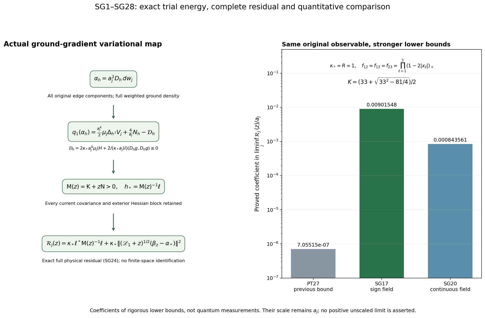
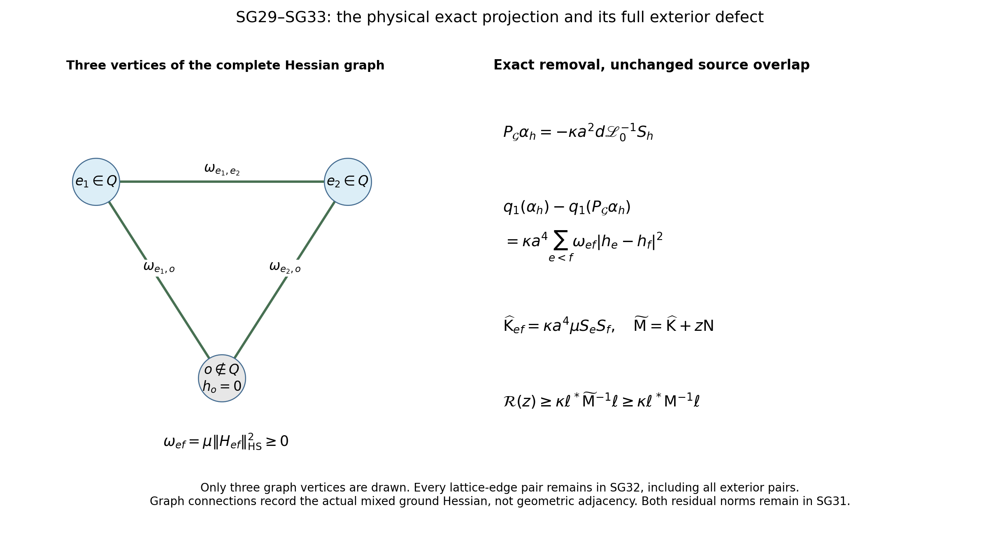

# Actual ground-gradient trials and their complete variational energy

This calculation uses the actual ground density, not a chosen comparison state. It constructs deterministic edge-weighted logarithmic gradients, computes their full one-form energy and outside terms, evaluates their overlap with the original curvature observable, and identifies the complete residual after optimization over all such edge weights. The inputs and their complete proofs are [CE1–CE11](https://github.com/KokunoYumeto/yang-mills-interacting-workbench/blob/0e459c141c01182be6a8bea1330a715f0d2ef843/yang-mills/continuations/20261011-central-signs-shrinking-window/CURRENT_COVARIANCE_EQUALITY.md), [BM16–BM17 and BM40–BM43](https://github.com/KokunoYumeto/yang-mills-interacting-workbench/blob/0e459c141c01182be6a8bea1330a715f0d2ef843/yang-mills/continuations/20261011-central-signs-shrinking-window/BOUNDED_ENERGY_MULTIPLIER.md), and [PT1–PT36](https://github.com/KokunoYumeto/yang-mills-interacting-workbench/blob/0e459c141c01182be6a8bea1330a715f0d2ef843/yang-mills/continuations/20261011-central-signs-shrinking-window/POSITIVE_TIME_COVARIANCE.md). The original-author differential-form sources and their bounded reading coverage remain recorded with PT. No new external theorem or novelty claim is introduced here.

## 1. Original state and the trial field

Retain the original open lattice, all positive edges \(\mathcal E_j\), all vertex gauge constraints, probability Haar measure, and radius-two edge metric with \(T_\beta=-i\sigma_\beta/2\) orthonormal. The full definitions are
\[
\begin{gathered}
z\in\{0,\ldots,2L_j\}^3,\quad L_j=j^4,\quad a_j=(100j)^{-1},\quad
g_j^2=\kappa_*a_j/2,\quad b_j=(\kappa_*a_j^2)^{-1},\\
U_p=U_d(z)U_k(z+e_d)U_d(z+e_k)^{-1}U_k(z)^{-1},\quad
D_p=2-\operatorname{Tr}U_p\quad(d<k),\\
x_{p,j}=o+a_j(z-L_j\mathbf1+(e_d+e_k)/2),\\
H_j=-\kappa_*\Delta+b_j\sum_pD_p,\quad
H_j\psi_j=E_{0,j}\psi_j,\quad \psi_j>0,\quad \|\psi_j\|=1,\\
w_j=\log\psi_j,\quad d\mu_j=\psi_j^2dU,\quad
A_j=H_j-E_{0,j}I,\quad
C_{\mathbf f,j}=a_j\sum_{\sigma,p:\sigma}f_\sigma(x_{p,j})D_p .
\end{gathered}\tag{SG1}
\]
Here \(\mathbf f\in C_c(\mathbb R^3;\mathbb R)^3\), \(u_{\mathbf f}=(C_{\mathbf f}-\mu C_{\mathbf f})\psi\), and \(\zeta_{\mathbf f}=A^{1/2}u_{\mathbf f}\). The complete scalar \(2b|\mathcal P_j|\) and vacuum energy \(E_0\) remain. Suppress \(j\) only within finite-regulator formulas.

Write \(g_e=\nabla_e w\), \(H_{ef}=\nabla_e\nabla_f w\), and \(T_e=\mu|g_e|^2\). Indices \(e,f\) in Hessian blocks denote edges, whereas bold \(\mathbf f\) is the unchanged observable test. A deterministic real edge list \(h=(h_e)\) defines a parallel self-adjoint bundle endomorphism \(D_h\), multiplying the entire three-dimensional edge cotangent summand by \(h_e\). Put
\[
\begin{gathered}
\alpha_h=a^2D_h\,dw,\qquad
N_h=\|\alpha_h\|_\mu^2=a^4\sum_eh_e^2T_e,\qquad
F_h=\sum_eh_e|g_e|^2,\\
\Delta_h=\sum_eh_e\Delta_e,\qquad
S_h=\Delta_hw+2F_h,\qquad
b_{\mathbf f}(h)=\langle dC_{\mathbf f},\alpha_h\rangle_\mu .
\end{gathered}\tag{SG2}
\]
The weight is constant in configuration space even when it varies from edge to edge. No derivative of a merely continuous spatial test is taken.

Each component projection is preserved by vertex gauge transformations. Hence \(\alpha_h\) is invariant as a one-form. It need not be horizontal or exact when the weights differ. All operations below initially use the full one-form space, as in PT18–PT21.

## 2. Complete exterior derivative and divergence

Use any local product orthonormal frame normal at the point. For configuration-coordinate indices \(i=(e,\beta)\), \(k=(f,\gamma)\), set \(h_i=h_e\). Because \(D_h\) is parallel and the Hessian is symmetric,
\[
(d\alpha_h)_{ik}=a^2(h_k-h_i)w_{ik},\qquad
d_\mu^*\alpha_h=-a^2S_h .
\tag{SG3}
\]
The same-edge exterior derivative is zero; within an arbitrary frame the connection and bracket terms give this same tensor identity. The norm of a two-form is the sum over \(i<k\) of its squared components. Consequently
\[
\begin{gathered}
q_1(\alpha_h)
:=\langle\alpha_h,\mathscr L_1\alpha_h\rangle_\mu\\
=\kappa a^4\left\{
\sum_{e<f}(h_e-h_f)^2\mu\|H_{ef}\|_{\rm HS}^2
+\mu S_h^2\right\}.
\end{gathered}\tag{SG4}
\]
The edge ordering only enumerates each unordered pair once. In particular, weights zero outside a patch leave every crossing Hessian block \(H_{ef}\) with exactly one weighted edge in the first sum. There is no locality assumption on the ground-state Hessian.

The original weighted Weitzenböck formula PT12 gives a second exact expression:
\[
q_1(\alpha_h)
=\kappa a^4\left\{
\sum_eh_e^2\mu\sum_f\|H_{ef}\|_{\rm HS}^2
+\frac12\sum_eh_e^2T_e
-2\mu H(D_hg,D_hg)\right\}.
\tag{SG5}
\]
Every mixed block is present in its first term. The factor \(1/2\) is the original product Ricci coefficient.

## 3. Ground equation and exact potential trace

Set \(V=b\sum_p(2-\operatorname{Tr}U_p)\). The full ground equation is
\(\kappa(\Delta w+|g|^2)=V-E_0\).
Differentiate it in an edge direction and use the radius-two gradient commutator. For \(Z_{h^2}=\sum_eh_e^2|g_e|^2\), the resulting scalar Bochner identity is
\[
(\Delta+2\nabla w\cdot\nabla)Z_{h^2}
=2\sum_eh_e^2\sum_f\|H_{ef}\|_{\rm HS}^2
+Z_{h^2}
+\frac2\kappa\sum_eh_e^2\langle g_e,\nabla_eV\rangle .
\tag{SG6}
\]
One can check each term directly: apply the product rule to \(|g_e|^2\); the commutation contributes \(2\operatorname{Ric}(g_e,g_e)=|g_e|^2\); differentiating \(|g|^2\) cancels the drift Hessian term. The parallel factor weights introduce no additional derivatives. The weighted mean of the left side is zero. Integration by parts gives
\(\mu\Delta_{h^2}V=-2\mu\sum_eh_e^2\langle g_e,\nabla_eV\rangle\).
Thus
\[
\sum_eh_e^2\mu\sum_f\|H_{ef}\|_{\rm HS}^2
+\frac12\sum_eh_e^2T_e
=\frac{\mu\Delta_{h^2}V}{2\kappa}.
\tag{SG7}
\]
This includes the complete exterior Hessian. It is the weighted version of the original partial identity used in BM42, derived here without imposing identical edge weights.

Each incident edge has Casimir
\(\Delta_eD_p=(3/4)(2-D_p)\). With
\(\sigma_{h^2,p}=\sum_{e\in\partial p}h_e^2\), it follows that
\[
\begin{gathered}
\mu\Delta_{h^2}V
=\frac{3b}{4}\sum_p\sigma_{h^2,p}(2-\mu D_p),\\
q_1(\alpha_h)
=\frac{a^4}{2}\mu\Delta_{h^2}V
-2\kappa a^4\mu H(D_hg,D_hg).
\end{gathered}\tag{SG8}
\]
All potential means, face incidences and scalar contributions survive in the first line. Differentiation annihilates \(E_0\) and the scalar potential only after the full ground equation has been used in (SG6).

The actual bound \(H\ge-2(\kappa a)^{-1}I\) gives the following identity with a nonnegative remainder:
\[
\begin{gathered}
\mathcal S=H+\frac{2}{\kappa a}I\ge0,\qquad
\mathcal D_h=2\kappa a^4\mu\mathcal S(D_hg,D_hg)\ge0,\\
q_1(\alpha_h)=\frac{a^4}{2}\mu\Delta_{h^2}V+\frac4aN_h-\mathcal D_h,\\
0\le q_1(\alpha_h)\le
\frac{a^4}{2}\mu\Delta_{h^2}V+\frac4aN_h .
\end{gathered}\tag{SG9}
\]
The subtraction \(\mathcal D_h\) is not assigned a value. It is the exact contribution needed when seeking an improvement over the displayed upper bound.

It also has a current-covariance representation. Since
\(\nabla F_h=2H D_hg\), weighted divergence integration yields
\[
\mu H(D_hg,D_hg)=-\frac12\mu(F_hS_h),\qquad
\mu S_h=0,\qquad
q_1(\alpha_h)=\frac{a^4}{2}\mu\Delta_{h^2}V
+\kappa a^4\operatorname{Cov}_\mu(F_h,S_h).
\tag{SG10}
\]
The first equality follows by integrating
\(\operatorname{div}_\mu(F_hD_hg)=2H(D_hg,D_hg)+F_hS_h\);
its integral is zero on the compact manifold. This evaluates the connecting map to the actual current covariance and keeps its sign undetermined.

## 4. Exact source overlap and the resolvent bound

Partial integration of the original observable gives
\[
\begin{gathered}
b_{\mathbf f}(h)
=-\frac{a^2}{2}\mu\Delta_hC_{\mathbf f}\\
=\frac{3a^3}{8}\sum_{\sigma,p:\sigma}
f_\sigma(x_p)\sigma_{h,p}(\mu D_p-2),\qquad
\sigma_{h,p}=\sum_{e\in\partial p}h_e .
\end{gathered}\tag{SG11}
\]
In the CE7 notation this is exactly \(a^2B_{\mathbf f}(h)/2\). The sign, the original face centers and the scalar term \(2\) are fixed by this calculation.

For the physical resolvent correlation
\(\mathcal R_{\mathbf f}(z)
=\langle\zeta_{\mathbf f},(A+zI)^{-1}\zeta_{\mathbf f}\rangle\),
PT16 and Cauchy–Schwarz in the positive form of \(\mathscr L_1+zI\) imply
\[
\mathcal R_{\mathbf f}(z)
=\kappa\langle dC_{\mathbf f},(\mathscr L_1+zI)^{-1}dC_{\mathbf f}\rangle_\mu
\ge
\frac{\kappa\,|b_{\mathbf f}(h)|^2}{q_1(\alpha_h)+zN_h},
\qquad z>0 .
\tag{SG12}
\]
If \(\alpha_h=0\), its overlap vanishes and the inequality is used without division. Otherwise the denominator is strictly positive. Explicitly, apply Cauchy–Schwarz to \((\mathscr L_1+zI)^{-1/2}dC\) and \((\mathscr L_1+zI)^{1/2}\alpha_h\). No exactness of the trial is required.

The physical exact-space projection \(P_{\mathcal G}\) from PT14 has a precise role. It commutes with \(\mathscr L_1\) and contains \(dC\), so
\[
\begin{gathered}
\langle dC,P_{\mathcal G}\alpha_h\rangle_\mu=b_{\mathbf f}(h),\\
q_1(\alpha_h)+z\|\alpha_h\|^2
=q_1(P_{\mathcal G}\alpha_h)+z\|P_{\mathcal G}\alpha_h\|^2\\
\hspace{15mm}
+q_1((I-P_{\mathcal G})\alpha_h)
+z\|(I-P_{\mathcal G})\alpha_h\|^2 .
\end{gathered}\tag{SG13}
\]
The cross terms vanish because the projection reduces the nonnegative operator. Thus physical exact projection preserves the source pairing and can only improve this trial's denominator. Formula (SG13) supplies its complete discarded part rather than assuming that a component-weighted gradient was already physical and exact.

## 5. Quantitative original-path evaluation

Fix a cube of side \(R\) containing all spatial tests and weights, with the original fitting patch and all crossing faces of CE4. Its counts are
\(N_Q=3q(q+1)^2\), \(M_Q=3q^2(q+1)\), \(q=\lceil R/a\rceil+3\), and its actual crossing count is
\(C_Q=2q(q+1)\sum_d[\mathbf1_{\{v_d>0\}}+\mathbf1_{\{v_d+q<2L\}}]\).
Retain the full energy comparison
\[
\begin{gathered}
\kappa^2a^2T_Q+d_Q\le E_Q/b\le\Lambda_Q,\qquad
E_Q=E_0-E_{\rm out},\quad d_Q=\mu W_Q,\quad T_Q=\sum_{e\in Q}T_e,\\
\Lambda_Q=\min\{2M_Q,6g^2\sqrt{N_QM_Q}\}+2C_Q,\\
\mathsf L_R=9\kappa_*R^3+24R^2,\qquad
K_R=\frac{\mathsf L_R+\sqrt{\mathsf L_R^2-81\kappa_*^2R^6/4}}2,\\
\limsup a^2(\Lambda_Q-d_Q)\le K_R .
\end{gathered}\tag{SG14}
\]
In particular \(N_h\le a^4\|h\|_\infty^2T_Q\), so bounded supported weights give
\(\limsup N_h\le\|h\|_\infty^2K_R/\kappa_*^2\).
The outside ground energy and all crossing terms are still present in (SG14).

First use the original CE7 signs
\(h_e=\operatorname{sgn}t_d(x_e)\) on a direction-\(d\) inside edge and zero outside, where
\(t_1=f_{12}+f_{13}\), \(t_2=f_{12}+f_{23}\), \(t_3=f_{13}+f_{23}\).
CE7–CE9, or the absolute-value Riemann sum in (SG11), prove
\[
b_{\mathbf f}(h)\longrightarrow-\frac32J_{\rm edge},\qquad
J_{\rm edge}=\sum_d\int|t_d|>0,\qquad
\limsup N_h\le K_R/\kappa_*^2 .
\tag{SG15}
\]
This nonzero overlap is for the original unmodified test. The sign weights need not have a Riemann-integrable square when a zero set has a complicated boundary; no such limit is assumed.

For the energy upper bound, use \(h_e^2\le1\). Each inside face has four inside edges and each crossing face exactly one. Equation (SG8) then gives
\[
\mu\Delta_{h^2}V
\le\frac{3b}{2}(4M_Q+C_Q),\qquad
\limsup a\,q_1(\alpha_h)
\le\frac{9R^3}{\kappa_*}+\frac{4K_R}{\kappa_*^2}.
\tag{SG16}
\]
Indeed the complete trace in (SG8) has been retained before applying \(D_p\ge0\); the crossing count is \(O(a^{-2})\), while \(a^3M_Q\to3R^3\), and \(b=1/(\kappa_*a^2)\). These facts give every coefficient displayed in (SG16). Combining the actual bound with (SG12) proves, for fixed \(z>0\),
\[
\liminf_{j\to\infty}\frac{\mathcal R_{\mathbf f,j}(z)}{a_j}
\ge
\frac{9\kappa_*^3J_{\rm edge}^{\,2}}
{4(9\kappa_*R^3+4K_R)} .
\tag{SG17}
\]
Here \(azN_h\to0\); no energy unit has changed in the definition of \(\mathcal R\). This is a proved lower bound at the stated scale, not a positive unscaled limit.

There is also an exact trace limit for continuous edge weights. Let \(h_d\in C_c(\mathbb R^3;\mathbb R)\), use \(h_e=h_d(x_e)\), and keep a patch containing their supports and the observable's support. Write
\[
I_h=\sum_d\int h_dt_d,\qquad
J_{h,2}=\sum_d\int h_d^2,\qquad
H_\infty=\max_d\|h_d\|_\infty .
\tag{SG18}
\]
The edge centers are \(x_e=o+a(z-L\mathbf1+e_d/2)\). On a face in directions \(d,k\), uniform continuity gives
\(\sigma_{h,p}=2(h_d+h_k)(x_p)+o(1)\) and
\(\sigma_{h^2,p}=2(h_d^2+h_k^2)(x_p)+o(1)\), uniformly on the fixed support.
The error in each scalar sum is controlled by its modulus times \(O(a^{-3})\). For the potential part of the trace, its absolute value is bounded by a constant times \(bH_\infty^2\mu W_{Q'}\), with \(Q'\) the same fitting patch enlarged once to include all incident faces. CE4 gives \(\mu W_{Q'}=O(a^{-2})\); multiplying this error by \(a^5\) makes it \(O(a)\). The observable overlap's potential term similarly has magnitude at most a constant times \(a^3\|\mathbf f\|_\infty H_\infty\mu W_{Q'}=O(a)\). Thus the complete original formulas imply
\[
b_{\mathbf f}(h)\longrightarrow-\frac32I_h,\qquad
\frac{a^5}{2}\mu\Delta_{h^2}V\longrightarrow\frac{3J_{h,2}}{\kappa_*},\qquad
\limsup N_h\le H_\infty^2K_R/\kappa_*^2 .
\tag{SG19}
\]
The one-layer enlargement can be taken as \(q\mapsto q+2\), \(v\mapsto v-\mathbf1\) when needed; the fixed support lies away from the open lattice boundary for all sufficiently large regulators. Its exact counts are still those of (SG14), with these new arguments. Since \(a(q+2)\to R\) and \(a^2(q+2)(q+3)\to R^2\), the leading volume and crossing terms, and hence the constant \(K_R\), are unchanged in the stated limits. This also covers the side-one test below without replacing its support cube by a larger fixed cube. No spatial derivative of \(h_d\) was used.

One explicit choice is \(h_d=t_d\), retaining these full sums without dividing them by a size parameter. Then \(I_h=J_{h,2}=J_t:=\sum_d\int t_d^2>0\) for nonzero \(\mathbf f\): indeed \(f_{12}=(t_1+t_2-t_3)/2\), \(f_{13}=(t_1+t_3-t_2)/2\), and \(f_{23}=(t_2+t_3-t_1)/2\), so all three \(t_d\) can vanish only for the zero test. Set \(H_t=\max_d\|t_d\|_\infty\). Equations (SG9), (SG12) and (SG19) give the additional actual bound
\[
\liminf_{j\to\infty}\frac{\mathcal R_{\mathbf f,j}(z)}{a_j}
\ge
\frac{9\kappa_*^3J_t^2}{4(3\kappa_*J_t+4H_t^2K_R)} .
\tag{SG20}
\]
No comparison between (SG17), (SG20) and PT27 is presumed; all three remain available for the unchanged observable.

## 6. Exact optimization over all deterministic edge weights

For a fixed finite edge set \(Q\), put \(\alpha_e=a^2\Pi_e dw\). Every \(T_e\) is strictly positive. Otherwise its nonnegative integral would force \(\nabla_e w=0\) everywhere by full support and continuity, making \(\psi\) independent of \(U_e\). The ground equation would then force \(V\) independent of \(U_e\). Set all other links to the identity: every face incident to \(e\) contributes \(b(2-\operatorname{Tr}U_e)\), also for inverse orientation because the SU(2) trace is unchanged under inverse. Every edge of the stated open three-dimensional cube belongs to an elementary face. This contradicts the required independence. Consequently the \(\alpha_e\) have positive disjoint-component squared norms \(a^4T_e\) and are linearly independent.

Their full energy, norm and source matrices are
\[
\begin{gathered}
\mathsf N_{ef}=a^4\delta_{ef}T_e,\qquad
\mathsf K_{ef}
=a^4\delta_{ef}\frac{3b}{8}\sum_{p\ni e}(2-\mu D_p)
-2\kappa a^4\mu H_{ef}(g_e,g_f),\\
\ell_e=\langle\alpha_e,dC_{\mathbf f}\rangle_\mu
=\frac{3a^3}{8}\sum_{p\ni e}f_p(\mu D_p-2),\qquad
\mathsf M(z)=\mathsf K+z\mathsf N>0 .
\end{gathered}\tag{SG21}
\]
Equation (SG5) and (SG7), polarized in the real edge weights, prove the formula for \(\mathsf K\). Complex combinations give the same Hermitian form. Positive definiteness of \(\mathsf M\) follows from \(z>0\) and the just-proved independence; no Moore–Penrose replacement or unproved rank assumption is needed.

There is a second full expression retaining all current covariances:
\[
\begin{gathered}
S_e=\Delta_ew+2|g_e|^2,\qquad
\mathsf K_{ee}
=\kappa a^4\left(\mu S_e^2+\sum_{f\ne e}\mu\|H_{ef}\|_{\rm HS}^2\right),\\
\mathsf K_{ef}
=\kappa a^4\left(\mu S_eS_f-\mu\|H_{ef}\|_{\rm HS}^2\right)
\quad(e\ne f).
\end{gathered}\tag{SG22}
\]
For the diagonal, apply (SG4) to the single-edge weight. For the off-diagonal, polarize the same identity: the pair's exterior derivatives have opposite signs on their shared mixed Hessian block, and their weighted divergences give the displayed covariance. The diagonal sum is over every edge of the full lattice, including those outside the trial set \(Q\). Comparing (SG21) and (SG22) proves their exact signed contraction relation, with no positivity assigned to an individual off-diagonal entry.

Optimization of the finite positive quadratic form gives
\[
h_*(z)=\mathsf M(z)^{-1}\ell,\qquad
\mathcal R_{\mathbf f}(z)\ge\kappa\,\ell^*\mathsf M(z)^{-1}\ell .
\tag{SG23}
\]
Indeed \(\sup_h\{2\operatorname{Re}\ell^*h-h^*\mathsf M h\}=\ell^*\mathsf M^{-1}\ell\) by completing the square. This is the best variational value in the entire deterministic edge-weighted ground-gradient space. The optimizing coefficients are not assumed uniformly bounded in the regulator, so the bounds for the particular weights in Section 5 are not automatically assigned to them.

The complete residual is also exact. Let
\(\beta_z=(\mathscr L_1+zI)^{-1}dC_{\mathbf f}\) and
\(\alpha_*=\sum_{e\in Q}(h_*)_e\alpha_e\). Then
\[
\mathcal R_{\mathbf f}(z)
=\kappa\,\ell^*\mathsf M(z)^{-1}\ell
+\kappa\|(\mathscr L_1+zI)^{1/2}(\beta_z-\alpha_*)\|_\mu^2 .
\tag{SG24}
\]
For each \(\alpha_e\), the form inner product against \(\beta_z\) is \(\ell_e\). The equation \(\mathsf M h_*=\ell\) therefore makes the residual form-orthogonal to the whole finite trial span. Pythagoras in this positive form proves (SG24). It gives the exact receiving map from this trial optimization to the full physical response; the missing part is the displayed nonnegative norm.

## 7. A forced equation for the actual trial and the remaining calculation

The same differentiated ground equation gives another exact map. As a one-form,
\[
\begin{gathered}
\mathcal B\,dw=-dV,\qquad
\mathcal B=\kappa(\nabla_\mu^*\nabla+\tfrac12 I),\\
\mathcal B\alpha_h=-a^2D_h\,dV,\qquad
\alpha_h=-a^2\mathcal B^{-1}D_h\,dV .
\end{gathered}\tag{SG25}
\]
To verify signs, differentiate
\(\Delta w+|dw|^2=(V-E_0)/\kappa\).
The scalar-gradient commutation is
\(d\Delta w=-\nabla^*\nabla dw-\operatorname{Ric}^{\#}dw\),
and \(d|dw|^2=2Hdw=2\nabla_{\nabla w}dw\).
The stated \(\operatorname{Ric}^{\#}=I/2\) gives the first line. Since \(D_h\) is parallel, it commutes with the rough weighted operator and \(I/2\), which gives the second line. Finally \(\mathcal B\ge\kappa I/2\), so its inverse is bounded on the full one-form Hilbert space. All finite source forms are smooth and in its domain. Thus the trial is received exactly from the derivative of the original plaquette potential, with no assigned effective force.

For continuous weights the complete possible cancellation at the next scale is
\[
a\,q_1(\alpha_h)
=\frac{a^5}{2}\mu\Delta_{h^2}V+4N_h-a\mathcal D_h,\qquad
\frac{a^5}{2}\mu\Delta_{h^2}V\longrightarrow\frac{3J_{h,2}}{\kappa_*}.
\tag{SG26}
\]
All terms of this identity are actual expectations; the nonnegative difference on its left is not assumed to have a positive limit or to vanish. Equations (SG17) and (SG20) establish quantitative order-\(a\) lower bounds, while (SG26) identifies the exact Hessian/current cancellation whose sharper evaluation would improve this trial. The full matrix (SG21)–(SG22) also allows collective choices of the edge weights, with the complete physical residual (SG24) retained.

The next calculation is to evaluate those signed matrix contractions and their collective small-energy directions using the actual forced equation (SG25), the conditional ground equation BM40, and the covariance remainder BM42. The finite matrix is not itself the full Hamiltonian, and (SG24) is the proved map specifying its remaining part. The smooth interacting four-dimensional no-gap endpoint, reconstruction, and the actual original-window weights remain the research objective.

## 8. A complete quantitative comparison for the original three-orientation test

Take \(\kappa_*=1\), \(R=1\), and retain all three orientations with
\(f_{12}=f_{13}=f_{23}=f\), where
\(f(x)=\prod_{\ell=1}^3(1-2|x_\ell|)_+\).
The one-dimensional integrals are
\(2\int_0^{1/2}(1-2x)\,dx=1/2\) and
\(2\int_0^{1/2}(1-2x)^2\,dx=1/3\).
Therefore
\[
\begin{gathered}
F=1,\quad \chi=16,\quad
\int f=1/8,\quad \int f^2=1/27,\quad
J_{\rm edge}=3/4,\quad J_t=4/9,\quad H_t=2,\\
\mathsf L_R=9+24=33,\quad
K=\frac{33+\sqrt{33^2-81/4}}2,\qquad 32<K<33,\\
c_{\rm PT}=
\frac{\left[9(3/4)^2/(4K)\right]^2}
{21\cdot3\cdot(1/27)+4\cdot16K},\\
c_{\rm sign}=\frac{9(3/4)^2}{4(9+4K)},\qquad
c_{\rm continuous}=\frac{9(4/9)^2}{4(3(4/9)+4\cdot2^2K)} .
\end{gathered}\tag{SG27}
\]
The three constants are the actual lower-bound coefficients for \(\liminf\mathcal R_{\mathbf f,j}(z)/a_j\) supplied respectively by PT27, SG17 and SG20. Every test factor and orientation multiplicity has been retained. The inequality \(32<K<33\) follows by comparing the radicand with \(31^2\) and \(33^2\).

For this fixed test the sign trial improves the previous bound by more than ten thousand:
\[
\frac{c_{\rm sign}}{c_{\rm PT}}
=\frac{256K^2(7/3+64K)}{81(36+16K)}
>\frac{256\cdot32^2\cdot(64\cdot32)}{81(36+16\cdot33)}
>10{,}000 .
\tag{SG28}
\]
The first equality is direct algebra from the unreplaced constants in (SG27). For the first inequality use \(32<K<33\), keeping \(7/3>0\) as the additional positive numerator contribution. For the second, the numerator is \(536870912\), exceeding \(10{,}000\) times the denominator \(45684\). The figure plots these proved coefficients; it is not a measurement of the quantum state or evidence of a nonzero unscaled limit.

## 9. Exact physical projection removes the full Hessian graph energy

The projection inequality (SG13) has a stronger exact evaluation. All trial forms \(\alpha_h\) are invariant. Their weighted divergence is \(-a^2S_h\), an invariant mean-zero scalar. The scalar operator \(\mathscr L_0=-\kappa(\Delta+2\nabla w\cdot\nabla)\) has a bounded inverse on the finite-regulator mean-zero invariant space. Define
\[
\begin{gathered}
\widehat\alpha_h:=P_{\mathcal G}\alpha_h
=-\kappa a^2d\,\mathscr L_0^{-1}S_h,\qquad
d\widehat\alpha_h=0,\qquad d_\mu^*\widehat\alpha_h=-a^2S_h,\\
q_1(\widehat\alpha_h)=\kappa a^4\mu S_h^2,\qquad
\|\widehat\alpha_h\|_\mu^2
=\kappa a^4\langle S_h,\mathscr L_0^{-1}S_h\rangle_\mu .
\end{gathered}\tag{SG29}
\]
To prove the projection formula, its right side is exact and invariant, and its weighted divergence is \(-a^2S_h\) because \(d_\mu^*d=\mathscr L_0/\kappa\). Its difference from \(\alpha_h\) is therefore orthogonal to all exact invariant forms by integration by parts. This characterizes \(P_{\mathcal G}\). The inverse sends smooth mean-zero functions to smooth functions by the finite elliptic domain argument in PT. The energy follows from \(d\widehat\alpha_h=0\); its norm follows by one scalar integration by parts. Thus no unproved physical exactness has been assigned to the original component-weighted form.

For the basis in (SG21), define the projected matrices
\[
\begin{gathered}
\widehat{\mathsf N}_{ef}
=\kappa a^4\langle S_e,\mathscr L_0^{-1}S_f\rangle_\mu,\qquad
\widehat{\mathsf K}_{ef}=\kappa a^4\mu S_eS_f,\\
0\le\widehat{\mathsf N}\le\mathsf N,\qquad
0\le\widehat{\mathsf K}\le\mathsf K,\qquad
\widetilde{\mathsf M}(z)=\widehat{\mathsf K}+z\mathsf N>0 .
\end{gathered}\tag{SG30}
\]
The norm difference is the Gram matrix of \((I-P_{\mathcal G})\alpha_e\). The energy difference is computed in (SG32) below. Positive definiteness of \(\widetilde{\mathsf M}\) follows from the already proved \(\mathsf N>0\), even if the projected forms have linear dependencies. Both projected matrices themselves are only claimed positive semidefinite.

Set \(\widehat h=\widetilde{\mathsf M}(z)^{-1}\ell\), \(\alpha_{\widehat h}=\sum_e\widehat h_e\alpha_e\), and use the same full \(\beta_z\) as (SG24). The sharper bound and its exact residual are
\[
\begin{gathered}
\mathcal R_{\mathbf f}(z)\ge
\kappa\ell^*\widetilde{\mathsf M}(z)^{-1}\ell
\ge\kappa\ell^*\mathsf M(z)^{-1}\ell,\\
\mathcal R_{\mathbf f}(z)
=\kappa\ell^*\widetilde{\mathsf M}(z)^{-1}\ell
+\kappa\|(\mathscr L_1+zI)^{1/2}
(\beta_z-P_{\mathcal G}\alpha_{\widehat h})\|_\mu^2
+\kappa z\|(I-P_{\mathcal G})\alpha_{\widehat h}\|_\mu^2 .
\end{gathered}\tag{SG31}
\]
For a proof valid also for complex coefficients, the source pairing of \(P_{\mathcal G}\alpha_h\) is still \(\ell^*h\), while its form energy is
\(h^*(\widehat{\mathsf K}+z\widehat{\mathsf N})h\).
Completing the square against \(\beta_z\) shows that the full response divided by \(\kappa\) is
\(2\operatorname{Re}\ell^*h-h^*(\widehat{\mathsf K}+z\widehat{\mathsf N})h\)
plus the squared form norm of the residual. At \(\widehat h\), replace this quadratic expression by
\(\ell^*\widetilde{\mathsf M}^{-1}\ell+
z\widehat h^*(\mathsf N-\widehat{\mathsf N})\widehat h\).
This proves the equality and its first lower bound. The second follows from
\(\widetilde{\mathsf M}\le\mathsf M\) and the positive inverse order, proved variationally in PT21. In particular, this is a proved improvement over (SG23), not a new assumed smallness condition.

The complete removed energy is a weighted graph on the original edge indices:
\[
\begin{gathered}
\omega_{ef}=\mu\|H_{ef}\|_{\rm HS}^2=\omega_{fe}\ge0,\qquad e\ne f,\\
q_1(\alpha_h)-q_1(P_{\mathcal G}\alpha_h)
=\kappa a^4\sum_{e<f}\omega_{ef}|h_e-h_f|^2
=h^*(\mathsf K-\widehat{\mathsf K})h .
\end{gathered}\tag{SG32}
\]
Subtract (SG29) from (SG4) and polarize. The sum is over every unordered pair of lattice edges; it is not restricted to geometrically adjacent edges. For a trial set \(Q\), extend \(h\) by zero outside. The corresponding diagonal includes all connections to those exterior vertices of this graph. Its zero-energy weights are exactly those constant on every connected component of the graph of strictly positive \(\omega_{ef}\); any component meeting the exterior must carry the constant zero. Indeed each summand is nonnegative, so a zero sum forces equality along each positive-weight pair; chaining gives constancy. Conversely that constancy makes every term zero. This gives the exact space and connecting map defined by the curl defect, without dropping the exterior pairs.

Finally the current covariance has a full density formula. With \(n=\psi^2\), the product rule gives \(nS_e=\Delta_en/2\). Twice integrating on the edge factor gives
\[
\begin{gathered}
\mu S_e=0,\qquad
\mu S_eS_f=\frac14\int_M
\frac{(\Delta_en)(\Delta_fn)}{n}\,dU,\\
\ell_e=-a^2\mu[(C_{\mathbf f}-\mu C_{\mathbf f})S_e]
=-\frac{a^2}{2}\int_M C_{\mathbf f}\Delta_en\,dU .
\end{gathered}\tag{SG33}
\]
All denominators are positive at finite regulator. These expressions identify the remaining matrix in (SG31) as an actual density-current Gram matrix and give its exact source covariance. The subtraction of the mean in the second line is justified by the first line. Equations (SG29)–(SG33) strengthen the original trial before taking any limit: they remove its entire nonnegative curl cost, retain both residual norms, and specify the density derivatives that must next be evaluated collectively. They do not assign a positive unscaled response or an original-window value.

Complete reproducible diagnostics and figure sources are in check_ground_gradient.py. The plotted coefficients are the proved bounds in SG27, not measured quantum expectations. The curved compact density checks test the geometric identities and are explicitly distinguished from the actual Yang–Mills ground. Exact provider editions and reading coverage are recorded in [the source-use ledger](GROUND_GRADIENT_SOURCE_USE_LEDGER.json).

The three drawn vertices are a schematic subset of the full graph on original lattice edges. Every omitted pair remains in SG32. The exact projection, both residual norms, and the density-current covariance are proved in SG29–SG33; the graph is not an assumed local-interaction model.

## Conditional ground currents and independent fluctuation weights

[CG1–CG34](https://github.com/KokunoYumeto/yang-mills-interacting-workbench/blob/main/yang-mills/continuations/20261011-central-signs-shrinking-window/CONDITIONAL_GROUND_CURRENT_TRIAL.md) split the actual ground-gradient trial into orthogonal marginal and conditional-fluctuation parts. The fluctuation has zero source overlap, so its independent weight can be optimized. The complete current matrix, including exterior drift and all zero directions, gives an exact nonnegative improvement over the previous SG matrix and an explicit additional lower-bound term. The physical resolvent retains both full residual norms. The conditional ground equation evaluates the remaining marginal contribution while preserving outside energy, crossing faces and conditional kinetic derivatives. Complete proofs, reproducible diagnostics and an inspected figure are included; no positive value of the limiting gain is assumed. A further exact minimization over every outside one-form replaces the conditional noise by its full outside resolvent multiplier, without an exterior-mode cutoff. Its original-Hamiltonian map, additional nonnegative gain, zero space, mixed derivatives and both physical residual norms are proved in CG23–CG34. Fixed-regulator small-z limits are not interchanged with the regulator limit.

## Retained derivatives and actual good boundary cubes

[RD1–RD22](https://github.com/KokunoYumeto/yang-mills-interacting-workbench/blob/main/yang-mills/continuations/20261011-central-signs-shrinking-window/RETAINED_DERIVATIVE_AND_GOOD_BOUNDARIES.md) evaluate the derivative retained in CG22 using the full ground equation, marginal equation, conditional variance and both Hessian contractions. The original supported sign and continuous weights have exactly zero direct crossing trace. For unit edge magnitudes, deterministic boundary selection in the actual ground gives a vanishing scaled crossing potential while the full Laplacian trace tends to \(9R^2/\kappa_*\). The original square-root collar and an additional logarithmic collar have complete finite bounds and different proved error rates. Every scalar, outside energy and conditional-current term remains in the calculation; no limiting spectral weight is assumed.

## Wilson covariance and ground-current signs

[GS1–GS12](https://github.com/KokunoYumeto/yang-mills-interacting-workbench/blob/main/yang-mills/continuations/20261011-central-signs-shrinking-window/WILSON_AND_CURRENT_COVARIANCE_SIGNS.md) construct a smooth gauge-invariant comparison on two disjoint original plaquettes with strictly positive Wilson-trace covariance and strictly negative distinct-edge ground-current covariance. Complete analytic constants, partition factors and the comparison Hamiltonian are retained. The exact unitary, full potential difference, vacuum change and current transformation connect it to the original Yang–Mills ground. The comparison rules out an inference from Wilson positivity alone; the specific actual-current contractions remain to be evaluated.

## Conditional outside forcing and current moments

[OC1–OC24](https://github.com/KokunoYumeto/yang-mills-interacting-workbench/blob/main/yang-mills/continuations/20261011-central-signs-shrinking-window/OUTSIDE_FORCE_AND_CURRENT_MOMENTS.md) derive the actual conditional score equation, positive averaged potential Hessian and complete outside-current forcing, preserving the entire original kinetic quotient and every mixed Hessian. Exact first and second moments give a quantified resolvent improvement with both physical residuals. A crossing plaquette proves that the full-cube positive-weight current is nonzero, so the specified finite-regulator improvement is strictly positive. The full covariance, Hessian and force kernels coincide and retain inside gauge directions. The global oscillation comparison is evaluated on the original path; it supplies no vanishing filter coefficient. The limiting current moments and smooth interacting no-gap endpoint remain open calculations.

## Exact boundary projection and actual current-moment bounds

[BQ1–BQ18](https://github.com/KokunoYumeto/yang-mills-interacting-workbench/blob/main/yang-mills/continuations/20261011-central-signs-shrinking-window/BOUNDARY_FORCE_PROJECTION.md) prove that the derivative of the original inside kinetic quotient is the full weighted exact projection of the inside potential gradient. Every wholly inside face derivative cancels from the conditional force; the complete crossing field and original ground-state projection remain. Exact projection and Casimir-gradient remainders give actual force and mixed-Hessian bounds on both established collars, including \(a_j^6\|F_j\|^2\to0\) and \(a_j^5\mathcal O_{Q_j}\to0\). The first current moment is computed without third kinetic derivatives and has a quantitative upper estimate. The second moment retains its weighted boundary divergence and all six signed covariance terms. Unscaled limiting spectral mass and the smooth interacting no-gap endpoint remain active calculations.

## Boundary divergence and marginal second moments

[BD1–BD19](https://github.com/KokunoYumeto/yang-mills-interacting-workbench/blob/main/yang-mills/continuations/20261011-central-signs-shrinking-window/BOUNDARY_DIVERGENCE_AND_MARGINAL_MOMENTS.md) prove an exact mixed derivative and two-square identity for the full projected boundary field. Weighted integration removes its mixed-Hessian contraction from the divergence estimate while retaining the inside score and every original crossing derivative. Both established collars give \(\smash{a_j^7\|J_j\|^2\to0}\) with explicit rates. The existing marginal-gradient block has complete first and second moments and \(\smash{a_j^{11}m_{2,j}^\gamma\to0}\), again with explicit collar constants. The arbitrary-weight force map, full scalar trial line, signed second-moment cross term, exact scalar optimizer and both physical residuals remain. The full-gradient mixed-Hessian fluctuation and limiting physical spectral weight still require evaluation.

## Original kinetic current and its full physical energy

[KC1–KC28](https://github.com/KokunoYumeto/yang-mills-interacting-workbench/blob/main/yang-mills/continuations/20261011-central-signs-shrinking-window/KINETIC_CURRENT_AND_PHYSICAL_ENERGY.md) retain the original kinetic quotient and its complete conditional mean, and decompose the full current into kinetic and score fluctuations. The actual kinetic variance has a boundary-count bound with all nonnegative energy remainders. Its first two moments control the full kinetic column of the conditional inverse at the original shrinking energy. Differentiating its conditional mean gives the exact full physical energy, including a retained conditional covariance. That covariance supplies an explicit enlargement of the physical scalar trial space, an exact Green-function gain and its full residual. The source gain and limiting physical spectral weight remain unevaluated; the complete earlier current family remains available.

## Complete local energy and physical spectral windows

[LE1–LE23](https://github.com/KokunoYumeto/yang-mills-interacting-workbench/blob/main/yang-mills/continuations/20261011-central-signs-shrinking-window/LOCAL_ENERGY_PHYSICAL_WINDOWS.md) add the entire retained inside-energy fluctuation to the conditional kinetic vector. Its full physical gradient is the original projected boundary field. Complete norm, first-moment and second-moment identities retain all scalar energies and cross terms; explicit upper and lower bounds are proved. The original supported observable has zero mixed first energy but a retained ordinary covariance and mixed second moment. Its full two-vector Green calculation includes the complementary physical residual. An invertible coefficient map proves that the complete inside-function trial space is the existing KC space, preventing a spurious additional gain. The original full-Hamiltonian shrinking-window tails are bounded; the actual surviving norm and source mass remain unevaluated.

## Smooth spatial energy and exact sector covariances

[WH1–WH33](https://github.com/KokunoYumeto/yang-mills-interacting-workbench/blob/main/yang-mills/continuations/20261011-central-signs-shrinking-window/SMOOTH_WEIGHTED_LOCAL_ENERGY.md) construct the complete original energy with smooth spatial weights and calculate its full physical forcing, including exact face-trace cancellation. A comparison for every actual edge subset and an exact finite level decomposition prove a variance bound while retaining all nested-sector covariances. The noncommuting weighted-sector defect is computed explicitly. The original observable trace has an evaluated limit; its subtracting covariance and all distinct-face energy contractions remain. Complete norm, first-energy and second-moment matrices give the scalar Green gain and full physical residual, including dependent-vector cases. Original shrinking-window upper functions improve. The exact one-face physical vector vanishes, demonstrating why surviving mass requires the actual coupling between faces. No limiting spectral mass is assigned.

## Actual filtered currents and the complete inverse contribution

[FTC1–FTC33](https://github.com/KokunoYumeto/yang-mills-interacting-workbench/blob/main/yang-mills/continuations/20261011-central-signs-shrinking-window/ACTUAL_FILTERED_CURRENT_AND_TAIL.md) transfer the original positive first energy to the outside Wilson source and prove a positive filtered-response bound with its original vanishing scale retained. The complete inverse contribution is located through an exact map from the physical window, including its full metric. Direct optimization of the filtered response retains the original force, every mixed Hessian and all exterior rows in a complete second-moment matrix. Both physical residual norms remain. An explicit comparison measure shows why the moment bounds alone do not establish surviving low-energy weight. The signed three-scale interacting response and the continuum no-gap endpoint remain active calculations.

## Actual score moments and the full second-energy matrix

[SOM1–SOM24](https://github.com/KokunoYumeto/yang-mills-interacting-workbench/blob/main/yang-mills/continuations/20261011-central-signs-shrinking-window/ACTUAL_SCORE_MOMENTS_AND_SECOND_ENERGY.md) prove all even moments and an exponential tail for the actual conditional ground-state score at every outside configuration. A full weighted score/Hessian identity controls the second-energy matrix with all exterior rows and force cross terms retained. Its original source-vector norm is evaluated with explicit removed-face and lattice-sampling errors. The matrix trace bound is sufficient for a fully evaluated filter estimate at its stated vanishing scale; it does not improve the earlier filter bound or establish surviving low-energy weight. Source-directed inverse and residual calculations, reconstruction and the smooth no-gap endpoint remain active.
