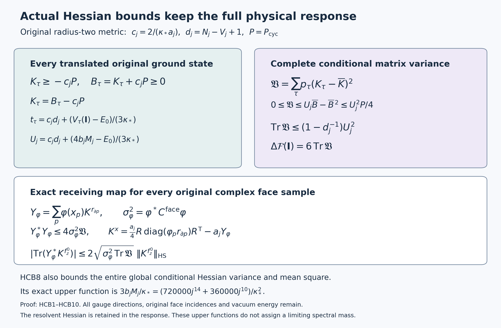

# Actual conditional Hessian bounds and the full response contraction

Reviewed derivation, 14 October 2026. This continues the actual original-state calculation in [CHM1–CHM13](https://github.com/KokunoYumeto/yang-mills-interacting-workbench/blob/db938fb3be2c57ac841d71a505ae9313e07ab33d/yang-mills/continuations/20261011-central-signs-shrinking-window/CENTRAL_HESSIAN_FACE_MAP.md). The original smooth interacting global no-gap state remains the goal.

The additional proof providers actually read are [HVR1–HVR15](https://github.com/KokunoYumeto/yang-mills-interacting-workbench/blob/db938fb3be2c57ac841d71a505ae9313e07ab33d/yang-mills/continuations/20261011-central-signs-shrinking-window/HESSIAN_RECEIVING_REVIEW.md), [PVI1–PVI17](https://github.com/KokunoYumeto/yang-mills-interacting-workbench/blob/db938fb3be2c57ac841d71a505ae9313e07ab33d/yang-mills/continuations/20261011-central-signs-shrinking-window/POTENTIAL_VARIANCE_IDENTITIES.md), and the complete CK, CFE and FPR proofs cited in CHM. In particular PVI7 already proves the integrated original log-Hessian identity; it is used below, not claimed as new. Thirteen bounded disk-index hits are routing records only. No new external reading or novelty claim is asserted.

Retain all original open-box vertices, edges, ordered plaquettes, boundary incidences and physical coordinates:
\[
\begin{gathered}
L_j=j^4,\quad a_j=(100j)^{-1},\quad
g_j^2=\kappa_*a_j/2,\quad b_j=(\kappa_*a_j^2)^{-1},\quad
s_j=100\kappa_*a_j,\\
N_j=3(2L_j)(2L_j+1)^2,\quad
M_j=3(2L_j)^2(2L_j+1),\quad
V_j=(2L_j+1)^3,\quad d_j=N_j-V_j+1,\\
x_p=o+a_j(z-L_j\mathbf1+(e_d+e_k)/2),\qquad d<k,\\
U_p=U_d(z)U_k(z+e_d)U_d(z+e_k)^{-1}U_k(z)^{-1},\quad
T_p=\operatorname{Tr}U_p,\quad D_p=2-T_p,\\
H=-\kappa_*\Delta+V_{\rm pot},\quad
V_{\rm pot}=2b_jM_j-b_j\sum_pT_p,\quad
H\psi=E_0\psi,\quad \psi>0,\quad \int\psi^2dU=1 .
\end{gathered}
\]
The metric on each link is the original radius-two metric with orthonormal \(T_\alpha=-i\sigma_\alpha/2\); every Haar measure is the original probability measure. Let \(D\) and \(R\) be exactly the full vertex incidence and face-boundary matrices in CHM1–CHM3, and let \(P=P_{\rm cyc}\) be CHM2's orthogonal projection onto \(\ker D^{\mathsf T}\). In particular \(\operatorname{Tr}P=d_j\).

Use every original central sign \(\tau\in\{\pm1\}^{N_j}\), \(n=2^{N_j}\), and the unchanged quantities
\[
\begin{gathered}
w_\tau=\log(\psi\circ D_\tau),\qquad
A^2=n^{-1}\sum_\tau e^{2w_\tau},\quad u=\log A,\quad
p_\tau=e^{2w_\tau}/(nA^2),\quad h_\tau=\sqrt{p_\tau},\\
r_S=\sum_\tau\chi_S(\tau)p_\tau,\qquad
\mathcal C_{S,T}=r_{S\triangle T}-r_Sr_T,\qquad
\mathcal F=\sum_\tau|dh_\tau|^2 .
\end{gathered}
\]
At the central configuration \(\mathbf I\), \(K_\tau=K^{w_\tau}\), \(\overline K=\sum p_\tau K_\tau\), \(\mathscr D_\tau=K_\tau-\overline K\), and \(\mathfrak V=\sum p_\tau\mathscr D_\tau^2\) are the actual edge matrices in CHM7–CHM8. All matrix equations through HCB7 are at that configuration. No matrix is assigned to the ground state by a realization construction.

## 1. Apply the original global Hessian bound to every translated state

The exact original-state bound needed here is
\[
\nabla^2\log\psi\ge-c_j g,\qquad
c_j=2\sqrt{b_j/\kappa_*}=\frac{2}{\kappa_*a_j}.
\tag{HCB1}
\]
Here is the full minimum-principle calculation, with the geometric identities supplied and proved in HVR3–HVR9. Write \(w=\log\psi\), \(h=\nabla^2w\), and \(\mathscr L=\Delta+2\nabla w\cdot\nabla\). On the original product, \(\operatorname{Ric}=\tfrac12g\), \(\nabla\operatorname{Ric}=0\), and
\[
\mathscr R(v,z,v,z)=\tfrac14\sum_e
\bigl(|v_e|^2|z_e|^2-\langle v_e,z_e\rangle^2\bigr).
\]
Commuting the two covariant derivatives of
\(\Delta w+|dw|^2=(V_{\rm pot}-E_0)/\kappa_*\), as in HVR4–HVR7, gives the entire tensor equality
\[
\begin{split}
\kappa_*^{-1}(\nabla^2 V_{\rm pot})_{ij}
={}&(\mathscr Lh)_{ij}+2h_{ik}h_{kj}
+2\mathscr R_{ikjl}h_{kl}\\
&-\operatorname{Ric}_{ik}h_{kj}
-\operatorname{Ric}_{jk}h_{ik}
+2\mathscr R_{ikjl}w_kw_l .
\end{split}
\]
At a negative global minimum eigenvalue \(\lambda\) of \(h\), take a unit eigenvector \(v\) and extend it by radial parallel transport. At the minimum \((\mathscr Lh)(v,v)\ge0\). The possible second derivative of the extension contributes \(2\lambda\langle v,\Delta v\rangle=0\), because the field is unit and its first covariant derivative vanishes there. The curvature and Ricci terms combine to
\(2\operatorname{tr}[\mathscr R(v,\cdot,v,\cdot)(h-\lambda g)]\ge0\), and the remaining gradient-curvature term is nonnegative. Consequently
\(2\lambda^2\le\kappa_*^{-1}\nabla^2V_{\rm pot}(v,v)\).

For every original ordered face and product geodesic with tangent \(Y=(Y_e)\), the four same-factor and twelve ordered distinct-factor trace derivatives give
\[
|\nabla^2D_p(Y,Y)|
\le\tfrac12\Bigl(\sum_{e\in\partial p}|Y_e|\Bigr)^2
\le2\sum_{e\in\partial p}|Y_e|^2.
\]
Every original edge has \(r_e\le4\) incident faces, including its actual boundary count. Therefore
\(\nabla^2V_{\rm pot}(Y,Y)\le2b_j\sum_e r_e|Y_e|^2\le8b_j|Y|^2\).
Combining these inequalities proves HCB1; the case of a nonnegative minimum is immediate. The constant \(2b_jM_j\) and \(E_0\) remain in the original ground equation even though their differentiated Hessians are zero.

Each \(D_\tau\) is an isometry. Pulling HCB1 back and using CHM1–CHM2 gives
\[
\begin{gathered}
K_\tau\ge-c_jP,\qquad
B_\tau:=K_\tau+c_jP\ge0,\qquad B_\tau=PB_\tau P,\\
t_\tau:=\operatorname{Tr}B_\tau
=c_jd_j+\frac{V_\tau(\mathbf I)-E_0}{3\kappa_*},
\qquad
V_\tau(\mathbf I)=2b_jM_j-2b_j\sum_p\chi_{\partial p}(\tau),\\
\overline B=\overline K+c_jP,\qquad
\overline t=c_jd_j+\frac{\overline V(\mathbf I)-E_0}{3\kappa_*}.
\end{gathered}\tag{HCB2}
\]
The trace formula follows directly from the translated ground equation, whose first derivative vanishes at \(\mathbf I\). Positivity first holds on the circulation subspace; both matrices kill the complementary original gauge directions, proving the displayed full-space inequalities. The auxiliary \(B_\tau\) is a comparison matrix only. Its inverse map is explicitly \(K_\tau=B_\tau-c_jP\), and all equations below retain that term.

## 2. An actual upper bound with its entire nonnegative remainder

The following matrix identity and positive remainder evaluate the actual conditional variance:
\[
\begin{gathered}
\mathfrak V
=\overline t\,\overline B-\overline B^{\,2}
-\frac{b_j}{3\kappa_*}\sum_pK^{r_{\partial p}}
-\mathcal R,\\
\mathcal R=\sum_\tau p_\tau B_\tau(t_\tau P-B_\tau)\ge0 .
\end{gathered}\tag{HCB3}
\]
For each \(\tau\), all eigenvalues of \(B_\tau\) on the circulation space are nonnegative and sum to \(t_\tau\). Thus \(t_\tau P-B_\tau\ge0\); these two factors commute, so their product is positive. Expanding the full square of \(B_\tau-\overline B=K_\tau-\overline K\) gives
\(\mathfrak V=\sum p_\tau B_\tau^2-\overline B^2\). By the definition of \(\mathcal R\), the first term is \(\sum p_\tau t_\tau B_\tau-\mathcal R\). Moreover
\[
\begin{split}
\sum_\tau p_\tau(t_\tau-\overline t)B_\tau
&=\frac1{3\kappa_*}\sum_\tau
p_\tau(V_\tau-\overline V)(K_\tau+c_jP)\\
&=-\frac{2b_j}{3\kappa_*}\sum_p\sum_\tau
p_\tau(\chi_{\partial p}(\tau)-r_{\partial p})K_\tau\\
&=-\frac{b_j}{3\kappa_*}\sum_pK^{r_{\partial p}} .
\end{split}
\]
The scalar \(c_jP\) cancels because the actual centered potential has zero mean. The last equality is exactly CHM7. This proves HCB3, including the source Hessian term and both orders in each matrix square; no commutation between distinct \(K_\tau\) is used.

Define the actual scalar ceiling
\[
U_j=c_jd_j+\frac{4b_jM_j-E_0}{3\kappa_*}.
\]
Since every original \(T_p\in[-2,2]\), \(0\le V_\tau(\mathbf I)\le4b_jM_j\), so \(0\le t_\tau\le U_j\) and \(0\le B_\tau\le U_jP\). It follows that
\[
\begin{gathered}
0\le\mathfrak V
\le U_j\overline B-\overline B^{\,2}
\le\frac{U_j^2}{4}P,\\
0\le\operatorname{Tr}\mathfrak V
\le U_j\overline t-\operatorname{Tr}\overline B^{\,2}
\le U_j\overline t-\frac{\overline t^{\,2}}{d_j}
\le\left(1-\frac1{d_j}\right)U_j^2 .
\end{gathered}\tag{HCB4}
\]
For the first bound square the eigenvalues of each \(B_\tau\): \(B_\tau^2\le U_jB_\tau\), then average and subtract \(\overline B^2\). The eigenvalues of \(\overline B\) lie in \([0,U_j]\), where \(U_jx-x^2\le U_j^2/4\). For the trace bound use Cauchy–Schwarz on its \(d_j\) eigenvalues. Finally \(0\le\overline t\le U_j\) and \(d_j\ge28\) for \(j\ge1\). The function \(U_jt-t^2/d_j\) is increasing on this interval, since its derivative is at least \(U_j(1-2/d_j)\ge0\). This proves the last line with its exact dimension factor. It is stronger for the trace than multiplying the operator ceiling by \(d_j\).

## 3. The exact defect in the curvature lower bound

Write
\[
\mathscr A_\tau=
\mathscr D_\tau-\frac{V_\tau(\mathbf I)-\overline V(\mathbf I)}
{3\kappa_*d_j}P,\qquad \operatorname{Tr}\mathscr A_\tau=0 .
\]
Then the complete original curvature has the exact positive decomposition
\[
\Delta\mathcal F(\mathbf I)
=\frac{8b_j^2}{3\kappa_*^2d_j}
\sum_{p,r}\mathcal C_{\partial p,\partial r}(\mathbf I)
+6\sum_\tau p_\tau\|\mathscr A_\tau\|_{\rm HS}^2 .
\tag{HCB5}
\]
Indeed \(3\operatorname{Tr}\mathscr D_\tau=(V_\tau-\overline V)/\kappa_*\) by CHM9. Expand the Hilbert–Schmidt square of its displayed scalar part plus \(\mathscr A_\tau\). The cross term is zero because \(P\mathscr A_\tau=\mathscr A_\tau\) and its trace is zero. The scalar term is
\((V_\tau-\overline V)^2/(9\kappa_*^2d_j)\).
Taking the original conditional mean, using the full variance
\(4b_j^2\sum_{p,r}\mathcal C_{\partial p,\partial r}\), and multiplying by the original colour factor \(6\) from CHM8 proves HCB5. Thus the lower bound CHM9 has a precise actual traceless-matrix defect. Equality holds exactly when every \(\mathscr A_\tau=0\), because every \(p_\tau>0\).

## 4. Retain every face covariance in the source estimate

Let \(C^{\rm face}_{p,r}=\mathcal C_{\partial p,\partial r}(\mathbf I)\). It is positive definite, as proved in CFE9/FPR3: the distinct nonconstant face characters together with the constant character are linearly independent on the full sign group, and all original probabilities are positive. Set
\[
\mathscr D^{\,{\rm face}}_\tau
=\frac12\sum_{p,r}
(\chi_{\partial p}(\tau)-r_{\partial p})
[(C^{\rm face})^{-1}]_{p,r}K^{r_{\partial r}},
\qquad
\mathscr E_\tau=\mathscr D_\tau-\mathscr D^{\,{\rm face}}_\tau .
\]
These are actual matrices formed from the full original probabilities. The exact identity is
\[
\mathfrak V
=\frac14\sum_{p,r}[(C^{\rm face})^{-1}]_{p,r}
K^{r_{\partial p}}K^{r_{\partial r}}
+\sum_\tau p_\tau\mathscr E_\tau^2 .
\tag{HCB6}
\]
To prove it, CHM7 gives
\(\sum_\tau p_\tau(\chi_{\partial p}-r_{\partial p})\mathscr D_\tau
=K^{r_{\partial p}}/2\).
The same calculation for \(\mathscr D^{\,{\rm face}}\), using
\(C^{\rm face}(C^{\rm face})^{-1}=I\), gives the same result. Hence the conditional covariance of \(\mathscr E_\tau\) with every centered face character is zero, entry by entry. Both cross terms in the expansion of
\((\mathscr D^{\,{\rm face}}_\tau+\mathscr E_\tau)^2\)
therefore have zero conditional mean, in their actual product order. Averaging the first square gives the first term of HCB6. Each remaining square is positive because the matrix is real symmetric. This proves the complete relation between the face part and the full character variance.

For the original complex samples \(\varphi_p=\varphi(x_p)\), set
\[
Y_\varphi=\sum_p\varphi_p K^{r_{\partial p}},
\qquad
\sigma_\varphi^2=\sum_{p,r}\overline{\varphi_p}
C^{\rm face}_{p,r}\varphi_r .
\]
The actual source and the FPR8 contraction obey
\[
\begin{gathered}
Y_\varphi^*Y_\varphi\le4\sigma_\varphi^2\mathfrak V,\\
\|Y_\varphi\|_{\rm HS}^2
\le4\sigma_\varphi^2\operatorname{Tr}\mathfrak V
\le4\sigma_\varphi^2(1-d_j^{-1})U_j^2,\\
K^x=\frac{a_j}{4}R\operatorname{diag}(\varphi_pr_{\partial p})R^{\mathsf T}
-a_jY_\varphi,\\
\left|12\kappa_*a_jA(\mathbf I)^2
\operatorname{Re}\sum_p\overline{\varphi_p}
\operatorname{Tr}\bigl(K^{r_{\partial p}}K^{f_z^0}\bigr)\right|\\
\le24\kappa_*a_jA(\mathbf I)^2
\sqrt{\sigma_\varphi^2\operatorname{Tr}\mathfrak V}
\ \|K^{f_z^0}\|_{\rm HS}.
\end{gathered}\tag{HCB7}
\]
For any complex edge vector \(v\), put
\(\xi_\varphi(\tau)=\sum_p\varphi_p(\chi_{\partial p}(\tau)-r_{\partial p})\).
Then \(Y_\varphi v=2\sum p_\tau\xi_\varphi(\tau)\mathscr D_\tau v\).
The weighted vector Cauchy–Schwarz inequality gives
\(\|Y_\varphi v\|^2\le4(\sum p_\tau|\xi_\varphi|^2)
(\sum p_\tau\|\mathscr D_\tau v\|^2)
=4\sigma_\varphi^2v^*\mathfrak Vv\).
This proves the operator inequality, and taking its full trace proves the Hilbert–Schmidt bound. The source equality is CHM12 with every original face term retained. Finally the trace sum is
\(\operatorname{Tr}(Y_\varphi^*K^{f_z^0})\), because each \(K^{r_{\partial p}}\) is real symmetric. Hilbert–Schmidt Cauchy–Schwarz and the first line prove the final inequality. This is precisely the original FPR8 term after its colour factor; it does not assign a bound to the remaining actual resolvent Hessian.

## 5. A global positive-square identity for the actual conditional Hessians

This section concerns all configurations, with full covariant tensors instead of their central edge matrices. Define
\[
\begin{gathered}
q_\tau=dw_\tau,\quad \overline q=\sum p_\tau q_\tau=du,\quad
\mathcal S=\sum_\tau p_\tau(q_\tau-du)\otimes(q_\tau-du),\\
\mathcal H_\tau=\nabla^2w_\tau,\qquad
\overline{\mathcal H}=\sum_\tau p_\tau\mathcal H_\tau .
\end{gathered}
\]
Differentiating the entire conditional mean gives
\[
dp_\tau=2p_\tau(q_\tau-du),\qquad
\nabla^2u=\overline{\mathcal H}+2\mathcal S,\qquad
\mathcal F=\operatorname{Tr}\mathcal S .
\]
The last equality follows from \(dh_\tau=h_\tau(q_\tau-du)\). The first two identities retain the derivatives of the actual probabilities, including their full factor two.

The exact global identity is
\[
\begin{split}
&\int A^2\left[
\|\nabla^2u-2\mathcal S\|_{\rm HS}^2
\vphantom{\sum_\tau}\right.\\
&\hspace{8mm}\left.
+\sum_\tau p_\tau\|\mathcal H_\tau-\nabla^2u+2\mathcal S\|_{\rm HS}^2
+\tfrac12\bigl(|du|^2+\mathcal F\bigr)
\right]dU\\
&\hspace{14mm}=
\frac{3b_j}{2\kappa_*}\sum_p\mu T_p
=\frac{3}{2\kappa_*}(2b_jM_j-\mu V_{\rm pot})
\le\frac{3b_jM_j}{\kappa_*}.
\end{split}\tag{HCB8}
\]
For a direct proof of the input PVI7, the original logarithmic equation and scalar Bochner formula give
\[
\tfrac12\mathscr L|dw|^2
=\|\nabla^2w\|_{\rm HS}^2+\tfrac12|dw|^2
+\kappa_*^{-1}\langle dw,dV_{\rm pot}\rangle .
\]
Integrating against \(\mu=\psi^2dU\) kills the weighted divergence on the left. Integration by parts in the last term gives
\(\mu\langle dw,dV_{\rm pot}\rangle=-\tfrac12\mu\Delta V_{\rm pot}\).
Since every original four-link face has \(\Delta T_p=-3T_p\), this proves
\[
\mu\|\nabla^2w\|_{\rm HS}^2+\tfrac12\mu|dw|^2
=\frac{1}{2\kappa_*}\mu\Delta V_{\rm pot}
=\frac{3b_j}{2\kappa_*}\sum_p\mu T_p .
\]
Now average the entire squared Hessian over all original central translations and use their isometries and the Haar change of variables:
\(\mu\|\nabla^2w\|^2=\int A^2\sum p_\tau\|\mathcal H_\tau\|^2dU\).
Expanding the finite conditional Hilbert-space variance gives
\(\sum p_\tau\|\mathcal H_\tau\|^2=
\|\overline{\mathcal H}\|^2+
\sum p_\tau\|\mathcal H_\tau-\overline{\mathcal H}\|^2\).
Insert \(\overline{\mathcal H}=\nabla^2u-2\mathcal S\). Similarly
\(\sum p_\tau|q_\tau|^2=|du|^2+\mathcal F\), which is CK4. These identities prove every term of HCB8. The final upper bound uses \(T_p\le2\) on each original face. The vacuum-energy relation remains
\[
E_0=\kappa_*\mu|dw|^2+\mu V_{\rm pot},
\qquad
\mu\|\nabla^2w\|_{\rm HS}^2
=\frac{3}{2\kappa_*}(2b_jM_j-E_0)+\mu|dw|^2 .
\]
In particular the score term in this last equality has a positive sign. At \(\mathbf I\), where all first derivatives vanish, the conditional Hessian-variance integrand in HCB8 equals \(3\operatorname{Tr}\mathfrak V\), agreeing with the full colour count in CHM8.

For any smooth real configuration weight \(\eta\), its full localized identity is
\[
\begin{split}
\mu\!\left[\eta\left(\|\nabla^2w\|_{\rm HS}^2+\tfrac12|dw|^2\right)\right]
={}&\frac{3b_j}{2\kappa_*}\sum_p\mu(\eta T_p)\\
&+\frac1{2\kappa_*}\mu\langle d\eta,dV_{\rm pot}\rangle
-\frac12\mu\langle d\eta,d|dw|^2\rangle .
\end{split}\tag{HCB9}
\]
Multiply the preceding Bochner equation by \(\eta\). Weighted integration by parts gives
\(\mu(\eta\mathscr L|dw|^2)=-\mu\langle d\eta,d|dw|^2\rangle\).
Integrating \(\operatorname{div}(\psi^2\eta\nabla V_{\rm pot})\) gives
\[
2\mu(\eta\langle dw,dV_{\rm pot}\rangle)
=-\mu(\eta\Delta V_{\rm pot})
-\mu\langle d\eta,dV_{\rm pot}\rangle .
\]
Substitution proves HCB9 with both derivative contributions. Thus localization does not delete the score-Hessian or original potential boundary term. For central-invariant \(\eta\), the left side is also the \(\eta\)-weighted positive-square integrand of HCB8, by exactly the same finite change of variables.

## 6. Evaluate the bounds on the unchanged regulator path

Every scalar in these bounds has an explicit original-path value:
\[
\begin{gathered}
d_j=16j^{12}+12j^8,\quad
M_j=24j^{12}+12j^8,\quad c_j=\frac{200j}{\kappa_*},\\
U_j=
\frac{320000j^{14}+160000j^{10}}{\kappa_*^2}
+\frac{3200j^{13}+2400j^9}{\kappa_*}
-\frac{E_{0,j}}{3\kappa_*},\\
U_j^+=
\frac{320000j^{14}+160000j^{10}}{\kappa_*^2}
+\frac{3200j^{13}+2400j^9}{\kappa_*},\\
0<\Delta\mathcal F_j(\mathbf I)
\le6(1-d_j^{-1})U_j^2
\le6(1-d_j^{-1})(U_j^+)^2,\\
\frac{3b_jM_j}{\kappa_*}
=\frac{720000j^{14}+360000j^{10}}{\kappa_*^2}.
\end{gathered}\tag{HCB10}
\]
Insert \(2L_j=2j^4\) into the exact counts to get the first line, then substitute \(b_j=10000j^2/\kappa_*\) into HCB2/HCB4. The original Hamiltonian is nonnegative, so \(E_{0,j}\ge0\) and \(U_j\le U_j^+\); the actual \(E_{0,j}\) is retained explicitly before that bound. CHM8, HCB4 and CHM9 give the full curvature inequalities. The final line is precisely the global square bound in HCB8.

The displayed upper functions have growth \(j^{28}\) for the central curvature and \(j^{14}\) for the integrated squares, with every original coefficient retained above. These are bounds, not asserted asymptotics of the actual quantities. They now supply actual estimates where CHM had only second/fourth-derivative identities. The original three shifts \(z=\theta s_j,\varepsilon\theta s_j,R_{\rm win}\theta s_j\), the complete residual and its actual resolvent Hessian remain in HCB7. The next calculation is to control that remaining Hessian or its full weighted contraction using HCB8–HCB9 and the original resolvent equation; the pointwise upper functions alone do not evaluate the signed shrinking-window mass.

The accompanying 365 diagnostics check noncommuting positive-matrix families, the entire face covariance and its exact remainder, complex response contractions, and a trace-ceiling equality fixture. Continuous checks use all four original radius-two links with \(\psi=e^{tT_p}/\sqrt{\int e^{2tT_p}dU}\) and its explicitly constructed potential \(V=E+\kappa\Delta\psi/\psi\), retaining both derivative terms for the central weights \(1+T_p^2\) and \(1+T_p^4\). These are not sampled Wilson vacua. Exact original counts and coupling substitutions are checked separately. The complete proofs above establish the original-state statements.

The auxiliary positive matrices retain the explicit inverse \(K_\tau=B_\tau-c_jP\). The diagram shows the complete original energy and dimension constants and the actual source receiving map. Its unresolved factor is the actual resolvent Hessian at each original shift, which is retained explicitly. HCB8–HCB9 supply the global squared-tensor relation and every localization derivative term. Reproducible source: [figure_hessian_bounds.py](figure_hessian_bounds.py); diagnostics: [check_hessian_bounds.py](check_hessian_bounds.py). Original human center-multiplication provenance remains L. Li and Y. Meurice, arXiv:hep-lat/0410029v2, Sections II–IV and Appendix, through CK and CS; no new reading or novelty is claimed.

## Actual resolvent derivatives and explicit residual gain

[RHB1–RHB13](https://github.com/KokunoYumeto/yang-mills-interacting-workbench/blob/main/yang-mills/continuations/20261011-central-signs-shrinking-window/ACTUAL_RESOLVENT_HESSIAN.md) evaluate the actual marginal resolvent derivatives using the original closed-geodesic, full-dimensional Hessian and weighted Bochner calculations. The heat-semigroup gradient estimate and original conditional-state derivatives remove the unevaluated maxima from a positive residual-mass bound. Every original source sample, vacuum-energy term, density factor and radius-two Haar-ball volume is retained. The resulting full residual energy and mass give
\[
\mathcal G_{X_\varphi}(z)-\langle x,(L_A+z)^{-1}x\rangle
\ge\frac{(m^-_{j,z})^2}{\mathcal E^+_{j,z}+z\,m^-_{j,z}}>0
\]
for nonzero original face samples. All constants are explicitly given in RHB9–RHB13. This is a finite-regulator gain; its signed differentiated three-shift response, limiting annular mass and the smooth interacting global no-gap state remain the continuing calculation.
