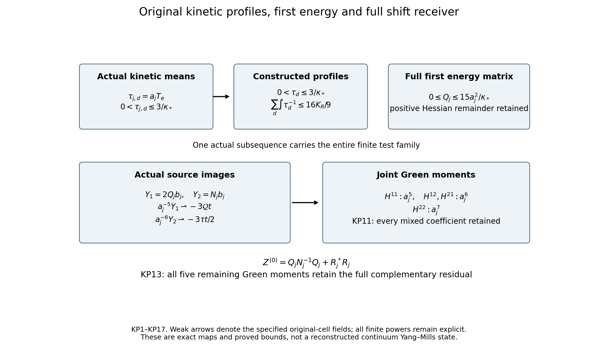
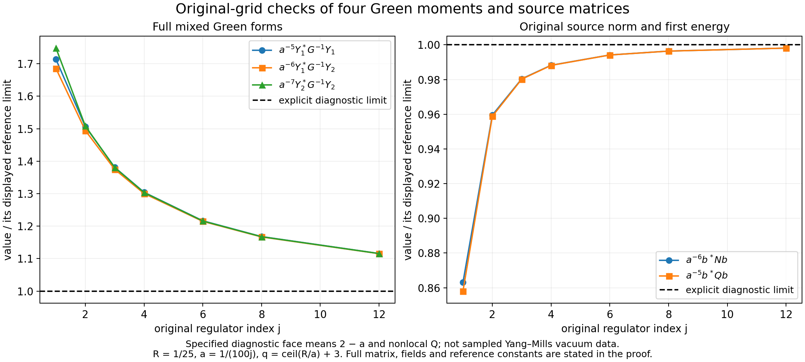

# Actual kinetic profiles and the original shift moments

The actual kinetic means have subsequential spatial profiles with a positive reciprocal bound. The complete first current-energy matrix has an operator bound, with its positive Hessian remainder retained. These constructions evaluate four joint Green moments, the source norm and first-energy matrices, and the full three-shift curvature while preserving the five remaining moments and physical residual.

Providers: [GG1–GG15](https://github.com/KokunoYumeto/yang-mills-interacting-workbench/blob/1e30612d3e8a7185feeaaeb89982fcc73e34dc28/yang-mills/continuations/20261011-central-signs-shrinking-window/EXACT_PATCH_GREEN_AND_PHYSICAL_RECEIVER.md), [QG5–QG7,QG12–QG13](https://github.com/KokunoYumeto/yang-mills-interacting-workbench/blob/1e30612d3e8a7185feeaaeb89982fcc73e34dc28/yang-mills/continuations/20261011-central-signs-shrinking-window/THREE_SHIFT_GAINS_AND_SOURCE_GRAPH.md), [CFC17,CFC20,CFC24–CFC26](https://github.com/KokunoYumeto/yang-mills-interacting-workbench/blob/1e30612d3e8a7185feeaaeb89982fcc73e34dc28/yang-mills/continuations/20261011-central-signs-shrinking-window/CENTERED_CURRENT_COVARIANCE.md), [SG2–SG10](https://github.com/KokunoYumeto/yang-mills-interacting-workbench/blob/1e30612d3e8a7185feeaaeb89982fcc73e34dc28/yang-mills/continuations/20261011-central-signs-shrinking-window/ACTUAL_GROUND_GRADIENT_TRIAL.md), [SOM14–SOM20](https://github.com/KokunoYumeto/yang-mills-interacting-workbench/blob/1e30612d3e8a7185feeaaeb89982fcc73e34dc28/yang-mills/continuations/20261011-central-signs-shrinking-window/ACTUAL_SCORE_MOMENTS_AND_SECOND_ENERGY.md). Original-author weighted-form provenance remains in the retained source ledger. This increment derives the displayed maps from these full formulas; it claims no additional external reading or novelty.

## Original objects and finite domains

Keep the open lattice with vertices \(\{0,\ldots,2L_j\}^3\), every positive edge, the original vertex gauge action, and probability Haar measure. The SU(2) edge metric has radius two and \(T_\alpha=-i\sigma_\alpha/2\) orthonormal. Retain
\[
\begin{gathered}
L_j=j^4,\quad a_j=(100j)^{-1},\quad g_j^2=\kappa_*a_j/2,\quad
b_j=(\kappa_*a_j^2)^{-1},\quad s_j=100\kappa_*a_j,\\
U_p=U_d(z)U_k(z+e_d)U_d(z+e_k)^{-1}U_k(z)^{-1}\quad(d<k),\\
D_p=2-\operatorname{Tr}U_p,\quad
V=b_j\sum_pD_p=2b_j|\mathcal P_j|-b_j\sum_p\operatorname{Tr}U_p,\\
H_j=-\kappa_*\Delta+V,\quad H_j\psi_j=E_{0,j}\psi_j,\quad
\psi_j>0,\quad \|\psi_j\|=1,\quad d\mu_j=\psi_j^2dU .
\end{gathered}
\]
The positive smooth gauge-invariant ground and its score bound are the original SOM1–SOM5. Suppress \(j\) only within finite formulas and write \(\kappa=\kappa_*\), \(w=\log\psi\), \(g_e=d_ew\), \(G_e=|g_e|^2\), \(T_e=\mu G_e\), \(F_e=d_eV\), and
\[
\mathscr D=\Delta+2dw\cdot d,\qquad
\mathscr L_0=-\kappa\mathscr D,\qquad
\mathscr L_1=\kappa(dd_\mu^*+d_\mu^*d).
\]
All are the original weighted operators on the compact full configuration manifold; no outside derivative is suppressed.

For the centered observable below, \(E_X=\kappa\mu|dX|^2\). For the original full test use \(A=H-E_0I\), \(u_{\mathbf f}=(C_{\mathbf f}-\mu C_{\mathbf f})\psi\), \(\zeta_{\mathbf f}=A^{1/2}u_{\mathbf f}\), and \(\mathcal R_{\mathbf f}(z)=\langle\zeta_{\mathbf f},(A+zI)^{-1}\zeta_{\mathbf f}\rangle=\kappa\langle dC_{\mathbf f},D_z^{-1}dC_{\mathbf f}\rangle_\mu\). SG12 proves this exact original-Hamiltonian map.

For a nonzero real continuous compactly supported triple \(\mathbf f=(f_{12},f_{13},f_{23})\), keep
\[
\begin{gathered}
x_p=o+a(z-L_j\mathbf1+(e_d+e_k)/2),\quad
x_e=o+a(z-L_j\mathbf1+e_d/2),\\
C_{\mathbf f}=a\sum_p f_{\sigma(p)}(x_p)D_p,\quad
X=a\sum_pu_pD_p-\mu\!\left(a\sum_pu_pD_p\right),\\
u_p=f_{\sigma(p)}(x_p)\ \hbox{for the full source},\qquad
u_p=f_{\sigma(p)}(x_p)\mathbf1_{\{e_0\notin\partial p\}}
\ \hbox{for its outside source},\\
M_f=\max_\sigma\|f_\sigma\|_\infty,\quad
t_1=f_{12}+f_{13},\quad t_2=f_{12}+f_{23},\quad
t_3=f_{13}+f_{23},\quad J_t=\sum_d\int_{\mathbb R^3}t_d^2>0 .
\end{gathered}
\]
The last strict inequality follows by the inverse relations \(2f_{12}=t_1+t_2-t_3\), \(2f_{13}=t_1+t_3-t_2\), \(2f_{23}=t_2+t_3-t_1\). Put \(v=dX\), \(J_X=dw\cdot dX\), \(\alpha_e=a^2\Pi_edw\), and \(D_z=\mathscr L_1+zI\), \(z>0\). For a deterministic finite edge list, \(\mathsf Cc=\sum_ec_e\alpha_e\), \(\mathsf N=\mathsf C^*\mathsf C\), \(\mathsf Z=(D_z\mathsf C)^*D_z\mathsf C\), \(\mathsf b=\mathsf C^*v\), \(k=(D_z\mathsf C)^*v\). The distinct sources \(k\) and \(\mathsf b\) are never identified.

Use the fitting cube \(Q=v_Q+\{0,\ldots,q\}^3\) for a physical support cube \(\prod_d[c_d,c_d+R]\), where \(q=\lceil R/a\rceil+3\), \((v_Q)_d=L_j+\lfloor(c_d-o_d)/a\rfloor-1\). Eventually it is strictly inside the full lattice. Its finite quantities, with boundary indicators retained, are
\[
\begin{gathered}
N_Q=3q(q+1)^2,\quad M_Q=3q^2(q+1),\quad
I=E_Q^\circ,\quad n=|I|=3q(q-1)^2,\\
C_Q=2q(q+1)\sum_d
[\mathbf1_{\{(v_Q)_d>0\}}+\mathbf1_{\{(v_Q)_d+q<2L_j\}}],\\
W_Q=\sum_{p\ {\rm inside}\ Q}D_p,\quad d_Q=\mu W_Q,\quad
T_Q=\sum_{e\ {\rm inside}\ Q}T_e,\quad E_Q=E_0-E_{\rm out},\\
\Lambda_Q=\min\{2M_Q,6g^2\sqrt{N_QM_Q}\}+2C_Q,\quad
\kappa T_Q+bd_Q\le E_Q\le b\Lambda_Q,\\
\mathsf L_R=9\kappa_*R^3+24R^2,\qquad
K_R=\frac{\mathsf L_R+\sqrt{\mathsf L_R^2-81\kappa_*^2R^6/4}}2 .
\end{gathered}
\]
Every edge in \(I\) has four incident faces, all inside \(Q\). HVR18–HVR22 prove both \(\limsup a_j^2d_Q\le K_R\) and \(\limsup a_j^2(\Lambda_Q-d_Q)\le K_R\). The inside, outside and crossing energies remain as displayed. All limits below use this same fitting prescription and original path.

Retain the complete Hessian row, incident deficit and positive density
\[
\begin{gathered}
H_{er}=(\nabla^2w)_{er},\quad R_e=\sum_{r\in\mathcal E_j}\|H_{er}\|_{\rm HS}^2,\quad
W_e^{\rm def}=\sum_{p\ni e}D_p,\quad w_e=\mu W_e^{\rm def},\\
\mathcal K_e=\Delta_eV-\kappa(2R_e+G_e),\quad \mu\mathcal K_e=0,\\
\mathcal A_e=\kappa(2R_e+G_e)+(3b/4)W_e^{\rm def}\ge0,\quad
\mu\mathcal A_e=6b,\quad d\nu_e=\frac{\mathcal A_e}{6b}d\mu,\\
I_j(C)=\{e\in I_j:w_e\le Ca_j\},\quad
C=\max\{\kappa_*,64M_f^2K_R/J_t\},\\
\liminf a_j^{-3}\|\mathsf b_{I(C)}\|^2\ge27J_t/16,\qquad
\gamma_C(z)=z^2a^4\,\frac{9(8-Ca)^2}{256Ca}\quad(Ca<8).
\end{gathered}
\]
CFC6–CFC20 prove these identities and bounds in the actual state, with no changed boundary or reference law. The ground log-Hessian bound and score estimate remain \(\nabla^2w\ge-2(\kappa a)^{-1}g\) and \(T_e\le3/(\kappa a)\).

## Full graph tail bound

For a common block in GG3 write \(S=s_1+s_2+s_3\). Since
\(2u_du_k\le u_d^2+u_k^2\) and \(2\operatorname{Re}\overline c_dc_k\le|c_d|^2+|c_k|^2\),
\[
\begin{aligned}
c^*\mathsf K_mc
&\ge\sum_d[D_d-4u_d\sum_{k\ne d}u_k]|c_d|^2\\
&\ge\sum_d(6S-2s_d)|c_d|^2
\ge4S\sum_d|c_d|^2 .
\end{aligned}\tag{KP1}
\]
Indeed \(D_d=8+4(S-s_d)\), and
\(4u_d\sum_{k\ne d}u_k\le2[2u_d^2+\sum_{k\ne d}u_k^2]=8-2S-2s_d\).
For a one-component boundary mode \(m_d=q\), its scalar \(D_d\) is \(4S+4\).
Also \(\sin(\pi m/(2q))\ge m/q\), by concavity of sine between its endpoint values on \([0,\pi/2]\).
Thus on every mode outside the full common list \(1\le m_d\le M\),
\[
a^2\|\mathsf G_I^{-1}|_{\mathrm{tail}}\|
\le\frac{(aq)^2}{4(M+1)^2}.
\tag{KP2}
\]
The boundary modes satisfy the same bound. The inverse acts on invariant whole blocks, so no noncommuting compression is used.

More generally let \(c_{j,e}=a_j^p v_{j,e}\) for an explicitly retained power \(p\).
Associate to each direction its original half-open cubes
\(x_e+[-a_j/2,a_j/2)^3\), set the piecewise constant value to \(v_{j,e}\), and extend it by zero outside \(I_j\).
Suppose these three fields are bounded in \(L^2\) of one fixed enclosing cube and converge weakly there to \(v_d\), supported in the closure of the unchanged support cube \(\mathcal Q\).
This paragraph proves a comparison lemma, not an assumption about missing physical convergence: the actual fields and an actual subsequence are constructed below.
Every fixed sine coefficient then converges by weak convergence and uniform convergence of the sampled physical sine test:
\(a_j^{3-p}\sum_e \Phi_{m,d}(e)c_{j,e}\to\int_{\mathcal Q}\chi_m v_d\).
The cell volume is exactly \(a_j^3\). GG9 and the raw norm \(q_j^3/8\) give the finite-mode limit. KP2 bounds the whole remaining contribution by
\[
\frac{(a_jq_j)^2}{4(M+1)^2}\,
a_j^3\sum_e|v_{j,e}|^2.
\]
Letting \(M\to\infty\) after the fixed-mode limit proves
\[
a_j^{-(2p-5)}c_j^*\mathsf G_{I_j}^{-1}c_j
\longrightarrow
\frac14\left\langle\sum_dv_d,\mathcal T_R\sum_dv_d\right\rangle.
\tag{KP3}
\]
This is a compact inverse-form statement for weakly convergent original-grid fields; the high-mode bound replaces a claim of strong convergence. All finite \(a_j^p\) and grid factors have been kept.

## Actual kinetic profiles exist and cannot vanish on positive volume

On the original edge cells put \(\tau_{j,d}=a_jT_{(z,d)}\).
Every cell meeting the fixed physical cube \(\mathcal Q\) lies in the strict fitting list eventually: the original lower margin is between \(a_j\) and \(2a_j\), and the upper margin follows from \(q_j=\lceil R/a_j\rceil+3\).
Consequently \(0<\tau_{j,d}\le3/\kappa_*\) on \(\mathcal Q\), with all three directions bounded in \(L^2\).
Choose a countable dense family in this Hilbert space, extract convergent scalar pairings by successive subsequences, and extend the bounded limiting functional by continuity. Riesz representation gives a simultaneous weak subsequence with
\[
0\le\tau_d\le3/\kappa_*\quad\hbox{almost everywhere}.
\]
The order bounds follow by testing against nonnegative indicator functions. The fields on the slightly enlarged fitting cubes have the same weak limit after zero extension: the excess boundary strips have volume \(O(a_j)\) and bounded values.

Retain an explicit auxiliary threshold \(\eta_j=\sqrt{a_j}\), with \(j\) large enough that \(\eta_j<4\). It is used only in the proof; the original set \(I_j\), its coefficients and its state remain unchanged. Define bad cells by \(w_e>\eta_j\). Their total volume over all directions within \(\mathcal Q\) is at most
\(a_j^3\sum_e w_e/\eta_j\le4a_j^3d_{Q_j}/\eta_j=O(\sqrt{a_j})\).
On every remaining cell CFC20 gives the full threshold-dependent bound
\[
T_e\ge\frac{9(8-w_e)^2}{256w_e}
\ge\frac{9(8-\eta_j)^2}{256w_e},\qquad
\frac1{a_jT_e}\le\frac{256w_e}{9a_j(8-\eta_j)^2}.
\]
In the proof only, define \(\widehat\tau_{j,d}=3/\kappa_*\) on bad cells and retain the actual value elsewhere. This is an explicit comparison field; the actual \(\tau_{j,d}\) and matrix \(\mathsf N\) remain unchanged.
The difference tends to zero in \(L^2\), bounded by
\((6/\kappa_*)\sqrt{a_j^3d_{Q_j}/\eta_j}\).
Keeping the complete finite contribution gives
\[
\sum_d\int_{\mathcal Q}\frac1{\widehat\tau_{j,d}}
\le\frac{1024a_j^2d_{Q_j}}{9(8-\eta_j)^2}
+\frac{4\kappa_*a_j^3d_{Q_j}}{3\eta_j}.
\]
For any bounded real measurable \(r_d\),
\[
\sum_d\int(2r_d-r_d^2\widehat\tau_{j,d})
\le\sum_d\int\frac1{\widehat\tau_{j,d}}.
\]
Weak convergence passes the left side to the limit, since \(r_d^2\in L^2\) on the finite cube. Now set \(r_d=\min(n,1/\tau_d)\), taking value \(n\) where \(\tau_d=0\).
The integrands increase to \(1/\tau_d\); at a zero they increase to infinity. Monotone convergence proves the actual limiting bound
\[
0<\tau_d\le3/\kappa_*\ \hbox{almost everywhere},\qquad
\sum_d\int_{\mathcal Q}\frac1{\tau_d}
\le C_{\rm rec}:=\frac{16K_R}{9}.
\tag{KP4}
\]
This proves existence and nonvanishing for every extracted kinetic profile; it makes no uniqueness assertion and constructs no full continuum vacuum.

## Actual highest shift moment

The original norm matrix is diagonal:
\(\mathsf N_{ef}=a_j^4T_e\delta_{ef}\).
For the original source column of a fixed test set \(Y_{2,j}=\mathsf N_j\mathsf b_j\).
Then exactly
\[
(Y_{2,j})_e=a_j^3\tau_{j,d}(x_e)(\mathsf b_j)_e .
\]
QG6, multiplied by the actual bound \(3/\kappa_*\), proves in original cell \(L^2\)
\[
a_j^{-6}(Y_{2,j})_e
=-\frac32\tau_{j,d}(x_e)t_d(x_e)+o_{L^2}(1).
\]
The notation means the piecewise constant fields and retains the factor \(a_j^3\) per cell in their norms. The original source error contributes at most
\((3/\kappa_*)a_j^{-3/2}\|\mathsf b_j-\overline{\mathsf b}_j\|\to0\).
The sample error for each continuous \(t_d\) tends to zero uniformly.
Along the actual subsequence constructed in KP4 the weak limit is therefore
\(-3\tau_dt_d/2\). Apply the proved lemma KP3 with \(p=6\):
\[
a_j^{-7}Y_{2,j}^*\mathsf G_{I_j}^{-1}Y_{2,j}
\longrightarrow
\frac9{16}
\left\langle\sum_d\tau_dt_d,\mathcal T_R\sum_d\tau_dt_d\right\rangle .
\tag{KP5}
\]
The outside-star variant has the same limit by its full QG6 error.
For a finite test family use the same actual kinetic subsequence, and polarization proves all mixed entries. No state or limiting profile is chosen separately for different columns.

For a real nonzero common test \(\mathbf f=(\varphi,\varphi,\varphi)\), choose a ball compactly inside \(\mathcal Q\) on which \(\sigma\varphi\ge\delta>0\), \(\sigma\in\{-1,1\}\). Such a ball exists by continuity, nonzero value, and zero boundary values of the original compactly supported test.
Choose any nonzero nonnegative smooth function \(\beta\) supported in that ball. It can be constructed explicitly as
\(\exp[-1/(1-|x-x_0|^2/r^2)]\) for \(|x-x_0|<r\), zero elsewhere; repeated differentiation gives polynomial factors in the reciprocal boundary distance multiplied by the exponential, all tending to zero at the boundary.
Put \(I_\beta=\int_{\mathcal Q}\sqrt\beta>0\) and
\(E_\beta=\int_{\mathcal Q}|\nabla\beta|^2>0\).
Cauchy–Schwarz on the disjoint union of three copies of the cube and KP4 give
\[
9I_\beta^2
\le\left(\sum_d\int\beta\tau_d\right)
\left(\sum_d\int\frac1{\tau_d}\right)
\le C_{\rm rec}\sum_d\int\beta\tau_d.
\]
Thus for \(h_\tau=\varphi\sum_d\tau_d\),
\(|\langle h_\tau,\sigma\beta\rangle|\ge9\delta I_\beta^2/C_{\rm rec}\).
The weak Green identity in GG10 and Cauchy–Schwarz in the gradient inner product imply
\(\langle h_\tau,\mathcal T_Rh_\tau\rangle
\ge|\langle h_\tau,\sigma\beta\rangle|^2/E_\beta\).
Since \(t_d=2\varphi\), the limit in KP5 is bounded below by
\(729\delta^2I_\beta^4/(4C_{\rm rec}^2E_\beta)>0\).
Every subsequence admits the same compact extraction and bound, so
\[
\liminf_j a_j^{-7}
(\mathsf N_j\mathsf b_j)^*\mathsf G_{I_j}^{-1}
(\mathsf N_j\mathsf b_j)
\ge\frac{729\delta^2I_\beta^4}{4C_{\rm rec}^2E_\beta}>0.
\tag{KP6}
\]
To justify the full-sequence liminf, otherwise take a violating subsequence, extract its weak kinetic profiles as above, and apply KP5–KP4 to contradict the same lower constant. This is an actual evaluated bound for the highest degree coefficient in GG14, not a replacement of its nine-term polynomial by this coefficient.

The full inside trial is proper in the original full lattice eventually, so DF15 makes its \(Z,Z_\star\) positive. GG6–GG7 are valid there by the same matrix proof. Use the unrestricted \(A_0(a)\) from QG18 in GG8. For a retained \(I(C)\) list, GG13 instead supplies the exact additional complement defect for \(Y_2\); this is not set to zero.

In the original window, the highest polynomial term is \(z_r^4Y_2^*G^{-1}Y_2\); it has the lower scale \(a_j^{11}\) with every factor \((100\kappa_*\theta_r)^4\) retained. The subsequent sections calculate three companion Green moments using these actual profiles and the complete first-energy operator. All remaining terms and the physical residual stay explicit. Neither the fourth coefficient nor its positive profile establishes a positive signed spectral-window mass.

## Full Hessian-row means on the entire physical cube

CFC17 keeps the exact identity
\[
a_j^2\bar R_e
=\frac3{\kappa_*^2}
-\frac{3w_e}{8\kappa_*^2}
-\frac{a_j\tau_{j,d}}2,\qquad
\bar R_e=\mu_j\sum_f\|(\nabla^2w)_{ef}\|_{\rm HS}^2.
\]
The sum over \(f\) is the whole original lattice. All terms subtracted from \(3/\kappa_*^2\) are nonnegative. On the original cells meeting \(\mathcal Q\),
\[
\begin{aligned}
0\le\sum_d\int_{\mathcal Q}
\left(\frac3{\kappa_*^2}-a_j^2\bar R_{j,d}\right)
&\le\frac{3a_j^3d_{Q_j}}{2\kappa_*^2}
+\frac{9a_jR^3}{2\kappa_*}\longrightarrow0 .
\end{aligned}\tag{KP7}
\]
The first term uses \(\sum_{e\in I}w_e\le4d_Q\), and the second uses the exact cube volume \(R^3\) and \(\tau_{j,d}\le3/\kappa_*\) on each of three directions. Thus the full row means converge in \(L^1\) on the whole cube, strengthening the earlier uniform result restricted to \(I(C)\). Individual random Hessians are not replaced by their means.

## The complete first energy matrix and its remainder

Keep \(\mathsf Q_j=\mathsf C_j^*\mathscr L_{1,j}\mathsf C_j\) on the entire inside list \(I_j\). All coefficient lists are extended by zero to the original full edge set. SG8–SG9, with each of the four incident faces retained, give
\[
\begin{gathered}
0\le\mathsf Q_j
=a_j^2\operatorname{diag}(v_{j,e})-\mathsf D_j,\qquad
v_{j,e}=\frac3{\kappa_*}-\frac{3w_e}{8\kappa_*}
+4\tau_{j,d}(x_e),\\
c^*\mathsf D_jc
=2\kappa_*a_j^4
\mu_j\left\langle D_c\,dw,
\left(\nabla^2w+\frac2{\kappa_*a_j}I\right)D_c\,dw\right\rangle,\\
0\le\mathsf D_j,\qquad
0\le\mathsf Q_j\le a_j^2\operatorname{diag}(v_{j,e})
\le\frac{15a_j^2}{\kappa_*}I.
\end{gathered}\tag{KP8}
\]
For complex lists the inner product conjugates its first argument, and \(D_c\) is the original edge-summand multiplication. The real SG identity extends by applying it to real and imaginary parts; the real symmetric matrix has no remaining imaginary quadratic part.
Indeed the potential contribution for one inside edge is
\((a_j^4/2)\mu\Delta_eV=(3a_j^2/(8\kappa_*))(8-w_e)\);
the norm contribution is \((4/a_j)a_j^4T_e=4a_j^2\tau_{j,d}\).
The original shifted Hessian is positive by SOM's actual lower bound, proving \(\mathsf D_j\ge0\). Nonnegativity of \(\mathscr L_1\) proves the other side. The upper coefficient \(15/\kappa_*\) follows from \(\tau\le3/\kappa_*\) and \(w_e\ge0\). This is an operator inequality, not only a trace bound, and the entire remainder is retained.

Choose one fixed slightly larger cube \(\mathcal U\) containing all the fitting cells for sufficiently large \(j\), and let \(\mathcal H=L^2(\mathcal U;\mathbb C^3)\) with its original physical-volume inner product. Define the exact cell maps
\[
\begin{gathered}
(\mathcal J_jc)_d(x)=c_e
\quad(x\in x_e+[-a_j/2,a_j/2)^3,\ e\in I_j\text{ in direction }d),\\
(\mathcal A_jh)_e=a_j^{-3}\int_{x_e+[-a_j/2,a_j/2)^3}h_d(x)\,dx,\\
\mathcal A_j\mathcal J_j=I,\qquad
\|\mathcal J_jc\|_{\mathcal H}^2=a_j^3\|c\|_{\ell^2}^2,\qquad
\mathcal A_j=a_j^{-3}\mathcal J_j^*,\\
\mathcal P_j=\mathcal J_j\mathcal A_j,\qquad
\mathcal Q_j=a_j^{-2}\mathcal J_j\mathsf Q_j\mathcal A_j,\qquad
\mathcal D_j=a_j^{-2}\mathcal J_j\mathsf D_j\mathcal A_j .
\end{gathered}\tag{KP9}
\]
The first field is zero off the union of its direction's fitting cells. Cauchy–Schwarz on each cell proves that \(\mathcal P_j\) is an orthogonal projection and a contraction. The adjoint equality follows by integrating a constant on each exact-volume cell. These maps retain all factors; no original coefficient is replaced by a unit-norm vector.
For smooth fields cell averages converge uniformly on compact interior sets; boundary strip volume tends to zero, and density plus contraction extends the conclusion to every \(h\in\mathcal H\):
\(\mathcal P_jh\to\mathbf1_{\mathcal Q}h\) strongly.

Using KP8 and these adjoints gives
\(0\le\mathcal Q_j,\mathcal D_j\le15/\kappa_*\).
Extract a further simultaneous subsequence, retaining KP4, on which all matrix elements of \(\mathcal Q_j\) between a countable dense set converge.
Their uniform bound extends the limiting sesquilinear form to \(\mathcal H\); the Riesz representation theorem defines its unique bounded operator \(\mathcal Q\).
Its form is Hermitian and nonnegative, so the operator is self-adjoint and positive.
For bounded fields \(u,v\), the exact diagonal multiplier identity in KP8 and KP9 converges to the multiplier \(3/\kappa_*+4\tau_d\) on \(\mathcal Q\).
To see this, the cell averages of bounded fields can first be approximated by smooth fields in \(L^2\); all diagonal operators have uniform bound \(15/\kappa_*\). For smooth fields the assertion follows from uniform convergence of their samples, weak convergence of \(\tau_{j,d}\), and \(\sum_d\int w_{j,d}\le4a_j^3d_Q\to0\). Density extends it to all \(u,v\).
Thus the actual remainder also converges in the weak operator sense, and
\[
\begin{gathered}
\mathcal Q
=\mathbf1_{\mathcal Q}\mathcal Q\mathbf1_{\mathcal Q},\qquad
\mathcal D
=M_{\mathbf1_{\mathcal Q}(3/\kappa_*+4\tau)}-\mathcal Q,\\
0\le\mathcal Q\le
M_{\mathbf1_{\mathcal Q}(3/\kappa_*+4\tau)}
\le\frac{15}{\kappa_*}I,\qquad
\mathcal D\ge0 .
\end{gathered}\tag{KP10}
\]
The support identity follows from the strong convergence of \(\mathcal P_j\), since
\(\mathcal Q_j=\mathcal P_j\mathcal Q_j\mathcal P_j\).
This constructs a common actual limit operator and retains its complete positive Hessian remainder. It does not assert that \(\mathcal Q\) is multiplication or local.

## Four joint Green moments, with every mixed term

Fix a finite family of the original test triples, all supported in \(\mathcal Q\), and let \(\mathsf B_j\) contain their actual raw-source columns.
For one column write \(t=(t_1,t_2,t_3)\) extended by zero, and keep
\[
Y_{1,j}=2\mathsf Q_j\mathsf b_j,\qquad
Y_{2,j}=\mathsf N_j\mathsf b_j .
\]
QG6 gives
\(\mathcal J_j(a_j^{-3}\mathsf b_j)\to-3t/2\) strongly in \(\mathcal H\).
The uniform operator bound and weak convergence in KP10 therefore imply
\[
\begin{gathered}
\mathcal J_j(a_j^{-5}Y_{1,j})
=2\mathcal Q_j\mathcal J_j(a_j^{-3}\mathsf b_j)
\rightharpoonup-3\mathcal Qt,\\
\mathcal J_j(a_j^{-6}Y_{2,j})
\rightharpoonup-\frac32M_\tau t .
\end{gathered}
\]
Define the scalar functions, on the same actual subsequence for the entire family,
\[
u_r=\sum_d(\mathcal Qt^{(r)})_d,\qquad
v_r=\sum_d\tau_dt_d^{(r)} .
\]
KP3 and polarization, keeping the two different original powers in a mixed pairing, give
\[
\begin{aligned}
a_j^{-5}(Y_{1,j}^{(r)})^*\mathsf G_{I_j}^{-1}Y_{1,j}^{(s)}
&\longrightarrow \frac94\langle u_r,\mathcal T_Ru_s\rangle,\\
a_j^{-6}(Y_{1,j}^{(r)})^*\mathsf G_{I_j}^{-1}Y_{2,j}^{(s)}
&\longrightarrow \frac98\langle u_r,\mathcal T_Rv_s\rangle,\\
a_j^{-6}(Y_{2,j}^{(r)})^*\mathsf G_{I_j}^{-1}Y_{1,j}^{(s)}
&\longrightarrow \frac98\langle v_r,\mathcal T_Ru_s\rangle,\\
a_j^{-7}(Y_{2,j}^{(r)})^*\mathsf G_{I_j}^{-1}Y_{2,j}^{(s)}
&\longrightarrow \frac9{16}\langle v_r,\mathcal T_Rv_s\rangle .
\end{aligned}\tag{KP11}
\]
For completeness, in the mixed proof take the two bounded weakly convergent cell fields divided respectively by \(a_j^5\) and \(a_j^6\).
Apply KP3 at one common power to their sum, difference, and the sums with \(i\) times the second field, then restore the original factors. The high-mode cross term is bounded by the geometric mean of the two KP2 tails, so the two limits can be taken in the same order. This proves the complex Hermitian entries, not only separate real diagonals.

Let \(\mathsf H_{rs,j}^{pq}=(Y_{p,j}^{(r)})^*\mathsf G_{I_j}^{-1}Y_{q,j}^{(s)}\).
The exactly retained part of GG14 with \(p,q\in\{1,2\}\) is
\[
z^2\mathsf H_j^{11}
+z^3(\mathsf H_j^{12}+\mathsf H_j^{21})
+z^4\mathsf H_j^{22}.
\tag{KP12}
\]
At the original \(z=100\kappa_*a_j\theta\), their respective powers are \(a_j^7,a_j^9,a_j^{11}\), and their coefficients are exactly
\((100\kappa_*\theta)^2,(100\kappa_*\theta)^3,(100\kappa_*\theta)^4\)
multiplying the three limits in KP11.
These are separate coefficient limits; the error in the first is not claimed small enough to isolate the later terms after subtracting it.
For each finite joint matrix, define its norm error \(\epsilon_j^{pq}\to0\).
For arbitrary raw lists \(\gamma_j,\eta_j\), the corresponding mixed error is at most
\(a_j^{p_p+p_q-5}\epsilon_j^{pq}\|\gamma_j\|\,\|\eta_j\|\), where \(p_1=5,p_2=6\).
The original coefficient norms remain even when they grow.

## The five remaining moments have an exact current-span residual

Let \(\mathsf C\) have the original current columns on \(I_j\), and
\(L=\mathscr L_1\) on the full original one-form Hilbert space.
Since \(\mathsf N=\mathsf C^*\mathsf C>0\), the exact projection onto the current span is
\(\Pi_{\mathsf C}=\mathsf C\mathsf N^{-1}\mathsf C^*\).
It is self-adjoint and idempotent by multiplication; its range is exactly the column span.
Define \(\mathsf R=(I-\Pi_{\mathsf C})L\mathsf C\).
The finite smooth columns are in the domain of \(L\).
Orthogonality of the projected and complementary columns proves
\[
\begin{gathered}
\mathsf Z^{(0)}
=(L\mathsf C)^*L\mathsf C
=\mathsf Q\mathsf N^{-1}\mathsf Q+\mathsf R^*\mathsf R,\\
Y_0=\mathsf Q\mathsf N^{-1}\mathsf Q\mathsf B
+\mathsf R^*\mathsf R\mathsf B .
\end{gathered}\tag{KP13}
\]
Indeed \(\Pi_{\mathsf C}L\mathsf C=\mathsf C\mathsf N^{-1}\mathsf Q\).
The five still unevaluated Green pairings in GG14 are those with at least one index zero; KP13 gives their exact receiving columns including the complete complementary term. \(\Pi_{\mathsf C}\) is not the exact-form projection \(P\), and no equality between their ranges is asserted.
Together with the full physical residual in DF18, this is the next actual calculation.

## Exact curvature at all three original shifts

For the three distinct positive original \(z_r=100\kappa_*a_j\theta_r\), put
\[
\lambda_r=\frac1{\prod_{s\ne r}(z_r-z_s)}.
\]
Direct interpolation of \(1,z,z^2\) gives respectively
\(\sum_r\lambda_r=0\), \(\sum_r\lambda_rz_r=0\), and
\(\sum_r\lambda_rz_r^2=1\).
These equalities can also be checked over the common nonzero Vandermonde denominator. Thus GG14 gives the exact vector identity and inequality
\[
\begin{gathered}
\sum_{r=1}^3\lambda_rZ(z_r)\mathsf b=\mathsf N\mathsf b,\\
\sum_{r=1}^3
[Z(z_r)\mathsf b]^*\mathsf G_I^{-1}[Z(z_r)\mathsf b]
\ge
\frac{(\mathsf N\mathsf b)^*\mathsf G_I^{-1}(\mathsf N\mathsf b)}
{\sum_{r=1}^3|\lambda_r|^2}.
\end{gathered}\tag{KP14}
\]
Apply Cauchy–Schwarz to the three vectors
\(\mathsf G_I^{-1/2}Z(z_r)\mathsf b\) to prove the second line. No cross-shift vector is omitted from the first equality.
For the common real test in KP6 define
\[
L_\theta=\sum_{r=1}^3
\left|\prod_{s\ne r}(\theta_r-\theta_s)^{-1}\right|^2.
\]
Then \(\sum|\lambda_r|^2=(100\kappa_*a_j)^{-4}L_\theta\), so the actual sum in KP14 divided by \(a_j^{11}\) has lower limit at least
\[
\frac{(100\kappa_*)^4}{L_\theta}
\frac{729\delta^2I_\beta^4}{4C_{\rm rec}^2E_\beta}>0 .
\]
This measures actual source-image curvature. It does not assign the sign of the original three-shift spectral window.

## Local reciprocal measures and original plaquette means

The simultaneous vague plaquette-mean limits in CFC25 can be extracted on the same subsequence as KP4 and KP10.
For each orientation let
\(\mathfrak m_{\sigma,j}=a_j^2\sum_{p:\sigma}(\mu_jD_p)\delta_{x_p}\).
For every nonnegative continuous test \(\xi\) compactly supported inside \(\mathcal Q\), the exact incidence sum in direction \(d\) is
\[
a_j^2\sum_{e\in I_j:\,d}w_e\xi(x_e)
=a_j^2\sum_{\sigma\ni d}\sum_{p:\sigma}
(\mu_jD_p)\,[\xi(x_p-a_je_k/2)+\xi(x_p+a_je_k/2)],
\]
where \(k\) is the other direction in \(\sigma\), and all relevant faces and edges are inside the fitting patch eventually. Uniform continuity bounds the error from replacing the bracket by \(2\xi(x_p)\) by
\(2a_j^2d_Q\omega_\xi(a_j/2)\to0\).
Cell integration differs from the left side by a bound of the same type with \(\omega_\xi(\sqrt3a_j/2)\).
Repeat the finite reciprocal estimate leading to KP4 with weight \(\xi\); its bad-cell term is bounded by
\(4\kappa_*\|\xi\|_\infty a_j^3d_Q/(3\eta_j)\to0\).
The same variational argument proves
\[
\frac1{\tau_d}\,dx
\le\frac89\sum_{\sigma\ni d}\mathfrak m_\sigma
\quad\hbox{as measures on }\mathcal Q.
\tag{KP15}
\]
The factor is
\(\lim256/[9(8-\eta_j)^2]\) times the exact two incident edges per face, namely \(8/9\).
First obtain the inequality for nonnegative compactly supported continuous tests; regularity extends it to Borel sets.
The original CFC25 lower bounds
\(\mathfrak m_\sigma\ge3\kappa_*dx/16\) are retained.
This proves an explicit measure relation between the actual kinetic profiles and the original plaquette means; it does not merge the two objects.

## Actual source norm and first-energy receiving matrices

Along the same constructed subsequence, the original source comparison and KP4/KP10 give
\[
\begin{aligned}
a_j^{-6}(\mathsf b_j^{(r)})^*\mathsf N_j\mathsf b_j^{(s)}
&\longrightarrow
\frac94\int_{\mathcal Q}
\sum_d\tau_d\,\overline{t_d^{(r)}}t_d^{(s)},\\
a_j^{-5}(\mathsf b_j^{(r)})^*\mathsf Q_j\mathsf b_j^{(s)}
&\longrightarrow
\frac94\langle t^{(r)},\mathcal Qt^{(s)}\rangle_{\mathcal H}.
\end{aligned}\tag{KP16}
\]
For the first line use
\(a_j^{-6}b_r^*\mathsf N b_s
=\langle\mathcal J_j(a_j^{-3}b_r),
M_{\tau_j}\mathcal J_j(a_j^{-3}b_s)\rangle_{\mathcal H}\);
the source fields converge strongly and the bounded multipliers converge weakly.
The same formula with \(\mathcal Q_j\), its uniform operator bound, and the factor \(a_j^{-5}\) proves the second line.
Polarization and finite-dimensional norm convergence retain every mixed entry and give errors multiplied by the original raw coefficient norms as in KP12.

The first limiting matrix has exactly the original test-relation kernel: its nonnegative density uses \(\tau_d>0\) almost everywhere, and the original map \(t=A\mathbf f\) is invertible.
For a single nonzero real or complex test, one component has \(|t_d|\ge\delta>0\) on some interior ball \(B_0\).
Cauchy–Schwarz and KP4 yield
\(\int_{B_0}\tau_d\ge |B_0|^2/C_{\rm rec}\), so every subsequential first limit is at least
\(9\delta^2|B_0|^2/(4C_{\rm rec})>0\).
The same compact-extraction contradiction used in KP6 gives this positive full-sequence lower bound for the actual source norm matrix.

The second limit retains a precise candidate kernel, with no assumed cancellation:
\[
\ker\mathcal Q\cap L^2(\mathcal Q;\mathbb C^3)
=\{t:\mathcal Dt=M_{3/\kappa_*+4\tau}t\}.
\tag{KP17}
\]
This is the exact operator identity KP10 in both directions. For a positive operator,
\(\langle t,\mathcal Qt\rangle=0\) is equivalent to \(\mathcal Qt=0\):
Cauchy–Schwarz for its positive form gives
\(|\langle h,\mathcal Qt\rangle|^2\le
\langle h,\mathcal Qh\rangle\langle t,\mathcal Qt\rangle=0\)
for every \(h\), proving the implication without an assumed square-root domain.
For a test outside this kernel, KP16 gives the evaluated original mean-energy ratio
\[
a_j\,\frac{\mathsf b_j^*\mathsf Q_j\mathsf b_j}
{\mathsf b_j^*\mathsf N_j\mathsf b_j}
\longrightarrow
\frac{\langle t,\mathcal Qt\rangle}
{\int_{\mathcal Q}\sum_d\tau_d|t_d|^2}>0.
\]
For a test in the kernel the displayed limit is zero, with no rate inferred. This constructs the exact remainder-saturation space that the low-energy calculation must examine. The next step is the actual action of \(\mathcal D_j\) on these original source directions and the full residual \(\mathsf R\) in KP13. A zero first coefficient would still require its original next terms; no smooth no-gap endpoint is assumed.

## Reproducible figures and diagnostics

The face means \(2-a_j\) and matrices used in the plots are specified diagnostic inputs, not sampled Yang–Mills vacuum data. Retain
\[
\begin{gathered}
R=1/25,\quad c=o=0,\quad\kappa_*=1,\quad
\tau=(1,3/2,2),\quad\rho=2/5,\quad\sigma=7/10,\\
\varphi(x)=\mathbf1_{[0,R]^3}(x)
\prod_{d=1}^3\sin(\pi x_d/R),\qquad
\mathbf f=(\varphi,\varphi,\varphi),\\
g_{(z,d)}=\omega_d\varphi(x_e),\quad
\omega=(1,2,-1),\qquad
Q_j=a_j^2\left(\rho I+
\sigma\frac{gg^*}{\sum_{e\in I_j}|g_e|^2}\right).
\end{gathered}
\]
The full denominator and original grid remain explicit. Set \(I_0=R^3/8\) and \(E_0=I_0/(3\pi^2/R^2)\). Direct substitution into KP11 and KP16 gives the exact plotted references
\[
\begin{gathered}
H^{11}_\infty=\frac{(18\rho+4\sigma)^2}{4}E_0,\qquad
H^{12}_\infty=\frac{(18\rho+4\sigma)(27/2)}4E_0,\\
H^{22}_\infty=\frac{(27/2)^2}{4}E_0,\qquad
N_\infty=9(1+3/2+2)I_0,\qquad
Q_\infty=9(3\rho+2\sigma/3)I_0 .
\end{gathered}
\]
For verification, the common raw source has leading field \(-3\varphi(1,1,1)\). Its projection on \(g\) has coefficient \(-1\), since \(\sum\omega_d=2\) and \(\sum\omega_d^2=6\). Hence the sum of the \(Y_1/a_j^5\) components is \(-(18\rho+4\sigma)\varphi\), and the sum of the \(Y_2/a_j^6\) components is \(-(27/2)\varphi\). Their Green products give the first three constants by KP3; the original norm and energy quadratic forms give the last two. No diagnostic matrix is identified with the unknown actual limit operator. [Complete checks](check_kinetic_profile.py), [figure source](figure_kinetic_profile.py) and [source-use record](KINETIC_PROFILE_SOURCE_USE_LEDGER.json) accompany the proofs.

## Full current complement and its relative-energy measure

[CSR1–CSR21](https://github.com/KokunoYumeto/yang-mills-interacting-workbench/blob/main/yang-mills/continuations/20261011-central-signs-shrinking-window/FULL_CURRENT_SCHUR_AND_ENERGY_MEASURE.md) construct the full current-span Schur response with its corrected source and both physical solution components. The actual complementary coupling measure satisfies
\[
M_j([0,\theta s_j])\le1500\theta a_j^3I,\qquad
\int\lambda^{-1}dM_j(\lambda)\le Q_j .
\]
A common actual subsequence gives a bounded relative-energy measure with both endpoint atoms retained. It evaluates the effective current energy and the full complementary lift's norm and energy at their original \(a_j^4,a_j^5\) scales. The exact effective kernel includes KP17's current-trial kernel; the full physical projection and source cross measure remain in the response. All three original shifts, raw coefficient norms and complementary contributions are preserved. The signed physical window and smooth interacting no-gap endpoint remain active calculations.

## Exact physical scalar receiver and stronger original-state bounds

[PFR1–PFR19](https://github.com/KokunoYumeto/yang-mills-interacting-workbench/blob/main/yang-mills/continuations/20261011-central-signs-shrinking-window/PHYSICAL_SCALAR_RECEIVER_AND_CURRENT_COVARIANCE.md) prove the full scalar receiver for the physical current Schur lift, including both density/score-fluctuation mixed terms. The exact diagonal Hessian defect, with all exterior rows retained, improves the actual state bounds to
\[
a_jT_e\le\Theta_0(a_j)<\frac3{2\kappa_*},\qquad
\liminf_j\frac{\mu_jD_p}{a_j}\ge\frac{3\kappa_*}{8},\qquad
0\le Q_j<\frac{9a_j^2}{\kappa_*}I .
\]
The plaquette inequality uses PFR12's uniform finite lower root; it holds along any sequence of original faces. PFR13–PFR16 strengthen the finite local budget, spatial mean floors and original observable's first-energy and resolvent coefficients. The force/source upper constant \(K_R\) is unchanged.

The KP kinetic profiles now have ceiling \(3/(2\kappa_*)\). CSR10's complementary low-energy bound is \(900\theta a_j^3I\), CSR13's measure total is at most \(9/\kappa_*\), and CSR16's derivative ceiling is \(9m!/(\kappa_*\theta^m)\). The retained finite norm terms in CSR15 and CSR19 are bounded by \(150\theta a_j^2\) and \(150a_j^2\). Earlier weaker bounds remain valid. PFR17–PFR19 supply the complete equal-time scalar covariance, inverse-energy bound and explicit positive trace defect. All raw coefficient errors, original shifts, cross covariances and physical complementary components remain. Positive first energy does not yet establish positive mass in the original shrinking spectral window; that calculation and the smooth interacting continuum endpoint remain active.
