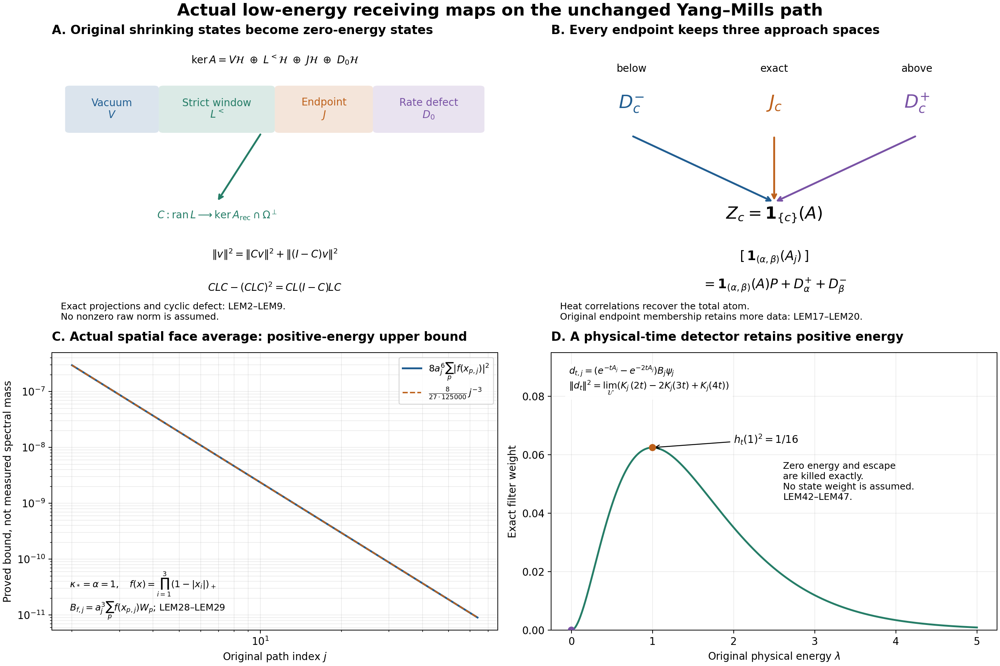

# Shrinking-window maps, spatial Wilson observables and positive-energy detectors

11 October 2026. Every finite-volume object below is the actual physical object in [ASL1–ASL66](https://github.com/KokunoYumeto/yang-mills-interacting-workbench/blob/5017bb93fcafa6f6282b72d076934d793a3ca6ad/yang-mills/continuations/20261011-central-signs-shrinking-window/ACTUAL_SEMIGROUP_LIMIT.md). The full earlier construction and proofs are retained. No raw state is normalized, no coupling or time scale is substituted, and no unknown positive spectral weight is assumed. The new maps keep the zero-energy rate defect, the cyclic visibility defect, and every endpoint atom.

The existing [SP1–SP16](https://github.com/KokunoYumeto/yang-mills-interacting-workbench/blob/5017bb93fcafa6f6282b72d076934d793a3ca6ad/yang-mills/continuations/20261011-central-signs-shrinking-window/PHASE_SPECTRAL_WEIGHTS.md) give complete fixed-box oscillator weights, including the original matrices with entries 12, −180, 2700, 2160 and 1440. [IP14–IP22](https://github.com/KokunoYumeto/yang-mills-interacting-workbench/blob/5017bb93fcafa6f6282b72d076934d793a3ca6ad/yang-mills/continuations/20261011-central-signs-shrinking-window/PHASE_MOMENTS_AND_ORIGINAL_PATH.md) prove the required fixed-box phase tails and explicitly distinguish their iterated limit from the prescribed path. These results remain intact; their box-dependent accuracy is not replaced by a joint-path assertion. The actual-vacuum accuracy input used below is AC11–AC18 in [the complete cancellation calculation](https://github.com/KokunoYumeto/yang-mills-interacting-workbench/blob/5017bb93fcafa6f6282b72d076934d793a3ca6ad/yang-mills/continuations/20261011-central-signs-shrinking-window/ACTUAL_PHASE_CANCELLATION.md). Its spectral residual AC27 is retained as the full residual, not identified with a multiplication-density variance. Source reading, canonical index routes and exact versions are recorded separately.

## 1. Actual spaces, shrinking projection and its full zero-energy defect

Keep every original vertex constraint and radius-two link metric, the probability Haar measure, and
\[
\begin{gathered}
 L_j=j^4,\quad m_j=2j^4,\quad n_j=2j^4+1,\quad
 a_j=(100j)^{-1},\quad g_j^2=\kappa_*/(200j),\quad
 \xi_j=10000j^2/\kappa_*^2,\quad s_j=\kappa_*/j,\\
 H_j=\kappa_*K_j+\kappa_*\xi_j\sum_{p\in\mathcal P_j}(2-W_p),\quad
 H_j\psi_j=E_j^{\rm vac}\psi_j,\quad\psi_j>0,\quad\|\psi_j\|=1,\quad
 A_j=H_j-E_j^{\rm vac}I\ge0.
\end{gathered}\tag{LEM1}
\]
Thus both the scalar \(2\kappa_*\xi_j|\mathcal P_j|\) and the full vacuum energy are retained. The physical Hilbert spaces, their common ultraproduct \(\mathcal H_{\mathcal U}\), its continuous projection \(P\), escape projection \(Q=I-P\), generator \(A\) on \(\mathcal H_c=P\mathcal H_{\mathcal U}\), and unit vacuum \(\Omega=[\psi_j]\) are exactly ASL5–ASL19. In particular \([e^{-tA_j}]=e^{-tA}P\) for \(t>0\), and \(A\Omega=0\). Denote the zero-energy projection on \(\mathcal H_c\) by \(Z=\mathbf1_{\{0\}}(A)\), extended by zero on \(Q\mathcal H_{\mathcal U}\).

Define the actual shrinking and endpoint projections
\[
 L=[\mathbf1_{(0,s_j]}(A_j)],\quad
 J=[\mathbf1_{\{s_j\}}(A_j)],\quad
 L^{<}=L-J=[\mathbf1_{(0,s_j)}(A_j)],\quad
 V=[|\psi_j\rangle\langle\psi_j|]=|\Omega\rangle\langle\Omega|.
 \tag{LEM2}
\]
The final equality is exact: for bounded \(v_j\), its coefficients \(\langle\psi_j,v_j\rangle\) have an ultralimit \(c\), and \([\langle\psi_j,v_j\rangle\psi_j]=c\Omega\). Each finite ground eigenspace is one-dimensional, so \([\mathbf1_{[0,s_j]}(A_j)]=V+L\). The spectral bound
\[
 \|(e^{-tA_j}-I)\mathbf1_{(0,s_j]}(A_j)\|
 \le1-e^{-ts_j}\longrightarrow0
 \tag{LEM3}
\]
proves \(T(t)L=L\) for every positive physical time. Therefore
\[
 J\le L\le Z-V,\qquad L\Omega=0,\qquad
 A|_{\operatorname{ran}L}=0,
 \qquad Z=V+L^{<}+J+D_0,
 \quad D_0:=Z-V-L.
 \tag{LEM4}
\]
All four summands are mutually orthogonal projections. In particular a bounded original shrinking-window vector survives, if nonzero, as a vacuum-orthogonal zero-energy vector. Its nonzero norm is not supplied merely by membership in that window.

The rate defect \(D_0\) has an exact original spectral-tail description. For fixed \(b>0\), put \(E_b=[\mathbf1_{[0,b]}(A_j)]\), as in ASL13. Eventually \(s_j<b\), and hence
\[
 E_b-V-L=[\mathbf1_{(s_j,b]}(A_j)],\qquad
 D_0=\mathop{\rm s-lim}_{b\downarrow0}[\mathbf1_{(s_j,b]}(A_j)],
\]
\[
 \|D_0[v_j]\|^2
 =\lim_{b\downarrow0}\lim_{\mathcal U}
       \|\mathbf1_{(s_j,b]}(A_j)v_j\|^2.
 \tag{LEM5}
\]
To prove the strong limit, ASL16 gives \(\mathbf1_{[0,b/2]}(A)\le E_b\le\mathbf1_{[0,b]}(A)\) for \(b>0\), so \(E_b\to Z\) strongly as \(b\downarrow0\). Subtract the two fixed orthogonal projections. This proves every term of (LEM5). The shrinking threshold is not silently replaced by a fixed neighbourhood followed by a limit; their difference is precisely \(D_0\).

The endpoint contribution is equally concrete:
\[
 \|J[v_j]\|^2=\lim_{\mathcal U}\|\mathbf1_{\{s_j\}}(A_j)v_j\|^2,
 \qquad \|L[v_j]\|^2=\|L^{<}[v_j]\|^2+\|J[v_j]\|^2.
 \tag{LEM6}
\]
No assertion that the finite spectrum avoids \(s_j\) has been made. More generally the nested projections \(L_\theta=[\mathbf1_{(0,\theta s_j]}(A_j)]\), \(\theta>0\), all lie in \(Z-V\) and retain exact relative-window norms. They are a spectral flag recording original rates, not a replacement Hamiltonian or a changed physical clock.

## 2. Exact maps into the cyclic reconstruction and visibility

Let \(C\) be the orthogonal projection from \(\mathcal H_{\mathcal U}\) onto the original Wilson cyclic space \(\mathcal H_{\rm rec}\) constructed in ASL34–ASL37. Extend it by zero outside \(\mathcal H_c\). That space reduces the reconstructed semigroup and generator, so \(CZ=ZC\), \(C\Omega=\Omega\). The exact receiving map is
\[
 \mathcal V=C|_{\operatorname{ran}L}:
 \operatorname{ran}L\longrightarrow\ker A_{\rm rec}\cap\Omega^\perp,
 \qquad
 v=Cv+(I-C)v,\quad
 \|v\|^2=\|Cv\|^2+\|(I-C)v\|^2.
 \tag{LEM7}
\]
Both pieces are in \(Z\mathcal H_{\mathcal U}\cap\Omega^\perp\). Its adjoint is \(\mathcal V^*=LC\), with its range regarded in \(\operatorname{ran}L\). The induced operator on \(\mathcal H_{\rm rec}\) is generally a positive contraction rather than a projection:
\[
 \mathcal V\mathcal V^*=CLC,
 \qquad CLC-(CLC)^2=CL(I-C)LC\ge0.
 \tag{LEM8}
\]
Indeed insert \(I=C+(I-C)\) into \(CL^2C\). Commutation of \(C\) with \(A\) does not prove commutation with \(L\): within \(\ker A\), different shrinking rates have already reached the same limiting energy. Formula (LEM8) retains the additional cyclic-compression defect. The identical statements for \(J\), \(L^{<}\) and \(D_0\) retain their individual pieces before the cyclic map.

Detection by original words is fully determined by their actual Gram maps. For any finite list of ASL34 word vectors \(w_1,\ldots,w_r\), put
\[
 G_{ab}=\langle w_a,w_b\rangle,\qquad d_a=\langle w_a,v\rangle,
 \qquad
 \|Cv\|^2=\sup_{\text{finite word lists}}d^*G^+d.
 \tag{LEM9}
\]
Here \(G^+\) is its Moore–Penrose inverse, with all zero eigenvalues retained. If a coefficient vector belongs to \(\ker G\), the associated word combination is zero and its inner product with \(v\) is zero. Thus \(d\) belongs to \(\operatorname{ran}G\). The projection onto the finite word span has squared norm \(d^*G^+d\), by diagonalizing \(G\); increasing the spans proves (LEM9). The invisible part is the simultaneous kernel of every original word overlap. Each entry is the actual ultralimit of its finite-volume scalar product. No nonzero overlap or Gram rank is assumed.

For \(v=[v_j]\in\operatorname{ran}L\), choose \(v_j=\mathbf1_{(0,s_j]}(A_j)u_j\) with bounded \(u_j\). A single original bounded observable has the exact overlap
\[
 \langle v,B\Omega\rangle
 =\lim_{\mathcal U}\langle u_j,\mathbf1_{(0,s_j]}(A_j)B_j\psi_j\rangle
 =\langle v,ZB\Omega\rangle,
 \quad
 \langle v,T(t)B\Omega\rangle=\langle v,B\Omega\rangle.
 \tag{LEM10}
\]
The last equality uses the self-adjoint semigroup and \(T(t)v=v\). For a multiple-time word only its leftmost time factor can be removed this way; all interior factors remain in (LEM9). Original reflection commutes with every finite spectral projection. The raw phase and its symmetric amplitude truncations are odd, so their receiving vectors and both pieces in (LEM7) remain odd whenever the chosen Wilson algebra is closed under that reflection, as is the full ASL Wilson algebra.

## 3. Original form commutators and separated spectral windows

The complete finite-volume ground-state form is
\(q_j(\psi_jf)=\kappa_*\mu_j(|\nabla f|^2)\).
For a real original multiplier \(b_j\), keep its supremum \(M_j^{b}\) and full physical gradient supremum \(D_j^{b}\). The estimates below also hold for complex multipliers: use \(|b_j|^2\) and the conjugate in the product expansion, and \(b_j^*\) on the first argument of the form commutator. Product differentiation, before any inequality, gives
\[
 q_j(b_j\psi_jf)=\kappa_*\mu_j\left[
 b_j^2|\nabla f|^2+|f|^2|\nabla b_j|^2
 +2\operatorname{Re}(b_j\bar f\,\nabla f\cdot\nabla b_j)\right].
 \tag{LEM11}
\]
Thus \(q_j(b_jv)^{1/2}\le M_j^b q_j(v)^{1/2}+\sqrt{\kappa_*}D_j^b\|v\|\), and in particular
\[
 \|\mathbf1_{[\alpha,\infty)}(A_j)b_j\mathbf1_{[0,s_j]}(A_j)\|
 \le{M_j^b\sqrt{s_j}+\sqrt{\kappa_*}D_j^b\over\sqrt\alpha}
 \qquad(\alpha>0).
 \tag{LEM12}
\]
The semigroup form commutator retains a complementary estimate independent of \(M_j^b\):
\[
 \|[b_j,e^{-tA_j}]\|\le2\sqrt{2\kappa_*t/e}\,D_j^b.
 \tag{LEM13}
\]
For completeness, differentiate \(\langle e^{-(t-r)A_j}u,b_je^{-rA_j}v\rangle\). The two uncancelled form terms are \(\kappa_*\mu_j[g\nabla\bar f\cdot\nabla b_j-\bar f\nabla b_j\cdot\nabla g]\), where \(\psi_jf=e^{-(t-r)A_j}u\), \(\psi_jg=e^{-rA_j}v\). Their absolute value is at most \(\sqrt{\kappa_*}D_j^b[q_j(\psi_jf)^{1/2}\|\psi_jg\|+\|\psi_jf\|q_j(\psi_jg)^{1/2}]\). Integrating \(\|A_j^{1/2}e^{-rA_j}\|\le(2er)^{-1/2}\) from zero to \(t\) gives exactly (LEM13), including both endpoint integrals. This is the full ASL50 proof, retained here for the new spectral map.

For \(0\le u<v\) and \(t>0\), a separated-window consequence is
\[
 \|\mathbf1_{[v,\infty)}(A_j)b_j\mathbf1_{[0,u]}(A_j)\|
 \le {2\sqrt{2\kappa_*t/e}\,D_j^b\over e^{-tu}-e^{-tv}}.
 \tag{LEM14}
\]
To prove the division by the spectral separation, write \(X=E_{\ge v}b_jE_{\le u}\), \(S_-=e^{-tA_j}|_{E_{\ge v}}\), \(S_+=e^{-tA_j}|_{E_{\le u}}\). Then \(S_-X-XS_+=Y\), where \(\|Y\|\le\|[e^{-tA_j},b_j]\|\), \(S_-\le aI\), \(S_+\ge bI\), \(a=e^{-tv}<b=e^{-tu}\). The exact integral solution is
\(X=-\int_0^\infty e^{r(S_--aI)}Y e^{-r(S_+-aI)}dr\).
Differentiating the integrand proves the Sylvester equation and its endpoint values; its norm integral is at most \(\|Y\|/(b-a)\). This proves (LEM14).

For a fixed \(\theta>1\), retain the original shrinking scale in (LEM14) by taking \(u=s_j\), \(v=\theta s_j\), \(t=1/s_j\):
\[
 \|\mathbf1_{[\theta s_j,\infty)}(A_j)b_j\mathbf1_{[0,s_j]}(A_j)\|
 \le {2\sqrt{2j/e}\over e^{-1}-e^{-\theta}}D_j^b.
 \tag{LEM15}
\]
This is an estimate of the original operators at a displayed, increasing physical time, not a replacement of \(A_j\) or \(s_j\). In particular multipliers with \(\sqrt jD_j^b\to0\) have vanishing leakage between these separated original shrinking windows. No claim is made at the touching endpoint \(\theta=1\), where its separate atom is (LEM6).

For fixed finite face words, ASL26–ASL29 give uniform \(M_j^b,D_j^b\). For an original growing loop with repeated-edge counts \(m_{e,j}\), the sharper full quantity is \(\nu_j=\sum_em_{e,j}^2\), and \(M_j^b\le2\), \((D_j^b)^2\le\nu_j\). For its actual vacuum vector the complete curvature result is
\[
 q_j(W_{\gamma_j}\psi_j)
 \le\kappa_*\nu_j\left[d_{\gamma_j}-\tfrac14\mu_j(D_{\gamma_j}^2)\right]
 \le\kappa_*\nu_j\eta\left(\min\left\{4,
       (\sum_{p\in\mathcal F_j}\sqrt{\mu_jD_p})^2\right\}\right),
 \tag{LEM16}
\]
where \(D_{\gamma_j}=2-W_{\gamma_j}\), \(d_{\gamma_j}=\mu_jD_{\gamma_j}\), and \(\eta(b)=b-b^2/4\) for \(0\le b\le2\), \(\eta(b)=1\) for \(2\le b\le4\). The ordered filling, orientation signs, conjugating transports and repeated-edge gradient cross terms are exactly ASL39–ASL42. Equations (LEM12)–(LEM16) retain their growing constants. They do not assert uniform reduction for a fixed physical loop whose perimeter grows with \(j\).

## 4. Every positive-energy interval and both endpoint atoms

Fix \(c\ge0\). On the full ultraproduct let \(E_c=[\mathbf1_{[0,c]}(A_j)]\), \(J_c=[\mathbf1_{\{c\}}(A_j)]\), and let \(Z_c=\mathbf1_{\{c\}}(A)\) on \(\mathcal H_c\), extended by zero. The complete endpoint decomposition is
\[
 D_c^+=\mathbf1_{[0,c]}(A)P-E_c,\qquad
 D_c^-=Z_c-D_c^+-J_c,\qquad
 Z_c=D_c^-+J_c+D_c^+.
 \tag{LEM17}
\]
These are mutually orthogonal projections. To verify that assertion, ASL16 gives \(E_c=\mathbf1_{[0,c)}(A)P+E_cZ_c\), and \(J_c\le E_cZ_c\), since \(T(t)J_c=e^{-tc}J_c\). Thus \(D_c^+=Z_c-E_cZ_c\), \(D_c^-=E_cZ_c-J_c\). At \(c=0\), these are exactly \(D_0^-=0\), \(J_0=V\), and \(D_0^+=Z-V\); the rate defect of (LEM4) is \(D_0^+-L\), not a discarded atom. The superscripts mean approach from below and above in the original spectra, with the exact original endpoint atom kept between them.

For \(0\le\alpha<\beta<\infty\), all four interval conventions have the exact maps
\[
\begin{array}{c|l}
 I&[\mathbf1_I(A_j)]\\\hline
 (\alpha,\beta)&\mathbf1_{(\alpha,\beta)}(A)P+D_\alpha^++D_\beta^-\\
 (\alpha,\beta]&\mathbf1_{(\alpha,\beta)}(A)P+D_\alpha^++D_\beta^-+J_\beta\\
 [\alpha,\beta)&\mathbf1_{(\alpha,\beta)}(A)P+D_\alpha^++J_\alpha+D_\beta^-\\
 [\alpha,\beta]&\mathbf1_{(\alpha,\beta)}(A)P+D_\alpha^++J_\alpha+D_\beta^-+J_\beta.
\end{array}\tag{LEM18}
\]
Subtract the two original cumulative projections and use \([\mathbf1_{[0,c)}(A_j)]=E_c-J_c\) to prove each row. All summands in each row are orthogonal. In particular no atom assumption is required for the original interval weights. For every bounded original sequence,
\[
 \lim_{\mathcal U}\|\mathbf1_I(A_j)v_j\|^2
 =\|\mathbf1_{(\alpha,\beta)}(A)Pv\|^2
       +\|R_\alpha^Iv\|^2+\|R_\beta^Iv\|^2,
 \quad v=[v_j],
 \tag{LEM19}
\]
where \(R_\alpha^I=D_\alpha^+\) plus \(J_\alpha\) exactly when the lower endpoint is included, and \(R_\beta^I=D_\beta^-\) plus \(J_\beta\) exactly when the upper endpoint is included. This is an evaluation in the actual constructed space, with the full original endpoint contributions still visible.

The same decompositions apply to nonnegative moving endpoints \(c_j\to c\), with \(E_c,J_c,D_c^\pm\) replaced by their versions relative to \(c_j\). Indeed the original cutoffs remain uniformly bounded in energy, so lie in \(\mathcal H_c\). On their ranges \([(1+A_j)^{-1}]\ge(1+c)^{-1}\), while on their complements it is at most that value. The spectral comparison follows as in ASL16. The exact endpoint projection has \(T(t)J_c=e^{-tc}J_c\). These facts prove the same three-piece endpoint decomposition, with the location of every inequality fixed relative to the original moving threshold. The special equalities \(D_0^-=0,J_0=V\) above refer only to the constant threshold zero. For the moving threshold \(c_j=s_j>0\), its three limiting zero-energy pieces are instead \(V+L^{<},J,D_0\), in that order.

For a Wilson vector \(w=B\Omega\in\mathcal H_{\rm rec}\), the interior term of (LEM18) belongs to \(\mathcal H_{\rm rec}\), but its endpoint pieces can carry an additional cyclic visibility defect. The exact formulas are
\[
\begin{split}
 C[\mathbf1_I(A_j)]w
 &=\mathbf1_{(\alpha,\beta)}(A)w+CR_\alpha^Iw+CR_\beta^Iw,\\
 \|(I-C)[\mathbf1_I(A_j)]w\|^2
 &=\|(I-C)R_\alpha^Iw\|^2+\|(I-C)R_\beta^Iw\|^2.
\end{split}\tag{LEM20}
\]
The two distinct endpoint energies are orthogonal, and \(C\) commutes with their reconstructed spectral projections. At a single endpoint, the cross term between \(CD_c^+w\) and \(CJ_cw\), or between \(CD_c^-w\) and \(CJ_cw\), is retained inside the norm of their sum. Compression need not preserve their orthogonality. Thus original interval projections are not automatically projections within the cyclic representation at its atoms.

## 5. Spatially resolved original face sums: a computed positive-energy loss

For every finite original coefficient array \(c_{p,j}\), retain its complete multiplier
\[
 B_j=\sum_{p\in\mathcal P_j}c_{p,j}W_p,\qquad
 S_j^c=\sum_p|c_{p,j}|,\qquad R_j^c=\sum_p|c_{p,j}|^2.
 \tag{LEM21}
\]
No coefficient or boundary face is removed. Its exact derivative is \(\nabla_eB_j=\sum_{p:e\in\partial p}c_{p,j}\nabla_eW_p\). On that edge, Cauchy–Schwarz in the actual incident list gives
\[
 \|B_j\|_\infty\le2S_j^c,\qquad
 |\nabla B_j|^2\le\sum_er_e\sum_{p:e\in\partial p}|c_{p,j}|^2
 \le16R_j^c.
 \tag{LEM22}
\]
Every face has four edges and every edge at most four incident faces. For coefficients in a single orientation, its actual incidence is at most two, so the last bound is \(8R_j^c\). The preceding full derivative sum retains every cross term before the inequality. Consequently the actual spectral weights obey
\[
 \|\mathbf1_{[\alpha,\infty)}(A_j)B_j\psi_j\|^2
 \le {16\kappa_*\over\alpha}R_j^c,
 \quad\hbox{or }{8\kappa_*\over\alpha}R_j^c
       \hbox{ for one orientation},\qquad\alpha>0.
 \tag{LEM23}
\]
This is the direct form identity followed by \(\alpha\mathbf1_{[\alpha,\infty)}(A_j)\le A_j\). It computes a genuine vanishing positive-energy bound whenever the displayed squared coefficient sum vanishes; no curvature uniformity or assumed spectral weight is involved.

There is an exact map placing these bounded weighted sums in the existing cyclic reconstruction, even when they are not finite words. Suppose only \(\sup_jS_j^c=S_*<\infty\). For every positive integer \(n\), sample a face with probabilities \(|c_{p,j}|/S_j^c\), attach the phase \(\zeta_{p,j}=c_{p,j}/|c_{p,j}|\), and consider the Hilbert vector \(\zeta_{p,j}W_p\psi_j\), of norm at most two. Its mean times \(S_j^c\) is exactly \(B_j\psi_j\). Independence of \(n\) such index samples and expansion of the squared norm give expected squared approximation error at most \(4(S_j^c)^2/n\). Therefore a deterministic choice of \(n\) original faces at each \(j\) has
\[
 \left\|B_j\psi_j-{S_j^c\over n}\sum_{r=1}^n
                   \zeta_{r,j}W_{p_{r,j}}\psi_j\right\|
 \le {2S_*\over\sqrt n}.
 \tag{LEM24}
\]
When \(S_j^c=0\), take the approximation to be zero. The scalar sequences \(S_j^c,\zeta_{r,j}\) have common ultralimits. Every selected \(p_{r,j}\) is an allowed original face sequence in the full ASL Wilson algebra. Passing (LEM24) to the ultraproduct and then \(n\to\infty\) proves
\[
 [B_j\psi_j]\in\mathcal H_{\rm rec}.
 \tag{LEM25}
\]
The probability calculation selects indices only; it does not replace the physical vacuum by a sampled measure. For a specified smaller countable Wilson family, adjoining the countably many selections in (LEM24) gives the same proved inclusion in its explicitly enlarged cyclic family.

Now let \(S_*<\infty\) and \(R_j^c\to0\). Equations (LEM13), (LEM22) and (LEM23) prove that \(B=[B_j]\) commutes with the reconstructed semigroup, reduces \(P\), and
\[
 B\Omega\in\ker A_{\rm rec},\qquad
 \|\mathbf1_{[\alpha,\infty)}(A)B\Omega\|^2=0\quad(\alpha>0).
 \tag{LEM26}
\]
It already commutes with every original multiplication operator. Since (LEM25) puts \(B\Omega\) in the cyclic space, commuting \(B\) through each word shows that \(B\) preserves \(\mathcal H_{\rm rec}\); the conjugate coefficients give the same assertion for \(B^*\). Thus it defines a central, time-independent observable on that reconstruction. Its centered zero-energy vector has the exact norm
\[
 \|(B-\langle\Omega,B\Omega\rangle)\Omega\|^2
 =\lim_{\mathcal U}\mu_j(|B_j|^2)
       -\left|\lim_{\mathcal U}\mu_jB_j\right|^2.
 \tag{LEM27}
\]
This nonnegative number is not assumed positive. The formula gives its exact possible vacuum degeneracy and its explicit Wilson detection by (LEM9).

For a fully spatial calculation, take a real continuous compactly supported test function \(f\) on the original physical \(\mathbb R^3\). In one orientation \(de\), use the actual face centers
\(x_{p,j}=o+a_j(z-L_j\mathbf1+(e_d+e_e)/2)\), where \(z\) is the original integer face base point. For sufficiently large \(j\), the support lies inside the original box. Retain the complete quadrature observable
\[
 B_{f,j}^{de}=a_j^3\sum_{p:\operatorname{type}p=de}f(x_{p,j})W_p,
 \quad
 S_j^c=a_j^3\sum_p|f(x_{p,j})|,\quad
 R_j^c=a_j^6\sum_p|f(x_{p,j})|^2.
 \tag{LEM28}
\]
Uniform continuity on a fixed compact enlargement and the partition into physical cubes of volume \(a_j^3\) prove the Riemann limits
\(S_j^c\to\int|f(x)|d^3x\) and
\(R_j^c/a_j^3\to\int|f(x)|^2d^3x\). Boundary cubes contribute at most their vanishing mesh-volume error, since the support is compact and the test is continuous. The exact positive-energy bound therefore has the path constant
\[
 \|\mathbf1_{[\alpha,\infty)}(A_j)B_{f,j}^{de}\psi_j\|^2
 \le {8\kappa_*\over\alpha}a_j^6\sum_p|f(x_{p,j})|^2,
 \qquad
 j^3{8\kappa_*\over\alpha}a_j^6\sum_p|f(x_{p,j})|^2
 \longrightarrow{\kappa_*\over125000\alpha}\int|f|^2d^3x.
 \tag{LEM29}
\]
Thus this actual bounded local physical smearing has no positive-energy weight in the limit. Its complete limiting observable is nevertheless retained by (LEM25)–(LEM27), including a possible centered zero-energy component. This calculation is on the original time generator and physical coordinates; no field rescaling has been installed.

For comparison of candidate original coefficients, replace only the explicitly named coefficient array in (LEM28) by \(a_j^\gamma f(x_{p,j})\). Its unchanged finite sums satisfy
\[
 S_j^c=a_j^{\gamma-3}\left(a_j^3\sum_p|f(x_{p,j})|\right),\qquad
 R_j^c=a_j^{2\gamma-3}\left(a_j^3\sum_p|f(x_{p,j})|^2\right).
 \tag{LEM30}
\]
This is a comparison of newly specified observables, not a rescaling of the raw phase. At \(\gamma=3/2\), the form bound is of finite nonzero order for nonzero \(f\), while the available operator-norm bound grows like \(a_j^{-3/2}\). At \(\gamma=1\), as in the coefficient of an \(a_j^{-2}\) face-defect smearing, the squared-gradient bound grows like \(a_j^{-1}\) and the norm bound like \(a_j^{-2}\). Neither array has an established bounded actual vacuum norm from these estimates. Equations (LEM21)–(LEM30) quantify the exact norm/positive-energy tradeoff, and identify where an actual covariance calculation is needed; they do not declare either candidate a continuum field.

The orientation-wide averages have the stronger, already evaluated result ASL46–ASL52. With \(K_j^0=m_j^2n_j\),
\[
 \overline W_{de,j}=(K_j^0)^{-1}\sum_{p:\,de}W_p,\quad
 \|(2-\overline W_{de,j})\psi_j\|^2
 \le4\min\{2,(3\kappa_*/100j)\sqrt{n_j/m_j}\},\quad
 \overline W_{de}|_{\mathcal H_{\rm rec}}=2I.
 \tag{LEM31}
\]
The full incidence-square coefficient is \(4m_jn_j(2m_j-1)/(K_j^0)^2\le8/K_j^0\). Substitution into (LEM15) gives the explicit separated shrinking-window leakage
\[
 \|\mathbf1_{[\theta s_j,\infty)}(A_j)\overline W_{de,j}
        \mathbf1_{[0,s_j]}(A_j)\|
 \le {8\over e^{-1}-e^{-\theta}}\sqrt{j/(eK_j^0)},\quad
 j^{11/2}\text{ times this bound}\longrightarrow
 {2\sqrt2\over\sqrt e\,(e^{-1}-e^{-\theta})}.
 \tag{LEM32}
\]
For any shrinking vector \(v\), every cyclic word overlap of \((\overline W_{de}-2)v\) is zero: the average reduces the cyclic space and acts there as \(2I\). For local smearings (LEM28), the same commutator calculation gives leakage \(O(j^{-1})\), since their \(D_j^b=O(j^{-3/2})\). The global CW budget gives no corresponding scalar value for their local vacuum mean: applying its orientation total to \(a_j^3\|f\|_\infty\) gives an uncapped bound of order \(j^8\), which exceeds the direct bounded range. No individual face or local average has been assigned the orientation-wide expectation.

## 6. The raw phase and the exact amplitude-window maps

For completeness retain the original rows and their physical words. Coordinates are \(0,\ldots,m_j\); the tree has all direction-one edges, direction-two edges at \(i=0\), and direction-three edges at \(i=k=0\). Its word and chord sets are
\[
\begin{gathered}
t_{i,k,l}=\left(\prod_{r=0}^{l-1}U_3(0,0,r)\right)
 \left(\prod_{b=0}^{k-1}U_2(0,b,l)\right)
 \left(\prod_{a=0}^{i-1}U_1(a,k,l)\right),\qquad
 Z_c=t_sU_ct_t^{-1},\\
\mathcal C_2=\{(i,k,l;2):1\le i\le m,\ 0\le k<m,\ 0\le l\le m\},\\
\mathcal C_3=\{(i,k,l;3):0\le i,k\le m,\ (i,k)\ne(0,0),\ 0\le l<m\}.
\end{gathered}\tag{LEM33}
\]
Every product increases its displayed index; empty products are identity. With \(h=\pi/(2n)\), the full rows, including their zero entry, are
\[
\begin{gathered}
v_0(r)=n^{-1/2},\quad v_1(r)=\sqrt{2/n}\cos[\pi(r+1/2)/n],
\quad w_1(r)=-\sqrt{2/n}\sin[\pi(r+1)/n],\\
a_{(i,k,l;2)}=-v_1(i)w_1(k)v_0(l)/\sqrt2,\quad a_{(i,k,l;3)}=0,\\
b_{(i,k,l;2)}=v_0(i)w_1(k)v_1(l)/\sqrt2,\quad
b_{(i,k,l;3)}=-v_0(i)v_1(k)w_1(l)/\sqrt2,\\
q^\alpha(U)=-2\operatorname{tr}(T_\alpha U),\quad |q(U)|\le2,\quad
u_1=\sum_ca_cq(Z_c),\quad u_3=\sum_cb_cq(Z_c),\\
S=u_1\cdot u_3,\quad S_{\mathcal R}=S\circ\mathcal R,\quad
\beta_0={\sqrt8\sin h\over2g^2},\qquad F=\beta_0(S-S_{\mathcal R}),\\
U_1^{\mathcal R}(i,k,l)=U_1(m-i-1,k,l)^{-1},\quad
U_d^{\mathcal R}(i,k,l)=U_d(m-i,k,l)\quad(d=2,3).
\end{gathered}\tag{LEM34}
\]
Substitute the last row in every root and chord factor to obtain the reflected word. In particular all boundary transports at \(i=m\) remain. The vertex rows have indices \(0,\ldots,m\), the edge row \(0,\ldots,m-1\). Root conjugation rotates both \(u\)'s together, so \(F\) is gauge invariant. Reflection gives \(F\circ\mathcal R=-F\) and \(\mu_jF_j=0\).

Write \(C_h=\cot h\), \(c_h=\cos h\), to avoid collision with the cyclic projection \(C\). The complete absolute row sums and actual norm bounds are
\[
\begin{gathered}
S_1=\sqrt{2/n}\,C_h(C_h-c_h),\qquad
S_3=\sqrt{2/n}\big[(2-1/n)C_h^2-(c_h/n)C_h\big],\\
M_{F,j}=8\beta_{0,j}S_{1,j}S_{3,j},\qquad
G_j=\mu_jF_j^2\le M_{F,j}^2,\qquad
{M_{F,j}\over j^9}\longrightarrow
{204800\sqrt2\over\kappa_*\pi^3}.
\end{gathered}\tag{LEM35}
\]
The finite sine sum is \(C_h\); the absolute vertex cosine sum is \(C_h\), with its central zero retained. Excluding the direction-two tree row subtracts \(c_h\). The two direction sums for \(S_3\) are \(\sqrt2mC_h^2/n^{3/2}\) and \(\sqrt2(nC_h-c_h)C_h/n^{3/2}\). These prove the first line, including both exclusions. The pointwise bounds \(|u_i|\le2S_i\) prove the second. Its limit follows from \(S_1/n^{3/2}\to4\sqrt2/\pi^2\), \(S_3/n^{3/2}\to8\sqrt2/\pi^2\), \(n/j^4\to2\), and \(j^3\beta_0\to50\sqrt2\pi/\kappa_*\). The CW34–CW41 curvature bound \(G_j\le4\beta_{0,j}^2U_{{\rm new},j}\) remains available; its proved upper-bound function eventually takes this pointwise branch, and does not establish bounded actual \(G_j\).

Let \(\nu_j^F(I)=\|\mathbf1_I(A_j)F_j\psi_j\|^2\), \(C_{F,j}=q_j(F_j\psi_j)\), and retain the original signed endpoint in full:
\[
\begin{gathered}
\mathcal E_j=G_j-C_{F,j}/s_j
=2\beta_{0,j}^2[Q_{4,j}-Q_{4,j}^{\mathcal R}
                         -jK_{1,j}+jK_{\mathcal R,j}]\\
=\beta_{0,j}^2\left[
4(Q_{4,j}-jK_{1,j})
-\{\mu_j(S_j+S_{\mathcal R,j})^2
             -j\mu_j\Gamma(S_j+S_{\mathcal R,j},S_j+S_{\mathcal R,j})\}\right],\\
\max\{0,\mathcal E_j\}\le\lambda_j:=\nu_j^F((0,s_j])\le G_j,\qquad
\mathcal E_j=
\int_{(0,s_j)}(1-\lambda/s_j)\,d\nu_j^F(\lambda)
-\int_{(s_j,\infty)}(\lambda/s_j-1)\,d\nu_j^F(\lambda).
\end{gathered}\tag{LEM36}
\]
Here \(Q_4=\mu S^2=\mu S_{\mathcal R}^2\), \(Q_4^{\mathcal R}=\mu SS_{\mathcal R}\), \(K_1=\mu\Gamma(S,S)=\mu\Gamma(S_{\mathcal R},S_{\mathcal R})\), and \(K_{\mathcal R}=\mu\Gamma(S,S_{\mathcal R})\). Expanding both squares proves both displayed densities, with all even means and mixed terms. The last equality uses the exact absence of a vacuum atom and the zero coefficient at the possible \(s_j\) atom. It proves the inequality but does not determine its sign or its strict-window mass. The SP/IP fixed-box results do not evaluate any of these simultaneous-path unknowns.

The raw projected sequence \(w_j=\mathbf1_{(0,s_j]}(A_j)F_j\psi_j\) has a canonical finite Hilbert germ exactly on the domain \(\lim_{\mathcal U}\lambda_j<\infty\). A sequence with that property agrees on a set in \(\mathcal U\) with a bounded sequence, by restricting to norms at most its finite limit plus one; all bounded extensions have the same class. Conversely agreement on such a set with a bounded sequence forces finite limit. Its squared norm is exactly \(\lim_{\mathcal U}\lambda_j\), possibly zero. This projected domain can be larger than the raw domain \(\lim_{\mathcal U}G_j<\infty\). Equations (LEM35)–(LEM36) do not prove either domain membership, and no division by either norm is made.

Bounded parts of the original raw vector are always available. For \(a>0\), define
\[
\begin{gathered}
u_{j,a}=F_j\mathbf1_{\{|F_j|\le a\}}\psi_j,\qquad
r_{j,a}=F_j\mathbf1_{\{|F_j|>a\}}\psi_j,\qquad
\tau_j(a)=\|r_{j,a}\|^2,\\
w_{j,a}=\mathbf1_{(0,s_j]}(A_j)u_{j,a},\qquad
z_{j,a}=\mathbf1_{(0,s_j]}(A_j)r_{j,a},\\
\|w_{j,a}\|\le a,\quad q_j(w_{j,a})\le s_ja^2,\quad
w_j=w_{j,a}+z_{j,a},\\
\lambda_j=\|w_{j,a}\|^2+2\operatorname{Re}\langle w_{j,a},z_{j,a}\rangle
                       +\|z_{j,a}\|^2,\qquad
\|z_{j,a}\|\le\sqrt{\tau_j(a)}.
\end{gathered}\tag{LEM37}
\]
The amplitude pieces are orthogonal before spectral projection. They need not remain orthogonal afterwards, and the mixed term in (LEM37) is essential. The vector \(w_a=[w_{j,a}]\) is unconditionally in \(\operatorname{ran}L\cap\Omega^\perp\), with norm at most \(a\), and has the exact visible map (LEM7)–(LEM9). Splitting its spectral projection into \((0,s_j)\) and \(\{s_j\}\) retains the orthogonal endpoint norm (LEM6). Both pieces are reflection odd. A finite positive-energy interval \(I\) has the identical full tail equation
\[
\nu_j^F(I)=\|\mathbf1_I(A_j)u_{j,a}\|^2
 +2\operatorname{Re}\langle\mathbf1_I(A_j)u_{j,a},
                                  \mathbf1_I(A_j)r_{j,a}\rangle
 +\|\mathbf1_I(A_j)r_{j,a}\|^2.
\tag{LEM38}
\]
The mixed term has absolute value at most \(2a\sqrt{\tau_j(a)}\), and the last term at most \(\tau_j(a)\). These are actual tails, not assumed small. For every bounded original \(B_j\), direct spectral Cauchy–Schwarz gives
\[
|\langle w_{j,a},B_j\psi_j\rangle|
\le a\,\|\mathbf1_{(0,s_j]}(A_j)B_j\psi_j\|,
\quad
|\langle w_j-w_{j,a},B_j\psi_j\rangle|
\le\sqrt{\tau_j(a)}\,\|\mathbf1_{(0,s_j]}(A_j)B_j\psi_j\|.
\tag{LEM39}
\]
Centering \(B_j\) leaves both formulas unchanged because the two projected vectors are vacuum orthogonal. For the orientation average, (LEM31) proves the explicit stronger estimate
\[
\begin{gathered}
|\langle w_{j,a},\overline W_{de,j}\psi_j\rangle|
 \le2a\sqrt{\varepsilon_j}\longrightarrow0,\quad
\varepsilon_j=\min\{2,(3\kappa_*/100j)\sqrt{n_j/m_j}\},\\
|\langle w_j,\overline W_{de,j}\psi_j\rangle|
 \le2\sqrt{\lambda_j\varepsilon_j}
 \le2M_{F,j}\sqrt{\varepsilon_j},\qquad
{2M_{F,j}\sqrt{\varepsilon_j}\over j^{17/2}}
 \longrightarrow {40960\sqrt6\over\sqrt{\kappa_*}\pi^3}.
\end{gathered}\tag{LEM40}
\]
Thus bounded shrinking germs are invisible to this evaluated scalar subalgebra. The actual raw upper bound grows; it cannot justify multiplying an unknown raw norm by a vanishing average defect. Local smearings instead have their possibly nonzero centered zero-energy vector (LEM27), and (LEM9) retains its exact overlap with shrinking vectors.

For an individual face the full form calculation is especially exact:
\[
q_j(W_p\psi_j)=\kappa_*[4-\mu_jW_p^2],\qquad
\| (W_p-\mu_jW_p)\psi_j\|^2
=\mu_jW_p^2-(\mu_jW_p)^2.
\tag{LEM41}
\]
Each of its four distinct edges contributes \(1-W_p^2/4\). Its two unknown moments have not been replaced by orientation means. Summing the first identity and using \(4-W_p^2=D_p(4-D_p)\le4D_p\) bounds the orientation-average form energy by \(4\kappa_*\varepsilon_j\). A sparse selected sequence need not satisfy that average bound. Growing physical loops retain (LEM16) and, directly, \(\nu_{\gamma,j}([\alpha,\infty))\le q_j(W_\gamma\psi_j)/\alpha\). For a physical rectangle their full available bound remains of order \(j\), and the trivial mass bound is four: the CW budget does not turn it into a proved vanishing or positive interval weight.

## 7. Actual physical-time detectors and every positive interval

For any original uniformly bounded observable sequence \(B_j\), put \(v_j=B_j\psi_j\), \(K_j(t)=\langle v_j,e^{-tA_j}v_j\rangle\) for \(t\ge0\). At a fixed positive physical time define
\[
h_t(\lambda)=e^{-t\lambda}-e^{-2t\lambda},\qquad
d_{t,j}=(e^{-tA_j}-e^{-2tA_j})v_j,\qquad
d_t=h_t(A)P[v_j].
\tag{LEM42}
\]
The equality \([d_{t,j}]=d_t\) follows from the actual ASL semigroup. Both zero-energy and escape components are exactly killed. Since \(0\le h_t\le1/4\), this is a bounded actual vector without any raw-state renormalization. It belongs to the cyclic space whenever \(P[v_j]\) does, including every fixed Wilson word and the weighted face sums in (LEM25). Its complete norm is the three physical-time correlation combination
\[
\|d_t\|^2=\lim_{\mathcal U}
 \{K_j(2t)-2K_j(3t)+K_j(4t)\}
=\int_{(0,\infty)}e^{-2t\lambda}(1-e^{-t\lambda})^2
                      \,d\nu_{P[v_j]}^A(\lambda).
\tag{LEM43}
\]
This follows by multiplying the two original semigroup differences before taking the scalar product. No sign has been assigned to the individual correlation differences. The squared norm is nonnegative by its exact first expression. It is positive exactly when the actual limiting vector has a nonzero positive-energy component, since the integrand is strictly positive on \((0,\infty)\); this is a proved exact detection equivalence, not an assertion that the component exists.

For \(0<\alpha<\beta\), put \(m_t=\min\{h_t(\alpha),h_t(\beta)\}>0\). Differentiation shows the only maximum occurs at \(\lambda=(\log2)/t\), so
\[
\begin{gathered}
m_t^2\|\mathbf1_{[\alpha,\beta]}(A)P[v_j]\|^2
\le\|\mathbf1_{[\alpha,\beta]}(A)d_t\|^2
\le\tfrac1{16}\|\mathbf1_{[\alpha,\beta]}(A)P[v_j]\|^2,\\
\|(e^{-tA_j}-e^{-2tA_j})\mathbf1_{(0,s_j]}(A_j)\|
\le ts_j={\kappa_*t\over j}.
\end{gathered}\tag{LEM44}
\]
The second inequality uses \(1-e^{-t\lambda}\le t\lambda\). Thus the same detector retains positive physical energies with the exact interval factors while killing every bounded shrinking-window vector at an explicit rate. It vanishes on the local averages (LEM28) by their already computed positive-energy loss. At a chosen physical energy \(E>0\), \(t=(\log2)/E\) gives \(h_t(E)^2=1/16\); this choice changes no Hamiltonian or path.

All positive interval weights can be calculated from an explicit sequence of finite combinations of the actual heat correlations. Fix \(t_0>0\), \(l=e^{-t_0\beta}\), \(u=e^{-t_0\alpha}\), and \(0<\epsilon<(u-l)/2\). On \([0,1]\) let
\[
\eta_\epsilon(x)=
\begin{cases}
\min\{1,(x-l)/\epsilon,(u-x)/\epsilon\},&l\le x\le u,\\
0,&x\notin[l,u],
\end{cases}
\quad
p_{n,\epsilon}(x)=\sum_{k=0}^n\eta_\epsilon(k/n)
                {n\choose k}x^k(1-x)^{n-k}.
\tag{LEM45}
\]
These functions are nonnegative and at most one, vanish at zero and one, and satisfy
\(\|p_{n,\epsilon}-\eta_\epsilon\|_\infty\le1/(2\epsilon\sqrt n)\).
Indeed \(p\) is the expectation of \(\eta_\epsilon(X/n)\) for a binomial \(X\) with parameter \(x\). Its \(1/\epsilon\) Lipschitz bound and
\(\mathbb E|X/n-x|\le\sqrt{x(1-x)/n}\le1/(2\sqrt n)\) prove the claim.
The complete finite physical formula is
\[
\begin{split}
H_{n,\epsilon,j}
&=\langle v_j,p_{n,\epsilon}(e^{-t_0A_j})v_j\rangle\\
&=\sum_{k=0}^n\sum_{r=0}^{n-k}
\eta_\epsilon(k/n){n\choose k}{n-k\choose r}(-1)^r
                       K_j((k+r)t_0).
\end{split}\tag{LEM46}
\]
Every summand, including the zero coefficients at \(k=0,n\), is displayed; expanding each \((1-x)^{n-k}\) proves the equality. If \(\|B_j\|\le M\), its approximation error is at most \(M^2/(2\epsilon\sqrt n)\). The endpoints \(p(0)=p(1)=0\) exclude both escape and zero energy exactly. Dominated convergence and then monotone increase of \(\eta_\epsilon\) as \(\epsilon\downarrow0\) give the evaluated receiving identity
\[
\|\mathbf1_{(\alpha,\beta)}(A)P[v_j]\|^2
=\lim_{\epsilon\downarrow0}\lim_{n\to\infty}
                  \lim_{\mathcal U}H_{n,\epsilon,j}.
\tag{LEM47}
\]
For a positive endpoint \(c\), replace \(\eta_\epsilon\) by
\(\zeta_{\epsilon,c}(x)=(1-|x-e^{-t_0c}|/\epsilon)_+\), with support inside \((0,1)\). The same complete sum, bound and ordered limits give \(\|Z_cP[v_j]\|^2\). Hence reconstructed atoms also have an explicit heat-correlation map.

Continuous heat functions determine the total \(Z_c\) atom, but do not select its approach-from-below, exact, or approach-from-above pieces. Those are the actual \(D_c^-,J_c,D_c^+\) in (LEM17), and the original finite interval limit is (LEM19), not automatically (LEM47). For example the scalar sequences \(c-j^{-1}\), \(c\), \(c+j^{-1}\) have identical limiting heat values \(e^{-tc}\) for every fixed \(t\), but their original open upper-endpoint membership differs. The retained triple is exactly the extra data required. Formula (LEM47) evaluates the full interior mass from actual correlations; it does not assign a numerical nonzero value before those correlations have been evaluated.

## 8. A proved nonzero original interval, with its complete moving scales

There is a concrete nonzero interval estimate for every actual single face, even though its interval is not a fixed positive physical band. Retain the proved SR65 and SR71 constants, with distinct names,
\[
\begin{gathered}
C_{\rm heat}=2+2\sqrt{4+2\pi},\quad C_{\rm cap}=e^{-1}2^{-37},\quad
\lambda_{e,j}=\min\{4r_e\xi_j,C_{\rm heat}\sqrt{r_e\xi_j}\},\quad
\omega_{e,j}=8\pi\min\{r_e\xi_j,\sqrt{r_e\xi_j}\},\\
\Omega_j^{\rm heat}=\sum_{e\in E_j}\omega_{e,j},\qquad
\eta_{p,j}=\max_{e\ne f\in\partial p}
 \max\{e^{-\omega_{e,j}-\omega_{f,j}},
 C_{\rm cap}[1+4\sqrt3(\lambda_{e,j}+\lambda_{f,j})]^{-4}\},\\
\delta_j=3\kappa_*e^{-\Omega_j^{\rm heat}},\qquad
\operatorname{Var}_{\mu_j}W_p\ge\eta_{p,j},\qquad
A_j\ge\delta_j(I-|\psi_j\rangle\langle\psi_j|).
\end{gathered}\tag{LEM48}
\]
Here \(r_e\) is the full original face incidence, including boundary edges. The variance proof conditions on two distinct face edges: all other face terms have at most one of them, whereas the full two-link Haar square of \(W_p-c\) is at least one. Their density-ratio bound gives the first branch. For the polynomial branch, in translated stereographic coordinates \(U=U^0[(1-|t|^2)I+2i t\cdot\sigma]/(1+|t|^2)\), both original Haar densities are \((4/\pi^2)(1+|t|^2)^{-3}d^3t\). The numerator of \(W_p-c\) has degree at most two per coordinate; the squared sum of its mixed coefficients is \(128+16(W_p^0)^2\ge128\). The six-variable Gram bound is \(8^{-6}\); on two cubes of radius \(r\) this gives \(128\,8^{-6}r^{10}\). Multiplying both Haar densities and denominators, then averaging their translated centers, gives exactly
\((2/8^6)r^4e^{-4\sqrt3r(\lambda_e+\lambda_f)}/(1+3r^2)^{10}\).
Choose \(r=[1+4\sqrt3(\lambda_e+\lambda_f)]^{-1}\). The exponential is at least \(e^{-1}\) and the last denominator at most \(4^{10}\), giving \(C_{\rm cap}\). Total variance proves the displayed actual bound. This repeats the complete constant mechanism of SR42–SR45 and SR71 rather than assuming a variance.

For the last inequality in (LEM48), the actual density ratio is at most \(e^{\Omega_j^{\rm heat}}\) by changing the original edges one at a time. The physical Haar gap is three: a nonzero gauge-invariant spin support has no terminal vertex, contains a cycle of at least four edges, and costs at least \(4(3/4)\). Minimize weighted variance over constants and compare its density maximum and minimum in this Haar Poincaré inequality. The original ground-state form then proves the gap lower bound, retaining the full vacuum.

Put \(v_{p,j}=(W_p-\mu_jW_p)\psi_j\), and use the exact form value in (LEM41). The number \(b_{p,j}=8\kappa_*/\eta_{p,j}\) exceeds \(\delta_j\): the gap and variance bounds give \(\delta_j\eta_{p,j}\le q_j(v_{p,j})\le4\kappa_*<8\kappa_*\). Thus the nonempty original interval satisfies
\[
\begin{gathered}
\|\mathbf1_{[\delta_j,b_{p,j}]}(A_j)W_p\psi_j\|^2
\ge\operatorname{Var}_{\mu_j}W_p
       -{\kappa_*[4-\mu_jW_p^2]\over b_{p,j}}
\ge\tfrac12\eta_{p,j}>0,\qquad b_{p,j}={8\kappa_*\over\eta_{p,j}},\\
\int h_t(\lambda)^2\,d\nu_{W_p\psi_j}^{A_j}(\lambda)
\ge\tfrac12\eta_{p,j}
\min\{h_t(\delta_j)^2,h_t(b_{p,j})^2\}>0
\quad(t>0).
\end{gathered}\tag{LEM49}
\]
There is no vacuum contribution on that interval. Markov's spectral bound gives the first line with the upper tail \((b_{p,j},\infty)\), so a possible upper endpoint atom is included. The actual lower gap includes its endpoint as well. The second line follows from the same exact band factors as (LEM44). Both are evaluated, strictly positive finite-regulator lower bounds; their limits are not claimed positive.

For a bulk face whose four edges all have incidence four, let
\(\mathfrak a_{\rm heat}=1600\sqrt3C_{\rm heat}/\kappa_*\). The polynomial branch eventually dominates its exponential branch, giving the exact asymptotic constants
\[
\begin{gathered}
j^4\eta_{p,j}\longrightarrow C_{\rm cap}/\mathfrak a_{\rm heat}^4,
\qquad b_{p,j}/j^4\longrightarrow
8\kappa_*\mathfrak a_{\rm heat}^4/C_{\rm cap},\\
\Omega_j^{\rm heat}={800\pi j\over\kappa_*}
[12m_j\sqrt2+12m_j(m_j-1)\sqrt3+6m_j(m_j-1)^2]
\quad\hbox{eventually},\\
\Omega_j^{\rm heat}/j^{13}\longrightarrow38400\pi/\kappa_*.
\end{gathered}\tag{LEM50}
\]
There are \(12m_j\) edges of incidence two, \(12m_j(m_j-1)\) of incidence three, and \(3m_j(m_j-1)^2\) of incidence four, so the second line includes all boundary classes. At incidence four, \(\lambda_e+\lambda_f=400C_{\rm heat}j/\kappa_*\) eventually, proving the first line. The constructed band's lower endpoint tends to zero and its upper endpoint to infinity, while its mass lower bound tends to zero. These exact rates are why (LEM49) does not produce a fixed positive-energy limiting state.

## 9. Receiving the existing finite-vacuum accuracy into these detectors

Keep the original electric cutoff \(P_\Lambda=\mathbf1_{[0,\Lambda]}(K_j)\), its unit lowest physical eigenvector \(\phi_\Lambda\), and its unshifted eigenvalue \(u_\Lambda\). All reflection parities remain in the cutoff. The established AC11–AC14 proof, with the stronger proved density ratio if desired, gives the explicit finite quantities
\[
\begin{gathered}
\overline E=\ell=2\kappa_*\xi_jM_j,\quad
\Lambda=1+\left\lceil\max\left\{3,
 {\overline E+\ell^2/(\delta_j\eta_*)\over\kappa_*}\right\}\right\rceil,
\quad 0<\eta_*<1/2,\\
w_\Lambda={\ell^2\over\kappa_*\Lambda-\overline E},\quad
\eta_\Lambda=w_\Lambda/\delta_j<\eta_*,\quad
0\le u_\Lambda-E_j^{\rm vac}\le w_\Lambda,\quad
\|\phi_\Lambda-\psi_j\|\le
\epsilon_\Lambda:=\sqrt{2(1-\sqrt{1-\eta_\Lambda})}.
\end{gathered}\tag{LEM51}
\]
The phase of \(\phi_\Lambda\) makes its vacuum overlap nonnegative. For completeness, the constant Haar trial gives \(E_j^{\rm vac}\le u_\Lambda\le\overline E\). The complementary electric block has \(H\ge\kappa_*\Lambda\), and the off-diagonal potential block has norm at most \(\ell\). Eliminate that block from the exact eigenvector equation to obtain the first energy error. The physical gap in (LEM48) applied to \(\phi_\Lambda\) gives \(1-|\langle\phi_\Lambda,\psi_j\rangle|^2\le\eta_\Lambda\), proving the last formula. The explicit cutoff makes the lowest cutoff eigenspace one-dimensional, because two ground eigenvectors would include one orthogonal to \(\psi_j\), contradicting its error below \(\delta_j\). No approximate vector is declared to be the actual vacuum.

For an original polynomial Wilson observable \(B\), including each finite raw polynomial \(F_j\), let \(M=\|B\|_\infty\), \(f=B\phi_\Lambda\). This has finite original Peter–Weyl support, since both factors do. Choose an electric cutoff \(P_R\) containing that entire support, and write
\[
\begin{gathered}
H_R=P_RH_jP_R,\quad S_R(t)=e^{-t(H_R-u_\Lambda)},\quad
\rho_R(t)=\|(I-P_R)H_jP_RS_R(t)f\|,\\
K_{\Lambda,R}(t)=\langle f,S_R(t)f\rangle,\qquad
K_j^B(t)=\langle B\psi_j,e^{-tA_j}B\psi_j\rangle .
\end{gathered}\tag{LEM52}
\]
Every quantity on the first line is a finite original-coordinate calculation. The kinetic term preserves the electric cutoff; the complete finite-degree potential raises the finite spin support by finite amounts, so the residual norm is a finite Haar contraction too. The full scalar \(2\kappa_*\xi_jM_j\) is in both \(H_j,H_R\).

The exact Duhamel identity for the embedded finite evolution is
\[
e^{-t(H_j-u_\Lambda)}f-S_R(t)f
=-\int_0^t e^{-(t-r)(H_j-u_\Lambda)}
          (I-P_R)H_jP_RS_R(r)f\,dr.
\tag{LEM53}
\]
Differentiate \(e^{-(t-r)(H_j-u_\Lambda)}S_R(r)f\); integrate its derivative between the two endpoints to prove the sign and identity. The original \(A_j\) evolution differs from the first term by the full scalar factor \(e^{-t(u_\Lambda-E_j^{\rm vac})}\). Since both \(H_j-u_\Lambda\) and \(H_R-u_\Lambda\) are bounded below by \(-w_\Lambda\), (LEM51)–(LEM53) give the unconditional error bound
\[
\left|K_j^B(t)-K_{\Lambda,R}(t)\right|
\le 2M^2\epsilon_\Lambda
 +M^2(e^{tw_\Lambda}-1)
 +M\int_0^t e^{(t-r)w_\Lambda}\rho_R(r)\,dr.
\tag{LEM54}
\]
The first term changes only the vacuum vectors in a contraction; the second retains its energy-shift uncertainty; the third is the full complementary residual. No residual has been discarded or presumed small. Every coefficient of (LEM43) or (LEM46) multiplies its own error (LEM54); the total certified error is the sum of their absolute coefficient times that error. The bound can be very large on this path and is not reported as an evaluated accurate approximation.

There is also a direct, unconditionally valid finite residual interval enclosure. For \(c>d>0\), define the full residual \(r_c=(H_j-u_\Lambda-c)f\), and
\[
\begin{gathered}
\mathcal L_{\Lambda,c,d}
=\left(\sqrt{\left(\|f\|^2-
 {(\|r_c\|+w_\Lambda\|f\|)^2\over d^2}\right)_+}
       -M\epsilon_\Lambda\right)_+^2,\\
\|\mathbf1_{[c-d,c+d]}(A_j)B\psi_j\|^2
\ge\mathcal L_{\Lambda,c,d}\ge0 .
\end{gathered}\tag{LEM55}
\]
Indeed \((A_j-c)f=r_c+(u_\Lambda-E_j^{\rm vac})f\), so the full spectral mass outside the closed interval is at most the displayed squared residual divided by \(d^2\). Subtract its upper bound from \(\|f\|^2\), then use
\(\|\mathbf1_I(A_j)(B\psi_j-f)\|\le M\epsilon_\Lambda\).
This proves (LEM55) with both endpoint atoms kept. Its lower bound is an explicit finite expression, possibly zero; no unevaluated expression has been asserted positive. This is the exact receiving map of the already existing full-residual method AC27/PK219–PK223 into the physical interval detectors, not a replacement by a density variance. In particular the cross and divergence terms in AC26 remain necessary when comparing the two kinds of residual.

## 10. What the construction now determines

The actual shrinking projection has the zero-energy flag and complementary rate space (LEM2)–(LEM6), the exact cyclic map and compression defect (LEM7)–(LEM10), and the original observable leakage bounds (LEM11)–(LEM16). Every finite positive interval and each of its endpoint approach spaces has the explicit map (LEM17)–(LEM20). The spatial averages give a computed \(j^{-3}\) loss of positive physical energy while remaining in the original cyclic space (LEM21)–(LEM32). The raw phase retains its complete rows, signed endpoint, all amplitude tails and its exact finite-norm domain (LEM33)–(LEM41).

Positive energy is tested by the actual physical-time vectors and complete correlation sums (LEM42)–(LEM47). The concrete original face interval (LEM49) has a proved positive finite mass with all scale constants (LEM48)–(LEM50); its moving endpoints and declining mass bound do not prove a fixed positive-energy limit. Existing finite-vacuum accuracy now acts directly on these same detectors and intervals by (LEM51)–(LEM55). Thus the next finite calculation is specified by actual matrix entries and full residuals, and has been carried through to explicit bounds without assigning them an unknown favourable value. The reconstruction remains the actual partial bounded-observable construction of ASL, with no asserted interacting four-dimensional identification.

## 11. Reproducible diagram and validation

Panels A and B display the exact projection maps, not finite-dimensional identifications: their proof locators are LEM2–LEM9 and LEM17–LEM20. Panel C plots the proved bound in LEM29 for the explicitly stated test function, physical mesh, \(\kappa_*=\alpha=1\), and all its actual lattice-center coefficients. It is not measured spectral mass. Panel D plots the exact physical-energy function in LEM42–LEM44, with no presumed state weight. The original radius-two metric and Hamiltonian are unchanged. The source is [draw_low_energy_maps.py](draw_low_energy_maps.py); both PNG and SVG are retained. A three-dimensional scene would not add mathematical information to these spectral maps.

[check_low_energy_maps.py](check_low_energy_maps.py) verifies all endpoint conventions and the moving zero threshold in a diagonal model, a nonzero cyclic compression defect, a Gram null relation, the original four-edge SU(2) derivative formula and all small-box orientation boundary incidences, the spatial path constant, all heat-polynomial coefficients and their error estimate, a nonzero amplitude-window mixed term, the full residual interval enclosure, and the Duhamel sign with its complementary block. It also audits source labels and delimiters and verifies that the completed ASL and SR sources remain byte-for-byte unchanged. These finite checks support the complete arguments above; they do not supply an unknown actual vacuum expectation.

The curvature provider is [CW14–CW15 and CW33–CW41 in the pinned public proof](https://github.com/KokunoYumeto/yang-mills-interacting-workbench/blob/dbbcbaf7e8d50e41f7491dc9bbed1c0c6ed54b0c/yang-mills/continuations/20261011-central-signs-shrinking-window/CURVATURE_ROOTED_WORDS.md). The complete providers also include [SR1–SR72](https://github.com/KokunoYumeto/yang-mills-interacting-workbench/blob/5017bb93fcafa6f6282b72d076934d793a3ca6ad/yang-mills/continuations/20261011-central-signs-shrinking-window/SQUARE_ROOT_SCORE_RECEIVING_MAPS.md) and [PRE1–PRE31](https://github.com/KokunoYumeto/yang-mills-interacting-workbench/blob/5017bb93fcafa6f6282b72d076934d793a3ca6ad/yang-mills/continuations/20261011-central-signs-shrinking-window/PHASE_RESPONSE_AND_ENDPOINT.md), with the reading coverage recorded below. All exact versions and bounded reading coverage are in [SOURCE_READING_USE_LEDGER.json](TEMPORAL_SPECTRAL_SOURCE_USE_LEDGER.json); the new claims and completed receiving calculations are in [CLAIMS_AND_PROPAGATION_LEDGER.md](CLAIM_LEDGER.md).

## Evaluated local physical quadratures

The complete [local curvature calculation, LC1–LC42](LOCAL_CURVATURE_BUDGET.md), now determines the formerly unevaluated scalar component of LEM27–LEM29. LC4–LC15 partition every original edge and face and prove the exact outside-ground crossing cost 2b per crossing face. The local kinetic-plus-potential estimate retains its potential subtraction, and LC17–LC25 give actual local moments without translation invariance. LC26–LC39 prove that each original a_j³-weighted physical face quadrature acts on the entire cyclic reconstruction as exactly 2 times its test-function integral. Its centered zero-energy component is zero. LC34 retains the full finite-word error, LC35 includes the original shrinking window, and LC40–LC42 prove the complete time-interval bounds and specified coupled almost-sure limit. This strengthens the earlier positive-energy loss; it supplies neither an individual-face law nor the original raw-phase weight. Candidate fluctuating observables require their own actual covariance and spectral calculation.

## Actual curvature covariance and a larger continuous representation

The complete [PVC1–PVC50 calculation](PHYSICAL_LOCAL_COVARIANCE.md) adds exact original-face source-pulse receiving maps, a coupled positive lower mean, and positive finite first-energy bounds for tests with nonzero integral. Its source-averaged covariance is O(a_j); PVC47–PVC50 retain and bound the signed response needed to reach the original-source covariance. That covariance is not evaluated by substituting the source average.

The complete [CP1–CP50 construction](CURVATURE_PHASE_RECONSTRUCTION.md) now admits bounded phases of the original a_j-weighted curvature into a continuous cyclic space. Exact multiplication, adjoints and coincident-time products survive there, and the earlier compression product defect vanishes on that space. Actual stationary reversible histories have real continuous anchored increments and a compact initial character. CP38–CP43 construct the regular-character reducing space and the exact effect of centering. CP44–CP49 retain positive energy, zero-energy collapse, first-energy loss, interval endpoints and the original shrinking window. No positive limiting spectral weight is inferred from finite energy bounds. The LC a_j³ quadratures remain scalar on this enlarged space.

## Actual-source bounds and their sharper receiving constants

The full [OS1–OS40 calculation](ORIGINAL_SOURCE_COVARIANCE.md), including OS8a and OS13a, proves a volume-independent lower Hessian bound for the logarithm of the actual interacting vacuum. The exact face Hessian and sign-weighted integration identity give positive finite first-energy bounds for every nonzero signed test, including zero-integral tests. They also give a positive lower bound of order a_j for the original-source variance. No source average is substituted.

[HVR1–HVR34](HESSIAN_RECEIVING_REVIEW.md) sharpen the lower bound using the same lower first-energy constant in the denominator, construct an explicit raw spectral window, and give a sharp Jensen heat bound at every positive time. They compute the full leading face-Hessian term, retaining the remaining ground-state Hessian contraction. These spectral windows have energies of order 1/a_j. The original window kappa_*/j, the actual variance upper bound of order a_j, and surviving positive continuum weight are still calculations to be completed.

## Actual bounded energy and complete signed covariance

[BM1–BM69](BOUNDED_ENERGY_MULTIPLIER.md) and the independent [IB1–IB46](BOUNDED_MULTIPLIER_RECEIVING.md) construct the original shrinking-window vector and its central, visible and hidden limiting maps. The complete retained energy gives two-root support and exact heat-word receivers. BM66–BM68 receive the full signed observable and companion covariance with every cross term. Its limiting Gram remains to be evaluated; the original operator and signed observable are retained throughout.

## Actual energy vectors and bounded phase history maps

[EF1–EF27](ENERGY_ROOT_AND_ANCHORED_HISTORIES.md) prove that all actual CE heat-increment vectors have one continuous-time receiver, with their complete escaped Gram retained. A bounded sine-cylinder approximation receives every positive-energy component of the actual energy-root vector in an explicitly enlarged curvature-phase cyclic space. The proof preserves the smaller CM space and every zero-energy, original-window and cyclic-compression defect. Exact anchored variance and reflection formulas retain both spectral endpoints; a quantitative original-energy window bound uses the actual variance and the full fourth-moment remainder. EF25–EF27 additionally prove that the actual small-phase energy measures receive the complete finite-energy spectral measure, including its zero endpoint, and give a quantitative bound for positive windows. No actual coefficient is assigned a positive value merely from whole-vector survival.

## Full differentiated residual and original scalar overlap

[SDR1–SDR13](https://github.com/KokunoYumeto/yang-mills-interacting-workbench/blob/main/yang-mills/continuations/20261011-central-signs-shrinking-window/SIGNED_RESIDUAL_RESPONSE.md) retain the full differentiated original residual, its exact cross-shift map, every signed coefficient and the common raw source norm. The central-invariant marginal has Haar gap eight; the full physical Haar gap remains three. The complete correction is
\[
\Delta\mathcal W(z)=P_z-2z^2\operatorname{Re}\langle f_z^0,\bar v_z\rangle_A,
\qquad
\langle f_z^0,\bar v_z\rangle_A=\mu[\overline{f_z^0}Z_z].
\]
SDR10 gives an exact finite example with positive resolvent gain at all shifts and negative signed correction. SDR11 proves that the independent norm lower function is eventually negative on the original path. SDR12–SDR13 retain the actual original ground diffusion and conditional covariance in the mixed overlap, supplying the next calculation without replacing the state. The actual joint overlap, limiting annular mass and smooth global no-gap state remain active.
