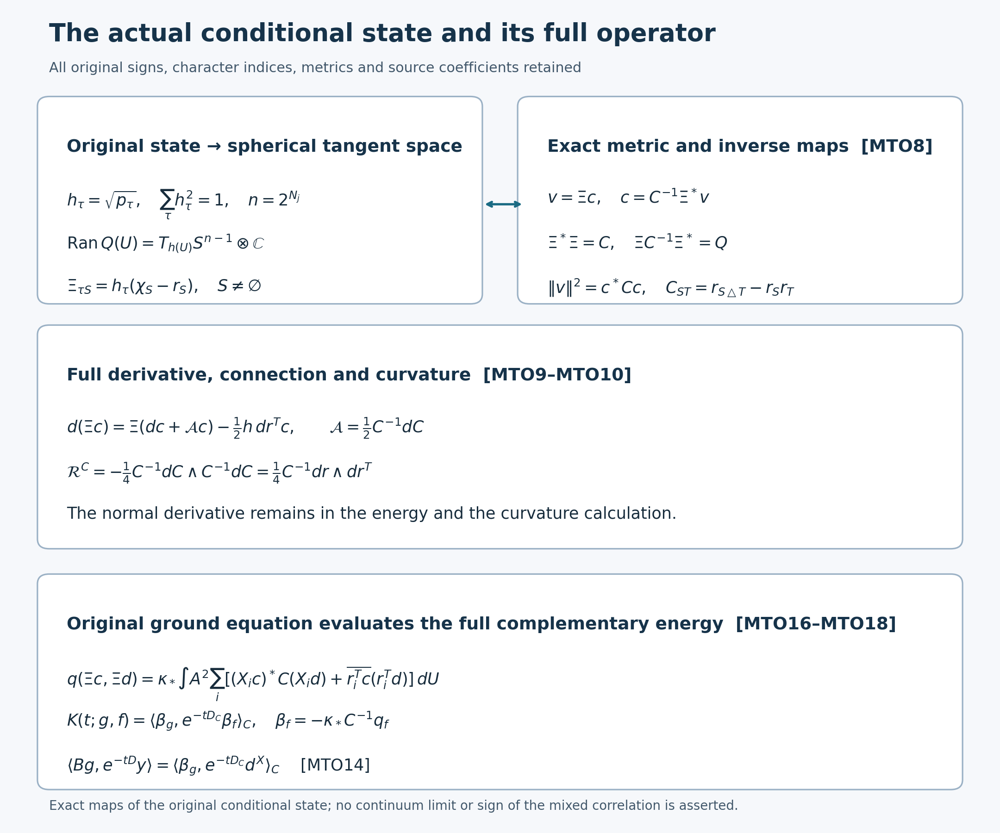

# Actual mixed-time evolution with the full conditional memory

Reviewed derivation, 14 October 2026. This continues SDR12–SDR13 for the original source, retaining its mixed correlation and the full original character-coordinate operator. The smooth global no-gap state remains the goal.

Use the complete original objects and domains in [SDR1–SDR13](https://github.com/KokunoYumeto/yang-mills-interacting-workbench/blob/4c2f9d4211edeefa003d4e4d469445ba7025d2b0/yang-mills/continuations/20261011-central-signs-shrinking-window/SIGNED_RESIDUAL_RESPONSE.md), [CK17–CK24](https://github.com/KokunoYumeto/yang-mills-interacting-workbench/blob/4c2f9d4211edeefa003d4e4d469445ba7025d2b0/yang-mills/continuations/20261011-central-signs-shrinking-window/CENTRAL_KINETIC_SOURCE.md) and [PT1–PT11](https://github.com/KokunoYumeto/yang-mills-interacting-workbench/blob/4c2f9d4211edeefa003d4e4d469445ba7025d2b0/yang-mills/continuations/20261011-central-signs-shrinking-window/POSITIVE_TIME_COVARIANCE.md). In particular retain \(L_j=j^4,a_j=(100j)^{-1},g_j^2=\kappa_*a_j/2,b_j=(\kappa_*a_j^2)^{-1},s_j=100\kappa_*a_j\), the full original potential and vacuum energy, every boundary vertex and link, all raw face samples, and the original radius-two metric. The sixteen bounded disk-index hits are routing metadata only; none was read or used. No novelty claim is made for projection or memory identities.

Fix the original source shift \(z>0\). Retain
\[
\begin{gathered}
f_z^0=(L_A+z)^{-1}x,\quad \eta_z=y-Bf_z^0,\quad
Jf=hf,\quad P=JJ^*,\quad Q=I-P,\\
Bf=-2\kappa_*(dh_\tau\cdot df)_\tau,\qquad
D\text{ the operator of }q\text{ restricted to }H^1\cap\mathscr Q,\\
u_z(t)=e^{-t\mathcal M}\eta_z,\quad
a_z(t)=J^*u_z(t),\quad b_z(t)=Qu_z(t),\quad
C_z(t)=\langle f_z^0,a_z(t)\rangle_A .
\end{gathered}
\]
Here \(a_z(t)\) is a scalar component of the actual evolved residual; it is not the original spatial mesh \(a_j\). All Hilbert pairings are conjugate-linear in the first argument. The inverse of \(D+\sigma\) below is the restricted inverse from CK20; it is not the full inverse of \(\mathcal M+\sigma\).

## 1. Exact time equations on the original domains

The actual components obey
\[
\begin{gathered}
a_z'(t)=-L_Aa_z(t)-B^*b_z(t),\qquad
b_z'(t)=-Ba_z(t)-Db_z(t),\\
a_z(0)=0,\qquad b_z(0)=\eta_z .
\end{gathered}\tag{MTO1}
\]
For each finite regulator the original residual is smooth, since \(x,y,h\) are smooth and the elliptic scalar resolvent preserves smoothness. The full \(\mathcal M\) is unitarily equivalent to the original smooth compact elliptic Hamiltonian, so \(e^{-t\mathcal M}\eta_z\) remains smooth, including at \(t=0\). Multiplication by the smooth projections \(P,Q\) preserves these domains. For a smooth \(b\in\mathscr Q\), the defining restricted form gives \(Db=Q\mathcal Mb\): the right side is in \(\mathscr Q\cap L^2\), and pairing against every \(H^1\cap\mathscr Q\) vector is exactly \(q(\cdot,b)\). CK17–CK19 therefore identify each projected term in \(u_z'=-\mathcal Mu_z\). The initial values use \(\eta_z\in\mathscr Q\). This proves MTO1 as strong equations for these actual smooth vectors, and as form equations against all original \(H^1\) test vectors.

The second equation has the full variation-of-constants solution
\[
b_z(t)=e^{-tD}\eta_z
-\int_0^t e^{-(t-r)D}Ba_z(r)\,dr.
\tag{MTO2}
\]
One way to justify the identity without assuming boundedness of \(D\) is to pair against its spectral projection \(\mathbf1_{[0,n]}(D)v\). On this bounded spectral subspace the differentiating-factor proof is an ordinary Hilbert-space integral identity. The original \(Ba_z(r)\) is continuous in \(L^2\) on each finite time interval, and \(e^{-tD}\) is a contraction, so the integral converges in \(L^2\). Strong convergence of the spectral projections proves MTO2 for every \(v\), hence as a Hilbert identity. No outside component is discarded.

Define the exact memory form on \(H^1\cap\mathscr A\) by
\[
K(t;g,f)=\langle Bg,e^{-tD}Bf\rangle,\qquad
F_z(t;g)=\langle Bg,e^{-tD}\eta_z\rangle .
\]
For every fixed original test \(g\in H^1\cap\mathscr A\), substituting MTO2 into the first equation yields
\[
\begin{aligned}
\langle g,a_z'(t)\rangle_A
={}&-\kappa_*\langle dg,da_z(t)\rangle_A-F_z(t;g)\\
&+\int_0^tK(t-r;g,a_z(r))\,dr,\\
F_z(t;g)={}&\langle Bg,e^{-tD}y\rangle-K(t;g,f_z^0).
\end{aligned}\tag{MTO3}
\]
The gradient pairing in this display is Hermitian. Boundedness of \(B:H^1\to\mathscr Q\) at the fixed regulator and the same contraction bound justify the scalar integral. Thus the equation retains both the instantaneous term, the original inhomogeneous conditional source, and the complete history. The second line follows from the original \(\eta_z=y-Bf_z^0\), not a newly chosen initial condition.

## 2. What positivity belongs to the memory, and its exact inverse

SDR1 gives \(D\ge\delta_j I\) on \(\mathscr Q\), since every vector there is orthogonal to the original vacuum. For every smooth \(f\),
\[
\begin{gathered}
K(t;f,f)=\|e^{-tD/2}Bf\|^2,\qquad
0\le K(t;f,f)\le e^{-\delta_jt}\|Bf\|^2,\\
(-1)^n\partial_t^nK(t;f,f)
=\|D^{n/2}e^{-tD/2}Bf\|^2\ge0\quad(n=0,1,\ldots),\\
|\langle Bg,e^{-tD}y\rangle|^2
\le K(t;g,g)\langle y,e^{-tD}y\rangle .
\end{gathered}\tag{MTO4}
\]
For \(t>0\) these follow from the spectral theorem. At \(t=0\), a smooth \(Bf\) is in every power domain: the preceding restricted-operator formula \(D=Q\mathcal M\) takes smooth equivariant physical \(\mathscr Q\) vectors to smooth vectors in that same space, so induction applies. Cauchy–Schwarz applied to \(e^{-tD/2}Bg\) and \(e^{-tD/2}y\) proves the last line, including complex sources. Positivity is an operator-form statement on the same test vector. It does not assign a sign to the cross-source function \(\langle Bg,e^{-tD}y\rangle\) or assert that this restricted semigroup is a Markov transition.

Let \(\sigma>0\) be a separate Laplace variable, while \(\eta_z\) and \(f_z^0\) retain their original fixed \(z\). The exact Laplace transforms are
\[
\begin{gathered}
\int_0^\infty e^{-\sigma t}K(t;g,f)dt
=\langle Bg,(D+\sigma)^{-1}Bf\rangle,\\
\widehat a_z(\sigma):=\int_0^\infty e^{-\sigma t}a_z(t)dt
=J^*(\mathcal M+\sigma)^{-1}\eta_z,\\
s_\sigma(g,\widehat a_z(\sigma))
=-\langle Bg,(D+\sigma)^{-1}\eta_z\rangle .
\end{gathered}\tag{MTO5}
\]
The first two integrals converge by the original contraction bounds. The last equation follows directly by applying CK20–CK22 to the source with central component zero and conditional component \(\eta_z\). Thus it does not require interchanging an unbounded derivative and an improper integral. In particular it proves that the time-domain history term is exactly the entire existing Schur term. At \(\sigma=z\),
\[
\bar v_z=\widehat a_z(z),\qquad
\langle f_z^0,\bar v_z\rangle_A
=\int_0^\infty e^{-zt}C_z(t)dt,
\]
which is SDR13 with its original source dependence retained.

## 3. The complete initial mixed derivatives

The first two actual time derivatives, not independent norm substitutes, are
\[
\begin{gathered}
C_z(0)=0,\qquad
C_z'(0)=\|Bf_z^0\|^2-\langle Bf_z^0,y\rangle,\\
C_z''(0)=\langle Bx-zBf_z^0,\eta_z\rangle
+q(Bf_z^0,\eta_z).
\end{gathered}\tag{MTO6}
\]
The zero value is the original \(P\)-\(Q\) orthogonality. The first derivative is
\(-\langle\mathcal MJf_z^0,\eta_z\rangle=-\langle Bf_z^0,\eta_z\rangle\), by CK17. Substitute \(\eta_z=y-Bf_z^0\). For the second derivative use self-adjointness and the full block components:
\[
\begin{aligned}
C_z''(0)&=\langle\mathcal MJf_z^0,\mathcal M\eta_z\rangle\\
&=\langle L_Af_z^0,B^*\eta_z\rangle_A
+\langle Bf_z^0,D\eta_z\rangle\\
&=\langle B(L_Af_z^0),\eta_z\rangle+q(Bf_z^0,\eta_z).
\end{aligned}
\]
The exact original equation gives \(L_Af_z^0=x-zf_z^0\), proving MTO6. Every cross term remains inside the displayed full expressions.

The actual first derivative also has the explicit original conditional-source form
\[
\begin{aligned}
C_z'(0)={}&4\kappa_*^2\int A^2
\mathcal S(df_z^0,d\overline{f_z^0})\,dU\\
&-\frac{\kappa_*a_j}{2}\int A^2
\sum_p\varphi(x_p)T_p\,
\langle d\overline{f_z^0},dr_{\partial p}\rangle\,dU .
\end{aligned}\tag{MTO7}
\]
Here \(\mathcal S=\sum_\tau dh_\tau\otimes dh_\tau\) and \(r_S=\sum_\tau p_\tau\chi_S(\tau)\), exactly as in CK/CFE. CFE1 gives \(t_X=2\sum y_\tau dh_\tau=-(a_j/2)\sum_p\varphi(x_p)T_pdr_{\partial p}\). Substituting the original \(B\) gives \(\langle Bf_z^0,y\rangle=-\kappa_*\int A^2\langle d\overline{f_z^0},t_X\rangle dU\), while the full square of \(Bf_z^0\) is the first term above. The metric contraction in MTO7 is complex-bilinear with its conjugation explicitly shown. This proves the exact coefficient and sign of the original source contribution.

These initial derivatives alone are not asserted to determine the full positive-time correlation. MTO2–MTO5 supply the exact memory and cross-source term through which they continue. The next calculation is to evaluate the original cross-source memory jointly at the three fixed source shifts, using the full conditional covariance rather than assigning its sign from the nonnegative diagonal memory.

## 4. The complete original fluctuation bundle and its character frame

Set \(n=2^{N_j}\), \(\mathfrak C=\{\pm1\}^{E_j}\), and let \(\mathcal I\) consist of all \(n-1\) nonempty original edge subsets. The empty character is also retained as \(\chi_\varnothing=1\), \(r_\varnothing=1\). At every original configuration define
\[
\begin{gathered}
\chi_S(\tau)=\prod_{e\in S}\tau_e,\qquad
r_S=\sum_{\tau\in\mathfrak C}p_\tau\chi_S(\tau),\qquad
C_{S,T}=r_{S\triangle T}-r_Sr_T,\\
\xi_S=(h_\tau[\chi_S(\tau)-r_S])_{\tau\in\mathfrak C},\qquad
\boldsymbol\Xi=(\xi_S)_{S\in\mathcal I}.
\end{gathered}
\]
Here \(\boldsymbol\Xi\) is an \(n\)-by-\((n-1)\) real matrix field. Every \(p_\tau>0\), \(h_\tau=\sqrt{p_\tau}\), and \(\sum h_\tau^2=1\). Thus the original state defines the smooth map
\[
h:SU(2)^{E_j}\longrightarrow S^{n-1}_{>0},\qquad
S^{n-1}_{>0}=\{v\in\mathbb R^n:v_\tau>0,\ \sum_\tau v_\tau^2=1\}.
\]
The pointwise real fluctuation space \(h(U)^\perp\) is exactly \(T_{h(U)}S^{n-1}\), with its original ambient Euclidean metric. Complexification gives the pointwise vector space used by \(Q\). The following exact maps retain every original sign and character:
\[
\begin{gathered}
\boldsymbol\Xi^*\boldsymbol\Xi=C>0,\quad
\boldsymbol\Xi C^{-1}\boldsymbol\Xi^*=Q,
\quad h^*\boldsymbol\Xi=0,\\
v=\boldsymbol\Xi c\quad(v\perp h),\qquad
c=C^{-1}\boldsymbol\Xi^*v,\qquad
\|v\|_{\ell^2}^2=c^*Cc,\\
(C^{-1})_{S,T}=\frac1{n^2}\sum_{\tau\in\mathfrak C}
\frac{\chi_S(\tau)\chi_T(\tau)}{p_\tau}.
\end{gathered}\tag{MTO8}
\]
The Gram identity follows by multiplying the two centered characters and summing with \(p_\tau\). If \(c^*Cc=0\), the full function \(\sum_{S\ne\varnothing}c_S\chi_S\) is constant on every sign, since all weights are positive. Its uniform Fourier coefficients at each nonempty character are \(c_S\), so they all vanish. Hence \(C>0\), and the \(n-1\) columns are a basis of \(h^\perp\). The middle identities follow from this basis and its Gram matrix. For completeness the full character matrix including the empty row satisfies \(\mathsf H\mathsf H^*=nI\). The matrix \(\mathsf H\operatorname{diag}(p)\mathsf H^*\) has block form \(\left(\begin{smallmatrix}1&r^T\\r&C+rr^T\end{smallmatrix}\right)\) and inverse \(n^{-2}\mathsf H\operatorname{diag}(p^{-1})\mathsf H^*\). Solving its empty-row equation first shows that the nonempty diagonal block of the inverse is \(C^{-1}\). This proves the final line, the same complete inverse as CFE9, without removing a factor or replacing the actual density.

## 5. Every derivative term and the exact spherical connection

Let \(dr\) be the column of all nonempty character differentials and put
\[
\mathcal A=\tfrac12 C^{-1}dC,\qquad
\nabla^C c=dc+\mathcal A c .
\]
This matrix-valued one-form is a derived connection on the full character coefficient bundle. It is not the original marginal density \(A\). The exact differential identities are
\[
\begin{gathered}
dh=\tfrac12\boldsymbol\Xi C^{-1}dr,\qquad
h^*d\boldsymbol\Xi=-\tfrac12dr^T,
\qquad \boldsymbol\Xi^*d\boldsymbol\Xi=\tfrac12dC,\\
d\boldsymbol\Xi=\boldsymbol\Xi\mathcal A-\tfrac12h\,dr^T,\\
d(\boldsymbol\Xi c)=\boldsymbol\Xi\nabla^Cc-\tfrac12h\,dr^Tc,\\
|d(\boldsymbol\Xi c)|^2
=\sum_{e,\alpha}(\nabla^C_{e,\alpha}c)^*C\nabla^C_{e,\alpha}c
+\tfrac14\sum_{e,\alpha}|(X_{e,\alpha}r)^Tc|^2 .
\end{gathered}\tag{MTO9}
\]
All norms on the base use the unchanged radius-two product metric. To prove the first identity, \(h^*dh=0\) and direct differentiation give \(\boldsymbol\Xi^*dh=dr/2\); now apply MTO8. Next
\[
d\xi_T=dh(\chi_T-r_T)-h\,dr_T.
\]
Its pairing with \(h\) is \(dr_T/2-dr_T=-dr_T/2\). Its pairing with \(\xi_S\) is
\[
\sum_\tau h_\tau dh_\tau(\chi_S-r_S)(\chi_T-r_T)
=\tfrac12\sum_\tau dp_\tau(\chi_S-r_S)(\chi_T-r_T)
=\tfrac12dC_{S,T}.
\]
In the last equality both derivatives of the centered factors have zero weighted mean. Resolving \(d\boldsymbol\Xi\) into its \(Q\) and \(h\) components proves the fourth line. The product rule proves the fifth. Its two terms are pointwise orthogonal, and the full Gram matrix of the first is \(C\), proving the last line with the normal derivative term retained.

Metric compatibility and the full curvature are
\[
\begin{gathered}
dC=\mathcal A^*C+C\mathcal A,\\
\mathcal R^C=d\mathcal A+\mathcal A\wedge\mathcal A
=-\tfrac14C^{-1}dC\wedge C^{-1}dC
=\tfrac14 C^{-1}dr\wedge dr^T .
\end{gathered}\tag{MTO10}
\]
The adjoint of a real matrix here is transpose, with the covector argument unchanged. The first identity follows from symmetry of \(dC\). Differentiating \(C^{-1}C=I\) gives \(dC^{-1}=-C^{-1}(dC)C^{-1}\). Thus \(d\mathcal A=-\tfrac12 C^{-1}dC\wedge C^{-1}dC\), and its product square supplies the first curvature formula. To prove the second without discarding the normal part, apply \(d\) to MTO9's full frame identity:
\[
0=d^2\boldsymbol\Xi
=\boldsymbol\Xi(\mathcal A\wedge\mathcal A+d\mathcal A)
-\tfrac12h\,dr^T\wedge\mathcal A
-\tfrac12dh\wedge dr^T .
\]
Multiply by \(C^{-1}\boldsymbol\Xi^*\) and use \(dh=\boldsymbol\Xi C^{-1}dr/2\). This gives \(\mathcal R^C=C^{-1}dr\wedge dr^T/4\) with its stated sign. Multiplication instead by \(h^*\) also retains the exact normal identity \(dr^T\wedge\mathcal A=0\).

More explicitly, for two original real tangent vectors \(X,Y\),
\[
\mathcal R^C(X,Y)c
=\tfrac14C^{-1}\bigl[dr(X)dr(Y)^T-dr(Y)dr(X)^T\bigr]c.
\]
The morphism \(c\mapsto\boldsymbol\Xi c\) therefore identifies \(\nabla^C\) with the original projected connection \(Qd\) on \(h^*TS^{n-1}\): applying \(Q\) to MTO9 gives \(Qd(\boldsymbol\Xi c)=\boldsymbol\Xi\nabla^Cc\). The normal derivative \(-h\,dr^Tc/2\) and the curvature are both explicit. No independent spherical state, replacement Hamiltonian or new metric has been assigned to the original vacuum.

## 6. The full original potential in the complementary form

For all \(S,T,R\in\mathcal I\), retain the actual third centered character moment
\[
\begin{aligned}
\mathcal T_{S,T,R}
&=\sum_\tau p_\tau(\chi_S-r_S)(\chi_T-r_T)(\chi_R-r_R)\\
&=r_{S\triangle T\triangle R}
-r_Sr_{T\triangle R}-r_Tr_{S\triangle R}-r_Rr_{S\triangle T}
+2r_Sr_Tr_R .
\end{aligned}
\]
The last coefficient is two: expanding the product gives three copies of \(r_Sr_Tr_R\) from the single-character terms and subtracts one constant copy. Define the full matrix
\[
\mathcal V_{S,T}
=-b_j\sum_{p\in\mathcal P_j}T_p\mathcal T_{S,T,\partial p}
-\kappa_*\mathcal F C_{S,T},\qquad
\mathcal F=\sum_\tau|dh_\tau|^2
=\tfrac14\sum_{e,\alpha}(X_{e,\alpha}r)^TC^{-1}(X_{e,\alpha}r).
\]
For smooth physical equivariant vectors \(v=\boldsymbol\Xi c\), \(w=\boldsymbol\Xi d\), the complete original complementary form is
\[
\begin{aligned}
q(v,w)=\int A^2\Bigg[&
\kappa_*\sum_{e,\alpha}(\nabla^C_{e,\alpha}c)^*C\nabla^C_{e,\alpha}d\\
&+\frac{\kappa_*}{4}\sum_{e,\alpha}
\overline{(X_{e,\alpha}r)^Tc}\,(X_{e,\alpha}r)^Td
+c^*\mathcal Vd\Bigg]dU .
\end{aligned}\tag{MTO11}
\]
Here \(d\) in \(\boldsymbol\Xi d\) denotes the second coefficient section; the differential in \(dr\) retains its exterior-derivative meaning. For the proof, CK19 gives the entire original expression
\[
q(v,w)=\int A^2\sum_\tau
\left[\kappa_*\langle d\overline{v_\tau},dw_\tau\rangle
+(V_\tau-\overline V-\kappa_*\mathcal F)\overline{v_\tau}w_\tau\right]dU .
\]
Its potentials, including their original constant terms, are
\[
V_\tau=2b_jM_j-b_j\sum_pT_p\chi_{\partial p}(\tau),\qquad
\overline V=2b_jM_j-b_j\sum_pT_pr_{\partial p}.
\]
Subtract these complete expressions to obtain
\(V_\tau-\overline V=-b_j\sum_pT_p(\chi_{\partial p}(\tau)-r_{\partial p})\).
Multiplication by the two centered characters gives exactly \(\mathcal V\). The original \(E_0\) has already entered CK's proven transform of \(H-E_0\); it has not been independently reset. Substitution of the full differentiated frame MTO9 gives MTO11, including the normal square and the negative \(-\kappa_*\mathcal F C\) term. The last identity for \(\mathcal F\) follows from the first line of MTO9 and its full Gram matrix. No term is removed by a sign estimate.

## 7. Original gauge constraints, domains and the entire differential operator

For a sign \(\epsilon\in\mathfrak C\), let \((\mathsf P_\epsilon v)_\tau=v_{\tau\epsilon}\) and let \(\mathsf E_\epsilon\) be the diagonal matrix with entries \(\chi_S(\epsilon)\) on all nonempty subsets. The full frame transforms as
\[
\boldsymbol\Xi(D_\epsilon U)
=\mathsf P_\epsilon\boldsymbol\Xi(U)\mathsf E_\epsilon,
\quad C(D_\epsilon U)=\mathsf E_\epsilon C(U)\mathsf E_\epsilon.
\]
This follows from \(p_\tau(D_\epsilon U)=p_{\tau\epsilon}(U)\) and \(r_S(D_\epsilon U)=\chi_S(\epsilon)r_S(U)\), by inserting each complete column. Consequently \(v(D_\epsilon U)=\mathsf P_\epsilon v(U)\) is equivalent to
\(c_S(D_\epsilon U)=\chi_S(\epsilon)c_S(U)\). Every ordinary vertex gauge transformation fixes \(p,h,r,\boldsymbol\Xi\); hence the physical gauge condition on \(v\) is exactly the same gauge condition on every \(c_S\).

In particular, if \(S\) has a vertex of odd incidence, the central gauge transformation at that vertex gives a sign \(\epsilon\) with \(\chi_S(\epsilon)=-1\). It is simultaneously a gauge transformation and a central link action. The two just-proved coefficient laws force \(c_S=0\) everywhere. They also force \(r_S=0\). These zero coefficients remain indexed in every full matrix above. If \(S\) is a cycle and \(T\) is not, then \(S\triangle T\) is not a cycle, so \(C_{S,T}=0\), and its derivative is zero as well. With a face boundary in the third slot the same argument makes \(\mathcal T_{S,T,\partial p}=0\). Thus the displayed full coefficient laws and matrices preserve the physical zero directions exactly; they are not deleted before deriving the operator.

Let \(\mathscr H_C\) be the space of all measurable coefficient fields satisfying the two original transformation laws, with squared norm \(\int A^2c^*Cc\,dU\). Define
\[
\mathscr U_C:\mathscr H_C\longrightarrow\mathscr Q,\qquad
\mathscr U_Cc=\boldsymbol\Xi c,\qquad
\mathscr U_C^{-1}v=C^{-1}\boldsymbol\Xi^*v .
\]
MTO8 and the transformation laws prove this is a unitary onto the full physical complementary space. At each fixed regulator all entries are smooth on a compact manifold and \(C>0\), so its smallest eigenvalue has a positive minimum and its largest eigenvalue a finite maximum. Multiplication by \(\boldsymbol\Xi\) and its displayed inverse therefore preserves the full \(H^1\) and \(H^2\) domains, with finite regulator-dependent constants. The coefficient form is exactly MTO11, extended by density, and is closed and nonnegative because it is unitarily the original restricted form. It defines
\[
D_C=\mathscr U_C^{-1}D\mathscr U_C,
\qquad e^{-tD}=\mathscr U_Ce^{-tD_C}\mathscr U_C^{-1},
\qquad(D+\sigma)^{-1}=\mathscr U_C(D_C+\sigma)^{-1}\mathscr U_C^{-1}.
\tag{MTO12}
\]
These maps identify the full operator, time evolution and inverse with all constraints, rather than a pointwise matrix model.

For an explicit differential formula use every original right-invariant orthonormal field \(X_i=X_{e,\alpha}\), and put \(r_i=X_ir\), \(u_i=X_iu\), \(\mathcal A_i=\tfrac12C^{-1}(X_iC)\). Then on smooth sections
\[
\begin{aligned}
D_Cc={}&-\kappa_*\sum_i\Big[
X_i^2c+2\mathcal A_iX_ic+(X_i\mathcal A_i)c+\mathcal A_i^2c
+2u_iX_ic+2u_i\mathcal A_ic\Big]\\
&+C^{-1}\left[\frac{\kappa_*}{4}\sum_i r_ir_i^T
-b_j\sum_pT_p\mathcal T_{\cdot,\cdot,\partial p}
-\kappa_*\mathcal F C\right]c .
\end{aligned}\tag{MTO13}
\]
To prove the formula, each \(X_i\) has zero divergence for the original Haar measure and \(\nabla_{X_i}X_i=0\) for the original bi-invariant metric. Metric compatibility MTO10 implies that the adjoint of \(X_i+\mathcal A_i\), in \(A^2C\), is \(-X_i-\mathcal A_i-2u_i\). Multiplying this complete pair of first-order expressions gives all six terms in the first line. The normal square and potential matrix in MTO11 give the second line after multiplication by \(C^{-1}\). Thus no connection derivative, density drift, normal square, scalar negative term or third moment is absent.

Here is the operator-domain justification, separately from the multiplication maps on Sobolev spaces. Extend the displayed coefficient form to all coefficient fields before imposing the physical laws. Its smooth positive matrix \(A^2C\) is uniformly positive at this fixed regulator, and its principal differential part is \(-\kappa_*\sum_iX_i^2I\). In a finite coordinate covering the positive metric gives the elliptic estimate \(\|c\|_{H^2}\le K_j(\|D_Cc\|_{L^2}+\|c\|_{L^2})\): freeze the principal coefficients on each sufficiently small chart, use the Fourier estimate for the resulting positive quadratic symbol, absorb the small principal-coefficient variation, bound the first-order terms by \(\varepsilon\|c\|_{H^2}+K_{j,\varepsilon}\|c\|_{L^2}\), and sum a smooth partition of unity. Applying the corresponding difference-quotient estimate to the weak form gives \(H^2\) regularity for every form-domain vector whose operator value is in \(L^2\). Conversely the displayed formula puts every \(H^2\) section in the operator domain. The finite sign average and compact vertex-gauge average preserve every coefficient transformation law of this form and commute with its operator; their common fixed subspace is \(\mathscr H_C\). Restriction therefore gives domain \(H^2\cap\mathscr H_C\). Only after this argument does MTO12 identify the domain of \(D\) with the corresponding physical \(H^2\cap\mathscr Q\); the earlier multiplication statement did not assume that operator-domain conclusion.

## 8. Exact original source coefficients in the memory

For a smooth central-invariant physical scalar \(f\), define the full column of original contractions
\[
(q_f)_S=\langle dr_S,df\rangle,
\qquad \beta_f=-\kappa_*C^{-1}q_f .
\]
For the original source retain its complete nonempty Fourier column
\[
d^X_S=\frac1n\sum_\tau\chi_S(\tau)(X_\varphi\circ D_\tau),\qquad
d^X_{\partial p}=-\frac{a_j}{2}\varphi(x_p)T_p,
\quad d^X_S=0\ \text{for every other nonempty }S.
\]
Its empty coefficient \((a_j/2)\sum_p\varphi(x_p)(2-\mu D_p)\) remains in \(x\). The full vector and operator identities are
\[
\begin{gathered}
Bf=\mathscr U_C\beta_f,\qquad
y=\mathscr U_Cd^X,\qquad
\eta_z=\mathscr U_Cc_z,\quad
c_z=d^X+\kappa_*C^{-1}q_{f_z^0},\\
K(t;g,f)=\langle\beta_g,e^{-tD_C}\beta_f\rangle_C,\qquad
F_z(t;g)=\langle\beta_g,e^{-tD_C}c_z\rangle_C,\\
\langle Bg,e^{-tD}y\rangle
=\langle\beta_g,e^{-tD_C}d^X\rangle_C .
\end{gathered}\tag{MTO14}
\]
The first identity follows by substituting \(dh=\boldsymbol\Xi C^{-1}dr/2\) into the unchanged \(B=-2\kappa_*dh\cdot d\). The next two follow from the complete Fourier expansion and the centered character frame; they reproduce CFE13 with all original signs and coefficients. MTO12 then proves the three time-dependent pairings exactly. Thus the cross-source term is expressed through the full original metric, connection, third moments and twisted coefficient domain, with its actual \(d^X\), rather than replaced by an arbitrary vector with the same norm.

The corresponding exact weak resolvent expression, still keeping a separate \(\sigma>0\), is
\[
s_\sigma(g,\widehat a_z(\sigma))
=-\langle\beta_g,(D_C+\sigma)^{-1}c_z\rangle_C.
\tag{MTO15}
\]
This is MTO5 under the proved unitary map MTO12. It is therefore the same original mixed overlap that enters SDR12 at \(\sigma=z\). All coefficients in \(D_C,c_z,\beta_g\) are given by the actual original character moments and their derivatives. The construction evaluates the full receiving operator and its exact source maps; it does not yet assign the original three cross-source correlation values or a nonzero limiting annular mass.

## 9. Evaluate the entire coefficient combination with the original ground equation

The full original ground equation supplies more than the separate terms of MTO13. Write \(R=\sum_i r_ir_i^T\). At every original configuration its complete zero-order combination obeys
\[
\begin{aligned}
&-\kappa_*\sum_i\big[(X_i\mathcal A_i)+\mathcal A_i^2+2u_i\mathcal A_i\big]\\
&\quad+C^{-1}\left[\frac{\kappa_*}{4}R
-b_j\sum_pT_p\mathcal T_{\cdot,\cdot,\partial p}
-\kappa_*\mathcal F C\right]
=\kappa_*C^{-1}R .
\end{aligned}\tag{MTO16}
\]
This identity retains, and evaluates together, the original connection derivatives, normal contribution, Wilson potential and conditional kinetic term. It does not follow from arbitrary positive probabilities: it uses their actual ground-state equation. In the componentwise differential expression, including on smooth columns before physical constraints, CK7 gives
\[
\mathcal M_\tau h_\tau
=L_Ah_\tau+(V_\tau-\overline V-\kappa_*\mathcal F)h_\tau=0.
\]
The original \(V_\tau=2b_jM_j-b_j\sum_pT_p\chi_{\partial p}(\tau)\), \(\overline V=2b_jM_j-b_j\sum_pT_pr_{\partial p}\), and the ground equation containing \(E_0\) are the same as in CK7 and MTO11. Since every \(\chi_T(\tau)\) is constant in the base variables, the complete product rule gives
\[
\begin{aligned}
\mathcal M(h\chi_T)&=0,\\
\mathcal M(hr_T)&=hL_Ar_T-2\kappa_*\sum_i(X_ih)(X_ir_T),\\
Q\mathcal M\xi_T&=2\kappa_*\sum_i(X_ih)(X_ir_T)
=\kappa_*\boldsymbol\Xi C^{-1}\sum_i r_i(X_ir_T).
\end{aligned}
\]
Here \(QX_ih=X_ih\). These are differential identities for columns; a constant nonempty coefficient column need not satisfy the physical equivariance law, so no physical zero mode has been asserted. Compare the last line with MTO13 applied as a differential expression to that column, then use the injectivity of \(\boldsymbol\Xi\). This proves MTO16, including its factor \(\kappa_*\) on the right.

For arbitrary physical coefficient sections the same product rule gives the exact evaluated operator identity
\[
\begin{aligned}
D_Cc
&=-\kappa_*\sum_i\big[X_i^2c+2u_iX_ic+C^{-1}(X_iC)X_ic\big]
+\kappa_*C^{-1}Rc\\
&=-\kappa_*A^{-2}C^{-1}\sum_i X_i(A^2C X_ic)
+\kappa_*C^{-1}Rc .
\end{aligned}\tag{MTO17}
\]
MTO13 and MTO16 remain the full comparison with every original potential term. Indeed the product rule for \(Q\mathcal M(\boldsymbol\Xi c)\) retains the derivative term \(-2\kappa_*Q(d\boldsymbol\Xi)\cdot dc=-\kappa_*\boldsymbol\Xi C^{-1}(dC)\cdot dc\), the scalar \(\boldsymbol\Xi L_Ac\), and the just-evaluated \((Q\mathcal M\boldsymbol\Xi)c\). This proves the first line; differentiating \(A^2C\) proves the second without a change of measure, coordinates or metric.

The resulting full energy identity is
\[
q(\boldsymbol\Xi c,\boldsymbol\Xi d)
=\kappa_*\int A^2\sum_i\left[
(X_ic)^*C(X_id)
+\overline{r_i^Tc}\,(r_i^Td)\right]dU .
\tag{MTO18}
\]
Integration by parts in MTO17 proves this for smooth sections and density extends it to the original form domain. A second derivation displays exactly how the original potential contributes: set \(G_\tau=\sum_S(\chi_S(\tau)-r_S)c_S\), so \(\boldsymbol\Xi c=hG\). The ground transform of each full component, with \(A^2h_\tau^2=\psi(D_\tau U)^2/n\), gives
\[
q(hG,hH)=\kappa_*\int A^2\sum_{\tau,i}p_\tau
\overline{X_iG_\tau}\,X_iH_\tau\,dU.
\]
For this calculation \(X_iG_\tau=\sum_S(\chi_S-r_S)X_ic_S-r_i^Tc\). Its two cross terms each contain \(\sum_\tau p_\tau(\chi_S-r_S)=0\) exactly; its two remaining terms are the covariance contraction and the complete \(r_i\) square in MTO18. The coefficient of that square is one, whereas the normal square in MTO11 has coefficient one quarter. MTO16 and the integrated connection terms account for the full difference. Thus both full formulas, their relation, and every coefficient are retained. This evaluates the complementary energy using first derivatives of the actual character moments, without replacing them by independent variables or uniform weights.

## 10. Apply the evaluated operator to the actual face source

Let \(e_p\) be the coordinate vector at the original face boundary \(\partial p\) in the entire nonempty-character column, and retain
\[
d^X=-\frac{a_j}{2}\sum_p\varphi(x_p)T_pe_p.
\]
For each oriented original face, \(\Delta T_p=-3T_p\). To see the constant with the original metric, on each of its four distinct links the radius-two generators obey \(\sum_{\alpha=1}^3T_\alpha^2=-3I/4\). Inserting the generator twice into that link's factor of the ordered holonomy, with its inverse when the original orientation requires it, therefore gives \(-3T_p/4\) on each link. Summing the four links gives \(-3T_p\). No lattice spacing or coupling is absorbed into this equation. Applying MTO17 now yields the complete original source action
\[
\begin{aligned}
D_Cd^X={}&3\kappa_*d^X
+\kappa_*a_j\sum_p\varphi(x_p)\sum_i u_i(X_iT_p)e_p\\
&+\frac{\kappa_*a_j}{2}C^{-1}
\sum_{p,i}\varphi(x_p)(X_iC)e_p(X_iT_p)\\
&-\frac{\kappa_*a_j}{2}C^{-1}
\sum_p\varphi(x_p)T_pRe_p .
\end{aligned}\tag{MTO19}
\]
The first line is the full \(L_A d^X\). The second is the entire covariance derivative term, and the third is the complete evaluated zero-order term. Every original face sample and matrix index is retained. Each term has the transformation laws proved in MTO12, so the total is a physical complementary source.

For a fixed smooth central physical \(g\), put \(H_g(t)=\langle Bg,e^{-tD}y\rangle\). Its first derivative and a complete finite-time remainder now have the actual receiving expressions
\[
\begin{gathered}
H_g(0)=\langle\beta_g,d^X\rangle_C,
\qquad H_g'(0)=-\langle\beta_g,D_Cd^X\rangle_C,\\
H_g(t)=H_g(0)-t\langle\beta_g,D_Cd^X\rangle_C
+\int_0^t(t-r)\langle D_C\beta_g,e^{-rD_C}D_Cd^X\rangle_C\,dr,\\
\left|H_g(t)-H_g(0)+t\langle\beta_g,D_Cd^X\rangle_C\right|
\le\frac{\delta_jt-1+e^{-\delta_jt}}{\delta_j^2}
\|D_C\beta_g\|_C\,\|D_Cd^X\|_C .
\end{gathered}\tag{MTO20}
\]
Smoothness and the proved domain maps allow two derivatives of this actual semigroup pairing, including at zero. Twice integrating the fundamental theorem of calculus gives the exact remainder. Self-adjointness puts one \(D_C\) on each source, and \(D_C\ge\delta_jI\) gives the bound after integrating \(\int_0^t(t-r)e^{-\delta_jr}dr\) exactly. The same formula with \(d^X\) replaced by \(c_z\) applies to \(F_z\); all original source-shift dependence remains. No sign for this mixed remainder follows from the positive diagonal memory. MTO19 evaluates its actual face-source operator; \(D_C\beta_g\), the joint long-time overlap and their regulator bounds are the next quantities to calculate using MTO17 and the existing full resolvent derivatives.

The figure displays exact maps of the original conditional state, rather than a low-dimensional projection of the full sphere. Its tangent fiber is the ambient conditional fiber; physical sections satisfy every additional sign and gauge law proved in MTO12. MTO8 proves the full frame and inverse; MTO9–MTO10 retain the normal derivative and curvature. MTO11–MTO18 prove both complete energy formulas and the original ground-equation comparison, including every Wilson-potential term. MTO14–MTO20 supply the actual sources and time-memory maps. Reproducible figure: [figure_mixed_time.py](figure_mixed_time.py). The inherited center-multiplication provenance is L. Li and Y. Meurice, [arXiv:hep-lat/0410029v2](https://arxiv.org/abs/hep-lat/0410029v2), Sections II–IV and Appendix, through the retained CS/CK author-source record. No new external source reading or novelty claim is made.

The accompanying diagnostics contain 235 full complex-matrix time, remainder and Laplace-tail checks, and 190 all-character geometry and differential-operator checks. The latter include a continuous gauge-invariant four-link radius-two fixture with all sixteen signs, all fifteen nonempty characters, the original trace Casimir and Haar density, and its entire constructed ground potential. That fixture is explicitly different from the Wilson ground state. Separate algebra checks retain the complete Wilson potential. These diagnostics check the formulas; the proofs above establish them for the actual original state. The joint mixed correlation at the three original shifts, its limiting spectral mass, continuum reconstruction and smooth global no-gap state remain the continuing calculation.

## Both original mixed sources and the entire inverse tail

[MSA1–MSA6](https://github.com/KokunoYumeto/yang-mills-interacting-workbench/blob/main/yang-mills/continuations/20261011-central-signs-shrinking-window/MIXED_SOURCE_OPERATOR_ACTION.md) evaluate the full complementary operator on the actual gradient and face sources. The original ground equation and actual resolvent equation give the complete commutator with all potential, Hessian and Ricci terms. Both operator norms in MTO20 now have explicit bounds from the original state estimates, retaining every lattice count, coupling and source coefficient. For \(b_z=Bf_z^0\), the full cross term is
\[
\begin{aligned}
\langle b_z,(D+\sigma)^{-1}y\rangle
={}&\frac{\langle b_z,y\rangle}{\sigma}
-\frac{\langle b_z,Dy\rangle}{\sigma^2}\\
&+\frac{\langle Db_z,(D+\sigma)^{-1}Dy\rangle}{\sigma^2}.
\end{aligned}
\]
The entire last term is bounded by the explicit \(\mathcal B_{j,z}\mathcal Y_j/[\sigma^2(\sigma+\delta_j)]\). The original time-domain remainder and source-dependent versions are also retained. The joint signed moments, full Schur solution, limiting annular mass and smooth global no-gap construction remain active.

## Strict mixed orientation in the actual one-plaquette Wilson model

[OPC1–OPC8](https://github.com/KokunoYumeto/yang-mills-interacting-workbench/blob/main/yang-mills/continuations/20261011-central-signs-shrinking-window/ACTUAL_ONE_PLAQUETTE_ORIENTATION.md) prove a strict mixed sign for the actual four-link one-plaquette Wilson ground state. The original trace kinetic operator, full16sign probabilities and all15character covariance blocks are retained. Differentiating the actual ground equation gives an exact scalar receiving map to the unit sphere S5; its positive source proves ground monotonicity. The full physical odd coefficient domain is the hemisphere Dirichlet domain, yielding
\[
\langle Bf_{z,\varphi}^0,e^{-tD}y_\varphi\rangle<0
\quad(z>0,\ t\ge0,\ \varphi\ne0).
\]
The exact residual source and entire restricted-resolvent cross terms have the same strict sign. This theorem concerns the separate one-plaquette Wilson model. Shared-face coupling, the original full open box, its full Schur inverse and signed spectral window, and the smooth global no-gap construction remain active.

## Shared-link two-face geometry and actual mixed sign

[TPL1–TPL18](https://github.com/KokunoYumeto/yang-mills-interacting-workbench/blob/main/yang-mills/continuations/20261011-central-signs-shrinking-window/SHARED_LINK_TWO_PLAQUETTE.md) retain all seven radius-two links of two adjacent Wilson plaquettes. Their exact gauge quotient has the three traces x,y,z with domain \(4-x^2-y^2-z^2+xyz\ge0\) and Haar density \(dx\,dy\,dz/(4\pi^2)\). The original kinetic matrix proves that the actual ground cannot depend only on the two face traces. The complete unit-ground expansion yields, on every bounded time interval and compact positive-shift interval,
\[
\begin{aligned}
\langle Bf_{s,\varphi},e^{-tD}y_\varphi\rangle
={}&-\frac{4a^2b^2e^{-3\kappa_*t}}{9\kappa_*(8\kappa_*+s)}
(|\varphi_1|^2+|\varphi_2|^2)\\
&+a^2O(b^3)(|\varphi_1|^2+|\varphi_2|^2).
\end{aligned}
\]
The proved analytic remainder gives a strict negative sign for sufficiently small b and every nonzero pair of raw samples. All 128 sign probabilities and 127 covariance indices and their inverse blocks are retained. TPL15–TPL17 give the exact receiving maps into the original full lattice, including its remaining potential and the full-state conditional score covariance. Increasing coupling on the original regulator path, the complete signed spectral window and the smooth global no-gap construction remain active.

## Actual full-state marginal ground and nonzero trace memory

[FMP1–FMP13](https://github.com/KokunoYumeto/yang-mills-interacting-workbench/blob/main/yang-mills/continuations/20261011-central-signs-shrinking-window/FULL_STATE_MARGINAL_GROUND.md) prove the actual full-lattice marginal equation with every remaining Wilson face, the original vacuum energy and both conditional score contributions retained. A global SU(2) loop-gradient argument shows that a smooth first integral is constant, for every loop length and arbitrary positive original link weights. Applied to the original seven-link patch and an explicit crossing Wilson face, this gives
\[
\|\mathcal Kx\|^2=\|\mathcal Ky\|^2>0,\qquad
\langle\mathcal Kx,e^{-t\mathcal D}\mathcal Kx\rangle>0
\quad(t\ge0)
\]
at every original regulator, with equal diagonal memory for y and strict positive-shift resolvent memory. This is the complement of trace-measurable functions in the actual full-ground measure, whose entire receiving maps and operator domains are proved. Its nonzero coupling is established beyond the earlier two-face expansion about b=0. The original single-face observable retains its full quadratic factor \(a^2/4\). Regulator-uniform shrinking-window weight, the signed three-shift combination and the smooth global no-gap construction remain active.
