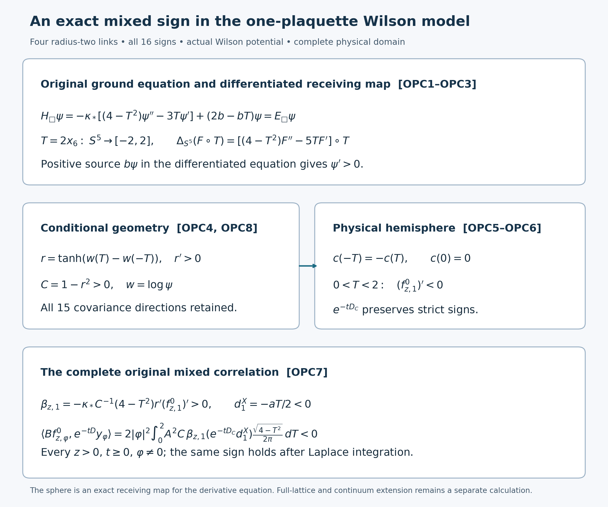

# Mixed-source orientation for the actual one-plaquette Wilson ground state

Reviewed derivation, 14 October 2026. This is a separate four-link, one-face Wilson model with its own exact physical gauge reduction. It is not the full original three-dimensional open box or a four-dimensional continuum state. The calculation uses the full conditional maps in [MTO1–MTO20](https://github.com/KokunoYumeto/yang-mills-interacting-workbench/blob/ace79c975ca05c67842853b3f96469eb0ba6871c/yang-mills/continuations/20261011-central-signs-shrinking-window/ACTUAL_MIXED_TIME_EVOLUTION.md) and original source actions in [MSA1–MSA6](https://github.com/KokunoYumeto/yang-mills-interacting-workbench/blob/ace79c975ca05c67842853b3f96469eb0ba6871c/yang-mills/continuations/20261011-central-signs-shrinking-window/MIXED_SOURCE_OPERATOR_ACTION.md). Four disk-index hits are routing metadata only; none was read as an external source. No novelty claim is made.

## 1. Original four-link objects and exact scalar receiving map

Take four radius-two SU(2) links on the boundary of one oriented square, with all four vertex gauge transformations, probability product Haar measure, and
\[
T=\operatorname{Tr}(U_1U_2U_3^{-1}U_4^{-1}),\qquad
H_\square=-\kappa_*\sum_{e=1}^4\Delta_e+2b-bT,
\qquad b=\frac1{\kappa_*a^2},\quad a,\kappa_*>0.
\]
The orthonormal generators are exactly \(-i\sigma_\alpha/2\). The positive unit ground state solves \(H_\square\psi=E_\square\psi\), retaining its original energy \(E_\square\), with \(\int\psi^2dU=1\). Compact ellipticity and positivity give the same unique positive ground construction as in the original finite-regulator Hamiltonian. Its uniqueness makes it invariant under the full vertex gauge group.

Successively choosing gauge transformations along a spanning tree sets three traversed link factors to the identity. The remaining factor is the ordered square holonomy, up to conjugation by the root gauge transformation. Thus a physical scalar is precisely a conjugation-invariant function of that holonomy, hence a function \(F(T)\) of its real trace \(T\in[-2,2]\). Integrating three Haar links first leaves the fourth translated Haar distribution. The exact Haar pushforward and kinetic identities are
\[
d\nu(T)=\frac{\sqrt{4-T^2}}{2\pi}\,dT,\qquad
|dT|^2=4-T^2=:\Gamma(T),\quad
\Delta T=-3T,
\quad
\Delta F(T)=\Gamma F''-3TF'.
\tag{OPC1}
\]
To verify the constants, write one Haar SU(2) element as \(\cos\theta I-i\sin\theta\,\mathbf n\cdot\boldsymbol\sigma\). Its trace is \(2\cos\theta\), and integrating \(\mathbf n\) leaves \((2/\pi)\sin^2\theta\,d\theta\); the displayed density follows by the exact change of variables. On each original link, the Pauli contraction gives \(|d_eT|^2=1-T^2/4\) and \(\Delta_eT=-3T/4\), including inverse-oriented factors. Summing all four contributions proves the other formulas. The full norm is \(\int_{-2}^2|F|^2d\nu\); no coupling or metric factor has been absorbed. Smooth physical functions give smooth functions of T up to both endpoints: at either pole the rotationally invariant local Taylor coefficients have only even radial powers, and \(2\mp T\) is a smooth coordinate in that radial square. The ground is in fact analytic by the analytic compact elliptic equation.

Consequently the exact physical ground equation is
\[
-\kappa_*[\Gamma\psi''-3T\psi']+(2b-bT)\psi=E_\square\psi.
\tag{OPC2}
\]
This is the actual Wilson potential, not a potential constructed from a prescribed positive function.

## 2. Strict monotonicity of the actual ground

The claim to prove is \(\psi'(T)>0\) for every \(-2\le T\le2\). Consider the actual positive heat solution \(v(t,T)=e^{-tH_\square}1\). Its derivative \(q=\partial_Tv\) obeys
\[
\partial_tq=\kappa_*[\Gamma q''-5Tq']-(2b-bT+3\kappa_*)q+bv,
\qquad q(0,T)=0.
\tag{OPC3}
\]
Every coefficient here follows by differentiating OPC2's unshifted differential expression: \(\Gamma'=-2T\), so the derivative drift is \(-5T\), and the differentiated original potential contributes the positive source \(bv\).

For an exact endpoint argument, use the auxiliary unit sphere \(S^5\subset\mathbb R^6\) and the scalar map \(T=2x_6\). For every smooth F,
\[
\Delta_{S^5}[F(2x_6)]
=[(4-T^2)F''-5TF']_{T=2x_6}.
\]
Indeed \(|\nabla_{S^5}x_6|^2=1-x_6^2\) and \(\Delta_{S^5}x_6=-5x_6\); the factor two in the map gives the displayed coefficients. This is an exact scalar pullback for the differentiated equation, not a replacement of the original four-link radius-two metric or Hamiltonian. OPC3 therefore is a smooth uniformly elliptic parabolic equation on the whole auxiliary sphere, with bounded multiplication coefficient, zero initial data and strictly positive forcing \(bv\). The maximum principle gives \(q\ge0\); it can be applied after multiplying q by an exponential large enough to make the multiplication coefficient nonpositive. The positive forcing and the strong maximum principle give \(q>0\) at positive time.

The original compact spectral expansion gives \(e^{tE_\square}v(t)\to\langle\psi,1\rangle\psi\) in every smooth norm. One way to justify the derivative convergence is to factor out a fixed positive heat time, which maps L2 to every Sobolev space, and apply the spectral gap above the simple ground eigenvalue to the remaining factor. Thus \(\psi'\ge0\). Differentiating the ground equation gives
\[
-\kappa_*[\Gamma(\psi')''-5T(\psi')']
+(2b-bT+3\kappa_*-E_\square)\psi'=b\psi>0.
\]
If the nonnegative smooth pullback of \(\psi'\) to S5 vanished anywhere, it would have a zero minimum there. Its negative Laplacian is then nonpositive and its multiplication term is zero, contradicting the positive right side. Therefore \(\psi'>0\), including the two original trace endpoints. No claim about the sign of \(2b-bT+3\kappa_*-E_\square\) was needed.

## 3. All sixteen conditional signs and physical coefficients

Let \(\chi(\tau)=\tau_1\tau_2\tau_3\tau_4\). Keep all sixteen \(\tau\), all fifteen nonempty characters and the empty character. Then
\[
\begin{gathered}
A^2(T)=\frac{\psi(T)^2+\psi(-T)^2}{2},\qquad
p_\tau(T)=\frac{\psi(\chi(\tau)T)^2}{16A^2(T)},\quad h_\tau=\sqrt{p_\tau},\\
r(T)=\frac{\psi(T)^2-\psi(-T)^2}{\psi(T)^2+\psi(-T)^2}
=\tanh(w(T)-w(-T)),\quad w=\log\psi,\\
C(T)=1-r(T)^2>0,\qquad
r'(T)=C(T)[w'(T)+w'(-T)]>0.
\end{gathered}\tag{OPC4}
\]
Every nonempty character moment except the full four-edge cycle is zero, by the uniform sum within each parity class. The vertex central-gauge constraints of MTO12 make every physical coefficient at a noncycle character zero as well. These are zero physical coefficients, not zero directions of the full covariance: that full matrix is strictly positive, with its noncycle blocks retained explicitly in OPC8 below. The one remaining physical coefficient is an odd scalar \(c(-T)=-c(T)\). The full covariance block at the cycle is the displayed C; the cycle-to-noncycle blocks are zero. The physical conditional norm and form therefore are exactly
\[
\begin{gathered}
\|\Xi c\|^2=\int_{-2}^2A^2C|c|^2d\nu,\\
q(\Xi c,\Xi d)=\kappa_*\int_{-2}^2 A^2\Gamma
\left[C\overline{c'}d'+(r')^2\overline c\,d\right]d\nu,\\
D_Cc=-\kappa_*\left[\Gamma c''+
\left(-3T+2\Gamma u'+\Gamma\frac{C'}C\right)c'\right]
+\kappa_*\Gamma\frac{(r')^2}C c,\qquad u=\log A.
\end{gathered}\tag{OPC5}
\]
These are the restrictions of MTO17–MTO18 after the exact gauge constraints, not a replacement of the all-character operator. The positive smooth even weight \(A^2C\) has a strictly positive minimum on this compact trace interval at fixed a and kappa. Odd physical sections vanish at T=0. On T>0 this is a scalar Dirichlet problem at the equator, with its original regular pole at T=2. The auxiliary unit S3 map T=2x4 represents its scalar kinetic part exactly as in OPC1; the drift is the smooth field \(\nabla\log(A^2C)\) and the multiplication term is nonnegative. The negative-part test in the complete form proves positivity of the resolvent; the resolvent-product formula proves positivity of the semigroup. The strong parabolic maximum principle on the connected hemisphere gives strict positivity for nonzero nonnegative initial functions in its interior. This is a property proved for this exact scalar physical block; no positivity claim about the full general-lattice matrix-valued conditional semigroup is inferred.

## 4. The actual marginal source and resolvent derivative

For one raw face sample \(\varphi\in\mathbb C\), retain
\[
X_\varphi(T)=\frac{a\varphi}{2}(\mu T-T),\qquad
x_\varphi(T)=\frac{a\varphi}{2}(\mu T-T r(T)),\qquad
f_{z,\varphi}^0=(L_A+z)^{-1}x_\varphi,
\]
where \(\mu T=\int T\psi(T)^2d\nu(T)\) is the full original ground expectation. In this paragraph take \(\varphi=1\). The conditional mean is even and has
\(x_1'(T)=-(a/2)[r(T)+T r'(T)]<0\) for \(0<T\le2\), by OPC4. Its marginal generator is exactly
\(L_A=-\kappa_*[\Gamma\partial_T^2+(-3T+2\Gamma u')\partial_T]\).

Let \(g(t)=e^{-tL_A}x_1\). It remains even. Its derivative q satisfies, on T>0 with q(t,0)=0,
\[
\partial_tq=\kappa_*\left[
\Gamma q''+(-5T+2\Gamma u')q'
+(-3+2\Gamma'u'+2\Gamma u'')q\right],\qquad q(0,T)=x_1'(T)<0.
\tag{OPC6}
\]
The differentiated equation has the same exact \(S^5\) principal receiving map as OPC3, now on its upper hemisphere; its drift is smooth, its multiplication coefficient bounded, and the original pole is a regular interior point of the hemisphere. Multiplication by an exponential with sufficiently large rate and the maximum principle preserve negativity; the strong principle gives \(q(t,T)<0\) for every \(t>0\) and \(0<T\le2\). The Laplace formula for the actual marginal resolvent then gives \((f_{z,1}^0)'(T)<0\). Differentiation under that integral is justified for every \(z>0\): near \(t=0\) the smooth solution has bounded derivative, and for \(t\ge1\) a fixed positive heat-time smoothing map followed by the \(L^2\) contraction gives a uniform spatial \(C^2\) bound. A smooth axial function with this bound has uniformly bounded trace derivative, including the poles. Indeed its derivative along a meridian vanishes at a pole, and integrating its second meridian derivative bounds the first by a constant times the meridian distance; division by \(|dT/d\theta|=2\sin\theta\) is then bounded near that pole. Away from the poles this denominator has a positive lower bound. Thus multiplication by \(e^{-zt}\) is integrable also for the trace derivative. This proves the derivative formula for the entire actual resolvent.

## 5. Strict orientation of the actual entire mixed correlation

In the full physical coefficient map, retain
\[
\beta_{z,1}(T)=-\kappa_*C(T)^{-1}\Gamma(T)r'(T)(f_{z,1}^0)'(T)>0,
\qquad d_1^X(T)=-aT/2<0\quad(0<T<2).
\]
Both are odd physical coefficients; their inequalities follow from OPC4 and OPC6. The semigroup of the exact scalar operator OPC5 preserves strict negativity of d1 on the upper hemisphere. Consequently the actual mixed function obeys
\[
\begin{aligned}
\langle Bf_{z,\varphi}^0,e^{-tD}y_\varphi\rangle
={}&2|\varphi|^2\int_0^2 A^2(T)C(T)\beta_{z,1}(T)
\left[e^{-tD_C}d_1^X\right](T)
\frac{\sqrt{4-T^2}}{2\pi}\,dT<0
\end{aligned}\tag{OPC7}
\]
for every z>0,t>=0 and nonzero phi. The factor two is the exact parity reduction of the original full Haar integral; the factor |phi|² follows from conjugate-linearity in the first Hilbert argument and the linear dependence of both original sources on phi. All sixteen sign components are accounted for by the full unitary coefficient map. The exact residual coefficient d1X-beta is also strictly negative on the upper hemisphere. Therefore the same strict sign holds for \(\langle Bf_{z,\varphi}^0,e^{-tD}\eta_{z,\varphi}\rangle\), and integration against any positive \(e^{-\sigma t}\) gives the corresponding strict signs of the entire restricted resolvent cross terms for every separate sigma>0. Integrability follows from the actual nonnegative restricted operator and positive sigma.

OPC1–OPC7 determine the mixed sign in this one-plaquette Wilson model. They do not determine the inverse of the full Schur operator, the signed three-shift spectral correction, the full original open-box state or any continuum limit. The next calculation tests how the multi-character connection and original shared-face couplings change this physical scalar sign mechanism.

## 6. The full covariance and exact hemisphere domain

Let \(R=\{1,2,3,4\}\) be the full cycle. The fourteen noncycle indices split into seven disjoint pairs \(\{S,S\triangle R\}\). Keeping the complete fifteen-index matrix \(\mathbf C\), its cycle block, each of its noncycle pair blocks and their full inverses are
\[
\begin{gathered}
\mathbf C_{R,R}=1-r^2=C,\qquad
\mathbf C\big|_{\{S,S\triangle R\}}=
\begin{pmatrix}1&r\\r&1\end{pmatrix},\\
(\mathbf C^{-1})_{R,R}=C^{-1},\qquad
\mathbf C^{-1}\big|_{\{S,S\triangle R\}}=
\frac1{1-r^2}\begin{pmatrix}1&-r\\-r&1\end{pmatrix}.
\end{gathered}\tag{OPC8}
\]
Every cross block between distinct displayed blocks is zero. To prove this, the full moment formula is \(r_\varnothing=1\), \(r_R=r\), and \(r_S=0\) for the fourteen other nonempty subsets. In \(\mathbf C_{S,T}=r_{S\triangle T}-r_Sr_T\), two noncycle indices therefore give one on the diagonal, r precisely when their difference is R, and zero otherwise. A cycle and a noncycle give zero. The displayed products with their inverses are the identity because \((1-r^2)^{-1}(1-r^2)=1\). Their eigenvalues \(1+r,1-r\) are strictly positive, and so is the cycle block. This explicitly verifies that the physical zero coefficients do not remove any positive covariance contribution before restriction.

For the domain statement in OPC5, its scalar form on odd sections is the closure of the complete original smooth form. The radial trace map into the unit \(S^3\) has precisely the measure \(d\nu\) and gradient coefficient \(\Gamma\) of OPC1. Hence it carries the form to the smooth weighted scalar form on that sphere, restricted to axial odd functions. Its restriction to the upper hemisphere has zero Sobolev trace at the equator. Conversely, the odd extension of an axial \(H^1\) hemisphere function with zero boundary trace belongs to the full odd \(H^1\) form domain. This follows in local boundary coordinates by extension of a zero-trace function and reflection; the two halves have equal integrals, so both the full norm and full form retain their exact factor two. The pole is an interior point of the sphere and contributes no new boundary condition or boundary term. Smooth positive \(A^2C\) makes these Sobolev and form completions equivalent at each fixed coupling. Uniqueness of the self-adjoint operator associated with this same closed form identifies the entire restricted semigroup used in OPC7.

In particular, for nonnegative real data \(g\) and \(\lambda>0\), let \(v=(D_C+\lambda)^{-1}g\) on that hemisphere. Its negative part \(v_-\) belongs to the zero-trace form domain. Testing the weak equation against \(v_-\) gives
\[
-q_C(v_-,v_-)-\lambda\|v_-\|_C^2
=\langle v_-,g\rangle_C\ge0.
\]
The nonnegative original form forces \(v_-=0\). Thus every positive-shift resolvent preserves positivity. The strong limit of \((I+tD_C/n)^{-n}\) is the full semigroup and preserves that cone. On the interior the scalar diffusion is uniformly elliptic in the spherical coordinates, with smooth drift and bounded multiplication term, so the strong parabolic principle gives the strict sign used in OPC7. The argument retains the actual operator domain, not a separately chosen scalar boundary problem.

## Diagnostic computation and its complete receiving formulas

The finite diagnostics use the actual Wilson potential. Set \(P_n(T)=U_n(T/2)\), where \(U_0=1,U_1=2x,U_{n+1}=2xU_n-U_{n-1}\). Thus \(P_0=1,P_1=T,P_{n+1}=TP_n-P_{n-1}\). In the original Haar density of OPC1 these polynomials have unit Gram matrix: with \(T=2\cos\theta\), \(P_n=\sin((n+1)\theta)/\sin\theta\), and the full inner product becomes \((2/\pi)\int_0^\pi\sin((n+1)\theta)\sin((m+1)\theta)d\theta=\delta_{mn}\). Differentiation or the same trigonometric formula gives \(\Delta P_n=-n(n+2)P_n\). Multiplication by T obeys \(TP_n=P_{n+1}+P_{n-1}\), with \(P_{-1}=0\). Therefore the complete infinite ground matrix has diagonal \(\kappa_*n(n+2)+2b\) and both adjacent entries \(-b\). A finite first-N eigenvector c, extended by zero, has the exact omitted residual \(-bc_{N-1}P_N\); its norm is \(|bc_{N-1}|\). This reports the full truncation defect and does not identify the finite eigenvector with the infinite ground state.

The initial numerical attempt lost a very small positive covariance by floating-point subtraction in 1-r². The exact original comparison is
\[
C=1-r^2
=\frac{(\psi(T)^2+\psi(-T)^2)^2-(\psi(T)^2-\psi(-T)^2)^2}
{(\psi(T)^2+\psi(-T)^2)^2}
=\frac{4\psi(T)^2\psi(-T)^2}{(\psi(T)^2+\psi(-T)^2)^2}.
\]
The script retains the comparison and evaluates the final complete positive product, preserving both small ground factors. The failed attempt is retained privately; it is a numerical cancellation, not a zero covariance assertion. All 125 current diagnostics pass for b=0.3,3,30 with kappa=0.8 and a=(kappa b)^-1/2. They compare 32/48-dimensional ground approximations, the full omitted residual, weighted marginal and conditional mass matrices, and the predicted mixed signs. These finite computations do not replace the endpoint and positivity proofs and are not a full-lattice or continuum result.

The upper receiving map is the exact pullback of the differentiated equation to the unit S5, retaining T=2x6, its drift coefficient five, the original four radius-two links and their complete Hamiltonian. It does not replace the original state by a state on that auxiliary sphere. The physical conditional block and its domain are proved in OPC4–OPC5 and OPC8. OPC7 retains the full time interval, source shift, complex source amplitude, Haar density and conditional probability weight in the strict mixed sign. The figure states a one-plaquette result; the shared-face and full-lattice continuation remains active. Reproducible figure: [figure_one_plaquette.py](figure_one_plaquette.py). The inherited center-multiplication provenance is L. Li and Y. Meurice, [arXiv:hep-lat/0410029v2](https://arxiv.org/abs/hep-lat/0410029v2), Sections II–IV and Appendix, through the retained CS/CK author-source record. No new external source reading or novelty claim is asserted.
