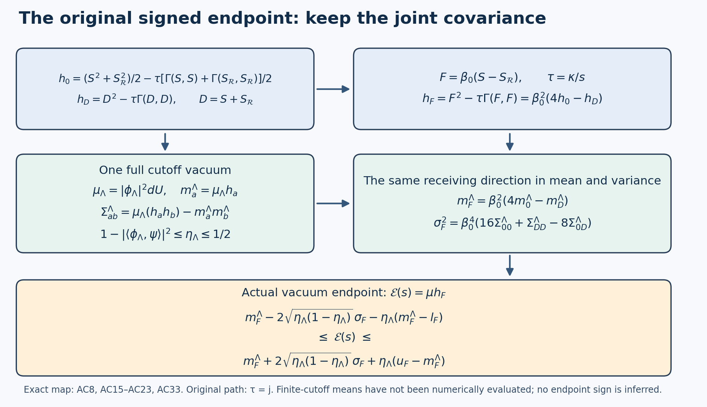

# The signed phase density, its coupled covariance, and the actual endpoint

11 October 2026. This calculation keeps the original phase, actual positive unit vacuum, original open-box Hamiltonian, all means, and the prescribed simultaneous path. Its new receiving result is a coupled enclosure for the actual pair \(Q_4-jK_1\) and \(\mathcal E_j\), using the covariance of their complete signed densities. The covariance retains the mixed mass–energy moments that a sum of separate mass and energy error bounds loses. It does not establish the sign of the actual shrinking-window endpoint.

The existing moment identities PK202, PRE23–PRE31, and SR32–SR40 are providers, not claimed advances. The finite-cutoff construction is the full unshifted construction PK207–PK227. The exact original words are retained from PK158–PK163, PS37–PS46, PG28–PG32, and PRE10–PRE16. All source versions and actual reading coverage are recorded separately. Existing disk indexes were queried before this derivation. No paper returned only as a routing record supplies a theorem here.

## 1. Original objects and the two signed quantities

Retain \(m=2L\), \(n=m+1\), \(L\ge2\), the physical vertices \(o+a(i-L,k-L,l-L)\), all original positive edges and faces, and
\[
 N=3m(m+1)^2,\quad M=3m^2(m+1),\quad Q_L=SU(2)^{E_L},\quad
 T_\alpha=-i\sigma_\alpha/2,\quad
 X_{e,\alpha}f=\left.\frac d{dt}f(\ldots,e^{tT_\alpha}U_e,\ldots)\right|_{t=0}.
 \tag{AC1}
\]
Product Haar is probability measure. The fields are orthonormal for the radius-two metric. Put \(K=-\sum_{e,\alpha}X_{e,\alpha}^2\), \(\Gamma(f,h)=\sum_{e,\alpha}(X_{e,\alpha}f)(X_{e,\alpha}h)\), and keep
\[
 \begin{gathered}
 W_{(z;i,j)}=\operatorname{tr}[U_i(z)U_j(z+e_i)U_i(z+e_j)^{-1}U_j(z)^{-1}],\\
 H=\kappa K+\kappa\xi\sum_p(2-W_p),\quad
 \kappa=2g^2/a,\quad \xi=1/(4g^4),\\
 H\psi=E_0\psi,\quad\psi>0,\quad\int\psi^2dU=1,\quad
 d\mu=\psi^2dU,\quad
 \mathcal L=K-2\Gamma(\log\psi,\cdot)
            =\kappa^{-1}\psi^{-1}(H-E_0)\psi .
 \end{gathered}\tag{AC2}
\]
The scalar \(2\kappa\xi M\), every boundary face, and the vacuum energy remain in these equations. The gauge action is imposed at every vertex, including the boundary.

The tree root is \((0,0,0)\), and its paths run in directions three, two, one. Its chords are
\[
 \mathcal C_2=\{(i,k,l;2):1\le i\le m,\ 0\le k<m,\ 0\le l\le m\},\qquad
 \mathcal C_3=\{(i,k,l;3):0\le i,k\le m,\ (i,k)\ne(0,0),\ 0\le l<m\}.
 \tag{AC3}
\]
Write \(Z_c=t_sU_ct_t^{-1}\), \(q^\alpha(U)=-2\operatorname{tr}(T_\alpha U)\), and retain the complete rows
\[
 \begin{gathered}
 h=\pi/(2n),\quad v_0(l)=n^{-1/2},\quad
 v_1(l)=\sqrt{2/n}\cos[\pi(l+1/2)/n],\quad
 w_1(l)=-\sqrt{2/n}\sin[\pi(l+1)/n],\\
 a_{(i,k,l;2)}=-v_1(i)w_1(k)v_0(l)/\sqrt2,\quad a_{(i,k,l;3)}=0,\\
 b_{(i,k,l;2)}=v_0(i)w_1(k)v_1(l)/\sqrt2,\quad
 b_{(i,k,l;3)}=-v_0(i)v_1(k)w_1(l)/\sqrt2,\\
 u_1=\sum_ca_cq(Z_c),\quad u_3=\sum_cb_cq(Z_c),\quad
 S=u_1\cdot u_3,\quad T=S_{\mathcal R},\quad
 \sigma_*=\sqrt8\sin h,\quad\beta_0=\sigma_*/(2g^2),\\
 F=\beta_0(S-T),\qquad D=S+T .
 \end{gathered}\tag{AC4}
\]
The letter \(T\) in this note denotes the reflected full scalar \(S_{\mathcal R}\), not a Lie generator or a phase-amplitude bound. Reflection retains its reflected root, all reversed physical edges, and every complete reflected word. For example its direction-two target word in tree coordinates is \(A_{k,l}U_2(m-i,k,l)A_{k+1,l}^{-1}\), with
\[
 A_{k,l}=\left(\prod_{t=0}^{l-1}U_3(m,0,t)\right)
          \left(\prod_{b=0}^{k-1}U_2(m,b,l)\right),
 \tag{AC5}
\]
in increasing order. The original \(i=0\) tree edges and all empty products are retained. Thus the constants and affine remainders in PS44 and PG31 remain in \(F,D\).

Set, as full functions before taking expectations,
\[
 A=\tfrac12(S^2+T^2),\quad C=ST,\quad
 B=\tfrac12[\Gamma(S,S)+\Gamma(T,T)],\quad J=\Gamma(S,T).
 \tag{AC6}
\]
Each is reflection-even. Since reflection commutes with \(H\) and fixes its positive unit vacuum, \(\mu A=Q_4\), \(\mu B=K_1\), \(\mu C=Q_4^{\mathcal R}\), \(\mu J=K_{\mathcal R}\). For any \(s>0\), put \(\tau=\kappa/s\) and define the two signed densities
\[
 h_0=A-\tau B,\qquad
 h_D=D^2-\tau\Gamma(D,D)
       =2(A+C-\tau B-\tau J).
 \tag{AC7}
\]
The complete endpoint density is
\[
 h_F=F^2-\tau\Gamma(F,F)
     =2\beta_0^2(A-C-\tau B+\tau J)
     =\beta_0^2(4h_0-h_D).
 \tag{AC8}
\]
All identities here are pointwise. Consequently
\[
 \mu h_0=Q_4-\tau K_1,\qquad
 \mathcal E(s)=G-C_F/s=\mu h_F
   =\beta_0^2(4\mu h_0-\mu h_D),\quad
 G=\mu F^2,\quad C_F=\kappa\mu\Gamma(F,F).
 \tag{AC9}
\]
This is the existing SR33 identity in a form suitable for a joint calculation.

Means have not been discarded. Let \(m_S=\mu S=\mu T\), \(S_+=(S+T)/2-m_S\), and \(S_-=(S-T)/2\). Reflection makes the first function even and the second odd, both with zero actual mean. It also makes their mass and energy cross terms zero. Thus
\[
 \begin{split}
 \mu h_0&=m_S^2+\mu S_+^2+\mu S_-^2
                 -\tau[\mu\Gamma(S_+,S_+)+\mu\Gamma(S_-,S_-)],\\
 \mu h_D&=4m_S^2+4\mu S_+^2-4\tau\mu\Gamma(S_+,S_+),\\
 \mathcal E(s)&=4\beta_0^2[\mu S_-^2-\tau\mu\Gamma(S_-,S_-)] .
 \end{split}\tag{AC10}
\]
The first two lines exhibit the identical mean and even-sector contributions cancelling in their displayed combination. They do not assume \(m_S=0\) or \(D=0\).

## 2. The actual vacuum overlap supplied by the full Hamiltonian

This section makes the input to the coupled estimate explicit. The existing physical electric gap is three: a nontrivial gauge-invariant spin support has no degree-one vertex, hence contains a cycle; the original cubic graph has no cycle shorter than four, and each nonzero edge spin costs at least \(3/4\). The fundamental face trace attains three.

One may retain the original global density-oscillation bound \(\Omega=32\pi\xi M\) of PK212, or its proved square-root-score improvement. The original bound already proves
\[
 \delta_{\rm v}=3\kappa e^{-\Omega},\qquad
 H-E_0\ge\delta_{\rm v}(I-|\psi\rangle\langle\psi|)
              \quad\hbox{on the physical space}.
 \tag{AC11}
\]
For clarity, the proof uses the full actual density. Changing edges one at a time along geodesics of length at most \(2\pi\), and using \(|\nabla_e\log\psi|\le2r_e\xi\), gives \(\operatorname{osc}\log\psi^2\le8\pi\xi\sum_er_e=32\pi\xi M\). If \(m_\rho=\min\rho\), \(M_\rho=\max\rho\), then
\(\operatorname{Var}_\mu f\le M_\rho\operatorname{Var}_{dU}f\le(M_\rho/3)\int\Gamma(f,f)dU\le e^\Omega\mu\Gamma(f,f)/3\).
The full ground-state identity from (AC2) proves (AC11). Every quantity is at the same original finite regulator.

Let \(P_\Lambda=\mathbf1_{[0,\Lambda]}(K)\) on the entire physical space, with both reflection parities retained, and let \(\phi_\Lambda\) be a unit lowest eigenvector of \(P_\Lambda H P_\Lambda\), with eigenvalue \(u_\Lambda\). Keep
\[
 \overline E=\ell=2\kappa\xi M,\quad
 \kappa\Lambda>\overline E,\quad
 w_\Lambda^{\rm bd}=\frac{\ell^2}{\kappa\Lambda-\overline E},\quad
 \eta_\Lambda=\frac{w_\Lambda^{\rm bd}}{\delta_{\rm v}}.
 \tag{AC12}
\]
These are the explicit original bounds underlying PK214; a smaller proved PK214 error can replace \(w_\Lambda^{\rm bd}\). Haar's constant trial vector gives \(E_0\le u_\Lambda\le\overline E\). On \(1-P_\Lambda\), positivity of the complete potential gives \(H\ge\kappa\Lambda\). Its off-diagonal block has norm at most \(\ell\), because it comes solely from \(-\kappa\xi\sum_pW_p\), whose norm is at most \(2\kappa\xi M\).

To derive the energy error directly, project the full equation \(H\psi=E_0\psi\) onto both blocks. The complementary inverse \((H_{QQ}-E_0)^{-1}\) exists and has norm at most \((\kappa\Lambda-E_0)^{-1}\). The component \(P_\Lambda\psi\) is nonzero, since otherwise \(E_0\ge\kappa\Lambda>\overline E\). Eliminating the complementary component gives
\[
 u_\Lambda-E_0
 \le \frac{\ell^2}{\kappa\Lambda-E_0}
 \le w_\Lambda^{\rm bd},\qquad
 1-|\langle\phi_\Lambda,\psi\rangle|^2\le\eta_\Lambda.
 \tag{AC13}
\]
The second inequality follows by applying (AC11) to \(\phi_\Lambda\). When \(\eta_\Lambda<1\), the lowest cutoff eigenspace is one-dimensional: a two-dimensional eigenspace would contain a unit vector orthogonal to \(\psi\), whose energy error is at least \(\delta_{\rm v}\), contrary to (AC13). Reflection preserves this eigenspace and its nonzero overlap with the even vacuum; hence \(\phi_\Lambda\) is even. Its phase can be chosen so \(\langle\phi_\Lambda,\psi\rangle\ge0\). These facts retain the finite approximation as an approximation; they do not identify it with \(\psi\).

For any chosen \(0<\eta_*<1/2\), the explicitly finite choice
\[
 \Lambda=1+\left\lceil\max\left\{3,\,
      \frac{\overline E+\ell^2/(\delta_{\rm v}\eta_*)}{\kappa}\right\}\right\rceil
 \tag{AC14}
\]
ensures \(\eta_\Lambda<\eta_*\). The size may be extremely large on the prescribed path. The unshifted scalar \(\overline E\) has not been removed from this cutoff.

## 3. A coupled expectation enclosure

Write \(d\mu_\Lambda=|\phi_\Lambda|^2dU\). For the pair \(\mathbf h=(h_0,h_D)\), define the two finite-cutoff means and the complete covariance matrix
\[
 m_a^\Lambda=\mu_\Lambda h_a,\qquad
 \Sigma_{ab}^\Lambda
   =\mu_\Lambda(h_ah_b)-m_a^\Lambda m_b^\Lambda,\qquad
 a,b\in\{0,D\}.
 \tag{AC15}
\]
All means are explicit here. For any real vector \(c=(c_0,c_D)\), put
\[
 h_c=c_0h_0+c_Dh_D,\quad m_c^\Lambda=c^Tm^\Lambda,\quad
 \sigma_c^2=c^T\Sigma^\Lambda c,\quad
 l_c\le h_c(U)\le u_c\quad(U\in Q_L).
 \tag{AC16}
\]
The bounds \(l_c,u_c\) below are proved for the original functions. Suppose \(0\le\eta_\Lambda\le1/2\), as guaranteed by (AC14). Then the actual expectation vector obeys, simultaneously for every \(c\),
\[
 \boxed{\begin{split}
 c^T\mu\mathbf h
 &\ge m_c^\Lambda
       -2\sqrt{\eta_\Lambda(1-\eta_\Lambda)}\,\sigma_c
       -\eta_\Lambda(m_c^\Lambda-l_c),\\
 c^T\mu\mathbf h
 &\le m_c^\Lambda
       +2\sqrt{\eta_\Lambda(1-\eta_\Lambda)}\,\sigma_c
       +\eta_\Lambda(u_c-m_c^\Lambda).
 \end{split}}\tag{AC17}
\]
This is an intersection of directional enclosures for the same expectation vector, not a replacement by independent scalar intervals.

Here is the complete proof. Put \(q=1-|\langle\phi_\Lambda,\psi\rangle|^2\), \(0\le q\le\eta_\Lambda\), and decompose the actual unit vacuum as
\(\psi=\sqrt{1-q}\,\phi_\Lambda+\chi\), with \(\langle\phi_\Lambda,\chi\rangle=0\), \(\|\chi\|^2=q\). Expansion gives the exact identity
\[
 \mu h_c-m_c^\Lambda
 =2\sqrt{1-q}\,\operatorname{Re}
       \langle\chi,(h_c-m_c^\Lambda)\phi_\Lambda\rangle
       +\langle\chi,(h_c-m_c^\Lambda)\chi\rangle.
 \tag{AC18}
\]
The squared norm of the vector in the first inner product is exactly \(\sigma_c^2\). Cauchy–Schwarz bounds that term by \(2\sqrt{q(1-q)}\,\sigma_c\). Multiplication by \(h_c-m_c^\Lambda\) is between \(l_c-m_c^\Lambda\) and \(u_c-m_c^\Lambda\); the second term lies between \(q(l_c-m_c^\Lambda)\) and \(q(u_c-m_c^\Lambda)\). Both \(m_c^\Lambda-l_c\) and \(u_c-m_c^\Lambda\) are nonnegative. On \(0\le q\le1/2\), \(\sqrt{q(1-q)}\) and \(q\) are increasing, so replacing \(q\) by \(\eta_\Lambda\) in these two one-sided estimates proves (AC17). No moment of the actual vacuum has been replaced by the finite-cutoff mean.

Because \(\phi_\Lambda\) is even, the variance of the even \(h_0\) is no larger than that of the unsymmetrized \(S^2-\tau\Gamma(S,S)\). Indeed the latter is \(h_0+o_0\), with
\[
 o_0=\tfrac12\{S^2-T^2-\tau[\Gamma(S,S)-\Gamma(T,T)]\},
 \quad
 \mu_\Lambda o_0=\mu_\Lambda(h_0o_0)=0,\quad
 \operatorname{Var}_{\mu_\Lambda}(h_0+o_0)
       =\Sigma_{00}^\Lambda+\mu_\Lambda o_0^2.
 \tag{AC19}
\]
This even projection preserves the actual target mean as well, since \(\mu o_0=0\).

## 4. Every mixed term in the actual receiving direction

Use \(c_F=\beta_0^2(4,-1)\) in (AC17). The finite-cutoff endpoint mean and its exact variance are
\[
 m_F^\Lambda=\mu_\Lambda h_F
       =\beta_0^2(4m_0^\Lambda-m_D^\Lambda),\qquad
 \sigma_F^2=\beta_0^4
      (16\Sigma_{00}^\Lambda+\Sigma_{DD}^\Lambda-8\Sigma_{0D}^\Lambda).
 \tag{AC20}
\]
The covariance coefficient \(-8\) is essential. For example, before subtracting its two means, its entry is exactly
\[
 \begin{split}
 \mu_\Lambda(h_0h_D)
 =\mu_\Lambda\{&
 A D^2-\tau A\,\Gamma(D,D)-\tau B D^2
                  +\tau^2B\,\Gamma(D,D)\}.
 \end{split}\tag{AC21}
\]
Each \(A,B,D\) here is the complete function (AC4)–(AC7), including every reflected transport and affine term. The covariance then subtracts
\((\mu_\Lambda A-\tau\mu_\Lambda B)
 (\mu_\Lambda D^2-\tau\mu_\Lambda\Gamma(D,D))\), with no zero-mean assumption.

Equivalently, the same full variance has the exact direct expression
\[
 \begin{split}
 \sigma_F^2={}&
 \mu_\Lambda F^4-2\tau\mu_\Lambda[F^2\Gamma(F,F)]
           +\tau^2\mu_\Lambda[\Gamma(F,F)^2]\\
 &-\{\mu_\Lambda F^2-\tau\mu_\Lambda\Gamma(F,F)\}^2 .
 \end{split}\tag{AC22}
\]
Thus the next coupled moment is a definite original-word expression of degree at most eight per physical link, rather than two unspecified approximation errors. No term in (AC22) is an actual-vacuum expectation unless it is explicitly written with \(\mu\).

In the invariant four functions of (AC6), expansion gives another complete check:
\[
 \begin{split}
 \sigma_F^2/(4\beta_0^4)={}&
 \operatorname{Var}_\Lambda A+\operatorname{Var}_\Lambda C
                 -2\operatorname{Cov}_\Lambda(A,C)\\
 &+\tau^2\{\operatorname{Var}_\Lambda B+\operatorname{Var}_\Lambda J
                 -2\operatorname{Cov}_\Lambda(B,J)\}\\
 &-2\tau\{\operatorname{Cov}_\Lambda(A,B)
          -\operatorname{Cov}_\Lambda(A,J)
          -\operatorname{Cov}_\Lambda(C,B)
          +\operatorname{Cov}_\Lambda(C,J)\}.
 \end{split}\tag{AC23}
\]
These are ten covariance entries, each formed with its own retained means. Keeping only variances of mass and energy would discard the entire last line, which has a sign in the original endpoint variance.

## 5. Exact connection to the complete Poisson and spectral residuals

For the actual vacuum, the full equation (AC2) and Haar integration by parts prove
\[
 \mu(f\mathcal Lg)=\mu\Gamma(f,g),\qquad
 \mu\mathcal Lg=0,\qquad
 \mathcal L(fg)=f\mathcal Lg+g\mathcal Lf-2\Gamma(f,g).
 \tag{AC24}
\]
All functions below are smooth on the compact product and hence lie in every operator domain used. Define the complete residual function \(R_F=F-\tau\mathcal LF\). The product rule gives the pointwise and vector identities
\[
 h_F=F R_F+\frac{\tau}{2}\mathcal L(F^2),\qquad
 \psi R_F=F\psi-\frac1s(H-E_0)(F\psi),\qquad
 \mathcal E(s)=\mu(FR_F).
 \tag{AC25}
\]
The divergence term is not pointwise zero. It has zero actual mean by (AC24). It need not have zero finite-cutoff mean, which is why (AC22) uses the polynomial \(h_F\) directly and does not insert the unknown actual score into a finite-cutoff calculation.

The exact relation of its actual variance to this full residual is
\[
 \operatorname{Var}_\mu h_F
 =\operatorname{Var}_\mu(FR_F)
   +\tau\,\mu\Gamma(FR_F,F^2)
   +\frac{\tau^2}{4}\mu[(\mathcal L(F^2))^2].
 \tag{AC26}
\]
Expand (AC25) after subtracting its mean, use \(\mu\mathcal L(F^2)=0\), and apply (AC24) to the cross term. This proves (AC26), including its sign and factor. It supplies the exact connecting map between the multiplication variance used in (AC22) and the complete Hamiltonian residual. The former is not the PK219 spectral second moment, and the displayed divergence and cross terms quantify their relation.

Here \(G>0\): choose the physical bulk chord \(e=(1,0,0;2)\), set it to \(\exp(\pi T_1)\), and set all other physical links to identity. The boundary products are identity, and (AC4) gives \(a_e b_e\ne0\), since \(m\ge4\). The original and reflected quadratic products have opposite coefficients, so \(F=8\beta_0a_eb_e\ne0\). At the identity configuration \(F=0\). Positivity of the continuous vacuum then gives \(G>0\), and connectedness gives \(C_F>0\). This reproduces PRE23's original-word witness rather than assuming either strict inequality.

More specifically, let \(\lambda=C_F/G\), \(v=F\psi\), and \(r=(H-E_0)v-\lambda v\). Then
\[
 \langle v,r\rangle=0,\qquad
 \|r\|^2=\|(H-E_0)v\|^2-C_F^2/G,\qquad
 \|\psi R_F\|^2=(1-\lambda/s)^2G+\|r\|^2/s^2.
 \tag{AC27}
\]
These follow by the orthogonal decomposition of the full operator action, retaining the original raw norm \(G\). They recover the rank-one case of PK223. In particular, a claim that the spectral residual alone determined (AC22) would omit the last two terms of (AC26) and the multiplication by \(F\).

PRE30–PRE31 already give the exact Poisson square using the full solution \(\mathcal Lu_F=F\), \(\mu u_F=0\). That square is not a new result here. The calculation above identifies the additional mixed multiplication covariance needed to estimate the signed density jointly; it neither assumes a small residual nor substitutes a conditional phase operator for the complete \(\mathcal L\).

## 6. What the all-physical-link degree-two property actually supplies

The quaternion identity
\(q(U)\cdot q(V)=\operatorname{tr}(UV^{-1})-\operatorname{tr}(UV)\)
keeps \(S\) as the complete ordered trace sum with coefficients \(a_cb_d\). Vary a physical tree edge by an arbitrary \(V\in SU(2)\), not only one subgroup. If \(\epsilon_z\in\{0,1\}\) records whether its root path crosses the edge, every chord \(c=(s,t)\) transforms as \(Z_c\mapsto C^{\epsilon_s}Z_cC^{-\epsilon_t}\), with \(C=A_eVA_e^{-1}\); an inverse traversal uses \(V^{-1}\). For a second chord \(d=(u,w)\), cyclicity gives the complete formulas
\[
\begin{split}
\operatorname{tr}(Z'_c(Z'_d)^{-1})
 &=\operatorname{tr}(Z_c C^{\epsilon_w-\epsilon_t}Z_d^{-1}
                         C^{\epsilon_s-\epsilon_u}),\\
\operatorname{tr}(Z'_cZ'_d)
 &=\operatorname{tr}(Z_c C^{\epsilon_u-\epsilon_t}Z_d
                         C^{\epsilon_s-\epsilon_w}).
\end{split}
\]
Every displayed exponent is in \(\{-1,0,1\}\). These two factors are linear in the four quaternion coordinates of \(V\). Chord edges occur at most twice in the pair. The same argument uses the full reflected tree for \(T\), with its own unchanged prefix and edge orientation.

It follows that \(S,T,F,D\), as functions of any one original physical group factor with all other factors fixed, lie in \(\mathcal H_0\oplus\mathcal H_1\oplus\mathcal H_2\). This strengthens the subgroup wording to the complete quaternion-polynomial statement, with the exact word transformation providing the comparison. A physical derivative preserves this degree in every factor: its vector field is linear in that factor's quaternion coordinates and leaves the polynomial degree unchanged; differentiation in a different factor differentiates coefficients only. Therefore
\[
 \deg_e F\le2,\quad
 \deg_e\Gamma(F,F)\le4,\quad
 \deg_e h_0,\deg_e h_D,\deg_e h_F\le4,\quad
 \deg_e(h_ah_b)\le8
       \quad(a,b\in\{0,D,F\})
 \tag{AC28}
\]
for every original physical edge. The corresponding maximum spins are \(1,2,2,4\). Products with the finite spin polynomial \(\phi_\Lambda\) are finite original-coordinate polynomials. Thus all means and mixed moments in (AC15)–(AC23) reduce to finite Haar contractions of precisely the kind in PK218, with no new unknown vacuum required for their finite-cutoff evaluation.

There is also an explicit exact test of what the degree information leaves uncancelled. Let \(P_ef\) be Haar integration in edge \(e\) only and let \(Z_ef(U)=f(\ldots,-U_e,\ldots)\). The radius-two Casimir eigenvalues on \(\mathcal H_0,\mathcal H_1,\mathcal H_2\) are \(0,3/4,2\). Since \(Z_e\) acts by \(1,-1,1\), comparison of these three eigenspaces proves
\[
 K_ef=\frac{11}{8}f+\frac58Z_ef-2P_ef
     =2(f-P_ef)+\frac58(Z_ef-f)
          \quad(f=S,T,F,D).
 \tag{AC29}
\]
Here \(K_e=-\sum_\alpha X_{e,\alpha}^2\); the complete three-colour sum is already included. Applying the actual integration-by-parts identity gives
\[
 \mu\Gamma(F,F)
 =\sum_e\left\{
   \frac{11}{8}G+\frac58\mu(FZ_eF)
       -2\mu(FP_eF)-\mu[F\Gamma_e(\log\rho,F)]\right\}.
 \tag{AC30}
\]
The last term is the entire actual density drift, since \(\log\rho=2\log\psi\). This exact formula retains the signed cross expectations whose control would be needed to replace the separate \(N\)-edge estimate. Neither the actual density nor the original phase is invariant under an individual central link flip in general. Therefore the terms \(\mu(FZ_eF)\), \(\mu(FP_eF)\), and the drift cannot be replaced by their Haar counterparts. Degree two supplies the exact finite operator (AC29), but does not itself establish a smaller actual quotient.

## 7. Explicit original ranges and an attempted path estimate

Use \(c_h=\cos h\), \(C_h=\cot h\). The exact original absolute row and repeated-occurrence sums are
\[
 \begin{gathered}
 S_1=\sqrt{2/n}\,C_h(C_h-c_h),\\
 S_3=\sqrt{2/n}[(2-1/n)C_h^2-(c_h/n)C_h],\\
 A_1=m\sqrt{2/n}\,C_h(5C_h-4c_h),\\
 A_3=(m/n)\sqrt{2/n}[(9m+5)C_h^2-2c_hC_h],\\
 U_0=16S_1^2S_3^2,\qquad
 C_{\rm occ}=12[S_3\sqrt{S_1A_1}+S_1\sqrt{S_3A_3}]^2 .
 \end{gathered}\tag{AC31}
\]
These are IP2–IP5's complete original-word sums. They retain both occurrences of a shared root edge. Since \(|q|\le2\), \(|S|,|T|\le4S_1S_3\). The occurrence derivative calculation bounds \(\Gamma(S,S),\Gamma(T,T)\le C_{\rm occ}\). Triangle inequality for the complete derivative vectors then gives \(\Gamma(F,F)\le4\beta_0^2C_{\rm occ}\) and \(\Gamma(D,D)\le4C_{\rm occ}\). Consequently the following original-function ranges are available in (AC17):
\[
 \begin{array}{c|cc}
 \text{density}&l&u\\ \hline
 h_0&-\tau C_{\rm occ}&U_0\\
 h_D&-4\tau C_{\rm occ}&4U_0\\
 h_F&-4\tau\beta_0^2C_{\rm occ}&4\beta_0^2U_0 .
 \end{array}\tag{AC32}
\]
The last row follows directly from the squares in (AC8). Combining independent ranges for \(4h_0-h_D\) would give the larger interval
\([-4\beta_0^2(\tau C_{\rm occ}+U_0),4\beta_0^2(U_0+\tau C_{\rm occ})]\);
thus retaining the complete odd phase also improves the tail term of the enclosure.

The fully coupled endpoint enclosure now reads
\[
 \boxed{\begin{split}
 \mathcal E(s)&\ge m_F^\Lambda
 -2\sqrt{\eta_\Lambda(1-\eta_\Lambda)}\,\sigma_F
 -\eta_\Lambda(m_F^\Lambda+4\tau\beta_0^2C_{\rm occ}),\\
 \mathcal E(s)&\le m_F^\Lambda
 +2\sqrt{\eta_\Lambda(1-\eta_\Lambda)}\,\sigma_F
 +\eta_\Lambda(4\beta_0^2U_0-m_F^\Lambda).
 \end{split}}\tag{AC33}
\]
For \(Q_4-\tau K_1\), use \(m_0^\Lambda,\sqrt{\Sigma_{00}^\Lambda}\) and the first row of (AC32) in (AC17). Both statements hold for the same original vacuum and the same finite cutoff; (AC20) keeps their joint covariance rather than making independent choices of their extrema.

For comparison with a bound that has not yet evaluated (AC22), any real \(h\in[l,u]\) satisfies
\[
 \operatorname{Var}_{\mu_\Lambda}h
 \le(u-\mu_\Lambda h)(\mu_\Lambda h-l)\le(u-l)^2/4.
 \tag{AC34}
\]
Indeed \((h-l)(u-h)\ge0\); take its mean and expand the resulting quadratic inequality. Substitution in (AC17), together with the sharper centered projection estimate below, gives the explicit coarse errors
\[
 \begin{split}
 |\mu h-\mu_\Lambda h|
 &\le[\sqrt{\eta_\Lambda(1-\eta_\Lambda)}+\eta_\Lambda](u-l),\\
 |\mu h-\mu_\Lambda h|&\le\sqrt{\eta_\Lambda}(u-l).
 \end{split}
 \tag{AC35}
\]
For the second line, the difference of the two unit-vector projections has eigenvalues \(+\sqrt q,-\sqrt q\) on their two-dimensional span and zero elsewhere. Its trace is zero, so subtracting the retained scalar \((l+u)/2\) from the multiplication operator does not change the expectation difference. The centered operator has norm at most \((u-l)/2\); the trace norm of the projection difference is \(2\sqrt q\). This proves the second line, including all factors. It is also an immediate strengthening of PK215 when an observable's complete range is known.

For \(h=h_F\), the width is
\(R_{F,j}=4\beta_{0,j}^2(U_{0,j}+jC_{{\rm occ},j})\).
Applying PK215 separately without centering gives \(2\sqrt{\eta_\Lambda}R_{F,j}\); centering each nonnegative observable already gives the sharper second line of (AC35). Thus the potential further gain in (AC33) is the actual finite-cutoff covariance in (AC22), not an unearned universal factor improvement. Intersect every directional interval (AC17) with \([m_c^\Lambda-\sqrt{\eta_\Lambda}(u_c-l_c),m_c^\Lambda+\sqrt{\eta_\Lambda}(u_c-l_c)]\). The resulting simultaneous enclosure is never weaker than that centered range estimate. No small variance is assumed.

Now keep the prescribed path exactly:
\[
 L_j=j^4,\quad a_j=(100j)^{-1},\quad
 g_j^2=\kappa_*/(200j),\quad
 \kappa_j=\kappa_*,\quad\xi_j=10000j^2/\kappa_*^2,\quad
 s_j=\kappa_*/j,\quad m_j=2j^4,\quad n_j=2j^4+1 .
 \tag{AC36}
\]
It has \(\tau_j=j\) and \(j^6\beta_{0,j}^2\to5000\pi^2/\kappa_*^2\). The trigonometric formulas in (AC31) give, with all finite boundary terms still present there,
\[
 \begin{gathered}
 \frac{U_{0,j}}{j^{24}}\longrightarrow\frac{2^{22}}{\pi^8},\\
 \frac{C_{{\rm occ},j}}{j^{28}}
 \longrightarrow\frac{3\,2^{21}}{\pi^8}
                  \left(\sqrt5+\frac3{\sqrt2}\right)^2,\\
 \frac{R_{F,j}}{j^{23}}
 \longrightarrow
 \frac{60000\,2^{21}}{\kappa_*^2\pi^6}
                  \left(\sqrt5+\frac3{\sqrt2}\right)^2 .
 \end{gathered}\tag{AC37}
\]
To verify these constants, \(S_1\sim4\sqrt2\,n^{3/2}/\pi^2\), \(S_3\sim8\sqrt2\,n^{3/2}/\pi^2\), \(A_1/S_1\sim5m\), \(A_3/S_3\sim(9/2)m\), and \(n,m\sim2j^4\). Insert these factors into each unchanged expression (AC31); the second line contributes the leading \(j^{29}\) part of \(U_0+jC_{\rm occ}\), and the original \(4\beta_0^2\) supplies the last line.

Thus merely using the available absolute ranges in the new covariance certificate still requires vacuum-overlap error substantially smaller than \(j^{-46}\) to obtain a vanishing absolute endpoint error. For example, selecting
\[
 \eta_{*,j}=\min\left\{\frac14,\,
       \frac{1}{16j^2(1+R_{F,j})^2}\right\}
 \tag{AC38}
\]
in (AC14) proves \(|\mathcal E_j-m_{F,j}^\Lambda|\le1/(2j)\): use \(\sqrt{\eta}+\eta\le2\sqrt{\eta}\) and
\(2\sqrt{\eta_{*,j}}R_{F,j}\le1/(2j)\).
This is a finite certified error, not a computed value of \(m_{F,j}^\Lambda\). It does not assert practical feasibility of the resulting electric matrix. It also does not give a sign because the finite-cutoff mean itself has not been evaluated here.

## 8. What the attempt establishes and the next exact coupling

The old score-only estimate SR40 gives a lower endpoint coefficient that eventually becomes negative. Equations (AC29)–(AC30) identify exactly which signed original-word and density-drift terms that estimate fails to control. The calculation then proceeds to the coupled signed density (AC8), its exact covariance (AC20)–(AC23), and the actual-vacuum enclosure (AC33). Those formulas are fully proved and retain the actual state.

The next finite computation is now specific: for the same \(\phi_\Lambda\), evaluate the complete original-word contractions
\[
 \mu_\Lambda F^2,\quad
 \mu_\Lambda\Gamma(F,F),\quad
 \mu_\Lambda F^4,\quad
 \mu_\Lambda[F^2\Gamma(F,F)],\quad
 \mu_\Lambda[\Gamma(F,F)^2],
 \tag{AC39}
\]
and, for the joint \(Q_4-jK_1\) and even-correction enclosure, the entries of (AC15) with the expansion (AC21). Their finite evaluation uses the proved per-link spin bounds (AC28), the original cutoff eigenvector, and exact Haar contractions. The negative mixed term in (AC22) is retained before estimation. It is not assigned a sign or a magnitude beyond its exact identity.

The endpoint is positive whenever the already-proved numerical lower expression in (AC33) evaluates positive; this is a description of how to read the enclosure, not an assumed theorem premise. No such numerical positivity is claimed in this note. Nor is the known fixed-box oscillator limit exchanged with the growing-box path.

For all \(s>0\), oddness of \(F\psi\) still gives the actual spectral consequence
\[
 \langle F\psi,\mathbf1_{(0,s]}(H-E_0)F\psi\rangle
 \ge\max\{0,\mathcal E(s)\}.
 \tag{AC40}
\]
This follows by integrating \(\mathbf1_{(0,s]}(\lambda)\ge1-\lambda/s\) over its positive spectral measure, whose vacuum atom vanishes. It retains the raw vector and completes the exact receiving map for the coupled certificate.

## 9. Calculating the mixed original density through the full vacuum equation

The list (AC39) determines finite inputs, but does not evaluate its central mixed density. We now calculate that coupling exactly. Write
\[
 I_F=\mu[F^2\Gamma(F,F)],\quad
 V=\kappa\xi\sum_p(2-W_p),\quad
 w=\log\psi,\quad
 {\cal T}(U)=\frac{E_0-V(U)}{\kappa}-\Gamma(w,w).
 \tag{AC41}
\]
The scalar \(2\kappa\xi M\) remains inside \(V\), and the complete score norm in \({\cal T}\) contains every original physical edge and colour. The chain and product rules for the nonnegative operator \(K\) give
\(K(F^4)=4F^3KF-12F^2\Gamma(F,F)\) and
\(K(\psi^2)=2\psi K\psi-2\Gamma(\psi,\psi)=2{\cal T}\psi^2\).
Integration by parts in product Haar, followed by the full equation \(K\psi=(E_0-V)\psi/\kappa\), therefore gives
\[
 \begin{split}
 I_F
 &=\frac13\mu(F^3{\cal L}F)
  =\frac13\mu(F^3KF)-\frac23\mu[F^3\Gamma(w,F)]\\
 &=\frac13\mu(F^3KF)-\frac16\mu({\cal T}F^4)\\
 &=\frac{11N}{24}\mu F^4
     +\frac5{24}\sum_e\mu(F^3Z_eF)
     -\frac23\sum_e\mu(F^3P_eF)\\
 &\hspace{7mm}
     -\frac{E_0}{6\kappa}\mu F^4
     +\frac{\xi}{6}\sum_p\mu[(2-W_p)F^4]
     +\frac16\mu[\Gamma(w,w)F^4].
 \end{split}\tag{AC42}
\]
For the first line, \(\Gamma(F,F^3)=3F^2\Gamma(F,F)\) and (AC24) suffice. For the second, the identity
\(\mu\Gamma(w,F^4)=\mu({\cal T}F^4)\)
follows by integrating \(\Gamma(\psi^2,F^4)=2\psi^2\Gamma(w,F^4)\), using \(K(\psi^2)=2{\cal T}\psi^2\). Since \(\Gamma(w,F^4)=4F^3\Gamma(w,F)\), the factor \(1/6\) follows. The final two lines insert the complete (AC29) into \(KF\). Every term is an actual expectation. In particular the last two terms have a positive sign; dropping the score square or the \(2\) in a face term would change this identity.

There is a second finite Casimir calculation of the same mixed density, keeping the full physical link and avoiding score differentiation. On the space of quaternion polynomials of degree at most four, the five eigenvalues of \(K_e\) are
\[
 (\lambda_0,\lambda_1,\lambda_2,\lambda_3,\lambda_4)
       =(0,3/4,2,15/4,6),\qquad
 {\sf P}_{e,l}=
   \prod_{\substack{0\le r\le4\\r\ne l}}
       \frac{K_e-\lambda_r I}{\lambda_l-\lambda_r},
 \quad 0\le l\le4 .
 \tag{AC43}
\]
These are exact spectral projections on this finite polynomial space: on the degree-\(r\) harmonic each product evaluates to its Kronecker delta. They are not conditional projections for the actual density. Their sum is the identity, and \(K_e=\sum_l\lambda_l{\sf P}_{e,l}\) on that space. Since \(F^2\) has degree at most four, its full components \(f_{e,l}={\sf P}_{e,l}(F^2)\) are defined without a truncation error. The product rule and (AC29) give the pointwise identity
\[
 \begin{split}
 \Gamma_e(F,F)
 &=\frac{11}{8}F^2+\frac58FZ_eF-2FP_eF\\
 &\quad-\frac38f_{e,1}-f_{e,2}
             -\frac{15}{8}f_{e,3}-3f_{e,4}.
 \end{split}\tag{AC44}
\]
Thus every term of the mixed original density, prior to any expectation, is explicitly specified by degree at most eight polynomials per link:
\[
 \begin{split}
 I_F={}&\frac{11N}{8}\mu F^4
       +\frac58\sum_e\mu(F^3Z_eF)-2\sum_e\mu(F^3P_eF)\\
 &-\frac14\sum_e\sum_{l,r=0}^4
          (\lambda_l+\lambda_r)\,\mu(f_{e,l}f_{e,r}).
 \end{split}\tag{AC45}
\]
Indeed \(F^2=\sum_rf_{e,r}\), and symmetrizing
\(\frac12\sum_{e,l,r}\lambda_l\mu(f_{e,l}f_{e,r})\)
gives the last line. Its scalar harmonic \(f_{e,0}\), all cross harmonics, and their nonzero means are retained. If
\(M^e_{lr}=\operatorname{Cov}_\mu(f_{e,l},f_{e,r})
              +(\mu f_{e,l})(\mu f_{e,r})\),
the last line is exactly \(-\frac14\sum_{e,l,r}(\lambda_l+\lambda_r)M^e_{lr}\).
Actual weighting does not make these different Haar harmonics orthogonal; setting the off-diagonal entries to zero is therefore unjustified. Equations (AC42) and (AC45) describe the exact drift and weighted-harmonic terms which such a step would lose. The pointwise construction (AC44), and consequently (AC45), remain valid when their expectations are taken with \(\mu_\Lambda\). The use of the true vacuum equation in (AC42) is reserved for \(\mu\).

The full Hamiltonian gives a useful additional coupling with its sign already fixed. The ground-state identity applied to the entire original square \(F^2\), not to a changed phase, proves
\[
 \begin{split}
 4\kappa I_F
 &=\langle F^2\psi,(H-E_0)F^2\psi\rangle\\
 &=\langle (F^2-G)\psi,(H-E_0)(F^2-G)\psi\rangle\\
 &\ge\delta_{\rm v}(\mu F^4-G^2),\qquad G=\mu F^2 .
 \end{split}\tag{AC46}
\]
The second equality expands \(F^2\psi=G\psi+(F^2-G)\psi\); the cross terms and \(G^2E_0\) contribution vanish only after using the complete equation \((H-E_0)\psi=0\). Its raw norm is \(\mu F^4-G^2\), with the mean retained. The first equality follows because
\(\Gamma(F^2,F^2)=4F^2\Gamma(F,F)\). This is an even-composite excitation coupled to the original odd phase.

Consequently, if \(E_F=\mu\Gamma(F,F)\) and
\({\cal A}_{F^2}=\langle F^2\psi,(H-E_0)F^2\psi\rangle\), then
\[
 \begin{split}
 \operatorname{Var}_\mu h_F
 &=\mu F^4-\frac{{\cal A}_{F^2}}{2s}
       +\frac{\kappa^2}{s^2}\mu[\Gamma(F,F)^2]
       -(G-\kappa E_F/s)^2\\
 &\le\left(1-\frac{\delta_{\rm v}}{2s}\right)
             \operatorname{Var}_\mu(F^2)
       +\frac{\kappa^2}{s^2}\operatorname{Var}_\mu(\Gamma(F,F))
       +\frac{2\kappa}{s}G E_F .
 \end{split}\tag{AC47}
\]
The mixed energy appears with a negative coefficient in the variance, so its lower bound in (AC46) has the correct direction for this upper bound. This is a coupled use of the full equation, not a separate lower bound on \(G\) or \(C_F\). The last line follows by expanding both variances and using \(I_F\ge\delta_{\rm v}\operatorname{Var}_\mu(F^2)/(4\kappa)\); every remaining mean is shown.

The cutoff version requires a further term. Let
\[
 e_\Lambda=(H-u_\Lambda)\phi_\Lambda,\quad
 P_\Lambda e_\Lambda=0,\quad
 G_\Lambda=\mu_\Lambda F^2,\quad
 z_\Lambda=(F^2-G_\Lambda)\phi_\Lambda .
 \tag{AC48}
\]
The residual is finite and computable: because \(P_\Lambda\) commutes with \(K\),
\(e_\Lambda=-\kappa\xi(1-P_\Lambda)(\sum_pW_p)\phi_\Lambda\).
The scalar \(2\kappa\xi M-u_\Lambda\) lies entirely in the cutoff space and cancels in this displayed residual only after the full eigenvalue equation has been used. For any real smooth \(f\), direct expansion of the kinetic quadratic form yields
\[
 \langle f\phi_\Lambda,(H-u_\Lambda)f\phi_\Lambda\rangle
 =\kappa\mu_\Lambda\Gamma(f,f)
       +\operatorname{Re}\langle f^2\phi_\Lambda,e_\Lambda\rangle .
\]
The two derivative cross terms in \(|\nabla(f\phi_\Lambda)|^2\) are precisely the cross terms produced by integrating
\(\operatorname{Re}\langle f^2\phi_\Lambda,K\phi_\Lambda\rangle\);
the potential and eigenvalue terms multiply \(f^2|\phi_\Lambda|^2\) identically. Thus no positivity or eigenvector identity for a changed state has been inserted. With \(f=F^2\), this proves
\[
 \begin{split}
 4\kappa\mu_\Lambda[F^2\Gamma(F,F)]
 &=\langle F^2\phi_\Lambda,(H-u_\Lambda)F^2\phi_\Lambda\rangle
       -\operatorname{Re}\langle F^4\phi_\Lambda,e_\Lambda\rangle\\
 &=\langle z_\Lambda,(H-u_\Lambda)z_\Lambda\rangle
       -\operatorname{Re}
          \langle(F^2-G_\Lambda)^2\phi_\Lambda,e_\Lambda\rangle .
 \end{split}\tag{AC49}
\]
The second line follows by expanding both complete squares: the \(2G_\Lambda\) cross terms cancel, and the \(G_\Lambda^2\) term vanishes because \(\langle\phi_\Lambda,e_\Lambda\rangle=0\). This is an exact reduction of the mixed moment to the unshifted finite Hamiltonian, its explicitly specified boundary residual, and multiplication by the complete original phase. All three vectors are finite original spin polynomials; (AC28) bounds their added per-link degrees. No unknown actual score enters their computation.

In particular (AC22) has the following complete Hamiltonian form, which can be inserted directly in the already-proved actual-state enclosure (AC33):
\[
 \begin{split}
 \sigma_F^2={}&\mu_\Lambda F^4
 -\frac1{2s}
     \langle F^2\phi_\Lambda,(H-u_\Lambda)F^2\phi_\Lambda\rangle\\
 &+\frac1{2s}\operatorname{Re}
                  \langle F^4\phi_\Lambda,e_\Lambda\rangle
 +\frac{\kappa^2}{s^2}\mu_\Lambda[\Gamma(F,F)^2]
 -(G_\Lambda-\kappa\mu_\Lambda\Gamma(F,F)/s)^2 .
 \end{split}\tag{AC50}
\]
The positive and negative signs of the two new full-operator terms are fixed by (AC49). Omitting the boundary residual would generally change the finite-cutoff variance.

The remaining gradient-square term also has a complete finite polynomial expression. Define, in the indicated order,
\[
 \begin{gathered}
 Y_e=(F^2,\ FZ_eF,\ FP_eF,\ f_{e,1},\ f_{e,2},\ f_{e,3},\ f_{e,4})^T,\qquad
 c=(11/8,\ 5/8,\ -2,\ -3/8,\ -1,\ -15/8,\ -3)^T,\\
 \mu_\Lambda\Gamma(F,F)=
       \sum_e\sum_{a=1}^7c_a\mu_\Lambda Y_{e,a},\\
 \mu_\Lambda[\Gamma(F,F)^2]=
       \sum_{e,f}\sum_{a,b=1}^7
                   c_ac_b\,\mu_\Lambda(Y_{e,a}Y_{f,b}).
 \end{gathered}
\]
This follows by squaring the pointwise formula (AC44), with every ordered edge pair and every one of its 49 component pairs included. The moments are raw moments; replacing each by a covariance also requires adding
\((\mu_\Lambda Y_{e,a})(\mu_\Lambda Y_{f,b})\).
Each product has per-link degree at most eight. Together with (AC49), this specifies all finite contractions in (AC50), including the cross-edge contributions rather than just the \(e=f\) terms.

Finally test the new actual coupling on the unchanged path. With the retained original bound,
\(\delta_{{\rm v},j}/(2s_j)=(3j/2)\exp[-32\pi\xi_jM_j]\), while
\[
 \frac{32\pi\xi_jM_j}{j^{14}}
       \longrightarrow\frac{7\,680\,000\pi}{\kappa_*^2}.
\]
Hence this coefficient tends to zero. The proved square-root score bound would improve that exponent's order, but still does not make this coefficient a positive uniform fraction. Thus (AC46) supplies a correctly signed exact coupling and (AC47) a valid bound, while this available gap input does not force the mixed moment to cancel the gradient-square variance on the original path. The remaining calculated quantity is the weighted quartic polynomial in (AC44), squared and summed with all edge cross terms, together with the finite residual in (AC50). Those are explicit finite contractions, not an assumed cancellation. The actual endpoint and the sign of its cutoff mean have still not been numerically evaluated.

Provider proofs: [PK158–PK227](https://github.com/KokunoYumeto/yang-mills-interacting-workbench/blob/485b61423c1f4e1805deb453c1b6b342b27842b6/yang-mills/continuations/20260930-s6-ns-moment-map-bridge/PERIOD_COUPLING_AND_PHYSICAL_KERNELS.md), [PRE1–PRE55](https://github.com/KokunoYumeto/yang-mills-interacting-workbench/blob/ade565f79be8b0eea8dc8e8a95a4034dde91644f/yang-mills/continuations/20261011-central-signs-shrinking-window/PHASE_RESPONSE_AND_ENDPOINT.md), and [SR1–SR72](https://github.com/KokunoYumeto/yang-mills-interacting-workbench/blob/ade565f79be8b0eea8dc8e8a95a4034dde91644f/yang-mills/continuations/20261011-central-signs-shrinking-window/SQUARE_ROOT_SCORE_RECEIVING_MAPS.md). Original source versions and bounded reading coverage are retained in COUPLED_SOURCE_USE_LEDGER.json.
