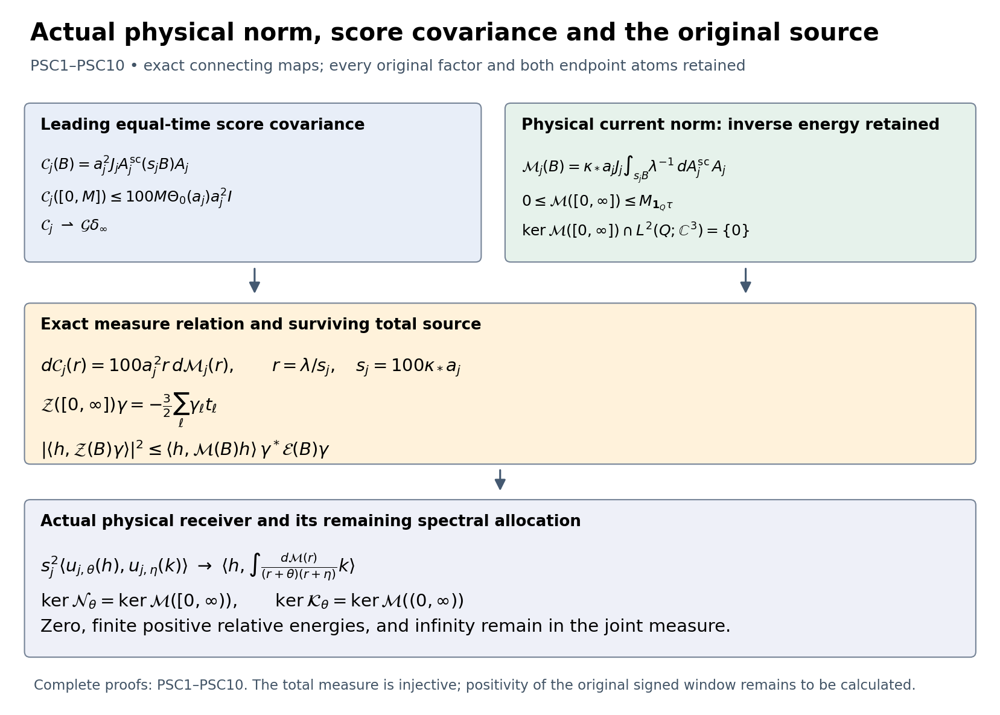

# Actual physical current measure, its kernel and the original window
The actual original sequence has a physical current-norm measure whose total has no kernel on the physical cube. This note proves that statement, the exact connection to the leading score covariance, and the complete joint source measure receiving the original three-shift window. The interacting continuum no-gap construction remains active.

Providers are [PFR1–PFR19](https://github.com/KokunoYumeto/yang-mills-interacting-workbench/blob/1c76b4823f06b70d6ddd78343d31a6421a1c7db1/yang-mills/continuations/20261011-central-signs-shrinking-window/PHYSICAL_SCALAR_RECEIVER_AND_CURRENT_COVARIANCE.md), [KP4–KP10 and KP16](https://github.com/KokunoYumeto/yang-mills-interacting-workbench/blob/1c76b4823f06b70d6ddd78343d31a6421a1c7db1/yang-mills/continuations/20261011-central-signs-shrinking-window/ACTUAL_KINETIC_PROFILE_AND_SHIFT_MOMENTS.md), and [CSR8 and CSR13–CSR14](https://github.com/KokunoYumeto/yang-mills-interacting-workbench/blob/1c76b4823f06b70d6ddd78343d31a6421a1c7db1/yang-mills/continuations/20261011-central-signs-shrinking-window/FULL_CURRENT_SCHUR_AND_ENERGY_MEASURE.md). This calculation uses the actual original regulator sequence and constructs actual subsequences; it assumes no missing physical limit. No new external-author reading or novelty claim is made.

## Original maps, dimensions and state

Retain the open SU(2) lattice with \(L_j=j^4\), the radius-two metric and probability Haar measure. The original quantities are
\[
\begin{gathered}
a_j=(100j)^{-1},\quad g_j^2=\kappa_*a_j/2,\quad
b_{{\rm pot},j}=(\kappa_*a_j^2)^{-1},\quad s_j=100\kappa_*a_j,\\
U_p=U_d(z)U_k(z+e_d)U_d(z+e_k)^{-1}U_k(z)^{-1},\quad d<k,\\
D_p=2-\operatorname{Tr}U_p,\quad
V_j=b_{{\rm pot},j}\sum_pD_p
=2b_{{\rm pot},j}|\mathcal P_j|-b_{{\rm pot},j}\sum_p\operatorname{Tr}U_p,\\
H_j=-\kappa_*\Delta+V_j,\quad H_j\psi_j=E_{0,j}\psi_j,\quad
\psi_j>0,\quad\|\psi_j\|=1,\quad \mu_j=\psi_j^2dU,\quad w_j=\log\psi_j,\\
L_0=\kappa_*d_\mu^*d,\qquad L_1=\kappa_*(dd_\mu^*+d_\mu^*d),\qquad P=P_{\rm ex}.
\end{gathered}
\]
Finite operators and inverses have the full compact weighted domains proved in PT/CSR/PFR. Scalar inverses act on mean-zero invariant functions. The physical exact-form projection \(P\) reduces \(L_1\); every original \(v=dX\) lies in its range.

Fix the same physical cube \(\mathcal Q=\prod_d(c_d,c_d+R)\), its strict fitting edge list \(I_j\), \(q_j=\lceil R/a_j\rceil+3\), and
\((v_Q)_d=L_j+\lfloor(c_d-o_d)/a_j\rfloor-1\). All exterior edges remain in \(L_1\). Keep \(x_e=o+a_j(z-L_j\mathbf1+e_d/2)\) and \(x_p=o+a_j(z-L_j\mathbf1+(e_d+e_k)/2)\).
Let \(\mathcal U\) enclose the fitting cells and \(\mathcal H=L^2(\mathcal U;\mathbb C^3)\). On the original direction-\(d\) cells \(K_{j,e}=x_e+[-a_j/2,a_j/2)^3\), set
\[
\begin{gathered}
(\mathcal J_jc)_d|_{K_{j,e}}=c_e,\quad
(\mathcal A_jh)_e=a_j^{-3}\int_{K_{j,e}}h_d,\quad
\mathcal A_j=a_j^{-3}\mathcal J_j^*,\\
\mathcal A_j\mathcal J_j=I,\quad
\|\mathcal J_jc\|^2=a_j^3\|c\|^2,\quad
\mathcal P_j=\mathcal J_j\mathcal A_j\longrightarrow\mathbf1_{\mathcal Q}
\quad\hbox{strongly}.
\end{gathered}
\]
Fields are zero off their fitting cells. These are KP9's original maps, with the exact cell volume; no coefficient list is assigned unit norm.

Write \(T_e=\mu_j|d_ew_j|^2\), \(\tau_{j,e}=a_jT_e\), and
\[
\begin{gathered}
\mathsf C_jc=a_j^2\sum_{e\in I_j}c_e\Pi_edw_j,\quad
\mathsf N_j=a_j^4\operatorname{diag}(T_e),\quad
\mathsf Q_j=\mathsf C_j^*L_1\mathsf C_j,\\
S_e=\Delta_ew_j+2|d_ew_j|^2,\quad
\mathsf B_jc=\sum_{e\in I_j}c_eS_e,\quad
\boldsymbol{\Gamma}_j=\mathsf B_j^*\mathsf B_j,\\
\mathsf A_j^{\rm sc}(B)=\mathsf B_j^*E_0(B)\mathsf B_j,\quad
\mathsf F_j(B)=\mathsf C_j^*P E_1(B)P\mathsf C_j.
\end{gathered}
\]
Here \(E_i\) denotes the spectral resolution of \(L_i\), with \(E_0\) on the mean-zero invariant space. The letter \(\mathsf B_j\) denotes the score map in this note, not the raw source-family matrix. PFR gives
\[
P\mathsf C_j=-\kappa_*a_j^2dL_0^{-1}\mathsf B_j,\quad
\mathsf F_j(B)=\kappa_*a_j^4
\int_B\lambda^{-1}\,d\mathsf A_j^{\rm sc}(\lambda),\quad
0\le\mathsf F_j((0,\infty))\le\mathsf N_j .
\]
The middle equality follows by the physical intertwining \(E_1(B)d=dE_0(B)\) and
\(\langle du,dv\rangle=\kappa_*^{-1}\langle u,L_0v\rangle\).
There is no zero scalar eigenvalue on this finite mean-zero space.

## Complete equal-time operator and escape at the original spectral scale

Retain every original Hessian pair in PFR17's positive matrix \(\mathsf L_{H,j}\), including pairs with one index outside \(I_j\). Define
\[
\begin{gathered}
\mathcal G_j=a_j^2\mathcal J_j\boldsymbol{\Gamma}_j\mathcal A_j,\quad
\mathcal H_j=a_j^2\mathcal J_j\mathsf L_{H,j}\mathcal A_j,\quad
\mathcal Q_j=a_j^{-2}\mathcal J_j\mathsf Q_j\mathcal A_j,\\
\mathcal G_j=\kappa_*^{-1}\mathcal Q_j-\mathcal H_j,\quad
0\le\mathcal G_j\le9\kappa_*^{-2}I,\quad
0\le\mathcal H_j\le6\kappa_*^{-2}I.
\end{gathered}
\]
Along the actual KP subsequence, extract a further subsequence for the bounded matrix elements of \(\mathcal H_j\) on a countable dense subset of \(\mathcal H\). Density extends the limit to a bounded operator \(\mathcal H_\infty\); the identity then forces the weak operator limit \(\mathcal G\). Thus
\[
\begin{gathered}
\mathcal G=\kappa_*^{-1}\mathcal Q-\mathcal H_\infty\ge0,\qquad
\mathcal Q=\kappa_*(\mathcal G+\mathcal H_\infty),\\
\ker\mathcal Q=\ker\mathcal G\cap\ker\mathcal H_\infty .
\end{gathered}\tag{PSC1}
\]
For the kernel identity, take the nonnegative quadratic form of the sum. Vanishing of a positive bounded quadratic form at \(h\) implies the operator kills \(h\), by Cauchy–Schwarz for that form. This proves both inclusions without assuming any multiplier representation for \(\mathcal Q\).

On the compact interval \([0,\infty]\), with coordinate \(r/(1+r)\), define the actual score covariance measure
\[
\mathcal C_j(B)=a_j^2\mathcal J_j
\mathsf A_j^{\rm sc}(\{\lambda>0:\lambda/s_j\in B\})\mathcal A_j .
\]
PFR18 gives, for every finite \(M>0\),
\[
\begin{gathered}
\mathcal C_j([0,\infty])=\mathcal G_j,\qquad
0\le\mathcal C_j([0,M])\le100M\Theta_0(a_j)a_j^2I,\\
\left\|\int f(r)\,d\mathcal C_j(r)-f(\infty)\mathcal G_j\right\|
\longrightarrow0\qquad(f\in C([0,\infty])),\\
\mathcal C_j\rightharpoonup\mathcal G\,\delta_\infty .
\end{gathered}\tag{PSC2}
\]
For the norm statement, split \(f-f(\infty)\) at \(M\). The first part is bounded by
\(2\|f\|_\infty100M\Theta_0(a_j)a_j^2\); the second by
\(9\kappa_*^{-2}\sup_{r>M}|f(r)-f(\infty)|\).
These positive-measure norm bounds hold for complex functions as well: the scalar cross-measure total variation is at most the geometric mean of its two diagonal total masses. First let \(j\to\infty\), then \(M\to\infty\). This proves the assertion for every continuous \(f\); the last statement is its weak operator consequence. It does not assert \(\mathcal G\ne0\), nor that the original observable's spectral mass escapes.

## The inverse-energy weight gives the actual physical norm measure

Keep that weight explicitly:
\[
\begin{gathered}
\mathcal M_j(B)=\kappa_*a_j\mathcal J_j
\left(\int_{\{\lambda>0:\lambda/s_j\in B\}}\lambda^{-1}
d\mathsf A_j^{\rm sc}(\lambda)\right)\mathcal A_j
=a_j^{-3}\mathcal J_j\mathsf F_j(s_jB)\mathcal A_j,\\
0\le\mathcal M_j([0,\infty])\le
M_{\tau_j}\mathcal P_j\le\Theta_0(a_j)I,\qquad
d\mathcal C_j(r)=100a_j^2r\,d\mathcal M_j(r),\\
\mathcal G_j=100a_j^2\int r\,d\mathcal M_j(r).
\end{gathered}\tag{PSC3}
\]
The notation \(s_jB\) means the positive finite spectral preimage; finite endpoints carry zero mass. In the measure relation the exact ratio of the original prefactors is
\(a_j^2/(\kappa_*a_j/\lambda)=a_j\lambda/\kappa_*=100a_j^2r\).
The moment is finite because the current columns are smooth. Its bound grows as \(a_j^{-2}\); no moment convergence is inferred.

Construct a common actual limiting positive operator measure \(\mathcal M\), preserving PSC1 and the KP/CSR subsequences. Choose countable dense vector sets and continuous functions, take a diagonal subsequence of their bounded pairings, and extend by the uniform total bound. For each vector the resulting positive continuous functional is a finite positive Borel measure. Polarization supplies cross measures; their Cauchy–Schwarz bound defines \(\mathcal M(B)\) as a bounded operator for every Borel \(B\). Scalar countable additivity for every vector pair proves weak countable additivity. In particular,
\[
0\le\mathcal M([0,\infty])\le M_{\mathbf1_{\mathcal Q}\tau}
\le\frac3{2\kappa_*}\mathbf1_{\mathcal Q},\qquad
\mathcal M(B)=\mathbf1_{\mathcal Q}\mathcal M(B)\mathbf1_{\mathcal Q}.
\tag{PSC4}
\]
The upper limit follows from the same cell approximation and weak kinetic-profile passage proved in KP10. For support, test a vector outside \(\mathcal Q\) in the finite total bound: its \(\mathcal P_j\) norm tends to zero. Positivity then kills the corresponding cross pairings. Both endpoint atoms of \(\mathcal M\) remain. PSC2 does not remove them: PSC3 has an unbounded first moment and the original factor \(100a_j^2\).

## An actual source estimate proves the physical total has no kernel

For a continuous original test triple \(\mathbf f\) compactly supported inside \(\mathcal Q\), keep
\(X=a_j\sum_p f_{\sigma(p)}(x_p)D_p-\mu_j(a_j\sum_p f_{\sigma(p)}(x_p)D_p)\),
\(M_f=\max_\sigma\|f_\sigma\|_\infty\), and
\(t=(f_{12}+f_{13},f_{12}+f_{23},f_{13}+f_{23})\).
All sums below include the original four edges of each inside face, with the original inverse signs in \(d_eD_p\). The complete squared gradient is
\[
\begin{aligned}
\|dX\|_\mu^2
&=a_j^2\sum_e\sum_{p,q\ni e}
\overline{f_{\sigma(p)}(x_p)}f_{\sigma(q)}(x_q)
\,\mu_j\langle d_eD_p,d_eD_q\rangle\\
&\le4a_j^2M_f^2\sum_e\sum_{p\ni e,\ p\subset Q}
\mu_j|d_eD_p|^2\\
&=16a_j^2M_f^2d_Q-4a_j^2M_f^2\sum_{p\subset Q}\mu_jD_p^2
\le16a_j^2M_f^2d_Q .
\end{aligned}\tag{PSC5}
\]
The first inequality is the finite Cauchy–Schwarz inequality with at most four incident faces and \(|f|\le M_f\), after retaining every cross term in the first line. The group identity is
\(|d_eD_p|^2=D_p-D_p^2/4\); each inside face contributes at its four edges. The original fitting prescription puts all nonzero coefficients strictly inside the full lattice for large \(j\), so there are no omitted nonzero boundary terms. For finite earlier \(j\) this formula is asserted only once that fitting condition holds. The unchanged budget proves
\(\limsup_j\|dX\|^2\le16M_f^2K_R\), where
\[
K_R=\frac{\mathsf L_R+\sqrt{\mathsf L_R^2-81\kappa_*^2R^6/4}}2,\qquad
\mathsf L_R=9\kappa_*R^3+24R^2 .
\]

For any fixed \(h\in\mathcal H\), put \(c_j=\mathcal A_jh\).
The exact cell-adjoint factor gives
\[
\langle h,\mathcal M_j([0,\infty])h\rangle
=\|P\mathsf C_jc_j\|^2,\qquad
\langle P\mathsf C_jc_j,dX\rangle
=\langle h,\mathcal J_j(a_j^{-3}\mathsf b_{X,j})\rangle
\longrightarrow-\frac32\langle h,t\rangle .
\]
Here \(\mathsf b_{X,j}=\mathsf C_j^*dX\), and KP's actual strong source comparison gives the last limit, also for complex tests by linearity. Cauchy–Schwarz and PSC5 prove, whenever \(\mathbf f\ne0\),
\[
\begin{gathered}
\langle h,\mathcal M([0,\infty])h\rangle
\ge\frac{9|\langle h,t\rangle|^2}{64M_f^2K_R},\\
\ker\mathcal M([0,\infty])\cap L^2(\mathcal Q;\mathbb C^3)=\{0\}.
\end{gathered}\tag{PSC6}
\]
To pass to the limit, the first norm factor converges by the constant continuous kernel and the second has the displayed upper limit; taking limsup of their product gives exactly the bound. The inverse original test map
\(2f_{12}=t_1+t_2-t_3\),
\(2f_{13}=t_1+t_3-t_2\),
\(2f_{23}=t_2+t_3-t_1\)
shows that these \(t\)'s include every continuous compactly supported triple, a dense subspace of \(L^2(\mathcal Q;\mathbb C^3)\). A vector in the kernel is therefore orthogonal to a dense subspace and is zero. This is injectivity, not a uniform positive operator lower bound. It establishes no allocation among the two endpoint atoms and the finite positive spectrum.

## The full physical joint measure retains the original source

For a fixed finite original test family \(X_\ell\), define
\(\mathsf V_j\gamma=\sum_\ell\gamma_\ell dX_\ell\), and
\[
\begin{gathered}
\mathcal Z_j(B)=a_j^{-3}\mathcal J_j
\mathsf C_j^*P E_1(s_jB)\mathsf V_j
=-a_j^{-1}\mathcal J_j\mathsf B_j^*E_0(s_jB)\mathsf X_j,\\
(\mathcal E_j(B))_{\ell m}
=\langle dX_\ell,E_1(s_jB)dX_m\rangle,\qquad
\mathcal W_j(B)=
\begin{pmatrix}\mathcal M_j(B)&\mathcal Z_j(B)\\
\mathcal Z_j(B)^*&\mathcal E_j(B)\end{pmatrix}\ge0 .
\end{gathered}
\]
Here \(\mathsf X_j\gamma=\sum_\ell\gamma_\ell X_\ell\).
The scalar equality follows by \(P\mathsf C=-\kappa_*a_j^2dL_0^{-1}\mathsf B\), the physical spectral intertwining, and one exact integration by parts.
The block quadratic form at \((h,\gamma)\) is the squared norm
\(\|E_1(s_jB)(P\mathsf C_j\mathcal A_jh+\mathsf V_j\gamma)\|^2\).
PSC5 and finite-family Cauchy–Schwarz bound the lower total matrix by
\(16a_j^2d_Q\sum_\ell M_{f_\ell}^2I\); PSC3 bounds the upper one. Their cross block is bounded by the square root of the product. Applying the countable construction above on the separable Hilbert space \(\mathcal H\oplus\mathbb C^m\) therefore gives one common actual limiting positive block measure
\[
\begin{gathered}
\mathcal W(B)=
\begin{pmatrix}\mathcal M(B)&\mathcal Z(B)\\
\mathcal Z(B)^*&\mathcal E(B)\end{pmatrix}\ge0,\qquad
\mathcal Z([0,\infty])\gamma=-\frac32\sum_\ell\gamma_\ell t_\ell,\\
|\,\langle h,\mathcal Z(B)\gamma\rangle\,|^2
\le\langle h,\mathcal M(B)h\rangle\,
\gamma^*\mathcal E(B)\gamma .
\end{gathered}\tag{PSC7}
\]
The total cross limit follows from the actual strong source comparison, hence holds on this same subsequence. The last inequality follows from nonnegativity of the two-by-two scalar compression of the block measure. Neither cross atom is omitted.

## All physical resolvent kernels and the original signed window

Let \(c_j=\mathcal A_jh\), \(d_j=\mathcal A_jk\), and
\(u_{j,\theta}(h)=(L_1+\theta s_j)^{-1}P\mathsf C_jc_j\).
The spectral theorem gives the exact finite formulas
\[
\begin{aligned}
s_j^2\langle u_{j,\theta}(h),u_{j,\eta}(k)\rangle
&=\left\langle h,\int\frac{d\mathcal M_j(r)}
{(r+\theta)(r+\eta)}k\right\rangle,\\
s_j\langle u_{j,\theta}(h),L_1u_{j,\eta}(k)\rangle
&=\left\langle h,\int\frac{r\,d\mathcal M_j(r)}
{(r+\theta)(r+\eta)}k\right\rangle,\\
s_j\langle P\mathsf C_jc_j,(L_1+\theta s_j)^{-1}\mathsf V_j\gamma\rangle
&=\left\langle h,\int\frac{d\mathcal Z_j(r)}{r+\theta}\gamma\right\rangle .
\end{aligned}\tag{PSC8}
\]
Every kernel is continuous on \([0,\infty]\), with value zero at infinity. Thus each has the actual limit with \(\mathcal M,\mathcal Z\) replacing its finite measure. The first kernel retains the zero atom with coefficient \(1/(\theta\eta)\); the second has zero value at both endpoints. Polarization gives all mixed entries. For any finite family the resulting matrix convergence is in matrix norm: its error at raw lists \(\alpha_j,\beta_j\) is bounded by \(\epsilon_j\|\alpha_j\|\|\beta_j\|\), \(\epsilon_j\to0\). Varying arbitrary infinite-dimensional \(h_j\) is not included.

For one original \(X\), put
\(\mathcal R_{X,j}(z)=\kappa_*\langle dX,(L_1+z)^{-1}dX\rangle\) and
\(\mathcal W_{X,j}(z)=z\kappa_*\|(L_1+z)^{-1}dX\|^2\).
Use the corresponding diagonal scalar measure \(\mathcal E_{X,j}\) in PSC7. Direct substitution \(\lambda=s_jr\) proves
\[
\begin{aligned}
\frac{s_j}{\kappa_*}\mathcal R_{X,j}(\theta s_j)
&=\int\frac{d\mathcal E_{X,j}(r)}{r+\theta}
\longrightarrow\int\frac{d\mathcal E_X(r)}{r+\theta},\\
\frac{s_j}{\kappa_*}\mathcal W_{X,j}(\theta s_j)
&=\int\frac{\theta\,d\mathcal E_{X,j}(r)}{(r+\theta)^2}
\longrightarrow\int\frac{\theta\,d\mathcal E_X(r)}{(r+\theta)^2},\\
\frac{s_j}{\kappa_*}\mathcal C_{X,j}(\theta s_j)
&\longrightarrow \int F_{\theta,\varepsilon,R_{\rm win}}(r)\,d\mathcal E_X(r),\\
F_{\theta,\varepsilon,R_{\rm win}}(r)
&=\frac{\theta}{(r+\theta)^2}
-\frac{4\varepsilon^2\theta}{(1+\varepsilon)^2(r+\varepsilon\theta)^2}
\\
&\quad-\frac{4R_{\rm win}^2\theta}{(1+R_{\rm win})^2(r+R_{\rm win}\theta)^2}.
\end{aligned}\tag{PSC9}
\]
Here \(\mathcal C_{X,j}\) is exactly CSR8's original three-shift signed window, \(0<\varepsilon<1<R_{\rm win}\). The original spectral measure \(\nu_{X,j}\) remains connected by
\(d\mathcal E_{X,j}(r)=(s_jr/\kappa_*)\,d(\nu_{X,j}\circ(\lambda\mapsto\lambda/s_j)^{-1})(r)\).
This follows from the physical unitary map and \(\|dX\|^2=\kappa_*^{-1}\langle X,L_0X\rangle\). The factor \(s_j/\kappa_*\) is written on every response; no scaled energy measure is substituted for the original physical mass. All signs and all three shifts are retained. The displayed limit has not been assigned a positive sign.

For \(\theta>0\) define the two actual limit operators
\[
\mathcal N_\theta=\int(r+\theta)^{-2}\,d\mathcal M(r),\qquad
\mathcal K_\theta=\int r(r+\theta)^{-2}\,d\mathcal M(r).
\]
Their kernels are exactly
\[
\begin{gathered}
\ker\mathcal N_\theta=\ker\mathcal M([0,\infty)),\qquad
\ker\mathcal K_\theta=\ker\mathcal M((0,\infty)),\\
h\in\ker\mathcal N_\theta\cap L^2(\mathcal Q;\mathbb C^3),\ h\ne0
\ \Longrightarrow\
\langle h,\mathcal M(\{\infty\})h\rangle>0 .
\end{gathered}\tag{PSC10}
\]
For a positive scalar measure, an integral of a strictly positive function vanishes precisely when the measure of its positivity set is zero. Apply this to each quadratic form; the positive-operator Cauchy inequality turns form vanishing into operator-kernel membership. The first positivity set is \([0,\infty)\), the second \((0,\infty)\). Finally PSC6 makes the total quadratic form positive for every nonzero supported \(h\); the first kernel condition leaves only its infinity atom. This proves the precise relation between physical norm nondegeneracy and the failure of a bounded-relative-energy receiver, without claiming that their kernels coincide.

## What the calculation establishes and what comes next

PSC6 proves injectivity of the total actual physical current-norm measure on the original physical cube. PSC2 identifies exactly where the leading score covariance lies at the shrinking scale; PSC3 preserves the inverse-energy weight that changes its receiver. PSC7 retains the original source in one positive joint measure, and PSC8–PSC10 evaluate all continuous original-shift kernels and identify their precise null spaces.

The next calculation is the actual allocation of \(\mathcal M,\mathcal Z,\mathcal E\) among zero, finite positive relative energies and infinity, with the sign of the exact PSC9 integral. The present total cross identity cannot by itself exclude concentration at infinity. To advance, insert the original density-potential/score decomposition and full Hessian graph identity into the finite joint measure, estimate its signed kernels before extraction, and retain the original observable mass, all three shifts and every mixed term. The interacting continuum construction, reconstruction and smooth global no-gap target remain active.

## Reproducible figure and diagnostics

The image is an exact map schematic, not a sample from a vacuum. Its [reproducible source](figure_physical_score_spectral.py) is retained. The [finite spectral diagnostics](check_physical_score_spectral.py) preserve the complete raw factors and three signs; their specified complex arrays are not actual Yang–Mills state data.

