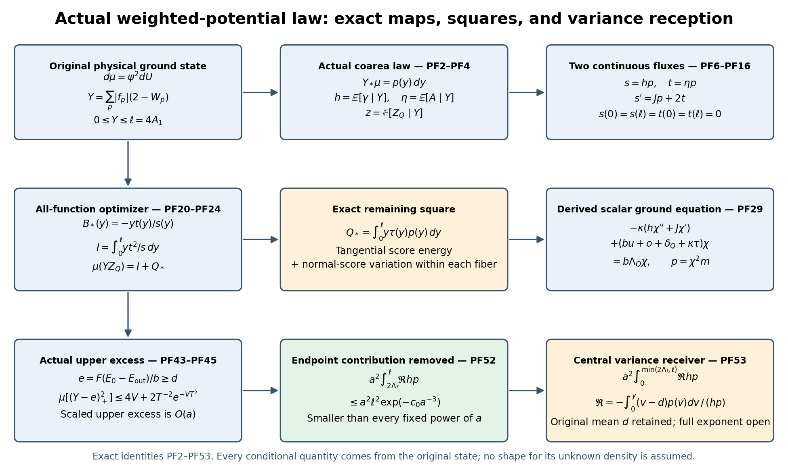

# Actual weighted-potential law and optimization over all score functions

This calculation uses the original finite open cubic lattice, the radius-two
product \(\mathcal M=\mathrm{SU}(2)^E\), its probability Haar measure,
\(H=-\kappa\Delta+b\sum_pD_p\), and its actual positive unit ground state
\(H\psi=E_0\psi\). Write \(w=\log\psi\), \(d\mu=\psi^2dU\).
Every original vertex gauge constraint is retained. The notation from
ZU6–ZU18 is unchanged, in particular
\[
 c_p=|f_p|,\quad F=\|f\|_\infty>0,\quad A_1=\sum_pc_p>0,
 \quad Y=\sum_pc_pD_p=2A_1-\sum_pc_pW_p,
\]
\[
 \ell=4A_1,\quad J(y)=6A_1-3y,\quad
 \gamma=\Gamma(Y),\quad A=\Gamma(w,Y),\quad Z_Q=|\nabla_Qw|^2.
\]
The symbol \(A\) in this note is the actual directional score, and is
distinct from the retained coefficient sum \(A_1\). If \(A_1=0\), then
\(Y=C_f=0\), and no disintegration or division below is needed.

## PF1. Exact range and the actual coarea law

The range of \(Y\) is exactly \([0,\ell]\). The identity configuration
gives zero. For an explicit path through every other value, let
\[
 U_d(z;\theta)=\exp\left(\theta T_3\sum_{k<d}z_k\right),
 \qquad 0\le\theta\le2\pi.
\]
For every original face \(d<e\), its four commuting factors in their
original order give \(U_p(\theta)=\exp(\theta T_3)\). Thus
\[
 Y(\theta)=A_1[2-2\cos(\theta/2)].                  \tag{PF1}
\]
This maps the interval onto \([0,4A_1]\), and its derivative is
\(A_1\sin(\theta/2)>0\) in the interior. Hence every interior value
has at least one regular point of \(Y\), including values whose other
fiber components contain critical points. Open boundary vertices and
all three face orientations are included in this construction.

The function \(Y\) and its squared gradient \(\gamma\) are real analytic.
They are nonconstant and \(\gamma\) is not identically zero. Their
critical set \(\{\gamma=0\}\) has volume zero. Here is the needed
analytic zero-set argument: at a zero of a nonzero analytic function,
some finite-order derivative is nonzero. Taking one derivative before
the first nonzero order places that point on the regular zero set of
one derivative. Countably many coordinate charts and multiindices
therefore cover the original zero set by countably many smooth
hypersurface pieces. A point where every derivative vanishes would
give a neighborhood of zero values by analyticity and then the
identically zero function on the connected analytic manifold. This
last possibility is excluded. The same argument applied to \(Y-y\)
also shows directly that every individual level set has volume zero.

Put \(n=3|E|\) and let \(d\Sigma_y=d\mathcal H^{n-1}/\operatorname{vol}(
\mathcal M)\), so it uses exactly the probability-Haar convention.
The actual pushforward \(\nu=Y_*\mu\) is absolutely continuous:
\[
 \boxed{\nu(dy)=p(y)\,dy,\qquad
 p(y)=\int_{\{Y=y,\,\gamma>0\}}
             {\psi^2\over\sqrt\gamma}\,d\Sigma_y.}             \tag{PF2}
\]
The formula holds almost everywhere and defines its integrable
density, extended as zero off \([0,\ell]\). To justify it without
discarding any critical contribution, cover \(\{\gamma>0\}\) by
countably many submersion charts with first coordinate \(Y\), insert
a subordinate partition of unity, and apply the change-of-variables
formula in each chart. The Jacobian for the normal coordinate is
\(|\nabla Y|^{-1}\), giving the displayed fiber measure. Sum the
nonnegative integrals and use the zero volume of the omitted critical
set. This proves both absolute continuity and total mass one.
Every interior value has a local positive regular-chart contribution
by (PF1). In particular \(p>0\) almost everywhere on \((0,\ell)\),
and the support of \(\nu\) is exactly \([0,\ell]\).

For any bounded measurable original observable \(G\), its actual
conditional expectation is given, almost everywhere, by
\[
 \overline G(y)p(y)
 =\int_{\{Y=y,\gamma>0\}}{G\psi^2\over\sqrt\gamma}\,d\Sigma_y.
                                                               \tag{PF3}
\]
This constructs the conditional quantities used below. It is not a
substitution of another probability density for the ground-state law.
Write
\[
 h=\overline\gamma,\quad \eta=\overline A,\quad z=\overline{Z_Q},
 \quad s=hp,\quad t=\eta p.                                    \tag{PF4}
\]
Then \(h>0\) almost everywhere, and conditional Cauchy--Schwarz gives
\(\eta^2\le hz\). In particular all subsequent weighted square
integrals are finite at each finite original lattice.

The fixed central link configuration at \(\theta=2\pi\) defines a
product isometry that negates every original face trace. It sends
\(Y\) to \(\ell-Y\) and preserves its squared-gradient formula.
Applying the original face derivative estimate to both expressions gives
\[
 0\le\gamma\le16F\min(Y,\ell-Y),\qquad
 0<h(y)\le16F\min(y,\ell-y)\quad\nu\text{-a.e.}                \tag{PF5}
\]
This is a geometric identity and bound; the transformation is not
asserted to preserve the original ground-state density.

## PF2. Distributional score, endpoint fluxes, and critical values

For every \(B\in C_c^\infty(\mathbb R)\), weighted Haar integration gives
\[
 0=\mu[B'(Y)\gamma+B(Y)J(Y)+2B(Y)A].
\]
Consequently, in distributions on the whole real line,
\[
 \boxed{s'=Jp+2t.}                                             \tag{PF6}
\]
The right side is integrable: \(J\) and the original smooth score
\(A\) are bounded at a fixed lattice. Thus \(s\in W^{1,1}(\mathbb R)\)
and its unique continuous representative obeys
\[
 s(0)=s(\ell)=0.                                               \tag{PF7}
\]
The coarea formula in a regular chart gives a positive continuous
contribution to \(s\) near every interior value by (PF1). Since the
full \(s\) is continuous and dominates that contribution almost
everywhere, \(s(y)>0\) at every \(0<y<\ell\).

On any interval containing only regular values, all the fiber
integrals are smooth, as follows by transporting the compact fibers
with the smooth vector field \(\nabla Y/\gamma\) and differentiating
under a finite partition of unity. There the usual density score is
\[
 h'(y)+h(y)(\log p)'(y)=J(y)+2\eta(y).                          \tag{PF8}
\]
At critical values neither \(p'\) nor \(h'\) is assumed to exist
separately. Formula (PF6) is the exact score identity across all such
values. In particular there are no atomic probabilities, no jumps
of \(s\), and no omitted delta terms at a critical value or endpoint.
No unproved pointwise value or power-law expansion of \(p\) at a
critical value is used.

There is a second current identity independent of the ground equation.
Integration by parts in the inside coordinates yields
\[
 \mu[B(Y)\Delta_Qw]
 =-\mu[B'(Y)A]-2\mu[B(Y)Z_Q].
\]
Hence
\[
 t'=\sigma p,\qquad
 \sigma(y)=\overline{\Delta_Qw+2Z_Q}(y).                       \tag{PF9}
\]
The conditional function \(\sigma\) is bounded by
\(C_\sigma=\|\Delta_Qw+2Z_Q\|_\infty\). Therefore
\(t\in W^{1,1}(\mathbb R)\), with
\[
 t(0)=t(\ell)=0.                                               \tag{PF10}
\]
Both current statements include every critical value, without making
smoothness assertions about the separate conditional densities there.

The endpoint behavior needed for all subsequent integrations is
quantitative. Set \(P_0(y)=\int_0^yp\) and
\(P_\ell(y)=\int_y^\ell p\). Because \(Z_Q\) is bounded, (PF5) gives
\(|\eta(y)|\le4\sqrt{F\|Z_Q\|_\infty\min(y,\ell-y)}\).
Thus, sufficiently close to the respective endpoints,
\(J+2\eta\ge3A_1\) and \(J+2\eta\le-3A_1\). Integrating (PF6),(PF9)
from the relevant endpoint gives
\[
 s(y)\ge3A_1P_0(y),\quad |t(y)|\le C_\sigma P_0(y)
 \quad\text{near }0,
\]
\[
 s(y)\ge3A_1P_\ell(y),\quad |t(y)|\le C_\sigma P_\ell(y)
 \quad\text{near }\ell.                                       \tag{PF11}
\]
In particular
\[
 r(y):={t(y)\over s(y)}={\eta(y)\over h(y)}
\]
is continuous and locally absolutely continuous on \((0,\ell)\),
and bounded on that entire interval. Indeed this follows from
(PF11) near the endpoints and the positive continuous denominator
on every remaining compact interval. Put \(R_0=\sup|r|<\infty\).
Then \(\eta=rh\) and (PF5) improve the endpoint score bound to
\(|\eta(y)|\le16FR_0\min(y,\ell-y)\).
The exact flux asymptotics, with controlled errors, are
\[
 s(y)=6A_1P_0(y)+O(yP_0(y)),\qquad
 s(y)=6A_1P_\ell(y)+O((\ell-y)P_\ell(y)),                       \tag{PF12}
\]
where the error coefficient can be taken as \(3+32FR_0\).

For example (PF5),(PF12) imply the explicit endpoint probability
upper powers
\[
 P_0(y)\le C_0y^{3A_1/(8F)},\qquad
 P_\ell(\ell-y)\le C_\ell y^{3A_1/(8F)}\quad(0<y<y_0),        \tag{PF13}
\]
with finite lattice-dependent constants. To prove the first, use
\(16Fyp\ge[6A_1-(3+32FR_0)y]P_0\), divide by the positive
\(16FyP_0\), and integrate the resulting logarithmic derivative
from \(y\) to \(y_0\); the second follows in the same way from the
upper endpoint. These bounds do not assign an exact endpoint exponent
or a regulator-uniform constant to the actual density.

## PF3. Exact conditional ground equation with outside terms

Let \(W_{\mathrm{out}}\) be the sum of original defects on faces with
no inside edge, and \(W_\times\) the original crossing sum. Define
\[
 u(y)=\overline{W_Q}(y),\quad x(y)=\overline{W_\times}(y),
 \quad z_{\mathrm{out}}(y)=\overline{|\nabla_{\mathrm{out}}w|^2}(y),
 \quad u_{\mathrm{out}}(y)=\overline{W_{\mathrm{out}}}(y).
\]
For \(r_{\mathrm{out}}=(H_{\mathrm{out}}\psi)/\psi\), partial
integration in the outside coordinates, which do not differentiate
\(B(Y)\), proves
\[
 \overline{r_{\mathrm{out}}}
 =\kappa z_{\mathrm{out}}+bu_{\mathrm{out}}.                    \tag{PF14}
\]
Moreover \(\overline{r_{\mathrm{out}}}\ge E_{\mathrm{out}}\).
For each fixed inside configuration, apply the outside operator lower
bound to its nonzero smooth outside slice \(\psi\), divide by that
slice's squared norm, and then disintegrate the resulting inequality
over the inside value of \(Y\). This proves the claimed conditional
lower bound, rather than inferring it from a pointwise local-energy
expression. Define the exact nonnegative conditional remainder
\[
 o(y)=\kappa z_{\mathrm{out}}(y)+bu_{\mathrm{out}}(y)
             -E_{\mathrm{out}}+bx(y)\ge0.                      \tag{PF15}
\]
Then \(\mathcal O_Q(Y)=\int yo(y)p(y)dy\), with the original outside
kinetic form and all crossing faces included.

The original ground equation gives
\(\Delta_Qw+Z_Q=[bW_Q+r_{\mathrm{out}}+bW_\times-E_0]/\kappa\).
Combining with (PF9) and
\(E_0-E_{\mathrm{out}}=b\Lambda_Q-\delta_Q\) proves
\[
 \boxed{\kappa t'
 =[\kappa z+b(u-\Lambda_Q)+o+\delta_Q]p.}                      \tag{PF16}
\]
No outside term or scalar has been removed. Before substituting the
local comparison energy, its right side is
\[
 [\kappa(z+z_{\mathrm{out}})+2bM
   -b\overline{\textstyle\sum_{p\ {\rm all}}W_p}-E_0]p.
                                                               \tag{PF17}
\]
Indeed \(W_Q+W_\times+W_{\mathrm{out}}\) contains exactly
\(M_Q,C_Q,M-M_Q-C_Q\) original faces respectively. Their scalar
parts sum to the original \(2bM\).

Together (PF6),(PF16) also give the exact second-order distributional
equation
\[
 {\kappa\over2}[s''-(Jp)']
 =[\kappa z+b(u-\Lambda_Q)+o+\delta_Q]p,                       \tag{PF18}
\]
with the endpoint fluxes (PF7),(PF10). Differentiating a possibly
singular \(p\) in isolation is unnecessary.

## PF4. Optimization over all B and the exact unrecovered energy

Let \(\mathcal H_B=L^2((0,\ell),s(y)dy/y)\). This is a finite
weighted measure because \(h/y\le16F\). Smooth compactly supported
functions are dense in this space: truncate away the endpoints and
truncate function values, approximate measurable sets by finite
unions of intervals for the finite absolutely continuous measure,
then smooth their indicator functions. The scalar cross functional
is continuous since conditional Cauchy--Schwarz gives
\[
 \int {y\eta^2\over h}p\le\int yz p=\mu(YZ_Q)<\infty.
\]
For every smooth \(B\), expansion and regularization as in ZU13 give
\[
 Q[B]=\lim_{\epsilon\downarrow0}
 \mu\left[(Y+\epsilon)
 \left|\nabla_Qw+{B(Y)\over Y+\epsilon}\nabla Y\right|^2\right]
 =\mu(YZ_Q)+2\int B t+\int B^2{s\over y}\ge0.                \tag{PF19}
\]
The formula extends continuously to \(\mathcal H_B\). Its exact
optimizer and optimal value are
\[
 \boxed{B_*(y)=-{yt(y)\over s(y)}=-y r(y),\qquad
 I=\int_0^\ell {y t(y)^2\over s(y)}dy,
 \qquad Q_*:=\inf_BQ[B]=\mu(YZ_Q)-I.}                         \tag{PF20}
\]
The optimum belongs to \(\mathcal H_B\), and the density argument
shows it is genuinely the infimum over the original smooth test
functions as well. By (PF11), it is bounded, continuous throughout
the interior, and tends to zero at the lower endpoint. No upper
endpoint value is assumed when the bounded ratio \(r\) lacks a
proved limit there. Its exact Pythagorean identity is
\[
 Q[B]=Q_*+\int_0^\ell {s(y)\over y}[B(y)-B_*(y)]^2dy.          \tag{PF21}
\]
Equivalently, using only the actual density and current,
\[
 I={1\over4}\int_0^\ell {y[s'(y)-J(y)p(y)]^2\over s(y)}dy.
                                                               \tag{PF22}
\]

The remaining square is evaluated exactly as a fiber defect:
\[
 \tau(y)=z(y)-{\eta(y)^2\over h(y)}\ge0,\qquad
 Q_*=\int_0^\ell y\tau(y)p(y)dy.                              \tag{PF23}
\]
It has the following original-configuration decomposition, with
critical-set values irrelevant because that set has measure zero:
\[
\boxed{\begin{aligned}
 Q_*={}&\mu\left[Y\left|\nabla_Qw-{A\over\gamma}\nabla Y\right|^2\right]\\
 &+\mu\left[Y\gamma
       \left({A\over\gamma}-{\eta(Y)\over h(Y)}\right)^2\right].
\end{aligned}}                                                   \tag{PF24}
\]
For the proof, the pointwise orthogonal decomposition gives
\(Z_Q=A^2/\gamma+|\nabla_Qw-(A/\gamma)\nabla Y|^2\).
On a fiber, expanding the second square subtracts
\(\eta^2/h\) from \(\overline{A^2/\gamma}\), because
\(\overline A=\eta\) and \(\overline\gamma=h\).
This proves (PF24) including both nonnegative terms. The first is
variation tangent to the level set; the second is the fluctuation of
the normal score coefficient within that level set. Optimization over
functions of \(Y\) cannot remove either term.

For the original \(B_0(y)=J(y)/(32F)\), let \(\mathcal R\) retain
exactly its ZU16 meaning. Equations ZU17 and (PF21) give
\[
 I={\mu J(Y)^2\over64F}-{3d\over2}
       +\mathcal R+\int{s\over y}(B_0-B_*)^2.                 \tag{PF25}
\]
Thus the complete original defect is decomposed, without replacement,
as
\[
 \mathcal D_f=\mathcal B_f+
 \alpha F\left[Q_*+\mathcal R+\int{s\over y}(B_0-B_*)^2\right].
                                                               \tag{PF26}
\]
Here \(\mathcal B_f\) is exactly the spatial plus outside remainder
in ZU38. The all-function improvement over that particular square is
the displayed squared distance. It is an actual nonnegative integral,
not a density chosen to saturate an inequality.

## PF5. Exact scalar ground equation and the map back to H

The ratio \(r=t/s\) has now been proved bounded. Fix any interior
\(y_0\) and define the positive function
\[
 \chi(y)=\exp\left(\int_{y_0}^y r(v)dv\right),\qquad
 m(y)=p(y)/\chi(y)^2.                                         \tag{PF27}
\]
The function \(\chi\) is bounded above and bounded away from zero,
extends continuously to both endpoints, and is Lipschitz. Its local
derivatives satisfy \(\chi'=r\chi\) and
\(\chi''=(r'+r^2)\chi\) almost everywhere. This construction is an
exact factorization of the actual law \(p=\chi^2m\); \(m\) is not
asserted to be the pushforward of Haar measure or any trial law.

From (PF6),
\[
 (hm)'=Jm,\quad hm=s/\chi^2,\quad
 (hm\chi')(0)=(hm\chi')(\ell)=0,                              \tag{PF28}
\]
the last assertion following from \(hm\chi'=t/\chi\).
Combine (PF16) with \(t=rs\) and \(z=r^2h+\tau\). It gives
\[
 h(r'+r^2)+Jr
 =\tau+\frac{b(u-\Lambda_Q)+o+\delta_Q}{\kappa}.
\]
Therefore the exact scalar ground equation is
\[
 \boxed{-\kappa[h\chi''+J\chi']
       +[bu+o+\delta_Q+\kappa\tau]\chi
       =b\Lambda_Q\chi.}                                    \tag{PF29}
\]
The potential \(bu+o+\delta_Q+\kappa\tau\) retains all the
conditional local, outside, crossing, comparison-slack and fiber
energy terms. It is nonnegative and obeys \(bu\ge by/F\).
All its coefficients are bounded at this fixed lattice. Although
\(h\) can be merely measurable at critical values, its weighted flux
\(hm\) is continuous and positive in the interior, and (PF29) is
valid as the divergence-form weak equation there and at the endpoints.

For precision, use the closure of the form initially defined on
smooth functions on the closed interval,
\[
 q_{\rm eff}[v]=\kappa\int h|v'|^2m
               +\int[bu+o+\delta_Q+\kappa\tau]|v|^2m.
\]
Local positivity of \(hm\) and \(m\), plus the weak-derivative
criterion on compact interior intervals, proves closability.
This specifies natural endpoint conditions rather than imposing
vanishing endpoint values. The Lipschitz \(\chi\) is in its form
domain: extend it Lipschitz across the endpoints and mollify, using
the uniform derivative bound and the integrability of \(hm,m\).
The zero flux in (PF28) justifies integration by parts, giving
\[
 q_{\rm eff}[\phi\chi]-b\Lambda_Q\int|\phi\chi|^2m
          =\kappa\int h|\phi'|^2p.                            \tag{PF30}
\]
Thus \(\chi\) is an actual positive unit ground function in
\(L^2(mdy)\), since \(\int\chi^2m=1\). This scalar representation
is an exact derived operator, with every original contribution
present; it is not a replacement ansatz for \(\mu\).

The map to the original Hilbert space is the isometry
\[
 \mathcal J:\phi\chi\longmapsto\phi(Y)\psi.
\]
Its range is physical because \(Y\) and \(\psi\) are gauge invariant.
By the original ground transform, the right side of (PF30) equals
\(\langle\phi(Y)\psi,(H-E_0)\phi(Y)\psi\rangle\).
This proves the exact equality of restricted quadratic forms.
For smooth \(\phi\), the conditional scalar generator is
\[
 L_Y\phi=h\phi''+(J+2\eta)\phi'={1\over p}(s\phi')'.          \tag{PF31}
\]
The actual action on \(\phi(Y)\psi\) also contains the orthogonal
fiber term
\[
 -\kappa\bigl[(\gamma-h(Y))\phi''(Y)
              +2(A-\eta(Y))\phi'(Y)\bigr]\psi.                \tag{PF32}
\]
Its conditional expectation is zero. Formula (PF32), rather than an
assumed invariant subspace, states the exact difference between the
full operator and its scalar form compression.

## PF6. Next actual receiving calculations and the exponent

The all-function optimizer inserted into the exact local budget gives
\[
 \boxed{\mu Y^2+\mathcal B_f+\alpha F(I+Q_*)
       =\Lambda_fd+3\alpha FA_1-\tfrac32\alpha Fd.}             \tag{PF33}
\]
The currently evaluated estimates imply
\(I,Q_*\le\mu(YZ_Q)=O(a^{-6})\) along the original path:
use ZU12, drop its nonnegative local potential and outside terms,
and use \(\Lambda_Q,d=O(a^{-2})\),
\(\alpha=\kappa_*^2a^2\), \(A_1=O(a^{-3})\).
Equation (PF26) gives exact additional subtractions, but no evaluated
cancellation of the order-\(a^{-4}\) second-moment contribution.
This does not establish an improved exponent for the actual variance.

The next receiving calculation uses the actual conditional drift,
not a model density. Let
\[
 d=\mu Y>0,\quad S=\mu\gamma,\quad
 q={6A_1\over d},\quad \lambda={q-3\over2},\quad
 \rho(y)=\eta(y)+\lambda y,
 \quad D_\rho=\int\rho(y)^2p(y)dy.
\]
The exact scalar identity \(\mu A=-3A_1+3d/2\) gives
\(\int\rho p=0\). Multiply (PF6) by \(y-d\) and integrate, using
the proved endpoint fluxes. Since
\(J+2\eta=q(d-y)+2\rho\), this yields
\[
 \boxed{q\operatorname{Var}_\mu Y
       =S+2\int(y-d)\rho(y)p(y)dy.}                            \tag{PF34}
\]
Its explicit variance bound is
\[
 \operatorname{Var}_\mu Y
 \le\left[{\sqrt{D_\rho}+\sqrt{D_\rho+qS}\over q}\right]^2.
                                                               \tag{PF35}
\]
Indeed apply Cauchy--Schwarz to the last integral in (PF34) and
solve the resulting quadratic in \(\sqrt{\operatorname{Var}Y}\).
The directly calculated density-score bound is
\[
 D_\rho\le32F\mu(YZ_Q)+2\lambda^2\mu Y^2=O(a^{-6}).           \tag{PF36}
\]
For the inequality, conditional Cauchy--Schwarz gives
\(\mu\eta(Y)^2\le\mu A^2\le\mu(\gamma Z_Q)\le16F\mu(YZ_Q)\),
then use \((\eta+\lambda Y)^2\le2\eta^2+2\lambda^2Y^2\).
The existing positive lower root for \(d\) supplies
\(d=\Theta(a^{-2})\), hence \(q=\Theta(a^{-1})\) and
\(\lambda=O(a^{-1})\). Also \(S\le16Fd=O(a^{-2})\).
Thus (PF35) with the estimates actually proved here still gives
\(\operatorname{Var}Y=O(a^{-4})\), and the original nonnegative
curvature smearing still has upper order \(a^{-2}\).
For signed smearings the original exact relation remains
\(G_f=a^2\mu Y^2-m_f^2-4a^2\mu(Y_+Y_-)\); it is not replaced by
a variance comparison with \(Y\).

There is also an exact next moment reception from the same conditional
ground equation. Multiply (PF16) by \(y^2\), integrate twice using
(PF6), and retain all nonnegative terms. The result is
\[
\boxed{\begin{aligned}
 b\Lambda_Q\mu Y^2={}&b\mu(Y^2W_Q)+\kappa\mu(Y^2Z_Q)
       +\int y^2[o(y)+\delta_Q]p(y)dy\\
 &-\kappa[6A_1d-3\mu Y^2+S].
\end{aligned}}                                                   \tag{PF37}
\]
For the coefficient check,
\(-2\mu(YA)=\mu[J(Y)Y]+\mu\gamma
=6A_1d-3\mu Y^2+S\). Since \(FW_Q\ge Y\), (PF37) supplies
\[
 \mu Y^3\le\Lambda_f\mu Y^2
 +\alpha F[6A_1d-3\mu Y^2+S]
 -\alpha F\mu(Y^2Z_Q)
 -{F\over b}\int y^2(o+\delta_Q)p.                            \tag{PF38}
\]
These are completed calculations of the next actual receiving terms.
Their nonnegative remainders have not been assumed to vanish. The
precise remaining defect after optimizing every function of \(Y\)
is (PF24), together with the actual spatial and outside terms in
(PF33); the evaluated drift reception (PF34)–(PF36) confirms that
the stronger desired exponent has not been proved by this route.

## PF7. Independent check and strengthening of the actual upper tail

The parent continuation FO33–FO46 was read and independently checked
after the preceding derivation. Its exact energy center is
\(e=F(E_0-E_{\mathrm{out}})/b\), not the mean \(d\).
For any smooth real \(\Phi\), (PF16) and (PF6) give
\[
 (E_0-E_{\mathrm{out}})\mu\Phi(Y)
 =\mu[\Phi(Y)(bu+\kappa z+o)]
   -\frac\kappa2\mu[\Phi''(Y)h+\Phi'(Y)J].                   \tag{PF39}
\]
Here \(u,z,o,h\) are evaluated at \(Y\). For
\(M(t)=\mu e^{tY}\), define
\[
 A_t=1+\frac{3\alpha F}{2}t-8\alpha F^2t^2,
 \qquad B_t=e+3\alpha FA_1t,
\]
\[
 D_t=\int e^{ty}\left[
 \alpha Fz+Fu-y+\frac Fbo
       +\frac{\alpha F}{2}t^2(16Fy-h)\right]p(y)dy\ge0.
\]
Substitute \(\Phi=e^{ty}\) into (PF39), retain
\(J=6A_1-3y\), and write \(h=16Fy-(16Fy-h)\). This proves exactly
\[
 A_tM'(t)=B_tM(t)-D_t,\qquad D_0=e-d.                         \tag{PF40}
\]
In particular all signs and coefficients in FO33–FO34 are correct.

For the original constants
\[
 T=\frac1{4F\sqrt\alpha},\qquad
 V=3\alpha FA_1+\frac43eF\sqrt\alpha,
\]
one has \(A_t\ge1/2\) on \([0,T]\). Then
\[
 \frac{B_t}{A_t}-e
 \le6\alpha FA_1t+16e\alpha F^2t^2,
 \qquad \log M(t)\le et+Vt^2\quad(0\le t\le T).              \tag{PF41}
\]
The first inequality follows by dropping the nonpositive term
\(-(3\alpha F/2)et\) in its numerator before using \(A_t\ge1/2\).
Integrating and using \(8\alpha F^2T=2F\sqrt\alpha\) gives the
second inequality. These are the unchanged original law and energy
center.

The exact clipped Chernoff bound, now incorporated in FO37, is:
\[
 \mu(Y\ge e+r)\le
 \begin{cases}
 e^{-r^2/(4V)},&0\le r\le2VT,\\
 e^{-Tr+VT^2},&r\ge2VT.
 \end{cases}                                                   \tag{PF42}
\]
FO37 also records the larger bound
\(e^{-Tr/2}\). Retaining (PF42) and integrating
\(2r\) on the two intervals gives the finite moment bound
\[
 \boxed{\mu[(Y-e)_+^2]\le4V+\frac2{T^2}e^{-VT^2}.}            \tag{PF43}
\]
Indeed the first integral is \(4V(1-e^{-VT^2})\), while the second
is \((4V+2/T^2)e^{-VT^2}\). Their sum proves (PF43).
This proves the complete expression now retained in FO38.
No truncation at the true endpoint \(\ell\) is needed; beyond it
the actual probability is zero.

On the original path,
\(a^3A_1\to3J_1\), \(\alpha=\kappa_*^2a^2\),
\(\limsup a^2e\le F\mathsf L_R\), and
\(\mathsf L_R=9\kappa_*R^3+24R^2\). Thus \(V=O(a^{-1})\),
\(T=(4F\kappa_*a)^{-1}\), and \(VT^2\) diverges at order
\(a^{-3}\). Substitution in (PF43) independently verifies FO42:
\[
 \limsup\frac{a^2\mu[(Y-e)_+^2]}a
 \le36\kappa_*^2FJ_1+\frac{16}{3}\kappa_*F^2\mathsf L_R.       \tag{PF44}
\]
The same bound holds for \(\mu[(|C_f|-ae)_+^2]/a\), since
\(|C_f|\le aY\). This is an actual improved order for the upper
excess about the actual energy center. It is not an upper bound of
that order on the full centered covariance. The exact distinction is
\[
 \operatorname{Var}Y
 =\mu[(Y-e)_+^2]+\mu[(e-Y)_+^2]-(e-d)^2,
\quad
 e-d=\alpha F\mu Z_Q+\int(Fu-y+Fo/b)p\ge0.                    \tag{PF45}
\]
These identities verify FO30 and FO43 with the mean retained.

## PF8. Variance-receiving map across every critical value and endpoint

Define, using the actual law,
\[
 I_d(y)=\int_0^y(v-d)p(v)dv,\qquad
 \mathfrak R(y)=-\frac{I_d(y)}{s(y)}\quad(0<y<\ell).
\]
The primitive has both endpoint values zero and is nonpositive:
before \(d\) its integrand is nonpositive, and after \(d\) it is
minus the integral from \(y\) to \(\ell\), whose integrand is
nonnegative. Because \(s>0\) is continuous in the whole interior,
\(\mathfrak R\) is a nonnegative continuous, locally absolutely
continuous function, including every critical value.
The endpoint expansions (PF12) imply the exact limits
\[
 \boxed{\mathfrak R(0)={d\over6A_1},\qquad
 \mathfrak R(\ell)={\ell-d\over6A_1}.}                        \tag{PF46}
\]
For the first, \(-I_d(y)=dP_0(y)+O(yP_0(y))\); for the second,
\(-I_d(y)=(\ell-d)P_\ell(y)+O((\ell-y)P_\ell(y))\).
Divide by (PF12). Thus \(\mathfrak R\) extends to a bounded
continuous function on the full closed interval at each finite
regulator. Its upper endpoint value tends to \(2/3\) on the original
path because \(d/A_1=O(a)\); no uniform bound of order \(a\) for
its supremum is asserted.

Integrating the primitive by parts gives, for smooth real \(\Phi\),
\[
 \operatorname{Cov}(Y,\Phi(Y))
 =\int\mathfrak R(y)h(y)\Phi'(y)p(y)dy,
 \qquad \operatorname{Var}Y=\int\mathfrak R h p.                \tag{PF47}
\]
The exact flux equation and its regular-value form are
\[
 (s\mathfrak R)'=-(y-d)p,\qquad
 h\mathfrak R'=-(y-d)-(J+2\eta)\mathfrak R.                   \tag{PF48}
\]
The first holds on the whole real line after extending its zero
boundary flux. These statements verify FO44–FO45, and (PF46) adds
the endpoint values and critical-value extension without assigning
unproved smoothness to the density.

Finally integrating \((y-d)s'\) gives
\(\int(y-d)(J+2\eta)p=-\int hp\). Cauchy--Schwarz therefore yields
\[
 \operatorname{Var}Y\ge
 \frac{(\int hp)^2}{\int(J+2\eta)^2p}.                        \tag{PF49}
\]
Its denominator is strictly positive because otherwise the preceding
identity would contradict \(\int hp>0\). This independently verifies
FO46 and its lower-bound direction. The exact variance reception in
(PF47), the lower-side term in (PF45), and the fiber energies in
(PF24) retain the still unevaluated contributions to an improved
upper covariance exponent.

## PF9. The upper-endpoint variance contribution is quantitatively small

The parent's final receiving calculation is also exact. Keep the
explicit original ceiling \(\Lambda_f=F\Lambda_Q\ge e\), and put
\[
 \overline V=3\alpha FA_1+\frac43\Lambda_fF\sqrt\alpha,
 \qquad c_*=2\Lambda_f.
\]
The unchanged moment generating function obeys
\(\log M(t)\le\Lambda_ft+\overline Vt^2\) on \([0,T]\).
Markov's inequality at
\(t=\min\{\Lambda_f/(2\overline V),T\}\) gives
\[
 \boxed{\mu(Y\ge2\Lambda_f)\le
 \exp\left[-\min\left\{
 {\Lambda_f^2\over4\overline V},{T\Lambda_f\over2}
 \right\}\right].}                                          \tag{PF50}
\]
If the unclipped minimizer lies below \(T\), its exponent is the
first expression and that expression is the smaller one. Otherwise
\(-T\Lambda_f+\overline VT^2\le-T\Lambda_f/2\), giving the second.
If the threshold reaches or exceeds the actual endpoint, the actual
probability is zero (there is no endpoint atom).

For \(d\le c\le\ell\), Fubini applied to the nonnegative tail
integrand proves the exact receiving equality
\[
\boxed{\begin{aligned}
 \int_c^\ell\mathfrak R(y)h(y)p(y)dy
 &=\int_c^\ell\int_y^\ell(v-d)p(v)\,dv\,dy\\
 &=\mu[(Y-c)_+(Y-d)]\le\ell^2\mu(Y\ge c).
\end{aligned}}                                                   \tag{PF51}
\]
Set the left side to zero if \(c\ge\ell\). Since
\(d\le e\le\Lambda_f\), (PF51) applies with \(c=c_*\).
On the original path, \(\Lambda_f=\Theta(a^{-2})\),
\(\overline V=\Theta(a^{-1})\), and \(T=\Theta(a^{-1})\).
Both expressions in the minimum in (PF50) are therefore bounded
below by a positive constant times \(a^{-3}\). Also
\(\ell=\Theta(a^{-3})\). Consequently, for every fixed \(N>0\),
\[
 \boxed{a^2\int_{2\Lambda_f}^{\ell}\mathfrak R h p
       =o(a^N),}                                              \tag{PF52}
\]
using the zero convention when the lower limit exceeds the upper.
This follows from the explicit upper bound
\(a^2\ell^2\exp(-c_0a^{-3})\); exponential decay dominates every
fixed inverse power, as is seen by taking logarithms.

Thus the nonvanishing endpoint value in (PF46) does not obstruct a
small integrated contribution from that endpoint. The exact remaining
variance receiver is confined, with a quantified error, to
\[
 a^2\operatorname{Var}Y
 =a^2\int_0^{\min(2\Lambda_f,\ell)}\mathfrak R h p+o(a^N)
 \quad\text{for every fixed }N>0.                             \tag{PF53}
\]
The finite exact decomposition uses (PF51) for the error; the
asymptotic statement (PF53) abbreviates only that proved error bound.
It keeps the original mean \(d\) in \(\mathfrak R\). The central
integral has not been bounded by order \(a\).

The diagram uses the actual maps and proof locators PF2–PF53; it does
not draw an invented shape for the unknown density. Its reproducible
source is `draw_pushforward_form.py`, and the rendered image was
inspected.

## Provenance and scope

The [original local provider](https://github.com/KokunoYumeto/yang-mills-interacting-workbench/blob/f8f4d548dde98f04429f8b7eea664806399de825/yang-mills/continuations/20261011-central-signs-shrinking-window/ORIGINAL_SOURCE_COVARIANCE.md)
supplies OS1–OS10 and OS34–OS40.
The sealed [ZU1–ZU44](https://github.com/KokunoYumeto/yang-mills-interacting-workbench/blob/f8f4d548dde98f04429f8b7eea664806399de825/yang-mills/continuations/20261011-central-signs-shrinking-window/SOURCE_ZERO_COVARIANCE_UPPER.md) supplies the weighted
definitions and ZU9–ZU40, read for this calculation. All identities in
this note were independently derived on the actual finite original
configuration. The [full companion derivation](ACTUAL_PUSHFORWARD_OPTIMIZATION.md),
FO26–FO46, was read for the requested tail and variance-map review.
The final parent handoff supplying the cutoff \(2\Lambda_f\) was
independently derived in (PF50)–(PF53).
The derivation keeps the original probability law throughout. Its exact provider editions and reading coverage are recorded in the source-use ledger.

Complete programme providers: [ZU1–ZU44](https://github.com/KokunoYumeto/yang-mills-interacting-workbench/blob/f8f4d548dde98f04429f8b7eea664806399de825/yang-mills/continuations/20261011-central-signs-shrinking-window/SOURCE_ZERO_COVARIANCE_UPPER.md), [PVI1–PVI24 plus PVI19a](https://github.com/KokunoYumeto/yang-mills-interacting-workbench/blob/f8f4d548dde98f04429f8b7eea664806399de825/yang-mills/continuations/20261011-central-signs-shrinking-window/POTENTIAL_VARIANCE_IDENTITIES.md), [LC1–LC42](https://github.com/KokunoYumeto/yang-mills-interacting-workbench/blob/f8f4d548dde98f04429f8b7eea664806399de825/yang-mills/continuations/20261011-central-signs-shrinking-window/LOCAL_CURVATURE_BUDGET.md), and [CP1–CP50](https://github.com/KokunoYumeto/yang-mills-interacting-workbench/blob/f8f4d548dde98f04429f8b7eea664806399de825/yang-mills/continuations/20261011-central-signs-shrinking-window/CURVATURE_PHASE_RECONSTRUCTION.md). The [source-use ledger](PUSHFORWARD_SOURCE_USE_LEDGER.json) records exact editions, actual reading coverage and the receiving calculations.

## Both potential tails and the complete retained-energy covariance

[LR1–LR58](LOWER_SIDE_RETAINED_ENERGY.md) prove both tails around the original local energy roots, exact negative-moment bounds, and inverse-weighted ground and Bochner identities. The full inside energy, including the actual conditional kinetic and outside terms, has variance O(a^-1), with an explicit constant and a complete nonnegative remainder. For the signed original curvature, LR58 proves the exact compensated map and all of its mean and covariance terms.

[IM1–IM42](INSIDE_MARGINAL_ENERGY.md) independently derive the inside marginal, its conditional-vector equation and full operator residual. They evaluate every mixed-Hessian, shifted-Hessian and conditional-score-variance contribution, including inverse weights. The unchanged potential variance retains its signed covariance with the nonnegative energy remainder. The proved small variance of their sum does not assign a sign to that covariance.
