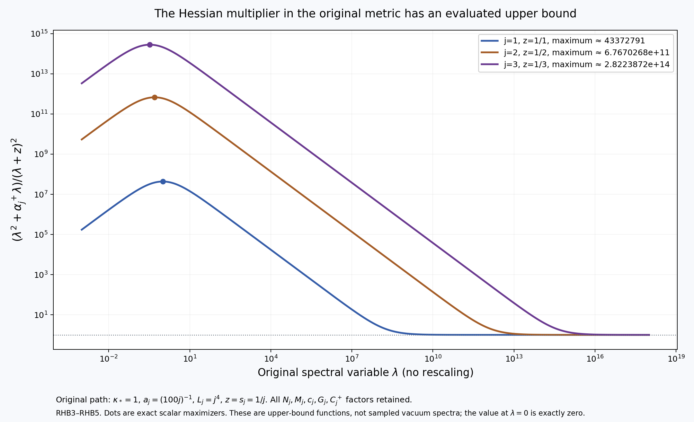
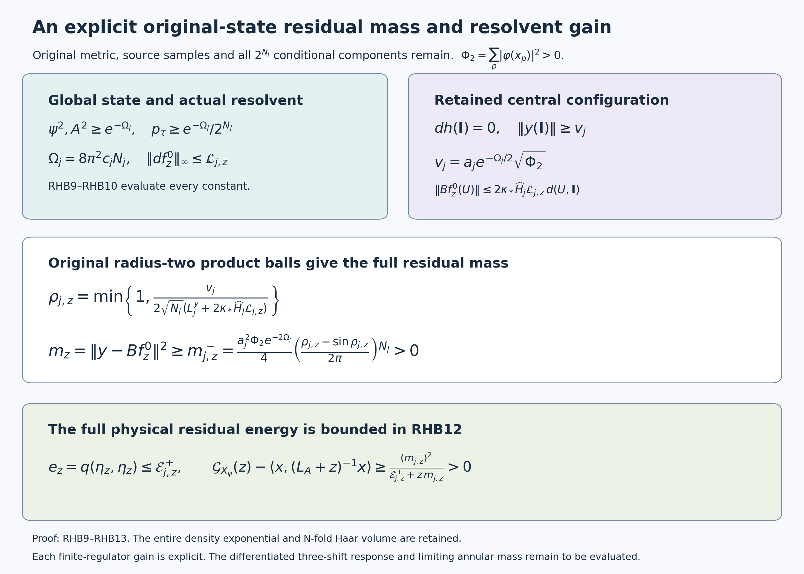

# Global bounds for the actual marginal resolvent Hessian

Reviewed derivation, 14 October 2026. This applies the actual HCB estimates to the remaining resolvent in CK and FPR, and gives explicit residual mass, energy and strict resolvent-gain bounds for the original source. The original smooth interacting global no-gap state remains the goal.

Use the complete original objects in [HCB1–HCB10](https://github.com/KokunoYumeto/yang-mills-interacting-workbench/blob/5f513b3aa56d9859c59ffadca44d06f8e97c1fb4/yang-mills/continuations/20261011-central-signs-shrinking-window/ACTUAL_HESSIAN_BOUNDS.md), [CK1–CK24](https://github.com/KokunoYumeto/yang-mills-interacting-workbench/blob/5f513b3aa56d9859c59ffadca44d06f8e97c1fb4/yang-mills/continuations/20261011-central-signs-shrinking-window/CENTRAL_KINETIC_SOURCE.md), and [HVR1–HVR15](https://github.com/KokunoYumeto/yang-mills-interacting-workbench/blob/5f513b3aa56d9859c59ffadca44d06f8e97c1fb4/yang-mills/continuations/20261011-central-signs-shrinking-window/HESSIAN_RECEIVING_REVIEW.md). Reading coverage and seven disk-index routing hits are recorded privately. No external hit is claimed read; no novelty claim is made.

In particular retain
\[
\begin{gathered}
L_j=j^4,\quad a_j=(100j)^{-1},\quad g_j^2=\kappa_*a_j/2,\quad
b_j=(\kappa_*a_j^2)^{-1},\quad s_j=100\kappa_*a_j,\\
N_j=3(2L_j)(2L_j+1)^2,\quad M_j=3(2L_j)^2(2L_j+1),\\
H=-\kappa_*\Delta+2b_jM_j-b_j\sum_pT_p,\quad
H\psi=E_0\psi,\quad \psi>0,\quad\int\psi^2dU=1,\\
T_p=\operatorname{Tr}\bigl[
U_d(z)U_k(z+e_d)U_d(z+e_k)^{-1}U_k(z)^{-1}\bigr],\quad d<k .
\end{gathered}
\]
The full configuration space is the original \(3N_j\)-dimensional product of radius-two \(SU(2)\) factors, with \(T_\alpha=-i\sigma_\alpha/2\) orthonormal and probability Haar measure. No quotient metric or coordinate rescaling is used. Retain \(w_\tau=\log(\psi\circ D_\tau)\), \(A^2=2^{-N_j}\sum e^{2w_\tau}\), \(u=\log A\), \(p_\tau=e^{2w_\tau}/(2^{N_j}A^2)\), \(h_\tau=\sqrt{p_\tau}\), and
\[
\mathcal S=\sum_\tau p_\tau(dw_\tau-du)\otimes(dw_\tau-du),
\qquad \mathcal F=\operatorname{Tr}\mathcal S,\qquad
L_A=-\kappa_*(\Delta+2\langle du,d\,\cdot\,\rangle).
\]
All sums include every original sign. Write \(d\mu_A=A^2dU\), \(\|\cdot\|_A^2=\int|\cdot|^2d\mu_A\), and \(c_j=2/(\kappa_*a_j)\).

## 1. A full score bound directly from the original closed geodesics

For each original link \(e\), including boundary links,
\[
|d_ew_\tau|\le2\pi c_j,\qquad
|d_eu|\le2\pi c_j,\qquad
0\le\mathcal F\le G_j:=4\pi^2N_jc_j^2 .
\tag{RHB1}
\]
HCB1 gives \(\nabla^2w_\tau\ge-c_jg\). For a unit tangent \(Y\) on link \(e\), the original geodesic \(U_e(t)=e^{tY}U_e(0)\) has period \(4\pi\), because \(Y^2=-I/4\). Let \(f(t)=w_\tau(U(t))\). The full Hessian bound says \(f''(t)\ge-c_j\). Twice integrating it on \([0,4\pi]\) gives
\[
0=f(4\pi)-f(0)\ge4\pi f'(0)-\tfrac12c_j(4\pi)^2.
\]
Applying the same argument to \(-Y\) proves \(|f'(0)|\le2\pi c_j\). Choose \(Y\) in the original link-gradient direction to get the first bound. The second follows from \(du=\sum p_\tau dw_\tau\) and the triangle inequality on that same link. Finally
\[
\mathcal F=\sum_\tau p_\tau|dw_\tau|^2-|du|^2
\le\sum_\tau p_\tau\sum_e|d_ew_\tau|^2\le4\pi^2N_jc_j^2.
\]
The negative squared mean has been displayed before taking the upper bound. This argument has preserved the original geodesic period and every link.

## 2. A two-sided global bound on the actual marginal Hessian

The exact conditional Hessian formula from HCB8 is
\[
\nabla^2u=\sum_\tau p_\tau\nabla^2w_\tau+2\mathcal S\ge-c_jg.
\]
CK6 retains the full logarithmic marginal equation
\[
-\kappa_*(\Delta u+|du|^2)+\overline V+\kappa_*\mathcal F=E_0,
\qquad
\overline V=2b_jM_j-b_j\sum_pT_pr_{\partial p}.
\]
Consequently
\[
\begin{gathered}
-c_jg\le\nabla^2u
\le\left[
\frac{\overline V-E_0}{\kappa_*}+\mathcal F-|du|^2
+(3N_j-1)c_j\right]g
\le C_jg,\\
C_j=\frac{4b_jM_j-E_0}{\kappa_*}
+G_j+(3N_j-1)c_j .
\end{gathered}\tag{RHB2}
\]
To prove the middle inequality at an arbitrary configuration, diagonalize the real symmetric Hessian on its full \(3N_j\)-dimensional tangent space. Every eigenvalue is at least \(-c_j\); subtracting the other \(3N_j-1\) eigenvalues from its exact trace gives
\(\lambda_{\max}\le\Delta u+(3N_j-1)c_j\).
Insert the displayed logarithmic equation. Each actual \(V_\tau\) lies in \([0,4b_jM_j]\), so its probability mean does too. Use RHB1 and retain the negative gradient square before taking the last bound. At a general configuration no gauge direction of the Hessian is declared zero; all \(3N_j\) dimensions remain. The sharper central cycle count in HCB2 has not been substituted here.

Nonnegativity of \(H\) gives \(E_0\ge0\). For completeness the constant unit trial vector gives \(E_0\le2b_jM_j\): its kinetic term is zero and every face trace has Haar mean zero by integrating any one of its four distinct links. Thus \(C_j>0\). Its fully explicit upper function is
\[
\begin{gathered}
C_j\le C_j^+
=\frac{4b_jM_j}{\kappa_*}+4\pi^2N_jc_j^2+(3N_j-1)c_j,\\
N_j=24j^{12}+24j^8+6j^4,\qquad
G_j=\frac{160000\pi^2N_jj^2}{\kappa_*^2},\\
C_j^+
=\frac{960000j^{14}+480000j^{10}
+160000\pi^2N_jj^2}{\kappa_*^2}
+\frac{200j(3N_j-1)}{\kappa_*},\qquad
C_j=C_j^+-E_0/\kappa_* .
\end{gathered}\tag{RHB3}
\]
Every original count, coupling and the vacuum energy have been retained before the independent upper function is used.

## 3. The complete weighted Hessian identity

For every smooth complex scalar \(f\), with Hermitian tensor norms,
\[
\begin{aligned}
\|\nabla^2f\|_A^2
= {}&\kappa_*^{-2}\|L_Af\|_A^2
+\int(2\nabla^2u-\tfrac12g)(df,d\overline f)\,d\mu_A\\
\le {}&\kappa_*^{-2}\|L_Af\|_A^2
+(2C_j-\tfrac12)\|df\|_A^2 .
\end{aligned}
\tag{RHB4}
\]
This is HVR15's weighted Bochner calculation applied to the actual \(u\), with its sign unchanged. Explicitly put \(\mathscr D_A=\Delta+2\langle du,d\,\cdot\,\rangle=-L_A/\kappa_*\). Commuting one scalar covariant derivative with the original Laplacian contributes \(\operatorname{Ric}=\tfrac12g\). Differentiating the drift contributes \(-2\nabla^2u\), so
\[
\tfrac12\mathscr D_A|df|^2
-\operatorname{Re}\langle df,d\overline{\mathscr D_Af}\rangle
=\|\nabla^2f\|_{\rm HS}^2
+(\tfrac12g-2\nabla^2u)(df,d\overline f).
\]
One can obtain the complex identity by adding the real and imaginary identities; no complex bilinear norm is used. Integrating against \(A^2dU\) kills the first weighted divergence and gives
\(-\operatorname{Re}\int\langle df,d\overline{\mathscr D_A f}\rangle
=\|\mathscr D_Af\|_A^2\).
This proves the equality in RHB4. RHB2 then proves its inequality with the displayed sign.

## 4. An evaluated bound for the actual resolvent, at all original shifts

Use exactly the original source
\[
\begin{gathered}
X_\varphi=\frac{a_j}{2}\sum_p\varphi(x_p)
(2-T_p-\mu(2-T_p)),\qquad
x_p=o+a_j(z-L_j\mathbf1+(e_d+e_k)/2),\\
x=\sum_\tau p_\tau(X_\varphi\circ D_\tau),\qquad
f_z^0=(L_A+z)^{-1}x,\quad z>0 .
\end{gathered}
\]
The original \(\psi\), all spatial samples and the original mean remain in this definition. The nonnegative Friedrichs operator \(L_A\) on central-invariant physical scalars has form \(\kappa_*\|df\|_A^2\), as in CK. Its smooth positive density on the compact original manifold gives elliptic regularity for the smooth source \(x\), so the actual \(f_z^0\) is smooth.

Let \(\nu_x\) be its actual spectral measure under \(L_A\), and put \(\alpha_j=\kappa_*(2C_j-\tfrac12)\). Then
\[
\begin{gathered}
\|\nabla^2 f_z^0\|_A^2
\le\frac1{\kappa_*^2}\int_{[0,\infty)}
\frac{\lambda^2+\alpha_j\lambda}{(\lambda+z)^2}\,d\nu_x(\lambda)
\le\frac{M(\alpha_j,z)}{\kappa_*^2}\|x\|_A^2,\\
M(\alpha,z)=
\begin{cases}
1,&\alpha\le2z,\\
\displaystyle\frac{\alpha^2}{4z(\alpha-z)},&\alpha>2z .
\end{cases}
\end{gathered}\tag{RHB5}
\]
For the first inequality apply RHB4 to the actual resolvent and use its spectral theorem:
\[
\|L_Af_z^0\|_A^2=\int\frac{\lambda^2}{(\lambda+z)^2}d\nu_x,\qquad
\kappa_*\|df_z^0\|_A^2
=\int\frac{\lambda}{(\lambda+z)^2}d\nu_x .
\]
To evaluate the exact scalar upper function, if \(\alpha\le2z\), subtract the numerator from the denominator to get \((2z-\alpha)\lambda+z^2\ge0\), and the ratio tends to one at infinity. If \(\alpha>2z\), its derivative is
\[
\frac{(2z-\alpha)\lambda+\alpha z}{(\lambda+z)^3}.
\]
It is positive up to \(\lambda=\alpha z/(\alpha-2z)\) and negative afterwards. Inserting that exact maximizer yields the second case of \(M\). This proves the bound also when \(\alpha<0\); no sign has been assigned to the separate spectral numerator in that case.

For each integer \(k\ge0\), differentiation with respect to the original positive shift, keeping \(x\) fixed, gives the complete derivative estimate
\[
\begin{gathered}
\partial_z^k f_z^0=(-1)^kk!(L_A+z)^{-k-1}x,\\
\|\nabla^2\partial_z^k f_z^0\|_A^2
\le\frac{(k!)^2M(\alpha_j,z)}
{\kappa_*^2 z^{2k}}\|x\|_A^2 .
\end{gathered}\tag{RHB6}
\]
The operator derivative follows by differentiating the resolvent spectral multiplier, which is bounded on each compact positive \(z\) interval. Apply RHB4 to this smooth vector. The resulting scalar multiplier is
\((k!)^2(\lambda^2+\alpha_j\lambda)/(\lambda+z)^{2k+2}\).
If the numerator is nonnegative, divide RHB5's scalar inequality by \((\lambda+z)^{2k}\ge z^{2k}\). If it is negative, the desired positive upper bound is immediate. This proves RHB6 without losing either the factorial or the raw shift powers. Both formulas apply to each \(z=\theta s_j,\varepsilon\theta s_j,R_{\rm win}\theta s_j\).

The source norm is still the exact original one:
\[
\|x\|_A^2+\|y\|_{\mathscr K}^2
=\mu|X_\varphi|^2,\qquad
y_\tau=h_\tau((X_\varphi)_\tau-x).
\]
This is CK's orthogonal physical decomposition; the term \(\|y\|^2\) and all original face coefficients have not been absorbed into a new choice of source.

## 5. Every localization cost and the retained physical coupling

For any smooth real weight \(\eta\), the full weighted identity is
\[
\begin{split}
\int\eta\|\nabla^2f\|_{\rm HS}^2d\mu_A
={}&\frac1{\kappa_*^2}\int\eta|L_Af|^2d\mu_A
+\int\eta(2\nabla^2u-\tfrac12g)(df,d\overline f)d\mu_A\\
&+\frac12\int|df|^2\mathscr D_A\eta\,d\mu_A
-\frac1{\kappa_*}\operatorname{Re}
\int(L_Af)\langle d\eta,d\overline f\rangle\,d\mu_A .
\end{split}\tag{RHB7}
\]
Multiply the pointwise complex Bochner identity in the proof of RHB4 by \(\eta\). Weighted self-adjointness sends its first term to
\(\tfrac12\int|df|^2\mathscr D_A\eta\).
In the second term integrate the derivative of \(\mathscr D_Af\) against \(\eta\,d\overline f\). The weighted divergence of this one-form is
\(\eta\mathscr D_A\overline f+\langle d\eta,d\overline f\rangle\).
Its first part gives \(\int\eta|\mathscr D_Af|^2\); its second gives the displayed cross term after \(\mathscr D_Af=-L_Af/\kappa_*\). Rearranging proves RHB7. No derivative of the cutoff or its drift is dropped.

For the full actual coupling \(Bf=-2\kappa_*(\langle dh_\tau,df\rangle)_\tau\), RHB1 gives
\[
\begin{gathered}
\|Bf_z^0\|_{\mathscr K}^2
=4\kappa_*^2\int\mathcal S(df_z^0,d\overline{f_z^0})d\mu_A
\le\frac{\kappa_*G_j}{z}\|x\|_A^2,\\
\|\eta_z\|_{\mathscr K}
\le\|y\|_{\mathscr K}
+\sqrt{\kappa_*G_j/z}\,\|x\|_A,\qquad
\eta_z=y-Bf_z^0 .
\end{gathered}\tag{RHB8}
\]
The equality is CK17, and \(0\le\mathcal S\le\mathcal Fg\le G_jg\) proves the first upper step. The exact maximum of \(\lambda/(\lambda+z)^2\) on \([0,\infty)\) is \(1/(4z)\), at \(\lambda=z\), so the displayed spectral gradient identity gives
\(\|df_z^0\|_A^2\le\|x\|_A^2/(4\kappa_*z)\).
Insert it into the full coupling equality. The last inequality is the triangle inequality for the original residual, whose complete square and mixed term remain in CFE6/CFE13.

These are global weighted estimates of the actual resolvent derivatives. They do not infer a pointwise Hessian estimate from an integral estimate. The following calculation instead uses the actual heat semigroup to bound the first derivative and the original conditional Hessians to control the coupling near \(\mathbf I\). The original source mass remains unchanged.

## 6. A computable global gradient estimate for the actual resolvent

Keep every original face sample, and define the explicit nonnegative numbers
\[
\begin{gathered}
\Phi_1=\sum_p|\varphi(x_p)|,\qquad
\Phi_2=\sum_p|\varphi(x_p)|^2,\qquad
Z_*=2a_j\Phi_1,\quad D_*=a_j\Phi_1,\\
\widehat W_j=\frac{4b_jM_j}{\kappa_*}+(3N_j-1)c_j,\qquad
\widehat C_j=\widehat W_j+G_j=C_j^+,\qquad
\widehat H_j=2\widehat W_j+5G_j,\\
\omega_j=2\widehat C_j+\tfrac12>0,\qquad
q_*=\sqrt{1-e^{-1}} .
\end{gathered}
\]
The hats designate explicit upper functions, not a new ground state: the actual \(E_0\) remains in RHB2–RHB3, and these upper functions use only the proved \(E_0\ge0\). The original source satisfies
\[
\|X_\varphi\|_\infty\le Z_*,\qquad
\|dX_\varphi\|_\infty\le D_*,\qquad
\|x\|_\infty\le Z_* .
\]
Indeed \(0\le D_p,\mu D_p\le4\), so each centered summand has absolute value at most \(4\). Also \(|dT_p|^2=4-T_p^2\le4\): each of its four original link derivatives has squared norm \(1-T_p^2/4\), from the original Pauli contraction. Summing the full source derivatives by the triangle inequality proves the second bound with its original \(a_j/2\). The third follows by its actual probability mean.

The actual positive-shift solution satisfies
\[
\boxed{\quad
\|df_z^0\|_\infty\le
\mathcal L_{j,z}:=
Z_*\left[
\frac{\sqrt{\omega_j}}{zq_*}
+\frac{2\,\operatorname{artanh}(q_*)}
{\kappa_*\sqrt{\omega_j}}
\right].\quad}
\tag{RHB9}
\]
Here is the full semigroup argument. Let \(P_t=e^{-tL_A}\), whose differential generator is \(\kappa_*\mathscr D_A\). On the original compact manifold it is positivity preserving and fixes \(1\): the scalar parabolic maximum principle proves preservation of nonnegative data and the constant solution. Thus it is a contraction in the supremum norm. Gauge and central invariance are preserved because the original coefficients and operator commute with those actions. The representation
\(f_z^0=\int_0^\infty e^{-zt}P_t x\,dt\)
gives \(\|f_z^0\|_\infty\le Z_*/z\), and its original equation gives \(\|L_Af_z^0\|_\infty\le2Z_*\).

The full Bochner curvature in RHB4 obeys
\[
\tfrac12g-2\nabla^2u
\ge(\tfrac12-2\widehat C_j)g\ge-\omega_jg .
\]
Write \(\Gamma(g)=|dg|^2\). For a real smooth \(g\), differentiate
\(P_s\Gamma(P_{t-s}g)\) with respect to \(s\). The pointwise Bochner formula gives its derivative at least
\(-2\kappa_*\omega_jP_s\Gamma(P_{t-s}g)\).
Multiplying by \(e^{2\kappa_*\omega_js}\) and integrating proves
\[
\Gamma(P_s v)\le e^{2\kappa_*\omega_js}P_s\Gamma(v)
\]
for every smooth \(v\). Adding the real and imaginary calculations proves the same inequality for complex \(v\), using \(\Gamma(v)=|d\operatorname{Re}v|^2+|d\operatorname{Im}v|^2\). The exact product rule also gives
\[
P_t|g|^2-|P_tg|^2
=2\kappa_*\int_0^tP_s\Gamma(P_{t-s}g)\,ds
\ge\frac{1-e^{-2\kappa_*\omega_jt}}{\omega_j}
\Gamma(P_tg).
\]
For the inequality apply the preceding gradient estimate to
\(P_tg=P_s(P_{t-s}g)\), keeping its factor
\(e^{-2\kappa_*\omega_js}\), and integrate that factor exactly. Since the left side is at most \(\|g\|_\infty^2\), this proves
\[
\|dP_tg\|_\infty
\le\sqrt{\frac{\omega_j}{1-e^{-2\kappa_*\omega_jt}}}\,
\|g\|_\infty.
\]
Apply it to the exact identity
\[
f_z^0=P_tf_z^0+\int_0^tP_sL_Af_z^0\,ds.
\]
The derivative bound is integrable at \(s=0\), so differentiating this finite integral is justified by its bound and smooth approximation. Choose the original physical time \(t=(2\kappa_*\omega_j)^{-1}\). Direct substitution \(v=\sqrt{1-e^{-2\kappa_*\omega_js}}\) gives
\[
\int_0^{(2\kappa_*\omega_j)^{-1}}
\sqrt{\frac{\omega_j}{1-e^{-2\kappa_*\omega_js}}}\,ds
=\frac{\operatorname{artanh}(q_*)}{\kappa_*\sqrt{\omega_j}}.
\]
Combining the supremum bounds for \(f_z^0\) and \(L_Af_z^0\) proves RHB9 with both coefficients retained.

## 7. Every density and original-source factor in a local residual bound

First define
\[
\Omega_j=8\pi^2c_jN_j,\qquad
v_j=a_j e^{-\Omega_j/2}\sqrt{\Phi_2}.
\]
The actual state and the full central covariance obey
\[
\begin{gathered}
\psi(U)^2\ge e^{-\Omega_j},\quad
A(U)^2\ge e^{-\Omega_j},\quad
p_\tau(U)\ge \frac{e^{-\Omega_j}}{2^{N_j}},\\
\sum_{p,r}\overline{\varphi(x_p)}
\mathcal C_{\partial p,\partial r}(U)\varphi(x_r)
\ge e^{-\Omega_j}\Phi_2,\qquad
\|y(\mathbf I)\|_{\ell^2}\ge v_j .
\end{gathered}\tag{RHB10}
\]
To prove the density bounds, join two configurations by successively moving their original links along minimizing geodesics of length at most \(2\pi\). RHB1 bounds the change of \(w=\log\psi\) on each link by \(4\pi^2c_j\). Thus
\(\max\psi^2/\min\psi^2\le e^{\Omega_j}\).
Since its original Haar integral is \(1\),
\(1\le\max\psi^2\le e^{\Omega_j}\min\psi^2\), proving the first bound. Averaging proves the second. In the exact definition
\(p_\tau=\psi(D_\tau U)^2/\sum_\sigma\psi(D_\sigma U)^2\),
compare its numerator with the minimum and each of its \(2^{N_j}\) denominator terms with the maximum. This proves the third bound with every finite-orbit factor.

For the covariance put
\(F_\varphi(\tau)=\sum_p\varphi(x_p)\chi_{\partial p}(\tau)\).
Its actual complex variance is
\(\min_{\beta\in\mathbb C}\sum_\tau p_\tau|F_\varphi(\tau)-\beta|^2\).
The probability lower bound gives at least
\[
\frac{e^{-\Omega_j}}{2^{N_j}}
\min_{\beta\in\mathbb C}\sum_\tau|F_\varphi(\tau)-\beta|^2
=e^{-\Omega_j}\Phi_2 .
\]
For this last equality, the original face boundaries are distinct nonempty edge subsets. Their full sign characters are mutually orthogonal to each other and to the constant character under the uniform sum, each with squared norm \(2^{N_j}\). The minimum is at \(\beta=0\). This proves the covariance inequality without assuming independence under the actual \(p_\tau\). FPR3 gives
\(\|y(\mathbf I)\|^2=a_j^2\varphi^*C^{\rm face}(\mathbf I)\varphi\), proving the last assertion with the original source amplitude.

We next bound the actual \(h\) derivatives and the source fluctuation. On the full original tangent space,
\[
\|\nabla^2w_\tau\|_{\rm op}\le\widehat W_j,\qquad
\|\nabla^2u\|_{\rm op}\le\widehat C_j .
\]
For the first bound use the unchanged logarithmic ground equation:
\(\Delta w_\tau=(V_\tau-E_0)/\kappa_*-|dw_\tau|^2\le4b_jM_j/\kappa_*\).
The other \(3N_j-1\) eigenvalues are at least \(-c_j\), as in RHB2. Also
\(\widehat W_j\ge(3N_j-1)c_j\ge c_j\).
The second bound follows from RHB2 and
\(\widehat C_j\ge\widehat W_j\).
Differentiating the exact \(h_\tau=e^{w_\tau-u}/\sqrt{2^{N_j}}\) gives
\[
\nabla^2h_\tau
=h_\tau\left[\nabla^2w_\tau-\nabla^2u
+(dw_\tau-du)\otimes(dw_\tau-du)\right].
\]
Both full score norms are at most \(\sqrt{G_j}\), so
\[
\|\nabla^2h_\tau\|_{\rm op}
\le h_\tau(\widehat W_j+\widehat C_j+4G_j)
=h_\tau\widehat H_j .
\]
In particular for two original tangent vectors \(v,w\),
\[
\left(\sum_\tau|\nabla^2h_\tau(v,w)|^2\right)^{1/2}
\le\widehat H_j|v||w|,
\]
because the exact sum \(\sum h_\tau^2\) is \(1\). FPR1 gives \(dh_\tau(\mathbf I)=0\). Along any minimizing product geodesic from \(\mathbf I\), parallel transport a unit tangent vector and integrate this last bilinear estimate. It proves
\[
\|dh(U)\|_{\rm op:T_U\to\ell^2}
\le\widehat H_j\,d(U,\mathbf I),
\qquad
\|Bf_z^0(U)\|_{\ell^2}
\le2\kappa_*\widehat H_j\mathcal L_{j,z}\,d(U,\mathbf I).
\]
The \(\ell^2\) target retains all original central components. No factor \(2^{N_j}\) is removed; their exact unit square sum is used.

Set
\[
L_j^y=2D_*+4Z_*\sqrt{G_j}.
\]
The full original fluctuation satisfies \(\|dy\|_{\rm HS}\le L_j^y\) at every configuration. To see this, let \(Z_\tau=(X_\varphi)_\tau\), \(\zeta_\tau=Z_\tau-x\). Direct differentiation gives
\[
dy_\tau=\zeta_\tau dh_\tau+h_\tau(dZ_\tau-dx),\qquad
dx=\sum_\tau p_\tau dZ_\tau+2\sum_\tau h_\tau\zeta_\tau dh_\tau .
\]
Here \(|\zeta_\tau|\le2Z_*\) and the exact conditional variance obeys
\(\sum p_\tau|\zeta_\tau|^2\le\sum p_\tau|Z_\tau|^2\le Z_*^2\).
Thus \(|dx|\le D_*+2Z_*\sqrt{G_j}\). The first term of \(dy\) has full tensor norm at most \(2Z_*\sqrt{G_j}\); the second has norm at most \(D_*+|dx|\). Adding them proves the displayed \(L_j^y\), including all derivatives before the inequalities.

When \(\Phi_2>0\), define the entirely explicit original link radius
\[
\rho_{j,z}=
\min\left\{1,\,
\frac{v_j}{2\sqrt{N_j}
(L_j^y+2\kappa_*\widehat H_j\mathcal L_{j,z})}\right\}.
\]
Then the actual residual has the computable positive lower bound
\[
\boxed{\quad
m_z=\|\eta_z\|_{\mathscr K}^2
\ge m^-_{j,z}:=
\frac{a_j^2\Phi_2 e^{-2\Omega_j}}4
\left(\frac{\rho_{j,z}-\sin\rho_{j,z}}{2\pi}\right)^{N_j}>0 .
\quad}\tag{RHB11}
\]
On the product of the original radius-\(\rho_{j,z}\) link balls, the product distance is at most \(\sqrt{N_j}\rho_{j,z}\). Integrating \(dy\) along the product geodesic and using the coupling estimate gives
\[
\|\eta_z(U)\|_{\ell^2}
\ge\|y(\mathbf I)\|_{\ell^2}
-(L_j^y+2\kappa_*\widehat H_j\mathcal L_{j,z})d(U,\mathbf I)
\ge v_j/2 .
\]
The exact original radius-two probability Haar ball volume is
\((\rho-\sin\rho)/(2\pi)\), as derived in FPR4. Multiply all \(N_j\) such factors and the global \(A^2\) lower bound from RHB10. Since \(e^{-\Omega_j}v_j^2/4=a_j^2\Phi_2e^{-2\Omega_j}/4\), this proves RHB11 with no derivative maximum left unevaluated. If \(\Phi_2=0\), every original sample vanishes and \(X_\varphi,\eta_z\) are exactly zero; the positive assertion is not made in that case.

## 8. The entire original residual energy and a computable strict gain

Put
\[
\alpha_j^+=\kappa_*(2\widehat C_j-\tfrac12),\qquad
\mathcal E^+_{j,z}
=\kappa_*\left[
2D_*+2Z_*\sqrt{G_j}
+Z_*(\widehat W_j+\widehat C_j)\sqrt{\kappa_*/z}
+2Z_*\sqrt{G_jM(\alpha_j^+,z)}
\right]^2 .
\]
The original physical residual energy obeys
\[
0\le e_z=q(\eta_z,\eta_z)\le\mathcal E^+_{j,z}.
\tag{RHB12}
\]
Use FPR5's exact scalar \(Y_z\), retaining its full square:
\[
\begin{gathered}
(Y_z)_\tau=Z_\tau-x+\kappa_*\langle d\log p_\tau,df_z^0\rangle,\\
e_z=\kappa_*\int A^2\sum_\tau p_\tau
\left|dZ_\tau-dx+\kappa_*\left[
\nabla^2\log p_\tau(\,\cdot\,,\nabla f_z^0)
+\nabla^2f_z^0(\,\cdot\,,\nabla\log p_\tau)\right]\right|^2dU .
\end{gathered}
\]
The first two derivatives have combined weighted tensor norm at most
\(2D_*+2Z_*\sqrt{G_j}\), by the bound on \(dx\) just proved. Since
\(\log p_\tau=2w_\tau-2u-\log 2^{N_j}\),
its Hessian has norm at most \(2(\widehat W_j+\widehat C_j)\). Thus the next term, in the complete conditional tensor norm, is bounded by
\(2\kappa_*(\widehat W_j+\widehat C_j)\|df_z^0\|_A\).
For the last term retain the exact conditional square
\[
\sum_\tau p_\tau|d\log p_\tau|^2
=4\sum_\tau p_\tau|dw_\tau-du|^2
=4\mathcal F\le4G_j .
\]
Its tensor norm is therefore at most
\(2\kappa_*\sqrt{G_j}\|\nabla^2f_z^0\|_A\).
The actual spectral gradient bound in RHB8 gives
\(\|df_z^0\|_A\le Z_*/(2\sqrt{\kappa_*z})\).
RHB4–RHB5 also hold with the proved upper constant \(\widehat C_j\), giving
\(\|\nabla^2f_z^0\|_A\le\sqrt{M(\alpha_j^+,z)}Z_*/\kappa_*\).
Apply the triangle inequality to the complete weighted tensor square and insert these two estimates. Squaring its nonnegative upper bound proves RHB12. All physical cross terms remain in the displayed equality before this upper estimate.

For every \(\Phi_2>0\), the exact physical resolvent gain now has no unevaluated state-dependent bound:
\[
\boxed{\quad
\mathcal G_{X_\varphi}(z)
-\langle x,(L_A+z)^{-1}x\rangle
\ge\frac{(m^-_{j,z})^2}
{\mathcal E^+_{j,z}+z\,m^-_{j,z}}>0 .
\quad}\tag{RHB13}
\]
CK24/FPR5 give the exact equality to
\(\langle\eta_z,(\mathcal M+z)^{-1}\eta_z\rangle\)
and the lower bound \(m_z^2/(e_z+zm_z)\). Replace \(e_z\) by its proved upper bound RHB12. The function \(m\mapsto m^2/(\mathcal E^+_{j,z}+zm)\) is increasing for \(m>0\), since its derivative is
\((2\mathcal E^+_{j,z}m+zm^2)/(\mathcal E^+_{j,z}+zm)^2>0\).
Now insert RHB11. Every remaining constant in the result is explicitly given by the original \(j,\kappa_*,z\) and the raw samples \(\varphi(x_p)\).

This strengthens FPR4/FPR5 by supplying actual explicit residual-mass and energy bounds. It preserves the exponentially small density factor and the full \(N_j\)-fold Haar volume. The bounds apply separately at the three original positive shifts; they do not assign the sign of the full differentiated three-shift response or a nonzero limiting annular mass. Those actual spectral quantities, continuum reconstruction and the intended smooth global no-gap state remain the continuing calculation.

## 9. Reproducible illustrations and diagnostic coverage

Figure 1. RHB3–RHB5 at the explicitly displayed original values \(\kappa_*=1\), \(a_j=(100j)^{-1}\), \(L_j=j^4\), \(z=s_j=1/j\), for \(j=1,2,3\). Every \(N_j,M_j,c_j,G_j,C_j^+\) factor remains. The dots mark the exact scalar maximizers; the legend reports approximate maximum values. These are evaluated upper functions, not samples of the interacting vacuum spectrum. The unplotted value at \(\lambda=0\) is exactly zero.

Figure 2. RHB9–RHB13 retain the actual resolvent, original conditional components, original central configuration, complete density factor and all \(N_j\) radius-two Haar-ball volumes. The displayed gain is finite-regulator information. Its signed differentiated response and limiting annular mass remain the next calculation. Both illustrations are reproduced by `figure_resolvent_hessian.py`.

The accompanying scripts perform 629 diagnostic checks: 266 for the exact scalar multipliers, original counts, weighted global and localized Bochner formulas and coupling identities; 363 for the heat variance estimate, its exact gradient integral, original Haar-ball volume and explicit residual mass and energy estimates. The continuous four-link fixtures retain the original radius-two metric and every central sign, but use explicitly constructed potentials and sources. They are not asserted to be Wilson-vacuum samples or the original \(X_\varphi\). The original-state claims are proved in RHB1–RHB13 above; the diagnostics only test the stated calculations and do not replace those proofs.

## Full differentiated residual and original scalar overlap

[SDR1–SDR13](https://github.com/KokunoYumeto/yang-mills-interacting-workbench/blob/main/yang-mills/continuations/20261011-central-signs-shrinking-window/SIGNED_RESIDUAL_RESPONSE.md) retain the full differentiated original residual, its exact cross-shift map, every signed coefficient and the common raw source norm. The central-invariant marginal has Haar gap eight; the full physical Haar gap remains three. The complete correction is
\[
\Delta\mathcal W(z)=P_z-2z^2\operatorname{Re}\langle f_z^0,\bar v_z\rangle_A,
\qquad
\langle f_z^0,\bar v_z\rangle_A=\mu[\overline{f_z^0}Z_z].
\]
SDR10 gives an exact finite example with positive resolvent gain at all shifts and negative signed correction. SDR11 proves that the independent norm lower function is eventually negative on the original path. SDR12–SDR13 retain the actual original ground diffusion and conditional covariance in the mixed overlap, supplying the next calculation without replacing the state. The actual joint overlap, limiting annular mass and smooth global no-gap state remain active.
