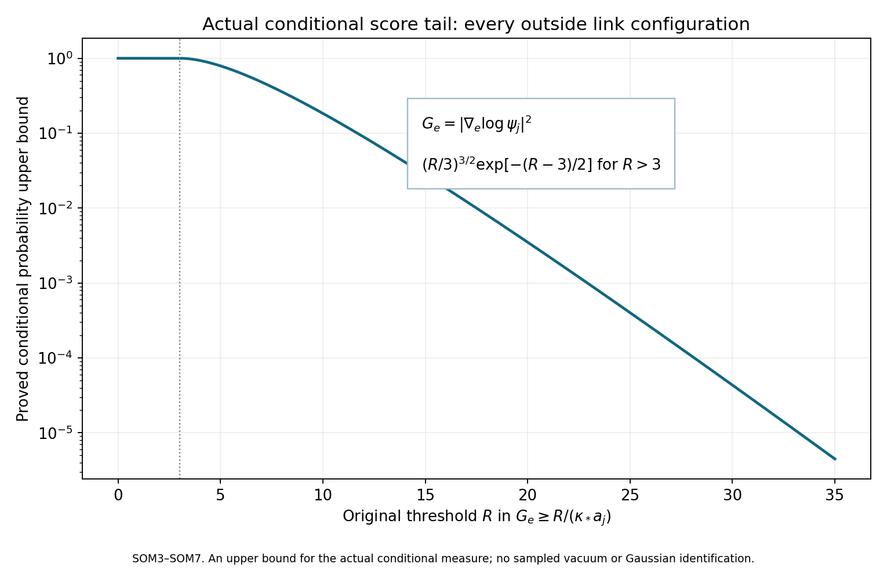
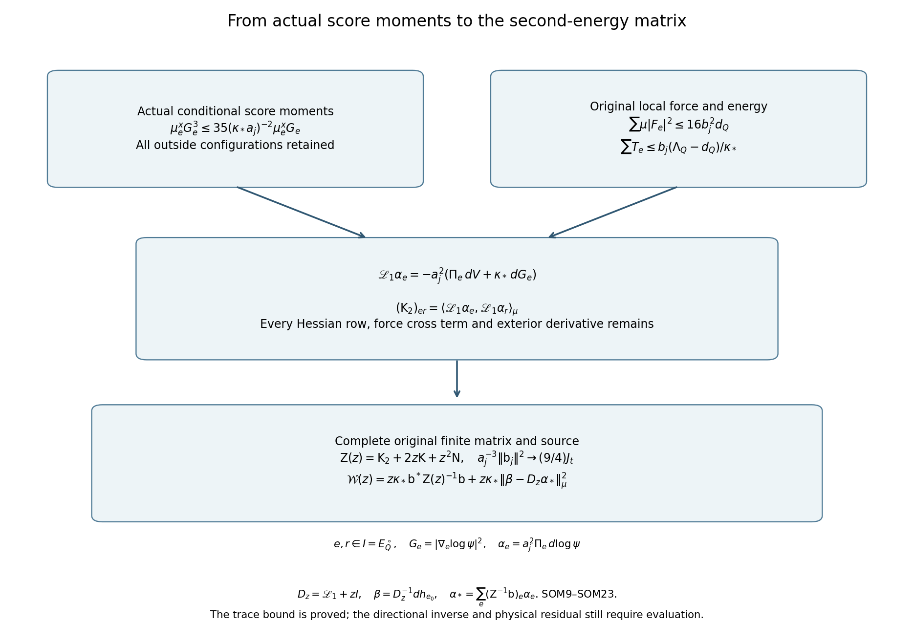

# Actual conditional score moments and the complete second-energy matrix

This note evaluates moments of the actual ground-state logarithmic gradient and uses them to bound every row of the filtered-current second-energy matrix. It also evaluates the squared norm of that matrix's original source vector. No product vacuum or independent-link law is introduced.

The complete provider proofs are [BM1–BM6, BM13 and BM16](https://github.com/KokunoYumeto/yang-mills-interacting-workbench/blob/ea5c059a5c111f2df6a5aabe62c69758e1642c34/yang-mills/continuations/20261011-central-signs-shrinking-window/BOUNDED_ENERGY_MULTIPLIER.md), [SG1–SG11 and SG14–SG19](https://github.com/KokunoYumeto/yang-mills-interacting-workbench/blob/ea5c059a5c111f2df6a5aabe62c69758e1642c34/yang-mills/continuations/20261011-central-signs-shrinking-window/ACTUAL_GROUND_GRADIENT_TRIAL.md), and [FTC21–FTC31](https://github.com/KokunoYumeto/yang-mills-interacting-workbench/blob/ea5c059a5c111f2df6a5aabe62c69758e1642c34/yang-mills/continuations/20261011-central-signs-shrinking-window/ACTUAL_FILTERED_CURRENT_AND_TAIL.md). The differential-form provenance retained there is Jon Johnsen, *On the spectral properties of Witten-Laplacians, their range projections and Brascamp-Lieb's inequality*, [arXiv:1703.10011v2](https://arxiv.org/abs/1703.10011v2), and Assane Lo, *Witten Laplacian Methods for the Decay of Correlations*, [arXiv:math-ph/0611002v9](https://arxiv.org/abs/math-ph/0611002v9). Their exact original-author source versions and bounded reading coverage remain in the source-use record. The calculations below are derived directly; no novelty claim is made.

## 1. Original state, metric and conditional probability

The original positive edges join vertices of \(\{0,\ldots,2L_j\}^3\), with all vertex gauge constraints retained. On every SU(2) edge use the radius-two metric for which \(T_\alpha=-i\sigma_\alpha/2\) is orthonormal, and probability Haar measure. Retain
\[
\begin{gathered}
L_j=j^4,\quad a_j=(100j)^{-1},\quad
g_j^2=\kappa_*a_j/2,\quad b_j=(\kappa_*a_j^2)^{-1},
\quad s_j=100\kappa_*a_j,\\
U_p=U_d(z)U_k(z+e_d)U_d(z+e_k)^{-1}U_k(z)^{-1}\quad(d<k),\\
W_p=\operatorname{Tr}U_p,\quad D_p=2-W_p,\quad
V=b_j\sum_pD_p=2b_j|\mathcal P_j|-b_j\sum_pW_p,\\
H_j=-\kappa_*\Delta+V,\quad H_j\psi_j=E_{0,j}\psi_j,\quad
\psi_j>0,\quad \|\psi_j\|=1,\quad d\mu_j=\psi_j^2dU .
\end{gathered}\tag{SOM1}
\]
The positive smooth ground state is unique and gauge invariant by BM2–BM3. Suppress \(j\) in finite-regulator formulas and write \(\kappa=\kappa_*\). Define
\[
\begin{gathered}
w=\log\psi,\quad g_e=\nabla_e w,\quad G_e=|g_e|^2,\quad T_e=\mu G_e,\\
H_{er}=(\nabla^2w)_{er},\quad R_e=\sum_{r\in\mathcal E_j}\|H_{er}\|_{\rm HS}^2,\quad
F_e=d_eV,\quad \mathscr D=\Delta+2\nabla w\cdot\nabla,\\
\kappa(\Delta w+|dw|^2)=V-E_0,\qquad
\nabla^2w\ge-\frac{2}{\kappa a}g .
\end{gathered}\tag{SOM2}
\]
The last bound is proved in BM16 by the tensor minimum principle on the original product of radius-two spheres: \(\nabla^2V\le8bg\), and at a negative least log-Hessian eigenvalue \(\zeta\), the full curvature terms are nonnegative and give \(2\zeta^2\le8b/\kappa\). Since \(b=(\kappa a^2)^{-1}\), this is exactly the displayed bound. No dimension or coordinate has changed.

Fix all links except \(e\), and denote those outside coordinates by \(x\). The actual conditional measure and its score are
\[
d\mu_e^x(U)=
\frac{\psi(U,x)^2\,dU}{\int_{\mathrm{SU}(2)}\psi(U',x)^2dU'},
\qquad d_e\log\frac{d\mu_e^x}{dU}=2g_e .
\tag{SOM3}
\]
Its denominator is positive and smooth for every \(x\). The outside marginal is that denominator times outside probability Haar; integrating \(\mu_e^x\) against this marginal recovers \(\mu\). Conditional integration below is therefore an exact disintegration of the interacting state.

## 2. Every even score moment and its exponential tail

For an integer \(p\ge1\), integrate the weighted divergence of \(G_e^{p-1}g_e\) over the compact edge:
\[
0=\mu_e^x\left[
2(p-1)G_e^{p-2}H_{ee}(g_e,g_e)
+G_e^{p-1}\Delta_e w+2G_e^p\right].
\tag{SOM4}
\]
At \(p=1\) the first term is identically zero; no negative power is evaluated. At larger integers the entire vector field is smooth, including where \(g_e=0\). SOM2 gives \(H_{ee}(g_e,g_e)\ge-2G_e/(\kappa a)\) and \(\Delta_e w\ge-6/(\kappa a)\), since the edge dimension is three. Substitution proves
\[
\begin{gathered}
\mu_e^xG_e^p\le\frac{2p+1}{\kappa a}\,\mu_e^xG_e^{p-1}
\le\frac{(2p+1)!!}{(\kappa a)^p},\\
\mu_e^xG_e\le\frac3{\kappa a},\qquad
\mu_e^xG_e^2\le\frac5{\kappa a}\mu_e^xG_e,\qquad
\mu_e^xG_e^3\le\frac{35}{(\kappa a)^2}\mu_e^xG_e .
\end{gathered}\tag{SOM5}
\]
Here \((2p+1)!!=1\cdot3\cdot5\cdots(2p+1)\). The second bound follows by induction from \(\mu_e^x1=1\). These inequalities hold at every outside point. Multiplication by any nonnegative outside function and integration preserves them; this step assumes no independence.

For \(0\le t<1/2\), the nonnegative exponential series and monotone convergence now give
\[
\mu_e^x\exp(t\kappa aG_e)
\le\sum_{p=0}^\infty\frac{(2p+1)!!}{p!}t^p
=(1-2t)^{-3/2}.
\tag{SOM6}
\]
To verify the series without an imported probability law, let its sum be \(A(t)\). The ratio of consecutive coefficients is \((2p+3)/(p+1)\), giving \((1-2t)A'(t)=3A(t)\) and \(A(0)=1\); solving this scalar equation gives the stated expression. Markov's inequality, followed by the choice \(t=(1-3/R)/2\), proves
\[
\mu_e^x\left\{G_e\ge\frac{R}{\kappa a}\right\}
\le\left(\frac R3\right)^{3/2}\exp\left(-\frac{R-3}{2}\right),
\qquad R>3 .
\tag{SOM7}
\]
For \(R\le3\), retain the bound1. This is an upper moment and tail estimate for the actual score. It does not identify that score with a Gaussian random variable.

The same argument also handles weights depending on the edge. For a smooth complex function \(u\) on the full configuration space set, at the fixed outside point,
\[
\begin{gathered}
X=\mu_e^x(|u|^2G_e^p),\quad
B=\mu_e^x(|u|^2G_e^{p-1}),\quad
Y=\mu_e^x(G_e^{p-1}|d_eu|^2),\quad
A_p=\frac{2p+1}{\kappa a},\\
X-\sqrt{XY}\le A_pB,\qquad
X\le\frac14\left(\sqrt Y+\sqrt{Y+4A_pB}\right)^2 .
\end{gathered}\tag{SOM8}
\]
Indeed integrating \(\operatorname{div}_{\mu_e^x}(|u|^2G_e^{p-1}g_e)\) adds the term \(2\operatorname{Re}\mu_e^x(\overline u G_e^{p-1}g_e\cdot d_eu)\) to SOM4. Its absolute value is at most \(2\sqrt{XY}\). The same Hessian bounds yield the first inequality, and solving the quadratic in \(\sqrt X\ge0\) yields the second. Thus correlated multipliers incur their exact derivative cost; an outside-only weight is the case \(Y=0\).

## 3. A full weighted score/Hessian identity

Differentiating the full ground equation in SOM2 and applying the product Bochner identity gives
\[
\mathscr D G_e=2R_e+G_e+\frac2\kappa\,g_e\cdot F_e .
\tag{SOM9}
\]
The Ricci contribution is \(2\operatorname{Ric}(g_e,g_e)=G_e\). The derivative of \(|dw|^2\) cancels the drift Hessian contraction; every row \(r\) remains in \(R_e\). This is SG6 for one selected edge. Since the integral of a weighted divergence is zero, \(\mu\mathscr D(G_e^2)=0\). Expanding the square and dividing by two proves the exact identity
\[
\mu|dG_e|^2+2\mu(G_eR_e)+\mu G_e^2
=-\frac2\kappa\mu(G_eg_e\cdot F_e).
\tag{SOM10}
\]
Each left-hand term is nonnegative. Cauchy–Schwarz on the right and the sixth-moment bound in SOM5, integrated over the actual outside marginal, therefore yield
\[
\mu|dG_e|^2+2\mu(G_eR_e)+\mu G_e^2
\le\frac{2\sqrt{35}}{\kappa^2a}
\sqrt{T_e\,\mu|F_e|^2}.
\tag{SOM11}
\]
In particular the full derivative \(dG_e\), including derivatives in arbitrarily distant links, is controlled.

The original force also has an exact pointwise formula. Let \(m_e\) be the number of incident faces, put \(W_e^{\rm def}=\sum_{p\ni e}D_p\), and collect the ordered three-link staples into a quaternion matrix \(S_e\) so that \(\sum_{p\ni e}W_p=\operatorname{Tr}(U_eS_e)\). Cyclicity and \(\operatorname{Tr}A^{-1}=\operatorname{Tr}A\) for SU(2) permit this collection even for inverse traversals. A sum of SU(2) quaternion matrices satisfies \(S_eS_e^*=\rho_e^2I\), \(0\le\rho_e\le m_e\). Radius-two differentiation gives
\[
\begin{gathered}
F_e=b\,d_eW_e^{\rm def},\qquad
|d_eW_e^{\rm def}|^2
=\rho_e^2-\frac{\{\operatorname{Tr}(U_eS_e)\}^2}{4}\\
=\rho_e^2-m_e^2+m_eW_e^{\rm def}
-\frac{(W_e^{\rm def})^2}{4}
\le m_eW_e^{\rm def},\\
\mu|F_e|^2\le b^2m_e\,\mu W_e^{\rm def}.
\end{gathered}\tag{SOM12}
\]
For the derivative identity, write \(U_eS_e=q_0I-iq\cdot\sigma\) with \(q_0^2+|q|^2=\rho_e^2\); the three trace derivatives against \(T_\alpha\) have squared sum \(|q|^2\). The two nonpositive terms in the second line are retained before the inequality.

## 4. Complete matrix bounds with the original local budget

Let \(Q=v+\{0,\ldots,q\}^3\) be an original fitting cube with \(q\ge2\), strictly inside the full lattice. Let \(I=E_Q^\circ\) consist of its direction-\(d\) edges with
\(v_d\le z_d\le v_d+q-1\) and \(v_k+1\le z_k\le v_k+q-1\) for \(k\ne d\). Thus all four incident faces of each \(e\in I\) lie inside \(Q\), and \(|I|=3q(q-1)^2\). Retain
\[
\begin{gathered}
N_Q=3q(q+1)^2,\quad M_Q=3q^2(q+1),\\
C_Q=2q(q+1)\sum_{d=1}^3
\left[\mathbf1_{\{v_d>0\}}+\mathbf1_{\{v_d+q<2L_j\}}\right],\\
W_Q=\sum_{p\ {\rm inside}\ Q}D_p,\quad d_Q=\mu W_Q,\quad
T_Q=\sum_{e\ {\rm inside}\ Q}T_e,\quad E_Q=E_0-E_{\rm out},\\
\Lambda_Q=\min\{2M_Q,6g^2\sqrt{N_QM_Q}\}+2C_Q,\\
\kappa T_Q+bd_Q\le E_Q\le b\Lambda_Q,\qquad
\sum_{e\in I}T_e\le\frac{b}{\kappa}(\Lambda_Q-d_Q).
\end{gathered}\tag{SOM13}
\]
BM5–BM6 prove these inequalities using the full outside Hamiltonian, original crossing-face scalar and inside comparison; no boundary energy is removed.

Every inside face has at most four edges in \(I\). Since \(m_e=4\), SOM12 and then Cauchy–Schwarz in the edge sum of SOM11 give
\[
\begin{gathered}
\sum_{e\in I}\mu|F_e|^2\le16b^2d_Q,\\
\sum_{e\in I}\mu|dG_e|^2
\le\frac{2\sqrt{35}}{\kappa^2a}
\sqrt{\left(\sum_{e\in I}T_e\right)
\left(\sum_{e\in I}\mu|F_e|^2\right)}\\
\le\frac{8\sqrt{35}\,b^{3/2}}{\kappa^{5/2}a}
\sqrt{d_Q(\Lambda_Q-d_Q)}
=\frac{8\sqrt{35}}{\kappa^4a^4}
\sqrt{d_Q(\Lambda_Q-d_Q)}.
\end{gathered}\tag{SOM14}
\]
The shared actual \(d_Q\) remains in both factors.

For the original trial forms \(\alpha_e=a^2\Pi_e dw\), let
\(\mathsf N_{er}=\langle\alpha_e,\alpha_r\rangle_\mu\),
\(\mathsf K_{er}=\langle\alpha_e,\mathscr L_1\alpha_r\rangle_\mu\) and
\((\mathsf K_2)_{er}=\langle\mathscr L_1\alpha_e,\mathscr L_1\alpha_r\rangle_\mu\).
FTC22 and the full identity \(dG_e=2(\nabla^2w)^\#\Pi_e dw\) yield
\[
\begin{gathered}
\mathscr L_1\alpha_e=-a^2(\Pi_e dV+\kappa dG_e),\\
(\mathsf K_2)_{er}
=a^4\mu\langle\Pi_e dV+\kappa dG_e,\Pi_r dV+\kappa dG_r\rangle .
\end{gathered}\tag{SOM15}
\]
Expanding the last line gives every original force term, both force/Hessian cross terms and the sum over every Hessian row in FTC26. In particular no row outside \(I\) is removed.

Apply the triangle inequality in the direct sum, over \(e\in I\), of the full one-form \(L^2(\mu)\) spaces. With \(c_0=\sqrt{8\sqrt{35}}\), SOM14 proves
\[
\begin{gathered}
\operatorname{tr}\mathsf K_2
\le a^4\left[
\sqrt{\sum_{e\in I}\mu|F_e|^2}
+\kappa\sqrt{\sum_{e\in I}\mu|dG_e|^2}\right]^2\\
\le\frac1{\kappa^2}
\left[4\sqrt{d_Q}
+c_0\{d_Q(\Lambda_Q-d_Q)\}^{1/4}\right]^2
\le\frac{(4+c_0)^2}{\kappa^2}\Lambda_Q .
\end{gathered}\tag{SOM16}
\]
The complete cross term is present in the first square. Only the last inequality uses \(d_Q\le\Lambda_Q\) and \(\Lambda_Q-d_Q\le\Lambda_Q\).

The other two trace bounds follow directly from SOM13 and SG9. Every \(e\in I\) has four incident faces and
\(\mu\Delta_eV=(3b/4)\sum_{p\ni e}(2-\mu D_p)\le6b\). Hence
\[
\begin{gathered}
\operatorname{tr}\mathsf N
=a^4\sum_{e\in I}T_e
\le\frac{a^2}{\kappa^2}(\Lambda_Q-d_Q),\\
0\le\operatorname{tr}\mathsf K
\le\frac{3a^2|I|}{\kappa}
+\frac{4a}{\kappa^2}(\Lambda_Q-d_Q),\\
\mathsf Z(z)=\mathsf K_2+2z\mathsf K+z^2\mathsf N>0,\qquad z>0,\\
\operatorname{tr}\mathsf Z(z)\le
\frac{[4\sqrt{d_Q}+c_0\{d_Q(\Lambda_Q-d_Q)\}^{1/4}]^2}{\kappa^2}\\
\hspace{5mm}
+2z\left[\frac{3a^2|I|}{\kappa}
+\frac{4a(\Lambda_Q-d_Q)}{\kappa^2}\right]
+\frac{z^2a^2(\Lambda_Q-d_Q)}{\kappa^2}.
\end{gathered}\tag{SOM17}
\]
Strict positivity follows from FTC27: the actual disjoint-component trial forms have positive norms and \(\mathscr L_1+zI\ge zI\). Thus these are bounds for an existing invertible matrix, with all its correlations retained.

## 5. Evaluating the actual source-vector norm

Use the original real continuous compactly supported triple \(\mathbf f=(f_{12},f_{13},f_{23})\), its original face centers
\(x_p=o+a(z-L_j\mathbf1+(e_d+e_k)/2)\), and edge centers
\(x_e=o+a(z-L_j\mathbf1+e_d/2)\). Let \(e_0\) be the removed edge in the outside source \(h_{e_0}\), and put
\[
\begin{gathered}
M_f=\max_\sigma\|f_\sigma\|_\infty,\quad
t_1=f_{12}+f_{13},\quad t_2=f_{12}+f_{23},\quad t_3=f_{13}+f_{23},\\
f_p=f_\sigma(x_p)\quad(p:\sigma),\qquad h_{e_0}=a\sum_{p\not\ni e_0}f_p(D_p-\mu D_p),\\
\mathsf b_e=\langle\alpha_e,dh_{e_0}\rangle_\mu
=\frac{3a^3}{8}\sum_{\substack{p\ni e\\p\not\ni e_0}}
f_p(\mu D_p-2),\\
c_e=-\frac{3a^3}{4}\sum_{p\ni e}f_p,\quad
r_e=\frac{3a^3}{8}\sum_{\substack{p\ni e\\p\not\ni e_0}}f_p\mu D_p,\quad
u_e=\frac{3a^3}{4}\sum_{\substack{p\ni e\\p\ni e_0}}f_p,\qquad
\mathsf b=c+r+u .
\end{gathered}\tag{SOM18}
\]
This is the unchanged FTC25 vector. Its scalar \(2\), sign and all removed faces remain explicit.

Choose a side-\(R\) cube containing the supports and the original fitting coordinates
\(v_{d,j}=L_j+\lfloor(c_d^{\rm cube}-o_d)/a_j\rfloor-1\),
\(q_j=\lceil R/a_j\rceil+3\).
For all sufficiently large \(j\) it is strictly interior. Every nonzero sampled face and every nonzero \(t_d(x_e)\) lies far enough inside this fitting cube for the needed incident edges to be in \(I\): its boundary is at least \(a_j\) beyond the support cube, while a face center differs from an incident edge center by \(a_j/2\). Integer link coordinates then give the strict transverse inequalities defining \(I\).

Since \(\sum_{p\ni e}\mu D_p\le16\) and each inside face meets at most four selected edges,
\[
\|r\|_{\ell^2(I)}^2\le9a^6M_f^2d_Q,\qquad
\|u\|_{\ell^2(I)}^2
\le\frac{9a^6}{16}
\left[\left(\sum_{p\ni e_0}f_p\right)^2
+3\sum_{p\ni e_0}f_p^2\right]
\le\frac{9a^6}{16}m_{e_0}(m_{e_0}+3)M_f^2 .
\tag{SOM19}
\]
For the first bound, square the incident sum using
\((\sum\mu D_p)^2\le16\sum\mu D_p\), then sum over \(e\).
For the second, extend the nonnegative squared edge sum to all edges. Distinct elementary faces incident to \(e_0\) share no other edge, so the removed-star sum is exactly the square at \(e_0\) plus three copies of each individual face square. The result is uniform in the removed edge, even when that edge varies with \(j\).

Let
\(\omega_f(\delta)=\max_\sigma\sup_{|x-y|\le\delta}|f_\sigma(x)-f_\sigma(y)|\).
The four face centers incident to a direction-\(d\) edge are exactly
\(x_e\pm ae_k/2\) for the two \(k\ne d\). Consequently
\[
\left\|c+\frac{3a^3}{2}(t_d(x_e))_{e\in I}\right\|_{\ell^2(I)}
\le3a^3\omega_f(a/2)\sqrt{|I|}.
\tag{SOM20}
\]
Combining the three explicit errors by the triangle inequality proves
\[
\begin{aligned}
\left|a^{-3/2}\|\mathsf b\|_{\ell^2(I)}
-\frac32\left(a^3\sum_{e\in I}t_d(x_e)^2\right)^{1/2}\right|
\le{}&3M_f\sqrt{a^3d_Q}\\
&+\frac34a^{3/2}M_f\sqrt{m_{e_0}(m_{e_0}+3)}
+3\omega_f(a/2)\sqrt{a^3|I|}.
\end{aligned}\tag{SOM21}
\]
No mean deficit has been assigned a value.

The full finite budget gives \(d_Q\le\Lambda_Q\), \(a^2\Lambda_Q\to\mathsf L_R=9\kappa_*R^3+24R^2\), and \(a^3|I|\to3R^3\). Thus every term on the right tends to zero. On each of the three original edge-center meshes, compact support and uniform continuity of \(t_d^2\) prove the Riemann-sum limit: partition into cubes of side \(a\), integrate the modulus of continuity of \(t_d^2\) on each cube, and bound their total volume by a fixed enclosing cube. The removed outer mesh layer has no nonzero samples by the fitting just established. Hence
\[
a_j^{-3}\|\mathsf b_j\|_{\ell^2(I_j)}^2
\longrightarrow\frac94J_t,\qquad
J_t=\sum_{d=1}^3\int_{\mathbb R^3}t_d(x)^2\,dx>0
\quad(\mathbf f\ne0).
\tag{SOM22}
\]
For positivity, \(f_{12}=(t_1+t_2-t_3)/2\), \(f_{13}=(t_1+t_3-t_2)/2\), and \(f_{23}=(t_2+t_3-t_1)/2\). Thus all \(t_d\) can vanish only for the zero triple. Continuity then makes \(J_t>0\) for a nonzero triple.

## 6. Receiving these bounds in the physical filter

FTC29–FTC31 give the exact physical filter, with \(v=dh_{e_0}\), \(D_z=\mathscr L_1+zI\), \(\beta=D_z^{-1}v\), and \(\alpha_*(z)=\sum_{e\in I}(\mathsf Z(z)^{-1}\mathsf b)_e\alpha_e\):
\[
\begin{gathered}
\mathcal W_{h_{e_0}\psi}(z)
=z\kappa\mathsf b^*\mathsf Z(z)^{-1}\mathsf b
+z\kappa\|\beta-D_z\alpha_*(z)\|_\mu^2,\\
\mathcal W_{h_{e_0}\psi}(z)
\ge z\kappa\frac{\|\mathsf b\|_{\ell^2(I)}^2}
{\operatorname{tr}\mathsf Z(z)} .
\end{gathered}\tag{SOM23}
\]
The second line follows by diagonalizing the positive finite matrix: each eigenvalue is at most its trace. It introduces no estimate on the residual.

Keeping \(z=\theta s_j=100\theta\kappa_*a_j\), \(\theta>0\), SOM17 and the exact counts give
\[
\begin{gathered}
\limsup_j a_j^2\operatorname{tr}\mathsf Z_j(\theta s_j)
\le\frac{(4+\sqrt{8\sqrt{35}})^2}{\kappa_*^2}\mathsf L_R,\\
\liminf_j\frac{\mathcal W_{h_{e_0}\psi_j}(\theta s_j)}{a_j^6}
\ge\frac{225\theta\kappa_*^4J_t}
{(4+\sqrt{8\sqrt{35}})^2\mathsf L_R}>0 .
\end{gathered}\tag{SOM24}
\]
Indeed \(a^2z\operatorname{tr}\mathsf K\to0\) and \(a^2z^2\operatorname{tr}\mathsf N\to0\) by SOM17, while SOM22 evaluates the numerator. The trace-only lower estimate has order \(a_j^6\), weaker than FTC12's existing order-\(a_j^3\) lower estimate. Its role is to establish a fully evaluated bound from the actual finite matrix, not to claim stronger spectral weight.

The next calculation must retain the matrix in the original source direction and both exact-projection residuals in FTC31. SOM15 supplies their complete forcing, SOM8 permits correlated weights with their derivative costs, and SOM21 supplies explicit source errors. None evaluates the signed three-shift subtraction of PLF25–PLF26. The actual interacting continuum state, reconstruction, global smoothness, intended-theory identification and no-gap result remain the programme goal.

Reproducible [diagnostics and figures](check_score_moments.py) and [source-use record](SCORE_MOMENTS_SOURCE_USE_LEDGER.json). Analytic diagnostic densities and arbitrary bounded face means are not the original Yang–Mills vacuum.

## Stronger source energy and retained current inverses

[CTI1–CTI39](https://github.com/KokunoYumeto/yang-mills-interacting-workbench/blob/main/yang-mills/continuations/20261011-central-signs-shrinking-window/CURRENT_TAILS_AND_RETAINED_SOURCE.md) prove exponential tails for the complete ground-state current and a stronger lower energy for the unchanged Wilson source:
\[
\begin{gathered}
e'_{\mathbf f}=\max\{e_{\mathbf f},3\kappa_*^2J_t/4\},\qquad
J_t=\sum_d\int t_d^2,\\
\liminf_jE_{h,j}\ge e'_{\mathbf f},\quad
\liminf_jE_{F,j}\ge e'_{\mathbf f},\qquad
\liminf_j\frac{\mathcal W_{h_{e_0}\psi_j}(\theta s_j)}{a_j^3}
\ge\frac{100\theta\kappa_*(e'_{\mathbf f})^3}{D_{\mathbf f}^2}.
\end{gathered}
\]
The full original upper constants and previous lower bound remain; CTI23–CTI26 give the complete formulas and exact strict improvement for the three-orientation tent. CTI24 also proves the finite-source matrix-order bound. This strengthens CE7–CE10, EF3 and FTC4–FTC12 without changing their source, metric or regulator. CTI27–CTI37 retain asymptotically all of the original source-vector norm in a set with a proved lower trial norm and explicit inverse accuracy. The complete omitted-direction Schur term and physical residual remain in CTI32–CTI33. Their signed three-shift contribution, reconstruction and the smooth no-gap endpoint remain active calculations.

## Positive current measures and individual plaquette means

[CFC1–CFC26](https://github.com/KokunoYumeto/yang-mills-interacting-workbench/blob/main/yang-mills/continuations/20261011-central-signs-shrinking-window/CENTERED_CURRENT_COVARIANCE.md) construct the positive original-configuration measure
\[
d\nu_e=\frac{\kappa(2R_e+G_e)+(3b/4)\sum_{p\ni e}D_p}{6b}\,d\mu .
\]
Its exact mixture and full source retain twice the force pairing. A deterministic subset carrying at least three quarters of the original squared source-norm limit has uniform tilted score tails and a trial inverse lower bound without the earlier logarithmic loss. The full complementary block and physical residual remain.

CFC22–CFC26 prove an individual-face lower mean, the resulting lower density \(3\kappa_*/16\) for every orientation of the limiting spatial vacuum mean, and
\[
K_R^{\rm kin}=\min\{K_R,\mathsf L_R-9\kappa_*R^3/16\},\qquad
\limsup a_j^2(\Lambda_Q-d_Q)\le K_R^{\rm kin}.
\]
This strictly improves the kinetic ceiling when \(\kappa_*R<128/3\), and the original gradient-trial response constants are rederived. All finite roots, counts and crossing terms remain. The force upper bound uses the original \(K_R\), not this kinetic ceiling. Spatial mean domination is not an operator lower bound for every vector or a smooth continuum field. The signed interacting source/Gram evaluation, reconstruction and smooth global no-gap endpoint remain active calculations.
