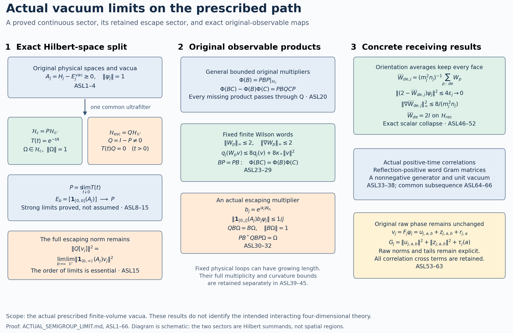

# The actual finite-vacuum semigroup limit and its spectral escape space

11 October 2026. This is a construction from the prescribed finite-volume Yang–Mills Hamiltonians, their actual positive unit physical vacua, and the unchanged path. One common nonprincipal ultrafilter is used for every object. No uniform spectral tightness, zero-time continuity, raw-phase normalization, mass gap, or interacting four-dimensional identification is assumed. The complete spectral escape space is retained. The original Wilson algebra has a stronger result: its operators reduce the continuous subspace, so its compression is a representation.

The finite-vacuum providers are [GPR1–GPR8 and GPR53](https://github.com/KokunoYumeto/yang-mills-interacting-workbench/blob/af1715c22ac52ba5fcc1d3768f2c6f0895de79ac/yang-mills/continuations/20261011-central-signs-shrinking-window/GLOBAL_PHYSICAL_RESPONSE.md), and the raw coefficient/word provider is [PS36–PS39](https://github.com/KokunoYumeto/yang-mills-interacting-workbench/blob/af1715c22ac52ba5fcc1d3768f2c6f0895de79ac/yang-mills/continuations/20261011-central-signs-shrinking-window/POLYNOMIAL_SCORE_AND_ORIGINAL_ENDPOINT.md). The actual curvature budget used in Section 9 is [CW14–CW15](https://github.com/KokunoYumeto/yang-mills-interacting-workbench/blob/dbbcbaf7e8d50e41f7491dc9bbed1c0c6ed54b0c/yang-mills/continuations/20261011-central-signs-shrinking-window/CURVATURE_ROOTED_WORDS.md), whose complete coefficient sums CW33 are also retained below. All facts from them used below are stated and proved again. Earlier free scalar reconstructions use different oscillator spaces and explicit mode isometries; none is substituted for the present physical spaces. For the reconstruction comparison, the original author TeX of Ashtekar, Marolf, Mourão and Thiemann, [quant-ph/9904094](https://arxiv.org/abs/quant-ph/9904094), Definition 1 and Theorem 1, Lemma 6, distinguishes reflection positivity from continuity and vacuum uniqueness. Here continuity is proved on an explicitly constructed subspace, with its complement kept. Source-reading coverage and exact hashes are in ACTUAL_LIMIT_SOURCE_USE_LEDGER.json. The elementary spectral theorem for self-adjoint operators and continuous functional calculus are the functional-analytic foundations used below.

## 1. Original finite spaces, path and energy identity

Fix \(\kappa_*>0\) and integer \(j\ge2\). Retain
\[
 L_j=j^4,\quad m_j=2j^4,\quad n_j=2j^4+1,\quad
 a_j=(100j)^{-1},\quad g_j^2=\kappa_*/(200j),\quad
 \xi_j=10000j^2/\kappa_*^2,\quad \kappa_j=\kappa_*,\quad
 h_j=\pi/(2n_j),\quad s_j=\kappa_*/j.
 \tag{ASL1}
\]
The vertices are \(V_j=\{-L_j,\ldots,L_j\}^3\), the positive edges are \(E_j=\{(x,i):x,x+e_i\in V_j\}\), and the positively ordered faces are \(\mathcal P_j=\{(x;i,k):i<k,\ x,x+e_i,x+e_k,x+e_i+e_k\in V_j\}\). Thus
\[
 N_j=|E_j|=3m_jn_j^2,\quad M_j=|\mathcal P_j|=3m_j^2n_j,\quad
 Q_j=SU(2)^{E_j},\quad dU_j=\bigotimes_{e\in E_j}dU_e.
 \tag{ASL2}
\]
Every Haar measure is probability measure. Every vertex, including each boundary vertex, acts by \(U_{st}\mapsto q_sU_{st}q_t^{-1}\). The physical space \(\mathcal H_j\) is the invariant subspace of \(L^2(Q_j,dU_j)\). All scalar products are antilinear in the first entry. With \(T_\alpha=-i\sigma_\alpha/2\), the original left fields \(X_{e,\alpha}\) are orthonormal; the edge metric is the round metric of radius two. Keep
\[
\begin{split}
 W_{(x;i,k)}&=\operatorname{Tr}\bigl[U_i(x)U_k(x+e_i)U_i(x+e_k)^{-1}U_k(x)^{-1}\bigr],\\
 K_j&=-\sum_{e,\alpha}X_{e,\alpha}^2,\qquad
 H_j=\kappa_*K_j+\kappa_*\xi_j\sum_{p\in\mathcal P_j}(2-W_p),\\
 H_j\psi_j&=E_j^{\rm vac}\psi_j,\quad \psi_j>0,\quad
 \int\psi_j^2dU_j=1,\quad A_j=H_j-E_j^{\rm vac}I,\quad
 d\mu_j=\psi_j^2dU_j.
\end{split}\tag{ASL3}
\]
The notation \(E_j^{\rm vac}\) avoids collision with the original edge set. The scalar \(2\kappa_*\xi_jM_j\) and the full vacuum energy remain in (ASL3).

For completeness, on the compact connected product the Casimir has discrete product-spin spectrum tending to infinity with finite multiplicities. Its resolvent is compact. The real smooth bounded potential preserves self-adjointness on the second Sobolev space and the first Sobolev form domain. A lowest Rayleigh minimizer exists, its modulus does not increase the kinetic form, elliptic regularity makes it smooth, and the strong maximum principle makes it positive. The product rule and integration by parts give, for \(v=\psi_j f\) in the form domain,
\[
 q_j(v):=\|A_j^{1/2}v\|^2
 =\kappa_*\int\psi_j^2\sum_{e,\alpha}|X_{e,\alpha}f|^2dU_j.
 \tag{ASL4}
\]
First prove the identity for smooth \(f\): expand \(K_j(\psi_jf)\), substitute the complete equation (ASL3), and integrate the mixed term. Both scalar terms cancel by that equation, rather than being removed from the Hamiltonian. Density extends the identity, since division by a fixed positive smooth \(\psi_j\) preserves the finite-volume Sobolev form domain. A second ground vector divided by \(\psi_j\) has zero derivative and is constant. Thus the ground eigenspace is one-dimensional. Gauge transformations fix its positive unit vector, so the full and physical ground energies agree and \(A_j\ge0\) on \(\mathcal H_j\). This also proves the stated properties of the actual vacua.

## 2. One Hilbert ultraproduct and the zero-time projection

Choose once and for all a nonprincipal ultrafilter \(\mathcal U\) on \(\{2,3,\ldots\}\). Every bounded scalar sequence has a unique \(\mathcal U\)-limit: compactness supplies an accumulation point selected by the ultrafilter, and disjoint neighbourhoods prove uniqueness. Sums, products, conjugates and inequalities commute with this limit by their continuity. Define
\[
 \ell^\infty(\mathcal H_j)=\{(v_j):\sup_j\|v_j\|<\infty\},\qquad
 \mathcal N_{\mathcal U}=\{(v_j):\lim_{\mathcal U}\|v_j\|=0\},\qquad
 \mathcal H_{\mathcal U}=\ell^\infty(\mathcal H_j)/\mathcal N_{\mathcal U},
 \quad \langle[v_j],[w_j]\rangle=\lim_{\mathcal U}\langle v_j,w_j\rangle.
 \tag{ASL5}
\]
The scalar product is well defined by Cauchy–Schwarz and positive definite on the quotient. Its norm equals the Banach quotient norm. Indeed it is at most every representative's supremum norm. In the other direction, if \(a=\lim_{\mathcal U}\|v_j\|\), then \(S_\epsilon=\{j:\|v_j\|\le a+\epsilon\}\) belongs to \(\mathcal U\). Replacing \(v_j\) by zero off \(S_\epsilon\) changes it by an element of \(\mathcal N_{\mathcal U}\) and bounds its supremum by \(a+\epsilon\). The space \(\ell^\infty(\mathcal H_j)\) is complete by componentwise limits of uniformly Cauchy sequences, and \(\mathcal N_{\mathcal U}\) is closed. To see explicitly that its quotient is complete, select a subsequence of any quotient Cauchy sequence whose successive quotient distances are at most \(2^{-2r}\), lift each difference to norm at most \(2^{-r}\), and sum the absolutely convergent series in \(\ell^\infty\). Its quotient is the limit of that subsequence and hence of the Cauchy sequence. Thus (ASL5) is a Hilbert space.

A uniformly bounded sequence \(B_j\in\mathcal B(\mathcal H_j)\) induces \(B[v_j]=[B_jv_j]\). Products and adjoints are preserved and
\[
 \|B\|\le\lim_{\mathcal U}\|B_j\|,\qquad
 \Omega=[\psi_j],\quad\|\Omega\|=1,\qquad
 T(t)=[e^{-tA_j}]\quad(t>0).
 \tag{ASL6}
\]
These assertions follow directly from (ASL5); in particular the vacuum has its original norm. Each \(T(t)\) is a positive self-adjoint contraction, \(T(t)T(s)=T(t+s)\), and \(T(t)\Omega=\Omega\). For \(t>0,h\ge0\), spectral calculus gives
\[
 \|T(t+h)-T(t)\|
 \le\sup_{\lambda\ge0}e^{-t\lambda}(1-e^{-h\lambda})
 \le {h\over et}.
 \tag{ASL7}
\]
Here \(1-e^{-h\lambda}\le h\lambda\) and \(\sup\lambda e^{-t\lambda}=1/(et)\). The same estimate with the smaller positive time proves norm continuity throughout \((0,\infty)\), without a zero-time assumption.

As \(t\downarrow0\), \(T(t)\) increases in the operator order and is bounded by \(I\). Its strong limit exists: for \(0<s<t\), the positive contraction \(D=T(s)-T(t)\) satisfies \(\|Dv\|^2\le\langle v,Dv\rangle\); the latter is Cauchy because \(\langle v,T(t)v\rangle\) is bounded monotone. Denote the strong limit by \(P\). Strong convergence of products of uniformly bounded operators and the semigroup law yield
\[
 P^*=P,\quad P^2=\lim_{t\downarrow0}T(t)^2
 =\lim_{t\downarrow0}T(2t)=P,\qquad
 PT(t)=T(t)P=T(t),\quad P\Omega=\Omega.
 \tag{ASL8}
\]
For the middle identity take \(s\downarrow0\) in \(T(s)T(t)=T(s+t)\), using (ASL7). Consequently
\[
 \mathcal H_{\mathcal U}=\mathcal H_c\oplus\mathcal H_{\rm esc},\quad
 \mathcal H_c=P\mathcal H_{\mathcal U},\quad
 \mathcal H_{\rm esc}=Q\mathcal H_{\mathcal U},\quad Q=I-P,
 \qquad T(t)=T_c(t)\oplus0\quad(t>0).
 \tag{ASL9}
\]
Precisely the vectors of \(\mathcal H_c\) satisfy \(T(t)v\to v\) as \(t\downarrow0\). For arbitrary \(v\), the exact missing squared norm is \(\|Qv\|^2\); moreover \(\lim_{t\downarrow0}\|T(t)v-v\|=\|Qv\|\). The full semigroup with its original value \([e^0]=I\) may be discontinuous at zero. We retain that fact and its complete defect space.

## 3. Generator, original spectral cutoffs and full escape identity

Set \(R=[(I+A_j)^{-1}]\). The integral
\[
 R=\int_0^\infty e^{-t}T(t)\,dt
 \tag{ASL10}
\]
holds in operator norm. On any compact interval away from zero, (ASL7) gives uniform Riemann-sum convergence, also for the finite-volume semigroups. The omitted interval \((0,\epsilon)\) has norm at most \(\epsilon\), and the tail after \(b\) has norm at most \(e^{-b}\). Finite-volume spectral calculus gives (ASL10), then these bounds pass it to the ultraproduct. No interchange involving zero-time continuity is used.

The operator \(R\) is positive, \(0\le R\le I\), and \(\ker R=\mathcal H_{\rm esc}\). One inclusion follows from (ASL9). Conversely, \(Rv=0\) makes the nonnegative continuous integrand \(\langle v,T(t)v\rangle\) vanish for every \(t>0\); its limit is \(\|Pv\|^2\). On \(\mathcal H_c\), \(R_c\) is therefore injective and has dense range. Its bounded spectral measure defines
\[
 A=R_c^{-1}-I,\quad
 D(A)=\operatorname{ran}R_c
 =\left\{v:\int_{(0,1]}(r^{-1}-1)^2\,d\langle v,E_{R_c}(r)v\rangle<\infty\right\}.
 \tag{ASL11}
\]
The equality of the domain with \(\operatorname{ran}R_c\) follows because integrability of \((r^{-1}-1)^2\), together with \(\|v\|^2<\infty\), is equivalent to integrability of \(r^{-2}\). The spectral multiplication operator is self-adjoint and nonnegative. For \(t>0\), let \(g_t(0)=0\) and \(g_t(r)=\exp[-t(r^{-1}-1)]\) for \(0<r\le1\). This is continuous on \([0,1]\). Uniform polynomial approximation and preservation of products show \([g_t((I+A_j)^{-1})]=g_t(R)\). Hence
\[
 T(t)=e^{-tA}P,\qquad T_c(0)=I_{\mathcal H_c},\qquad
 A\Omega=0.
 \tag{ASL12}
\]
This reconstructs the generator itself. In particular, it is not an assumed limit of unbounded \(A_j\) on all of \(\mathcal H_{\mathcal U}\).

For every finite \(b\ge0\), keep the original spectral cutoff
\[
 E_b=[\mathbf1_{[0,b]}(A_j)].
 \tag{ASL13}
\]
It is an orthogonal projection, increases with \(b\), and satisfies
\[
 \|(I-T(t))E_b\|\le1-e^{-tb},\quad E_b\le P,\qquad
 \|(I-E_b)T(t)\|\le e^{-tb},\qquad
 \mathop{\rm s-lim}_{b\to\infty}E_b=P.
 \tag{ASL14}
\]
The first inequality proves \(E_b\mathcal H_{\mathcal U}\subset\mathcal H_c\). The second inequality shows that \(T(t)\mathcal H_{\mathcal U}\) belongs to the closure of the union of the cutoff ranges; their closed union therefore contains the strong limit \(P\mathcal H_{\mathcal U}\). This proves the last equality, not merely one inclusion. For every bounded original vector sequence,
\[
 \boxed{\quad
 \|Q[v_j]\|^2=\lim_{b\to\infty}\lim_{\mathcal U}
       \|\mathbf1_{(b,\infty)}(A_j)v_j\|^2,
 \qquad
 \|P[v_j]\|^2=\lim_{b\to\infty}\lim_{\mathcal U}
       \|\mathbf1_{[0,b]}(A_j)v_j\|^2 .\quad}
 \tag{ASL15}
\]
The order of the two limits is part of the assertion. At each finite \(j\), all tails vanish as \(b\to\infty\); that reversed order would suppress the escape space and is not used.

The original cutoff need not be the reconstructed spectral projection at its endpoint. The exact comparison, on \(\mathcal H_c\), is
\[
 \mathbf1_{[0,b)}(A)\le E_b|_{\mathcal H_c}
 \le\mathbf1_{[0,b]}(A).
 \tag{ASL16}
\]
Indeed \(E_b\) commutes with \(R\), \(R\ge(1+b)^{-1}I\) on its range, and \(R\le(1+b)^{-1}I\) on its orthogonal complement. Functional calculus for \(R_c\) proves (ASL16). The entire possible discrepancy is a projection on the eigenspace \(\ker(A-b)\); no endpoint mass is dropped. For example the scalar sequences \(A_j=b+1/j\) and \(A_j=b-1/j\ge0\) both reconstruct the scalar \(b\), whereas their cutoffs at \(b\) are respectively zero and identity. At \(b=0\), the first example suffices.

If \(f\) is continuous on \([0,\infty)\) and vanishes at infinity, transform \(r=(1+\lambda)^{-1}\) to obtain
\[
 [f(A_j)]=f(A)P.
 \tag{ASL17}
\]
For bounded continuous \(f\) without a limit at infinity, the original bounded sequence still induces an operator. Its restriction to \(\mathcal H_c\) is \(f(A)\), by uniform approximation on each finite spectral interval and (ASL14); it preserves both subspaces because it commutes with every \(E_b\) and hence \(P\). Thus, in particular,
\[
 [e^{itA_j}]|_{\mathcal H_c}=e^{itA}\quad(t\in\mathbb R).
 \tag{ASL18}
\]
For precision in the approximation argument, multiply \(f\) by a continuous cutoff equal to one on \([0,b]\) and zero above \(b+1\); on \(E_b\) it agrees exactly with \(f\), while the error on \((P-E_b)v\) is at most \(2\|f\|_\infty\|(P-E_b)v\|\). This also proves (ASL18) without an assumption about the escaping unitary group.

Uniform form control is a sufficient property proved for specific vectors below: if \(\sup_jq_j(v_j)\le C\) and \(v_j\) is bounded, then
\[
 \|(I-E_b)[v_j]\|^2\le C/b\quad(b>0),\qquad
 [v_j]\in\mathcal H_c,\qquad
 \|A^{1/2}[v_j]\|^2\le\lim_{\mathcal U}q_j(v_j).
 \tag{ASL19}
\]
The tail inequality is \(\mathbf1_{(b,\infty)}(\lambda)\le\lambda/b\). For the form inequality use \((1-e^{-t\lambda})/t\le\lambda\), (ASL12), and monotone convergence as \(t\downarrow0\). A finite first-moment defect can remain even when the norm escape is zero; (ASL19) does not assert equality of energy moments.

## 4. Exact product defect for the full bounded original observable algebra

Let \(\mathfrak M\) be the unital commutative star algebra of all sequences of essentially bounded gauge-invariant functions \(b_j\) on \(Q_j\) with \(\sup_j\|b_j\|_\infty<\infty\), modulo equality as induced ultraproduct multiplication operators. Write \(B=[M_{b_j}]\). Its operator-norm closure remains a commutative unital C*-algebra on \(\mathcal H_{\mathcal U}\). Compression gives
\[
 \Phi(B)=PBP|_{\mathcal H_c},\qquad
 \Phi(I)=I_{\mathcal H_c},\qquad
 \boxed{\Phi(BC)-\Phi(B)\Phi(C)=PBQCP|_{\mathcal H_c}.}
 \tag{ASL20}
\]
Insert \(I=P+Q\) between \(B\) and \(C\) to prove the identity. Compression is completely positive: for any finite positive operator matrix \([B_{ab}]\) and vectors \(v_a\in\mathcal H_c\), \(\sum_{a,b}\langle v_a,\Phi(B_{ab})v_b\rangle=\sum_{a,b}\langle v_a,B_{ab}v_b\rangle\ge0\). Its exact Schwarz defect is
\[
 \Phi(B^*B)-\Phi(B)^*\Phi(B)
       =(QBP)^*(QBP)\ge0.
 \tag{ASL21}
\]
Both Schwarz defects for \(B\) and \(B^*\) vanish exactly when \(QBP=QB^*P=0\), equivalently \(BP=PB\). On the algebra of such reducing operators, (ASL20) is multiplicative. For the original commuting \(B,C\), its compressed commutator is exactly
\[
 [\Phi(B),\Phi(C)]=P(CQB-BQC)P|_{\mathcal H_c}.
 \tag{ASL22}
\]
Thus every lost multiplication term has an identified path through the escape space.

## 5. The actual Wilson algebra reduces the continuous subspace

Suppose a sequence of smooth gauge-invariant functions has uniform bounds \(\|b_j\|_\infty\le M\) and \(\|\nabla b_j\|_\infty\le D\), with the original full edge gradient. For complex \(f\), the complete product formula is
\[
\begin{split}
 q_j(b_j\psi_jf)=\kappa_*\int d\mu_j\bigl[
 |b_j|^2|\nabla f|^2+|f|^2|\nabla b_j|^2
 +2\operatorname{Re}\sum_{e,\alpha}
    \overline{b_jX_{e,\alpha}f}\,fX_{e,\alpha}b_j\bigr].
\end{split}\tag{ASL23}
\]
Every edge, coordinate and cross term is present. The elementary inequality \(|u+v|^2\le2|u|^2+2|v|^2\) then proves, without replacing the equality,
\[
 q_j(b_jv_j)\le2M^2q_j(v_j)+2\kappa_*D^2\|v_j\|^2.
 \tag{ASL24}
\]
The conjugate function has the same two bounds. For a bounded representative \(u_j\), the sequence \(v_j=\mathbf1_{[0,b]}(A_j)u_j\) has \(q_j(v_j)\le b\|u_j\|^2\). Equations (ASL19) and (ASL24) therefore show \(BE_b\mathcal H_{\mathcal U}\subset\mathcal H_c\). By (ASL14) and boundedness, \(B\mathcal H_c\subset\mathcal H_c\). Apply the same proof to \(B^*\) and take adjoints to obtain
\[
 BP=PB,\qquad \Phi(BC)=\Phi(B)\Phi(C)
 \quad\hbox{whenever either reducing factor supplies the required zero in (ASL20).}
 \tag{ASL25}
\]
In particular both the left and right multiplication identities hold for a reducing \(B\) and arbitrary \(C\). The form estimate constructs invariance; it is not a postulated algebraic property.

For an original face, \(|W_p|\le2\) and \(|\nabla_eW_p|\le1\) on each of its four distinct edges, and its other derivatives vanish. To prove the derivative constant, move the surrounding unitary matrices through the trace and, for inverse occurrences, differentiate \(U^{-1}\) with its minus sign. The resulting generator triple differs by an orthogonal adjoint rotation and possibly a common minus sign from \(\operatorname{Tr}(T_\alpha G)\). Write \(G=cI+2\sum x_\alpha T_\alpha\); then \(\operatorname{Tr}(T_\alpha G)=-x_\alpha\) and \(\sum x_\alpha^2=1-c^2\le1\). Thus, for any actual face sequence \(p_j\),
\[
 \|W_{p_j}\|_\infty\le2,\quad
 \|\nabla W_{p_j}\|_\infty^2\le4,\quad
 q_j(W_{p_j}v_j)\le8q_j(v_j)+8\kappa_*\|v_j\|^2,
 \quad q_j(W_{p_j}\psi_j)\le4\kappa_*.
 \tag{ASL26}
\]
The last bound uses (ASL4) directly and keeps the sharper constant. It gives the actual spectral tail
\[
 \lim_{\mathcal U}\|\mathbf1_{(b,\infty)}(A_j)W_{p_j}\psi_j\|^2
 \le4\kappa_*/b.
 \tag{ASL27}
\]

For a product of \(k\) original face traces, with repetitions and overlaps allowed, keep its full derivative
\[
 \nabla\prod_{a=1}^kW_{p_{a,j}}
 =\sum_{a=1}^k\left(\prod_{d\ne a}W_{p_{d,j}}\right)\nabla W_{p_{a,j}}.
 \tag{ASL28}
\]
In particular the squared gradient is the complete sum over \((a,d)\), including all overlap cross terms. Triangle inequality after this identity yields \(\|\prod W\|_\infty\le2^k\), \(\|\nabla\prod W\|_\infty\le k2^k\), and \(q_j((\prod W)\psi_j)\le\kappa_*k^24^k\). Finite linear combinations obey the corresponding sums of their absolute coefficients times these displayed constants. Therefore the operator-norm closed unital algebra \(\mathfrak W\) generated by all such fixed finite face-word sequences reduces \(P\). The number of factors is fixed for each generator, while their actual face locations may depend on \(j\). The representation
\[
 \pi:\mathfrak W\longrightarrow\mathcal B(\mathcal H_c),\qquad
 \pi(B)=B|_{\mathcal H_c}
 \tag{ASL29}
\]
preserves original products, adjoints, identities, commutativity and all original Wilson polynomial relations. It may have a kernel; injectivity is not asserted.

More generally, an original closed ordered Wilson loop of at most \(\ell\) edge occurrences has \(\|W_\gamma\|_\infty\le2\) and \(\|\nabla W_\gamma\|_\infty\le\ell\). Each occurrence contributes a three-component vector of norm at most one in its actual edge component, with its original orientation sign; summing all occurrences gives this bound even when an edge repeats. All fixed-length loop sequences, their finite products and norm closure therefore satisfy (ASL29). No assertion of this uniform derivative bound is made for loops whose number of edges diverges on the path.

## 6. Nonzero escape and a unit product defect in actual observables

The escape space in this construction is nonzero. Fix one elementary face \(p_j\) in each original box. For each finite \(j\), choose an integer \(k_j\ge1\) so that
\[
 b_j(U)=e^{ik_jW_{p_j}(U)},\qquad
 \|\mathbf1_{[0,j]}(A_j)b_j\psi_j\|\le1/j.
 \tag{ASL30}
\]
Such an integer exists. The cutoff has finite rank by compact resolvent. For each of a finite orthonormal basis \(\phi_{j,a}\) of that range, the coefficient is
\(\int\overline{\phi_{j,a}}\psi_j e^{ikW_{p_j}}dU_j\). Keeping all other edges fixed, change one face edge into the complete ordered face holonomy. Haar invariance makes this a measure-preserving change of variable, including an inversion when required. Under Haar probability on \(SU(2)\), the trace \(w\in[-2,2]\) has density \((2\pi)^{-1}\sqrt{4-w^2}\). Fubini therefore writes the coefficient as \(\int_{-2}^2e^{ikw}h_{j,a}(w)dw\), where \(h_{j,a}\in L^1\); indeed its absolute integral is at most \(\int|\phi_{j,a}\psi_j|dU_j\le1\). The Riemann–Lebesgue statement here follows directly by approximating an \(L^1\) function with step functions: each interval's oscillatory integral is at most \(2/k\), and the approximation error has its unchanged \(L^1\) bound. Every one of the finitely many coefficients tends to zero, proving (ASL30). One may choose the least successful positive integer, so no further choice is hidden in the sequence.

These are gauge-invariant smooth unit-modulus functions of actual face observables. Hence \(B=[M_{b_j}]\in\mathfrak M\) is unitary and \(v=B\Omega\) has norm one. For every fixed \(b\), the cofinite set \(j\ge b\) gives \(\|E_bv\|\le\lim_{\mathcal U}1/j=0\). Equations (ASL14)–(ASL15) prove
\[
 Pv=0,\quad Qv=v,\quad T(t)v=0\ (t>0),\quad
 \Phi(B)\Omega=0,\quad
 \bigl[\Phi(B^*B)-\Phi(B)^*\Phi(B)\bigr]\Omega=\Omega.
 \tag{ASL31}
\]
The last identity follows either from (ASL21) or from \(PB^*QBP\Omega=PB^*B\Omega=\Omega\). Its defect has norm exactly one: it is a positive contraction and attains one on a unit vector. In particular these \(b_j\) cannot have the uniform original gradient property of Section 5. This example changes no vacuum or raw phase; it identifies an actual subspace and an actual observable product that detect energy escaping to infinity.

There is an exact two-time discontinuity for this observable:
\[
 \lim_{\mathcal U}\langle b_j\psi_j,e^{-tA_j}b_j\psi_j\rangle
 =\begin{cases}1,&t=0,\\0,&t>0.\end{cases}
 \tag{ASL32}
\]
Thus boundedness alone cannot justify zero-time continuity for the full original observable algebra. The Wilson result (ASL29) supplies the precise additional mechanism for its specified subalgebra.

## 7. Actual correlations, reflection positivity and the cyclic reconstruction

For bounded original observable sequences \(B_0,\ldots,B_r\in\mathfrak M\) and strictly positive gaps \(t_1,\ldots,t_r\), their common actual limit is
\[
\begin{split}
 C_{\mathcal U}(B_0,t_1,B_1,\ldots,t_r,B_r)
 &:=\lim_{\mathcal U}\langle\psi_j,B_{0,j}e^{-t_1A_j}B_{1,j}
          \cdots e^{-t_rA_j}B_{r,j}\psi_j\rangle\\
 &=\langle\Omega,\Phi(B_0)e^{-t_1A}\Phi(B_1)
           \cdots e^{-t_rA}\Phi(B_r)\Omega\rangle,\\
 |C_{\mathcal U}|&\le\prod_{a=0}^r\sup_j\|B_{a,j}\|.
\end{split}\tag{ASL33}
\]
The first equality exists because the scalar sequence is bounded. The second is precisely the ultraproduct product law, (ASL12), and \(P\Omega=\Omega\). If a gap is exactly zero, the original adjacent factors must first be multiplied in \(\mathfrak M\). Their compression is \(\Phi(BC)\), with the full correction (ASL20) relative to \(\Phi(B)\Phi(C)\). For \(B_a\in\mathfrak W\), replace every \(\Phi\) by \(\pi\); (ASL29) proves (ASL33) for all nonnegative gaps, including every collision. Strong continuity of \(e^{-tA}\) then proves joint continuity in these gaps, by telescoping the finitely many factors. These are limits of the actual finite-volume correlations with their original vacuum factors.

Here is the full positive-time reflection kernel. A word \(w\) consists of \(0\le t_1\le\cdots\le t_k\) and \(B_1,\ldots,B_k\in\mathfrak W\). Define
\[
 V_w=e^{-t_1A}\pi(B_1)e^{-(t_2-t_1)A}\pi(B_2)
       \cdots e^{-(t_k-t_{k-1})A}\pi(B_k)\Omega,
 \qquad V_{\varnothing}=\Omega.
 \tag{ASL34}
\]
For another word \(z=((u_a,C_a))_{a=1}^\ell\), the exact reflected form is
\[
\begin{split}
 K(w,z)=\langle V_w,V_z\rangle
 =\langle\Omega,&\pi(B_k)^*e^{-(t_k-t_{k-1})A}\cdots
       \pi(B_1)^*e^{-(t_1+u_1)A}\pi(C_1)\\
       &\cdots e^{-(u_\ell-u_{\ell-1})A}\pi(C_\ell)\Omega\rangle.
\end{split}\tag{ASL35}
\]
Empty words mean deletion of the corresponding factors. Taking adjoints reverses their order and adds the two nearest positive times. This is exactly reflection through time zero, with complex conjugation of the reflected observables. For every finite list and coefficients,
\[
 \sum_{a,b}\overline{z_a}z_bK(w_a,w_b)
 =\left\|\sum_a z_aV_{w_a}\right\|^2\ge0.
 \tag{ASL36}
\]
The same identity holds at each finite \(j\), and (ASL33) identifies its ultralimit with (ASL35). For the larger algebra \(\mathfrak M\), words with positive initial time and strictly positive internal gaps give the same reflection result through \(\Phi\); zero-gap multiplication is retained as described after (ASL33). In particular the defect example (ASL32) has positive reflected kernels despite its failure of zero-time continuity.

Define \(\mathcal H_{\rm rec}\) as the closed linear span of the vectors in (ASL34). Its Hilbert structure is exactly the quotient of the formal word space by the nullspace of (ASL35), followed by completion: the map sending a word to \(V_w\) is isometric by definition, with dense range. Prepending a time-zero observable or increasing the initial time shows invariance under \(\pi(\mathfrak W)\) and \(e^{-tA}\). The adjoint observable and self-adjoint semigroup give reducing invariance. Consequently it carries
\[
 \bigl(\mathcal H_{\rm rec},\Omega,\pi_{\rm rec},A_{\rm rec}\bigr),\quad
 \|\Omega\|=1,\quad A_{\rm rec}\ge0,\quad A_{\rm rec}\Omega=0,
 \quad e^{-tA_{\rm rec}}\text{ strongly continuous},
 \quad e^{itA_{\rm rec}}\text{ a strongly continuous unitary group}.
 \tag{ASL37}
\]
The generator restriction is self-adjoint because the subspace reduces its resolvent, obtained from its semigroup integral. Its vacuum is cyclic for the algebra of the displayed observables and time evolutions. On any specified countable family of original Wilson sequences, take rational nonnegative times and rational complex linear combinations of words. They form a countable dense family by (ASL33)'s continuity and norm approximation of the observable algebra. Thus the corresponding cyclic reconstruction is separable. The construction for all possible original face sequences need not be separable.

The state is stationary in the precise time sense that ordered correlations depend only on successive time differences; the exterior time intervals disappear by \(e^{-tA}\Omega=\Omega\). Taking adjoints gives conjugate time reversal. Original cube symmetries act by the full edge permutation and inversion maps, preserve Haar, \(K_j\), the full potential and the positive unit vacuum, and therefore induce unitary symmetries on \(\mathcal H_{\mathcal U}\) commuting with \(T(t),P,A\). They carry each original Wilson word to its correctly oriented image. Any Wilson family closed under these maps gives the corresponding symmetry on \(\mathcal H_{\rm rec}\). Gauge transformations already act trivially on the original physical spaces. No spatial translation group on the open box, continuum rotation group, relativistic locality, distribution-valued four-dimensional field, clustering, unique limiting vacuum, nonzero limiting gap, or nontrivial interacting theory has been inferred from these facts.

There is also an exact bounded history interpretation, without assuming path regularity. At finite \(j\), conjugation by the actual vacuum gives \(S_j(t)f=\psi_j^{-1}e^{-tA_j}(\psi_jf)\). It is a symmetric positivity-preserving contraction on \(L^2(\mu_j)\), and \(S_j(t)1=1\). Positivity follows, for example, by the product formula for \(e^{-tH_j}\): the compact-group heat operators are positive integral operators and multiplication by \(e^{-tV_j/n}\) is positive; their strong limit is positive. The heat positivity itself follows from the scalar heat maximum principle on the compact product. The vacuum conjugation and its positive scalar preserve it. Since \(S_j(t)1=1\), positivity also gives the \(L^\infty\) contraction property.

For finitely many real Wilson sequences, regarded as coordinates in \([-2,2]\), the original symmetric Markov kernels therefore define consistent stationary finite-time probability laws. Their moments are the finite versions of (ASL33); no new density is substituted. Take their common ultralimits on continuous cylinder functions. Positivity, unit mass and consistency pass to the limit. On the compact product \([-2,2]^{I\times\mathbb R}\), these positive cylinder functionals extend by their supremum bound to the continuous-function algebra and hence to a probability measure. To justify density, every continuous function on a compact product is uniformly approximable by functions of finitely many coordinates; the latter are uniformly approximable by polynomials on their finite cubes. The Riesz representation theorem then gives the measure. Its cylinder laws retain stationarity and (ASL36), and its coordinate moments retain all original trace values and factors. The observed Wilson-coordinate process is not asserted to be Markov: projecting the finite configuration process to selected observables need not preserve that property.

For one face coordinate \(X_p(t)\), the actual limiting increment bound is
\[
 \mathbb E|X_p(t)-X_p(u)|^2
 =2\langle\pi(W_p)\Omega,(I-e^{-|t-u|A})\pi(W_p)\Omega\rangle
 \le8\kappa_*|t-u|.
 \tag{ASL38}
\]
At finite \(j\), use stationarity and symmetry to expand the square, followed by \(1-e^{-r\lambda}\le r\lambda\) and (ASL26); the limit preserves the inequality and the equality. This is mean-square time continuity. It does not by itself prove sample-path continuity or regularity in the spatial label.

## 8. Growing original loops and the precise curvature calculation

The fixed-word assertion in Section 5 is not a statement about a fixed physical loop with a growing edge count. Retain the actual occurrence list of any original ordered closed loop \(\gamma_j\), its total length \(\ell_j\), the multiplicity \(m_{e,j}\) of edge \(e\) with both orientations counted, and
\[
 \nu_j=\sum_em_{e,j}^2,\qquad
 D_{\gamma_j}=2-W_{\gamma_j},\qquad
 d_{\gamma_j}=\mu_j(D_{\gamma_j}).
 \tag{ASL39}
\]
Differentiating the full loop word gives, on each edge, a sum over all its occurrences, with the sign from its orientation and the orthogonal adjoint rotation from its actual surrounding transport. Every one of these three-component vectors has squared norm \(1-W_{\gamma_j}^2/4\), by the quaternion calculation preceding (ASL26). Keeping that sum before Cauchy–Schwarz proves
\[
 |\nabla W_{\gamma_j}|^2
 =\sum_e\left|\sum_{r:\,e_r=e}\epsilon_r R_r x(G_{\gamma_j})\right|^2
 \le\nu_j\left(1-\frac{W_{\gamma_j}^2}{4}\right)
 =\nu_j\left(D_{\gamma_j}-\frac{D_{\gamma_j}^2}{4}\right).
 \tag{ASL40}
\]
Here \(R_r\in SO(3)\) is the adjoint rotation furnished by that occurrence's cyclic transport, \(\epsilon_r\in\{1,-1\}\) is its actual orientation sign, and \(G_{\gamma_j}\) is the holonomy at the chosen initial vertex. This records every repeated-edge cross term. The norm of \(x(G)\) is \(\sqrt{1-W_\gamma^2/4}\). In particular \(\|\nabla W_{\gamma_j}\|_\infty^2\le\nu_j\le\ell_j^2\). If there is no repeated unoriented edge, every edge sum has one term and (ASL40) is an equality with \(\nu_j=\ell_j\).

The full original form estimate and a vacuum improvement are consequently
\[
\begin{split}
 q_j(W_{\gamma_j}v_j)&\le8q_j(v_j)+2\kappa_*\nu_j\|v_j\|^2,\\
 q_j(W_{\gamma_j}\psi_j)&\le\kappa_*\nu_j
       \left[d_{\gamma_j}-\tfrac14\mu_j(D_{\gamma_j}^2)\right]
 \le\kappa_*\nu_j\left[d_{\gamma_j}-d_{\gamma_j}^2/4\right].
\end{split}\tag{ASL41}
\]
The first line uses the pointwise bound; the second keeps the actual curvature moments before Jensen's inequality. For an exact ordered filling by transported elementary faces \(p\in\mathcal F_j\), with all repetitions, signs and conjugating transports retained, the identity \(I-UV=(I-U)+U(I-V)\) and \(\|I-U\|_{\rm op}^2=2-\operatorname{Tr}U\) prove
\[
 d_{\gamma_j}\le b_{\gamma_j}:=
 \min\left\{4,\left(\sum_{p\in\mathcal F_j}\sqrt{\mu_j(2-W_p)}\right)^2\right\},
 \quad
 q_j(W_{\gamma_j}\psi_j)\le\kappa_*\nu_j\eta(b_{\gamma_j}),
 \quad
 \eta(b)=\begin{cases}b-b^2/4,&0\le b\le2,\\1,&2\le b\le4.\end{cases}
 \tag{ASL42}
\]
Minkowski in the actual \(L^2(\mu_j)\) proves the first inequality. The last function is the maximum of \(d-d^2/4\) for \(0\le d\le b\). No face expectation has been replaced by a common value. The rooted fillings in CW8–CW13 are examples with every transport explicitly established; a rectangular planar loop also has such a filling, obtained by successively adjoining faces and retaining their boundary-to-root paths. Along each adjoining step the two traversals of the shared edge cancel, leaving exactly the next boundary word. This proves that filling identity inductively with its order.

For a concrete physical-loop test, take positive physical side lengths \(r,s\) and integer side counts \(r_j=\lceil r/a_j\rceil\), \(s_j'=\lceil s/a_j\rceil\). For sufficiently large \(j\) these rectangles fit in the original box. Their side lengths tend to \(r,s\); their filling size and simple perimeter are
\[
 a_{\square,j}=r_js_j',\quad \nu_j=\ell_j=2(r_j+s_j'),\quad
 a_{\square,j}/j^2\longrightarrow10000rs,\quad
 \nu_j/j\longrightarrow200(r+s).
 \tag{ASL43}
\]
Section 9 proves the actual total budget \(B_j=\min\{2M_j,6g_j^2\sqrt{N_jM_j}\}\) and each orientation budget \(B_j/3\). For any one of these planar rectangles, (ASL42) therefore gives the explicit, valid but eventually capped bound
\[
 b_{\gamma_j}\le\min\{4,a_{\square,j}B_j/3\},\qquad
 q_j(W_{\gamma_j}\psi_j)\le\kappa_*\nu_j.
 \tag{ASL44}
\]
Even averaging over every placement in one orientation does not make the presently established curvature estimate small. There are
\(K_j=(m_j-r_j+1)(m_j-s_j'+1)n_j\) placements. Each face lies in at most \(a_{\square,j}\) of their fillings. Applying the first inequality of (ASL42) by Cauchy–Schwarz inside each filling and summing gives
\[
 {1\over K_j}\sum_{\gamma_j}d_{\gamma_j}
 \le\min\left\{4,{a_{\square,j}^2 B_j\over3K_j}\right\},\qquad
 {a_{\square,j}^2 B_j\over3K_jj^3}
 \longrightarrow3{,}000{,}000\,\kappa_*r^2s^2.
 \tag{ASL45}
\]
Indeed \(M_j/(3K_j)\to1\), and \(jB_j/M_j\to3\kappa_*/100\). Thus this bound also reaches its cap. The derivative/form estimate for these growing physical loops is fully retained but is not uniform, and the available curvature budget does not improve it to a uniform value. These calculations do not assert that their actual energy diverges or their actual states escape; their limits remain in the full bounded algebra with the exact defects of Sections 2–4. This is the precise extent of the proved Wilson reduction result.

## 9. Actual orientation averages and a proved scalar collapse

Retain \(D_p=2-W_p\) and \(D_{{\rm tot},j}=\sum_pD_p\). The actual vacuum budget is
\[
 d_{{\rm tot},j}:=\mu_j(D_{{\rm tot},j})\le
 B_j:=\min\{2M_j,6g_j^2\sqrt{N_jM_j}\},\qquad
 \sum_{p:\operatorname{type}p=de}\mu_j(D_p)=d_{{\rm tot},j}/3.
 \tag{ASL46}
\]
Here is its proof with all coefficients. For \(x=\operatorname{Tr}U/2\), use a one-link comparison factor proportional to \(e^{tx}\), with \(q_t=\mathbb E_t x\). The Haar density of \(x\) is \((2/\pi)\sqrt{1-x^2}\,dx\); symmetry gives \(0\le q_t\le1\). Put \(z=1-x\). Its tilted density is the gamma density proportional to \(e^{-2tz}z^{1/2}\), multiplied by the decreasing nonnegative factor \(\sqrt{2-z}\mathbf1_{[0,2]}\). The two-copy identity for covariance between an increasing and a decreasing function shows that this multiplication lowers the mean. Integrating the gamma density by parts gives \(1-q_t\le3/(4t)\). The radius-two identities \(|\nabla x|^2=(1-x^2)/4\), \(\Delta x=-3x/4\), and integration of \(\operatorname{div}(e^{2tx}\nabla x)\) give kinetic energy \(3tq_t/8\) per edge. The product comparison vector has the exact energy
\(3\kappa_*N_jtq_t/8+2\kappa_*\xi_jM_j(1-q_t^4)\), at most \(3\kappa_*N_jt/8+6\kappa_*\xi_jM_j/t\). At \(t=4\sqrt{\xi_jM_j/N_j}\) this is \(3\kappa_*\sqrt{\xi_jN_jM_j}\). The constant comparison vector gives \(2\kappa_*\xi_jM_j\). The full and physical ground energies agree by Section 1, so the variational comparison is legitimate. Finally \(\kappa_*\xi_jd_{{\rm tot},j}\le E_j^{\rm vac}\), and \(\xi_j^{-1/2}=2g_j^2\), prove the first part of (ASL46). Coordinate permutations preserve all original edges, Haar, metric and potential; uniqueness fixes the positive vacuum and gives equal sums over the three orientations. This proves the second part without asserting equal expectations at different boundary locations.

Each orientation has exactly \(K_j^0=m_j^2n_j=M_j/3\) faces. Define the actual averages, with their full factors,
\[
 \overline W_{de,j}={1\over K_j^0}\sum_{p:\operatorname{type}p=de}W_p,
 \qquad \Delta_{de,j}=2-\overline W_{de,j},\qquad
 \epsilon_j={B_j\over M_j}
 =\min\left\{2,{3\kappa_*\over100j}\sqrt{n_j/m_j}\right\}.
 \tag{ASL47}
\]
We have \(0\le\Delta_{de,j}\le4\) and \(\mu_j\Delta_{de,j}\le\epsilon_j\). Thus
\[
 \|(2-\overline W_{de,j})\psi_j\|^2
 =\mu_j(\Delta_{de,j}^2)\le4\epsilon_j,
 \qquad j\epsilon_j\longrightarrow3\kappa_*/100.
 \tag{ASL48}
\]
This is an actual norm convergence to zero, with rate at most \(O(j^{-1/2})\) for the norm. No individual face has been replaced by this average in any earlier formula.

The averages also have a vanishing original gradient. Let \(r_e^{de}\in\{0,1,2\}\) be the number of faces of that orientation incident on the edge \(e\). The full derivative sum and the previously proved one-face bound imply
\[
 |\nabla\overline W_{de,j}|^2
 \le{1\over(K_j^0)^2}\sum_e(r_e^{de})^2
 ={4m_jn_j(2m_j-1)\over(K_j^0)^2}
 \le{2\over(K_j^0)^2}\sum_er_e^{de}
 ={8\over K_j^0},\qquad
 q_j(\overline W_{de,j}\psi_j)\le{8\kappa_*\over K_j^0}.
 \tag{ASL49}
\]
Every face contributes exactly four to the last incidence sum, including boundary faces. For the squared incidence sum, each of the two in-plane edge directions contributes \(m_jn_j[2+4(m_j-1)]\): the two transverse boundary rows have incidence one and the remaining rows incidence two. Their sum is the displayed \(4m_jn_j(2m_j-1)\). This proves that \(\overline B_{de}=[M_{\overline W_{de,j}}]\) reduces \(P\) by Section 5.

For a real smooth original multiplier \(b\) with \(\|\nabla b\|_\infty\le D\), there is a useful finite-volume operator bound
\[
 \|[M_b,e^{-tA_j}]\|\le2\sqrt{2\kappa_*t/e}\,D.
 \tag{ASL50}
\]
To prove it, set \(u_s=e^{-(t-s)A_j}u\), \(v_s=e^{-sA_j}v\), with \(0<s<t\), and differentiate \(\langle u_s,bv_s\rangle\). The derivative is \(q_j(u_s,bv_s)-q_j(bu_s,v_s)\), interpreted through the polarized form. On dividing the two vectors by \(\psi_j\), its full integrand is
\(\kappa_*[(v_s/\psi_j)\nabla(\overline{u_s}/\psi_j)\cdot\nabla b-(\overline{u_s}/\psi_j)\nabla b\cdot\nabla(v_s/\psi_j)]\,d\mu_j\).
Both terms remain. Its absolute value is at most
\(\sqrt{\kappa_*}D[q_j(u_s)^{1/2}\|v_s\|+\|u_s\|q_j(v_s)^{1/2}]\).
The spectral bound \(\|A_j^{1/2}e^{-rA_j}\|\le(2er)^{-1/2}\) bounds its integral from zero to \(t\) by
\(\sqrt{\kappa_*}D\|u\|\|v\|[2\sqrt t/\sqrt{2e}+2\sqrt t/\sqrt{2e}]\).
First integrate over \((\delta,t-\delta)\), then use strong continuity at the finite-volume endpoints and the integrable bounds to let \(\delta\downarrow0\). The resulting endpoint difference is \(\langle u,[b,e^{-tA_j}]v\rangle\), proving (ASL50).

Equations (ASL49)–(ASL50) give the explicit norm bound
\[
 \|[M_{\overline W_{de,j}},e^{-tA_j}]\|
 \le8\sqrt{\kappa_*t/(eK_j^0)}\longrightarrow0.
 \tag{ASL51}
\]
Therefore \(\overline B_{de}\) commutes with every \(T(t)\) exactly in the ultraproduct, as well as with all original multiplication operators. Equation (ASL48) proves \(\overline B_{de}\Omega=2\Omega\). Commuting it through every vector (ASL34) now proves the stronger, exact result
\[
 \boxed{\quad \overline B_{12}|_{\mathcal H_{\rm rec}}
 =\overline B_{13}|_{\mathcal H_{\rm rec}}
 =\overline B_{23}|_{\mathcal H_{\rm rec}}=2I_{\mathcal H_{\rm rec}}.\quad}
 \tag{ASL52}
\]
One may adjoin these three concrete sequences to the Wilson algebra; its cyclic space remains the same because every added factor acts as the displayed scalar. Thus the entire unital algebra generated by these orientation averages collapses to its evaluation at \((2,2,2)\) on the reconstruction. Every one of their mixed-time polynomial correlations has that exact scalar limit. This result identifies a concrete kernel of the receiving representation and does not assert collapse of all individual faces or of growing physical loops.

## 10. The original raw phase, its unknown norms and complete bounded pieces

All raw-phase definitions are retained. Translate integer coordinates to \(0,\ldots,m_j\), with physical position \(o+a_j(i-L_j,k-L_j,l-L_j)\). The original rooted tree has every direction-one edge, direction-two edges at \(i=0\), and direction-three edges at \(i=k=0\). Its exact root word is
\[
 t_{i,k,l}=\left(\prod_{r=0}^{l-1}U_3(0,0,r)\right)
          \left(\prod_{b=0}^{k-1}U_2(0,b,l)\right)
          \left(\prod_{a=0}^{i-1}U_1(a,k,l)\right),\qquad
 Z_d(x)=t_xU_d(x)t_{x+e_d}^{-1}.
 \tag{ASL53}
\]
Products are in increasing order, and empty products are identity. The chord sets are \(\mathcal C_2=\{(i,k,l;2):1\le i\le m,0\le k<m,0\le l\le m\}\) and \(\mathcal C_3=\{(i,k,l;3):0\le i,k\le m,(i,k)\ne(0,0),0\le l<m\}\). Suppressing only the path subscript in the next display, retain
\[
\begin{gathered}
 v_0(r)=n^{-1/2},\quad v_1(r)=\sqrt{2/n}\cos[\pi(r+1/2)/n],\quad
 w_1(r)=-\sqrt{2/n}\sin[\pi(r+1)/n],\\
 a_{(i,k,l;2)}=-v_1(i)w_1(k)v_0(l)/\sqrt2,\quad a_{(i,k,l;3)}=0,\\
 b_{(i,k,l;2)}=v_0(i)w_1(k)v_1(l)/\sqrt2,\quad
 b_{(i,k,l;3)}=-v_0(i)v_1(k)w_1(l)/\sqrt2,\\
 U=c(U)I+\sum_\alpha q^\alpha(U)T_\alpha,\quad |q(U)|\le2,\quad
 u_1=\sum_{c\in\mathcal C_2\cup\mathcal C_3}a_cq(Z_c),\quad
 u_3=\sum_{c\in\mathcal C_2\cup\mathcal C_3}b_cq(Z_c),\\
 \mathcal S=u_1\cdot u_3,\quad
 \mathcal S_{\mathcal R}=\mathcal S\circ\mathcal R,\quad
 \beta_0=\sqrt8\sin h/(2g^2),\quad
 F_j=\beta_{0,j}(\mathcal S_j-\mathcal S_{\mathcal R,j}).
\end{gathered}\tag{ASL54}
\]
The vertex sequences have indices \(0,\ldots,m\); the edge sequence has \(0,\ldots,m-1\). The reflected raw word is obtained by replacing every factor in (ASL53) by its exact reflected factor
\[
 U_1^{\mathcal R}(i,k,l)=U_1(m-i-1,k,l)^{-1},\qquad
 U_d^{\mathcal R}(i,k,l)=U_d(m-i,k,l)\ (d=2,3).
 \tag{ASL55}
\]
In particular the reflected root contains the complete boundary products at \(i=m\); no boundary chord is fixed to identity. This defines every factor of \(F_j\) without using an unproved sign rule. Gauge transformations conjugate both \(u_1,u_3\) by the same root adjoint rotation, so their dot product and \(F_j\) are physical. Reflection invariance of the actual vacuum and (ASL54) give \(\mu_jF_j=0\).

Write \(C=\cot h\), \(c_h=\cos h\). The complete absolute coefficient sums are
\[
 S_1:=\sum_c|a_c|=\sqrt{2/n}\,C(C-c_h),\qquad
 S_3:=\sum_c|b_c|=\sqrt{2/n}\left[(2-1/n)C^2-(c_h/n)C\right].
 \tag{ASL56}
\]
Indeed, the finite sine and cosine sums give \(\sum_{r=0}^{m-1}\sin[\pi(r+1)/n]=C\) and \(\sum_{r=0}^{m}|\cos[\pi(r+1/2)/n]|=C\). For the latter, \(n\) is odd, its central term is zero, and pairing the two halves reduces it to a finite sine geometric sum. In \(S_1\), exclusion of the direction-two tree row subtracts \(c_h\) from that cosine sum. The direction-two part of \(S_3\) is \(\sqrt2\,mC^2/n^{3/2}\); the direction-three part is \(\sqrt2(nC-c_h)C/n^{3/2}\), where the excluded corner contributes exactly the displayed \(c_h\) subtraction. Their sum is (ASL56).

Both original and reflected rows obey \(|u_1|\le2S_1\), \(|u_3|\le2S_3\). Thus the explicit original raw bound and its exact asymptotic constant are
\[
 \|F_j\|_\infty\le M_{F,j}:=8\beta_{0,j}S_{1,j}S_{3,j},\qquad
 {M_{F,j}\over j^9}\longrightarrow{204800\sqrt2\over\kappa_*\pi^3},\qquad
 G_j:=\mu_j(F_j^2)\le M_{F,j}^2.
 \tag{ASL57}
\]
The limit uses \(S_1/n^{3/2}\to4\sqrt2/\pi^2\), \(S_3/n^{3/2}\to8\sqrt2/\pi^2\), \(n/j^4\to2\), and \(j^3\beta_{0,j}\to50\sqrt2\pi/\kappa_*\). All four factors are present. The actual curvature improvement CW34–CW36 also gives \(G_j\le4\beta_{0,j}^2U_{{\rm new},j}\); its bound function eventually takes the same pointwise branch by CW41. Neither this fact nor (ASL57) asserts growth of the actual \(G_j\). In particular these upper bounds do not prove a bounded raw-state sequence.

The raw vector is exactly \(v_j=F_j\psi_j\), with \(\|v_j\|^2=G_j\). Its untouched sequence defines an element of (ASL5) when its actual norms are uniformly bounded; that property has not been proved. More generally the exact domain of the canonical ultrafilter-germ map is
\[
 \mathcal D_{\mathcal U}=\{(v_j):\lim_{\mathcal U}\|v_j\|<\infty\}.
 \tag{ASL58}
\]
The limit is taken in the compact extended half-line. A sequence in this domain agrees on a set in \(\mathcal U\) with a bounded sequence: take the set where its norm is at most its finite limit plus one. Any two such bounded extensions agree on a set in \(\mathcal U\), and hence define the same class and norm. Conversely a finite-norm bounded representative agreeing on such a set forces a finite extended limit. This proves the domain exactly. It changes no finite raw state; it specifies when its germ has a finite Hilbert norm. The value \(\lim_{\mathcal U}G_j\) for the actual raw phase has not been determined here, and no raw vector has been inserted into (ASL33) by silently replacing it with a norm-one vector.

There are bounded components of the raw state available unconditionally. For every finite amplitude threshold \(a>0\) and spectral threshold \(b\ge0\), define at each original volume
\[
\begin{split}
 u_{j,a}&=F_j\mathbf1_{\{|F_j|\le a\}}\psi_j,\qquad
 r_{j,a}=F_j\mathbf1_{\{|F_j|>a\}}\psi_j,\\
 u_{j,a,b}&=\mathbf1_{[0,b]}(A_j)u_{j,a},\qquad
 z_{j,a,b}=\mathbf1_{(b,\infty)}(A_j)u_{j,a},\qquad
 v_j=u_{j,a,b}+z_{j,a,b}+r_{j,a}.
\end{split}\tag{ASL59}
\]
These are actual parts of the original vector, not replacement states. They keep its amplitude, coefficient rows, beta factor and vacuum. Their exact relations are
\[
\begin{gathered}
 \|u_{j,a}\|\le a,\quad\|u_{j,a,b}\|\le a,\quad
 q_j(u_{j,a,b})\le ba^2,\quad
 \langle u_{j,a,b},z_{j,a,b}\rangle=0,\quad
 \langle u_{j,a},r_{j,a}\rangle=0,\\
 \langle u_{j,a,b},r_{j,a}\rangle+
 \langle z_{j,a,b},r_{j,a}\rangle=0,\\
 G_j=\|u_{j,a,b}\|^2+\|z_{j,a,b}\|^2+\tau_j(a),\qquad
 \tau_j(a):=\|r_{j,a}\|^2=\mu_j(F_j^2\mathbf1_{\{|F_j|>a\}}).
\end{gathered}\tag{ASL60}
\]
The last mixed terms cancel as a sum; neither is individually asserted to vanish. The amplitude-truncated multiplier is bounded and physical, though its jump need not preserve a Sobolev form domain. The spectral cutoff nevertheless places \(u_{j,a,b}\) in \(D(A_j)\) and gives the stated energy bound by spectral calculus. The raw cutoff \(\mathbf1_{[0,b]}(A_j)v_j\), without the amplitude threshold, has no established uniform norm bound and has not been represented as a bounded ultraproduct vector.

Put \(u_a=[u_{j,a}]\) and \(u_{a,b}=[u_{j,a,b}]\). The preceding construction gives, for every finite \(a,b\),
\[
 u_{a,b}=E_bu_a\in\mathcal H_c,\quad
 u_{a,b}\longrightarrow Pu_a\ (b\to\infty),\quad
 \|Qu_a\|^2=\lim_{b\to\infty}\lim_{\mathcal U}\|z_{j,a,b}\|^2,
 \quad
 \|u_a\|^2=\lim_{\mathcal U}\mu_j(F_j^2\mathbf1_{\{|F_j|\le a\}}).
 \tag{ASL61}
\]
All are actual constructed bounded vectors. For \(a'>a\), their amplitude difference has the exact norm
\[
 \|u_{a'}-u_a\|^2
 =\lim_{\mathcal U}\mu_j(F_j^2\mathbf1_{\{a<|F_j|\le a'\}}).
 \tag{ASL62}
\]
This retains the quantitative information needed to discuss increasing amplitude thresholds; no existence of an \(a\to\infty\) raw-state limit is asserted without evaluating these actual tails.

Finally the complete raw positive-time two-point identity, valid at every finite \(j\), is
\[
\begin{split}
 \langle v_j,e^{-tA_j}v_j\rangle
 ={}&\langle u_{j,a,b},e^{-tA_j}u_{j,a,b}\rangle
   +\langle z_{j,a,b},e^{-tA_j}z_{j,a,b}\rangle\\
 &+2\operatorname{Re}\langle u_{j,a,b},e^{-tA_j}r_{j,a}\rangle
  +2\operatorname{Re}\langle z_{j,a,b},e^{-tA_j}r_{j,a}\rangle
  +\langle r_{j,a},e^{-tA_j}r_{j,a}\rangle .
\end{split}\tag{ASL63}
\]
The two omitted low/high spectral mixed terms are exactly zero because the spectral projections commute with the semigroup and have disjoint support. Every amplitude-tail mixed term remains. The second term is between zero and \(e^{-tb}\|z_{j,a,b}\|^2\); the sum of the two amplitude mixed terms has absolute value at most \(2a\sqrt{\tau_j(a)}\), and the last term is between zero and \(\tau_j(a)\). At \(t=0\), the amplitude mixed terms cancel as in (ASL60), recovering the complete raw norm. For finite \(a,b\), the first term has its actual ultralimit \(\langle u_{a,b},e^{-tA}u_{a,b}\rangle\). Equations (ASL60)–(ASL63) display exactly what is retained, what has a proved bounded limit, and which actual tails are still unevaluated. They never divide by \(G_j\), by \(\|F_j\|_\infty\), or by any path power.

## 11. An ordinary common subsequence for each countable Wilson family

Fix a countable collection of the original Wilson sequences covered by Section 5, optionally including the three averages in Section 9. Enumerate its polynomial star algebra with rational complex coefficients and all finite correlations having rational nonnegative gaps. This is a countable list of bounded scalar sequences \(c_j^{(1)},c_j^{(2)},\ldots\). Let \(c_{\mathcal U}^{(r)}\) be their already constructed common ultralimits. Set \(j_1\) to the smallest index in the first approximation set, and recursively let \(j_n\) be the smallest integer larger than \(j_{n-1}\) in
\[
 S_n=\bigcap_{r=1}^n\{j:|c_j^{(r)}-c_{\mathcal U}^{(r)}|<1/n\}.
 \tag{ASL64}
\]
Every \(S_n\) belongs to the nonprincipal ultrafilter, so it is infinite; the recursion is well defined. For each fixed \(r\), the error along \(j_n\) is less than \(1/n\) once \(n\ge r\). All listed actual correlations therefore converge on this single ordinary subsequence, with exactly their ultraproduct values.

This convergence extends to arbitrary real nonnegative times, including collisions, rather than just the enumerated rational times. The needed uniform estimate is proved from the original forms. For a vector obtained by successively applying finitely many of these multipliers and finite-volume semigroups to \(\psi_j\), keep bounds \(N^2\) for its squared norm and \(E\) for its form. Start with \((N^2,E)=(1,0)\). A semigroup factor does not increase either entry. A multiplier with bounds \((M,D)\) updates them to
\[
 (N^2,E)\longmapsto\bigl(M^2N^2,\ 2M^2E+2\kappa_*D^2N^2\bigr).
 \tag{ASL65}
\]
This is (ASL24), and yields finite constants independent of \(j\) and of every nonnegative time gap. For any such vector and \(h\ge0\), spectral calculus gives
\[
 \|(e^{-(t+h)A_j}-e^{-tA_j})v_j\|^2
 \le hq_j(v_j)\le hE\qquad(t\ge0).
 \tag{ASL66}
\]
The scalar inequality is \((1-e^{-h\lambda})^2\le1-e^{-h\lambda}\le h\lambda\). Telescoping the finite correlation and applying (ASL66) to its right-hand word vector bounds each changed gap by the product of the left operator norms times \(\sqrt{hE}\). This common modulus extends the rational-time subsequence convergence to all real times. It also extends to the closure of these polynomial **sequences** in the norm \(\sup_j\|B_j\|\): approximate each sequence uniformly in \(j\), and apply the product norm bound in (ASL33) before and after the limit. Thus the same subsequence realizes every correlation of that specified uniform sequence closure. This is not a claim about arbitrary representatives of every element of the ultraproduct operator-norm closure: changing a sequence on a set outside \(\mathcal U\) preserves its ultraproduct class but could change an ordinary subsequence. The countable original polynomial algebra and its stated uniform sequence closure have the proved common subsequence. No choice independent of the ultrafilter, or identification of limits obtained from other subsequences, is asserted.

The diagram depicts Hilbert summands and operator maps, not spatial regions. Its bound \(\epsilon_j\) is exactly (ASL47). Every labelled claim is proved at its ASL locator above; the actual-vacuum curvature source is CW14–CW15 as linked in the opening paragraph, and the human reconstruction comparison is the author source identified there. The reproducible source is draw_actual_limit.py, with a vector SVG and an inspected PNG retained alongside the complete argument.

## 12. What the construction supplies

The actual limit consists of the common ultraproduct (ASL5), its nonzero escape summand and exact tail identity (ASL9), (ASL15), its continuous generator (ASL11), and the original bounded-observable compression with exact product defect (ASL20). The fixed finite Wilson algebra, with its complete loop-length restriction, has a representation by (ASL23)–(ASL29). The actual correlations, reflection-positive history state, cyclic Hilbert space and time evolutions are given by (ASL33)–(ASL38). The proved orientation-average collapse is the stronger receiving result (ASL52). The growing-loop calculation (ASL39)–(ASL45) and complete raw-phase components (ASL53)–(ASL63) preserve the data not controlled by those results. No convergence independent of the chosen common ultrafilter, identification of a continuum field, or intended interacting four-dimensional theory follows from these statements. The concrete next quantities exposed by the construction are the actual physical-loop spectral tails in (ASL15), the individual-face curvature moments in (ASL42), and the original raw amplitude and spectral tails in (ASL60)–(ASL63).

The further [time-regularity calculation, TR1–TR17](WILSON_TIME_REGULARITY.md), proves continuous versions with every local Hölder exponent below one half and convergence on the stated countable continuous-path space. It strengthens ASL38 and the full-interval form of ASL52 without changing the observable family or the growing-loop scope.
