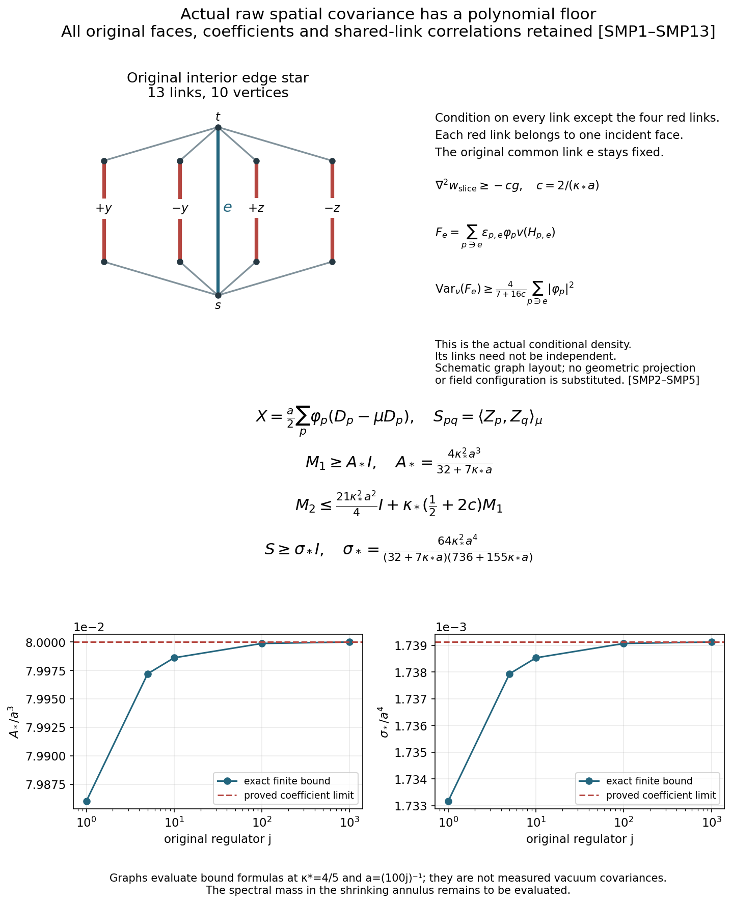

# Actual spatial moment matrices and a polynomial covariance floor

Reviewed derivation, 15 October 2026. Complete SMP1–SMP13 proofs,143 diagnostics and the figure have been checked. The original matrix receiver is [SCR7–SCR13](https://github.com/KokunoYumeto/yang-mills-interacting-workbench/blob/ace49ec037c9eb1e2352485c8505d411f86bad25/yang-mills/continuations/20261011-central-signs-shrinking-window/COMMON_CUBIC_SPATIAL_RESPONSE.md). The source inputs are [PVC21–PVC27](https://github.com/KokunoYumeto/yang-mills-interacting-workbench/blob/ace49ec037c9eb1e2352485c8505d411f86bad25/yang-mills/continuations/20261011-central-signs-shrinking-window/PHYSICAL_LOCAL_COVARIANCE.md), [SF1–SF5](https://github.com/KokunoYumeto/yang-mills-interacting-workbench/blob/ace49ec037c9eb1e2352485c8505d411f86bad25/yang-mills/continuations/20261011-central-signs-shrinking-window/SHARED_FACE_WORDS_AND_PHYSICAL_COUPLING.md), [HCB1](https://github.com/KokunoYumeto/yang-mills-interacting-workbench/blob/ace49ec037c9eb1e2352485c8505d411f86bad25/yang-mills/continuations/20261011-central-signs-shrinking-window/ACTUAL_HESSIAN_BOUNDS.md) and [HSF1–HSF13](https://github.com/KokunoYumeto/yang-mills-interacting-workbench/blob/ace49ec037c9eb1e2352485c8505d411f86bad25/yang-mills/continuations/20261011-central-signs-shrinking-window/ORIGINAL_SOURCE_HESSIAN_AND_FILTER.md). The full Hessian formula and its bound are also [FTC11](https://github.com/KokunoYumeto/yang-mills-interacting-workbench/blob/ace49ec037c9eb1e2352485c8505d411f86bad25/yang-mills/continuations/20261011-central-signs-shrinking-window/ACTUAL_FILTERED_CURRENT_AND_TAIL.md). Shared-link gradient identities and the source Hessian are providers, not claimed as new. Bounded disk-index hits are routing records only. No novelty or no-gap conclusion is asserted.

## 1. Original state and raw face matrices

Keep the entire original box, boundary, metric, gauge action and coupling:
\[
\begin{gathered}
a=(100j)^{-1},\quad L=j^4,\quad g^2=\kappa_*a/2,\quad
b=(\kappa_*a^2)^{-1},\quad s_j=\kappa_*/j,\\
N=3(2L)(2L+1)^2,\qquad M=3(2L)^2(2L+1),\\
H=-\kappa_*\Delta+2bM-b\sum_pT_p,\quad
H\psi=E_0\psi,\quad\psi>0,\quad\int\psi^2dU=1,\\
w=\log\psi,\quad d\mu=\psi^2dU,\quad
\mathcal L=\psi^{-1}(H-E_0)\psi
=-\kappa_*[\Delta+2\langle dw,d\,\cdot\,\rangle],\\
c=\frac2{\kappa_*a},\qquad \nabla^2w\ge-cg .
\end{gathered}
\]
The last inequality is the proved HCB1 with its complete original-state argument. Each SU(2) factor has radius two, orthonormal generators \(T_\alpha=-i\sigma_\alpha/2\), Ricci tensor \(g/2\), and probability Haar measure. The scalar \(2bM\) and vacuum \(E_0\) occur in the ground equation before its product-rule cancellation.

Let \(\mathcal F\) be any finite set of distinct original geometric faces, with their original orientations. Retain arbitrary complex raw coefficients \(\varphi_p\), allowing zeros, growing support and regulator dependence. Put
\[
\begin{gathered}
D_p=2-T_p,\quad Z_p=\frac a2(\mu T_p-T_p)
=\frac a2(D_p-\mu D_p),\\
X=Z\varphi=\sum_{p\in\mathcal F}\varphi_pZ_p,\qquad
\Phi_2=\sum_{p\in\mathcal F}|\varphi_p|^2,\\
S_{pq}=\langle Z_p,Z_q\rangle_\mu,\quad
(M_1)_{pq}=\langle Z_p,\mathcal LZ_q\rangle_\mu,\quad
(M_2)_{pq}=\langle\mathcal LZ_p,\mathcal LZ_q\rangle_\mu .
\end{gathered}\tag{SMP1}
\]
Thus \(s_\varphi=\|X\|^2=\varphi^*S\varphi\),
\(m_1=\varphi^*M_1\varphi\), and \(m_2=\varphi^*M_2\varphi\).
Every source is smooth, physical and centered, so all displayed operator moments exist at each regulator. No source is divided by its norm.

## 2. Keep the complete shared-link energy

For an original positive edge e and an incident face p use the SF1 word
\[
H_{p,e}=
\begin{cases}
U_e A_{p,e},&\epsilon_{p,e}=+1,\\
A_{p,e}U_e^{-1},&\epsilon_{p,e}=-1.
\end{cases}
\]
Here \(A_{p,e}\) is the ordered other three original edges, including every inverse. Write the full holonomy as
\(H_{p,e}=h_{0,p}I-i\,v_p\cdot\sigma\), with
\(h_{0,p}^2+|v_p|^2=1\) and \(T_p=2h_{0,p}\).
Differentiating the two words and their inverse edge gives
\[
(X_{e,\alpha}D_p)_\alpha=\epsilon_{p,e}v_p,\qquad
|v_p|^2=D_p-D_p^2/4.
\]
The exact energy is therefore
\[
m_1=\frac{\kappa_*a^2}{4}\sum_e
\mu\left|\sum_{\substack{p\in\mathcal F\\p\ni e}}
\epsilon_{p,e}\varphi_pv_p\right|^2 .
\tag{SMP2}
\]
Expansion retains every orientation and cross-face term. Equivalently the mixed contraction is
\(\epsilon_{p,e}\epsilon_{q,e}
[\operatorname{Tr}(H_{p,e}H_{q,e}^{-1})
-\operatorname{Tr}(H_{p,e}H_{q,e})]/4\),
as proved by the Pauli contraction in SF2–SF4. No independence under \(\mu\) is used.

## 3. Conditional variance from the actual Hessian bound

Fix e. Distinct unit faces incident on e share only e and its endpoints: each face chooses one transverse coordinate and one of its two sides. Their three-edge exterior paths are pairwise edge-disjoint, including at the original box boundary. Choose one exterior edge from each incident face in \(\mathcal F\), and freeze all other original links, including e. There are at most four selected edges.

For each selected edge, its map to the corresponding \(H_{p,e}\) is left multiplication, possibly inversion, and right multiplication by fixed original matrices. It is an isometry preserving probability Haar. Different selected edges occur in different holonomies. Thus this is an exact product isometry of the selected link factors. The full original conditional probability is
\[
d\nu=\frac{\exp(2w_{\rm slice})}
{\int\exp(2w_{\rm slice})\,dU_{\rm sel}}\;dU_{\rm sel}.
\]
Its logarithmic half-density differs from \(w_{\rm slice}\) only by a constant on the slice. The selected product is totally geodesic, so HCB1 restricts to
\(\nabla^2w_{\rm slice}\ge-cg_{\rm sel}\), and the holonomy isometries preserve this inequality. The conditional density need not factor.

On a radius-two SU(2) factor, each quaternion component v_i is a coordinate function on the unit sphere with metric multiplied by four. Direct restriction of its Euclidean linear differential gives
\[
\nabla^2v_i=-\frac14v_i g,\qquad
\sum_{i=1}^3|dv_i|^2=\frac{3-|v|^2}{4},\qquad
\sum_{i=1}^3|\nabla^2v_i|^2=\frac{3|v|^2}{16}.
\tag{SMP3}
\]
For clarity, the tangent projection of the ambient i-th coordinate has squared norm \(1-v_i^2\), and the original metric divides that by four. The second fundamental form gives the displayed Hessian; the tensor norm of the three-dimensional metric is squared norm three.

Let \(F_e=\sum_{p\ni e}\gamma_p v_p\), where
\(\gamma_p=\epsilon_{p,e}\varphi_p\). Different summands depend on different selected factors. Define their full conditional quantities
\[
\begin{gathered}
A_e=\int|dF_e|^2d\nu
=\frac14\sum_{p\ni e}|\varphi_p|^2(3-\nu|v_p|^2),\\
B_e=\int|\nabla^2F_e|^2d\nu
=\frac3{16}\sum_{p\ni e}|\varphi_p|^2\nu|v_p|^2 .
\end{gathered}
\]
These are sums of norms over all three complex components. Cross derivatives on different selected factors are zero; the conditional measure still couples them in \(|F_e|^2\). In particular \(B_e\le3A_e/8\) and \(A_e\ge\sum_{p\ni e}|\varphi_p|^2/2\).

Use the actual conditional operator
\(\mathcal D_e=-\Delta_{\rm sel}-2dw_{\rm slice}\cdot d\).
Weighted integration by parts on the whole compact selected product and the scalar Bochner identity give, component by component,
\[
\begin{aligned}
\int|\mathcal D_eF_e|^2d\nu
={}&\int\{|\nabla^2F_e|^2+\tfrac12|dF_e|^2\\
&\quad-2\nabla^2w_{\rm slice}(d\overline F_e,dF_e)\}d\nu\\
\le{}& B_e+(\tfrac12+2c)A_e .
\end{aligned}
\tag{SMP4}
\]
To verify the integrated identity, expand the weighted divergence
\(\mathcal D_e=-e^{-2w_{\rm slice}}\operatorname{div}
(e^{2w_{\rm slice}}d)\), integrate one derivative in its squared norm, and commute the covariant derivatives of the scalar. The commutator contributes Ricci \(g/2\); differentiating the drift contributes \(-2\nabla^2w_{\rm slice}\). Compactness supplies no boundary term. Applying this to real and imaginary parts and summing proves the stated complex formula.

Since \(\nu\mathcal D_eF_e=0\),
\[
A_e=\langle F_e-\nu F_e,\mathcal D_eF_e\rangle_\nu.
\]
Cauchy–Schwarz in the full three-component Hilbert space gives
\[
\operatorname{Var}_\nu(F_e)
\ge\frac{A_e^2}{B_e+(\tfrac12+2c)A_e}
\ge\frac{4}{7+16c}\sum_{p\ni e}|\varphi_p|^2 .
\tag{SMP5}
\]
For a zero coefficient list the undivided zero inequality applies. Otherwise \(A_e>0\) and the denominator is positive. This is proved for every outside configuration in the actual full state. No comparison vacuum or product conditional distribution has been substituted.

## 4. The complete first-moment matrix has a polynomial floor

The conditional identity
\(\nu|F_e|^2=|\nu F_e|^2+\operatorname{Var}_\nu F_e\)
retains the full mean before its nonnegative term is bounded. Integrate SMP5 over the actual outside marginal and sum SMP2. Every original face has exactly four original edges, including a boundary face. Hence
\[
m_1\ge A_*\Phi_2,\qquad
M_1\ge A_*I,\qquad
A_*=\frac{4\kappa_*a^2}{7+16c}
=\frac{4\kappa_*^2a^3}{32+7\kappa_*a}.
\tag{SMP6}
\]
No total-box volume enters this constant. It holds simultaneously for every raw complex coefficient vector; the matrix inequality follows from those quadratic forms. Every source with at least one nonzero coefficient has positive first spectral moment.

The local curvature budget strengthens the evaluated lower value. Set
\[
D_\varphi=\sum_p|\varphi_p|^2\,\mu(D_p-D_p^2/4),\qquad
0\le D_\varphi\le
\overline D_\varphi:=\min\{\Phi_2,\Phi_\infty^2B_Q\},
\quad B_Q=\min\{4M_Q,\Lambda_Q\}.
\]
Here the original fitting cube and all its counts, outward-side indicators and crossing terms are those of SCR8 and PVC25–PVC27; \(\Phi_\infty=\max_p|\varphi_p|\). Before using either upper bound, apply Cauchy–Schwarz to the integral of \(A_e^2/[B_e+(\tfrac12+2c)A_e]\) over every e and every outside slice. The positive denominators give
\[
m_1\ge\frac{\kappa_*a^2}{4}
\frac{(3\Phi_2-D_\varphi)^2}
{(\tfrac32+6c)\Phi_2+(\tfrac14-2c)D_\varphi}.
\tag{SMP7}
\]
Indeed the sums of \(A_e\) and \(B_e\) are \(3\Phi_2-D_\varphi\) and \(3D_\varphi/4\), respectively, since each face occurs four times. This proves every constant and retains the complete actual diagonal deficit before estimating it.

For \(t=\Phi_2>0\), the rational function in SMP7 decreases on \(0\le D\le t\). Differentiating its numerator and denominator gives a negative factor proportional to
\((3t-D)[(15+24c)t+(1-8c)D]\);
the bracket is positive throughout because its endpoint values are positive. Therefore replacing \(D_\varphi\) by \(\overline D_\varphi\) gives an explicit valid lower value. Its value at \(D=t\) is exactly SMP6.

For fixed nonzero continuous compactly supported orientation samples, the original Riemann sums give \(a^3\Phi_2\to J_2^\Sigma>0\). The unchanged local budget has \(B_Q=O(a^{-2})\), so \(\overline D_\varphi/\Phi_2\to0\). Thus
\[
\liminf_j m_1\ge\frac{3\kappa_*^2}{16}J_2^\Sigma .
\tag{SMP8}
\]
This does not replace the stronger smooth-test HSF11–HSF13 bound, which retains \(J_t\ge J_2^\Sigma\) and gives \(3\kappa_*^2J_t/16\) for the present half-amplitude source. The new finite inequality SMP6 also covers oscillating and growing raw coefficients without a spatial regularity assumption.

## 5. Exact Hessian and second-moment upper matrix

Retain the complete original source Hessian before taking a bound:
\[
\|\nabla^2X\|^2
=\frac{a^2}{4}\left[
\frac3{16}\sum_e\left|\sum_{p\ni e}\varphi_pT_p\right|^2
+\sum_p|\varphi_p|^2(6+\tfrac34T_p^2)\right].
\tag{SMP9}
\]
This is the original FTC11/HSF1 identity polarized to complex coefficients. Its direct check is as follows. The same-link block for \(D_p\) is \(T_pg_e/4\); its squared tensor norm after summing faces is the first term. Two distinct original links belong to at most one unit face, so there is no cross-face term in a distinct-link block. For that face the squared block norm is
\((8+T_p^2)/16\), by inserting the two generators and contracting the Pauli matrices. There are twelve ordered distinct-link blocks, giving the second term. Thus every same-link interference term is present before estimating it.

Cauchy–Schwarz at each original edge, with its actual incident count \(r_e\le4\), gives
\(\sum_e|\sum_{p\ni e}\varphi_pT_p|^2
\le16\sum_p|\varphi_p|^2T_p^2\).
Since \(|T_p|\le2\), SMP9 proves
\[
\mu\|\nabla^2X\|^2\le\frac{21a^2}{4}\Phi_2 .
\]
The full weighted Bochner identity, proved as in SMP4 on all original links with the full w, yields
\[
\begin{gathered}
m_2=\kappa_*^2\mu\{
|\nabla^2X|^2+\tfrac12|dX|^2
-2\nabla^2w(d\overline X,dX)\},\\
M_2\le \frac{21\kappa_*^2a^2}{4}I
+\kappa_*(\tfrac12+2c)M_1 .
\end{gathered}\tag{SMP10}
\]
The equality retains every off-diagonal vacuum Hessian. In particular no long-range correlation has been set to zero. HCB1 bounds the full tensor, not individual entries. The earlier exact Hessian and local energy estimates remain sharper inputs when their actual quantities are available.

## 6. An evaluated lower bound on the original covariance matrix

Spectral Cauchy–Schwarz for the actual centered X gives
\(m_1^2\le s_\varphi m_2\).
Combining this with SMP10 yields, for \(\Phi_2>0\),
\[
s_\varphi\ge
\frac{m_1^2}
{21\kappa_*^2a^2\Phi_2/4+
\kappa_*(\tfrac12+2c)m_1}.
\]
The function \(x^2/(A+Bx)\) increases for \(x>0,A>0,B>0\): its derivative is \(x(2A+Bx)/(A+Bx)^2>0\). Substitution of SMP6 therefore proves
\[
\begin{gathered}
S\ge \sigma_*I,\qquad
\sigma_*=
\frac{64a^2}{(7+16c)(155+368c)}
=\frac{64\kappa_*^2a^4}
{(32+7\kappa_*a)(736+155\kappa_*a)},\\
\frac{\sigma_*}{a^4}\longrightarrow\frac{\kappa_*^2}{368}.
\end{gathered}\tag{SMP11}
\]
All finite constants and both original factors in the denominator remain. For \(\Phi_2=0\), the undivided zero statement holds. The complete original face covariance matrix is therefore positive definite for every finite list of distinct original faces, with this lower bound independent of the number of faces or box volume. This is an actual-state estimate, not the covariance of a constructed density.

For the same original fitting cube, SCR8 also gives
\[
S\le a^2\min\{|\mathcal F|,B_Q,U_{2,Q}/4\}\,I,
\quad
U_{2,Q}=\min\{(4M_Q)^2,\Lambda_Q^2+16(g^2)^2\}.
\tag{SMP12}
\]
Indeed \(\Phi_1^2\le|\mathcal F|\Phi_2\) and
\(\Phi_\infty^2\le\Phi_2\), so each of the three original SCR8 inequalities implies its corresponding matrix upper bound. These estimates control the true raw coefficient metric without changing the original source.

## 7. Receive the bound in the full common-cubic optimization

Use exactly the actual SCR12 matrices \(G=Y^*Y\), \(H=Y^*Z\),
\(E=S-H^*G^\dagger H\), where \(Y_p=q_\zeta(\mathcal L)u_p\) and the original trial functions are unchanged. Keep all zero eigenspaces in \(G^\dagger\). For any \(\varphi\in\ker H\), the exact optimal trial coefficients are zero and
\[
\varphi^*E\varphi=\varphi^*S\varphi
\ge\sigma_*\|\varphi\|_{\ell^2}^2 .
\tag{SMP13}
\]
Thus a missing trial direction cannot be removed by treating the original source covariance as degenerate. Moreover
\(\operatorname{rank}H\le\operatorname{rank}G\), by the SCR12 range proof, so \(\ker H\) has dimension at least
\(|\mathcal F|-\operatorname{rank}G\). Choose an orthonormal basis of this kernel and extend it to the full raw coefficient space. Since \(E\ge0\), summing its diagonal entries gives
\(\operatorname{Tr}E\ge(|\mathcal F|-\operatorname{rank}G)\sigma_*\).
This is an exact consequence for the existing trial space, not an assertion that its rank is deficient.

The actual full signed response, all original shifts and both spectral tails remain SCR1–SCR13. SMP11 evaluates a positive metric floor, while SMP6 and SMP10 control its first two moments. Their constants do not put that mass in the shrinking annulus: the lower metric floor tends to zero on fixed smooth support, and neither signed trial matrix nor common-cubic residual has yet been evaluated to a surviving-window bound. The next calculation is to apply these actual coercive matrices to the cross-patch inverse and residual without replacing the full state or its correlations.

The schematic shows the exact thirteen-link interior star: four pairwise disjoint exterior three-link paths and the retained common edge. One red link from each path is varied in the actual conditional measure. SMP3–SMP5 keep its full coupled density and metric. SMP6, SMP10 and SMP11 give the displayed full raw matrix inequalities. The two graphs evaluate the bound formulas at kappa=4/5 on the original path; they are not actual covariance samples. The complete proof also handles every original boundary star with fewer incident faces. Reproducible sources: [figure_spatial_moment.py](figure_spatial_moment.py) and [check_spatial_moment.py](check_spatial_moment.py). The143 diagnostics include nonproduct comparison densities, full original link tensors and finite spectral fixtures; the actual-state claims follow from the preceding proof.

## Full cubic compression and exact source matching

[FCC1–FCC13](https://github.com/KokunoYumeto/yang-mills-interacting-workbench/blob/main/yang-mills/continuations/20261011-central-signs-shrinking-window/FULL_CUBIC_SOURCE_COMPRESSION.md) place the complete original spatial source in one actual inside-cube conditional space and solve the full compressed cubic equation. Every marginal and complementary term remains. This evaluates the source-overlap and equation Gram matrices exactly:
\[
H_{\rm src}=S,\qquad G=S+R,\qquad R=W^*W\ge0 .
\]
The polynomial covariance floor of SMP11 therefore makes both matrices invertible, with no additional shrinking-shift penalty. The unique raw coefficient optimum and its complete noncommuting residual bounds are proved. All filtered cross terms remain; an exact rational example shows that their vanishing cannot be inferred from unfiltered orthogonality. The actual complementary forcing and signed trial response are the next calculations toward spectral survival and the smooth global no-gap target.
