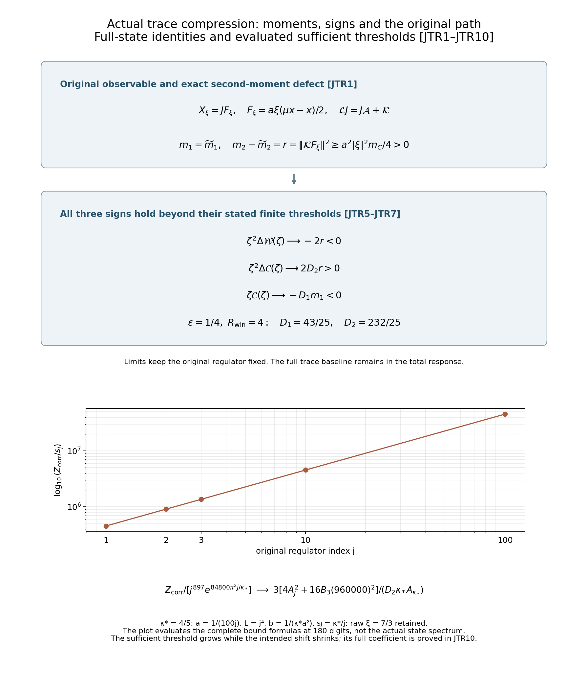
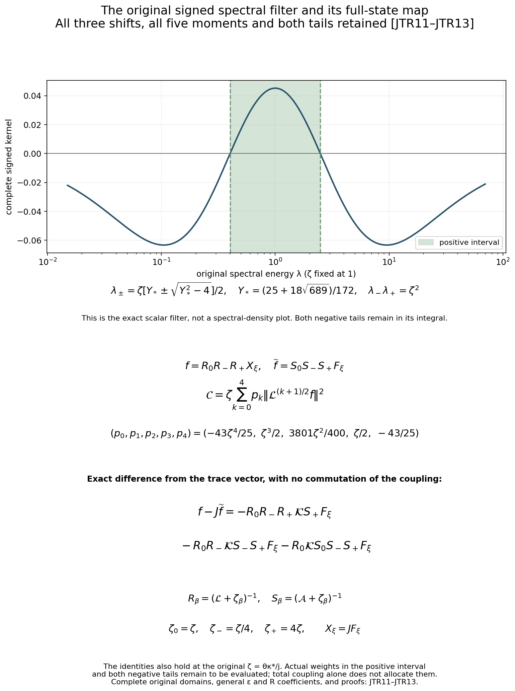

# Actual trace coupling and the complete signed response

Reviewed derivation, 15 October 2026. The complete JTR1–JTR13 proofs, two figures and 413 independent diagnostics have been checked. This uses the actual full state and the exact trace map of [FMP1–FMP13](https://github.com/KokunoYumeto/yang-mills-interacting-workbench/blob/3b25c38c5a5a6c513cd5ae9068d08ad9a3d738ca/yang-mills/continuations/20261011-central-signs-shrinking-window/FULL_STATE_MARGINAL_GROUND.md), the derivative bounds of [QLR5–QLR10](https://github.com/KokunoYumeto/yang-mills-interacting-workbench/blob/3b25c38c5a5a6c513cd5ae9068d08ad9a3d738ca/yang-mills/continuations/20261011-central-signs-shrinking-window/QUANTITATIVE_LOOP_RIGIDITY.md), and the actual residual floor [LPF1–LPF7](https://github.com/KokunoYumeto/yang-mills-interacting-workbench/blob/3b25c38c5a5a6c513cd5ae9068d08ad9a3d738ca/yang-mills/continuations/20261011-central-signs-shrinking-window/LOCAL_CONDITIONAL_MEMORY_FLOOR.md). The signed coefficients and central-sign comparison are those of [SDR1–SDR13](https://github.com/KokunoYumeto/yang-mills-interacting-workbench/blob/3b25c38c5a5a6c513cd5ae9068d08ad9a3d738ca/yang-mills/continuations/20261011-central-signs-shrinking-window/SIGNED_RESIDUAL_RESPONSE.md). No new external theorem or novelty is claimed. The bounded index routes are recorded separately and are not literature reading.

## 1. Original full state and the exact trace compression

Keep all original parameters, metric factors and faces:
\[
\begin{gathered}
a=(100j)^{-1},\quad L=j^4,\quad g^2=\kappa_*a/2,\quad
b=(\kappa_*a^2)^{-1},\quad s_j=\kappa_*/j,\\
N=3(2L)(2L+1)^2,\quad M=3(2L)^2(2L+1),\\
H=-\kappa_*\Delta+2bM-b\sum_pT_p,\quad H\psi=E_0\psi,
\quad\psi>0,\quad\int\psi^2dU=1,\quad0\le E_0\le2bM.
\end{gathered}
\]
Here dU is original probability Haar measure on the N radius-two SU(2) factors, with orthonormal generators -i sigma_alpha/2. The full physical Hilbert space consists of gauge-invariant functions in L2(mu), where dmu=psi2 dU. Its nonnegative generator is
\[
\mathcal L=\psi^{-1}(H-E_0)\psi
=-\kappa_*[\Delta+2\langle dw,d\,\cdot\,\rangle],\qquad w=\log\psi.
\]
The original ground equation gives the displayed equality by the full product rule; E0 is retained before that cancellation. Keep the seven-link trace map pi=(x,y,z), its domain Omega, its complete kinetic matrix Gamma and its Haar measure dnu_Omega=dx dy dz/(4pi2) from TPL1–TPL6. In this note a positive resolvent shift is denoted zeta to avoid confusion with the third trace coordinate z. Set rho=Pi0psi2, u=one-half log(rho circpi), and
\[
\begin{gathered}
J F=F\circ\pi,\qquad J^*f=\mathbb E_\mu[f\mid\pi],\qquad
P=JJ^*,\quad Q=I-P,\\
\mathcal A=J^*\mathcal LJ
=-\kappa_*\rho^{-1}\sum_{i,k}\partial_i(\rho\Gamma_{ik}\partial_k),
\qquad\mathcal K=Q\mathcal LJ.
\end{gathered}
\]
These are the inherited closed form operators of FMP3 and FMP9. The projection preserves the form domain and smooth lifts: it is the Haar conditional projection composed with multiplication by the original smooth positive psi2 and rho inverse. Consequently smooth trace lifts and their repeated A images are in every domain used below. All integrations occur on the original compact link manifold; the degenerate trace boundary has the inherited domain rather than an imposed new boundary condition.

Retain an arbitrary complex raw coefficient xi on the selected left face and the exact physical factor:
\[
F_\xi=\frac{a\xi}{2}(\mu x-x),\qquad X_\xi=JF_\xi.
\]
This is the one-face specialization of the original Wilson sum. It does not replace a general spatial source by that specialization. The arguments for moments and signed identities below apply to any smooth centered trace function; the explicit strict floors here are for this original selected face. Xi=0 makes every displayed response zero; take xi nonzero for strict signs. No coefficient is divided out of the state or observable.

## 2. First, second and third actual moments

Write
\[
m_n=\langle X_\xi,\mathcal L^nX_\xi\rangle_\mu,\qquad
\widetilde m_n=\langle F_\xi,\mathcal A^nF_\xi\rangle_\rho,
\qquad r=\|\mathcal KF_\xi\|_\mu^2.
\]
The spectral moments are finite because the repeated smooth lifts lie in the operator domains. The exact first two comparisons are
\[
\begin{gathered}
m_0=\widetilde m_0,\qquad
m_1=\widetilde m_1=\frac{\kappa_*a^2|\xi|^2}{4}\mu(4-x^2),\\
m_2=\widetilde m_2+r,\qquad
r=\frac{a^2|\xi|^2}{4}\|\mathcal Kx\|^2
\ge r_-:=\frac{a^2|\xi|^2}{4}m_C>0.
\end{gathered}\tag{JTR1}
\]
The first equality is the isometry. Equality of first energies follows from the compressed form and the exact four-link identity |dx|2=4-x2. For the second moment use the orthogonal identity L JF=J AF+KF. Its squared norm is the sum of the two squared norms, with no mixed term. LPF6 supplies m_C, retaining its entire original formula; max(m_C,m_*) gives a stronger floor as well. We use m_C explicitly in the limit calculation below.

There is a local lower bound for the common first moment. Conditional on all links outside the four selected face edges, the individual score bound |d_e w|<=2pi c, c=2/(kappa a), gives oscillation at most 16pi2 c on those four radius-two factors. Thus the actual conditional density relative to their Haar probability is at least exp(-32pi2 c), exactly by the minimum/mean argument of LPF2. At each fixed outside configuration the Haar mean of x2 is one, so that of 4-x2 is three. Integration in the actual outside marginal proves
\[
m_1\ge E_1^-:=\frac{3\kappa_*a^2|\xi|^2}{4}e^{-32\pi^2c}>0.
\tag{JTR2}
\]
The conditional outside measure is not replaced by Haar.

Retain the complete previously proved constants
\[
G=4\pi^2Nc^2,\qquad
W=(4bM-E_0)/\kappa_*+(3N-1)c,\qquad W^+=4bM/\kappa_*+(3N-1)c.
\]
QLR5 proves |dw|,|du|<=sqrt(G), Hess w between -c and W, and Hess u between -c and W+2G. Here W>=c. The original four-link trace has |dx|<=2 and Hess x operator norm at most two. To check the last constant directly, on a product geodesic with original link velocities v_e, each occurrence of a Lie generator has matrix norm |v_e|/2. Differentiating the full ordered trace twice gives absolute second derivative at most one-half times (sum of the four |v_e|) squared, including all ordered mixed terms. Cauchy–Schwarz bounds this by two times the sum of their squared norms. Polarization of the symmetric Hessian gives the asserted operator bound.

The exact actions are Lx=kappa(3x-2dw.dx) and (Ax)circpi=kappa(3x-2du.dx). Differentiating both expressions, retaining each Hessian contribution, gives
\[
\begin{gathered}
|d\mathcal Lx|\le\kappa_*[6+4W+4\sqrt G]
\le\kappa_*[6+4W^++4\sqrt G],\\
|d((\mathcal Ax)\circ\pi)|
\le\kappa_*[6+4W+8G+4\sqrt G]
\le\kappa_*[6+4W^++8G+4\sqrt G].
\end{gathered}
\]
For example d(dw.dx)=Hess w applied to dx plus Hess x applied to dw. Its two norms are at most 2W and 2sqrt(G), before the full factor two in the action is applied. The first term 3dx has norm at most six. The u calculation keeps its additional 2G in the Hessian bound. Applying the full ground form to LX and the compressed form to AF now proves
\[
\begin{gathered}
m_2\le E_2^+:=\frac{a^2|\xi|^2\kappa_*^2}{4}(6+4\sqrt G)^2,\\
m_3\le U_3:=\frac{a^2|\xi|^2\kappa_*^3}{4}(6+4W^++4\sqrt G)^2,\\
\widetilde m_3\le\widetilde U_3
:=\frac{a^2|\xi|^2\kappa_*^3}{4}(6+4W^++8G+4\sqrt G)^2.
\end{gathered}\tag{JTR3}
\]
The second-moment estimate uses |x|<=2 in the full action. The sharper E0-dependent derivative expressions are retained above before the explicit upper functions are used. These are bounds on actual moments, not moment values inferred from an isolated patch ground.

## 3. Exact remainder and the sign at one shift

Let nu and tilde-nu be the full spectral measures of X_xi for L and F_xi for A. For zeta>0 define
\[
\mathcal W(\zeta)=\int\frac{\zeta\lambda}{(\lambda+\zeta)^2}\,d\nu(\lambda),\qquad
\widetilde{\mathcal W}(\zeta)=\int\frac{\zeta\lambda}{(\lambda+\zeta)^2}\,d\widetilde\nu(\lambda).
\]
The following is an exact scalar identity at every nonnegative lambda, including zero:
\[
\frac{\zeta\lambda}{(\lambda+\zeta)^2}
=\frac\lambda\zeta-\frac{2\lambda^2}{\zeta^2}
+\frac{\lambda^3(3\zeta+2\lambda)}{\zeta^2(\lambda+\zeta)^2}.
\tag{JTR4}
\]
Multiplication by zeta2(lambda+zeta)2 verifies all terms. Denote the integral of the last term by R(zeta) and its tilde-measure counterpart by tilde-R(zeta). Both are nonnegative and
\[
0\le R(\zeta)\le\frac{3m_3}{\zeta^3},\qquad
0\le\widetilde R(\zeta)\le\frac{3\widetilde m_3}{\zeta^3}.
\]
Indeed (3+2t)/(1+t)2<=3 for t>=0, since the difference after multiplication is 4t+3t2. There is no truncated series or discarded tail in JTR4. JTR1 therefore yields the exact identity and two-sided estimates
\[
\begin{gathered}
\Delta\mathcal W(\zeta):=\mathcal W(\zeta)-\widetilde{\mathcal W}(\zeta)
=-\frac{2r}{\zeta^2}+R(\zeta)-\widetilde R(\zeta),\\
-\frac{2r}{\zeta^2}-\frac{3\widetilde U_3}{\zeta^3}
\le\Delta\mathcal W(\zeta)
\le-\frac{2r}{\zeta^2}+\frac{3U_3}{\zeta^3},\\
\lim_{\zeta\to\infty}\zeta^2\Delta\mathcal W(\zeta)=-2r<0,\\
\zeta\ge Z_1:=\frac{3U_3}{r_-}
\quad\Longrightarrow\quad
\Delta\mathcal W(\zeta)\le-\frac{r_-}{\zeta^2}<0.
\end{gathered}\tag{JTR5}
\]
The last statement is an evaluated theorem for every actual regulator: r_- and U3 are the displayed original functions, proved finite and positive. It is not an assumption about an unspecified third moment. All limits in this section keep the regulator fixed.

## 4. The original three shifts reverse the correction's leading sign

Keep exactly 0<epsilon<1<R_win and zeta0=zeta, zeta-=epsilon zeta, zeta+=R_win zeta. Write
\[
\begin{gathered}
c_-=\frac{4\varepsilon}{(1+\varepsilon)^2},\quad
c_+=\frac{4R_{\rm win}}{(1+R_{\rm win})^2},\\
D_1=\frac{c_-}{\varepsilon}+\frac{c_+}{R_{\rm win}}-1>0,\qquad
D_2=\frac{c_-}{\varepsilon^2}+\frac{c_+}{R_{\rm win}^2}-1>0,\\
B_3=\frac{c_-}{\varepsilon^3}+\frac{c_+}{R_{\rm win}^3},\qquad
\mathcal C=\mathcal W(\zeta)-c_-\mathcal W(\varepsilon\zeta)-c_+\mathcal W(R_{\rm win}\zeta),
\end{gathered}
\]
and define tilde-C by the same coefficients. Positivity of D1 follows from 4/(1+epsilon)2>1, and positivity of D2 follows from 4/[epsilon(1+epsilon)2]>1, before adding their positive R_win terms. Keep the exact remainder combination
\[
\mathcal R(\zeta)=R(\zeta)-c_-R(\varepsilon\zeta)-c_+R(R_{\rm win}\zeta)
\]
and its tilde counterpart. JTR4 at the three original shifts gives
\[
\begin{gathered}
\Delta\mathcal C:=\mathcal C-\widetilde{\mathcal C}
=\frac{2D_2r}{\zeta^2}+\mathcal R(\zeta)-\widetilde{\mathcal R}(\zeta),\\
\frac{2D_2r}{\zeta^2}-\frac{3(\widetilde U_3+B_3U_3)}{\zeta^3}
\le\Delta\mathcal C
\le\frac{2D_2r}{\zeta^2}+\frac{3(U_3+B_3\widetilde U_3)}{\zeta^3},\\
\lim_{\zeta\to\infty}\zeta^2\Delta\mathcal C=2D_2r>0,\\
\zeta\ge Z_{\rm corr}:=\frac{3(\widetilde U_3+B_3U_3)}{D_2r_-}
\quad\Longrightarrow\quad
\Delta\mathcal C\ge\frac{D_2r_-}{\zeta^2}>0.
\end{gathered}\tag{JTR6}
\]
For the lower bound, keep the possible negative tilde-R(zeta) and the negative c_minus R(epsilon zeta), c_plus R(R_win zeta). Their bounds are precisely the lower numerator shown. For the upper bound the opposite three nonnegative remainders survive. This establishes the joint sign without assigning positive signs to the individual corrections. The stronger threshold max(Z1/epsilon,Z_corr) places all three individual corrections in the negative region of JTR5 while their signed combination is positive. For epsilon=1/4 and R_win=4, the exact constants are c_minus=c_plus=16/25, D1=43/25, D2=232/25 and B3=4097/100.

## 5. The full signed response is still negative in that large-shift region

The same exact expansion for the actual full measure gives
\[
\mathcal C=-\frac{D_1m_1}{\zeta}+\frac{2D_2m_2}{\zeta^2}+\mathcal R(\zeta)
\le-\frac{D_1E_1^-}{\zeta}+\frac{2D_2E_2^+}{\zeta^2}+\frac{3U_3}{\zeta^3}.
\]
Consequently
\[
\begin{gathered}
\lim_{\zeta\to\infty}\zeta\mathcal C=-D_1m_1<0,\\
Z_{\rm full}:=\max\left\{\frac{8D_2E_2^+}{D_1E_1^-},
\sqrt{\frac{12U_3}{D_1E_1^-}}\right\},\\
\zeta\ge Z_{\rm full}\quad\Longrightarrow\quad
\mathcal C\le-\frac{D_1E_1^-}{2\zeta}<0.
\end{gathered}\tag{JTR7}
\]
Each of the two positive upper terms is then at most D1 E1-/(4 zeta). Their sum proves the bound. The limit follows directly from the finite second and third moments. Thus for the actual state, beyond the explicit maximum of the three thresholds, each single-shift correction is negative, its three-shift correction is positive, and the full signed response is negative. These simultaneous facts do not contradict one another: the retained trace baseline supplies the order-one-over-zeta term. A positive correction is not the sign of the total observable response.

## 6. Exact relation to the central-sign response

Use all 2^N original link signs tau, their central translations D_tau, their probabilities p_tau and h_tau=sqrt(p_tau) from SDR1. Let chi_1(tau) and chi_2(tau) be the products of signs on the two face boundaries. The perimeter sign is their product because the shared sign occurs twice. Hence
\[
\pi(D_\tau U)=(\chi_1x,\chi_2y,\chi_1\chi_2z).
\]
The physical unitary into the original central-sign representation is
\[
(\mathscr U f)_\tau=h_\tau f(D_\tau U),\qquad
\mathscr U\mathcal L\mathscr U^{-1}=\mathcal M.
\]
Its isometry follows from p_tau=psi(D_tau U)2/(2^N A_c2): multiply by A_c2, sum over all signs, and change variables in each original Haar integral. Here A_c denotes the central amplitude called A in SDR, to avoid identifying it with the trace operator mathcal A. The inverse on the physical equivariant range is determined by its identity-sign component divided by h_plus; substituting the equivariance recovers every component. Multiplication by psi and the original SDR unitary T prove the generator relation on the smooth domain and then on the closed self-adjoint domain. In particular the exact trace embedding into that same representation is
\[
(\mathscr UJF)_\tau=h_\tau F(\chi_1x,\chi_2y,\chi_1\chi_2z).
\tag{JTR8}
\]
For the particular original source set m_chi=sum_tau p_tau chi_1(tau). The exact central average and complementary source are
\[
\bar X_\xi=\frac{a\xi}{2}(\mu x-m_\chi x),\qquad
y_\tau=\frac{a\xi}{2}h_\tau x(m_\chi-\chi_1).
\]
Indeed summing h_tau times the displayed full source gives the first formula, and subtracting h_tau bar-X gives the second. The central vacuum constant and every sign weight are retained. With C_c the three-shift response of bar-X under the actual central operator L_A of SDR, its correction obeys the exact equality
\[
\Delta\mathcal C_{\rm central}
=\Delta\mathcal C_{\rm trace}+\widetilde{\mathcal C}-\mathcal C_c.
\tag{JTR9}
\]
To prove it, functional calculus under the proved unitary gives the same full C in both representations, including each of the three original coefficients. Subtract C_c from C=tilde-C+Delta-C_trace. This proves both the receiving map and the additional baseline term that must accompany it. LPF's trace-complement floor is not inserted as though it were SDR's central-complement residual norm.

## 7. Evaluate the threshold on the original regulator path

The actual lower-bound function m_C has the complete LPF7 coefficient A_kappa. Retain
\[
A_J=1920000+15360000\pi^2,\qquad
\lim_{j\to\infty}m_Cj^{869}e^{84800\pi^2j/\kappa_*}=A_{\kappa_*}>0.
\]
Its full formula, including A_Q=207360000+1105920000pi2, d0=3200pi2/kappa and C4=532082, is
\[
A_{\kappa_*}=\frac{\kappa_*^2}{2(48\pi)^7(2\sqrt7 A_J/\kappa_*^2)^{21}}
\left[\frac{10000}{4C_4d_0 A_Q}\right]^{23}.
\]
For fixed nonzero xi the complete original formulas give
\[
\begin{gathered}
r_-j^{871}e^{84800\pi^2j/\kappa_*}\longrightarrow\frac{|\xi|^2A_{\kappa_*}}{40000},\\
\frac{U_3}{j^{26}}\longrightarrow\frac{16|\xi|^2(960000)^2}{40000\kappa_*},\qquad
\frac{\widetilde U_3}{j^{26}}\longrightarrow\frac{4|\xi|^2A_J^2}{40000\kappa_*}.
\end{gathered}
\]
For proof insert the full counts N=24j12+24j8+6j4 and M=24j12+12j8. LPF7 already proves G/j14 tends to 3840000pi2/kappa2 and W+/j14 tends to 960000/kappa2. The constant six and sqrt(G) terms in JTR3 have smaller powers; they remain in each finite-j formula and vanish only in these quotients. The tilde leading bracket is 3840000+30720000pi2=2A_J. The original a2/4=1/(40000j2) supplies the stated powers and constants. Substitution in the exact threshold proves
\[
\lim_{j\to\infty}\frac{Z_{\rm corr}}{j^{897}e^{84800\pi^2j/\kappa_*}}
=\frac{3[4A_J^2+16B_3(960000)^2]}{D_2\kappa_*A_{\kappa_*}}>0.
\tag{JTR10}
\]
All raw amplitude factors cancel in this threshold ratio, after being retained in each original quadratic quantity. Since the exact threshold is independent of every nonzero xi, its same limit holds for arbitrary nonzero regulator-dependent coefficients xi_j. The preceding individual moment quotient limits were stated for fixed xi; no uniform bound on xi_j is needed for the threshold conclusion. Along zeta=theta s_j=theta kappa/j, its ratio to that shrinking shift therefore diverges with the exact additional factor j/(theta kappa). The large-shift sign theorem does not reach the intended shrinking window. This is an evaluation of the proved threshold, not an assertion that the actual sign changes at that threshold.

What would settle the next step using this calculation? At the original shrinking shifts, the exact retained quantity is
\[
\Delta\mathcal C-\frac{2D_2r}{\theta^2s_j^2}
=\mathcal R(\theta s_j)-\widetilde{\mathcal R}(\theta s_j),
\]
together with the full baseline tilde-C and, for SDR, the precisely mapped central baseline in JTR9. JTR4 gives the complete positive spectral remainders at each shift, including all high-energy tails. Independent third-moment bounds grow too quickly there, as JTR10 proves. The continuing calculation must evaluate their joint difference at those unchanged shifts. No such cancellation, surviving annular mass, continuum reconstruction or smooth global no-gap result is assumed in this note.

## 8. One exact expression for all three retained shifts

The next calculation keeps the three resolvents together instead of bounding their remainders independently. Define the exact degree-four polynomial
\[
\begin{aligned}
P_\zeta(\lambda)={}&(\lambda+\varepsilon\zeta)^2(\lambda+R_{\rm win}\zeta)^2\\
&-c_-\varepsilon(\lambda+\zeta)^2(\lambda+R_{\rm win}\zeta)^2\\
&-c_+R_{\rm win}(\lambda+\zeta)^2(\lambda+\varepsilon\zeta)^2
=\sum_{k=0}^4p_k\lambda^k.
\end{aligned}
\]
Every coefficient, with the original parameters unaltered, is
\[
\begin{aligned}
p_4={}&1-c_-\varepsilon-c_+R_{\rm win},\\
p_3={}&2\zeta[\varepsilon+R_{\rm win}
-c_-\varepsilon(1+R_{\rm win})-c_+R_{\rm win}(1+\varepsilon)],\\
p_2={}&\zeta^2[\varepsilon^2+4\varepsilon R_{\rm win}+R_{\rm win}^2\\
&\quad-c_-\varepsilon(1+4R_{\rm win}+R_{\rm win}^2)\\
&\quad-c_+R_{\rm win}(1+4\varepsilon+\varepsilon^2)],\\
p_1={}&2\zeta^3[\varepsilon R_{\rm win}(\varepsilon+R_{\rm win})
-c_-\varepsilon R_{\rm win}(1+R_{\rm win})
-c_+R_{\rm win}\varepsilon(1+\varepsilon)],\\
p_0={}&\zeta^4[\varepsilon^2R_{\rm win}^2
-c_-\varepsilon R_{\rm win}^2-c_+R_{\rm win}\varepsilon^2].
\end{aligned}
\]
For zeta0=zeta, zeta-=epsilon zeta and zeta+=R_win zeta, let
\[
f=\prod_{\beta\in\{0,-,+\}}(\mathcal L+\zeta_\beta)^{-1}X_\xi,
\qquad
\widetilde f=\prod_{\beta\in\{0,-,+\}}(\mathcal A+\zeta_\beta)^{-1}F_\xi.
\]
Each product is in the displayed order 0,-,+. Resolvents of a single operator commute. Both vectors belong to the third operator domain because the multiplier lambda3 divided by the three linear factors is bounded on the nonnegative axis. In particular all the following five moments exist. Directly bringing the three scalar response terms to their common denominator and applying spectral calculus proves
\[
\begin{gathered}
\mathcal C=\zeta\sum_{k=0}^4p_k\|\mathcal L^{(k+1)/2}f\|_\mu^2,\qquad
\widetilde{\mathcal C}=\zeta\sum_{k=0}^4p_k\|\mathcal A^{(k+1)/2}\widetilde f\|_\rho^2,\\
\Delta\mathcal C=\zeta\sum_{k=0}^4p_k
\left[\|\mathcal L^{(k+1)/2}f\|_\mu^2
-\|\mathcal A^{(k+1)/2}\widetilde f\|_\rho^2\right].
\end{gathered}\tag{JTR11}
\]
For verification the scalar kernel is exactly
\(\zeta\lambda P_\zeta(\lambda)/[(\lambda+\zeta)^2(\lambda+\varepsilon\zeta)^2(\lambda+R_{\rm win}\zeta)^2]\).
This identity retains the zero spectral value, both tails and all raw source factors. It is valid at the unchanged shrinking shifts zeta=theta kappa/j; no large-shift expansion is used.

For epsilon=1/4 and R_win=4, the complete polynomial is
\[
P_\zeta(\lambda)
=-\frac{43}{25}\lambda^4+\frac\zeta2\lambda^3
+\frac{3801}{400}\zeta^2\lambda^2+\frac{\zeta^3}{2}\lambda
-\frac{43}{25}\zeta^4.
\]
The exact positive interval of this actual filter can be given without omitting either negative tail. For lambda>0 set only as an auxiliary scalar
\(Y=\lambda/\zeta+\zeta/\lambda\); the original lambda and zeta remain in every operator and kernel. Multiplying out gives
\[
P_\zeta(\lambda)=\frac{\lambda^2\zeta^2}{400}[-688Y^2+200Y+5177].
\]
Here Y>=2 follows from (lambda-zeta)2>=0. The bracket is strictly decreasing for Y>=2, is 2825 at Y=2, and has its unique root there at
\[
Y_*:=\frac{25+18\sqrt{689}}{172}>2,\qquad
\lambda_\pm(\zeta):=\frac\zeta2[Y_*\pm\sqrt{Y_*^2-4}].
\]
Solving the quadratic inequality in the original positive lambda gives
\[
\begin{gathered}
P_\zeta(\lambda)>0\ \Longleftrightarrow\
\lambda_-(\zeta)<\lambda<\lambda_+(\zeta),\\
P_\zeta(\lambda)<0\quad\text{for }0\le\lambda<\lambda_-(\zeta)
\text{ and }\lambda>\lambda_+(\zeta),\\
\lambda_-(\zeta)\lambda_+(\zeta)=\zeta^2.
\end{gathered}\tag{JTR12}
\]
At lambda=0 the polynomial is negative while the complete filter is zero because its original lambda factor is retained. At the two positive roots the filter is zero too. Thus the exact full C is the integral of the positive kernel over this open interval minus the absolute kernel integrals over both outside intervals. Nothing in this sign computation assigns the actual spectral measure to the positive interval. It specifies the exact part of that measure and the exact two tails whose joint values JTR11 must evaluate.

## 9. Full-state map for the common resolvent vector

Write R_beta=(L+zeta_beta)^(-1) and S_beta=(A+zeta_beta)^(-1), using the full operators just defined. For a smooth trace vector v the exact resolvent relation is
\(R_\beta Jv=JS_\beta v-R_\beta\mathcal KS_\beta v\).
Indeed apply L+zeta_beta to J S_beta v, use L J=J A+K, and then apply the full inverse. Smoothness and the inherited domains justify both products. Applying this relation three times, with every operator order retained, gives the actual difference
\[
\begin{aligned}
f-J\widetilde f={}&-R_0R_-R_+\mathcal KS_+F_\xi\\
&-R_0R_-\mathcal KS_-S_+F_\xi\\
&-R_0\mathcal KS_0S_-S_+F_\xi.
\end{aligned}\tag{JTR13}
\]
To verify the exact telescoping insert the intermediate vectors R0 Rminus J Splus F and R0 J Sminus Splus F. The three differences are respectively R0 Rminus(Rplus J-J Splus)F, R0(Rminus J-J Sminus)Splus F, and (R0 J-J S0)Sminus Splus F. The one-shift identity supplies exactly the three negative terms in JTR13. No commutation of K with either operator is used. For arbitrary trace L2 data, the identity follows by density and the first-order bound from FMP9 together with bounded positive-shift resolvents; for the present original smooth source each vector already lies in the stated domain.

This completes the next algebraic calculation: JTR11 now expresses the shrinking-window response using five moments of one full-state vector, and JTR13 supplies its entire difference from the actual trace vector. The relevant sources are K Splus F, K Sminus Splus F and K S0 Sminus Splus F, with their exact coefficients and inverse tails. LPF6 controls K F but does not evaluate these three filtered sources. Their joint original-state values, and the five full moments in JTR11, remain to be calculated. JTR8–JTR9 retain the exact map to the central-sign calculation throughout.

The original source and orthogonal second-moment identity in JTR1 retain the full physical factor and raw coefficient. JTR5–JTR7 prove all three signs beyond their explicit thresholds, including the negative full response despite a positive correction. The graph evaluates the exact JTR10 threshold divided by the original s_j, at kappa=4/5 and j=1,2,3,10,100, using 180 digits. Segments connect those samples; they are not spectral measurements. The complete asymptotic coefficient and every finite formula are in the proof.

The graph is the original scalar filter at zeta=1, epsilon=1/4 and R_win=4. Its shaded interval and exact endpoints are proved in JTR12; no state-dependent spectral density is depicted. All five signed moments and all three ordered coupling terms of JTR11–JTR13 appear beneath it. The identities hold at the original shrinking shifts as well. Reproducible sources: [figure_joint_trace.py](figure_joint_trace.py) and [check_joint_trace.py](check_joint_trace.py).

## Common cubic residual and the full spatial response

[SCR1–SCR13](https://github.com/KokunoYumeto/yang-mills-interacting-workbench/blob/main/yang-mills/continuations/20261011-central-signs-shrinking-window/COMMON_CUBIC_SPATIAL_RESPONSE.md) compute the complete common-cubic forcing from the actual trace vector, including all ordered complementary terms and the original conditional covariance. The full signed-filter response error retains its centered source-norm difference and mixed inner product; its bound has no explicit inverse shrinking-shift prefactor.

Every original spatial face, raw coefficient and cross-face term remains. The actual local curvature estimates give three explicit source bounds and their original-path coefficient, including the full boundary contribution. The complete trial-space optimization also retains dependent columns. Writing the exact squared source norm as s_phi and the optimal residual norm as r_phi, its full signed response obeys
\[
\left|\mathcal C_X-c^*\mathsf T c-\alpha r_\varphi^2\right|
\le d\,r_\varphi\sqrt{4s_\varphi-3r_\varphi^2}.
\]
All constants, actual matrices, domains and proof steps are given in SCR1–SCR13. The state-dependent matrix entries still require evaluation; no surviving annular mass or smooth global no-gap conclusion is inferred from the finite error formula.
