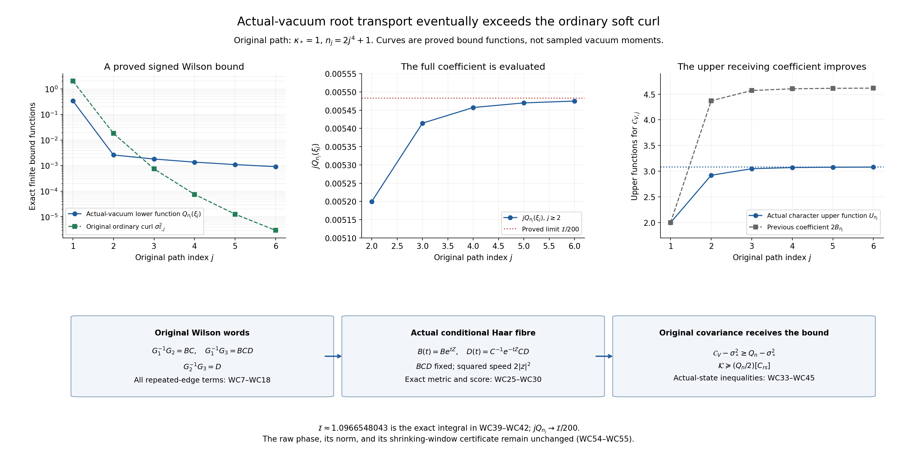

# Actual-vacuum Wilson covariances of the original transported soft curl

This proof continues the sealed RH and DP derivations. It proves an
actual-state result about the signed Wilson contraction in DP28. The
positive ground state's global Hessian bound gives quantitative
conditional score bounds on single original links and on a specific
two-link Haar fibre. These imply that the original transported-curl
covariance is bounded below by an explicit function of order \(j^{-1}\),
although its ordinary cochain curl has squared norm of order \(j^{-8}\).
No independent-link law, small root transport, configuration surrogate,
or sign of the raw spectral endpoint is assumed.

## 1. Original objects and the exact receiving quantity

Let \(L\ge1\), \(m=2L\), \(n=m+1\), and retain every positive edge of
the open cube \(\{0,\ldots,m\}^3\). The physical vertices are
\(o+a(i-L,k-L,l-L)\). There are \(N=3mn^2\) edges and \(M=3m^2n\)
faces. Each \(SU(2)\) edge has probability Haar and the radius-two
bi-invariant metric, with \(T_\alpha=-i\sigma_\alpha/2\) and
\(X_{e\alpha}f=\partial_t f(\ldots,e^{tT_\alpha}U_e,\ldots)|_0\).
The full original model and actual positive unit ground state are
\[
 \begin{gathered}
 H=-\kappa\Delta+bW,\quad \Delta=\sum_{e,\alpha}X_{e\alpha}^2,\quad
 \\
 W=\sum_p(2-\operatorname{tr}U_p),\quad
 \\
 H\psi=E_0\psi,\quad d\mu=\psi^2dU,\quad w=\log\psi,
 \\
 \quad \kappa=2g^2/a,\quad b=1/(2g^2a),\quad \xi=b/\kappa .
 \end{gathered}\tag{WC1}
\]
The full scalar term \(2bM\) is retained. The original physical gauge
action is \(U_{st}\mapsto h_sU_{st}h_t^{-1}\) at every vertex, including
the boundary. The established RH18–RH20 input is the pointwise bound
\[
                  \nabla^2w\ge-2\sqrt{\xi}\,g.                 \tag{WC2}
\]
The proof below uses this actual-ground-state input and proves all new
conditional and Wilson consequences directly.

The root is \((0,0,0)\), and every root transport has its original order
\[
 t_{i,k,l}=
 \left(\prod_{r<l}U_3(0,0,r)\right)
 \left(\prod_{s<k}U_2(0,s,l)\right)
 \left(\prod_{t<i}U_1(t,k,l)\right),\qquad
 Z_e=t_{s(e)}U_et_{t(e)}^{-1}.
 \tag{WC3}
\]
All products increase in the indicated index. Put
\[
 \begin{gathered}
 h=\pi/(2n),\quad s=\sin h,\quad c_h=\cos h,\quad
 \\
 v(r)=\sqrt{2/n}\cos\frac{\pi(r+1/2)}n,\quad
 w_1(r)=-\sqrt{2/n}\sin\frac{\pi(r+1)}n,\quad v_*=v(0),\\
 V_1=0,\qquad V_2(i,k,l)=\frac{w_1(k)v(l)}{\sqrt{2n}},\qquad
 V_3(i,k,l)=-\frac{v(k)w_1(l)}{\sqrt{2n}} .
 \end{gathered}\tag{WC4}
\]
Here \(\sum_{r=0}^{m}v(r)^2=\sum_{r=0}^{m-1}w_1(r)^2=1\),
and \(\sum_eV_e^2=1\). These finite sums include all endpoints.
The orthonormal root frame is
\(E_{e\alpha}=\operatorname{Ad}_{t_{s(e)}^{-1}}\mathbf e_\alpha\cdot X_e\),
and \(Y_z=\sum_eV_eE_{e,z}\).

For each 23 face \(p=(i,k,l)\), \(0\le i\le m\), \(0\le k,l<m\),
write \(x=(i,k,l)\), \(y=x+e_2\), \(z_p=x+e_2+e_3\), and \(w_p=x+e_3\).
The symbol \(w_p\) denotes this vertex, whereas \(w=\log\psi\).
Retain
\[
 \begin{gathered}
 A=Z_2(x),\quad B=Z_3(y),\quad C=Z_2(w_p)^{-1},\quad
 D=Z_3(x)^{-1},\quad P=ABCD,\\
 a_p=\frac{w_1(k)v(l)}{\sqrt{2n}},\quad
 b_p=-\frac{v(k+1)w_1(l)}{\sqrt{2n}},\quad
 c_p^V=\frac{w_1(k)v(l+1)}{\sqrt{2n}},\quad
 d_p=-\frac{v(k)w_1(l)}{\sqrt{2n}},\\
 t_1=b_p,\qquad t_2=-c_p^V,\qquad t_3=a_p-d_p,\qquad
 K_p=t_1\operatorname{Ad}_A+
              t_2\operatorname{Ad}_{ABC}+t_3\operatorname{Ad}_{P}.
 \end{gathered}\tag{WC5}
\]
The \(t_r\) in this display are insertion coefficients, not root paths.
Define the actual scalar covariance and the ordinary curl exactly by
\[
 \mathcal C_V=\frac13\mu\sum_{p\in23}\operatorname{tr}(K_p^tK_p),
 \qquad k_p=t_1+t_2+t_3=-\frac{4s\,w_1(k)w_1(l)}{\sqrt{2n}},
 \qquad \sigma_*^2=\sum_pk_p^2=8s^2 .
 \tag{WC6}
\]
Root gauge rotations conjugate each \(K_p\); consequently
\(\mu\sum_pK_p^tK_p=\mathcal C_V I_3\). This follows because a real
symmetric matrix commuting with all rotations is scalar and its trace
fixes the scalar. In particular this is an actual colour covariance,
without a product assumption on the rooted words.

## 2. All three Wilson words and their repeated-edge contributions

For \(G_1=A,G_2=ABC,G_3=P\), the three original products in DP28 are
\[
 \begin{array}{c|c|c}
 \text{full original product}&\text{exact product identity}&
                      \text{root-expanded word}\\ \hline
 G_1^{-1}G_2=A^{-1}ABC&BC&
 t_yU_3(y)U_2(w_p)^{-1}t_{w_p}^{-1}\\
 G_1^{-1}G_3=A^{-1}ABCD&BCD&
 t_yU_3(y)U_2(w_p)^{-1}U_3(x)^{-1}t_x^{-1}\\
 G_2^{-1}G_3=(ABC)^{-1}ABCD&D&
 t_{w_p}U_3(x)^{-1}t_x^{-1}.
 \end{array}\tag{WC7}
\]
The middle column is proved by multiplication with the inverse adjacent
factors; it does not delete their derivative contributions from the
full original column. We now retain those contributions explicitly.

For an original physical edge \(e\), write \(I_e(v)=1\) when \(e\)
lies on the root path to \(v\), and zero otherwise. The unsigned
occurrences in \(A,B,C,D\) are
\[
 \begin{array}{ll}
 N_A(e)=I_e(x)+\mathbf1_{e=(x,2)}+I_e(y),&
 N_B(e)=I_e(y)+\mathbf1_{e=(y,3)}+I_e(z_p),\\
 N_C(e)=I_e(z_p)+\mathbf1_{e=(w_p,2)}+I_e(w_p),&
 N_D(e)=I_e(w_p)+\mathbf1_{e=(x,3)}+I_e(x).
 \end{array}\tag{WC8}
\]
Thus every occurrence, including inverse factors in the full left
column of (WC7), has the exact multiplicity
\[
 \nu_{12,e}=2N_A+N_B+N_C,\qquad
 \nu_{13,e}=2N_A+N_B+N_C+N_D,\qquad
 \nu_{23,e}=2(N_A+N_B+N_C)+N_D.                    \tag{WC9}
\]
The signed letters and their order remain exactly those of (WC3),
(WC5) and (WC7).

For precision, the trace comparison after removing the common cyclic
prefix has the following words. Set
\[
 T_l=\prod_{r<l}U_3(0,0,r),\quad
 R_{k,l}=\prod_{s<k}U_2(0,s,l),\quad
 Q_{i,k,l}=\prod_{t<i}U_1(t,k,l).
\]
Then the trace of \(BC\) is the trace of
\[
 R_{k+1,l}Q_{i,k+1,l}U_3(y)U_2(w_p)^{-1}
 Q_{i,k,l+1}^{-1}R_{k,l+1}^{-1}U_3(0,0,l)^{-1}.
 \tag{WC10}
\]
Its outer conjugating prefix was \(T_l\). The trace of \(BCD\) is
the trace of
\[
 U_2(0,k,l)Q_{i,k+1,l}U_3(y)U_2(w_p)^{-1}
                    U_3(x)^{-1}Q_{i,k,l}^{-1}.       \tag{WC11}
\]
Its common prefix was \(T_lR_{k,l}\). The trace of \(D\) is the
trace of
\[
 U_3(0,0,l)R_{k,l+1}Q_{i,k,l+1}U_3(x)^{-1}
                       Q_{i,k,l}^{-1}R_{k,l}^{-1}.   \tag{WC12}
\]
Its common prefix was \(T_l\). Each displayed nontrivial word contains
distinct original edges: the two direction-one paths have different
heights or direction-two coordinates; the two direction-two paths have
different heights; the distinguished direction-three edges have
different starting points. At \(i=k=0\), (WC12) is the exact inverse
pair \(U_3(0,0,l)U_3(0,0,l)^{-1}\) and equals identity.
This proves the complete physical-edge lengths
\[
 \ell_{12}=2i+2k+4,\qquad
 \ell_{13}=2i+4,\qquad
 \ell_{23}=
 \begin{cases}0&i=k=0,\\2i+2k+2&(i,k)\ne(0,0).\end{cases}
 \tag{WC13}
\]
No boundary face is omitted; the exceptional zero length occurs at
exactly the \(m\) faces with \(i=k=0\).

Put \(\chi(U)=(\operatorname{tr}U)^2-1=\operatorname{tr}\operatorname{Ad}_U\)
and \(\mathfrak h(U)=4-(\operatorname{tr}U)^2=3-\chi(U)\).
For \(U=cI+q\cdot T\), \(\mathfrak h=|q|^2\), so
\(0\le\mathfrak h\le4\) and \(-1\le\chi\le3\).
Let \(J_\alpha y=\mathbf e_\alpha\times y\). Direct vector algebra gives
\(\sum_\alpha J_\alpha^2=-2I_3\).
For any full word \(U_{e_1}^{\varepsilon_1}\cdots
U_{e_R}^{\varepsilon_R}\), let \(F_r=\operatorname{Ad}_{U_{e_r}^{\varepsilon_r}}\).
An original edge derivative acts at its \(r\)-th occurrence by
\[
 D_{r\alpha}F_r=
 \begin{cases}J_\alpha F_r&\varepsilon_r=+1,\\
               -F_rJ_\alpha&\varepsilon_r=-1,\end{cases}
 \qquad
 D_{r\alpha}^2F_r=
 \begin{cases}J_\alpha^2F_r&\varepsilon_r=+1,\\
               F_rJ_\alpha^2&\varepsilon_r=-1.\end{cases} \tag{WC14}
\]
The complete same-edge Laplacian is therefore
\[
 \Delta_e\chi=
 -2\nu_e\chi+
 2\sum_\alpha\sum_{\substack{r<s\\e_r=e_s=e}}
 \operatorname{tr}\bigl(F_1\cdots D_{r\alpha}F_r\cdots
                             D_{s\alpha}F_s\cdots F_R\bigr).
 \tag{WC15}
\]
Every mixed term and its factor two is present. Let \(n_e\in\{0,1\}\)
indicate the membership of \(e\) in the corresponding distinct-edge
word (WC10), (WC11), or (WC12), with \(n_e=0\) for the identity.
The exact trace identities (WC7)–(WC12) hold as smooth functions of
every original physical link, hence their differentiated functions
are equal. The distinct-edge side has \(\Delta_e\chi=-2n_e\chi\).
Consequently the entire mixed sum in (WC15) is exactly
\[
 2\sum_\alpha\sum_{\substack{r<s\\e_r=e_s=e}}
 \operatorname{tr}(F_1\cdots D_{r\alpha}F_r\cdots D_{s\alpha}F_s\cdots F_R)
             =2(\nu_e-n_e)\chi .                         \tag{WC16}
\]
For a shared prefix appearing once with each sign, this is \(+4\chi\)
against its diagonal contribution \(-4\chi\). If an edge has four,
six, or more original occurrences, (WC9) and (WC16) retain their
complete aggregate cross term. This proves cancellation by an exact
differentiated morphism of the full words, rather than ignoring
repeated links.

Summing all original edges gives
\[
 \boxed{\Delta\chi_\omega=-2\ell_\omega\chi_\omega,\qquad
 \Delta\mathfrak h_\omega=2\ell_\omega(3-\mathfrak h_\omega),\qquad
 \Gamma(\chi_\omega)=\Gamma(\mathfrak h_\omega)
      =\ell_\omega\mathfrak h_\omega(4-\mathfrak h_\omega).}
 \tag{WC17}
\]
For the gradient identity, a distinct-edge loop can be written
\(U_{\rm left}U_e^{\pm1}U_{\rm right}\); multiplication and inversion
preserve the radius-two metric. For \(t=\operatorname{tr}U\),
\(\sum_\alpha(X_\alpha t)^2=1-t^2/4\), whence
\(\Gamma_e(t^2-1)=4t^2(1-t^2/4)=\mathfrak h(4-\mathfrak h)\).
The canceled edges have zero derivative by the same exact word
identities. This proves all three formulas, including the length-zero
case \(\chi=3,\mathfrak h=0\).

Mixed gradients between different words also retain every overlap.
At a positive occurrence let \(P_r\) be the prefix before that letter;
at a negative occurrence let \(P_r\) include that inverse letter.
Then the original variation of a word \(U_\omega\) is
\(\varepsilon_r(\operatorname{Ad}_{P_r}T_\alpha)U_\omega\). Thus, with
the original quaternion \(q_\omega\),
\[
 \begin{gathered}
 J_{\omega,e}=\sum_{r:e_r=e}
               \varepsilon_r\operatorname{Ad}_{P_r^{-1}}q_\omega,\qquad
 (X_{e\alpha}\chi_\omega)_\alpha
                  =-(\operatorname{tr}U_\omega)J_{\omega,e},\\
 \Gamma(\chi_\omega,\chi_\tau)=
 (\operatorname{tr}U_\omega)(\operatorname{tr}U_\tau)
                          \sum_e J_{\omega,e}\cdot J_{\tau,e}.
 \end{gathered}\tag{WC18}
\]
This is the full shared-edge formula, before any expectation. It
includes the roots in both words and all same-edge cross products.

## 3. Ground integration, signed coefficients, and exact kinetic maps

All the Wilson traces above are physical smooth functions. Integration
on the compact product with the actual \(\psi^2\) density gives
\(\mu\Delta f=-2\mu\Gamma(w,f)\). Hence for each nontrivial word
\[
 \ell_\omega\mu\chi_\omega=\mu\Gamma(w,\chi_\omega),\qquad
 \ell_\omega(3-\mu\mathfrak h_\omega)
                         =-\mu\Gamma(w,\mathfrak h_\omega).
 \tag{WC19}
\]
For the original centered vector
\((\chi_\omega-\mu\chi_\omega)\psi\), the exact norm, first energy
and second energy are, without a unit-vector substitution,
\[
 \begin{gathered}
 G_\omega=\mu(\chi_\omega-\mu\chi_\omega)^2,\qquad
 E_\omega=\kappa\ell_\omega\mu[
                           \mathfrak h_\omega(4-\mathfrak h_\omega)],\\
 E_{2,\omega}=4\kappa^2\mu\left(
                    [\ell_\omega\chi_\omega-\Gamma(w,\chi_\omega)]^2\right).
 \end{gathered}\tag{WC20}
\]
Indeed the ground transform is
\((H-E_0)(f\psi)=-\kappa\psi[\Delta f+2\Gamma(w,f)]\).
This proves (WC20) with every factor and the actual raw norm.
The full potential and kinetic local energy
\(\mathfrak e=\kappa|\nabla w|^2+bW\) has \(\mu\mathfrak e=E_0\).
Testing the ground equation against \(\chi_\omega\psi\) and using
(WC19) gives the further exact covariance
\[
 \operatorname{Cov}_\mu(\chi_\omega,\mathfrak e)
                         =-\kappa\ell_\omega\mu\chi_\omega. \tag{WC21}
\]
This includes \(bW\) and all kinetic directions; neither is discarded.

Let \(\omega_{12}=t_1t_2,\omega_{13}=t_1t_3,\omega_{23}=t_2t_3\).
In sums carrying a prime, omit only the length-zero \(D\) word.
Its contribution \(\chi_D=3\) is included separately below.
Define the exact deterministic coefficient and physical function
\[
 \begin{gathered}
 A_n^0=\sum_p(t_1^2+t_2^2+t_3^2)
                    +2\sum_{p:i=k=0}t_2t_3,\qquad
 T_W=\sum_{p,r<s}'\frac{\omega_{rs}}{\ell_{rs}}\chi_{rs},\\
 P_+=\sum_{p,r<s}'(\omega_{rs})_+,\qquad
 P_-=\sum_{p,r<s}'(-\omega_{rs})_+ .
 \end{gathered}\tag{WC22}
\]
Expanding the original \(K_p^tK_p\) and using (WC19) proves
\[
 \boxed{\mathcal C_V=A_n^0+\frac23\mu\Gamma(w,T_W),\qquad
 \mathcal C_V-\sigma_*^2
       =\frac23\sum_{p,r<s}'\omega_{rs}(\mu\chi_{rs}-3).}
 \tag{WC23}
\]
The omitted term in the second identity equals zero identically.
The complete gradient and kinetic form of \(T_W\) are obtained by
the full double sum
\[
 \Gamma(T_W)=
 \sum_{\substack{p\in23,\ r<s\\\ell_{p,rs}>0}}
 \sum_{\substack{p'\in23,\ u<v\\\ell_{p',uv}>0}}
 \frac{\omega_{p,rs}\omega_{p',uv}}
      {\ell_{p,rs}\ell_{p',uv}}\,
                 \Gamma(\chi_{p,rs},\chi_{p',uv}).
\]
Every mixed gradient is given by (WC18). No overlap term is set to
zero by an independence assumption.

The deterministic term can be fully evaluated without a lattice sum.
The finite identities
\(\sum_{k<m}w_1(k)v(k)=-s\),
\(\sum_{k<m}w_1(k)v(k+1)=s\), and
\(\sum_{k<m}v(k)v(k+1)=\cos(2h)-v_*^2\) give
\[
 \begin{gathered}
 D_n^0:=\sum_p(t_1^2+t_2^2+t_3^2)=2(1-v_*^2)+s^2,\\
 \Omega_0:=\sum_{p:i=k=0}t_2t_3
       =-\frac{s^2v_*^2}{n}\,[2\cos(2h)-2v_*^2-1],\\
 A_n^0=D_n^0+2\Omega_0,\qquad
 \sigma_*^2=A_n^0+2(P_+-P_-),\qquad A_n^0\longrightarrow2 .
 \end{gathered}\tag{WC24}
\]
For example \(\sum_pt_1^2=\sum_pt_2^2=(1-v_*^2)/2\), while
\(\sum_pt_3^2=1-v_*^2+s^2\).
For the exceptional row use \(w_1(0)=-2sv_*\) in
\(-[w_1(0)^2\sum_lv(l)v(l+1)+w_1(0)v_*\sum_lw_1(l)v(l+1)]/(2n)\);
this gives the displayed \(\Omega_0\). These calculations retain the
original boundary row and all signs.

## 4. The conditional score and exact two-link fibre

Fix every original physical edge except one. Its actual conditional
probability is
\[
\psi(U,\widehat U)^2\,dU/\int\psi(V,\widehat U)^2dV
\].
The denominator is positive. Subtracting its logarithm from \(2w\)
does not change derivatives in \(U\). For a constant left generator
\(X_z\), Haar integration, its geodesic flow, and (WC2) give
\[
 \mathbb E[(X_zw)^2\mid\widehat U]
  =-\frac12\mathbb E[X_z^2w\mid\widehat U]
  \le\sqrt{\xi}|z|^2 .
 \tag{WC25}
\]
The same statement holds for constant right generators. Polarization
proves the entire conditional score matrix inequality
\(\mathbb E[(X_\alpha w)(X_\beta w)\mid\widehat U]\preceq\sqrt\xi I_3\).
This is a conditional consequence of the pointwise global bound; it
does not assert that the conditional state is a separate ground state.

For unit \(y,z\), put \(f(U)=z\cdot\operatorname{Ad}_Uy\).
Then \(\Delta f=-2f\),
\(\Gamma(f)=1-f^2\), and its left-gradient vector
\(\operatorname{Ad}_Uy\times z\) is perpendicular to the fixed vector
\(z\). Only the two constant score directions perpendicular to \(z\)
enter \(\Gamma(w,f)\). Conditional integration and Cauchy–Schwarz give
\[
 \begin{gathered}
 (\mathbb E f)^2
 =(\mathbb E\Gamma(w,f))^2
 \le2\sqrt\xi\,\mathbb E(1-f^2)
 \le2\sqrt\xi[1-(\mathbb E f)^2],\\
 \boxed{\|\mathbb E[\operatorname{Ad}_U\mid\widehat U]\|_{\rm op}
       \le r_1:=\sqrt{\frac{2\sqrt\xi}{1+2\sqrt\xi}}<1.}
 \end{gathered}\tag{WC26}
\]
Left or right multiplication by fixed group elements and inversion
preserve this bound. These operations preserve Haar and the original
metric; no change of the physical link scale is involved.

The same argument supplies an exact character interval. For a
nontrivial distinct-edge loop condition on all but one of its edges.
Writing \(h_0=\mathfrak h_\omega\), \(m_\chi=\mathbb E\chi_\omega\),
the three-dimensional conditional Fisher trace is at most
\(3\sqrt\xi\). Thus
\[
 m_\chi^2\le3\sqrt\xi\,\mathbb E[h_0(4-h_0)]
          \le3\sqrt\xi(3+2m_\chi-m_\chi^2).
 \tag{WC27}
\]
The last inequality follows by expanding \(h_0=3-\chi_\omega\) and
using \(\mathbb E\chi_\omega^2\ge m_\chi^2\). Set \(q=\sqrt\xi\).
Solving this scalar quadratic proves, conditionally and after full
expectation,
\[
 \boxed{\gamma_-(q)\le\mu\chi_\omega\le\gamma_+(q),\qquad
 \gamma_\pm(q)=\frac{3q\ \pm\ 3\sqrt{q(1+4q)}}{1+3q}.}
 \tag{WC28}
\]
The roots lie in \((-1,3)\) for \(q>0\); their limits are \(-1,3\).
The interval is also implied directly by (WC17), (WC19), and the sum
of the \(\ell_\omega\) one-edge Fisher bounds, including every
support edge. It does not acquire an extra power of \(r_1\) per edge:
the links have not been declared independent.

There is an additional conditional fibre relevant to the middle
coefficient in \(K_p\). The links \(B\) and \(D\) correspond to distinct
non-tree direction-three physical edges when \((i,k)\ne(0,0)\).
After fixing every tree link and every other chord, their conditional
reference measure is exactly \(dB\,dD\): the two rooted changes of
coordinates are fixed left/right multiplications and inversion.
Holding \(C\) fixed, the change \((B,D)\mapsto(B,P_0=BCD)\) has exact
Haar disintegration \(dB\,dD=dB\,dP_0\).
For fixed \(P_0\), \(D=C^{-1}B^{-1}P_0\), and the coordinate curve
\[
 B(t)=B e^{tZ},\qquad
 D(t)=C^{-1}e^{-tZ}CD,\qquad Z=z\cdot T                 \tag{WC29}
\]
is a geodesic in each of the two original link factors, with total
squared speed \(2|z|^2\). There is no transverse connection term in its
second derivative: both factors are their displayed constant-generator
group geodesics. Therefore the conditional fibre logarithm has second
derivative at least \(-4\sqrt\xi|z|^2\).
Integration on its Haar coordinate proves the score matrix bound
\(2\sqrt\xi I_3\), and the two-colour argument of (WC26) yields
\[
 \|\mathbb E[\operatorname{Ad}_{BC}\mid P_0,\text{other links}]\|_{\rm op}
       \le r_2:=\sqrt{\frac{4\sqrt\xi}{1+4\sqrt\xi}} .
 \tag{WC30}
\]
This is a proved fibre metric and conditional-density calculation, not
a directional tensor maximum principle.

## 5. An evaluated positive lower bound for the actual Wilson contraction

The elementary matrix fact needed here is the following. If \(R\) is
an orthogonal random matrix with \(\|\mathbb ER\|\le r<1\), and \(M,N\)
are fixed matrices or fixed vectors of compatible size, then
\[
 \begin{split}
 \mathbb E\|M+RN\|^2
 &\ge\|M\|^2+\|N\|^2-2r\|M\|\|N\|\\
 &=(1-r^2)\|M\|^2+(\|N\|-r\|M\|)^2\\
 &=(1-r^2)\|N\|^2+(\|M\|-r\|N\|)^2 .
 \end{split}\tag{WC31}
\]
The norm is Euclidean or Frobenius. The first line follows by expanding
the square and using the operator norm of the mean, and hence both
lower bounds are proved without discarding a random coefficient.

Let \(u\) be any vector depending only on the original tree links and
the direction-two chords. For each face, remove the left rotation
\(\operatorname{Ad}_A\) inside the norm:
\[
                 |K_pu|=|t_1u+t_2Ru+t_3RSu|,\qquad
            R=\operatorname{Ad}_{BC},\quad S=\operatorname{Ad}_D .
 \tag{WC32}
\]
The direction-three edge in \(B=Z_3(i,k+1,l)\) is always a non-tree
chord, and is distinct from the edge in \(D\). Condition on every
other link. The vector \(u\) remains fixed. Apply (WC31), (WC26) to
\(M=t_1u\), \(RN=R(t_2I+t_3S)u\).
This gives \(t_1^2\mu|u|^2/(1+2\sqrt\xi)\).
If \((i,k)\ne(0,0)\), condition instead on \(D\) and use the last
line of (WC31) with the coefficient \(t_3\). Finally condition on the
fibre (WC29), on which \(RS\) and \(u\) remain fixed, and apply
(WC30) with the coefficient \(t_2\).
Thus all three valid lower bounds hold for the same actual expectation.

For the exceptional row \(i=k=0\), the original tree gives
\(A=C=D=I\), so \(K_p=t_1I+(t_2+t_3)\operatorname{Ad}_B\).
Its exact conditional mean bound gives the following full coefficient:
\[
 \begin{gathered}
 q_p=
 \begin{cases}
 \displaystyle\max\left\{\frac{t_1^2}{1+2\sqrt\xi},
                         \frac{t_3^2}{1+2\sqrt\xi},
                         \frac{t_2^2}{1+4\sqrt\xi}\right\},
                                           &(i,k)\ne(0,0),\\[2mm]
 t_1^2+(t_2+t_3)^2-2r_1|t_1(t_2+t_3)|,&i=k=0,
 \end{cases}\\
 Q_n(\xi):=\sum_{\substack{0\le i\le m\\0\le k,l<m}}q_p,\qquad
 \boxed{\mu\sum_p|K_pu|^2\ge Q_n(\xi)\,\mu|u|^2,\qquad
                         \mathcal C_V\ge Q_n(\xi)>0.}
 \end{gathered}\tag{WC33}
\]
The first inequality follows by taking the maximum of the three
proved inequalities at each face; their coefficients are deterministic.
For the second use a fixed unit \(u\) and root rotation invariance, or
sum over three fixed orthogonal colours and divide by three.
Positivity follows since \(t_1\) is nonzero on at least one allowed face
for every odd \(n\ge3\), and \(r_1<1\).

This controls the entire original higher-row covariance. In the
notation of RH and DP, let
\[
 u^{[r]}=\sum_{c\in\mathcal C_2}a_cr_c^r q(Z_c),\quad
 a_{(i,k,l;2)}=-v(i)w_1(k)/\sqrt{2n},\quad
 r_c=\sum_eV_eR_{ce},\quad C_{rs}=\mu u^{[r]}\cdot u^{[s]} .
 \tag{WC34}
\]
Here \(R_{ce}=I_e(s(c))+\mathbf1_{e=c}+I_e(t(c))\) includes every
original unsigned word occurrence. The \(r_c\) are deterministic
cochain sums, and \(u^{[r]}\) is independent of all non-tree
direction-three chords when tree and direction-two links are fixed.
Apply (WC33) to every finite linear combination \(u=\sum_r\lambda_ru^{[r]}\).
For the unchanged transported matrix of DP36b this proves
\[
 \boxed{\mathcal K_{rs}:=\frac12\mu\sum_p
          (K_pu^{[r]})\cdot(K_pu^{[s]})
                    \succeq\frac{Q_n(\xi)}2[C_{rs}].}
 \tag{WC35}
\]
This quadratic-form statement includes all mixed entries and does
not divide by the norm of a row combination.

The character interval also evaluates the upper and signed bounds.
Retain \(B_n=\frac12\sum_p(|t_1|+|t_2|+|t_3|)^2\) exactly. Then
\[
 \begin{gathered}
 U_n(\xi)=\min\left\{2B_n,\,
             A_n^0+\frac23[\gamma_+(\sqrt\xi)P_+
                                 -\gamma_-(\sqrt\xi)P_-]\right\},\\
 Q_n(\xi)\le\mathcal C_V\le U_n(\xi),\\
 \boxed{Q_n(\xi)-\sigma_*^2
       \le\frac23\sum_{p,r<s}'\omega_{rs}(\mu\chi_{rs}-3)
       \le U_n(\xi)-\sigma_*^2.}
 \end{gathered}\tag{WC36}
\]
Each sign is fixed by the original \(\omega_{rs}\): positive weights
take \(\gamma_+\) for the upper bound, negative weights take
\(\gamma_-\). The universal operator-norm bound on the middle mean
also gives a full variable-row upper block:
\[
 \mathcal K\preceq
 \frac12\{A_n^0+2r_1(P_++P_-)\}\,[C_{rs}].             \tag{WC37}
\]
To prove it, expand \(|K_pu|^2\) and condition a nontrivial cross term
on its \(B\) or \(D\) chord. The vector \(u\) is fixed and the
conditional mean adjoint has norm at most \(r_1\). Bound the cross
term by \(r_1|u|^2\), and retain the exceptional \(D=I\) term exactly.
The character's lower trace bound used in (WC36) is not substituted
for this correlated variable-vector bound.

## 6. Original-path constants and the signed conclusion

On the unchanged path
\[
 \begin{gathered}
 L_j=j^4,\quad n_j=2j^4+1,\quad a_j=(100j)^{-1},\quad
 \\
 g_j^2=\kappa_*/(200j),\quad
 \kappa_j=\kappa_*,\quad b_j=10000j^2/\kappa_*,\quad
 \\
 \sqrt{\xi_j}=100j/\kappa_*,\quad s_j=\kappa_*/j ,
 \end{gathered}\tag{WC38}
\]
the lower function has the exact asymptotic coefficient
\[
 \boxed{jQ_{n_j}(\xi_j)\longrightarrow\frac{\kappa_*}{200}\,\mathcal I,}
 \qquad
 \mathcal I=\frac2{\pi^2}\int_0^\pi\!\!\int_0^\pi
 \max\left\{\cos^2x\sin^2y,\ \sin^2(x+y),\
                         \tfrac12\sin^2x\cos^2y\right\}\,dx\,dy .
 \tag{WC39}
\]
Here \(\mathcal I\) is an exact positive constant, not a fitted
vacuum moment. For proof put \(x=\pi(k+1)/n,y=\pi(l+1)/n\).
The full coefficients are
\[
 \begin{split}
 t_1&=\sqrt2\,n^{-3/2}\cos(x+h)\sin y,\\
 t_2&=\sqrt2\,n^{-3/2}\sin x\cos(y+h),\\
 t_3&=-\sqrt2\,n^{-3/2}
                  [\sin x\cos(y-h)+\cos(x-h)\sin y].
 \end{split}\tag{WC40}
\]
Uniform continuity on the compact square, \(h\to0\), and
\(j/(1+200j/\kappa_*)\to\kappa_*/200\) show that the full
\(n\)-slice sum in (WC33) converges to (WC39).
The exceptional row changes that sum by at most
\(\sum_l(|t_1|+|t_2|+|t_3|)^2\le8/n^2\), using the exact
DP21 maximum \(8c_h^4/n^3\). After multiplication by \(j\) this
tends to zero. This proves the limit while retaining the boundary row.

The constant has the following complete one-dimensional evaluation.
Write \(\alpha=\sqrt2,\ \beta=2+\sqrt2\), and
\(x_1(y)=\arctan(\alpha\tan y),\
  x_2(y)=\arctan(\beta\tan y)\) for \(0<y<\pi/2\).
The two same-sign cosine quadrants have integrand
\(\sin^2(x+y)\), with total integral \(\pi^2/4+1\).
On either other quadrant put \(p=\sin x\cos y,\ q=\cos x\sin y\)
with \(0<x,y<\pi/2\). For \(u=p/q\), direct comparisons of the three
quadratics give
\[
 \max\{q^2,(p-q)^2,p^2/2\}=
 \begin{cases}
 q^2&0\le u\le\sqrt2,\\
 p^2/2&\sqrt2\le u\le2+\sqrt2,\\
 (p-q)^2&u\ge2+\sqrt2 .
 \end{cases}\tag{WC41}
\]
Integrating first in \(x\) proves
\[
 \begin{gathered}
 \mathcal I=\frac2{\pi^2}\left(\frac{\pi^2}4+1+2J\right),\\
 J=\int_0^{\pi/2}\left\{\begin{aligned}&
 \sin^2y\left(\frac{x_1}2+\frac{\sin2x_1}4\right)
 \\ &+\frac{\cos^2y}{2}
       \left(\frac{x_2-x_1}2-\frac{\sin2x_2-\sin2x_1}4\right)
 +\frac{\pi/2-x_2}2-\frac{\sin2y-\sin(2x_2-2y)}4
                          \end{aligned}\right\}dy .
 \end{gathered}\tag{WC42}
\]
This is a finite elementary integral with all limits explicit.
Analytically \(1\le\mathcal I\le7/4\): use the second integrand
term for the lower bound and the sum of all three for the upper.
The supplied numerical evaluation is
\(\mathcal I\approx1.096654804318065\).
For a bounded independent check, the exact \(N\)-by-\(N\) midpoint
sum of (WC39) has error at most \(\pi/N\): each of the three
functions has both partial derivatives bounded in magnitude by one,
and their maximum has the same \(L^1\) Lipschitz bound. The mean
distance from a midpoint in the two coordinates is half the mesh
width. This proves the stated error bound, independently of the
floating quadrature. The reported decimal values are numerical
evaluations, not interval-arithmetic certificates.

The exact finite identity
\[
 B_n=D_n^0/2+P_++P_-+\Omega_{\rm abs},\qquad
 \Omega_{\rm abs}:=\sum_{p:i=k=0}|t_2t_3|
 \tag{WC43}
\]
follows by expanding the square of the three absolute coefficients
and separating the exceptional pair.
Here \(\Omega_{\rm abs}\le4/n^2\) by the face-weight bound, so it
tends to zero independently of the signed \(\Omega_0\).
The previously proved \(B_n\to3/2+8/\pi^2\), together with (WC24),
gives
\[
 P_+\to-\frac14+\frac4{\pi^2},\qquad
 P_-\to\frac34+\frac4{\pi^2},\qquad
 U_{n_j}(\xi_j)\longrightarrow2+\frac{32}{3\pi^2}.
 \tag{WC44}
\]
Here \(\Omega_0\to0\), so all boundary terms remain accounted for.
Consequently the signed original DP28 contraction has the actual-state
consequence
\[
 \boxed{\liminf_{j\to\infty}
       j\,[\mathcal C_{V,j}-\sigma_{*,j}^2]
                   \ge\frac{\kappa_*}{200}\mathcal I>0,\qquad
 \frac{Q_{n_j}(\xi_j)}{\sigma_{*,j}^2\,j^7}
                      \longrightarrow\frac{\kappa_*\mathcal I}{100\pi^2}.}
 \tag{WC45}
\]
Indeed \(j^8\sigma_{*,j}^2\to\pi^2/2\), and (WC36), (WC39)
give both statements. In particular this signed covariance is positive
for all sufficiently large \(j\). This is an actual-vacuum inequality
derived from the proved global Hessian input, not the earlier
configuration-family test.

## 7. Original curvature budgets, the remaining score, and the raw window

The local/global curvature estimates can also be applied to these
exact words without making their transports small. Let
\(\widehat P_{de}(x)=t_xU_{de}(x)t_x^{-1}\), retaining the original
positive face orientation. Rooted tree identities give the exact
ordered products
\[
 \begin{split}
 Z_2(i,k,l)&=\prod_{r=i-1,\ldots,0}\widehat P_{12}(r,k,l),\\
 Z_3(i,k,l)&=
 \left(\prod_{r=i-1,\ldots,0}\widehat P_{13}(r,k,l)\right)
 \left(\prod_{s=k-1,\ldots,0}\widehat P_{23}(0,s,l)\right),\\
 D&=Z_3(i,k,l)^{-1},\quad
 BCD=Z_2(i,k,l)^{-1}\widehat P_{23}(i,k,l),\\
 BC&=Z_2(i,k,l)^{-1}\widehat P_{23}(i,k,l)Z_3(i,k,l).
 \end{split}\tag{WC46}
\]
For example \(\widehat P_{13}(r,k,l)=Z_3(r+1,k,l)Z_3(r,k,l)^{-1}\)
because all direction-one rooted links are identity. At \(i=0\),
\(\widehat P_{23}(0,s,l)=Z_3(0,s+1,l)Z_3(0,s,l)^{-1}\);
the initial tree chord is identity. Multiplication proves the first
two formulas including their descending order, and \(P=ABCD\)
proves the last three. Their numbers of elementary face factors are
\(r_D=i+k,\ r_{BCD}=i+1,\ r_{BC}=2i+k+1\).
The inverse factors in (WC46) retain their negative orientations.

Since \(\|\operatorname{Ad}_U-I\|_{\rm Frob}^2=2\mathfrak h(U)\),
the exact matrix identity
\(R_1\cdots R_r-I=\sum_{j=1}^rR_1\cdots R_{j-1}(R_j-I)\),
proved by telescoping successive prefix products, and orthogonality give
\(\sqrt{\mathfrak h(U_1\cdots U_r)}
 \le\sum_j\sqrt{\mathfrak h(U_j)}\).
For an elementary face,
\(\mathfrak h(U_p)=D_p(4-D_p)\le4D_p\), with \(D_p=2-\operatorname{tr}U_p\).
Thus each displayed surface has the actual upper bound
\[
 \mu\mathfrak h_\omega
 \le\min\left\{4,\ 4r_\omega\mu\sum_{p\in\Sigma_\omega}D_p\right\}
 \le\min\{4,\ 4r_\omega B_W,\ 4r_\omega\Lambda_Q\},
 \quad B_W=\min\{2M,6g^2\sqrt{NM}\}.                \tag{WC47}
\]
Here \(Q=v+\{0,\ldots,q_0\}^3\) is any induced cube containing the
displayed surface, and the original boundary cost is
\[
 \begin{gathered}
 \Lambda_Q=\min\{2M_Q,6g^2\sqrt{N_QM_Q}\}+2C_Q,\quad
 \\
 N_Q=3q_0(q_0+1)^2,\ M_Q=3q_0^2(q_0+1),\quad
 \\
 C_Q=2q_0(q_0+1)\sum_d[
            \mathbf1_{v_d>0}+\mathbf1_{v_d+q_0<m}]. \end{gathered}\tag{WC48}
\]
One valid explicit receiving cube has
\(q_0=\max(i,k+1,1)\), \(v_1=v_2=0\),
\(v_3=\min(l,m-q_0)\).
It contains every factor of (WC46). For any proper cube \(q_0<m\),
at least one outward indicator in each coordinate equals one, so
\(C_Q\ge6q_0(q_0+1)\) and \(2C_Q\ge24\).
The local upper function in (WC47) consequently reaches the cap four
for every nontrivial word. The full-box alternative has
\(B_{W,j}\sim(18\kappa_*/25)j^{11}\); hence its cap is also four
eventually. These are evaluated limitations of these particular
upper functions, not assertions that an actual loop mean equals four.
Taking the minimum with \(3-\gamma_-(\sqrt\xi)\) from (WC28) is a
valid finite improvement. The same signed weights of (WC23) then
receive every improved individual bound.

To retain the precise DP41 coupling, let
\[
 \bar\eta=\min\{8B_n,\,8c_h^4B_W/(3n^3)\},\quad
 \epsilon_n=\bar\eta/4+\tfrac12\sqrt{2B_n\bar\eta}.
 \tag{WC49}
\]
The complete directional potential formula in DP19 proves
\(\left|\mu Y_z^2W-\tfrac12|z|^2\mathcal C_V\right|
 \le\epsilon_n|z|^2\).
Combining it with the new actual covariance interval yields
\[
 |z|^2[Q_n/2-\epsilon_n]\le\mu Y_z^2W
 \le|z|^2\min\{B_n,U_n/2+\epsilon_n\}.
 \tag{WC50}
\]
The upper function on the right tends to \(1+16/(3\pi^2)\).
The magnetic main lower function \(b_jQ_{n_j}/2\), divided by \(j\),
tends to \(25\mathcal I\), whereas
\(b_j\epsilon_{n_j}/j^{3/2}\to2000\sqrt{3B_*/\kappa_*}\),
\(B_*=3/2+8/\pi^2\). Therefore this lower function still does not
give a positive expectation of the potential Hessian eventually.
No unknown actual error is equated to its upper function.

More explicitly, retain the original DP commutator coefficients
\[
 L_{fe}=(V_f+p_{s(f)})\delta_{fe}+\mathbf1_{f\prec e}V_e,\quad
 p_{i,k,l}=\frac{v(l)\sum_{r<k}w_1(r)-v_*\sum_{r<l}w_1(r)}
                    {\sqrt{2n}},\quad C=L\otimes(z\times).
 \tag{WC51}
\]
The signed kinetic matrix remains exactly
\([L^tL-\operatorname{sym}L^2]\otimes(|z|^2I-zz^t)\).
Its complete ground double commutator is
\[
 2\langle-iY_z\psi,(H-E_0)(-iY_z\psi)\rangle
 =2\kappa\mu\{\,|C\nabla_Ew|^2+
                  \nabla_Ew\cdot C^2\nabla_Ew\,\}
                       +b\mu Y_z^2W.                 \tag{WC52}
\]
The new substitution (WC50) improves its potential upper coefficient,
but its retained kinetic upper function still has the DP42 leading
coefficient \(43200j^{17}|z|^2\). Conditional centering of a single
score does not erase its score products in this matrix.

There is a further exact consequence for the signed RH47/DP43 block.
The vector \(u^{[0]}\times u^{[1]}\) depends on tree links and
direction-two chords only. For every non-tree direction-three edge,
its coefficient and the root-frame rotation are fixed under the
conditional integral; Haar integration gives
\(\mathbb E[E_{e\alpha}w\mid\widehat U]=0\).
Let \(Y^{\rm rem}\) retain all direction-two coefficients and only
the tree direction-three coefficients \(e=(0,0,l;3)\). Then the
unchanged exact score contraction reduces to
\[
 \begin{gathered}
 C_{02}-C_{11}
   =-2\mu[(u^{[0]}\times u^{[1]})\cdot
                                (Y_\alpha^{\rm rem}w)_\alpha],\\
 \sum_{e\ {\rm retained}}V_e^2
       =\alpha_n:=\tfrac12+c_h^2/n^2,\qquad
 [\mu(Y_\alpha^{\rm rem}w)(Y_\beta^{\rm rem}w)]
                                      \preceq\alpha_n\sqrt\xi I_3,\\
 |C_{02}-C_{11}|
       \le2\sqrt{3\alpha_n\sqrt\xi\,
                          \mu|u^{[0]}\times u^{[1]}|^2}.
 \end{gathered}\tag{WC53}
\]
For the middle line, any fixed-colour root field with deterministic
edge coefficients is divergence free and geodesic. In fact the full
original connection is
\(\nabla_{E_{e\alpha}}E_{f\beta}
=-(\mathbf1_{e\prec f}+\delta_{ef}/2)
 E_{f,\mathbf e_\alpha\times\mathbf e_\beta}\);
after contracting the field with itself every term is proportional
to \(z\times z=0\).
Its squared norm is the displayed coefficient sum. Apply (WC2) and
integration by parts as in (WC25), then polarize.
The tree direction-three squared mass is
\(v_*^2\sum_lw_1(l)^2/(2n)=c_h^2/n^2\); no tree score was removed.
The uniform coefficient bound for (WC53) is the earlier DP43
bound times \(\sqrt{\alpha_n}\). Its ratio to \(j^{21/2}\) tends to
\(20480\sqrt{13}/(\sqrt{\kappa_*}\pi^5)\), still larger in order
than RH41a's \(j^8\) upper function. Its actual contraction remains
available with the exact sign.

Finally preserve the original raw phase itself:
\[
 \begin{gathered}
 a_{\mathcal C_2}=-v(i)w_1(k)/\sqrt{2n},\quad a_{\mathcal C_3}=0,\quad
 b_{\mathcal C_2}=w_1(k)v(l)/\sqrt{2n},\quad
 b_{\mathcal C_3}=-v(k)w_1(l)/\sqrt{2n},\\
 u_1=\sum_ca_cq(Z_c),\quad u_3=\sum_cb_cq(Z_c),\quad
 S=u_1\cdot u_3,\quad F=\frac{\sqrt8\sin h}{2g^2}(S-S_R).
 \end{gathered}\tag{WC54}
\]
The reflection is
\((RU)_1(i,k,l)=U_1(m-1-i,k,l)^{-1}\) and
\((RU)_d(i,k,l)=U_d(m-i,k,l)\) for \(d=2,3\);
\(S_R=S(RU)\) includes every reflected root word.
The actual raw norm and energy are \(G_F=\mu F^2\) and
\(E_F=\kappa\mu|\nabla F|^2\), and the window is
\(G_F-E_F/s_j\) with \(s_j=\kappa_*/j\).
The retained conjugate variance upper function satisfies
\(U_H(x)\ge\sqrt\xi x\), \(x=\mu|u_1|^2\), while the unchanged raw
commutator numerator obeys \(J_F^2\le xE_F/\kappa\).
Therefore its existing lower certificate still obeys
\[
             \frac{J_F^2}{4U_H(x)}-\frac{E_F}{s_j}
                  \le\left(\frac{a_j}{4}-\frac1{s_j}\right)E_F .
 \tag{WC55}
\]
It remains negative when \(400j^2>\kappa_*\), as proved previously.
The new positive signed Wilson lower bound (WC45) is neither an
upper bound on the score nor a positive raw-window certificate.
The strongest calculated connections here are the full transported
matrix interval (WC35), (WC37), the improved actual potential map
(WC50), and the shortened exact score contraction (WC53).
They preserve the remaining signed kinetic term (WC52) and all raw
moments, without a continuum or gapless conclusion.

## 8. Source identities, checks, and reproducible figure

The full proof of the input (WC2) is in the preserved
[RH18–RH20](https://github.com/KokunoYumeto/yang-mills-interacting-workbench/blob/b5e6c1fa3da1341bf73e42605e41bd2d7ddf8392/yang-mills/continuations/20261011-central-signs-shrinking-window/RAW_S6_HESSIAN_RECEIVING.md) and the original [OS17–OS28](https://github.com/KokunoYumeto/yang-mills-interacting-workbench/blob/b5e6c1fa3da1341bf73e42605e41bd2d7ddf8392/yang-mills/continuations/20261011-central-signs-shrinking-window/ORIGINAL_SOURCE_COVARIANCE.md)/[HVR](https://github.com/KokunoYumeto/yang-mills-interacting-workbench/blob/b5e6c1fa3da1341bf73e42605e41bd2d7ddf8392/yang-mills/continuations/20261011-central-signs-shrinking-window/HESSIAN_RECEIVING_REVIEW.md) providers. The exact [DP1–DP43](https://github.com/KokunoYumeto/yang-mills-interacting-workbench/blob/b5e6c1fa3da1341bf73e42605e41bd2d7ddf8392/yang-mills/continuations/20261011-central-signs-shrinking-window/DIRECTIONAL_POTENTIAL_AND_ROOT_DEFECT.md) edition and sealed-source hashes are in the [source-use ledger](WILSON_COVARIANCE_SOURCE_USE_LEDGER.json).
Local source hashes and read coverage are recorded in the source ledger.
The existing canonical disk-literature indexes were queried for Wilson
and Casimir work; those routes are recorded as routes, not as paper
reading. No external theorem or novelty claim is imported, and no PDF
was read.

The check program enumerates 1,032 full original Wilson products in
boxes \(n=3,5,7\), verifies every exact root-surface product and
distinct-edge length, and evaluates 36 full repeated-letter adjoint
matrix jets. The mixed terms in (WC15) are compared against (WC16),
with maximal absolute discrepancy below \(2\times10^{-14}\) in the
recorded run. Twelve quaternion checks also verify the exact two-link
fibre's fixed product. The program checks the full gradient identity (WC17), the
boundary scalar \(\Omega_0\), the signed coefficient sums, the
one-dimensional integral against an independent two-dimensional
midpoint calculation, and the original path at \(j=1,\ldots,6\).
These are bounded checks of proved formulas, not vacuum simulation.

The accompanying figure displays the proved lower function \(Q_n\),
the original ordinary curl, and the explicit interval endpoints.
It does not plot a computed vacuum expectation. Complete numerical
values, scripts, source checks and the inspected render are retained
in this folder.

Complete original local curvature provider: [LC1–LC42](https://github.com/KokunoYumeto/yang-mills-interacting-workbench/blob/b5e6c1fa3da1341bf73e42605e41bd2d7ddf8392/yang-mills/continuations/20261011-central-signs-shrinking-window/LOCAL_CURVATURE_BUDGET.md). The reproducible [check program](check_wilson.py) and [figure source](wilson_figure.py) retain the original path and all finite coefficients. The plotted curves are proved bound functions, not sampled vacuum expectations.

## Sharper signed kinetic bound and full physical receiving map

[SK1–SK39](SIGNED_KINETIC_TRACE.md) evaluate the complete original ancestor matrix. SK20–SK28 give its explicit negative remainder and sharpen the original-path kinetic upper function to 1200j^5+O(j log j). SK29–SK39 retain the actual root covariance, chord-score/Gauss map, physical variable-colour Gram and raw spectral certificate. No actual covariance is replaced by its deterministic bound.
