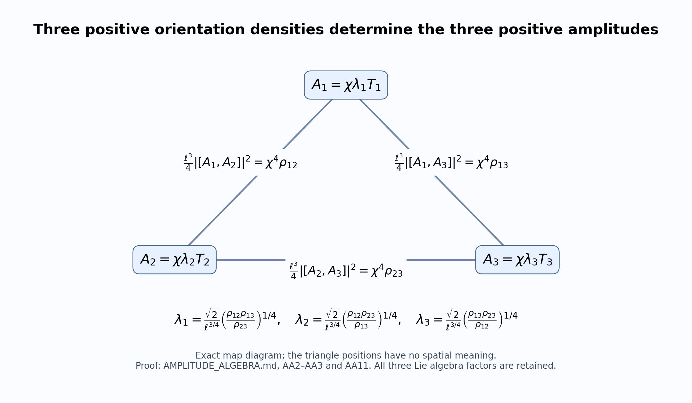

# Positive orientation densities, smooth amplitudes, and the complete Yang–Mills source

This calculation supplies the amplitude part of the smooth measure realization. The input here is a triple of strictly positive smooth functions; the receiving construction supplies their approximation to the intended measures. All assertions below are proved directly. No novelty claim, global evolution theorem, or identification with a vacuum probability law is made.

## 1. Coordinates, Lie algebra, and the exact inverse map

Retain the HC1–HC21 conventions. The spatial coordinates are the original coordinates of \(\mathbb R^3\), \(\ell>0\) is the original reference length, and
\[
T_i=-\frac{i\sigma_i}{2},\qquad
[T_i,T_k]=\sum_{r=1}^3\varepsilon_{ikr}T_r,\qquad
-2\operatorname{Tr}(T_iT_k)=\delta_{ik},\qquad
|X|^2=-2\operatorname{Tr}(X^2).
\tag{AA1}
\]
Thus \(|T_i|=1\) and \(\|vT_i\|_{\mathrm{op}}=|v|/2\) for real \(v\). Let \(U\subset\mathbb R^3\) be open, and let \(\rho_{12},\rho_{13},\rho_{23}:U\to(0,\infty)\) be smooth. The unique positive solution of all three equations
\[
\frac{\ell^3}{4}\lambda_1^2\lambda_2^2=\rho_{12},\qquad
\frac{\ell^3}{4}\lambda_1^2\lambda_3^2=\rho_{13},\qquad
\frac{\ell^3}{4}\lambda_2^2\lambda_3^2=\rho_{23}
\tag{AA2}
\]
is
\[
\begin{aligned}
\lambda_1^2&=\frac{2}{\ell^{3/2}}
          \sqrt{\frac{\rho_{12}\rho_{13}}{\rho_{23}}},&
\lambda_1&=\frac{\sqrt2}{\ell^{3/4}}
          \left(\frac{\rho_{12}\rho_{13}}{\rho_{23}}\right)^{1/4},\\
\lambda_2^2&=\frac{2}{\ell^{3/2}}
          \sqrt{\frac{\rho_{12}\rho_{23}}{\rho_{13}}},&
\lambda_2&=\frac{\sqrt2}{\ell^{3/4}}
          \left(\frac{\rho_{12}\rho_{23}}{\rho_{13}}\right)^{1/4},\\
\lambda_3^2&=\frac{2}{\ell^{3/2}}
          \sqrt{\frac{\rho_{13}\rho_{23}}{\rho_{12}}},&
\lambda_3&=\frac{\sqrt2}{\ell^{3/4}}
          \left(\frac{\rho_{13}\rho_{23}}{\rho_{12}}\right)^{1/4}.
\end{aligned}\tag{AA3}
\]
For example, multiplication of the first two equations of AA2 and division by the third gives \((\ell^3/4)\lambda_1^4=\rho_{12}\rho_{13}/\rho_{23}\). The positive fourth root gives AA3 with its displayed factor. The same operations for the other two coordinates give their formulas. Conversely, substituting AA3 in each product gives exactly AA2. The positive fourth-root function is smooth on \((0,\infty)\), so these amplitudes are smooth on \(U\). This also proves that the map from the positive amplitude octant to the positive density octant in AA2 is a smooth bijection with smooth inverse. If arbitrary nonzero real amplitudes are permitted, their independent signs are additional data and the positive branch is one specific section.

## 2. Every first and second derivative

Write \(\mathcal E=(12,13,23)\), and retain the full sign table
\[
(s_{1,e})_{e\in\mathcal E}=(1,1,-1),\qquad
(s_{2,e})_{e\in\mathcal E}=(1,-1,1),\qquad
(s_{3,e})_{e\in\mathcal E}=(-1,1,1).
\]
For spatial indices \(r,s\in\{1,2,3\}\), define the following auxiliary expressions in the original density functions:
\[
Q_{i,r}=\sum_{e\in\mathcal E}s_{i,e}\frac{\partial_r\rho_e}{\rho_e},\qquad
H_{i,rs}=\sum_{e\in\mathcal E}s_{i,e}
 \left(\frac{\partial_r\partial_s\rho_e}{\rho_e}
 -\frac{(\partial_r\rho_e)(\partial_s\rho_e)}{\rho_e^2}\right).
\]
The exact derivative identities, with no omitted summand, are
\[
\begin{aligned}
\partial_r\lambda_i
 &=\frac{\lambda_i}{4}\sum_{e\in\mathcal E}
              s_{i,e}\frac{\partial_r\rho_e}{\rho_e}
 =\frac{\lambda_i}{4}Q_{i,r},\\
\partial_r\partial_s\lambda_i
 &=\frac{\lambda_i}{16}
       \left(\sum_{e\in\mathcal E}s_{i,e}
                  \frac{\partial_r\rho_e}{\rho_e}\right)
       \left(\sum_{e\in\mathcal E}s_{i,e}
                  \frac{\partial_s\rho_e}{\rho_e}\right)\\
 &\quad+\frac{\lambda_i}{4}\sum_{e\in\mathcal E}s_{i,e}
       \left(\frac{\partial_r\partial_s\rho_e}{\rho_e}
          -\frac{(\partial_r\rho_e)(\partial_s\rho_e)}{\rho_e^2}\right)
 =\lambda_i\left(\frac{Q_{i,r}Q_{i,s}}{16}
                         +\frac{H_{i,rs}}4\right).
\end{aligned}\tag{AA4}
\]
Indeed, taking the logarithm of the positive formula AA3 gives the constant \(\log(\sqrt2\ell^{-3/4})\) plus \(\frac14\sum_e s_{i,e}\log\rho_e\). Differentiation gives the first line. Differentiating that line and using the quotient rule gives the second line, including the product term and the sign of each inverse-density term. This argument uses the logarithm only to prove an identity for the original amplitudes; it does not replace them as the connection input.

Fix a compact \(K\subset U\) and define actual finite bounds
\[
\begin{gathered}
m=\min_{x\in K,e\in\mathcal E}\rho_e(x)>0,\qquad
R=\max_{x\in K,e\in\mathcal E}\rho_e(x),\\
G=\max_{x\in K,e,r}|\partial_r\rho_e(x)|,\qquad
H=\max_{x\in K,e,r,s}|\partial_r\partial_s\rho_e(x)|,\\
B=\frac{\sqrt2}{\ell^{3/4}}\left(\frac{R^2}{m}\right)^{1/4},\qquad
B^{(1)}=\frac{3B G}{4m},\qquad
B^{(2)}=B\left(\frac{3H}{4m}+\frac{21G^2}{16m^2}\right).
\end{gathered}
\]
Then, for every displayed index and every \(x\in K\),
\[
\frac{\sqrt2}{\ell^{3/4}}\left(\frac{m^2}{R}\right)^{1/4}
\le\lambda_i(x)\le B,\qquad
|\partial_r\lambda_i(x)|\le B^{(1)},\qquad
|\partial_r\partial_s\lambda_i(x)|\le B^{(2)}.
\tag{AA5}
\]
The two amplitude bounds follow immediately from AA3 by bounding each of its three density factors separately. In AA4, \(|Q_{i,r}|\le3G/m\), and
\(|H_{i,rs}|\le3H/m+3G^2/m^2\). Thus the Hessian is bounded by
\(B(9G^2/(16m^2)+3H/(4m)+3G^2/(4m^2))\), which is the exact stated constant \(21/16\). In particular these bounds expose, rather than discard, the cost of a density approaching zero.

## 3. A common cutoff and the unchanged amplitude

Let \(\chi\in C_c^\infty(U)\) satisfy \(0\le\chi\le1\), and let \(K\) contain its support. Define
\[
b_i=\chi\lambda_i,\qquad A_i=b_iT_i,\qquad
A=\sum_{i=1}^3 A_i\,dx^i,
\]
and extend every \(b_i\) by zero to \(\mathbb R^3\). The extension is smooth: every point outside \(U\) has a neighborhood disjoint from the compact set \(\operatorname{supp}\chi\), on which the extension is identically zero. All three coefficients remain present. The product rule gives, on \(U\),
\[
\begin{aligned}
\partial_r b_i
 &= (\partial_r\chi)\lambda_i+\chi\partial_r\lambda_i,\\
\partial_r\partial_s b_i
 &= (\partial_r\partial_s\chi)\lambda_i
 +(\partial_r\chi)(\partial_s\lambda_i)
 +(\partial_s\chi)(\partial_r\lambda_i)
 +\chi\partial_r\partial_s\lambda_i.
\end{aligned}\tag{AA6}
\]
Put \(C_0=\sup|\chi|\), \(C_1=\max_r\sup|\partial_r\chi|\), \(C_2=\max_{r,s}\sup|\partial_r\partial_s\chi|\). AA5–AA6 give global bounds
\[
\begin{gathered}
B_0=C_0B,\quad B_1=C_1B+C_0B^{(1)},\quad
B_2=C_2B+2C_1B^{(1)}+C_0B^{(2)},\\
|b_i|\le B_0,\quad |\partial_r b_i|\le B_1,\quad
|\partial_r\partial_s b_i|\le B_2,\\
M_A:=\max_i\sup\|A_i\|_{\mathrm{op}}\le B_0/2,\qquad
L_A:=\max_{i,r}\sup\|\partial_r A_i\|_{\mathrm{op}}\le B_1/2.
\end{gathered}\tag{AA7}
\]
These are the exact types of coefficient bounds used in HC14–HC15, with the factor \(1/2\) required by HC1. No compactness bound uniform in a measure-approximation index is asserted by AA7; the displayed constants must be retained for every input triple.

For every original regulator keep
\[
a_j=\frac1{100j},\qquad
t_j=\left(\frac\ell{a_j}\right)^{3/4},\qquad
\delta_j=a_jt_j=\ell^{3/4}a_j^{1/4},\qquad
\mathcal A_i^{(j)}=t_j b_iT_i.
\tag{AA8}
\]
The connection input is exactly the HC13 input with the newly constructed smooth \(A\); no lattice, coordinate, coupling, or observable is replaced.

## 4. Full curvature and each orientation density

For \(k\ne i\), the curvature of AA8 is
\[
\begin{aligned}
\mathcal F_{ki}^{(j)}
 &=t_j\left[((\partial_k\chi)\lambda_i+\chi\partial_k\lambda_i)T_i
        -((\partial_i\chi)\lambda_k+\chi\partial_i\lambda_k)T_k\right]\\
 &\quad+t_j^2\chi^2\lambda_k\lambda_i
                 \sum_r\varepsilon_{kir}T_r.
\end{aligned}\tag{AA9}
\]
For \(k=i\) it is exactly zero. This follows by substituting \(t_j A\) in \(\partial_k\mathcal A_i-\partial_i\mathcal A_k+[\mathcal A_k,\mathcal A_i]\), since \(t_j\) is spatially constant. AA1 gives pairwise orthogonality of the two derivative colours and the third commutator colour. Consequently its complete square is
\[
\begin{aligned}
|\mathcal F_{ki}^{(j)}|^2
 &=t_j^2\left[(\partial_k\chi)^2\lambda_i^2
       +2\chi(\partial_k\chi)\lambda_i\partial_k\lambda_i
       +\chi^2(\partial_k\lambda_i)^2\right]\\
 &\quad+t_j^2\left[(\partial_i\chi)^2\lambda_k^2
       +2\chi(\partial_i\chi)\lambda_k\partial_i\lambda_k
       +\chi^2(\partial_i\lambda_k)^2\right]
       +t_j^4\chi^4\lambda_k^2\lambda_i^2.
\end{aligned}\tag{AA10}
\]
There is no cubic-in-\(t_j\) term in this square because its corresponding inner products are zero; the two displayed cutoff mixed terms need not vanish. The three commutator densities are individually
\[
\frac{\ell^3}{4}|[A_1,A_2]|^2=\chi^4\rho_{12},\qquad
\frac{\ell^3}{4}|[A_1,A_3]|^2=\chi^4\rho_{13},\qquad
\frac{\ell^3}{4}|[A_2,A_3]|^2=\chi^4\rho_{23}.
\tag{AA11}
\]
Indeed \([A_i,A_k]=\chi^2\lambda_i\lambda_k[T_i,T_k]\) and \(|[T_i,T_k]|=1\) for \(i\ne k\); insert AA2. The common cutoff thus multiplies every receiving density by precisely its fourth power. On any neighborhood where \(\chi=1\), every orientation density equals its prescribed \(\rho_{ik}\). The derivatives of \(\lambda_i\) generally remain in AA9–AA10 on this neighborhood: a constant cutoff does not make a variable density constant.

## 5. Exact static Yang–Mills source, including all cutoff terms

Write physical time as \(t_{\mathrm{phys}}\), so the retained Minkowski coordinate is \(x^0=ct_{\mathrm{phys}}\), with metric \(\operatorname{diag}(-1,1,1,1)\). Extend AA8 statically with \(\mathcal A_0^{(j)}=0\). Let
\(\mathcal D_\mu=\partial_\mu+[\mathcal A_\mu^{(j)},\cdot]\),
and define \(\mathcal J_\nu^{(j)}=\mathcal D^\mu\mathcal F_{\mu\nu}^{(j)}\).
The time component is exactly \(\mathcal J_0^{(j)}=0\). For the spatial components, set
\[
P_{ki}=b_i\partial_k b_k+2b_k\partial_k b_i\qquad(k\ne i).
\]
The complete source is
\[
\begin{aligned}
\mathcal J_i^{(j)}
 &=t_j\sum_{k\ne i}\left[(\partial_k^2b_i)T_i
                                  -(\partial_k\partial_i b_k)T_k\right]\\
 &\quad+t_j^2\sum_{k\ne i}P_{ki}[T_k,T_i]
       -t_j^3 b_i\left(\sum_{k\ne i}b_k^2\right)T_i.
\end{aligned}\tag{AA12}
\]
Here every \(b\)-derivative and every \(P\)-coefficient has the full cutoff expansion
\[
\begin{aligned}
\partial_k^2b_i
 &= (\partial_k^2\chi)\lambda_i
       +2(\partial_k\chi)(\partial_k\lambda_i)
       +\chi\partial_k^2\lambda_i,\\
\partial_k\partial_i b_k
 &= (\partial_k\partial_i\chi)\lambda_k
       +(\partial_k\chi)(\partial_i\lambda_k)
       +(\partial_i\chi)(\partial_k\lambda_k)
       +\chi\partial_k\partial_i\lambda_k,\\
P_{ki}
 &=3\chi(\partial_k\chi)\lambda_i\lambda_k
       +\chi^2\left[\lambda_i\partial_k\lambda_k
                        +2\lambda_k\partial_k\lambda_i\right],\\
b_i\sum_{k\ne i}b_k^2
 &=\chi^3\lambda_i\sum_{k\ne i}\lambda_k^2.
\end{aligned}\tag{AA13}
\]
Substitution of AA4 in AA13 expresses every term through the original three densities and the common cutoff, including every reciprocal-density factor. Equations AA4 and AA13 are exact formulas, rather than asymptotic errors.

To prove AA12, differentiate the exact curvature before collecting terms:
\[
\begin{aligned}
\sum_k\partial_k\mathcal F_{ki}^{(j)}
 &=t_j\sum_k\left[(\partial_k^2 b_i)T_i
                         -(\partial_k\partial_i b_k)T_k\right]\\
 &\quad+t_j^2\sum_k\left[(\partial_k b_k)b_i
                          +b_k\partial_k b_i\right][T_k,T_i],\\
\sum_k[t_jb_kT_k,\mathcal F_{ki}^{(j)}]
 &=t_j^2\sum_k b_k\partial_k b_i[T_k,T_i]
       -t_j^2\sum_k b_k\partial_i b_k[T_k,T_k]\\
 &\quad+t_j^3\sum_k b_k^2b_i[T_k,[T_k,T_i]].
\end{aligned}
\]
The displayed self-commutator is zero. For \(k\ne i\), AA1 gives \([T_k,[T_k,T_i]]=-T_i\): the vector identity \(e_k\times(e_k\times e_i)=-e_i\) is equivalently the contraction of the two displayed Levi-Civita symbols. For \(k=i\), both curvature terms and both derivative terms cancel exactly. Adding the two expressions proves AA12, with the coefficient 2 in \(P_{ki}\) and the negative cubic sign. Expanding its products proves AA13, with one copy and two copies of \(\chi\partial_k\chi\lambda_i\lambda_k\) producing the coefficient 3.

For a direct sign check, retain the linear expression
\(L_i=\sum_{k\ne i}[(\partial_k^2b_i)T_i-(\partial_k\partial_i b_k)T_k]\).
All three sources separately are
\[
\begin{aligned}
\mathcal J_1^{(j)}&=t_jL_1+t_j^2(P_{31}T_2-P_{21}T_3)
                     -t_j^3b_1(b_2^2+b_3^2)T_1,\\
\mathcal J_2^{(j)}&=t_jL_2+t_j^2(P_{12}T_3-P_{32}T_1)
                     -t_j^3b_2(b_1^2+b_3^2)T_2,\\
\mathcal J_3^{(j)}&=t_jL_3+t_j^2(P_{23}T_1-P_{13}T_2)
                     -t_j^3b_3(b_1^2+b_2^2)T_3.
\end{aligned}\tag{AA14}
\]
The powers \(t_j,t_j^2,t_j^3\) are the original powers in HC18. On a region where both the cutoff and all three amplitudes are constant, only the final terms remain. On a region where only the cutoff is constant, all amplitude derivatives in AA12–AA13 remain.

The derivative bounds yield an explicit global source estimate
\[
|\mathcal J_i^{(j)}|
\le\sqrt6\,t_j B_2+3\sqrt2\,t_j^2B_0B_1+2t_j^3B_0^3,
\qquad
\|\mathcal J_i^{(j)}\|_{\mathrm{op}}
\le\frac12\left(\sqrt6\,t_j B_2+3\sqrt2\,t_j^2B_0B_1+2t_j^3B_0^3\right).
\tag{AA15}
\]
For the linear term, the coefficient along \(T_i\) is a sum of two terms bounded by \(B_2\), and the other two orthogonal coefficients have bounds \(B_2\) each. Its squared norm is at most \(4B_2^2+B_2^2+B_2^2\). The two commutator colours are orthogonal and each coefficient has bound \(3B_0B_1\), giving \(3\sqrt2B_0B_1\). The cubic coefficient has bound \(B_0(B_0^2+B_0^2)\). The triangle inequality between these three full vectors proves the first estimate; AA1 proves the second.

## 6. Zero-electric data, acceleration, and its exact compatibility

Specify temporal-gauge initial data, on the original slice \(x^0=0\), by
\[
\mathcal A_0^{(j)}=0,\qquad
\mathcal A_i^{(j)}(0,x)=t_jb_i(x)T_i,\qquad
\partial_0\mathcal A_i^{(j)}(0,x)=0.
\tag{AA16}
\]
Then \(\mathcal F_{0i}^{(j)}(0,x)=0\) pointwise and all of its spatial derivatives vanish pointwise. The Gauss equation therefore holds exactly:
\[
\sum_i\mathcal D_i\mathcal F_{0i}^{(j)}(0,x)=0,
\qquad
\mathcal D^\mu\mathcal F_{\mu0}^{(j)}(0,x)
=-\sum_i\mathcal D_i\mathcal F_{0i}^{(j)}(0,x)=0.
\tag{AA17}
\]
No spatial divergence condition on \(A\) appears in this proof. Since \(g^{00}=-1\), temporal gauge gives
\[
\mathcal D^\mu\mathcal F_{\mu i}^{(j)}
=-\partial_0^2\mathcal A_i^{(j)}
  +\sum_k\mathcal D_k\mathcal F_{ki}^{(j)}.
\]
Hence the exact acceleration required by the source-free Yang–Mills equation at this initial slice is
\[
\left.\partial_0^2\mathcal A_i^{(j)}\right|_{x^0=0}
       =\mathcal J_i^{(j)},\qquad
\left.\partial_{t_{\mathrm{phys}}}^2\mathcal A_i^{(j)}\right|_{t_{\mathrm{phys}}=0}
       =c^2\mathcal J_i^{(j)},
\tag{AA18}
\]
with the full AA12–AA14 expression on the right. In particular the constant-core cubic term has negative sign in both acceleration formulas. The factor \(c^2\) follows from \(\partial_{t_{\mathrm{phys}}}=c\partial_0\).

The prescribed acceleration satisfies the exact covariant compatibility identity
\[
\sum_i\mathcal D_i\mathcal J_i^{(j)}=0.
\tag{AA19}
\]
Here is the full algebraic proof. For any smooth Lie-algebra-valued \(X\), expansion of the two operators and cancellation of the commuting second derivatives and the single-derivative terms gives
\[
[\mathcal D_i,\mathcal D_k]X
=[\partial_i\mathcal A_k-\partial_k\mathcal A_i
                  +[\mathcal A_i,\mathcal A_k],X]
=[\mathcal F_{ik},X].
\]
The nested-commutator equality follows by expanding each matrix product, so no further structural hypothesis is used. Since \(\mathcal F_{ki}=-\mathcal F_{ik}\), relabeling the finite double sum gives
\[
\begin{aligned}
\sum_i\mathcal D_i\mathcal J_i
&=\sum_{i,k}\mathcal D_i\mathcal D_k\mathcal F_{ki}
=\frac12\sum_{i,k}(\mathcal D_i\mathcal D_k-\mathcal D_k\mathcal D_i)\mathcal F_{ki}\\
&=\frac12\sum_{i,k}[\mathcal F_{ik},\mathcal F_{ki}]
=\frac12\sum_{i,k}[\mathcal F_{ik},-\mathcal F_{ik}]=0.
\end{aligned}
\]
At zero electric data, differentiation of Gauss gives
\(\partial_0\sum_i\mathcal D_i\partial_0\mathcal A_i
=\sum_i\mathcal D_i\partial_0^2\mathcal A_i
  +\sum_i[\partial_0\mathcal A_i,\partial_0\mathcal A_i]\).
Its second sum is zero individually, and AA18–AA19 make its first sum zero. Thus the initial Gauss equation and its first time derivative both hold. These statements concern the exact initial data and temporal second derivatives; they do not assert a global evolution or a regulator-uniform lifespan.

For completeness, a compactly supported diagonal profile of the present form cannot be assumed divergence-free unless it is zero. Indeed,
\(\sum_i\partial_i A_i=\sum_i(\partial_i b_i)T_i\), and the three basis vectors are independent. Vanishing divergence therefore implies \(\partial_i b_i=0\) for each \(i\). For each fixed pair of other coordinates, \(b_i\) is then constant along the entire \(x^i\)-line and is zero outside a bounded interval by compact support. That constant is zero. This proves the claimed obstruction and identifies exactly the divergence-free subspace within this diagonal compact-support domain: it is \(\{0\}\). Gauss is nevertheless satisfied by every AA16 datum, as AA17 proves. The broader three-colour profile in HC17 uses additional spatial components and is a different explicitly specified domain.

## 7. Boundary density data and why positive approximations have a cost

Extend the density map in AA2 to finite nonnegative amplitudes. Its image consists exactly of the positive density octant, the three nonnegative coordinate rays, and the origin. To prove necessity, if two density products are positive, every one of the three amplitudes is positive, so the third product is positive. Thus a triple having exactly two positive coordinates is impossible in this finite diagonal-amplitude domain. If exactly one amplitude is nonzero, every product is zero; if exactly two amplitudes are nonzero, precisely their mutual product is positive. For sufficiency, AA3 treats the positive octant. For a target \((r,0,0)\), \(r>0\), choose
\(\lambda_1=\lambda_2=(4r/\ell^3)^{1/4}\) and \(\lambda_3=0\); the other two rays follow by the corresponding coordinate choices. All zero amplitudes give the origin. These choices explicitly prove the whole stated image.

For example, approach the excluded triple \((r_{12},r_{13},0)\), with \(r_{12},r_{13}>0\), through \((r_{12},r_{13},\epsilon)\). The exact inverse is
\[
\lambda_1=\frac{\sqrt2}{\ell^{3/4}}
       \left(\frac{r_{12}r_{13}}\epsilon\right)^{1/4},\qquad
\lambda_2=\frac{\sqrt2}{\ell^{3/4}}
       \left(\frac{r_{12}\epsilon}{r_{13}}\right)^{1/4},\qquad
\lambda_3=\frac{\sqrt2}{\ell^{3/4}}
       \left(\frac{r_{13}\epsilon}{r_{12}}\right)^{1/4}.
\tag{AA20}
\]
For every \(\epsilon>0\), all three density equations hold exactly; as \(\epsilon\downarrow0\), \(\lambda_1\) diverges at its displayed rate while the other two tend to zero. This is the exact morphism approaching the boundary defect, with every product retained. It explains why the measure construction must carry the approximation-dependent bounds AA5 and AA7 into the original holonomy error. It does not impose or select a measure schedule.

## Proof and source record

The receiving conventions were read directly in [the complete holonomy-curvature proof](https://github.com/KokunoYumeto/yang-mills-interacting-workbench/blob/9329e5f38fd2175528ba640402e06f45999bf6b6/yang-mills/continuations/20261011-central-signs-shrinking-window/HOLONOMY_CURVATURE_RECEIVING.md), HC1–HC21, especially HC1, HC13–HC18. The current note supplies every identity it uses from those conventions. The source hash and actual reading scope are recorded in [the source-use ledger](SMOOTH_GLOBAL_SOURCE_USE_LEDGER.json); the privately retained disk-index results are routing records and have not been represented as source reading. The exact figure `AMPLITUDE_FACTOR_MAP.svg` depicts AA2–AA3 and AA11; it contains no numerical approximation. The independent symbolic checks in `check_amplitude_algebra.py` supplement the displayed proofs.

## Global source-free evolution of the measure-realizing data

[GM1–GM28](GLOBAL_MEASURE_EVOLUTION.md) apply Sung-Jin Oh's global Cauchy theorem to the exact smooth compact data, construct continuous solution laws from the actual central spatial measure, and prove their zero-time Wilson and energy receiving maps. The complete time expansion, a strict electric-field stationarity defect, and time averages with an explicit invariance error are calculated. The exact virial proves that any stationary probability on conserved finite-total-energy smooth trajectories is supported on flat fields, without an energy-moment assumption. Its receiving space must therefore be enlarged to allow infinite total energy for a nonflat stationary classical law. Quantum reconstruction and the actual low-window coefficients remain to be established.
