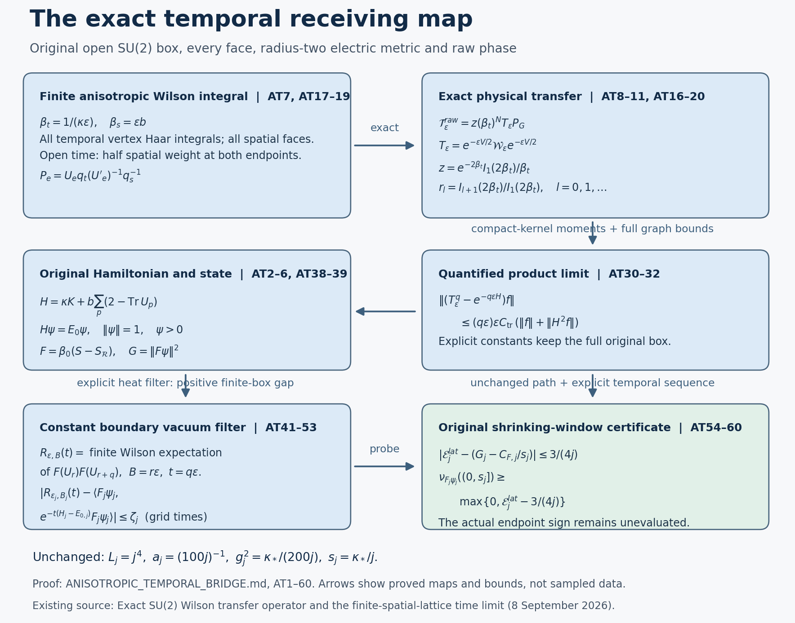

# Exact anisotropic Wilson transfer and a quantitative temporal sequence

This derivation keeps the original open spatial box, radius-two electric metric, every spatial face, the raw reflected phase, the actual positive unit vacuum, and the prescribed simultaneous path. The exact Bessel and fixed-box transfer maps are existing programme results. The additional result here is an explicit temporal step sequence with a proved error for the original vacuum correlations and shrinking-window endpoint. It uses finite anisotropic four-dimensional Wilson integrals with constant open-time boundary vectors. It makes no assertion of Euclidean rotation invariance, spatial continuum reconstruction, or positivity of the unresolved original endpoint.

The original programme temporal-transfer TeX was read in full. Its exact scalar, gauge and operator formulas are retained below; its fixed-spatial-regulator convergence is not presented as a new result. The original spatial TeX explicitly records the absence of a simultaneous temporal error bound. The source ledger records the exact reading coverage, versions and comparison. The existing disk indexes were queried first. No theorem from a routing record is assumed.

## 1. Original spatial objects and raw phase

Let \(m=2L\), \(n=m+1\), \(L\ge2\). The physical vertices are
\(o+a(i-L,k-L,l-L)\), with \(0\le i,k,l\le m\), and all positive nearest-neighbour edges and geometric faces are retained. Reverse traversal uses the inverse of the same link. Put
\[
 N=3m(m+1)^2,\quad M=3m^2(m+1),\quad
 Q_L=SU(2)^{E_L},\quad dU=\prod_e dU_e,\quad
 T_\alpha=-i\sigma_\alpha/2 .
 \tag{AT1}
\]
Every Haar factor has mass one. The physical left derivative is
\(X_{e,\alpha}f(U)=\left.\frac{d}{dt}f(\ldots,e^{tT_\alpha}U_e,\ldots)\right|_{t=0}\).
These fields are orthonormal for the original radius-two metric. Define
\[
 \begin{gathered}
 K=-\sum_{e,\alpha}X_{e,\alpha}^2,\qquad
 \Gamma(f,g)=\sum_{e,\alpha}(X_{e,\alpha}f)(X_{e,\alpha}g),\\
 W_{(z;i,j)}=\operatorname{Tr}
  [U_i(z)U_j(z+e_i)U_i(z+e_j)^{-1}U_j(z)^{-1}],\\
 H=\kappa K+V,\qquad
 V=b\sum_p(2-W_p),\quad
 \kappa=2g^2/a,\quad b=1/(2g^2a)=\kappa\xi,\quad \xi=1/(4g^4).
 \end{gathered}\tag{AT2}
\]
The complete scalar \(2bM\) is part of \(V\). The gauge action is imposed at every vertex, including the boundary:
\((\alpha_qU)_e=q_{s(e)}U_eq_{t(e)}^{-1}\).
Its probability-Haar average is the orthogonal projection \(P_G\). The Hamiltonian acts on the invariant Hilbert space, and its actual vacuum satisfies
\[
 H\psi=E_0\psi,\quad\psi>0,\quad\|\psi\|=1,\quad
 d\mu=\psi^2dU,\qquad
 0\le E_0\le\overline E:=2bM.
 \tag{AT3}
\]
The upper bound is the constant trial vector: each original face trace has Haar mean zero. To fix the vacuum used below, \(K\) is the compact-product Laplacian with its complete matrix-coefficient spectrum, so its resolvent is compact. The bounded real potential preserves self-adjointness on \(D(K)\) and compact resolvent. Its heat kernel is bounded below by \(e^{-tV_0}\) times the strictly positive product heat kernel, by the Brownian integral with weight \(\exp(-\int_0^t V)\); \(V_0=4bM\). Thus the semigroup improves positivity. A lowest eigenvector can first be replaced by its absolute value without increasing its energy form and then becomes strictly positive under this heat operator. Simplicity follows because a second lowest eigenvector would have a nonzero sign-changing component orthogonal to the positive one, contradicting equality in the positivity-improving triangle inequality. Smoothness follows by applying the elliptic equation successively. Gauge averaging and reflection commute with \(H\); simplicity and positivity make this unique positive unit vector invariant under both. These arguments also show that its unrestricted lowest energy equals its physical lowest energy. They reproduce the finite-volume properties used in the retained programme proofs.

For specificity the full original phase is fixed here. The root is \((0,0,0)\), and
\[
 t_{i,k,l}=
 \left(\prod_{r=0}^{l-1}U_3(0,0,r)\right)
 \left(\prod_{s=0}^{k-1}U_2(0,s,l)\right)
 \left(\prod_{v=0}^{i-1}U_1(v,k,l)\right),
 \qquad Z_c=t_{s(c)}U_ct_{t(c)}^{-1}.
 \tag{AT4}
\]
Products have increasing indices and empty products are \(I\). Chords are
\(\mathcal C_2=\{(i,k,l;2):1\le i\le m,0\le k<m,0\le l\le m\}\) and
\(\mathcal C_3=\{(i,k,l;3):0\le i,k\le m,(i,k)\ne(0,0),0\le l<m\}\).
Set
\[
 \begin{gathered}
 \vartheta=\pi/(2n),\quad v_0(l)=n^{-1/2},\quad
 v_1(l)=\sqrt{2/n}\cos[\pi(l+1/2)/n],\quad
 w_1(l)=-\sqrt{2/n}\sin[\pi(l+1)/n],\\
 a_{(i,k,l;2)}=-v_1(i)w_1(k)v_0(l)/\sqrt2,\quad a_{(i,k,l;3)}=0,\\
 b_{(i,k,l;2)}=v_0(i)w_1(k)v_1(l)/\sqrt2,\quad
 b_{(i,k,l;3)}=-v_0(i)v_1(k)w_1(l)/\sqrt2,\\
 q^\alpha(U)=-2\operatorname{Tr}(T_\alpha U),\quad
 u_1=\sum_ca_cq(Z_c),\quad u_3=\sum_cb_cq(Z_c),\quad S=u_1\cdot u_3,\\
 \sigma_*=\sqrt8\sin\vartheta,\quad\beta_0=\sigma_*/(2g^2),\quad
 F=\beta_0(S-S_{\mathcal R}),\quad D=S+S_{\mathcal R}.
 \end{gathered}\tag{AT5}
\]
Here \(\mathcal R\) reflects coordinate one. It sends a direction-one edge at \(i\) to the inverse edge at \(m-i-1\), and directions two and three at \(i\) to the same oriented direction at \(m-i\). The entire reflected root paths are evaluated after this map. No boundary transport or affine term has been removed. In each root word the internal gauge factors cancel in order, giving \(t_x\mapsto q_ot_xq_x^{-1}\) and \(Z_c\mapsto q_oZ_cq_o^{-1}\). The three \(q^\alpha\) transform by the adjoint orthogonal matrix, so their dot products and both full phases are invariant. Reflection permutes links, inverts precisely the specified ones, preserves Haar and the bi-invariant metric, and permutes all face traces using cyclicity and \(\operatorname{Tr}U^{-1}=\operatorname{Tr}U\). It therefore commutes with \(H\), fixes its positive vacuum, and makes \(F\psi\) odd. Retain the raw quantities
\[
 v=F\psi,\quad G=\|v\|^2=\mu F^2,\quad
 C_F=\langle v,(H-E_0)v\rangle=\kappa\mu\Gamma(F,F),\quad
 \nu_v(B)=\langle v,\mathbf1_B(H-E_0)v\rangle .
 \tag{AT6}
\]
No division by \(G\) occurs in this bridge.

## 2. Full Wilson normalization and every spin multiplier

For a temporal spacing \(\epsilon>0\), keep
\[
 \beta_t=\frac1{\kappa\epsilon}=\frac{a}{2g^2\epsilon},
 \qquad \beta_s=\epsilon b=\frac{\epsilon}{2g^2a}.
 \tag{AT7}
\]
For \(\beta>0\), define the entire Bessel coefficients by
\[
 I_d(2\beta)=\sum_{r=0}^{\infty}
       \frac{\beta^{2r+d}}{r!(r+d)!}\quad(d=0,1,\ldots),\qquad
 Z(\beta)=\frac{I_1(2\beta)}{\beta},\qquad
 z(\beta)=e^{-2\beta}Z(\beta).
 \tag{AT8}
\]
Multiplying the two absolutely uniformly convergent exponential series on the unit circle proves
\(I_d(2\beta)=\pi^{-1}\int_0^\pi e^{2\beta\cos\theta}\cos(d\theta)d\theta\).
The SU(2) class Haar formula is
\((2/\pi)\int_0^\pi f(\theta)\sin^2\theta\,d\theta\).
Integrating the derivative of
\(e^{2\beta\cos\theta}\sin(d\theta)\) gives
\[
 I_{d-1}(2\beta)-I_{d+1}(2\beta)=\frac d\beta I_d(2\beta).
 \tag{AT9}
\]
Both endpoint terms vanish. In particular \(Z(\beta)=\int e^{\beta\operatorname{Tr}U}dU\), and
\[
 z(\beta)=\int e^{-\beta(2-\operatorname{Tr}U)}dU,\quad
 k_\beta(U)=\frac{e^{-\beta(2-\operatorname{Tr}U)}}{z(\beta)}
           =\frac{e^{\beta\operatorname{Tr}U}}{Z(\beta)},\quad
 ({\cal W}_{\epsilon,e}f)(U')=\int k_{\beta_t}(U'U^{-1})f(U)dU.
 \tag{AT10}
\]
The two displayed forms keep the full Wilson scalar and specify its exact relation to the convolution.

Spin \(l/2\) has dimension \(l+1\), character
\(\chi_l(\theta)=\sin((l+1)\theta)/\sin\theta\), and the original radius-two Casimir eigenvalue \(l(l+2)/4\). Its exact convolution eigenvalue and multiplicity are
\[
 r_l(\epsilon)=\frac{I_{l+1}(2/(\kappa\epsilon))}
                       {I_1(2/(\kappa\epsilon))},\qquad
 \text{multiplicity }(l+1)^2,\qquad l=0,1,\ldots .
 \tag{AT11}
\]
Indeed the unnormalized character integral is
\(I_l-I_{l+2}=(l+1)I_{l+1}/\beta\). Centrality makes the representation integral a scalar, and division by its dimension \(l+1\) cancels exactly that factor. The positive series proves \(r_l>0\), while \(|\chi_l|\le l+1\) proves \(r_l\le1\); \(r_0=1\). Completeness of the original SU(2) matrix coefficients therefore proves positivity, self-adjointness, contraction and injectivity. The bound
\(I_d(2\beta)\le\beta^de^{\beta^2}/d!\)
proves trace class after summing \(d^2 I_d/I_1\). The spin and completeness facts are the original finite-product electric spectral decomposition used in PK and the retained transfer source; no finite spin cutoff replaces (AT11).

## 3. A quantitative compact-kernel estimate

The following estimate supplies the new uniform control rather than a fixed-spin asymptotic alone. Assume \(\beta\ge1\). Under \(k_\beta dU\), the radial angle \(\theta\) has density proportional to
\(\sin^2\theta\,e^{-2\beta(1-\cos\theta)}\), and the physical radius is \(r=2\theta\). Define the explicit constants
\[
 D_k=\frac{3e\pi^2}{8}\,
       \Gamma(k+3/2)\left(\frac{\pi^2}{4}\right)^{k+3/2}
       \quad(k=1,2),\qquad
 a_0=\frac{2D_2}{9}+\frac{D_1}{2},\quad b_0=\frac{2D_2}{3}.
 \tag{AT12}
\]
Then
\[
 \mathbb E_\beta\theta^{2k}\le D_k\beta^{-k},\qquad
 \left|\frac{\mathbb E_\beta r^2}{6}-\frac1\beta\right|
           \le a_0\beta^{-2},\qquad
 \frac{\mathbb E_\beta r^4}{24}\le b_0\beta^{-2}.
 \tag{AT13}
\]
Here is a complete derivation. On \(0\le\theta\le\beta^{-1/2}\le1\),
\(\sin\theta\ge2\theta/\pi\) and
\(2\beta(1-\cos\theta)\le\beta\theta^2\le1\).
Thus the radial normalizing integral is at least
\(4\beta^{-3/2}/(3e\pi^2)\).
On \(0\le\theta\le\pi\),
\(1-\cos\theta\ge2\theta^2/\pi^2\) and \(\sin^2\theta\le\theta^2\).
The moment numerator is consequently at most
\[
 \int_0^\infty\theta^{2k+2}e^{-4\beta\theta^2/\pi^2}d\theta
 =\tfrac12\Gamma(k+3/2)
                 (\pi^2/(4\beta))^{k+3/2}.
\]
Division gives the first estimate. Integration of the derivative of
\(\sin^3\theta e^{2\beta\cos\theta}\) gives
\(\mathbb E_\beta\sin^2\theta=3\mathbb E_\beta\cos\theta/(2\beta)\).
Moreover
\(0\le\theta^2-\sin^2\theta\le\theta^4/3\) and
\(1-\cos\theta\le\theta^2/2\).
The former follows by integrating
\(\sin(2t)\ge2t-(2t)^3/6\); this sine inequality follows by three integrations of \(1-\cos(2t)\ge0\) with the appropriate scale. Hence
\[
 \left|\mathbb E_\beta\theta^2-\frac3{2\beta}\right|
 \le\frac13\mathbb E_\beta\theta^4
               +\frac3{4\beta}\mathbb E_\beta\theta^2,
\]
which proves the other two estimates with exactly (AT12).

For a unit Lie direction \(n\), put \(X_n=\sum_\alpha n_\alpha X_{e,\alpha}\). Its unitary translation commutes with \(K_e\), and
\(\|X_n^4f\|\le\|K_e^2f\|\) on \(D(K_e^2)\). To prove the inequality, \(-X_n^2\le K_e\) as quadratic forms after rotating the orthonormal Lie basis; they commute because \(K_e\) is the Casimir. Their simultaneous spectral decomposition gives the stated fourth-power bound.
Apply the exact fourth-order integral remainder to \(f(e^{rn\cdot T}U)\), then average over the uniform direction \(n\). Odd powers vanish, and
\(\mathbb E_nX_n^2=-K_e/3\). Equations (AT13) give
\[
 \|({\cal W}_{\epsilon,e}-I+\kappa\epsilon K_e)f\|
 \le\kappa^2\epsilon^2
               (a_0\|K_ef\|+b_0\|K_e^2f\|),
 \qquad \kappa\epsilon\le1.
 \tag{AT14}
\]
The convolution uses inverse left multiplication, but its radial law is invariant under inversion, so the same averaged formula applies.

Let \({\cal W}_\epsilon=\bigotimes_e{\cal W}_{\epsilon,e}\). Every factor commutes with every \(K_f\) and is a scalar function of its own Casimir. Comparing (AT14) in a single spin sector to the actual heat multiplier, whose second-order remainder is at most \(\kappa^2\epsilon^2\lambda_e^2/2\), and telescoping the finite product in the joint electric spectrum gives
\[
 \|({\cal W}_\epsilon-e^{-\kappa\epsilon K})f\|
 \le\kappa^2\epsilon^2
       \{a_0\|Kf\|+(b_0+1/2)\|K^2f\|\}.
 \tag{AT15}
\]
For detail, write \(\lambda=\sum_e\lambda_e\), with every \(\lambda_e\ge0\).
All the exact Wilson and heat multipliers lie in \([0,1]\), so their scalar product difference is at most the sum of their scalar differences. Equation (AT14) therefore bounds its absolute value by
\[
 \kappa^2\epsilon^2
   \left[a_0\sum_e\lambda_e+(b_0+1/2)\sum_e\lambda_e^2\right]
 \le\kappa^2\epsilon^2[a_0\lambda+(b_0+1/2)\lambda^2].
\]
Integrating its square against the joint spectral measure of \(f\), then using the triangle inequality for \(a_0Kf+(b_0+1/2)K^2f\), proves (AT15). This order of operations removes the unnecessary \(\sqrt N\) from the earlier valid estimate that summed vector norms before spectral integration. The preceding valid estimate is preserved in the source archive; the dimension improvement and its receiving constants are recorded in the claim ledger. No spin- or dimension-dependent constant occurs in (AT15). In particular (AT14) applied to every spin also proves
\(r_l(\epsilon)=1-\kappa\epsilon\,l(l+2)/4+O_l(\epsilon^2)\), with the original absolute coefficient.

## 4. Exact gauge-integrated four-dimensional transfer

Write \(A_\epsilon=e^{-\epsilon V/2}\), and define the positive physical transfer
\[
 T_\epsilon=A_\epsilon{\cal W}_\epsilon A_\epsilon
       \quad\hbox{on }{\cal H}_{\rm phys},\qquad
 {\cal T}^{\rm raw}_\epsilon
       =c_\epsilon T_\epsilon P_G,\qquad
 c_\epsilon=z(\beta_t)^N .
 \tag{AT16}
\]
The unrestricted version of \(T_\epsilon\) commutes with \(P_G\). This follows from gauge invariance of \(V\) and centrality of the convolution kernel. The gauge projection is proved directly by two Haar integrations and Haar inversion; it includes all boundary vertices.

For adjacent spatial slices \(U,U'\), keep a temporal link \(q_x\) at every vertex from the first slice to the second, and the original oriented temporal plaquette
\[
 P_e(U',q,U)=U_eq_{t(e)}(U'_e)^{-1}q_{s(e)}^{-1}.
 \tag{AT17}
\]
Its inverse is
\((\alpha_qU')_eU_e^{-1}\). Their traces agree, so the exact raw kernel is
\[
 {\cal T}^{\rm raw}_\epsilon(U',U)
 =e^{-\epsilon V(U')/2}e^{-\epsilon V(U)/2}
   \int_{SU(2)^{V_L}}
      \exp\!\left[-\beta_t\sum_e(2-\operatorname{Tr}P_e)\right]
          \prod_xdq_x .
 \tag{AT18}
\]
Substitution of (AT10) proves (AT16), including \(c_\epsilon\); it is not a temporal gauge-fixing assertion. Under the original inverse-transport convention the changes
\(U_e\mapsto h_s^{-1}U_eh_t\),
\(U'_e\mapsto(h'_s)^{-1}U'_eh'_t\),
\(q_x\mapsto h_x^{-1}q_xh'_x\)
conjugate \(P_e\) by \(h_s^{-1}\), proving its exact gauge law.

Multiplying \(q\) adjacent raw kernels and integrating every intermediate slice gives the anisotropic Wilson integral on the original open spatial box and an open temporal interval. Each temporal layer contains all \(N\) plaquettes (AT17); each interior spatial slice contains all \(M\) faces with coefficient \(\beta_s=\epsilon b\); the two endpoints carry coefficient \(\beta_s/2\). Boundary wavefunctions are integrated against product Haar. Periodic time is instead the trace with every spatial slice carrying its full weight:
\[
 Z_q^{\rm periodic}
   =c_\epsilon^q\operatorname{Tr}_{\rm phys}(T_\epsilon^q).
 \tag{AT19}
\]
Trace class follows from (AT11) and bounded multiplication. Fubini on the finite compact products proves the open-interval composition and insertion formulas directly. No temporal holonomy is set to the identity.

The complete scalar-energy dictionary is
\[
 H_\epsilon=-\epsilon^{-1}\log T_\epsilon,\qquad
 H_\epsilon^{\rm raw}
   =-\epsilon^{-1}\log c_\epsilon\,I+H_\epsilon,\qquad
 -\epsilon^{-1}\log c_\epsilon
   =\frac N\epsilon\left[2\beta_t-\log\frac{I_1(2\beta_t)}{\beta_t}\right].
 \tag{AT20}
\]
The logarithm is on the physical space only. Strict positivity of all spin eigenvalues and invertibility of \(A_\epsilon\) make \(T_\epsilon\) injective there, although its eigenvalues accumulate at zero. If \(T_\epsilon u_\alpha=\tau_\alpha u_\alpha\) is a complete orthonormal eigenbasis, \(0<\tau_\alpha\le1\), its exact domain is
\[
 D(H_\epsilon)=
 \left\{\sum_\alpha f_\alpha u_\alpha:
   \sum_\alpha \epsilon^{-2}|\log\tau_\alpha|^2|f_\alpha|^2<\infty,
   \quad \sum_\alpha|f_\alpha|^2<\infty\right\}.
\]
It acts there by coefficients \(-\epsilon^{-1}\log\tau_\alpha\).
The raw and divided transfers have identical eigenvectors and energy differences. Equations (AT16)–(AT20) retain the scalar explicitly; it is not silently discarded.

## 5. Full-Hamiltonian graph bounds and the product error

The next constants are deliberately generous and explicit functions of the original regulator. They are not estimates uniform in the growing box. Put \(d=3N\) and
\[
 V_0=4bM,\quad V_1=\sqrt d\,bM,\quad V_2=dbM/2,\qquad
 Q_K(f)=\|f\|+\|K^2f\|,\quad Q_H(f)=\|f\|+\|H^2f\|.
 \tag{AT21}
\]
These uppercase constants are distinct from the row function \(v_0(l)\) in (AT5).
Each physical edge occurs once in any one original face. For every ordered physical field word of length \(r\ge1\), differentiation inserts \(r\) matrices of norm \(1/2\), with the order reversed when required by an inverse link. Thus
\[
 \|V\|_\infty\le V_0,\quad
 \|X_{i_1}\cdots X_{i_r}V\|_\infty\le2bM\,2^{-r},
 \quad \|\nabla V\|_\infty\le V_1,\quad
 \|KV\|_\infty\le V_2 .
 \tag{AT22}
\]
Here each \(i\) denotes one of all \(3N\) edge-colour fields. Terms from faces not containing a differentiated edge are zero; bounding the retained sum by all \(M\) faces is valid and leaves every original term in \(V\).

The central operator \(K\) commutes with every physical field. Repeatedly using \(\|X_i f\|\le\|K^{1/2}f\|\) proves, for an ordered word of length \(0\le r\le4\),
\(\|X_{i_1}\cdots X_{i_r}f\|\le Q_K(f)\).
Indeed the intermediate bound is \(\|K^{r/2}f\|\), and
\(\lambda^{r/2}\le1+\lambda^2\) for \(\lambda\ge0\); spectral calculus and the triangle inequality finish the proof.
If
\[
 0<\epsilon\le\epsilon_0:=\min\{1,\kappa^{-1},(1+V_0)^{-1}\},
 \tag{AT23}
\]
each positive-order derivative of the exponent \(-\epsilon V/2\), up to order four, has absolute value at most one. The ordered chain rule for \(A_\epsilon\) is indexed by partitions of the derivative positions, preserving the order within each block. Its number of summands is the Bell number, at most \(15\) through order four. Every summand has absolute value at most \(A_\epsilon\le1\). The full Leibniz expansions therefore give
\[
 \|K(A_\epsilon f)\|\le60d\,Q_K(f),\qquad
 \|K^2(A_\epsilon f)\|\le240d^2\,Q_K(f).
 \tag{AT24}
\]
There are \(d\) second-derivative words and \(d^2\) fourth-derivative words, with respectively \(2^2\) and \(2^4\) Leibniz terms. No commutation between two individual fields is presumed.

The exact forward and reverse identities are
\[
 \begin{split}
 H^2f={}&\kappa^2K^2f+2\kappa V Kf+\kappa(KV)f
                -2\kappa\Gamma(V,f)+V^2f,\\
 \kappa^2K^2f={}&H^2f-VHf-\kappa V Kf-\kappa(KV)f
                          +2\kappa\Gamma(V,f).
 \end{split}\tag{AT25}
\]
The signs follow from \(K(Vf)=VKf+(KV)f-2\Gamma(V,f)\). Define
\[
 \begin{gathered}
 h_2=\kappa^2+2\kappa V_0+\kappa V_2+2\kappa V_1+V_0^2,\qquad
 k_1=(1+V_0)/\kappa,\\
 k_2=\frac{(1+V_0)^2+\kappa V_2+
                    2\kappa V_1\sqrt{k_1}}{\kappa^2}.
 \end{gathered}\tag{AT26}
\]
Then
\[
 \begin{gathered}
 Q_H(f)\le(1+h_2)Q_K(f),\qquad
 \|Kf\|\le k_1Q_H(f),\qquad
 \|\nabla f\|\le\sqrt{k_1}Q_H(f),\\
 \|K^2f\|\le k_2Q_H(f),\qquad
 Q_K(f)\le(1+k_2)Q_H(f).
 \end{gathered}\tag{AT27}
\]
For the forward bound use (AT22), \(\|Kf\|,\|\nabla f\|\le Q_K(f)\), and the first line of (AT25). For the reverse bound,
\(\|Hf\|\le Q_H(f)\) by nonnegative spectral calculus, so
\(\kappa\|Kf\|\le(1+V_0)Q_H(f)\).
The identity \(\|\nabla f\|^2=\langle f,Kf\rangle\) gives the gradient estimate. The second line of (AT25) then gives \(k_2\), since
\(1+V_0+\kappa V_0k_1=(1+V_0)^2\).

These are domain statements as well as smooth calculations. The bounded real multiplier \(V\) gives \(D(H)=D(K)\). The product rule and (AT22) show that multiplication by \(V\) maps \(D(K)\) into \(D(K)\): approximate in its graph norm by smooth functions and use the gradient bound. Hence \(f\in D(H^2)\) if and only if \(f\in D(K)\) and \(\kappa Kf+Vf\in D(K)\), which is equivalent to \(f\in D(K^2)\). Smooth approximation extends (AT25)–(AT27) to this common domain. Finite Peter–Weyl sums, followed by \(P_G\), are a core for \(K^2\) on the physical space. Thus no product of unbounded operators has been used outside its domain.

The additional exact multiplier identity needed for the local error is
\[
 \begin{split}
 A_\epsilon K(A_\epsilon f)-Kf
  ={}&(A_\epsilon^2-1)Kf
      -\frac{\epsilon}{2}A_\epsilon^2(KV)f
      -\frac{\epsilon^2}{4}A_\epsilon^2\Gamma(V,V)f\\
     &+\epsilon A_\epsilon^2\Gamma(V,f).
 \end{split}\tag{AT28}
\]
In particular the \(\Gamma(V,V)\) term has a negative sign. Since
\(|A_\epsilon^2-1|\le\epsilon V_0\), its norm is bounded by
\(\epsilon[V_0+V_2/2+V_1^2/4+V_1]Q_K(f)\) under (AT23).
The scalar inequality
\(|e^{-x}-1+x|\le x^2/2\), \(x\ge0\), bounds
\((A_\epsilon^2-I+\epsilon V)f\).
Equation (AT15), followed by the heat remainder, bounds
\(({\cal W}_\epsilon-I+\kappa\epsilon K)A_\epsilon f\).
Insert these estimates into the exact decomposition
\[
 T_\epsilon f=A_\epsilon^2f-\kappa\epsilon A_\epsilon K(A_\epsilon f)
          +A_\epsilon({\cal W}_\epsilon-I+\kappa\epsilon K)A_\epsilon f.
 \tag{AT29}
\]
The result, including the full \(H\)-heat remainder, is
\[
 \begin{gathered}
 D_{\rm loc}=\frac{V_0^2}{2}
   +\kappa\left(V_0+\frac{V_2}{2}+\frac{V_1^2}{4}+V_1\right)
   +\kappa^2\left[
       60d\,a_0+
       240d^2(b_0+1)\right]+\frac{h_2}{2},\\
 C_{\rm tr}=D_{\rm loc}(1+k_2),\qquad
 \|(T_\epsilon-e^{-\epsilon H})f\|
                  \le\epsilon^2 C_{\rm tr}Q_H(f).
 \end{gathered}\tag{AT30}
\]
Every term of \(D_{\rm loc}\) has been specified: the first is the spatial scalar remainder, the second is (AT28), the bracket is (AT24) in the electric estimate, and the last is the \(H\)-heat remainder. In particular the extensive constant in \(V\) affects this error and has not been removed.

Both \(T_\epsilon\) and \(e^{-tH}\) are contractions, and
\(Q_H(e^{-tH}f)\le Q_H(f)\). The ordered telescoping identity
\[
 T_\epsilon^q-e^{-q\epsilon H}
 =\sum_{r=0}^{q-1}T_\epsilon^{q-1-r}
       (T_\epsilon-e^{-\epsilon H})e^{-r\epsilon H}
 \tag{AT31}
\]
therefore proves, for every integer \(q\ge0\),
\[
 \|(T_\epsilon^q-e^{-q\epsilon H})f\|
                  \le(q\epsilon)\epsilon C_{\rm tr}Q_H(f).
 \tag{AT32}
\]
This quantitative estimate is the receiving refinement of the existing fixed-box strong limit. Density and contraction give that limit on all of the physical Hilbert space. Equation (AT32), not an interchange of fixed-box limits, will be used when \(j\) grows.

## 6. Bounds for the complete original phase and the actual vacuum

The exact coefficient sums are
\[
 \begin{gathered}
 S_1=\sum_c|a_c|=\sqrt{2/n}\cot\vartheta
                         (\cot\vartheta-\cos\vartheta),\\
 S_3=\sum_c|b_c|=\sqrt{2/n}
       [(2-1/n)\cot^2\vartheta-(\cos\vartheta/n)\cot\vartheta],
 \qquad \overline F=8\beta_0S_1S_3 .
 \end{gathered}\tag{AT33}
\]
For completeness,
\(\sum_{i=0}^m|v_1(i)|=\sqrt{2/n}\cot\vartheta\),
\(\sum_{i=1}^m|v_1(i)|=\sqrt{2/n}(\cot\vartheta-\cos\vartheta)\),
and \(\sum_{k=0}^{m-1}|w_1(k)|=\sqrt{2/n}\cot\vartheta\).
Each follows by summing the finite geometric series for the sine or cosine and pairing terms around the midpoint; \(n=2L+1\) is odd and its central cosine is zero.
Multiplying the three independent sums gives \(S_1\).
The direction-two contribution to \(S_3\) is
\(\sqrt{2/n}(m/n)\cot^2\vartheta\).
The full direction-three rectangle contributes
\(\sqrt{2/n}\cot^2\vartheta\), and its excluded corner contributes
\(\sqrt{2/n}(\cos\vartheta/n)\cot\vartheta\).
Their sum gives exactly (AT33).

The original quaternion identity, proved by multiplying
\(A=a_0I-i\,a\cdot\sigma\) and \(B=b_0I-i\,b\cdot\sigma\), is
\[
 q(A)\cdot q(B)=\operatorname{Tr}(AB^{-1})-\operatorname{Tr}(AB).
 \tag{AT34}
\]
It expresses \(F\) as the full coefficient sum of four traces: the two displayed words and the two entire reflected words, with their original signs. Each individual root path traverses an edge at most once, and the chord is outside the tree. Hence each physical edge occurs at most twice in \(Z_c\), and at most four times in either two-chord trace word. The reflected words obey the same bound. For an ordered derivative word of length \(r\), there are at most \(4^r\) insertion terms per trace, each bounded by \(2(1/2)^r\), including inverse-link differentiation. Consequently
\[
 \|F\|_\infty\le\overline F,\qquad
 \|X_{i_1}\cdots X_{i_r}F\|_\infty
                         \le2^r\overline F\quad(r\ge0).
 \tag{AT35}
\]
This deliberately retains repeated root occurrences. It does not replace the raw phase by a local selected word.

The complete fourth-order Leibniz sum is
\(\sum_{r=0}^4\binom4r2^r=81\). Applying it to each of the \(d^2\) terms in \(K^2(Ff)\), then using (AT27), gives
\[
 \begin{gathered}
 Q_K(Ff)\le\overline F(1+81d^2)Q_K(f),\\
 m_F=(1+h_2)\overline F(1+81d^2)(1+k_2),\qquad
 Q_H(Ff)\le m_F Q_H(f),\\
 q_\psi=1+\overline E^2,\qquad
 a_F=m_Fq_\psi+\overline E\,\overline F,\qquad
 q_1=1+\kappa V_2+V_0^2,\\
 \|(H-E_0)F\psi\|\le a_F,\qquad Q_H(1)\le q_1.
 \end{gathered}\tag{AT36}
\]
Indeed \(Q_H(\psi)=1+E_0^2\le q_\psi\), and
\(\|HF\psi\|\le Q_H(F\psi)\).
Also \(H^2 1=\kappa KV+V^2\), which proves the last bound. No unknown derivative of \(\psi\) is part of these constants.

Here is a direct proof of the existing positive finite-volume gap input, so that the filter below is explicit. Put \(w=\log\psi\). The vacuum equation is
\(\Delta w+|\nabla w|^2=V/\kappa-E_0/\kappa\).
On the original product of radius-two three-spheres, the partial Bochner identity for one edge is
\[
 \frac12(\Delta+2\nabla w\cdot\nabla)|\nabla_e w|^2
   =|\nabla\nabla_e w|^2+\frac12|\nabla_e w|^2
                     +\langle\nabla_e w,\nabla_e(V/\kappa)\rangle .
 \tag{AT37}
\]
The Hessian norm includes derivatives in every edge direction. This identity follows by differentiating the vacuum equation, commuting the covariant derivatives on that product, and using the Ricci tensor \(1/2\) on its edge factor; cross-factor curvatures vanish. At a global maximum of \(|\nabla_e w|^2\), its drift derivative is zero and its Laplacian is nonpositive. For an incident face, the three-colour norm of the derivative of its trace is at most one: write its cyclic word as \(cI-i z\cdot\sigma\), use \(|z|\le1\), and rotate the inserted generators by its fixed surrounding transports. Thus
\(\|\nabla_e(V/\kappa)\|\le r_e\xi\), where \(r_e\) is the actual number of incident faces. Equation (AT37) proves
\(\|\nabla_e w\|_\infty\le2r_e\xi\).
Every edge factor has diameter \(2\pi\), and \(\sum_er_e=4M\). Hence
\[
 \Omega=32\pi\xi M,\qquad
 \operatorname{osc}\log\psi^2\le\Omega,\qquad
 \min\psi\ge e^{-\Omega/2},\quad
 c:=\langle1,\psi\rangle\ge e^{-\Omega/2},\qquad
 \delta=3\kappa e^{-\Omega}.
 \tag{AT38}
\]
The normalized density has minimum at least \(e^{-\Omega}\), proving the two middle inequalities.

To verify the gap constant, a nonzero-spin support in an invariant Peter–Weyl component has no degree-one vertex: Haar averaging at such a vertex would annihilate its only nontrivial representation. Any finite graph with nonempty support and no degree-one vertex contains a cycle. The original open cubic graph has no cycle shorter than four, and every nonzero edge spin contributes at least \(3/4\) to \(K\). Therefore the first nonconstant physical electric eigenvalue is at least three. A fundamental face trace attains three, so it is exactly three.
For every invariant smooth real \(f\), write \(\rho=\psi^2\). Subtracting its Haar mean and then minimizing over constants gives
\[
 \operatorname{Var}_\mu f
 \le(\max\rho)\operatorname{Var}_{dU}f
 \le\frac{\max\rho}{3}\int\Gamma(f,f)dU
 \le\frac{e^\Omega}{3}\mu\Gamma(f,f).
 \tag{AT39}
\]
Finally the full product rule and Haar integration by parts give
\(\langle f\psi,(H-E_0)f\psi\rangle=\kappa\mu\Gamma(f,f)\).
Applying the same argument to the real and imaginary parts gives the complex form statement with \(\sum_i|X_if|^2\). It follows first on smooth functions, then on the form domain, that
\(H-E_0\ge\delta\) on the physical orthogonal complement of \(\psi\).
The potential and \(2bM\) are removed from this form only by inserting their exact vacuum equation.

## 7. Constant-boundary Wilson integrals that recover the actual vacuum

Write \({\cal A}=H-E_0\ge0\) and
\[
 C(t)=\langle F\psi,e^{-t{\cal A}}F\psi\rangle,\qquad C(0)=G.
 \tag{AT40}
\]
For a finite filter duration \(B>0\), decompose the actual heat vector as
\[
 e^{BE_0}e^{-BH}1=c(\psi+\eta_B),\quad
 \eta_B\perp\psi,\quad
 \|\eta_B\|\le r_B:=e^{\Omega/2-B\delta}.
 \tag{AT41}
\]
The decomposition is exact by spectral projection; its bound uses
\(\|1-c\psi\|\le1\), (AT38), and the gap just proved. Introduce the complete unshifted heat ratio
\[
 R_B(t)=
 \frac{\langle e^{-BH}1,F e^{-tH}F e^{-BH}1\rangle}
      {\langle1,e^{-(2B+t)H}1\rangle}.
 \tag{AT42}
\]
Divide both numerator and denominator by
\(c^2e^{-(2B+t)E_0}\). The denominator becomes
\(1+\langle\eta_B,e^{-t{\cal A}}\eta_B\rangle\), between \(1\) and \(1+r_B^2\). The numerator differs from \(C(t)\) by at most
\(\overline F^2(2r_B+r_B^2)\), from its two linear and one quadratic cross terms. The denominator correction contributes at most another \(\overline F^2r_B^2\). Thus, if \(r_B\le1\),
\[
 |R_B(t)-C(t)|\le4\overline F^2r_B
          \quad\hbox{for every }t\ge0 .
 \tag{AT43}
\]
For a requested error \(0<\zeta\le1\), any
\[
 B\ge B_{\rm pre}:=\delta^{-1}
       [\,\Omega/2+\log(8(1+\overline F^2)/\zeta)\,]
 \tag{AT44}
\]
makes the right side at most \(\zeta/2\).

Now require \(B=r\epsilon\) and \(t=q\epsilon\), with \(r,q\) nonnegative integers, \(r\ge1\). The finite anisotropic Wilson ratio is
\[
 R_{\epsilon,B}(t)=
 \frac{\langle1,T_\epsilon^rF T_\epsilon^qF T_\epsilon^r1\rangle}
      {\langle1,T_\epsilon^{2r+q}1\rangle}.
 \tag{AT45}
\]
The same expression with every \(T_\epsilon\) replaced by
\({\cal T}^{\rm raw}_\epsilon\) has the identical value: there are exactly \(2r+q\) factors in each line, so their full scalar \(c_\epsilon^{2r+q}\) cancels. The inserted \(F\)'s and the constant endpoint vectors are invariant, so all \(P_G\)'s are retained by the temporal gauge integrations and then act as the identity on the physical vectors. Equations (AT17)–(AT18) identify (AT45) with the exact expectation of \(F(U_r)F(U_{r+q})\) in the finite four-dimensional Wilson measure. Its temporal endpoints have half spatial weight, and its temporal boundary vectors are both the constant one. The case \(q=0\) is the same finite measure with one \(F^2\) insertion. There is no use of the unknown vacuum as a lattice boundary condition.

Fix a finite time horizon \(T>0\). The heat denominator in (AT42), for \(0\le t\le T\), is at least
\[
 d_{\min}=e^{-\Omega-(2B+T)\overline E},\qquad
 0\le R_B(t)\le R_{\max}:=
                 \overline F^2 e^{\Omega+T\overline E}.
 \tag{AT46}
\]
For the first inequality use its vacuum contribution
\(c^2e^{-(2B+t)E_0}\). For the second, the numerator is nonnegative and at most
\(\overline F^2 e^{-2BE_0}\), since the middle heat is a positive contraction and
\(\|e^{-BH}1\|\le e^{-BE_0}\). Division by the same vacuum contribution proves (AT46).

Write \(x=T_\epsilon^r1\), \(y=e^{-BH}1\).
Equation (AT32) gives
\(\|x-y\|\le B\epsilon C_{\rm tr}q_1\), and both have norm at most one. Replacing the two exterior vectors in
\(\langle x,FT_\epsilon^qFx\rangle\) therefore changes it by at most
\(2\overline F^2B\epsilon C_{\rm tr}q_1\).
For its middle factor, (AT32) is applied to \(Fy\), whose \(Q_H\)-norm is at most \(m_Fq_1\) by (AT36) and heat contraction. Consequently the numerator and denominator errors are bounded respectively by
\[
 \begin{split}
 e_N&=\epsilon C_{\rm tr}q_1
              (2\overline F^2B+\overline F m_Ft),\\
 e_D&=(2B+t)\epsilon C_{\rm tr}q_1 .
 \end{split}\tag{AT47}
\]
All estimates compare the full unshifted operators. If \(e_D\le d_{\min}/2\), the lattice denominator is positive and the quotient identity gives
\[
 |R_{\epsilon,B}(t)-R_B(t)|
 \le\frac{2\epsilon C_{\rm tr}q_1}{d_{\min}}A_{\rm err},\qquad
 A_{\rm err}=2\overline F^2B+\overline F m_FT
                         +R_{\max}(2B+T).
 \tag{AT48}
\]
Indeed \(|N'/D'-N/D|\le(e_N+(N/D)e_D)/D'\), and (AT46) applies.
Thus no exponential vacuum-energy amplification has been hidden; it appears explicitly in \(d_{\min}\) and \(R_{\max}\).

## 8. An explicit temporal sequence on the unchanged original path

For every integer \(j\ge2\), keep exactly
\[
 \begin{gathered}
 L_j=j^4,\quad a_j=(100j)^{-1},\quad
 g_j^2=\kappa_*/(200j),\quad s_j=\kappa_*/j,\quad \kappa_*>0,\\
 m_j=2j^4,\quad n_j=2j^4+1,\quad
 \kappa_j=\kappa_*,\quad
 \xi_j=10000j^2/\kappa_*^2,\quad
 b_j=10000j^2/\kappa_* .
 \end{gathered}\tag{AT49}
\]
Evaluate every constant above at these original values. The next displayed prescription introduces only the temporal spacing and the finite open-time extent. Suppress subscripts \(j\) inside the prescription to improve legibility; all its inputs have already been defined:
\[
 \begin{gathered}
 u=\min\left\{1,\frac{s}{j(1+a_F^2)}\right\},\qquad
 \zeta=\frac{1}{4j(1+2/(us))},\qquad T=1+\frac1s,\\
 \ell=\left\lceil B_{\rm pre}/u\right\rceil,\qquad B=\ell u,
 \end{gathered}\tag{AT50}
\]
where \(B_{\rm pre}\) is (AT44) with this \(\zeta\). Compute \(d_{\min},R_{\max},A_{\rm err}\) from (AT46), (AT48) with this \(B,T\), and set
\[
 \begin{split}
 \epsilon_{\max}=\min\bigg\{&
 1,\frac1\kappa,\frac1{1+V_0},
 \frac{d_{\min}}{4C_{\rm tr}q_1(1+2B+T)},\\
 &\frac{\zeta d_{\min}}{4C_{\rm tr}q_1(1+A_{\rm err})},
 \frac{\zeta}{1+\overline F a_F}\bigg\},\\
 n_t&=1+\left\lceil u/\epsilon_{\max}\right\rceil,\qquad
 \epsilon_j=u/n_t,\qquad r_t=\ell n_t .
 \end{split}\tag{AT51}
\]
All these numbers are strictly positive and finite at each \(j\). The integer powers in (AT45) are exact:
\(u=n_t\epsilon_j\) and \(B=r_t\epsilon_j\).
The values of \(E_0,\psi,G,C_F\) are not needed to define the sequence.
Its size is not a claim of computational practicality.
Since \(\epsilon_j\le u\le\kappa_*/j^2\), it tends to zero.

The fourth entry in (AT51) gives \(e_D\le d_{\min}/4\), which is stronger than the hypothesis of (AT48). Its fifth entry gives transfer-ratio error at most \(\zeta/2\). Equations (AT43)–(AT44) give another \(\zeta/2\). Therefore this single choice satisfies
\[
 \sup_{\substack{q\in\mathbb Z_{\ge0}\\q\epsilon_j\le T_j}}
 \left|R_{\epsilon_j,B_j}(q\epsilon_j)-C_j(q\epsilon_j)\right|
 \le\zeta_j .
 \tag{AT52}
\]
For arbitrary \(0\le t\le T_j\), use the grid time
\(t_j=\epsilon_j\lfloor t/\epsilon_j\rfloor\).
The spectral measure of \(F\psi\) gives
\[
 |C(t)-C(t_j)|\le(t-t_j)C_F
       \le\epsilon_j\overline F a_F\le\zeta_j,
 \tag{AT53}
\]
because \(C_F=\langle F\psi,{\cal A}F\psi\rangle
\le\overline F a_F\).
Thus the total error is at most \(2\zeta_j\), uniformly through the growing horizon \(T_j=1+1/s_j\).
The norm \(G_j=C_j(0)\) is controlled by (AT52) without being divided out.
This is a proved simultaneous sequence for the actual original vectors and state, with an explicit growing-box error. It does not follow merely by diagonalizing an unspecified fixed-box limit.

## 9. The original shrinking-window endpoint and its exact remaining defect

For every \(u>0\) define the finite-difference energy
\[
 C_{F,u}=\frac{G-C(u)}{u}.
 \tag{AT54}
\]
For \(x\ge0\), integration of \(1-e^{-x}\le x\) gives
\(0\le x-(1-e^{-x})\le x^2/2\).
Apply it to the full spectral measure \(\nu_v\) of (AT6) to obtain
\[
 0\le C_F-C_{F,u}
 \le\frac{u}{2}\|{\cal A}F\psi\|^2
 \le\frac{u a_F^2}{2}.
 \tag{AT55}
\]
The finite-difference energy is a lower approximation to \(C_F\); its direction matters when it is subtracted from \(G\).
On (AT49)–(AT51), let
\[
 G_j^{\rm lat}=R_{\epsilon_j,B_j}(0),\qquad
 {\cal E}^{\rm lat}_j
 =G_j^{\rm lat}
       -\frac{G_j^{\rm lat}-R_{\epsilon_j,B_j}(u_j)}
                    {u_js_j},\qquad
 {\cal E}_j=G_j-\frac{C_{F,j}}{s_j}.
 \tag{AT56}
\]
Both finite lattice correlations are exact finite anisotropic Wilson expectations with the boundary conventions proved in Section 7. Their temporal extents are respectively \(2B_j\) and \(2B_j+u_j\), so each uses its own full denominator.
The two errors in (AT52) give
\[
 \left|{\cal E}^{\rm lat}_j
       -\left(G_j-\frac{G_j-C_j(u_j)}{u_js_j}\right)\right|
 \le(1+2/(u_js_j))\zeta_j=\frac1{4j}.
 \tag{AT57}
\]
Here the coefficient \(1+2/(u_js_j)\) bounds
\(|1-1/(u_js_j)|+1/(u_js_j)\); no sign of either correlation error is assumed.
By (AT50), (AT55), the difference between the expression in parentheses and the full original endpoint is nonnegative and at most \(1/(2j)\). It follows that
\[
 \boxed{\left|{\cal E}^{\rm lat}_j-{\cal E}_j\right|
                    \le\frac{3}{4j},\qquad
 \nu_{F_j\psi_j}((0,s_j])
       \ge\max\left\{0,\ {\cal E}^{\rm lat}_j-\frac{3}{4j}\right\}.}
 \tag{AT58}
\]
For the last inequality, reflection gives \(\nu_v(\{0\})=0\), and
\(\nu_v((s,\infty))\le C_F/s\) by the scalar inequality
\(\mathbf1_{(s,\infty)}(\omega)\le\omega/s\).
Subtract this from the full raw mass \(G\), then use (AT57)–(AT55).
All endpoint masses and constants agree with the original PK202 expression
\[
 {\cal E}_j=
 2\beta_{0,j}^2(\mathcal Q_{4,j}-\mathcal Q_{4,\mathcal R,j})
 -\frac{2\kappa_*\beta_{0,j}^2}{s_j}
                (\mathcal K_{1,j}-\mathcal K_{\mathcal R,j}),
 \tag{AT59}
\]
where the four quantities are respectively
\(\mu_jS^2,\mu_j(SS_{\mathcal R}),
 \mu_j\Gamma(S,S),\mu_j\Gamma(S,S_{\mathcal R})\).
Reflection makes the two self moments and the two self energies equal; expanding the two complete squares in (AT6) proves (AT59). The scalar \(D=S+S_{\mathcal R}\) in (AT5) remains the original even phase and is not substituted for \(F\).

The exact defect in replacing the original energy by the probe is the nonnegative original expectation
\[
 {\cal D}(u):=C_F-C_{F,u}
  =\int_{[0,\infty)}
       \left[\omega-\frac{1-e^{-u\omega}}u\right]d\nu_v(\omega)
  =\frac1u\int_0^u(u-r)
       \langle{\cal A}v,e^{-r{\cal A}}{\cal A}v\rangle\,dr .
 \tag{AT60}
\]
The second equality follows by integrating the second derivative of
\(e^{-r\omega}\) twice and then using Tonelli; \(\|{\cal A}v\|\le a_F\) gives integrability. It calculates the next coupled quantity rather than presuming a spectral-projector limit. Formula (AT55) is its immediate upper bound; (AT50) controls it on the actual shrinking window.

The unresolved original endpoint sign is now the sign of the explicit combination of two finite four-dimensional Wilson expectations in (AT56), within the proved error (AT58). No positive sign is inferred from the representation. Likewise there is no claim that a temporal spectral projector converges at an unknown eigenvalue equal to \(s_j\), or that this anisotropic sequence yields Euclidean rotation invariance or an interacting continuum identification. Equations (AT45), (AT49)–(AT53), and (AT58) are the precise established receiving map.

## 10. Exact comparison with the original action convention

The retained temporal source also records the classical Lie form
\(c(X,Y)=-\operatorname{Tr}(XY)/2\). It is not the radius-two electric form:
the latter is \(-2\operatorname{Tr}(XY)=4c(X,Y)\).
For the actual generators \(T_\alpha=-i\sigma_\alpha/2\),
\(c(T_\alpha,T_\gamma)=\delta_{\alpha\gamma}/4\).
Thus the \(c\)-orthonormal derivatives are \(2X_\alpha\), and
\(\Delta^c=4\sum_\alpha X_\alpha^2=-4K_e\).
Changing the source's displayed example \(+i\sigma_\alpha/2\) to the programme's \(-i\sigma_\alpha/2\) negates every basis vector and leaves this sum of squares exactly fixed. The probability-Haar Hilbert spaces in the present comparison are identical. If geometric volume is used instead, its constant total volume is \(2\pi^2\) per \(c\)-sphere and \(16\pi^2\) per radius-two electric sphere; multiplication by the square root of the corresponding full product volume is the unitary map from geometric-volume \(L^2\) to probability-Haar \(L^2\). It preserves the numerical norm of the transported vector, including the full \(G\), rather than redefining it.

The original continuum-action convention in that source is
\((2g^2)^{-1}\int\sum_{\mu<\nu}c(F_{\mu\nu},F_{\mu\nu})\,d^4x\).
The exact coefficient identities are
\[
 \frac{\beta_t(a\epsilon)^2}{a^3\epsilon}
     =\frac1{2g^2},\qquad
 \frac{\beta_s a^4}{a^3\epsilon}
     =\frac1{2g^2}.
\]
They follow directly from (AT7); they do not replace either compact Wilson exponential by a curvature polynomial.
Finally the inverse-transport gauge parameters \(h_x\) and the Hamiltonian parameters \(q_x\) describe the same link change by \(q_x=h_x^{-1}\), since
\(q_sU_eq_t^{-1}=h_s^{-1}U_eh_t\).
Haar inversion preserves every gauge integral. This comparison inverts the vertex parameters only; it does not invert a spatial configuration or alter (AT17).

The main source and the spatial receiving source already prove the fixed-box operator map. The quantitative additions here are (AT12)–(AT15), (AT21)–(AT36), (AT41)–(AT58), with every original scalar retained. The course's finite time-reflection and logarithm constructions are compatible with (AT16)–(AT20), after their convention comparison; no continuum reconstruction theorem from that course or outside literature has been imported.

The reproducible figure source is [draw_temporal_map.py](draw_temporal_map.py). The complete retained provider is [the original temporal-transfer TeX](sources/temporal_transfer.tex), Sections 2–7, including the full action and metric dictionary. Source versions and bounded reading coverage appear in [the source-use ledger](TEMPORAL_SPECTRAL_SOURCE_USE_LEDGER.json).
