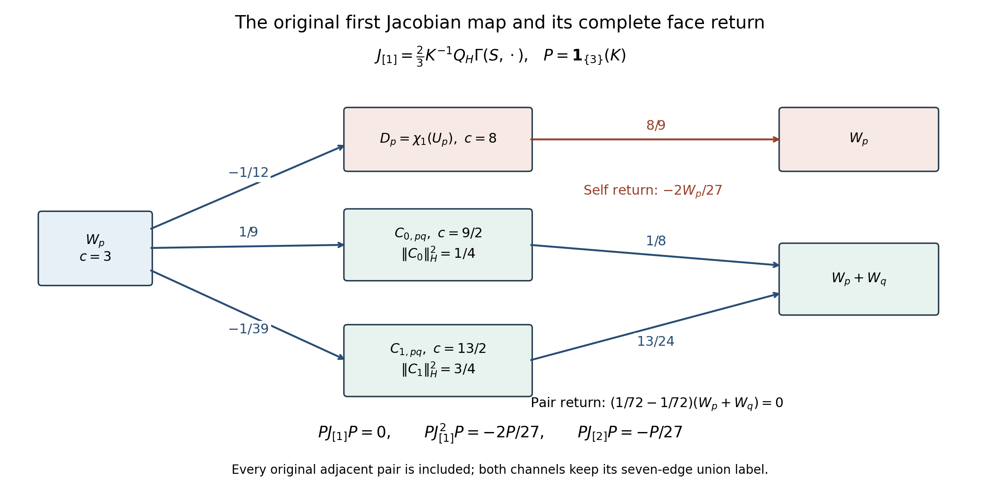

Historical source, preserved below. The third coefficient and complete inverse/tail backlog at the end is now resolved by [P1–P45](ORIGINAL_J5_PARITY_AND_TAIL.md); the fourth coefficient is the next unevaluated term.

# Original first Jacobian block and its exact return

29 September 2026. This calculation continues the retained fifth-reference residual on the original open cubic box. It uses the complete face channels already proved in [B13–B16 of the 15 September band source](https://github.com/KokunoYumeto/yang-mills-interacting-workbench/blob/fa79faff2cd697e16cfa3a7953f36810c22c8922/yang-mills/continuations/20260915-gauge-native-band/BAND_AND_CERTIFICATE.md#L125), not a new spin cutoff. No literature-priority claim is made.

## Objects and maps

Keep the vertices \(\{-L,\ldots,L\}^3\), \(L\ge2\), original positive links, Haar probability, all vertex gauge constraints and oriented face words
\[
 W_{(n;i,j)}=\operatorname{Tr}U_i(n)U_j(n+e_i)
 U_i(n+e_j)^{-1}U_j(n)^{-1}.
\]
The working Hamiltonian remains
\[
 H_L=\kappa K+\kappa\xi(2M-S),\quad
 K=-\sum_{e,\alpha}X_{e,\alpha}^2,\quad
 S=\sum_pW_p,\quad M=12L^2(2L+1),\quad
 \kappa=2g^2/a,\quad\xi=1/(4g^4).
\]
No energy multiplier or vacuum scalar is removed from that object. The following coefficient maps are auxiliary maps for its logarithmic vacuum equation.

On physical finite Peter–Weyl polynomials let \(P_H\) be the constant Haar coefficient, \(Q_H=I-P_H\), and let \(K^{-1}\) act on every nonconstant original spin block by its actual inverse Casimir. For
\[
 \Gamma(f,h)=\sum_{e,\alpha}(X_{e,\alpha}f)(X_{e,\alpha}h),\qquad
 \mathcal B(f,h)=K^{-1}Q_H\Gamma(f,h),
\]
the fifth reference is \(q_5(\xi)=\sum_{i=1}^5\xi^iv_i\), with \(v_1=S/3\) and original labeled coefficients \(v_i\). Its exact linearized map is
\[
 J_5(\xi)=2\mathcal B(q_5(\xi),\cdot)
 =\sum_{i=1}^5\xi^iJ_{[i]},\qquad
 J_{[1]}=2\mathcal B(v_1,\cdot)=\tfrac23K^{-1}Q_H\Gamma(S,\cdot).
\]
For the completed local source, retain every pair \((S,j)\) with its original union label and norm \(\max_e\sum_{S\ni e,j}c(j)\|A_{S,j}\|_1\). Its assembly kernel is exactly \(\sum_{S\supset\operatorname{supp}(j)}A_{S,j}=0\) at every \(j\). Assembly is continuous because its total Casimir norm is bounded by \(|E_L|\) times this local norm; the kernel is closed. Take the Banach quotient by this explicit kernel when discussing assembled operator series. The bilinear map preserves that kernel in either input because assembly of its derivative product is the derivative product of the assembled inputs. Thus the original G13 bound descends to the quotient.

Let \(P\) be the original physical Haar spectral projection onto \(\ker(K-3)\). On the labeled source it selects exactly those spin blocks, retaining \(S\). It and \(I-P\) contract the displayed coefficient norm and preserve the assembly kernel, so they descend to bounded quotient projections. The band source G8 proves that the assembled range is precisely \(\operatorname{span}\{W_p\}\), with \(\int_HW_pW_q=\delta_{pq}\). The maps below are identities on finite polynomials and their finite-dimensional face domain. No assertion about the full norm of \(J_5\) follows from a face-domain compression.

## First outgoing map

For an adjacent unordered pair \(\{p,q\}\), let
\[
 C_{0,pq}=P_{e,0}(W_pW_q),\qquad C_{1,pq}=P_{e,1}(W_pW_q),
\]
where \(e\) is their original shared link. Thus \(C_0+C_1=W_pW_q\). The original word identities put the two words at this link into \(\operatorname{Tr}(UA)\), \(\operatorname{Tr}(U^{-1}B)\), with their ordered three-link paths retained. Haar integration gives \(C_0=\tfrac12\operatorname{Tr}(AB)\), so
\[
 KC_0=\tfrac92C_0,\quad KC_1=\tfrac{13}2C_1,\quad
 \|C_0\|_H^2=\tfrac14,\quad\|C_1\|_H^2=\tfrac34,\quad
 \langle C_0,C_1\rangle_H=0.
\]
Both channels keep the original seven-edge union label, including when the shared link has spin zero. Write \(D_p=\chi_1(U_p)\); then \(KD_p=8D_p\), \(\|D_p\|_H=1\).

The product rule \(K(fh)=(Kf)h+f(Kh)-2\Gamma(f,h)\), together with \(KW_p=3W_p\), proves
\[
 \Gamma(W_p,W_p)=3-D_p,\qquad
 \Gamma(W_p,W_q)=\tfrac34C_{0,pq}-\tfrac14C_{1,pq}
\]
for an adjacent pair. Nonadjacent \(\Gamma\) is zero since the derivative supports are disjoint. The scalar 3 in the diagonal term is removed only by the explicit \(Q_H\) and remains part of the original vacuum-scalar equation. Substituting the actual inverse Casimirs gives the complete outgoing map
\[
 \boxed{
 J_{[1]}W_p=-\tfrac1{12}D_p+
 \sum_{q\sim p}\left(\tfrac19C_{0,pq}-\tfrac1{39}C_{1,pq}\right).
 }\tag{J1}
\]
In particular \(PJ_{[1]}P=0\), because none of its output Casimirs \(8,9/2,13/2\) equals 3. The nonzero connecting map (J1), rather than that zero compression alone, is the relevant object.

## Complete orthogonality and the outgoing Gram

Distinct self-face spin-1 blocks \(D_p\) are orthogonal by their spin supports. Distinct adjacent unordered pairs have distinct center parity: multiplication of any original link by the central element \(-I\) gives the half-integer parity of the symmetric difference of the two boundaries. Equal parity for different pairs would produce a nonempty mod-two sum of at most four distinct faces with zero boundary. Each edge of any included face must then be shared with another included face; each other elementary face shares at most one edge with it, so at least four other faces would be required. This contradicts the total of at most four. These pair blocks are also orthogonal to every even-parity \(D_p\). The two channels of each pair are orthogonal by the original shared-link Casimir.

Thus for \(C:\operatorname{ran}P\longrightarrow L^2_{\rm phys}(dU)\), \(Cx=J_{[1]}x\), every boundary degree \(d_p=\#\{q:q\sim p\}\) is retained, and
\[
 \|CW_p\|_H^2=\tfrac1{144}
 +d_p\left(\tfrac1{81}\tfrac14+\tfrac1{1521}\tfrac34\right)
 =\tfrac1{144}+d_p\tfrac{49}{13689}.
\]
For \(p\ne q\) the only common outgoing channels are those of \(\{p,q\}\), when they are adjacent. Consequently
\[
 \boxed{C^*C=\tfrac1{144}I+
 \tfrac{49}{13689}(D_{\deg}+A_{\rm adj}).}\tag{J2}
\]
This is the actual Haar Gram of this outgoing auxiliary map. It is not an identity-metric replacement for the interacting band Gram. Since \(d_p\le12\), row sums give
\[
 \|C\|_H^2\le\tfrac1{144}+24\,\tfrac{49}{13689}.
\]
This estimate is uniform in the box on the specified face domain only.

## Exact return through the higher channels

For real finite polynomials the Haar adjoint of \(\Gamma(S,\cdot)\) is
\[
 \Gamma(S,\cdot)^*=3S-\Gamma(S,\cdot).
\]
Indeed integration by parts gives
\[
 \int_H\overline f\,\Gamma(S,h)
 =\int_Hh\big((KS)\overline f-\Gamma(S,\overline f)\big),
 \qquad KS=3S.
\]
If \(h_c\) has Casimir \(c>0\), then for any \(W_r\) the product rule and self-adjointness of \(K\) give
\[
 \langle h_c,\Gamma(S,W_r)\rangle_H
 =\tfrac{6-c}2\langle h_c,SW_r\rangle_H.
\]
Substituting in the adjoint formula, and retaining \(PK^{-1}Q_H=P/3\), yields the exact return map
\[
 PJ_{[1]}h_c=\tfrac c9PS h_c. \tag{J3}
\]

For \(D_p\), center parity forces \(\langle W_r,SD_p\rangle\) to have the same two half-integer faces. They must coincide; if that coincident face differs from \(p\), an unmatched spin-1 link of \(p\) makes the integral zero. The remaining original character integral is
\(\int_HW_p^2D_p=\int_H(1+D_p)D_p=1\). Hence
\[
 PSD_p=W_p,\qquad PJ_{[1]}D_p=\tfrac89W_p.
\]
For an adjacent pair, the same parity argument allows only the two source faces \(p,q\). At either face the scalar product with \(S C_\lambda\) is \(\int_HW_pW_qC_\lambda=\|C_\lambda\|_H^2\). Therefore
\[
 PSC_0=\tfrac14(W_p+W_q),\quad
 PSC_1=\tfrac34(W_p+W_q),
\]
\[
 PJ_{[1]}C_0=\tfrac18(W_p+W_q),\qquad
 PJ_{[1]}C_1=\tfrac{13}{24}(W_p+W_q).
\]
Apply these literal maps to (J1). Each adjacent pair returns
\[
 \tfrac19\tfrac18(W_p+W_q)
 -\tfrac1{39}\tfrac{13}{24}(W_p+W_q)
 =\left(\tfrac1{72}-\tfrac1{72}\right)(W_p+W_q)=0.
\]
The self-face channel returns \(-\tfrac1{12}\tfrac89W_p=-\tfrac2{27}W_p\). Thus
\[
 \boxed{PJ_{[1]}^2P=-\tfrac2{27}P.}\tag{J4}
\]
This is composition, not the adjoint Gram \(C^*C\) in (J2); the two distinct objects have both been calculated. It holds at every original open boundary, because cancellation occurs pair by pair, without substituting a bulk degree.

The original support labels also survive this proof. A self-face return has the original four-edge face label. Each adjacent two-channel return has the same seven-edge union label in both terms, so its cancellation occurs within that label. Other second-step faces have zero projection by the four-face parity argument. Thus the assembled identity (J4) has an explicit labeled representative with no discarded larger-support contribution. Assembly's relation kernel remains the coefficient-sum equation recorded in G3 and F11.

## Second coefficient of the direct face block

The complete second vacuum source, with the same labeled products, is
\[
 v_2=-\tfrac1{72}\sum_pD_p+
 \sum_{\{p,q\}:p\sim q}
       \left(\tfrac1{27}C_{0,pq}-\tfrac1{117}C_{1,pq}\right).
\]
For a component \(f_c\) of \(v_2\) having Casimir \(c\), the product rule projected onto the 3-eigenspace gives
\[
 P\Gamma(f_c,W_q)=\tfrac c2P(f_cW_q),\qquad
 PJ_{[2]}W_q=\tfrac23\sum_cP\Gamma(f_c,W_q)
            =\sum_c\tfrac c3P(f_cW_q).
\]
The same complete parity argument used above eliminates every other face and pair. The self-face coefficient is
\[
 -\tfrac1{72}\tfrac83PW_qD_q=-\tfrac1{27}W_q.
\]
For a pair containing \(q\), its two coefficients returning to either source face are
\[
 \tfrac1{27}\tfrac{9/2}{3}\tfrac14=\tfrac1{72},\qquad
 -\tfrac1{117}\tfrac{13/2}{3}\tfrac34=-\tfrac1{72}.
\]
They cancel within their common original union label. It follows that
\[
 \boxed{PJ_{[2]}P=-\tfrac1{27}P.}\tag{J5}
\]
In particular the second coefficient of the full complementary return is
\[
 PJ_{[2]}P+PJ_{[1]}(I-P)J_{[1]}P=-\tfrac19P, \tag{J6}
\]
because \(PJ_{[1]}P=0\). For the operator coefficient series of \(I-J_5(\xi)\), its exact Schur expression is
\[
 \mathscr S(\xi)=P-PJ_5(\xi)P
 -PJ_5(\xi)(I-P)
 \left[(I-P)-(I-P)J_5(\xi)(I-P)\right]^{-1}
 (I-P)J_5(\xi)P.
\]
Here the inverse may be read coefficientwise as the series with constant coefficient \(I-P\); each coefficient is a finite sum of compositions on the original physical coefficient source. The original bilinear bound makes every coefficient a bounded map on the completed local source (or its assembly quotient); for each fixed box this series also converges for sufficiently small \(|\xi|\), since \(J_5(0)=0\) and \(J_5\) is a polynomial of bounded maps. This establishes the actual operator meaning near zero without assigning a larger certified radius. Equations (J4)–(J6) give its full second coefficient
\[
 \boxed{\mathscr S(\xi)=P+\tfrac19\xi^2P+
       \text{terms of degrees at least three}.}\tag{J7}
\]
The phrase about degree means an exact convergent local series near zero for each fixed box, not a uniform remainder estimate or positivity claim on the full complementary block.

## Receiving calculation and present limit

The coefficient of \(\xi\) in \(PJ_5(\xi)P\) vanishes; its second coefficient is \(-P/27\). The second coefficient of \(PJ_5(\xi)^2P\) is \(-2P/27\). The direct term and the actual complementary return give the Schur coefficient \(+P/9\). The higher coefficients, full outgoing channels beyond (J1), and the remainder in
\[
 (I-J_5)w=R_5+\mathcal B(w,w)
\]
remain to be evaluated. The negative return in (J4) and the positive Schur coefficient in (J7) do not certify an enlarged source endpoint or a new physical spectral-gap bound. The next concrete calculation is the third Schur coefficient, together with a norm bound for the full complementary inverse and the accumulated tail on a specified original coupling interval. The known original band matrix and complete B10 tail remain comparison inputs; their earlier result is not an unfinished open problem.

Figure: the self-face term and one arbitrary adjacent unordered pair in (J1)–(J4). Every actual neighbor is included in the sum (J1); the drawing shows the two common channels of a single pair. Arrows retain the original Casimirs, Haar norms, outgoing signs and return factors. The pair cancels within its original seven-edge union, while the self-face term returns \(-2W_p/27\). The second direct coefficient is separately proved in (J5). Figure source: jacobian_return_figure.py, with SVG and inspected PNG beside this note.

The exact outgoing norms and rational return coefficients are independently checked in CLAUDE_EXACT_LOCAL_CHECKS.json. This note supplies the complete arguments for (J1)–(J7); the preserved source supplies the original face-channel and physical free-band proofs. No Lean, new worker, publication, or change of reasoning effort occurred.
