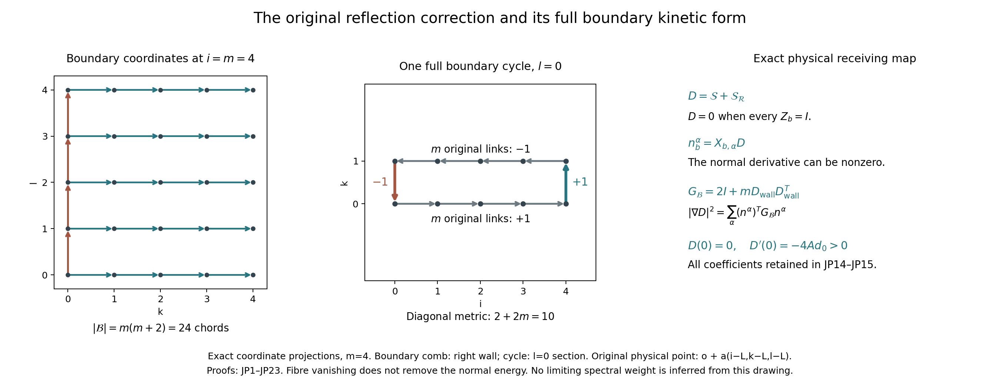
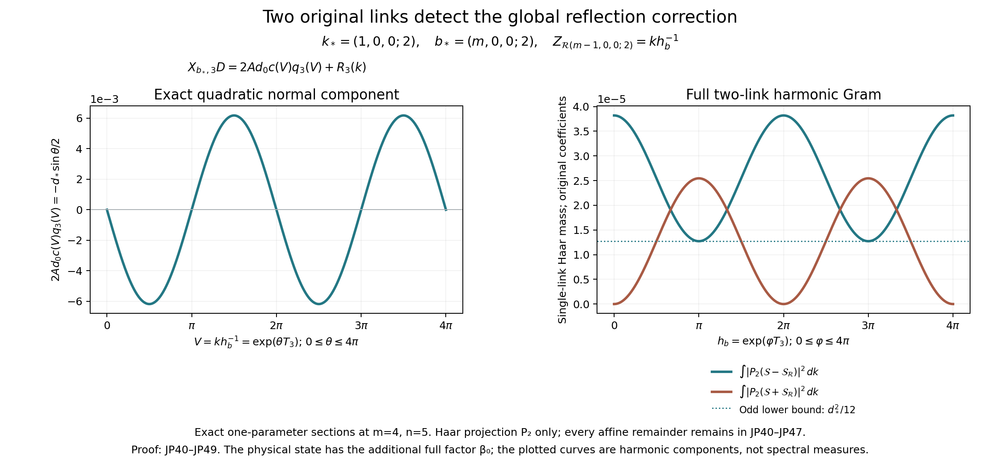
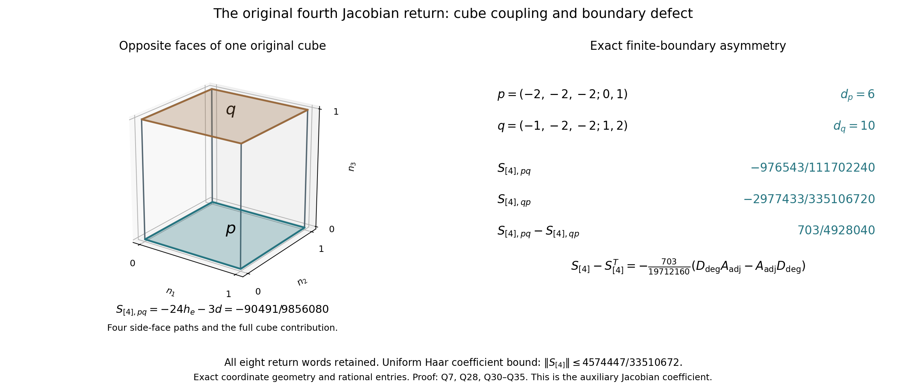

# Exact reflection and fourth-return illustrations

These images depict the exact objects, coordinate sections and proved coefficients in the accompanying complete proofs. They do not depict a constructed continuum quantum state or a limiting spectral measure. The three Python sources reproduce the rendered figures.
