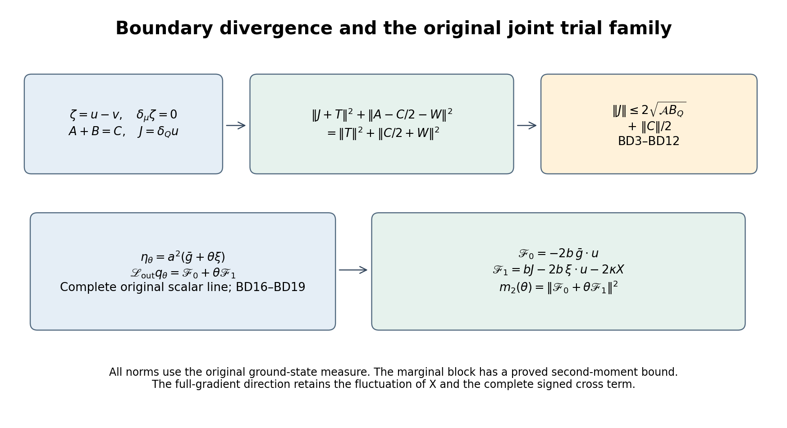
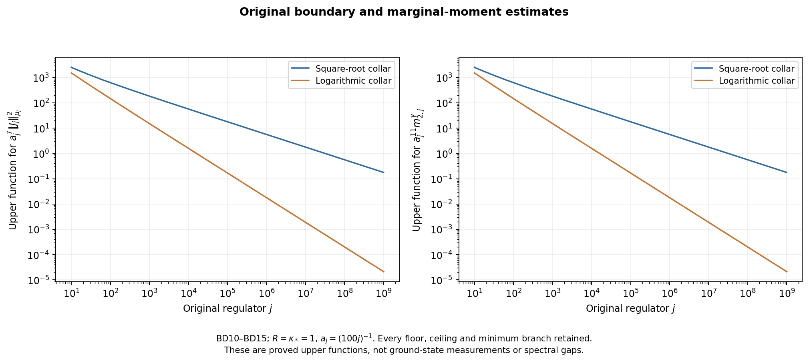

# Boundary divergence and second moments in the original trial family

This continuation controls the weighted boundary divergence left in [BQ18](https://github.com/KokunoYumeto/yang-mills-interacting-workbench/blob/944878c26947447b15051effcd5807aa4c8e5a42/yang-mills/continuations/20261011-central-signs-shrinking-window/BOUNDARY_FORCE_PROJECTION.md). It proves a mixed derivative identity and an exact square identity in the original state. It also computes the full second moment of every marginal-gradient trial and bounds it for the full-cube unit trial already present in [CG25–CG30](https://github.com/KokunoYumeto/yang-mills-interacting-workbench/blob/944878c26947447b15051effcd5807aa4c8e5a42/yang-mills/continuations/20261011-central-signs-shrinking-window/CONDITIONAL_GROUND_CURRENT_TRIAL.md), retaining its connection to the whole joint family. The full-gradient trial still contains a mixed-Hessian fluctuation; that term is displayed, not assumed small.

## 1. Original state, projections and boundary fields

Keep the original open cubic lattice, every positive edge and vertex gauge transformation, Haar probability, and the radius-two \(\mathrm{SU}(2)\) metric with \(T_\alpha=-i\sigma_\alpha/2\) orthonormal. Retain
\[
\begin{gathered}
L_j=j^4,\quad a_j=(100j)^{-1},\quad
g_j^2=\kappa_*a_j/2,\quad b_j=(\kappa_*a_j^2)^{-1},\quad s_j=\kappa_*/j,\\
U_p=U_d(z)U_k(z+e_d)U_d(z+e_k)^{-1}U_k(z)^{-1},\quad d<k,\\
D_p=2-\operatorname{Tr}U_p,\quad V=b\sum_pD_p,\quad
H=-\kappa\Delta+V,\quad H\psi=E_0\psi,\\
\psi>0,\quad\int\psi^2dU=1,\quad w=\log\psi,\quad d\mu=\psi^2dU,\\
x_{p,j}=o+a_j\{z-L_j\mathbf1+(e_d+e_k)/2\},\quad
C_{\mathbf f,j}=a_j\sum_{\sigma,p}f_\sigma(x_{p,j})D_p .
\end{gathered}\tag{BD1}
\]
The tests are the original real continuous compactly supported functions. Only finite-regulator equations suppress \(j\), with \(\kappa=\kappa_*\).

For a complete strict interior cube \(Q\), \(E\) selects its entire edge cotangent factors and \(E^\perp=I-E\). \(P\) is the full \(L^2(\mu)\) orthogonal projection onto exact one-forms from BQ2–BQ3, with its proved closed range and gauge restriction. Let
\[
\begin{gathered}
\alpha=E\,d\mathcal W_\times,\quad \mathcal W_\times=\sum_{p\ {\rm crossing}}D_p,\quad
\zeta=(I-P)\alpha,\quad u=E\zeta,\quad v=E^\perp P\alpha,\\
g=dw,\quad g_Q=Eg,\quad H_{er}=\nabla_r\nabla_ew,\quad
\delta_\mu=-\operatorname{div}-2g\mathbin{\lrcorner},\\
K_Q=\Delta_Q\psi/\psi,\quad
F=E\,d(V-E_0-\kappa K_Q)=bu,\quad
\delta_\mu\zeta=0,\quad d\zeta=d\alpha,\quad
J=\delta_Q u=\delta_{\rm out}v .
\end{gathered}\tag{BD2}
\]
Every outside factor remains. BQ3 retains \(\mu K_Q=-\mu|g_Q|^2\); the quotient and its scalar have not been replaced. The projected fields in (BD2) are smooth by their explicit BQ6 potentials.

## 2. Mixed derivatives and the exact divergence energy

Use inside coordinate indices \(i\) and outside coordinate indices \(r\) in product orthonormal frames normal at the point. Define the full mixed tensors
\[
A_{ri}=\nabla_r u_i,\qquad B_{ri}=\nabla_i v_r,\qquad
C_{ri}=\nabla_r\alpha_i,\qquad
T=g_Q\cdot u,\qquad W_{ri}=v_r(g_Q)_i .
\]
These \(A,B,C\) are derivative tensors; they do not denote the original Hamiltonian or observable. Because
\(\zeta=u-v\), the \((i,r)\) component of \(d\zeta=d\alpha\) gives
\[
A+B=C,\qquad d_Q u=0,\qquad d_{\rm out}v=0 .
\tag{BD3}
\]
The last two equalities also follow from BQ6: \(u\) is an inside derivative of the conditional potential divided by \(b\), and \(v=(\kappa/b)d_{\rm out}K_Q\). Mixed covariant derivatives commute here because they act on distinct product factors; there is no discarded mixed curvature term.

Weighted integration by parts now proves
\[
\begin{gathered}
\|J\|_\mu^2=\langle A,B\rangle_\mu
-2\mu H_{{\rm out},Q}(u,v),\\
2\|J\|_\mu^2+\|A\|_\mu^2+\|B\|_\mu^2
=\|C\|_\mu^2-4\mu H_{{\rm out},Q}(u,v).
\end{gathered}\tag{BD4}
\]
Indeed
\[
\nabla_r(\delta_Q u)=\delta_Q(\nabla_r u)-2\sum_iH_{ri}u_i.
\]
Pair this with \(v_r\), sum over every \(r\), and integrate inside. The adjoint relation gives \(\langle A,B\rangle\). The left side is
\(\langle\delta_{\rm out}v,\delta_Q u\rangle=\|J\|^2\).
The identity \(A+B=C\) proves the second line.

For comparison the complete partial Bochner formulas are
\[
\begin{gathered}
\|J\|_\mu^2
=\|\nabla_Q u\|_\mu^2+\tfrac12\|u\|_\mu^2
-2\mu H_{QQ}(u,u),\\
\|J\|_\mu^2
=\|\nabla_{\rm out}v\|_\mu^2+\tfrac12\|v\|_\mu^2
-2\mu H_{{\rm out},{\rm out}}(v,v).
\end{gathered}\tag{BD5}
\]
Here is the underlying integration identity with its signs. Expanding
\(\|d_Q u\|^2+\|\delta_Q u\|^2\), integrate one covariant derivative in each off-diagonal summand. The commutator on an inside covector contributes
\(\operatorname{Ric}_Q(u,u)\), and differentiating the weight's drift \(2g_Q\) contributes \(-2H_{QQ}(u,u)\). The surviving diagonal sum is \(\|\nabla_Q u\|^2\). The original product Ricci tensor is \(\tfrac12 I\), and \(d_Q u=0\) by (BD3), proving the first line. The identical expansion in the outside factors proves the second. Thus the proved lower bound \(H\ge-2(\kappa a)^{-1}I\) bounds the displayed Hessian contribution from above; it does not furnish an upper bound on \(\nabla_Q u\) from \(\|J\|\). The next identity estimates \(J\) without reversing that sign.

## 3. The inside-score square identity

A further original outside integration by parts yields
\[
\mu H_{{\rm out},Q}(u,v)
=-\langle A,W\rangle_\mu+\langle T,J\rangle_\mu .
\tag{BD6}
\]
To verify it, write \(H_{ri}=\nabla_r g_i\), differentiate \(u_iv_r\) when transferring \(\nabla_r\), and keep the density derivative \(2g_r\). The first resulting term is \(-\sum_{ri}\mu g_i(\nabla_r u_i)v_r\). The remaining sum is
\[
-\mu(g_Q\cdot u)\{\operatorname{div}_{\rm out}v+2g_{\rm out}\cdot v\}
=\mu T J.
\]
This proves both terms and their signs.

Substitute (BD6) and \(B=C-A\) into (BD4), and complete both squares. The exact result is
\[
\boxed{\quad
\|J+T\|_\mu^2+\|A-C/2-W\|_\mu^2
=\|T\|_\mu^2+\|C/2+W\|_\mu^2 .
\quad}\tag{BD7}
\]
Expansion gives
\(\|J\|^2+2\langle J,T\rangle=-\|A\|^2+\langle A,C+2W\rangle\),
which is precisely (BD4) after that substitution. No Hessian sign or outside score bound is assumed.

If the proved inside score bound is \(|g_Q|^2\le\mathcal A\), BQ7 gives
\[
\|u\|_\mu^2+2\|v\|_\mu^2\le B_Q,\qquad B_Q=\|\alpha\|_\mu^2,
\]
and (BD7) implies
\[
\boxed{\quad
\|J\|_\mu\le 2\sqrt{\mathcal A B_Q}+\tfrac12\|C\|_\mu .
\quad}\tag{BD8}
\]
For detail set \(x=\sqrt{\mathcal A}\|u\|\), \(y=\sqrt{\mathcal A}\|v\|\), \(d=\|C\|/2\). The triangle inequality and (BD7) give
\[
\|J\|\le x+\sqrt{x^2+(d+y)^2}
\le x+\sqrt{x^2+y^2}+d
\le2\sqrt{x^2+2y^2}+d.
\]
Use \(x^2+2y^2\le\mathcal A B_Q\). This proves the bound with its original coefficient 2.

## 4. Complete original crossing Hessian

The tensor \(C=\nabla_{\rm out}(E\,d\mathcal W_\times)\) has an exact face formula:
\[
\|C\|_\mu^2
=\mu\sum_{p\ {\rm crossing}}
\left(\frac94-\frac34D_p+\frac3{16}D_p^2\right)
\le\frac94\,C_Q^\times ,
\tag{BD9}
\]
where \(C_Q^\times\) is the original crossing-face count.

To prove this with all metric factors, two distinct edges in an ordered plaquette give a mixed derivative block which, up to orthogonal adjoint transports and the inverse-factor signs, is
\(-\operatorname{Tr}(T_\alpha T_\beta U_p)\).
Write \(U_p=cI-i\sum_\gamma z_\gamma\sigma_\gamma\), \(c^2+|z|^2=1\).
The Pauli multiplication rule makes the block
\((c\delta_{\alpha\beta}+\epsilon_{\alpha\beta\gamma}z_\gamma)/2\),
up to those orthogonal changes. Its squared Hilbert–Schmidt norm is
\[
(3c^2+2|z|^2)/4
=\tfrac12+\tfrac1{16}(\operatorname{Tr}U_p)^2
=\tfrac34-\tfrac14D_p+\tfrac1{16}D_p^2 .
\]
These are the original OS22–OS24 face constants, rederived here for this mixed boundary tensor. No two distinct elementary cubic faces share two distinct physical edges: adjacent edges determine their unique unit square, and opposite edges do also. Thus there are no cross terms between different faces in \(C\). Each crossing face has one inside edge and three outside edges, contributing three such blocks, each counted once in \(C\). This proves (BD9). Its upper bound uses \(|\operatorname{Tr}U_p|\le2\) only after the full scalar and deficit terms are retained.

## 5. Actual collar bound for the boundary divergence

Use the original fitting vertices and counts from BQ12:
\[
\begin{gathered}
v_{j,d}=L_j+\lfloor(c_d-o_d)/a_j\rfloor-1,\quad
q_j=\lceil R/a_j\rceil+3,\quad n_{j,K}=q_j+2K,\\
N_{j,K}=3n_{j,K}(n_{j,K}+1)^2,\quad
M_{j,K}=3n_{j,K}^2(n_{j,K}+1),\quad
C_{j,K}=12n_{j,K}(n_{j,K}+1),\\
\Lambda_{j,K}=\min\{2M_{j,K},6g_j^2\sqrt{N_{j,K}M_{j,K}}\}+2C_{j,K},\\
C_{\rm heat}=2+2\sqrt{4+2\pi},\quad
G(a)=\min\{8/(\kappa_*^2a^2),C_{\rm heat}/(\kappa_*a)\},\quad
\mathcal A_{j,K}=N_{j,K}G(a_j)^2 .
\end{gathered}\tag{BD10}
\]
All six original boundary indicators equal one for these strictly included cubes; only such regulators are used. Select the same smallest actual crossing-deficit minimizer among the \(K\) nested cubes as in RD and BQ. It satisfies
\(B_{Q_j}\le2\Lambda_{j,K}/K\), \(|g_{Q_j}|^2\le\mathcal A_{j,K}\), and \(C_{Q_j}^\times\le C_{j,K}\). Equations (BD8)–(BD9) prove
\[
\|J_j\|_{\mu_j}
\le 2\sqrt{\frac{2\mathcal A_{j,K}\Lambda_{j,K}}K}
+\frac34\sqrt{C_{j,K}} .
\tag{BD11}
\]
This estimate concerns the full projected field in the actual ground state.

Keep both original collar choices
\[
K_j=\max\{1,\lfloor\sqrt{R/a_j}\rfloor\},\quad
\ell_j=\log(e+R/a_j),\quad
\widehat K_j=\max\{1,\lfloor R/(a_j\ell_j)\rfloor\},
\quad \mathsf L_R=9\kappa_*R^3+24R^2 .
\]
Their proved count limits are
\(a_j^2\Lambda_{j,K}\to\mathsf L_R\),
\(a_j^2C_{j,K}\to12R^2\), and
\(a_j^5\mathcal A_{j,K}\to3C_{\rm heat}^2R^3/\kappa_*^2\).
Squaring (BD11) with its cross term gives
\[
\begin{gathered}
\limsup_j a_j^7K\,\|J_j\|_{\mu_j}^2
\le\mathsf J_R:=24C_{\rm heat}^2R^3\mathsf L_R/\kappa_*^2,
\qquad a_j^7\|J_j\|_{\mu_j}^2\longrightarrow0,\\
\limsup_j a_j^{13/2}\|J_j\|^2\le\mathsf J_R/\sqrt R
\quad(K=K_j),\\
\limsup_j\frac{a_j^6}{\ell_j}\|J_j\|^2
\le\mathsf J_R/R\quad(K=\widehat K_j).
\end{gathered}\tag{BD12}
\]
Indeed the first squared term contributes
\(8(a_j^5\mathcal A)(a_j^2\Lambda)\), with the stated limit. The second contributes
\((9/16)a_j^7K C_{j,K}\to0\), since \(a_jK\to0\).
The scaled cross term tends to zero by Cauchy–Schwarz between those two contributions. Finally
\(K_j\sqrt{a_j}\to\sqrt R\) and \(a_j\ell_j\widehat K_j\to R\).
These are upper bounds with all original lattice powers retained.

## 6. Full marginal-current moments

Disintegrate the same ground state as in BQ5:
\(m(x)=\int\psi(x,y)^2dy\), \(\varphi=\sqrt m\),
\(\chi=\psi/\varphi\), \(\bar g=d\log\varphi\), and
\(\xi=g_Q-\bar g\). For any deterministic real inside weights \(h\), retain the existing CG marginal trial
\[
\gamma_h=a^2D_h\bar g,\qquad
q_h^\gamma=2\langle D_h\bar g,\xi\rangle,\qquad
\mathbb E_xq_h^\gamma=0 .
\]
The full conditional generator is
\(\mathscr L_{\rm out}=-\kappa(\Delta_{\rm out}+2g_{\rm out}\cdot\nabla_{\rm out})\).
OC3 and the inside-only dependence of \(\bar g\) prove
\[
\begin{gathered}
d_{\rm out}q_h^\gamma=2H_{{\rm out},Q}D_h\bar g,\qquad
\mathscr L_{\rm out}q_h^\gamma=-2b\langle D_h\bar g,u\rangle,\\
m_{0,h}^\gamma=4\mu|\langle D_h\bar g,\xi\rangle|^2,\\
m_{1,h}^\gamma=4\kappa\mu|H_{{\rm out},Q}D_h\bar g|^2,\qquad
m_{2,h}^\gamma=4b^2\mu|\langle D_h\bar g,u\rangle|^2 .
\end{gathered}\tag{BD13}
\]
Every edge cross term remains inside each squared sum. These are precisely the moments of \(q_{h,0}\) in the earlier full CG family; no new state or Hamiltonian has been substituted.

For the original full-cube unit \(h\), conditional Jensen gives
\(|\bar g|^2\le\mathcal A_{j,K}\).
The actual BQ estimates yield the finite bounds
\[
\begin{gathered}
m_{0,j}^\gamma\le
\frac{4\mathcal A_{j,K}\Lambda_{j,K}}{\kappa_*^2a_j^2},\\
m_{1,j}^\gamma\le
\frac{4\sqrt2\,\mathcal A_{j,K}\Lambda_{j,K}}
{\kappa_*^2a_j^3\sqrt K},\qquad
m_{2,j}^\gamma\le
\frac{8\mathcal A_{j,K}\Lambda_{j,K}}
{\kappa_*^2a_j^4K}.
\end{gathered}\tag{BD14}
\]
Use respectively \(T_Q^\delta\le\Lambda/(\kappa_*^2a_j^2)\),
\(\mathcal O_Q\le\sqrt2\Lambda/(\kappa_*^3a_j^3\sqrt K)\), and
\(\|F\|^2\le2\Lambda/(\kappa_*^2a_j^4K)\).
Thus
\[
\begin{gathered}
\limsup_j a_j^9m_{0,j}^\gamma
\le12C_{\rm heat}^2R^3\mathsf L_R/\kappa_*^4,\\
\limsup_j a_j^{10}\sqrt K\,m_{1,j}^\gamma
\le12\sqrt2 C_{\rm heat}^2R^3\mathsf L_R/\kappa_*^4,\\
\limsup_j a_j^{11}K\,m_{2,j}^\gamma
\le\mathsf F_R:=24C_{\rm heat}^2R^3\mathsf L_R/\kappa_*^4,
\qquad a_j^{11}m_{2,j}^\gamma\longrightarrow0,\\
\limsup_j a_j^{21/2}m_{2,j}^\gamma\le\mathsf F_R/\sqrt R
\quad(K=K_j),\\
\limsup_j\frac{a_j^{10}}{\ell_j}m_{2,j}^\gamma
\le\mathsf F_R/R\quad(K=\widehat K_j).
\end{gathered}\tag{BD15}
\]
These follow directly by multiplying (BD14) by the indicated factors and using (BD10)'s limits. No smaller energy scale is inferred from these upper estimates alone.

## 7. Connection to the entire original joint family

For any real pair \(h,k\), OC11 and \(F=bu\) give
\[
\begin{gathered}
q_{h,k}=2p_h+t_k,\quad
p_h=\langle D_h\bar g,\xi\rangle,\\
t_k=\sum_{e\in Q}k_e\{\operatorname{div}_e\xi_e+
2\langle g_e,\xi_e\rangle\},\\
\mathscr L_{\rm out}q_{h,k}
=b\,\delta_k u
-2b\langle D_h\bar g,u\rangle
-2b\langle D_k\xi,u\rangle
-2\kappa\sum_{\substack{e\in Q\\r\notin Q}}k_e\|H_{er}\|^2 ,
\end{gathered}\tag{BD16}
\]
where \(\delta_k u=\sum_ek_e\delta_eu_e\).
To check every coefficient, replace \(g_e=\bar g_e+\xi_e\) in OC11 and use
\(\delta_eu_e=-\operatorname{div}_eu_e-2\langle g_e,u_e\rangle\).
This proves the exact map for all weights. Only unit \(k\) uses the specific \(J\) estimate above.

Here \(S_Q=K_Q+|g_Q|^2\) and \(s_Q=\operatorname{div}_Q\bar g+2|\bar g|^2\), with the original inside divergence and marginal score. In particular the full scalar line \(h=\mathbf1,k=\theta\mathbf1\), \(\theta\in\mathbb R\), has
\[
\begin{gathered}
q_\theta=q^\gamma+\theta q^\delta,\qquad
q^\delta=t_{\mathbf1},\quad q_1=S_Q-s_Q,\\
\mathscr F_0=-2b\,\bar g\cdot u,\qquad
\mathscr F_1=bJ-2b\,\xi\cdot u-2\kappa X,\quad
X=\sum_{\substack{e\in Q\\r\notin Q}}\|H_{er}\|^2,\\
\mathscr L_{\rm out}q_\theta=\mathscr F_0+\theta\mathscr F_1,\\
m_2(\theta)=\|\mathscr F_0\|_\mu^2+
2\theta\langle\mathscr F_0,\mathscr F_1\rangle_\mu+
\theta^2\|\mathscr F_1\|_\mu^2 .
\end{gathered}\tag{BD17}
\]
Both forces have zero mean. For the second,
\(\mu\xi\cdot bu=-\kappa\mathcal O_Q\) and \(\mu X=\mathcal O_Q\), so its two constant contributions cancel; \(\mu J=0\).
At \(\theta=1\) this is the entire BQ18 second moment. At \(\theta=0\) it is (BD13), including its proved bound. The cross term and the \(\theta^2\) term have not been deleted from the family.

The original RD fitting cube contains every edge of each plaquette with a nonzero test value. For that same physical observable, every \(\theta\) has the unchanged overlap
\[
\ell=\langle dC_{\mathbf f},a^2(\bar g+\theta\xi)\rangle_\mu
=\frac{3a^3}{2}\sum_{\sigma,p}f_\sigma(x_p)(\mu D_p-2).
\]
Conditional mean zero removes the \(\xi\) overlap exactly. Put
\(N^\gamma=\|a^2\bar g\|^2\), \(N^\delta=\|a^2\xi\|^2\), and
\[
\begin{gathered}
I_{\gamma\gamma}(z)=\langle q^\gamma,\mathcal T_zq^\gamma\rangle,\quad
I_{\gamma\delta}(z)=\langle q^\gamma,\mathcal T_zq^\delta\rangle,\quad
I_{\delta\delta}(z)=\langle q^\delta,\mathcal T_zq^\delta\rangle,\\
\mathcal T_z=z(\mathscr L_{\rm out}+z)^{-1},\\
E_{\theta,z}=\kappa a^4\mu s_Q^2+
z(N^\gamma+\theta^2N^\delta)+
\kappa a^4\{I_{\gamma\gamma}+2\theta I_{\gamma\delta}
+\theta^2I_{\delta\delta}\}.
\end{gathered}\tag{BD18}
\]
This is exactly CG28 on that whole line. Original crossing interactions imply \(N^\delta>0\) by BQ11. Therefore, writing
\(d=zN^\delta+\kappa a^4I_{\delta\delta}>0\), its actual optimizer and complete square are
\[
\theta_z=-\frac{\kappa a^4 I_{\gamma\delta}}d,\qquad
E_{\theta,z}=E_{0,z}
-\frac{(\kappa a^4 I_{\gamma\delta})^2}{d}
+d(\theta-\theta_z)^2 .
\tag{BD19}
\]
Thus the evaluated \(\theta=0\) direction remains connected to a larger original variational family with its exact gain. CG30 still optimizes over every \(h,k\), a family containing this entire line.

The marginal direction receives the existing moment estimate in original units:
\[
I_{\gamma\gamma}(z)\le m_0^\gamma-
\frac{(m_1^\gamma)^2}{m_2^\gamma+zm_1^\gamma}.
\]
If \(q^\gamma=0\), all three moments and this inverse pairing are zero and are treated as that separate case. Otherwise finite-regulator conditional positivity makes the denominator positive. Substituting the actual upper bound for \(m_2^\gamma\) from (BD14) gives a valid, explicit further upper function with \(m_0^\gamma,m_1^\gamma\) still at their actual values. No positive limiting lower bound for \(m_1^\gamma\), or nonzero limiting gain, has been assumed.

The physical variational identity retains both residuals. For
\(\Theta_{\theta,z}=a^2(\bar g+\theta\xi)+
\kappa a^2d_{\rm out}(\mathscr L_{\rm out}+z)^{-1}q_\theta\),
\(c=\ell/E_{\theta,z}\), and
\(\beta=(\mathscr L_1+z)^{-1}dC_{\mathbf f}\), it is
\[
\mathcal R_{\mathbf f}(z)=\frac{\kappa\ell^2}{E_{\theta,z}}
+\kappa\|(\mathscr L_1+z)^{1/2}(\beta-cP\Theta_{\theta,z})\|^2
+\kappa zc^2\|(I-P)\Theta_{\theta,z}\|^2 .
\]
Here \(\mathscr L_1=\kappa(\nabla_\mu^*\nabla+I/2-2\nabla^2w)\), the original full operator, and \(P\) on these invariant inputs is its physical exact projection. Expand the squared norm and use
\(\langle dC,\Theta\rangle=\ell\) and
\(q_1(P\Theta)+z\|\Theta\|^2=E_{\theta,z}\) from CG28 to prove the displayed identity. If a zero trial occurs, its source pairing vanishes and the division is not used.

The boundary divergence has now been estimated, and a complete existing block of the original second-moment matrix has a quantitative bound. The remaining full-gradient term is the actual fluctuation of \(X\) and its signed correlations in (BD17), while the physical denominator still includes marginal-current energy and the whole conditional inverse. Their limiting evaluation, the interacting continuum state, reconstruction, global smoothness, intended theory and no-gap endpoint remain the active programme.

Reproducible diagnostics and figure sources are in [check_boundary_divergence.py](check_boundary_divergence.py). Manufactured curved states and comparison inverse multipliers are not original Yang–Mills samples. Bounded source coverage and exact provider versions are in [the source-use ledger](BOUNDARY_DIVERGENCE_SOURCE_USE_LEDGER.json).
