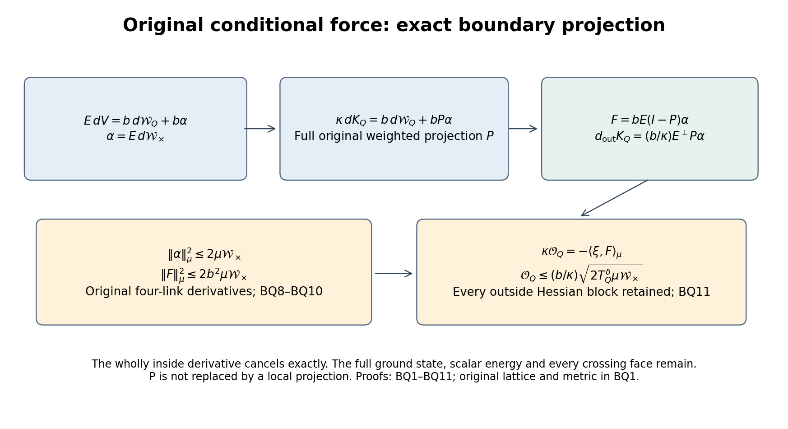
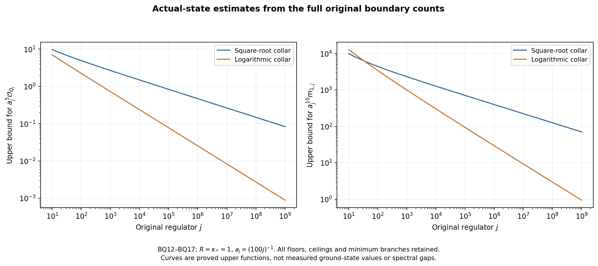

# Boundary projection of the actual conditional force

This calculation continues [OC1–OC24](https://github.com/KokunoYumeto/yang-mills-interacting-workbench/blob/52c2b9ef34c1bd243caf4dc9ff02fe885b7d873d/yang-mills/continuations/20261011-central-signs-shrinking-window/OUTSIDE_FORCE_AND_CURRENT_MOMENTS.md). It proves an exact projection identity for the original kinetic quotient. On a complete inside cube, that identity cancels its wholly inside potential from the conditional force. The full projection still depends on the original interacting ground state. The actual boundary collars in [RD14–RD22](https://github.com/KokunoYumeto/yang-mills-interacting-workbench/blob/52c2b9ef34c1bd243caf4dc9ff02fe885b7d873d/yang-mills/continuations/20261011-central-signs-shrinking-window/RETAINED_DERIVATIVE_AND_GOOD_BOUNDARIES.md) then give quantitative bounds for the force, mixed Hessian and first current moment. No limiting spectral mass is assumed.

## 1. Original objects and full gradient space

Keep all positively oriented edges of the original open vertex box, every vertex gauge transformation, Haar probability and the radius-two edge metric with \(T_\alpha=-i\sigma_\alpha/2\) orthonormal. Retain
\[
\begin{gathered}
L_j=j^4,\quad a_j=(100j)^{-1},\quad g_j^2=\kappa_*a_j/2,\quad
b_j=(\kappa_*a_j^2)^{-1},\quad s_j=\kappa_*/j,\\
U_p=U_d(z)U_k(z+e_d)U_d(z+e_k)^{-1}U_k(z)^{-1},\quad d<k,\\
D_p=2-\operatorname{Tr}U_p,\quad
V=b\sum_pD_p,\quad H=-\kappa\Delta+V,\quad
H\psi=E_0\psi,\quad \psi>0,\quad \int\psi^2dU=1,\\
w=\log\psi,\quad d\mu=\psi^2dU,\quad
x_{p,j}=o+a_j\{z-L_j\mathbf1+(e_d+e_k)/2\},\quad
C_{\mathbf f,j}=a_j\sum_{\sigma,p}f_\sigma(x_{p,j})D_p .
\end{gathered}\tag{BQ1}
\]
Only finite-regulator formulas suppress \(j\), with \(\kappa=\kappa_*\). The original test functions are real, continuous and compactly supported. A deterministic edge weight \(h\) acts by the parallel endomorphism \(D_h\) on entire edge cotangent factors; \(\Delta_h=\sum_eh_e\Delta_e\). Define
\[
\begin{gathered}
g=dw,\quad H_{er}=\nabla_r\nabla_ew,\quad
K_h=\frac{\Delta_h\psi}{\psi}
=\Delta_hw+\sum_eh_e|g_e|^2,\\
\delta_\mu=d_\mu^*=-\operatorname{div}-2g\mathbin{\lrcorner},
\qquad \mathscr L=\psi^{-1}(H-E_0)\psi=\kappa\delta_\mu d,\\
\mathscr E=\overline{\{df:f\in C^\infty\}}^{L^2(\mu;T^*)},
\qquad P:L^2(\mu;T^*)\longrightarrow\mathscr E .
\end{gathered}\tag{BQ2}
\]
All full-product derivatives occur here. \(P\) is the orthogonal projection in the original weighted metric. It is not a finite-mode projection.

At fixed regulator the compact product and strictly positive smooth density give an equivalent weighted \(H^1\) norm. Haar Poincare on its connected compact product, followed by the positive maximum/minimum density comparison, gives a Poincare inequality modulo constants, as proved with the original radius-two constant in OC5. The range of \(d:H^1/\mathbb R\to L^2(T^*)\) is therefore closed: if \(df_n\) is Cauchy, choose \(\mu f_n=0\), use that inequality, and pass to the \(H^1\) limit. Consequently the closure in (BQ2) equals this full range. Its orthogonal complement is precisely the weak kernel of \(\delta_\mu\). For each field projected below, the explicit smooth \(K_h\) supplies its exact potential; no additional regularity of an abstract projection is assumed. No regulator-uniform Poincare constant is asserted.

Vertex gauge transformations preserve \(\mu\), every edge factor and \(d\). They therefore commute with \(P\). For an invariant one-form, averaging a gradient potential over the compact vertex gauge group leaves its gradient equal to that invariant exact form. Thus \(P\) on the invariant inputs below agrees with the physical exact-one-form projection used in SG and CG. No factorization of the gauge-invariant Hilbert space is required.

## 2. Exact kinetic quotient and its retained scalar

For every deterministic real \(h\), the full original equation gives
\[
\boxed{\quad
\mathscr L K_h=\delta_\mu(D_h\,dV),\qquad
\kappa\,dK_h=P(D_h\,dV),\qquad
\mu K_h=-\mu\sum_eh_e|g_e|^2 .
\quad}\tag{BQ3}
\]
To prove the first identity, the product Laplacians commute, and
\[
[H,\Delta_h]\psi
=-(\Delta_hV)\psi-2\sum_eh_e\langle\nabla_eV,\nabla_e\psi\rangle.
\]
Apply \(H-E_0\) to \(\Delta_h\psi=\psi K_h\). Since
\(\Delta_h(H\psi)=E_0\Delta_h\psi\), division by \(\psi\) gives exactly
\(-\Delta_hV-2\sum_eh_e\langle g_e,\nabla_eV\rangle\), which is the displayed weighted divergence. In particular \(E_0\) and the scalar \(2b|\mathcal P|\) were present in the original equation before their derivatives vanished.

It follows that \(D_hdV-\kappa dK_h\) has zero weighted divergence. Its other component \(\kappa dK_h\) belongs to the closed exact range. Orthogonality proves the middle identity. Finally,
\(\mu K_h=\int\psi\Delta_h\psi=-\int\sum_eh_e|\nabla_e\psi|^2\).
This proves the last identity without replacing \(K_h\) by a shifted function. Together the gradient and scalar identify the entire original quotient. In particular
\[
\|D_hdV\|_\mu^2
=\kappa^2\|dK_h\|_\mu^2+
\|(I-P)D_hdV\|_\mu^2 .
\tag{BQ4}
\]
This is a full orthogonal identity, including its nonnegative remainder.

## 3. Exact boundary cancellation

Let \(Q\) be every edge with endpoints in a strictly interior original cube. Put \(E=D_{\mathbf1_Q}\), \(E^\perp=I-E\). Partition the original faces into wholly inside, crossing and wholly outside sets, and retain
\[
\begin{gathered}
\mathcal W_Q=\sum_{\partial p\subseteq Q}D_p,\quad
\mathcal W_\times=\sum_{p\ {\rm crossing}}D_p,\quad
V=b\mathcal W_Q+b\mathcal W_\times+V_{\rm out},\\
\alpha=E\,d\mathcal W_\times,\qquad
\zeta=(I-P)\alpha,\qquad
u=E\zeta,\quad v=E^\perp P\alpha,\quad
C=EPE\big|_{\operatorname{ran}E},\\
m(x)=\int\psi(x,y)^2dy,\quad
\varphi=\sqrt m,\quad \chi=\psi/\varphi,\quad
\bar g=d\log\varphi,\quad \xi=E\,dw-d\log\varphi .
\end{gathered}\tag{BQ5}
\]
Here \(x\) are inside links and \(y\) all outside links. The fields \(\bar g,\xi\) are extended by zero in outside cotangent factors. The letter \(C\) in this section denotes a bounded compression of \(P\), whereas \(C_{\mathbf f,j}\) in (BQ1) is the unchanged observable. Conditional expectation is \(\mathbb E_x F=\int F\chi^2dy\).

Wholly inside faces have every derivative inside; wholly outside faces have no derivative inside. Therefore
\[
\begin{gathered}
E\,dV=b\,d\mathcal W_Q+b\alpha,\qquad
\kappa\,dK_Q=b\,d\mathcal W_Q+bP\alpha,\\
\mathcal U_{\rm out}=V-E_0-\kappa K_Q,\qquad
F:=E\,d\mathcal U_{\rm out}=b\,u=bE(I-P)\alpha,\qquad
E^\perp dK_Q=(b/\kappa)v .
\end{gathered}\tag{BQ6}
\]
The first equality is the complete face decomposition; apply (BQ3) and \(P\,d\mathcal W_Q=d\mathcal W_Q\) to get the second. Subtract their inside components to prove the force identity. The outside derivative of \(\mathcal W_Q\) is zero, proving the last line. This cancels the wholly inside derivative exactly; the full potential itself still contains all three face sets and \(E_0\). \(P\), \(u\), and \(v\) depend on the actual original ground state and may depend on every outside link.

The two orthogonal projections yield stronger identities than separate triangle inequalities:
\[
\begin{gathered}
u=(I-C)\alpha,\quad 0\le C\le I,\quad E^\perp\zeta=-v,\quad
\delta_\mu\zeta=0,\quad \delta_Q u=\delta_{\rm out}v,\\
\|v\|_\mu^2
=\langle\alpha,C(I-C)\alpha\rangle_\mu
=\tfrac14\|\alpha\|_\mu^2-\|(C-\tfrac12I)\alpha\|_\mu^2,\\
\|\alpha\|_\mu^2=\|C\alpha\|_\mu^2+\|u\|_\mu^2+2\|v\|_\mu^2 .
\end{gathered}\tag{BQ7}
\]
In fact \(P\alpha=C\alpha+v\), and
\(\|P\alpha\|^2=\langle\alpha,P\alpha\rangle=\langle\alpha,C\alpha\rangle\).
Subtract \(\|C\alpha\|^2\), then complete the square to prove the second line. The last line follows from \(u=\alpha-C\alpha\). The divergence equation follows from \(\zeta=u-v\) and its full zero divergence. These arguments do not assume that \(E\) and \(P\) commute.

## 4. Original boundary derivative and every discarded contribution

Every crossing face of the cube has exactly one inside edge, denoted \(e(p)\). An inside edge belongs to at most two crossing faces, one for each transverse coordinate in which it lies on the cube boundary. Let
\(\mathcal X_e=\{p\ {\rm crossing}:e(p)=e\}\) and \(r_e^\times=|\mathcal X_e|\in\{0,1,2\}\).
For each original face and each one of its four edges,
\[
|\nabla_eD_p|^2
=1-(\operatorname{Tr}U_p/2)^2
=D_p-\tfrac14D_p^2 .
\tag{BQ8}
\]
Indeed write the ordered product as an \(\mathrm{SU}(2)\) quaternion
\(U_p=cI+i\sum_\alpha s_\alpha\sigma_\alpha\) with \(c^2+\sum s_\alpha^2=1\).
Differentiation in the three original orthonormal directions gives squared norm \(\sum s_\alpha^2=1-c^2\). Inverse factors produce the derivative \(-U_e^{-1}T_\alpha\); multiplication and inversion are isometries, so the ordered word and its signs give the same squared norm. Substituting \(D_p=2-2c\) proves the full formula.

Put \(B_Q=\|\alpha\|_\mu^2\), \(W_Q^\times=\mu\mathcal W_\times\). Then
\[
\begin{gathered}
B_Q=2W_Q^\times-\tfrac12\mu\sum_{p\ {\rm crossing}}D_p^2-\mathcal R_\partial,\qquad
0\le B_Q\le 2W_Q^\times,\\
\mathcal R_\partial=
\sum_{p\ {\rm crossing}}(2-r_{e(p)}^\times)
\,\mu(D_p-D_p^2/4)\\
\hspace{13mm}+
\sum_{e\in Q}\ \sum_{\substack{p<q\\p,q\in\mathcal X_e}}
\mu|\nabla_eD_p-\nabla_eD_q|^2\ge0 .
\end{gathered}\tag{BQ9}
\]
For \(r\) vectors \(a_p\), expand
\(|\sum a_p|^2=r\sum|a_p|^2-\sum_{p<q}|a_p-a_q|^2\).
Apply this to each \(\alpha_e\), use (BQ8), and then add and subtract
\(2\sum_p(D_p-D_p^2/4)\). This proves the exact remainder with every crossing incidence retained.

Consequently the actual conditional force and outside kinetic derivative satisfy
\[
\begin{gathered}
\|F\|_\mu^2
=b^2\{B_Q-\|C\alpha\|_\mu^2-2\|v\|_\mu^2\}
\le 2b^2 W_Q^\times,\\
\|E^\perp dK_Q\|_\mu^2
=\frac{b^2}{\kappa^2}
\{\tfrac14 B_Q-\|(C-\tfrac12I)\alpha\|_\mu^2\}
\le \frac{b^2}{2\kappa^2}W_Q^\times .
\end{gathered}\tag{BQ10}
\]
Both exact remainders come from (BQ7), before the actual nonnegative deficit bound is used.

## 5. Mixed Hessian in the actual state

Define the complete mixed Hessian norm and conditional Fisher quantity
\[
\mathcal O_Q=\mu\sum_{\substack{e\in Q\\r\notin Q}}\|H_{er}\|_{\rm HS}^2,\qquad
T_Q^\delta=\mu|\xi|^2 .
\]
OC3–OC4 give, with all original outside links,
\[
\begin{gathered}
\kappa\mathcal O_Q=-\langle\xi,F\rangle_\mu,\qquad
\mu\operatorname{tr}(\mathbb E_x\nabla_Q^2\mathcal U_{\rm out})
=2\kappa\mathcal O_Q,\\
\|F\|_\mu^2
=\frac{\kappa^2\mathcal O_Q^2}{T_Q^\delta}
+\left\|F+\frac{\kappa\mathcal O_Q}{T_Q^\delta}\xi\right\|_\mu^2,\qquad
\mathcal O_Q\le\frac b\kappa\sqrt{2T_Q^\delta W_Q^\times}.
\end{gathered}\tag{BQ11}
\]
For the original strict interior cube, \(T_Q^\delta>0\). Otherwise full support makes \(\xi=0\), so \(\chi\) is independent of inside variables, giving the product state excluded by the explicit crossing-plaquette mixed derivative in OC18–OC19. The same argument and the conditional mean-zero score show \(\mathcal O_Q>0\): if every mixed derivative vanishes, each \(\xi_e\) is constant on the connected outside fiber and hence zero. Taking the trace of OC4 and applying its score equation proves the first line. Expanding the square proves the second line, and (BQ10) gives its last bound. No sign has been assigned to RD's different full-minus-marginal Hessian contraction.

## 6. Evaluated original collar rates

Use the RD fitting data, including their original offsets,
\[
\begin{gathered}
v_{j,d}=L_j+\lfloor(c_d-o_d)/a_j\rfloor-1,\quad
q_j=\lceil R/a_j\rceil+3,\quad
Q_{j,k}:v_j-k\mathbf1+\{0,\ldots,q_j+2k\}^3,\\
N_{j,K}=3(q_j+2K)(q_j+2K+1)^2,\quad
M_{j,K}=3(q_j+2K)^2(q_j+2K+1),\\
C_{j,K}=12(q_j+2K)(q_j+2K+1),\quad
\Lambda_{j,K}=\min\{2M_{j,K},6g_j^2\sqrt{N_{j,K}M_{j,K}}\}+2C_{j,K}.
\end{gathered}\tag{BQ12}
\]
All these cubes are strictly inside the original box for the sufficiently large regulators under consideration; this is why all six original boundary indicators in \(C_{j,K}\) equal one. At a finite regulator where that inclusion is used, it is explicitly required; no boundary face is deleted.

For either RD collar below, select the smallest \(k\in\{0,\ldots,K-1\}\) minimizing the actual \(W_{Q_{j,k}}^\times\), and call that cube \(Q_j\). RD14–RD17 prove
\(W_{Q_j}^\times\le\Lambda_{j,K}/K\).
The same original energy comparison gives
\(T_{Q_j}^\delta\le\mu|E\,dw|^2\le\Lambda_{j,K}/(\kappa_*^2a_j^2)\).
Indeed the selected cube's counts do not exceed those of \(Q_{j,K}\), and both branches of the original minimum are increasing in the cube length. Thus (BQ10)–(BQ11) give finite bounds
\[
\begin{gathered}
\|F_j\|_{\mu_j}^2\le\frac{2\Lambda_{j,K}}{\kappa_*^2a_j^4K},\qquad
\|E^\perp dK_{Q_j}\|_{\mu_j}^2\le
\frac{\Lambda_{j,K}}{2\kappa_*^4a_j^4K},\\
\mathcal O_{Q_j}\le
\frac{\sqrt2\,\Lambda_{j,K}}{\kappa_*^3a_j^3\sqrt K}.
\end{gathered}\tag{BQ13}
\]
Retain
\[
\begin{gathered}
\mathsf L_R=9\kappa_*R^3+24R^2,\qquad
K_j=\max\{1,\lfloor\sqrt{R/a_j}\rfloor\},\\
\ell_j=\log(e+R/a_j),\qquad
\widehat K_j=\max\{1,\lfloor R/(a_j\ell_j)\rfloor\}.
\end{gathered}
\]
For both choices \(a_j^2\Lambda_{j,K}\to\mathsf L_R\),
\(a_j^3N_{j,K}\to3R^3\), and \(K\to\infty\). In particular
\[
\begin{gathered}
\limsup_j a_j^6K\,\|F_j\|_{\mu_j}^2\le2\mathsf L_R/\kappa_*^2,\qquad
\limsup_j a_j^6K\,\|E^\perp dK_{Q_j}\|_{\mu_j}^2
\le\mathsf L_R/(2\kappa_*^4),\\
\limsup_j a_j^5\sqrt K\,\mathcal O_{Q_j}
\le\sqrt2\,\mathsf L_R/\kappa_*^3,\qquad
a_j^6\|F_j\|^2\to0,\quad a_j^5\mathcal O_{Q_j}\to0 .
\end{gathered}\tag{BQ14}
\]
These are limits or upper limits of quantities in the actual original state. They follow by multiplying (BQ13) by its displayed powers, using the exact RD count limits. The square-root collar gives
\[
\limsup_j a_j^{19/4}\mathcal O_{Q_j}
\le\frac{\sqrt2\,\mathsf L_R}{\kappa_*^3R^{1/4}},
\]
whereas the logarithmic collar gives
\[
\limsup_j\frac{a_j^{9/2}}{\sqrt{\ell_j}}\mathcal O_{Q_j}
\le\frac{\sqrt2\,\mathsf L_R}{\kappa_*^3\sqrt R}.
\]
The factors follow from \(\sqrt K\,a_j^{1/4}\to R^{1/4}\) and
\(\sqrt{\widehat K}\sqrt{a_j\ell_j}\to\sqrt R\). No unscaled vanishing of \(\mathcal O_{Q_j}\) is claimed.

## 7. First current moment without third kinetic derivatives

For the full-cube equal weights, retain the actual OC current
\[
S_Q=\Delta_Qw+2|E\,dw|^2,\qquad
s_Q=\Delta_Q\log\varphi+2|d\log\varphi|^2,\qquad
q=S_Q-s_Q .
\]
Let \(Y=H_{{\rm out},Q}\,E\,dw\), an outside covector field with
\(Y_r=\sum_{e\in Q}H_{re}g_e\). Then
\[
\begin{gathered}
d_{\rm out}q=(b/\kappa)v+2Y,\\
m_1=\kappa\|d_{\rm out}q\|_\mu^2
=\frac{b^2}{\kappa}\|v\|_\mu^2
+4b\langle v,Y\rangle_\mu+4\kappa\|Y\|_\mu^2 .
\end{gathered}\tag{BQ15}
\]
Indeed \(S_Q=K_Q+|E\,dw|^2\), \(s_Q\) is inside-only, and the outside derivative of the second term is \(2Y\). Now apply (BQ6). This proves the complete cross term and removes the third derivatives of \(K_Q\) from this first-moment calculation by an exact equality.

For every inside edge the original degree is four. The proved original score estimate SR65 is
\[
\begin{gathered}
C_{\rm heat}=2+2\sqrt{4+2\pi},\qquad
G(a)=\min\{8/(\kappa_*^2a^2),C_{\rm heat}/(\kappa_*a)\},\\
|g_e|\le G(a),\qquad
A_{j,K}=N_{j,K}G(a_j)^2,\qquad
|E\,dw|^2\le A_{j,K}.
\end{gathered}
\]
Its factor one half comes from \(w=\tfrac12\log\rho\) in SR65, with original incident parameter \(4/(\kappa_*^2a_j^2)\). No change of metric or field scale occurs. Hence
\[
\begin{gathered}
\|Y\|_\mu^2\le A_{j,K}\mathcal O_{Q_j},\\
m_{1,j}\le
\kappa_*\left\{
\frac{b_j}{2\kappa_*}\sqrt{\frac{2\Lambda_{j,K}}K}
+2\sqrt{\frac{\sqrt2\,A_{j,K}\Lambda_{j,K}}
{\kappa_*^3a_j^3\sqrt K}}
\right\}^2 .
\end{gathered}\tag{BQ16}
\]
The first line is pointwise Cauchy–Schwarz for the full mixed Hessian followed by integration. For the second use the triangle inequality on (BQ15)'s vector equality, the one-half projection bound in (BQ7), (BQ9), and (BQ13). Equation (BQ15) retains the cross term whose sign this bound does not use.

Eventually the square-root score branch holds, so
\(a_j^5 A_{j,K}\to3C_{\rm heat}^2R^3/\kappa_*^2\).
Multiplying (BQ16) by \(a_j^{10}\sqrt K\) proves
\[
\begin{gathered}
\limsup_j a_j^{10}\sqrt K\,m_{1,j}
\le \mathsf M_R:=
\frac{12\sqrt2\,C_{\rm heat}^2R^3\mathsf L_R}{\kappa_*^4},
\qquad a_j^{10}m_{1,j}\longrightarrow0,\\
\limsup_j a_j^{39/4}m_{1,j}
\le\mathsf M_R/R^{1/4}\quad(K=K_j),\\
\limsup_j \frac{a_j^{19/2}}{\sqrt{\ell_j}}m_{1,j}
\le\mathsf M_R/\sqrt R\quad(K=\widehat K_j).
\end{gathered}\tag{BQ17}
\]
For completeness, the square of the first term in braces, after multiplication by \(\kappa_*a_j^{10}\sqrt K\), is

\[
a_j^6\Lambda_{j,K}/(2\kappa_*^3\sqrt K)\to0
\]
.
The second squared term is
\(4\sqrt2(a_j^5A_{j,K})(a_j^2\Lambda_{j,K})/\kappa_*^2\),
whose limit is the displayed \(\mathsf M_R\). Their cross contribution tends to zero by the product of these two bounded square roots. The last two bounds use the same exact collar factors as (BQ14). These are upper estimates for the actual moment, not an assignment of its asymptotic equality.

## 8. Second moment and the remaining exact derivative

The same cancellation can be inserted into the entire original forcing. Set
\[
\begin{gathered}
X=\sum_{\substack{e\in Q\\r\notin Q}}\|H_{er}\|_{\rm HS}^2,\quad
J=\delta_Q u=\delta_{\rm out}v,\quad
B=g_Q\cdot u+\kappa\mathcal O_Q/b,\quad
Z=X-\mathcal O_Q .
\end{gathered}
\]
Here \(g_Q=E\,dw\). These three scalars have zero \(\mu\)-mean. For \(J\) this is weighted divergence integration. For \(B\), OC3 gives \(\mathbb E_xF=0\), so
\(\mu g_Q\cdot F=\mu\xi\cdot F=-\kappa\mathcal O_Q\) by (BQ11). For \(Z\) it is its stated definition. The OC11 forcing and complete second moment are
\[
\begin{gathered}
\mathscr L_{\rm out}q
=-b\,\operatorname{div}_Q u-4b\,g_Q\cdot u-2\kappa X
=bJ-2bB-2\kappa Z,\\
m_2=b^2\mu J^2+4b^2\mu B^2+4\kappa^2\mu Z^2
-4b^2\mu JB-4\kappa b\,\mu JZ+8\kappa b\,\mu BZ .
\end{gathered}\tag{BQ18}
\]
Substitute \(F=bu\) into OC11 with equal unit weights, and use
\(\delta_Qu=-\operatorname{div}_Qu-2g_Q\cdot u\).
The two centering constants cancel exactly. Squaring proves the second line, including every signed covariance. Thus the next derivative to estimate is the weighted divergence of the full projected boundary field, together with the displayed mixed-Hessian fluctuations. A bound for \(\|F\|\) alone is not silently promoted to a bound for that derivative.

For the physical response, OC20–OC21 still use
\[
E_{{\rm new},s_j}
=\kappa_*a_j^4\mu s_Q^2+s_j\|a_j^2E\,dw\|_\mu^2
+\kappa_*a_j^4\langle q,s_j(\mathscr L_{\rm out}+s_j)^{-1}q\rangle_\mu .
\]
The current first-moment estimates above do not by themselves evaluate that inverse, \(m_2\), the marginal current energy, or either complete physical residual in OC21. They do prove actual force and mixed-Hessian bounds that were previously unevaluated. The next calculation is (BQ18)'s full boundary divergence and its correlations, retaining the original state and projection. The interacting continuum construction, reconstruction, global smoothness, physical window mass and intended no-gap result remain the active goal.

Complete diagnostic and figure sources are in [check_boundary_force.py](check_boundary_force.py). Manufactured curved states and projection matrices are not original Yang–Mills samples. Bounded provider coverage and exact versions are in [the source-use ledger](BOUNDARY_FORCE_SOURCE_USE_LEDGER.json).

## Boundary divergence and marginal second moments

[BD1–BD19](https://github.com/KokunoYumeto/yang-mills-interacting-workbench/blob/main/yang-mills/continuations/20261011-central-signs-shrinking-window/BOUNDARY_DIVERGENCE_AND_MARGINAL_MOMENTS.md) prove an exact mixed derivative and two-square identity for the full projected boundary field. Weighted integration removes its mixed-Hessian contraction from the divergence estimate while retaining the inside score and every original crossing derivative. Both established collars give \(\smash{a_j^7\|J_j\|^2\to0}\) with explicit rates. The existing marginal-gradient block has complete first and second moments and \(\smash{a_j^{11}m_{2,j}^\gamma\to0}\), again with explicit collar constants. The arbitrary-weight force map, full scalar trial line, signed second-moment cross term, exact scalar optimizer and both physical residuals remain. The full-gradient mixed-Hessian fluctuation and limiting physical spectral weight still require evaluation.

## Original kinetic current and its full physical energy

[KC1–KC28](https://github.com/KokunoYumeto/yang-mills-interacting-workbench/blob/main/yang-mills/continuations/20261011-central-signs-shrinking-window/KINETIC_CURRENT_AND_PHYSICAL_ENERGY.md) retain the original kinetic quotient and its complete conditional mean, and decompose the full current into kinetic and score fluctuations. The actual kinetic variance has a boundary-count bound with all nonnegative energy remainders. Its first two moments control the full kinetic column of the conditional inverse at the original shrinking energy. Differentiating its conditional mean gives the exact full physical energy, including a retained conditional covariance. That covariance supplies an explicit enlargement of the physical scalar trial space, an exact Green-function gain and its full residual. The source gain and limiting physical spectral weight remain unevaluated; the complete earlier current family remains available.

## Complete local energy and physical spectral windows

[LE1–LE23](https://github.com/KokunoYumeto/yang-mills-interacting-workbench/blob/main/yang-mills/continuations/20261011-central-signs-shrinking-window/LOCAL_ENERGY_PHYSICAL_WINDOWS.md) add the entire retained inside-energy fluctuation to the conditional kinetic vector. Its full physical gradient is the original projected boundary field. Complete norm, first-moment and second-moment identities retain all scalar energies and cross terms; explicit upper and lower bounds are proved. The original supported observable has zero mixed first energy but a retained ordinary covariance and mixed second moment. Its full two-vector Green calculation includes the complementary physical residual. An invertible coefficient map proves that the complete inside-function trial space is the existing KC space, preventing a spurious additional gain. The original full-Hamiltonian shrinking-window tails are bounded; the actual surviving norm and source mass remain unevaluated.
