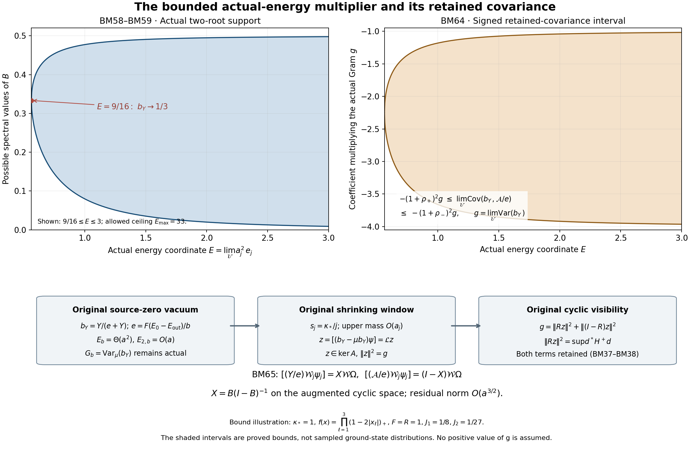

# A bounded function of the actual local energy observable

This note studies the bounded original multiplier Y/(e+Y), where e is the actual local ground-energy difference with its full factor F/b. It retains the original Y and signed C_f, proves the exact first and second spectral moments and operator residual, and constructs its actual central zero-energy map. The actual Gram and its possible collapse remain explicit.

## 1. The original objects and their finite-regulator identities

The vertices are \(z\in\{0,\ldots,m\}^3\), \(m=2L\); positive edges have both endpoints in this set. For \(d<e\), the face word, trace, scalar deficit, metric, and Hamiltonian are
\[
\begin{gathered}
U_p=U_d(z)U_e(z+e_d)U_d(z+e_e)^{-1}U_e(z)^{-1},\qquad
W_p=\operatorname{Tr}U_p,\qquad D_p=2-W_p,\\
T_\alpha=-i\sigma_\alpha/2,\qquad
\Delta=\sum_{e,\alpha}X_{e,\alpha}^2,\quad K=-\Delta,\quad
\Gamma(G,H)=\sum_{e,\alpha}X_{e,\alpha}G\,X_{e,\alpha}H,\\
\kappa=2g^2/a,\qquad b=1/(2g^2a),\qquad
H=\kappa K+b\sum_pD_p=\kappa K+2bM-b\sum_pW_p,\\
N=3m(m+1)^2,\qquad M=3m^2(m+1).
\end{gathered}\tag{BM1}
\]
The metric on each \(\mathrm{SU}(2)\) is the radius-two metric. Product Haar has mass one. All original vertex gauge constraints, including boundary vertices, remain imposed. The smooth positive unit lowest eigenfunction of the full compact operator is \(\psi\), and
\[
H\psi=E_0\psi,\qquad w=\log\psi,\qquad d\mu=\psi^2dU.
\tag{BM2}
\]
The ground transform is obtained by expanding derivatives and using the ground equation:
\[
\langle G\psi,(H-E_0)G\psi\rangle
 =\kappa\mu\Gamma(G,\overline G),\qquad
2\mu\Gamma(w,G)=-\mu\Delta G.
\tag{BM3}
\]
It proves uniqueness of the positive unit ground vector, because any second ground vector divided by \(\psi\) has zero gradient on the connected configuration space. Every original gauge transformation preserves the operator, metric, Haar measure and positivity, hence fixes \(\psi\). The full ground energy is therefore the physical ground energy; no product decomposition of the physical Hilbert space is assumed.

For the original real compactly supported continuous \(f\), retain all three orientations and centers
\[
\begin{gathered}
x_p=o+a(z-L\mathbf1+(e_d+e_e)/2),\quad f_p=f(x_p),\quad
F=\|f\|_\infty,\quad A_1=\sum_p|f_p|,\\
C_f=a\sum_pf_pD_p,\quad
Y=\sum_p|f_p|D_p,\quad d=\mu Y,\quad m_f=\mu C_f,\\
Y_+=\sum_{f_p>0}f_pD_p,\quad Y_-=\sum_{f_p<0}(-f_p)D_p,\quad
C_f=a(Y_+-Y_-),\quad Y=Y_++Y_-.
\end{gathered}\tag{BM4}
\]
The case \(A_1=0\) has \(Y=C_f=0\). Assume \(A_1>0\), so \(F>0\). Every displayed quantity is evaluated at source zero.

Let \(Q=v+\{0,\ldots,q\}^3\) contain all edges of every face with nonzero sampled coefficient. Inside edges have both endpoints in \(Q\); inside faces use four inside edges. Define
\[
\begin{gathered}
N_Q=3q(q+1)^2,\quad M_Q=3q^2(q+1),\quad
\eta_Q=\sum_{\ell=1}^3
[\mathbf1_{\{v_\ell>0\}}+\mathbf1_{\{v_\ell+q<m\}}],\\
C_Q=2q(q+1)\eta_Q,\qquad
W_Q=\sum_{p\ \mathrm{inside}}D_p,\qquad
Z_Q=|\nabla_Qw|^2,\\
H=\kappa K_Q+bW_Q+H_{\rm out}+bW_\times,\qquad
H_{\rm out}\ge E_{\rm out}I,\qquad E_Q=E_0-E_{\rm out}.
\end{gathered}\tag{BM5}
\]
A mixed face has one inside edge: two adjacent inside edges force its four vertices into the interval product \(Q\), and two opposite inside edges already contain the four vertices. The crossing count is thus the stated exact \(C_Q\). The inside, outside and mixed scalar potential terms are \(2bM_Q\), \(2b(M-M_Q-C_Q)\), and \(2bC_Q\).

For completeness, the local energy comparison and its constants are as follows:
\[
\begin{gathered}
0\le E_Q\le b\Lambda_Q,\quad
\Lambda_Q=\min\{2M_Q,6g^2\sqrt{N_QM_Q}\}+2C_Q,\\
\kappa\mu Z_Q+b\mu W_Q\le E_Q,\quad
\alpha=\kappa/b=4(g^2)^2=\kappa^2a^2,\quad
e=FE_Q/b\le\Lambda_f:=F\Lambda_Q.
\end{gathered}\tag{BM6}
\]
Here is a proof of the upper comparison, so its boundary contribution is not an unproved input. The positive outside ground is invariant under every restricted original vertex gauge action. Starting a crossing face at its inside edge leaves an outside three-edge path with distinct endpoints; the central gauge element \(-I\) at one endpoint negates its matrix expectation. Thus an inside/outside tensor comparison has crossing energy exactly \(2bC_Q\). For an inside link write \(x=\operatorname{Tr}U/2\), \(h_t=Z_t^{-1/2}e^{tx}\), \(Z_t=\int e^{2tx}dU\), and \(q_t=\int xh_t^2dU\). The radius-two identities \(\Gamma(x)=(1-x^2)/4\), \(\Delta x=-3x/4\), give kinetic energy \(3\kappa tq_t/8\). The Haar marginal is \((2/\pi)\sqrt{1-x^2}\,dx\). With \(z=1-x\), its tilted density is proportional to \(e^{-2tz}z^{1/2}\sqrt{2-z}\mathbf1_{[0,2]}\). The extra factor relative to the gamma density \(e^{-2tz}z^{1/2}\) is decreasing. Its covariance with \(z\) is nonpositive, as follows by integrating \((z-z')(r(z)-r(z'))\le0\). Hence \(1-q_t\le3/(4t)\); symmetry also gives \(0<q_t<1\). Centrality gives both matrix means \(q_tI\), so the inside product comparison has energy at most \(3\kappa N_Qt/8+6bM_Q/t\). Set \(t=4\sqrt{bM_Q/(\kappa N_Q)}\), or take the constant vector. This proves the upper bound. The lower bounds follow from the nonnegative inside kinetic, inside potential, crossing potential and \(H_{\rm out}-E_{\rm out}\).

The face identities and exact incidence bounds are
\[
\begin{gathered}
J(y)=6A_1-3y,\qquad \Delta Y=J(Y),\qquad
\gamma=\Gamma(Y),\\
\sum_\alpha(X_{e,\alpha}D_p)^2=D_p-D_p^2/4\quad(e\in p),\\
\gamma\le
\sum_e r_e^f\sum_{p\ni e}|f_p|^2(D_p-D_p^2/4)
\le16FY-\frac4{n_f}Y^2,\qquad
n_f=\#\{p:f_p\ne0\}.
\end{gathered}\tag{BM7}
\]
The Laplacian follows from \(\sum_\alpha T_\alpha^2=-3I/4\) on each of the four incident links. In a quaternion representation the squared derivative on one link is \(1-W_p^2/4\); inverse traversals and surrounding links act by signs and orthogonal adjoint transports. Cauchy–Schwarz at each edge, with the actual count \(r_e^f\le4\), gives the first bound. Expanding it bounds \(16FY-\gamma\) below by \(16\sum_p|f_p|(F-|f_p|)D_p+4\sum_p f_p^2D_p^2\), whose last term is at least \(4Y^2/n_f\).

## 2. The actual scalar e and the bounded multiplier

Write \(s=\Gamma_Q(w,Y)\). The exact local budget in (BM6) and integration of \(\Delta Y\) give
\[
\mu Z_Q\le(e-d)/(\alpha F),\qquad
2\mu s=-(6A_1-3d),\qquad
(6A_1-3d)^2\le64d(e-d)/\alpha.
\tag{BM8}
\]
For the last inequality use \(s^2\le Z_Q\gamma\), Cauchy–Schwarz in the actual measure, and \(\mu\gamma\le16Fd\). Since \(Y\) is nonconstant and \(\psi\) positive, \(d>0\) and \(e>0\). For example on the actual commuting path \(U_d(z;\theta)=\exp(\theta T_3\sum_{k<d}z_k)\), every ordered face is \(\exp(\theta T_3)\), and \(Y=A_1[2-2\cos(\theta/2)]\). No comparison law enters this verification. Define
\[
\begin{gathered}
c=9\alpha/64,\quad B_e=e+4cA_1,\quad C_e=4cA_1^2,\quad
D_e=B_e^2-4(1+c)C_e\ge0,\\
r_-={2C_e\over B_e+\sqrt{D_e}},\quad
r_+={B_e+\sqrt{D_e}\over2(1+c)},\quad
0<r_-\le d\le r_+\le e,\\
e\ge e_{\min}:=4A_1[\sqrt{c(1+c)}-c]>0.
\end{gathered}\tag{BM9}
\]
Expansion of (BM8) proves the quadratic and the two roots. The upper root is at most \(e\): the quadratic at \(e\) is \(c(e-2A_1)^2\ge0\), and \(d\le e\); if \(e=d\) is a root, it equals \(2A_1\) and the quadratic derivative there is \(2A_1>0\), so it is the upper root. The discriminant inequality gives the final line.

Now retain, without changing \(Y\) or \(C_f\),
\[
\begin{gathered}
\phi_e(y)={y\over e+y},\qquad b_Y=\phi_e(Y),\qquad
0\le b_Y\le{4A_1\over e+4A_1}<1,\\
\phi_e'(y)={e\over(e+y)^2},\qquad
\phi_e''(y)=-{2e\over(e+y)^3},\\
m_b=\mu b_Y,\qquad v_b=(b_Y-m_b)\psi,\qquad
G_b=\|v_b\|^2,\quad E_b=\langle v_b,(H-E_0)v_b\rangle,
\quad E_{2,b}=\|(H-E_0)v_b\|^2.
\end{gathered}\tag{BM10}
\]
The scalar \(e=F(E_0-E_{\rm out})/b\) in every denominator is the actual energy, with its full factors. It is positive by (BM8)–(BM9). Euler's number below is written \(\exp(1)\) to avoid collision with this scalar.

The exact Gram and first energy are
\[
\boxed{\begin{gathered}
G_b=\mu\left({Y\over e+Y}\right)^2-m_b^2
=e^2\left[\mu(e+Y)^{-2}-\{\mu(e+Y)^{-1}\}^2\right],\\
G_b={e^2\over2}\iint{(Y(U)-Y(U'))^2\over
(e+Y(U))^2(e+Y(U'))^2}\,d\mu(U)d\mu(U'),\\
E_b=\kappa\mu{e^2\gamma\over(e+Y)^4},\qquad
0<G_b\le1/4,\qquad0<E_b\le{27\kappa F\over16e}.
\end{gathered}}\tag{BM11}
\]
The double integral is the variance identity for two independent copies of the actual state. It is not a replacement of that state. The ground transform proves the energy equality. For the upper bound, the exact gradient is \(\Gamma(b_Y)=e^2\gamma/(e+Y)^4\le16Fe^2Y/(e+Y)^4\). The derivative of \(u/(1+u)^4\) is \((1-3u)/(1+u)^5\); its maximum on \([0,\infty)\) is \(27/256\) at \(u=1/3\). Thus
\[
\sup\Gamma(b_Y)\le{27F\over16e}.
\tag{BM12}
\]
The positive finite Gram and energy follow from nonconstancy of \(Y\), strict monotonicity of \(\phi_e\), and full support of \(\mu\). They do not provide a positive limiting Gram.

## 3. Complete Hessian and original second-energy residual

Put \(A_2=\sum_pf_p^2\). The radius-two connection on a link is
\(\nabla_{X_\alpha}X_\beta=\tfrac12[X_\alpha,X_\beta]\).
The Pauli anticommutator gives the same-link block
\((\nabla^2D_p)_{e\alpha,e\beta}=(W_p/4)\delta_{\alpha\beta}\).
For two distinct incident edges the derivatives commute. Cyclically rearranging the original trace gives, up to independent orthogonal adjoint transports and orientation signs,
\(-\operatorname{Tr}(T_\alpha T_\beta U_p)\).
Writing \(U_p=x_0I-i\sum_\gamma x_\gamma\sigma_\gamma\), with \(x_0^2+|x|^2=1\), its entries are
\((x_0\delta_{\alpha\beta}+\epsilon_{\alpha\beta\gamma}x_\gamma)/2\).
Therefore the squared norm of each ordered distinct-link block is \(1/2+W_p^2/16\).
No two distinct elementary cubic faces share two distinct physical edges: adjacent shared edges specify the square, and opposite shared edges do also. Each face has twelve ordered distinct-link blocks. It follows, with every diagonal interference term retained, that
\[
\boxed{\quad
\|\nabla^2Y\|_{\rm HS}^2
={3\over16}\sum_e\left(\sum_{p\ni e}|f_p|W_p\right)^2
+\sum_pf_p^2\left(6+{3W_p^2\over4}\right)
\le21A_2.
\quad}\tag{BM13}
\]
For the bound, at most four faces meet an edge and \(|W_p|\le2\), so the first sum is at most \(12A_2\). The second is at most \(9A_2\). Thus the proposed coarser coefficient 120 is valid, and 21 is proved by the exact original blocks.

Composition gives the complete Hessian expression before any upper estimate:
\[
\begin{aligned}
\nabla^2b_Y&={e\over(e+Y)^2}\nabla^2Y
-{2e\over(e+Y)^3}\,dY\otimes dY,\\
\|\nabla^2b_Y\|^2
&={e^2\over(e+Y)^4}\|\nabla^2Y\|^2
+{4e^2\gamma^2\over(e+Y)^6}
-{4e^2\over(e+Y)^5}\nabla^2Y(\nabla Y,\nabla Y).
\end{aligned}\tag{BM14}
\]
The cross contraction is retained. Since \(u/(1+u)^3\) has maximum \(4/27\) at \(u=1/2\),
\(2e\gamma/(e+Y)^3\le128F/(27e)\).
Triangle inequality in the original tensor norm and (BM13) prove
\[
\|\nabla^2b_Y\|^2\le {1\over e^2}
\left(\sqrt{21A_2}+{128F\over27}\right)^2
\le{42A_2\over e^2}+{32768F^2\over729e^2}.
\tag{BM15}
\]
Both coefficients improve the proposed estimate while preserving its second term.

The actual source-zero log Hessian obeys \(\nabla^2w\ge-2\alpha^{-1/2}g\). Here is the exact argument used, to specify its hypotheses. With \(\operatorname{Ric}=g/2\), nonnegative sectional curvature and \(\nabla R=0\), twice differentiating \(\Delta w+|\nabla w|^2=(V-E_0)/\kappa\) gives
\[
\begin{aligned}
\kappa^{-1}(\nabla^2V)_{ij}
={}&(\mathscr L\nabla^2w)_{ij}+2w_{ik}w_{kj}
+2R_{ikjl}w_{kl}-\operatorname{Ric}_{ik}w_{kj}
-\operatorname{Ric}_{jk}w_{ik}+2R_{ikjl}w_kw_l,\\
\mathscr L&=\Delta+2\nabla w\cdot\nabla,\qquad
V=b\sum_p(2-W_p).
\end{aligned}\tag{BM16}
\]
At a negative global minimum eigenvalue \(\zeta\) of \(\nabla^2w\), use a radial parallel extension of its eigenvector. The covariant drift-Laplacian term is nonnegative. The curvature/Ricci combination is
\(2\operatorname{tr}\{R(v,\cdot,v,\cdot)(\nabla^2w-\zeta g)\}\ge0\), and the final curvature term is nonnegative. Hence \(2\zeta^2\le\kappa^{-1}\nabla^2V(v,v)\). A product-geodesic differentiation of each four-factor face word retains four same-factor and twelve distinct-factor terms and gives
\(|\nabla^2D_p(v,v)|\le\tfrac12(\sum_{e\in p}|v_e|)^2\le2\sum_{e\in p}|v_e|^2\).
The four-face incidence bound gives \(\nabla^2V\le8bg\), proving the claimed lower log-Hessian bound. The commutations in (BM16) are
\(\nabla_iw_{jk}-\nabla_kw_{ij}=R_{ikjl}w_l\),
\(\nabla_i\nabla_j|\nabla w|^2=2w_{ik}w_{jk}+2w_k\nabla_kw_{ij}+2R_{ikjl}w_kw_l\), and
\(\nabla_i\nabla_j\Delta w=(\Delta\nabla^2w)_{ij}+2R_{ikjl}w_{kl}-\operatorname{Ric}_{ik}w_{kj}-\operatorname{Ric}_{jk}w_{ik}\); their sum proves (BM16), with all curvature signs fixed.

The integrated scalar Bochner identity now proves the exact second energy and its evaluated bound:
\[
\boxed{\begin{aligned}
E_{2,b}&=\kappa^2\mu\left[
\|\nabla^2b_Y\|^2+\tfrac12\Gamma(b_Y)
-2\nabla^2w(\nabla b_Y,\nabla b_Y)\right],\\
E_{2,b}&\le{\kappa^2\over e^2}(\sqrt{21A_2}+128F/27)^2
+\kappa\left(\tfrac12+{4\over\sqrt\alpha}\right)E_b,\\
E_{2,b}&\le\kappa^2\left[
{(\sqrt{21A_2}+128F/27)^2\over e^2}
+\left(\tfrac12+{4\over\sqrt\alpha}\right){27F\over16e}\right].
\end{aligned}}\tag{BM17}
\]
Indeed \(\mu\mathscr L\Gamma(b_Y)=0\), and
\(\tfrac12\mathscr L\Gamma(b_Y)-\Gamma(b_Y,\mathscr Lb_Y)
=\|\nabla^2b_Y\|^2+(\operatorname{Ric}-2\nabla^2w)(\nabla b_Y,\nabla b_Y)\).
Weighted integration gives \(\mu(\mathscr Lb_Y)^2\) on the left; the full ground transform is \((H-E_0)(b_Y\psi)=-\kappa(\mathscr Lb_Y)\psi\). This proves the equality, not merely a geometric bound.

The full scalar-compression residual is also exact. Let \(\nu=Y_\#\mu\) be the actual pushforward on \([0,4A_1]\), including every critical level and endpoint. Define the conditional expectations
\(h(Y)=\mathbb E_\mu[\gamma\mid Y]\),
\(k(Y)=\mathbb E_\mu[s\mid Y]\), and
\(z(Y)=\mathbb E_\mu[Z_Q\mid Y]\).
These are the bounded conditional projections in the original probability space; no density is assigned. For every smooth \(\phi\),
\[
\begin{gathered}
L_Y\phi=h\phi''+(J+2k)\phi',\qquad
\mathcal R_\phi=(\gamma-h(Y))\phi''(Y)+2(s-k(Y))\phi'(Y),\\
(H-E_0)(\phi(Y)\psi)=-\kappa\psi\{(L_Y\phi)(Y)+\mathcal R_\phi\},
\qquad\mathbb E[\mathcal R_\phi\mid Y]=0,\\
E_{2,b}=\kappa^2\int|L_Y\phi_e|^2d\nu
+\kappa^2\mu|\mathcal R_{\phi_e}|^2,\\
\mathcal R_{\phi_e}
=-{2e(\gamma-h(Y))\over(e+Y)^3}
+{2e(s-k(Y))\over(e+Y)^2},\\
\mu|\mathcal R_{\phi_e}|^2
=4e^2\int\left[
{\Sigma_{11}(y)\over(e+y)^6}
-{2\Sigma_{12}(y)\over(e+y)^5}
+{\Sigma_{22}(y)\over(e+y)^4}\right]d\nu(y).
\end{gathered}\tag{BM18}
\]
Here \(\Sigma(y)\) is the actual conditional covariance matrix of \((\gamma,s)\) given \(Y=y\). Expansion of the original generator proves every term. Conditional expectation proves orthogonality of the two displayed summands in the original Hilbert space. Thus both residual terms and their mixed correlation are retained.

For any finite list of original spatial tests, including different local energy scalars, the centered vectors \(v_r=(b_{Y_r}-\mu b_{Y_r})\psi\) have exact matrices
\[
\begin{gathered}
G_{rs}=\mu(b_{Y_r}b_{Y_s})-(\mu b_{Y_r})(\mu b_{Y_s}),\qquad
E_{rs}=\kappa\mu\Gamma(b_{Y_r},b_{Y_s}),\\
E_{2,rs}=\kappa^2\mu[(\mathscr Lb_{Y_r})(\mathscr Lb_{Y_s})].
\end{gathered}\tag{BM19}
\]
These matrices retain every cross correlation. Each is positive semidefinite as the Gram matrix of, respectively, \(v_r\), \((H-E_0)^{1/2}v_r\), and \((H-E_0)v_r\). No independence between distinct tests is used.

## 4. The retained upper tail and evaluated spectral moments

Put \(\ell=4A_1\), \(\Lambda=\Lambda_f\). Cauchy–Schwarz in (BM8), now retaining the gradient moment before bounding it, gives
\[
S:=\mu\gamma\ge{\alpha F(6A_1-3e)_+^2\over4e}.
\tag{BM20}
\]
Indeed \((6A_1-3d)^2\le4(\mu Z_Q)S\le4eS/(\alpha F)\). When \(e<2A_1\), \(d\le e\) gives the displayed positive lower bound; when \(e\ge2A_1\), its right side is zero and the assertion follows from \(S\ge0\).

Here is an actual-state derivation of the upper tail used below. Let \(M(t)=\mu e^{tY}\) for real \(t\), and \(h_t=e^{tY/2}\psi\). The original operator inequality \(H-E_{\rm out}\ge bY/F\) holds because its difference is
\(\kappa K_Q+b(W_Q-Y/F)+(H_{\rm out}-E_{\rm out})+bW_\times\ge0\).
Its complete quadratic-form remainder obeys
\[
\begin{gathered}
\mathcal R(t)={F\over b}\langle h_t,(H-E_{\rm out}-bY/F)h_t\rangle\ge0,\\
M'(t)+\mathcal R(t)=eM(t)+{\alpha Ft^2\over4}\mu(\gamma e^{tY}),\\
(1-4\alpha F^2t^2)M'(t)\le eM(t).
\end{gathered}\tag{BM21}
\]
The equality is the ground transform, so the inside kinetic, outside energy, crossing potential, and \(FW_Q-Y\) remain in \(\mathcal R(t)\). Set
\[
T={1\over4F\sqrt\alpha},\qquad
\overline V=3\alpha FA_1+\frac43\Lambda F\sqrt\alpha,\qquad
\Xi=\min\left\{{\Lambda^2\over4\overline V},{T\Lambda\over2}\right\}.
\tag{BM22}
\]
For \(0\le t\le T\), integrate (BM21) to obtain
\(\log M(t)\le e\,\operatorname{arctanh}(2F\sqrt\alpha\,t)/(2F\sqrt\alpha)\).
The excess over \(et\) is at most
\(e(4\alpha F^2)t^3/[3(1-4\alpha F^2t^2)]\le(4/9)eF\sqrt\alpha\,t^2\le\overline Vt^2\).
Consequently \(\log M(t)\le\Lambda t+\overline Vt^2\). Markov's inequality with \(t=\min\{\Lambda/(2\overline V),T\}\) proves \(\mu(Y>2\Lambda)\le e^{-\Xi}\): in the second branch \(T\Lambda-\overline VT^2\ge T\Lambda/2\). This reproduces, with an independently proved stronger intermediate bound, the actual FO cutoff and never substitutes a comparison density.

Retain the complete tail-gradient moment
\(\tau_\gamma=\mu[\gamma\mathbf1_{\{Y>2\Lambda\}}]\).
Then
\[
\boxed{\begin{gathered}
0\le\tau_\gamma\le16F\ell e^{-\Xi},\\
E_b\ge{\kappa e^2\over(e+2\Lambda)^4}
\left\{{\alpha F(6A_1-3e)_+^2\over4e}-\tau_\gamma\right\}.
\end{gathered}}\tag{BM23}
\]
On \(Y\le2\Lambda\) the derivative weight \(e^2/(e+Y)^4\) is at least \(e^2/(e+2\Lambda)^4\); apply (BM20) to \(S-\tau_\gamma\). The upper estimate for the retained tail uses \(\gamma\le16FY\le16F\ell\) and the proved tail probability. No term on \(Y>2\Lambda\) was declared zero.

Keep exactly the original path and physical support cube:
\[
\begin{gathered}
L_j=j^4,\quad a_j=(100j)^{-1},\quad g_j^2=\kappa_*/(200j),\quad
\kappa_j=\kappa_*,\quad b_j=1/(\kappa_*a_j^2),\quad
\alpha_j=\kappa_*^2a_j^2,\\
v_{\ell,j}=L_j+\lfloor(c_\ell-o_\ell)/a_j\rfloor-1,\quad
q_j=\lceil R/a_j\rceil+3,\quad
J_1=\int_{\mathbb R^3}|f|>0,\quad J_2=\int_{\mathbb R^3}f^2,\\
\mathsf L_R=9\kappa_*R^3+24R^2,\quad
E_{\min}={9\over2}\kappa_*J_1,\quad E_{\max}=F\mathsf L_R.
\end{gathered}\tag{BM24}
\]
The chosen physical cube contains \(\operatorname{supp}f\), and for large \(j\) the patch is strictly interior. The full boundary indicators in (BM5) are used before taking this limit. Direct substitution gives \(a_j^2\Lambda_{Q_j}\to\mathsf L_R\). Each of the three face orientations is a translated mesh with step \(a_j\); integrating the modulus of continuity on each centered mesh cube proves
\(a_j^3A_{1,j}\to3J_1\), \(a_j^3A_{2,j}\to3J_2\).
Equation (BM9) therefore gives
\[
E_{\min}\le\liminf_j a_j^2e_j\le\limsup_j a_j^2e_j\le E_{\max},
\qquad \Xi_j=\Omega(a_j^{-3}).
\tag{BM25}
\]
All constants are for the original three orientations and physical coordinates.

Set
\[
\begin{gathered}
\mathsf e_b^-=
81\kappa_*^3FJ_1^2
\min\left\{
{E_{\min}\over(E_{\min}+2E_{\max})^4},
{E_{\max}\over(3E_{\max})^4}\right\}>0,\\
\mathsf e_b^+={3F\over8J_1},\qquad
\mathsf h_b={28J_2\over9J_1^2}+{3F\over2J_1}.
\end{gathered}\tag{BM26}
\]
The finite bounds above imply the evaluated original-path statements
\[
\boxed{\quad
\mathsf e_b^-\le\liminf_j{E_{b,j}\over a_j^2}
\le\limsup_j{E_{b,j}\over a_j^2}\le\mathsf e_b^+,\qquad
\limsup_j{E_{2,b,j}\over a_j}\le\mathsf h_b.
\quad}\tag{BM27}
\]
To verify the lower constant, multiply (BM23) by \(a_j^{-2}\), retain \(x_j=a_j^2e_j\), and take any convergent subsequence. The tail contribution tends to zero, and its remaining lower expression tends to \(81\kappa_*^3FJ_1^2x/(x+2E_{\max})^4\), with \(x\in[E_{\min},E_{\max}]\). The function \(x/(x+2E_{\max})^4\) increases up to \(2E_{\max}/3\) and decreases thereafter, so its minimum on the interval is at one of its endpoints. The first upper constant follows from (BM11) and (BM25). For the second, the first term in (BM17), divided by \(a_j\), has limsup at most \(63\kappa_*^2J_2/E_{\min}^2=28J_2/(9J_1^2)\); its cross term and constant term tend to zero. The part containing \(4/\sqrt{\alpha_j}\) has limsup \(27\kappa_*F/(4E_{\min})=3F/(2J_1)\); the \(1/2\) part tends to zero. Every term remains in the finite formula (BM17).

Let \(A_j=H_j-E_{0,j}\) on the actual physical Hilbert space, and let \(\nu_{b,j}\) be the spectral measure of \(v_{b,j}\) for \(A_j\), with its original mass \(G_{b,j}\). Then
\[
\begin{gathered}
\nu_{b,j}(\{0\})=0,\quad
\int d\nu_{b,j}=G_{b,j},\quad
\int\lambda\,d\nu_{b,j}=E_{b,j},\quad
\int\lambda^2\,d\nu_{b,j}=E_{2,b,j},\\
G_{b,j}\ge E_{b,j}^2/E_{2,b,j}=\Omega(a_j^3),\quad
G_{b,j}\le1/4,\\
s_j={\kappa_*\over j}=100\kappa_*a_j,\qquad
\nu_{b,j}((s_j,\infty))
\le{E_{b,j}\over s_j}\le {27F\over1600a_je_j}=O(a_j),\\
G_{b,j}=\nu_{b,j}((0,s_j])+\nu_{b,j}((s_j,\infty)).
\end{gathered}\tag{BM28}
\]
Uniqueness of the finite ground and centering prove the zero atom assertion. Spectral Cauchy–Schwarz proves the Gram lower bound; integration of \(\lambda\ge s_j\) on the indicated open upper interval proves the tail. An atom at \(s_j\) remains in the lower interval. These bounds do not force \(G_{b,j}\) to tend to a positive number. They prove \(E_b=\Theta(a^2)\) and \(E_{2,b}=O(a)\) for the unaltered bounded multiplier.

## 5. Exact heat, word and continuous-space receiving maps

The finite multiplier \(M_{b_{Y_j}}\) has operator norm at most one. The exact original Dirichlet form proves, for every \(t\ge0\),
\[
\boxed{\quad
\|[M_{b_{Y_j}},e^{-tA_j}]\|
\le\eta_j(t):=
2\sqrt{{2\kappa_*t\over\exp(1)}}\sqrt{{27F\over16e_j}}
=O(a_j\sqrt t).
\quad}\tag{BM29}
\]
Here is the proof of the LC32 receiving inequality with all constants. For unit vectors \(u,v\), differentiate
\(\langle e^{-(t-r)A_j}u,b_{Y_j}e^{-rA_j}v\rangle\), initially for \(0<r<t\). The potential and \(E_{0,j}\) cancel in the polarized form. Write \(u_r=e^{-(t-r)A_j}u\), \(v_r=e^{-rA_j}v\). The derivative is the integral of
\[
\kappa_*\left[
{v_r\over\psi_j}\nabla{\overline u_r\over\psi_j}\cdot\nabla b_{Y_j}
-{\overline u_r\over\psi_j}\nabla b_{Y_j}\cdot\nabla{v_r\over\psi_j}
\right]d\mu_j .
\tag{BM30}
\]
Its absolute value is at most \(\sqrt{\kappa_*}\|\nabla b_{Y_j}\|_\infty[
\|A_j^{1/2}u_r\|\|v_r\|+\|u_r\|\|A_j^{1/2}v_r\|]\).
The elementary spectral maximum is
\(\|A_j^{1/2}e^{-rA_j}\|\le[2\exp(1)r]^{-1/2}\).
Integrating both integrable endpoint bounds gives \(2\sqrt{2\kappa_*t/\exp(1)}\|\nabla b_{Y_j}\|_\infty\). First integrate on \([\epsilon,t-\epsilon]\), then take \(\epsilon\downarrow0\) by strong continuity. Equation (BM12) proves (BM29), and \(t=0\) has zero commutator.

For any finite original multiplier word, retain its order, times and coefficients:
\[
\begin{gathered}
\mathcal W_j=C_{0,j}e^{-t_1A_j}C_{1,j}\cdots
e^{-t_kA_j}C_{k,j},\qquad \sup_j\|C_{r,j}\|\le M_r,\\
M_{b_{Y_j}}\mathcal W_j-\mathcal W_jM_{b_{Y_j}}
=\sum_{r=1}^k C_{0,j}e^{-t_1A_j}\cdots C_{r-1,j}
[M_{b_{Y_j}},e^{-t_rA_j}]C_{r,j}\cdots e^{-t_kA_j}C_{k,j},\\
\|M_{b_{Y_j}}\mathcal W_j-\mathcal W_jM_{b_{Y_j}}\|
\le\left(\prod_{r=0}^kM_r\right)\sum_{r=1}^k\eta_j(t_r).
\end{gathered}\tag{BM31}
\]
The middle formula follows by telescoping and exact commutation of multiplication operators. It holds for signed or complex original multipliers, arbitrary overlap, zero time gaps and all original boundary faces. In the summand the products before and after the commutator stop at their displayed positions. Their norms give the last line. The bound is zero if a multiplier is zero, as is the word.

Here is the precise continuum receiving construction. Fix the same nonprincipal ultrafilter \(\mathcal U\) used for the original semigroup limit. The Hilbert ultraproduct \(\mathcal H_{\mathcal U}\) consists of bounded sequences in the actual physical Hilbert spaces, modulo sequences whose norm has ultralimit zero, with inner product \(\lim_{\mathcal U}\langle u_j,v_j\rangle\). Define
\[
\Omega=[\psi_j],\quad T(t)=[e^{-tA_j}],\quad
B=[M_{b_{Y_j}}],\quad
P=\mathop{\rm s\!-\!lim}_{M\to\infty}[\mathbf1_{[0,M]}(A_j)].
\tag{BM32}
\]
The increasing projections have a strong limit. The continuous subspace \(\mathcal H_c=P\mathcal H_{\mathcal U}\) is precisely the vectors \(u\) for which \(T(t)u\to u\) as \(t\downarrow0\). On a bounded spectral band the estimate is \(\|(I-T(t))u\|\le(1-e^{-Mt})\|u\|\). Conversely,
\(\|u-[\mathbf1_{[0,M]}(A_j)]u\|\le(1-e^{-Mt})^{-1}\|(I-T(t))u\|\), using each finite spectral measure. Choose \(t\) first and then \(M\) to prove the converse. Moreover
\(\|T(t)(I-[\mathbf1_{[0,M]}(A_j)])\|\le e^{-tM}\), so \(T(t)(I-P)=0\) for \(t>0\). On \(\mathcal H_c\), the strongly continuous positive self-adjoint contraction semigroup has its nonnegative self-adjoint generator \(A\). Its resolvent is \((\lambda+A)^{-1}=\int_0^\infty e^{-\lambda t}T(t)|_{\mathcal H_c}\,dt\): the integral identity and the semigroup law prove the resolvent equations and identify the generator. This uses the original physical time \(t\).

Equation (BM29) gives \(BT(t)=T(t)B\). Taking \(t\downarrow0\) on the full space, where \(T(t)\to P\), proves \(BP=PB\). Every original bounded multiplier \(C=[M_{c_j}]\) commutes with \(B\) before compression; thus
\[
0\le B\le I,\qquad
B_c=B|_{\mathcal H_c},\qquad
[B_c,A]=0\ \hbox{in the spectral sense},\qquad
[B_c,PC|_{\mathcal H_c}]=0 .
\tag{BM33}
\]
The spectral commutation follows first for the resolvent integral, and then for its spectral projections. In particular \(B\Omega\in\ker A\). Put \(m_{\mathcal U}=\lim_{\mathcal U}m_{b,j}\), \(z=(B-m_{\mathcal U})\Omega\), and
\(\mathcal L=[\mathbf1_{(0,s_j]}(A_j)]\).
The original moving-window result is the stronger exact receiving statement
\[
\boxed{\quad
z=\mathcal Lz\in\ker A\cap\Omega^\perp,\qquad
\|z\|^2=\lim_{\mathcal U}G_{b,j},\qquad
\|z-[\mathbf1_{(0,s_j]}(A_j)v_{b,j}]\|=0.
\quad}\tag{BM34}
\]
The last equality follows directly from (BM28). Every vector in the range of \(\mathcal L\) has \(\|(I-T(t))u\|\le\lim_{\mathcal U}(1-e^{-ts_j})\|u_j\|=0\), so that range is in \(\ker A\); it is orthogonal to \(\Omega\). No positive value for the displayed norm is assigned.

The original Wilson algebra \(\mathfrak W\) is the norm closure of finite linear combinations of fixed finite original face-word sequences, and the fixed-length original loop sequences to which the same derivative estimate applies. A face has norm at most 2 and gradient norm at most 2; a product of \(k\) faces has norm at most \(2^k\) and gradient norm at most \(k2^k\), retaining its full product derivative before the estimate. For any such bounded-gradient multiplier \(c_j\), the full product form gives
\[
q_j(c_ju_j)\le2\|c_j\|_\infty^2q_j(u_j)
+2\kappa_*\|\nabla c_j\|_\infty^2\|u_j\|^2.
\tag{BM35}
\]
Apply it to vectors in bounded spectral bands and then close their union to prove that these multipliers and their adjoints preserve \(\mathcal H_c\). Thus \(\pi(C)=C|_{\mathcal H_c}\) is the original Wilson representation, with its original products and adjoints. A loop with at most \(\ell\) edge occurrences has derivative norm at most \(\ell\), since every occurrence contributes its original sign and an orthogonal adjoint transport of a vector of norm at most one; this proves the same statement for the stated fixed-length loops. No uniform derivative assertion is made for a number of occurrences diverging with \(j\).

The original cyclic space, with its actual generators, is
\[
\mathcal H_{\rm rec}=
\overline{\operatorname{span}}\{
\pi(C_0)e^{-t_1A}\pi(C_1)\cdots e^{-t_kA}\pi(C_k)\Omega:
C_r\in\mathfrak W,\ t_r\ge0,\ k<\infty\}.
\tag{BM36}
\]
It reduces \(\pi(\mathfrak W)\) and \(e^{-tA}\), since left multiplication and adjoints preserve its defining span and closure. Write \(R\) for its orthogonal projection in \(\mathcal H_c\). The larger space obtained by adjoining \(B_c\) to these generators reduces \(B_c\), and on it \(B_c\) is central by (BM33). On the existing space one instead has the full compression formula
\[
\begin{gathered}
B_{\rm vis}=RB_cR|_{\mathcal H_{\rm rec}},\quad
K_{\rm vis}=(I-R)B_cR,\quad
RB_c^2R-(RB_cR)^2=K_{\rm vis}^*K_{\rm vis},\\
[B_{\rm vis},\pi(C)|_{\mathcal H_{\rm rec}}]=
[B_{\rm vis},e^{-tA}|_{\mathcal H_{\rm rec}}]=0,\\
\lim_{\mathcal U}G_{b,j}=\|Rz\|^2+\|(I-R)z\|^2 .
\end{gathered}\tag{BM37}
\]
Insert \(I=R+(I-R)\) between the two \(B_c\)'s to prove the first line. The commutations follow because \(R\) commutes with the displayed original generators and \(B_c\) commutes with them before compression. The last line is Pythagoras. There is no claim here that \(B_c\) preserves the existing cyclic space: its construction as a growing weighted sum followed by a scalar function does not prove membership in the norm-closed fixed finite Wilson-word algebra.

This distinction has an exact actual-correlation receiving map. For any finite list \(w_1,\ldots,w_n\) of vectors in the defining word span, set
\[
H_{rs}=\langle w_r,w_s\rangle,\qquad
d_r=\langle w_r,z\rangle,\qquad
\|Rz\|^2=\sup_{\text{finite word lists}}d^*H^+d .
\tag{BM38}
\]
Here the inner product is conjugate-linear in its first argument and \(H^+\) is the Moore–Penrose inverse. Each \(H_{rs}\) and \(d_r\) is the ultralimit of its actual finite-regulator inner product, with the word order, heat factors, vacuum and mean intact. A relation \(\sum c_rw_r=0\) implies \(c^*d=0\), so \(d\) is in the range of \(H\). Diagonalizing this finite positive matrix gives the orthogonal projection of \(z\) onto the list's span and its squared norm \(d^*H^+d\). Taking the increasing collection of finite spans proves the supremum. Thus the visible Gram and the hidden Gram in (BM37) have specified maps, not assigned values.

The spectral law of \(B\) in \(\Omega\) is the actual compact moment law \(\vartheta\) determined by
\[
\int_0^1p(u)\,d\vartheta(u)
=\langle\Omega,p(B)\Omega\rangle
=\lim_{\mathcal U}\mu_jp(b_{Y_j})
\quad(p\ \hbox{a polynomial}),\qquad
\int(u-m_{\mathcal U})^2d\vartheta=\lim_{\mathcal U}G_{b,j}.
\tag{BM39}
\]
The positive functional has value one on the constant polynomial and is bounded by the supremum norm; polynomial approximation on \([0,1]\) extends it to continuous functions, and the compact representation theorem produces its unique probability measure. Equivalently it is the spectral measure of the actual operator \(B\), so it is not a chosen comparison law. The map \(p\mapsto p(B)\Omega\) preserves the complete Gram \(\int\overline p q\,d\vartheta\). Quotienting its null vectors and completing gives an isometry from \(L^2(\vartheta)\) onto \(\overline{\{p(B)\Omega\}}\); continuous functions are dense by regularity of a compact Borel measure and polynomial approximation. Every vector in this space has energy zero, since \(B\) commutes with the semigroup and \(T(t)\Omega=\Omega\). A point mass law gives a one-dimensional space; a nonconstant law gives more. The calculation has not selected between these possibilities.

The finite word identities (BM31) prove all mixed-time limiting moments in this augmented reconstruction. In a word containing powers of \(b_{Y_j}\), move each power to the vacuum by telescoping. Its commutator bound is \(n\eta_j(t)\) for a fixed power \(n\), obtained from \([B^n,T]=\sum_{r=0}^{n-1}B^r[B,T]B^{n-1-r}\). Every resulting error tends to zero. Thus each limiting power acts at any time as the same central \(B^n\), with its actual joint word moments retained. No spacetime field identification, unique limiting vacuum, positive surviving variance, or interacting four-dimensional theory is inferred from this central zero-energy map.

## 6. Retained energy and the next actual signed contractions

Split the full configuration into inside links \(x\) and remaining links \(v\). These are configuration variables; the physical Hilbert space is not factored. Define
\[
\begin{gathered}
n(x)=\int\psi(x,v)^2\,dv,\quad \varphi(x)=\sqrt{n(x)}>0,\quad
w_Q=\log\varphi,\quad \chi(x,v)=\psi(x,v)/\varphi(x),\\
\int\chi^2\,dv=1,\quad
\overline Z(x)=\mathbb E_\mu[Z_Q\mid x]
=|\nabla_Qw_Q|^2+\mathcal T_Q(x),\quad
\mathcal T_Q=\int|\nabla_Q\chi|^2\,dv\ge0,\\
R_Q(x)={1\over n(x)}
\int\left[\kappa|\nabla_{\rm out}\psi|^2+
(V_{\rm out}-E_{\rm out})\psi^2+bW_\times\psi^2\right]\,dv\ge0,\\
-\kappa\Delta_Q\varphi+
[bW_Q+R_Q+\kappa\mathcal T_Q]\varphi=E_Q\varphi .
\end{gathered}\tag{BM40}
\]
The outside quadratic form at each fixed \(x\) proves \(R_Q\ge0\). Differentiating \(\int\chi^2=1\) cancels its first derivative and proves the middle decomposition. Integrate the ground equation times \(\psi\) in \(v\); use
\(\int\psi\Delta_Q\psi=\tfrac12\Delta_Q n-\int|\nabla_Q\psi|^2\)
and \(\Delta_Q n=2\varphi\Delta_Q\varphi+2|\nabla_Q\varphi|^2\). Substitution proves the last equation and keeps its conditional kinetic term. Every function is smooth on the compact inside product, since \(n>0\); no regular-level coordinates for \(Y\) are used. Original vertex gauge transformations preserve all these quantities by their separate changes of variables in \(x,v\).

Set
\[
\begin{gathered}
\mathcal A=FW_Q-Y+\alpha F\overline Z+(F/b)R_Q\ge0,\qquad
\mathcal M=Y+\mathcal A,\\
s_Q=\Delta_Qw_Q+2|\nabla_Qw_Q|^2,\qquad
\mathcal M=e+\alpha Fs_Q,\quad \mu s_Q=0,\quad
\mu\mathcal A=e-d,\\
\boxed{\quad
\mu[\Phi(\mathcal M-e)]={\alpha F\over2}\mu\Delta_Q\Phi
\quad\hbox{for every smooth inside }\Phi .
\quad}
\end{gathered}\tag{BM41}
\]
The pointwise identity follows from (BM40); \(n s_Q=\Delta_Q n/2\). Twice integrating this last identity against \(\Phi\) proves the boxed equation, including signed tests and every mean term.

For a quantitative estimate retain the actual Hessian and boundary trace:
\[
\begin{gathered}
S_Q=\Delta_Qw+2Z_Q,\quad g_Q=\nabla_Qw,\quad
H_{QQ}=\nabla_Q^2w,\quad H_{{\rm out},Q}=\nabla_{\rm out}\nabla_Qw,\\
\mathcal V_Q=6M_Q-3\mu W_Q+\tfrac32C_Q-\tfrac34\mu W_\times,\quad
\mathcal B=(\alpha F)^2\mu s_Q^2=\operatorname{Var}\mathcal M,\\
\mathcal B_{\rm up}={\alpha F^2\over2}\mathcal V_Q+
4\alpha^{3/2}F^2\mu Z_Q,\\
\mathcal B_{\rm up}-\mathcal B
=\alpha^2F^2\left[
\mu\|H_{{\rm out},Q}\|^2+
2\mu(H_{QQ}+2\alpha^{-1/2}g_Q^{\rm metric})(g_Q,g_Q)
+\mu\operatorname{Var}(S_Q\mid x)\right]\ge0 .
\end{gathered}\tag{BM42}
\]
Here \(g_Q^{\rm metric}\) denotes the inside metric tensor, to distinguish it from the preceding gradient vector. To prove every term, partial integration gives \(s_Q=\mathbb E[S_Q\mid x]\) and
\(\mu S_Q^2=\mu\|H_{QQ}\|^2+\mu Z_Q/2-2\mu H_{QQ}(g_Q,g_Q)\).
Differentiating the original ground equation once gives
\(\mathscr L Z_Q=2\|\nabla\nabla_Qw\|^2+Z_Q+
2\langle\nabla_Qw,\nabla_QV\rangle/\kappa\).
Its integral and \(\mu\Delta_QV=-2\mu\langle\nabla_Qw,\nabla_QV\rangle\) yield
\(\mu\|\nabla\nabla_Qw\|^2+\mu Z_Q/2=\mathcal V_Q/(2\alpha)\).
Each inside face contributes \(b(6-3D_p)\) to \(\Delta_QV\); each crossing face contributes \(b(3/2-3D_p/4)\), since it has exactly one inside edge. Subtract the partial identity, decompose the full mixed Hessian, and use conditional variance to obtain (BM42). Its nonnegativity is precisely (BM16), with every crossing and mean contribution still present.

In particular
\[
\mathcal B\le{\alpha F^2\over2}(6M_Q+\tfrac32C_Q)
+4\sqrt\alpha\,F e=O(a^{-1}).
\tag{BM43}
\]
For this upper bound only, use \(\mu Z_Q\le e/(\alpha F)\) and remove the displayed negative potential means from (BM42). The exact formula (BM42) remains the receiving identity. The original signed field also retains the exact map
\[
\mathcal A_f=\mathcal A+2Y_-\ge0,\qquad
C_f+a\mathcal A_f=a\mathcal M,\qquad
\mu\mathcal A_f=e-m_f/a,\qquad
\operatorname{Var}(C_f+a\mathcal A_f)=a^2\mathcal B=O(a).
\tag{BM44}
\]
This keeps both sign sectors and the actual mean. It does not assign the same variance bound to \(C_f\) separately.

The bounded multiplier now receives this full retained energy pointwise:
\[
\boxed{\quad
2b_Y-1+{\mathcal A\over e+Y}
={\mathcal M-e\over e+Y}
={\alpha Fs_Q\over e+Y},\qquad
\mu\left|2b_Y-1+{\mathcal A\over e+Y}\right|^2
\le{\mathcal B\over e^2}=O(a^3).
\quad}\tag{BM45}
\]
Thus its Gram is tied to the actual weighted retained energy, not to an assumed sign of a covariance. Writing \(D_A=\mathcal A/(e+Y)\), \(\epsilon=(\mathcal M-e)/(e+Y)\), centering the exact equation gives
\[
4G_b=\operatorname{Var}D_A+\operatorname{Var}\epsilon
-2\operatorname{Cov}(D_A,\epsilon),\qquad
\left|2\sqrt{G_b}-\sqrt{\operatorname{Var}D_A}\right|
\le\sqrt{\mathcal B}/e.
\tag{BM46}
\]
The variance of \(\epsilon\) is at most \(\mathcal B/e^2\); the final inequality is the reverse triangle inequality in the actual centered \(L^2\) space. This is the next signed contraction, with its undetermined covariance kept.

Its equation is accessible without singular tests. For every integer \(n\ge1\) define the actual moments
\[
R_n=\mu(e+Y)^{-n},\quad R_0=1,\quad
\mathsf A_n=\mu[\mathcal A/(e+Y)^n],\quad
H_n=\mu[\gamma/(e+Y)^{n+2}].
\tag{BM47}
\]
All are finite since the actual \(e>0\). The complete shifted-inverse equations are
\[
\boxed{\quad
(2e+\tfrac32n\alpha F)R_n
=R_{n-1}+\mathsf A_n-\tfrac12\alpha Fn(n+1)H_n
+\tfrac12\alpha Fn(6A_1+3e)R_{n+1},\qquad n\ge1.
\quad}\tag{BM48}
\]
Indeed \(\Delta_Q(e+Y)^{-n}=n(n+1)\gamma(e+Y)^{-n-2}
-nJ(Y)(e+Y)^{-n-1}\). Also \(Y(e+Y)^{-n}=(e+Y)^{-n+1}-e(e+Y)^{-n}\) and
\(J(Y)=6A_1+3e-3(e+Y)\). Insert these full formulas in (BM41) and move terms; this proves all signs. The two equations directly controlling the original Gram are
\[
\begin{aligned}
(2e+\tfrac32\alpha F)R_1
&=1+\mathsf A_1-\alpha FH_1
+\tfrac12\alpha F(6A_1+3e)R_2,\\
(2e+3\alpha F)R_2
&=R_1+\mathsf A_2-3\alpha FH_2
+\alpha F(6A_1+3e)R_3,\\
m_b&=1-eR_1,\qquad G_b=e^2(R_2-R_1^2).
\end{aligned}\tag{BM49}
\]
The retained moments \(\mathsf A_n\) are distinct from the original coefficient sums \(A_1=\sum|f_p|\), \(A_2=\sum f_p^2\); the coefficient \(6A_1\) in (BM48)–(BM49) always denotes the original sum.

The original local kinetic energy is received directly:
\[
0\le\alpha F\mu[Z_Q/(e+Y)^n]\le\mathsf A_n
\le(2e+\tfrac32n\alpha F)R_n
+\tfrac12\alpha Fn(n+1)H_n,\quad
H_n\le16F R_{n+1}.
\tag{BM50}
\]
Use \(\mathcal A\ge\alpha F\overline Z\), conditional expectation, and (BM48), retaining its two negative subtractions
\(-R_{n-1}-\tfrac12\alpha Fn(6A_1+3e)R_{n+1}\)
before removing them for the upper bound. Since \(R_n\le e^{-n}\), this yields \(\mathsf A_n=O(a^{2n-2})\), \(H_n=O(a^{2n+2})\) and \(\mu[Z_Q/(e+Y)^n]=O(a^{2n-4})\). Thus (BM49) is evaluated at its actual scale; its retained mean terms are not negligible replacements.

The exact centered contractions are
\[
\begin{gathered}
\operatorname{Cov}(b_Y,\mathcal M)
={\alpha F\over2}\mu\left[
{eJ(Y)\over(e+Y)^2}-{2e\gamma\over(e+Y)^3}\right],\\
\operatorname{Cov}(b_Y,\mathcal A)
=\operatorname{Cov}(b_Y,\mathcal M)-\operatorname{Cov}(b_Y,Y),\\
\operatorname{Cov}(b_Y,Y)
=e\{(e+d)R_1-1\}
={e\over2}\iint{(Y-Y')^2\over(e+Y)(e+Y')}\,d\mu\,d\mu'\ge0.
\end{gathered}\tag{BM51}
\]
The first row is (BM41) with \(\Phi=b_Y\). For the last row use \(b_YY=Y-e+e^2/(e+Y)\), retaining the mean \(d\), or use the independent-copy covariance identity. These are actual signed equations; they do not assert a sign of \(\operatorname{Cov}(b_Y,\mathcal A)\).

The available moments do evaluate the first contraction. Jensen's inequality gives \(R_2\ge(e+d)^{-2}\ge(2e)^{-2}\), while \(eR_1\le1\). The gradient term in (BM51) is at most \(128F/(27e)\). Thus, with \(c_b=\operatorname{Cov}(b_Y,\mathcal M)\),
\[
{\alpha F\over2}\left[
{6A_1+3e\over4e}-3-{128F\over27e}\right]
\le c_b\le{3\alpha FA_1\over e},\qquad
{9\kappa_*^2FJ_1\over4E_{\max}}
\le\liminf_j{c_{b,j}\over a_j}
\le\limsup_j{c_{b,j}\over a_j}
\le{9\kappa_*^2FJ_1\over E_{\min}}.
\tag{BM52}
\]
For the upper estimate use \(J(Y)\le6A_1\), \(e/(e+Y)^2\le1/e\), and retain the nonpositive second term before discarding it. This proves \(c_b=\Theta(a)>0\) for sufficiently large \(j\). The exact positive covariance matrix of \(b_Y,\mathcal M\) has determinant \(G_b\mathcal B-c_b^2\ge0\), hence again \(G_b\ge c_b^2/\mathcal B=\Omega(a^3)\). Its sign cannot be reversed to give an upper variance bound.

## 7. Actual two-root support and the zero-energy scalar endpoint

The next calculation localizes the actual compact law (BM39). We give the complete tilted-square derivation, including its scalar remainder, so no unspecified distribution or concentration hypothesis enters. For real \(t\), write \(\langle G\rangle_t=\mu(Ge^{tY})/M(t)\), and
\[
\begin{gathered}
d_t=\langle Y\rangle_t,\quad h_t=\langle\gamma\rangle_t>0,\quad
z_t=\langle Z_Q\rangle_t,\quad s_t=\langle\Gamma_Q(w,Y)\rangle_t,\quad
J_t=6A_1-3d_t,\\
R_0=FW_Q-Y+(F/b)R_Q\ge0,\quad R_t=\langle R_0\rangle_t,\quad
\delta_t=16Fd_t-h_t\ge4\langle Y^2\rangle_t/n_f,\\
Q_t=\left\langle\left|\nabla_Qw+
\left({t\over2}+{J_t\over2h_t}\right)\nabla Y\right|^2\right\rangle_t\ge0.
\end{gathered}\tag{BM53}
\]
Nonconstancy and full support prove \(d_t>0,h_t>0\) at every finite real \(t\). Integration by parts gives \(2s_t=-J_t-th_t\). Equation (BM41) with \(\Phi=e^{tY}\), together with \(\mathcal A=R_0+\alpha F\overline Z\), gives
\(e=d_t+R_t+\alpha Fz_t-\alpha F(t^2h_t+tJ_t)/2\).
Expand the full square in (BM53):
\(Q_t=z_t+ts_t+t^2h_t/4-J_t^2/(4h_t)\).
Substitution cancels the two linear \(tJ_t\) terms and proves
\[
\begin{gathered}
c=9\alpha/64,\quad A_0=1+c,\quad\beta_0=4\alpha F^2,\quad
B_e=e+4cA_1,\quad C_e=4cA_1^2,\\
\boxed{\quad
(A_0-\beta_0t^2)d_t^2-B_ed_t+C_e+\mathcal D_t=0,\quad}\\
\mathcal D_t=d_tR_t+\alpha Fd_tQ_t+
{\alpha J_t^2\delta_t\over64h_t}
+{\alpha Ft^2d_t\delta_t\over4}\ge0 .
\end{gathered}\tag{BM54}
\]
Indeed the preceding equation is
\(e=d_t+R_t+\alpha FQ_t+\alpha FJ_t^2/(4h_t)-\alpha Ft^2h_t/4\).
Insert \(h_t=16Fd_t-\delta_t\), multiply by \(d_t\), and expand \(J_t^2=36A_1^2-36A_1d_t+9d_t^2\). This gives (BM54) with every nonnegative term retained.

The discriminant \(D_e=B_e^2-4A_0C_e\) is strictly positive. If it were zero, (BM54) at zero would force \(J_0=0\), since \(\delta_0>0\), so \(d=2A_1\). A double root would require \(B_e=4A_0A_1\), whereas \(P_0(2A_1)=0\) requires \(e=2A_1\) and \(B_e=(2+4c)A_1\); these differ by \(2A_1>0\). Thus the roots in (BM9) have the following global receiving bound:
\[
r_-(t)={2C_e\over B_e+\sqrt{D_e+4\beta_0C_et^2}}\le d_t
\quad(t\in\mathbb R),\qquad
p_0={3A_1\over8F},\quad \lambda_-={r_-\over p_0}.
\tag{BM55}
\]
For positive leading coefficient this is the smaller root. For zero coefficient it is \(C_e/B_e\). For negative coefficient the polynomial is strictly decreasing on \([0,\infty)\), starts positive, and this is its unique positive root. These three cases prove the bound on its full stated domain. For \(t\ge0\),
\(\sqrt{D_e+4\beta_0C_et^2}\le\sqrt{D_e}+2\sqrt{\beta_0C_e}t\), so \(d_{-t}\ge r_-/(1+\lambda_-t)\). Integrating \((\log M(-t))'=-d_{-t}\) proves \(M(-t)\le(1+\lambda_-t)^{-p_0}\).
Markov's inequality at \(t=(u^{-1}-1)/\lambda_-\), \(0<u<1\), then gives
\(\mu(Y\le ur_-)\le\exp[p_0(1-u+\log u)]\le\exp[-p_0(1-u)^2/2]\).
The last inequality follows by integration of \(1/u-1\ge1-u\). At zero the same Laplace bound gives \(\mu(Y=0)=0\).

For \(0\le t\le T=(4F\sqrt\alpha)^{-1}\) the leading coefficient is at least \(3/4+c\). The larger-root formula, with subtraction before taking a bound, gives
\[
\begin{gathered}
d_t\le r_+(t)\le r_++2V_+t,\qquad
V_+={F\sqrt\alpha(2\sqrt{C_e}+r_+)\over2(3/4+c)},\qquad
V_-={r_-^2\over2p_0},\\
r_+(t)-r_+
={\sqrt{D_e+4\beta_0C_et^2}-\sqrt{D_e}\over2(A_0-\beta_0t^2)}
+{r_+\beta_0t^2\over A_0-\beta_0t^2},\\
\mu[(r_--Y)_+^2]\le4V_-,\qquad
\mu[(Y-r_+)_+^2]\le4V_++2T^{-2}\exp(-V_+T^2).
\end{gathered}\tag{BM56}
\]
Bound the first numerator by \(2\sqrt{\beta_0C_e}t\) and use \(\beta_0T=F\sqrt\alpha\) to prove the first row. Integration gives \(\log M(t)\le r_+t+V_+t^2\). Optimizing Markov's inequality over \(0\le t\le T\) gives the upper tail \(e^{-r^2/(4V_+)}\) for \(0\le r\le2V_+T\), and \(e^{-Tr+V_+T^2}\) thereafter. Integrating \(2r\) times these bounds yields \(4V_+(1-e^{-V_+T^2})+(4V_++2T^{-2})e^{-V_+T^2}\), which is the displayed upper excess. The same integral of the lower Gaussian bound above gives \(4V_-\). Finally \(r_-^2\le C_e/(1+c)\), so \(V_-\le3F\alpha A_1/[4(1+c)]\). On the original path both \(V_\pm=O(a^{-1})\), and \(V_+T^2=\Theta(a^{-3})\).

Apply the exact increasing function \(\phi_e\), whose derivative is at most \(1/e\). With \(b_\pm=r_\pm/(e+r_\pm)\),
\[
\mu[(b_--b_Y)_+^2+(b_Y-b_+)_+^2]
\le{4V_-+4V_++2T^{-2}e^{-V_+T^2}\over e^2}=O(a^3).
\tag{BM57}
\]
This is a bound on the actual multiplier, not a replacement for \(Y\). The fixed ultrafilter in (BM32) has the actual energy limit
\[
\begin{gathered}
E=\lim_{\mathcal U}a_j^2e_j\in[E_{\min},E_{\max}],\qquad
C_0={81\kappa_*^2J_1^2\over16},\quad E_{\min}=2\sqrt{C_0},\\
R_\pm(E)={E\pm\sqrt{E^2-4C_0}\over2},\qquad
b_\pm(E)={R_\pm(E)\over E+R_\pm(E)},\\
\operatorname{supp}\vartheta\subset[b_-(E),b_+(E)],\qquad
b_+(E)-b_-(E)={E\sqrt{E^2-4C_0}\over2E^2+C_0},\\
0\le\lim_{\mathcal U}G_{b,j}
\le\{m_{\mathcal U}-b_-(E)\}\{b_+(E)-m_{\mathcal U}\}
\le{E^2(E^2-4C_0)\over4(2E^2+C_0)^2}.
\end{gathered}\tag{BM58}
\]
To prove the root limits use \(a^2B_e\to E\), \(a^4C_e\to C_0\), \(c\to0\) in their exact finite formulas. Equation (BM57) makes the expectation of the continuous squared distance to the limiting interval vanish, proving the support assertion for the actual spectral law. Its variance inequality follows by integrating \((u-b_-)(b_+-u)\ge0\). The width formula uses \(R_-+R_+=E\), \(R_-R_+=C_0\), retaining both roots.

At the coalescent endpoint \(E=E_{\min}\), (BM58) forces
\[
\vartheta=\delta_{1/3},\qquad B\Omega=\tfrac13\Omega,\qquad
\lim_{\mathcal U}G_{b,j}=0 .
\tag{BM59}
\]
This is the exact consequence at that endpoint of the actual energy coordinate; the argument has not proved that the actual sequence attains that endpoint. By centrality, the same endpoint makes \(B\) act as \(1/3\) on the augmented cyclic space: it acts as that scalar on every original word and every polynomial in \(B\) applied to \(\Omega\). Away from the endpoint, the interval in (BM58) remains and the actual Gram is still given by (BM49), (BM46) and the visible projection (BM38). Thus these completed next equations identify the quantities whose values remain undetermined, without replacing them by a positive surviving variance.

## 8. The signed retained covariance and bounded potential receiver

The preceding calculation yields a further signed conclusion, rather than an assumed sign. Since
\((Y-Y')(b_Y-b_Y')=e(b_Y-b_Y')^2/[(1-b_Y)(1-b_Y')]\),
the independent-copy covariance formula proves
\[
\operatorname{Cov}(b_Y,Y)\ge eG_b,\qquad
\operatorname{Cov}(b_Y,\mathcal A/e)
\le-G_b+c_b/e,\qquad c_b/e=O(a^3).
\tag{BM60}
\]
Both statements retain the exact \(c_b\) in (BM51)–(BM52). Thus a positive limiting Gram, if measured, would force a negative limiting retained covariance; no sign for the finite full covariance was assumed. We now identify that limiting contraction as an exact operator in the augmented cyclic space.

Let \(\widehat{\mathcal H}_{\rm rec}\) be the augmented space in (BM36)–(BM37). Its \(B_c\) spectrum is contained in the actual interval \([b_-(E),b_+(E)]\), not merely its vacuum spectrum. To prove this, if a continuous function \(h\) vanishes on that interval, (BM39), (BM58) give \(h(B)\Omega=0\). Centrality makes \(h(B)\) annihilate every augmented word; density gives \(h(B)|_{\widehat{\mathcal H}_{\rm rec}}=0\). Continuous spectral cutoffs outside the interval prove the assertion. Since \(b_+(E)<1/2\) when \(C_0>0\) and \(E<\infty\), the bounded operator
\[
X=B_c(I-B_c)^{-1}\big|_{\widehat{\mathcal H}_{\rm rec}},
\qquad
\rho_\pm={R_\pm(E)\over E},\qquad
\rho_-I\le X\le\rho_+I<I
\tag{BM61}
\]
is well-defined by functional calculus on this space. It is central and has energy zero on the vacuum polynomial sector. The inverse is not asserted to be bounded on the whole Hilbert ultraproduct or all of \(\mathcal H_c\).

This operator receives the original potential and retained energy vectors exactly. At finite \(j\), put \(x_j=Y_j/e_j\), \(\widehat x_j=\min\{x_j,1\}\) as an auxiliary bounded multiplier, keeping the original \(Y_j\) in every identity. Since \(\mathcal A_j\ge0\), (BM41) implies
\[
\begin{gathered}
\mu_j[(x_j-1)_+^2]\le\mathcal B_j/e_j^2=O(a_j^3),\\
\|x_j\psi_j-\widehat x_j\psi_j\|^2=O(a_j^3),\qquad
\|(\mathcal A_j/e_j)\psi_j-(1-\widehat x_j)\psi_j\|^2
\le\mathcal B_j/e_j^2=O(a_j^3).
\end{gathered}\tag{BM62}
\]
For the second retained inequality write \(x+\mathcal A/e-1=(\mathcal M-e)/e\). If \(x\le1\), the difference is exactly that residual; if \(x>1\), it equals \(\mathcal A/e\), which lies between zero and the nonnegative residual. This proves both cases. The bounded function
\(h(u)=\min\{u/(1-u),1\}\) on \([0,1)\), extended by \(h(1)=1\), is continuous, and \(\widehat x_j=h(b_{Y_j})\). Therefore
\[
[\, (Y_j/e_j)\psi_j\,]=X\Omega,\qquad
[\,(\mathcal A_j/e_j)\psi_j\,]=(I-X)\Omega
\quad\hbox{in }\mathcal H_{\mathcal U}.
\tag{BM63}
\]
The vector sequences are bounded by (BM62), so these ultraproduct expressions exist. The equalities first use the bounded continuous function \(h(B)\), then its restriction (BM61), where \(h(B)=X\). These are receiving maps for the actual vacuum vectors and, by exact finite commutation, for any uniformly bounded multiplication factors applied to them. An unbounded multiplication operator \(Y_j/e_j\) has not been moved through a heat word.

Let \(g=\lim_{\mathcal U}G_{b,j}=\operatorname{Var}_\vartheta u\). Cauchy–Schwarz and (BM62) justify passing every covariance below to the original ultralimit. Equations (BM60)–(BM63) give the complete signed limit and its two-root bound:
\[
\boxed{\begin{gathered}
\lim_{\mathcal U}\operatorname{Cov}_{\mu_j}(b_{Y_j},\mathcal A_j/e_j)
=-\operatorname{Cov}_\Omega(B,X)
=-\frac12\iint{(u-v)^2\over(1-u)(1-v)}\,d\vartheta(u)d\vartheta(v),\\
-(1+\rho_+)^2g
\le\lim_{\mathcal U}\operatorname{Cov}_{\mu_j}(b_{Y_j},\mathcal A_j/e_j)
\le-(1+\rho_-)^2g .
\end{gathered}}\tag{BM64}
\]
The pair identity follows from \(u/(1-u)-v/(1-v)=(u-v)/[(1-u)(1-v)]\). The support in (BM58) gives \(1/(1-u)\in[1+\rho_-,1+\rho_+]\), proving both inequalities with their full factors. At the endpoint (BM59), \(X=I/2\) and this covariance is zero. For every value of the actual energy coordinate, (BM64) describes the exact covariance determined by its still unevaluated actual Gram law. This supplies the next signed contraction and its equation using the available actual moments.

The unbounded original potential and retained energy have an additional exact receiving map on all fixed original bounded heat words. The ground-transformed semigroup
\(\mathcal P_j(t)F=\psi_j^{-1}e^{-tA_j}(\psi_jF)\) has generator \(\kappa_*\mathscr L_j\). On the compact product the parabolic maximum principle applies: at a spatial maximum of a smooth real solution the gradient vanishes and its Laplacian is nonpositive. Approximation and the semigroup law extend positivity and constant preservation to bounded measurable functions; positivity also gives
\(|\mathcal P_j(t)F|\le\mathcal P_j(t)|F|\le\|F\|_\infty\) for complex \(F\).
Equivalently its positive transition kernel has mass one. Starting at the actual vacuum and successively applying the original multiplication and heat factors therefore gives
\[
\begin{gathered}
\mathcal W_j\psi_j=F_{\mathcal W,j}\psi_j,\qquad
\|F_{\mathcal W,j}\|_\infty\le N_{\mathcal W}:=\prod_{r=0}^kM_r,\\
\|(Y_j/e_j-\widehat x_j)\mathcal W_j\psi_j\|
\le N_{\mathcal W}\sqrt{\mathcal B_j}/e_j=O(a_j^{3/2}),\\
\|(\mathcal A_j/e_j-1+\widehat x_j)\mathcal W_j\psi_j\|
\le N_{\mathcal W}\sqrt{\mathcal B_j}/e_j=O(a_j^{3/2}),\\
[\, (Y_j/e_j)\mathcal W_j\psi_j\,]=X\mathcal W\Omega,\qquad
[\, (\mathcal A_j/e_j)\mathcal W_j\psi_j\,]=(I-X)\mathcal W\Omega .
\end{gathered}\tag{BM65}
\]
Multiply the two pointwise residual inequalities used in (BM62) by \(|F_{\mathcal W,j}|^2\) and integrate to prove the norm bounds. The bounded clipped multiplier is \(h(b_{Y_j})\), so the last row follows by continuous functional calculus and (BM61). Finite linear combinations obey the sum of the individual word constants. Any null relation between limiting words is consequently sent to zero by the bounded \(X\) and \(I-X\); this proves descent and extension to the completed augmented cyclic space. The proof never commutes the unbounded raw multiplication operators through a heat factor.

The \(L^2\) errors in (BM62) also receive the full actual second moments. Cauchy–Schwarz gives an error at most \(2\epsilon_j+\epsilon_j^2\) for each square and the mixed product, with \(\epsilon_j=\sqrt{\mathcal B_j}/e_j\). Therefore
\[
\boxed{\begin{gathered}
\lim_{\mathcal U}a_j^4
\begin{pmatrix}
\operatorname{Var}Y_j&\operatorname{Cov}(Y_j,\mathcal A_j)\\
\operatorname{Cov}(Y_j,\mathcal A_j)&\operatorname{Var}\mathcal A_j
\end{pmatrix}
=E^2\operatorname{Var}_\Omega(X)
\begin{pmatrix}1&-1\\-1&1\end{pmatrix},\\
(1+\rho_-)^4g\le\operatorname{Var}_\Omega(X)\le(1+\rho_+)^4g .
\end{gathered}}\tag{BM66}
\]
For the second line use the product of the actual spectral measure of \(X\) with itself. On its interval,
\[
{(x-x')^2\over(1+\rho_+)^4}
\le\left({x\over1+x}-{x'\over1+x'}\right)^2
\le{(x-x')^2\over(1+\rho_-)^4}.
\]
Integrating half this expression proves the assertion with every factor. Thus the bounded Gram vanishes exactly when this actual leading potential-variance coefficient vanishes. This equivalence does not give a rate for that vanishing.

There is a full signed receiving map as well. Apply the proved construction to the original continuous tests \(f_+=\max(f,0)\) and \(f_-=\max(-f,0)\), using the same inside cube and the same original ground measure and outside operator. The resulting potential sums are exactly the \(Y_+\) and \(Y_-\) of (BM4). For each nonzero sign part define \(F_\pm=\|f_\pm\|_\infty\), \(e_\pm=F_\pm E_Q/b\), and use its own bounded multiplier and proved central receiver \(X_\pm\). Use the same fixed ultrafilter for all three tests and the cyclic space augmented by all three bounded multipliers. They commute at every finite regulator, and each commutes with the original semigroup in the limit. Hence all prior word estimates and support restrictions hold on their joint augmented cyclic space. A zero sign part is represented by the zero operator and contributes no fraction.
\[
\begin{gathered}
E_\pm=\lim_{\mathcal U}a_j^2e_{\pm,j}={F_\pm\over F}E,\qquad
EX=E_+X_++E_-X_-,\\
S_f=E_+X_+-E_-X_-,\qquad
-EX\le S_f\le EX,\qquad [S_f,e^{-tA}]=0,\\
\boxed{\quad
[\,a_jC_{f,j}\mathcal W_j\psi_j\,]=S_f\mathcal W\Omega,\qquad
\lim_{\mathcal U}a_jm_{f,j}=\langle S_f\rangle_\Omega,\qquad
\lim_{\mathcal U}a_j^2\operatorname{Var}_{\mu_j}C_{f,j}
=\operatorname{Var}_\Omega(S_f).
\quad}
\end{gathered}\tag{BM67}
\]
For the first operator equality, the two sides applied to \(\Omega\) are the same ultraproduct vector because the finite identity is \(Y=Y_++Y_-\). Centrality extends this equality to every joint augmented word and its closure. The operator order follows from \(X_\pm\ge0\). For the boxed word identity apply (BM65) to both sign parts and multiply by their bounded scalar sequences \(a_j^2e_{\pm,j}\); the finite identity remains \(a_jC_{f,j}=a_j^2Y_{+,j}-a_j^2Y_{-,j}\). Its first and second vacuum moments follow by the same \(L^2\) estimates, proving the mean and variance limits. All powers of the original \(a_j\) are shown; neither the signed observable nor its law was replaced.

In particular its full signed leading coefficient is
\[
\begin{gathered}
\operatorname{Var}_\Omega(S_f)
=E_+^2\operatorname{Var}_\Omega(X_+)
+E_-^2\operatorname{Var}_\Omega(X_-)
-2E_+E_-\operatorname{Cov}_\Omega(X_+,X_-),\\
\lim_{\mathcal U}
\begin{pmatrix}
a_j^2\operatorname{Var}C_{f,j}
&a_j^3\operatorname{Cov}(C_{f,j},\mathcal A_{f,j})\\
a_j^3\operatorname{Cov}(C_{f,j},\mathcal A_{f,j})
&a_j^4\operatorname{Var}\mathcal A_{f,j}
\end{pmatrix}
=\operatorname{Var}_\Omega(S_f)
\begin{pmatrix}1&-1\\-1&1\end{pmatrix}.
\end{gathered}
\tag{BM68}
\]
The joint covariance remains an actual vacuum entry. Applying the same \(L^2\) argument to the original retained \(\mathcal A_f\) in (BM44) receives \(a_j^2\mathcal A_{f,j}\) as \(E I-S_f\), and its leading covariance with \(a_jC_{f,j}\) is \(-\operatorname{Var}_\Omega(S_f)\). Thus the signed next receiving object and its complete cancellation are calculated, rather than inferred from the absolute observable alone.

An independent direct first-energy receiver strengthens the lower estimate while keeping the tail-based bound (BM23). The complete Laplacian and elementary maximum give
\[
\boxed{\begin{gathered}
\mu\Delta b_Y\ge {6eA_1\over(e+d)^2}
-{3\over4}-{128F\over27e}
\ge {3A_1\over2e}-{3\over4}-{128F\over27e},\\
E_b\ge{\kappa\alpha F\over4e}
\left[{3A_1\over2e}-{3\over4}-{128F\over27e}\right]_+^2,\qquad
\liminf_j{E_{b,j}\over a_j^2}
\ge {81\kappa_*^3FJ_1^2\over16E_{\max}^3}>0 .
\end{gathered}}\tag{BM69}
\]
For the first line use Jensen for \((e+Y)^{-2}\), the exact negative term
\(-3eY/(e+Y)^2\ge-3/4\), and the retained gradient term bound from (BM15). Integration by parts gives \(\mu\Delta b_Y=-2\mu\Gamma(w,b_Y)\), whose square is at most \(4\mu Z_Q\,E_b/\kappa\le4eE_b/(\kappa\alpha F)\). Taking the positive part of the proved lower bound before squaring proves the second line, including regulators where that lower bound is nonpositive. Finally apply \(a^3A_1\to3J_1\) and \(a^2e\le E_{\max}+o(1)\). This is a further evaluated bound for the actual first energy; it assumes no sign for a retained covariance.

The results establish a bounded central zero-energy receiver, its original shrinking-window map, the full potential, signed-field and retained-energy word maps, and exact moment and covariance equations. They do not establish a positive limiting Gram, a value of the actual signed coefficient (BM68), or an improved centered source-zero upper exponent for the unchanged signed \(C_f\).

## Reproducibility and source scope

The reproducible illustration bounded_multiplier_receiver.png and its SVG/source show the proved actual two-root support, complete signed retained-covariance interval, shrinking projection and original cyclic visibility. Its explicit spatial test is \(f(x)=\prod_{\ell=1}^3(1-2|x_\ell|)_+\), with \(\kappa_*=1\), \(F=R=1\), \(J_1=1/8\), \(J_2=1/27\). The horizontal energy coordinate ranges over an evaluated bound; no energy value, density or Gram is assigned to the actual theory by the drawing. Proof locations are printed in the illustration.

The task's disk-literature routing records and actual original-author TeX reading are identified in [the source-use ledger](SIGNED_MULTIPLIER_SOURCE_USE_LEDGER.json). Frédéric Legoll and Tony Lelièvre's [original author source, arXiv:0906.4865v1](https://arxiv.org/src/0906.4865v1), concerns conditional-expectation effective dynamics; its regular-gradient and approximation assumptions are not imported here. The actual conditional residual (BM18) and all original compact-space and cyclic receiving maps are proved above. The original metric, potential and coupling conventions are preserved from [the pinned programme source, Section 12 equations (93)–(100)](https://github.com/KokunoYumeto/yang-mills-interacting-workbench/blob/485b61423c1f4e1805deb453c1b6b342b27842b6/yang-mills/continuations/20260930-s6-ns-moment-map-bridge/sources/spatial/spatial_continuum.tex#L1742). No novelty or exhaustive source-reading claim is made.

Complete earlier proof providers: [RH](https://github.com/KokunoYumeto/yang-mills-interacting-workbench/blob/d0610cf5edd84283bbdbd905e397446fe5feb60c/yang-mills/continuations/20261011-central-signs-shrinking-window/RAW_S6_HESSIAN_RECEIVING.md) [DP](https://github.com/KokunoYumeto/yang-mills-interacting-workbench/blob/d0610cf5edd84283bbdbd905e397446fe5feb60c/yang-mills/continuations/20261011-central-signs-shrinking-window/DIRECTIONAL_POTENTIAL_AND_ROOT_DEFECT.md) [WC](https://github.com/KokunoYumeto/yang-mills-interacting-workbench/blob/d0610cf5edd84283bbdbd905e397446fe5feb60c/yang-mills/continuations/20261011-central-signs-shrinking-window/ACTUAL_WILSON_COVARIANCE.md) [OS](https://github.com/KokunoYumeto/yang-mills-interacting-workbench/blob/d0610cf5edd84283bbdbd905e397446fe5feb60c/yang-mills/continuations/20261011-central-signs-shrinking-window/ORIGINAL_SOURCE_COVARIANCE.md) [HVR](https://github.com/KokunoYumeto/yang-mills-interacting-workbench/blob/d0610cf5edd84283bbdbd905e397446fe5feb60c/yang-mills/continuations/20261011-central-signs-shrinking-window/HESSIAN_RECEIVING_REVIEW.md) [LC](https://github.com/KokunoYumeto/yang-mills-interacting-workbench/blob/d0610cf5edd84283bbdbd905e397446fe5feb60c/yang-mills/continuations/20261011-central-signs-shrinking-window/LOCAL_CURVATURE_BUDGET.md) [ASL](https://github.com/KokunoYumeto/yang-mills-interacting-workbench/blob/d0610cf5edd84283bbdbd905e397446fe5feb60c/yang-mills/continuations/20261011-central-signs-shrinking-window/ACTUAL_SEMIGROUP_LIMIT.md) [LEM](https://github.com/KokunoYumeto/yang-mills-interacting-workbench/blob/d0610cf5edd84283bbdbd905e397446fe5feb60c/yang-mills/continuations/20261011-central-signs-shrinking-window/ACTUAL_LOW_ENERGY_MAPS.md) [LR](https://github.com/KokunoYumeto/yang-mills-interacting-workbench/blob/d0610cf5edd84283bbdbd905e397446fe5feb60c/yang-mills/continuations/20261011-central-signs-shrinking-window/LOWER_SIDE_RETAINED_ENERGY.md) [IM](https://github.com/KokunoYumeto/yang-mills-interacting-workbench/blob/d0610cf5edd84283bbdbd905e397446fe5feb60c/yang-mills/continuations/20261011-central-signs-shrinking-window/INSIDE_MARGINAL_ENERGY.md) [OP](https://github.com/KokunoYumeto/yang-mills-interacting-workbench/blob/d0610cf5edd84283bbdbd905e397446fe5feb60c/yang-mills/continuations/20261011-central-signs-shrinking-window/PUSHFORWARD_OPERATOR_RECEIVING.md) [OR](https://github.com/KokunoYumeto/yang-mills-interacting-workbench/blob/d0610cf5edd84283bbdbd905e397446fe5feb60c/yang-mills/continuations/20261011-central-signs-shrinking-window/INDEPENDENT_OPERATOR_REVIEW.md)

The [source-use ledger](SIGNED_MULTIPLIER_SOURCE_USE_LEDGER.json) identifies the exact reading coverage and source versions.
