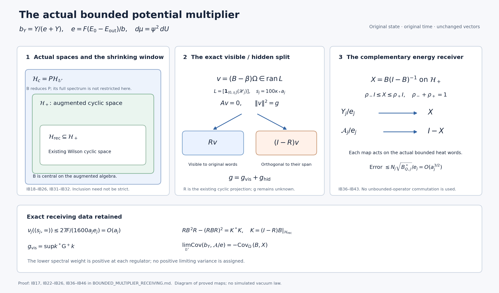

# The actual bounded potential multiplier and its zero-energy receiving space

This independent derivation uses the original positive physical vacuum and original energy units throughout. The bounded multiplier has a positive finite-regulator variance and an energy of order \(a^2\). Its unchanged centered vector reaches the original shrinking spectral window. Its limiting variance is retained as an actual Gram entry. The existing Wilson cyclic space can see only the component determined by its original word overlaps; the entire compression defect is explicit. A further receiving map identifies the original potential and retained energy with complementary bounded central observables on the augmented cyclic space.

The complete input proofs are linked below; exact versions and reading coverage are in the [source-use ledger](SIGNED_MULTIPLIER_SOURCE_USE_LEDGER.json). These are programme derivations. Every new assertion is proved below from the original-state identities and elementary spectral calculus. No new external theorem or novelty claim is used.

## Original finite spaces and the multiplier

Let \(j\ge2\), \(L_j=j^4\), and use the open cubic vertex box \(\{0,\ldots,2L_j\}^3\), all positive coordinate edges, all elementary faces in all three orientations, and every vertex gauge action, including the boundary. Keep
\[
 a_j=(100j)^{-1},\quad g_j^2=\kappa_*a_j/2,\quad
 b_j=(\kappa_*a_j^2)^{-1},\quad \alpha_j=\kappa_*/b_j,
 \quad s_j=\kappa_*/j=100\kappa_*a_j.
 \tag{IB1}
\]
The link metric is round radius two on \(SU(2)\), Haar measure is probability measure, and \(X_{e\beta}\) differentiates \(e^{tT_\beta}U_e\), where \(T_\beta=-i\sigma_\beta/2\). With the complete positively oriented holonomy
\[
\begin{gathered}
 U_{(z;d,k)}=U_d(z)U_k(z+e_d)U_d(z+e_k)^{-1}U_k(z)^{-1},\quad d<k,\\
 W_p=\operatorname{Tr}U_p,\quad D_p=2-W_p,\quad
 \Delta=\sum_{e,\beta}X_{e\beta}^2,\quad \Gamma(h,k)=\nabla h\cdot\nabla k,\\
 H_j=-\kappa_*\Delta+2b_jM_j-b_j\sum_pW_p,\quad M_j=3(2L_j)^2(2L_j+1),\\
 H_j\psi_j=E_{0,j}\psi_j,\quad \psi_j>0,\quad\|\psi_j\|=1,\quad
 d\mu_j=\psi_j^2dU,\quad \mathscr H_j=H_j-E_{0,j}I,\quad w_j=\log\psi_j.
\end{gathered}\tag{IB2}
\]
The physical Hilbert space \(\mathcal H_j\) is the gauge-invariant subspace. The positive unit full ground is physical and unique: the ground transform gives zero Dirichlet energy to the ratio of any other ground vector to \(\psi_j\), making that ratio constant. Gauge transformations preserve positivity and the unit norm. Thus \(\mathscr H_j\ge0\) and its zero eigenspace is exactly \(\mathbb C\psi_j\).

Fix a nonzero real \(f\in C_c(\mathbb R^3)\), the original offset \(o\), and all exact face centers
\[
\begin{gathered}
 x_{p,j}=o+a_j(z-L_j\mathbf1+(e_d+e_k)/2),\quad f_p=f(x_{p,j}),\quad F=\|f\|_\infty,\\
 A_1=\sum_p|f_p|,\quad A_2=\sum_pf_p^2,\quad
 Y=\sum_p|f_p|D_p=2A_1-\sum_p|f_p|W_p,\quad d=\mu Y,\\
 C_f=a\sum_pf_pD_p,\quad J(Y)=\Delta Y=6A_1-3Y,\quad
 \gamma=\Gamma(Y)\le16FY,\quad a^3A_1\to3\int|f|,\quad a^3A_2\to3\int f^2.
\end{gathered}\tag{IB3}
\]
Hereafter a missing \(j\) means this same finite regulator. The inequality for \(\gamma\) keeps every edge overlap before Cauchy–Schwarz; each edge has at most four incident faces and every face has four edges. The scalar Laplacian uses \(\Delta D_p=6-3D_p\). The signed \(C_f\) is displayed to identify the original object and is not replaced by \(aY\).

Choose a support cube of side \(R\) and its original fitting inside patch \(Q=v+\{0,\ldots,q\}^3\), with
\(v_d=L+\lfloor(c_d-o_d)/a\rfloor-1\), \(q=\lceil R/a\rceil+3\).
Its inside counts are \(N_Q=3q(q+1)^2\), \(M_Q=3q^2(q+1)\), and its crossing count is
\(C_Q=2q(q+1)\sum_d(\mathbf1_{v_d>0}+\mathbf1_{v_d+q<2L})\).
Write \(W_Q=\sum_{p\subset Q}D_p\), \(W_\times=\sum_{p\text{ crossing}}D_p\), and
\[
\begin{gathered}
 H=-\kappa\Delta_Q+bW_Q+H_{\rm out}+bW_\times,\quad
 H_{\rm out}=-\kappa\Delta_{\rm out}+2b(M-M_Q-C_Q)-b\sum_{p\text{ outside}}W_p,\\
 E_Q=E_0-E_{\rm out}>0,\quad e=FE_Q/b>0,\quad
 \Lambda_Q=\min\{2M_Q,6g^2\sqrt{N_QM_Q}\}+2C_Q,\\
 B_Q=36M_Q+64\Lambda_Q/\alpha,\quad A_Q=9+64/\alpha,\quad
 d_Q^-={72M_Q^2\over B_Q+\sqrt{B_Q^2-144A_QM_Q^2}},\\
 \mu W_Q\ge d_Q^-,\quad E_Q/b\le\Lambda_Q,\quad
 \mu Z_Q\le(\Lambda_Q-d_Q^-)/\alpha,\qquad Z_Q=|\nabla_Qw|^2.
\end{gathered}\tag{IB4}
\]
The outside ground energy is the bottom of the full outside operator. These bounds are the original local comparison and uncertainty calculation: \(\kappa\mu Z_Q+b\mu W_Q\le E_Q\le b\Lambda_Q\), and integration of \(\Delta_QW_Q=6M_Q-3W_Q\) gives
\((6M_Q-3\mu W_Q)^2\le64\mu W_Q(\Lambda_Q-\mu W_Q)/\alpha\), whose lower root is displayed. Every crossing scalar remains in \(H\) and \(\Lambda_Q\).

The bounded multiplier, mean, vector and its three actual moments are
\[
\begin{gathered}
 b_Y=\varphi(Y),\qquad \varphi(y)={y\over e+y},\quad
 \varphi'(y)={e\over(e+y)^2},\quad\varphi''(y)={-2e\over(e+y)^3},\\
 B_j=M_{b_{Y,j}},\quad \beta_j=\mu_j b_{Y,j},\quad
 v_j=(b_{Y,j}-\beta_j)\psi_j,\\
 G_j=\mu_jb_{Y,j}^2-\beta_j^2,\quad
 \mathcal E_j=\langle v_j,\mathscr H_jv_j\rangle,\quad
 \mathcal E_{2,j}=\|\mathscr H_jv_j\|^2.
\end{gathered}\tag{IB5}
\]
The coupling \(b_j\), bounded function \(b_Y\), and scalar \(e\) have different stated roles. No state is divided by its norm. The zero sampled function is excluded only because these fractions then have no intended definition; it has zero original covariance.

## Complete finite moments and conditional residual

Let \(\mathscr L=\Delta+2\nabla w\cdot\nabla\), and put \(a_Y=\Gamma(w,Y)\), \(D_Y=J(Y)+2a_Y\). Expanding IB2 gives
\(\mathscr H(h\psi)=-\kappa\psi\mathscr Lh\) and the form
\(q(h\psi)=\kappa\mu\Gamma(h,\bar h)\). The entire scalar and vacuum energy cancel by the original equation, not by changing the Hamiltonian. The chain rule now proves
\[
\begin{gathered}
 \mathscr Lb_Y={eD_Y\over(e+Y)^2}-{2e\gamma\over(e+Y)^3},\qquad
 \mathcal E=\kappa e^2\mu{\gamma\over(e+Y)^4},\\
 \mathcal E_2=\kappa^2e^2\mu\left[
 {D_Y^2\over(e+Y)^4}-{4D_Y\gamma\over(e+Y)^5}
                         +{4\gamma^2\over(e+Y)^6}\right].
\end{gathered}\tag{IB6}
\]
The mixed term is retained with its negative sign.

Use the actual pushforward \(p(y)dy=Y_*\mu\), \(h=\mathbb E[\gamma\mid Y=y]\), \(\eta=\mathbb E[a_Y\mid Y=y]\), and the conditional covariance matrix \(\Sigma(y)\) of \((\gamma,a_Y)\). These are the actual coarea law and conditional moments constructed in PF and OR, including their critical values and endpoint fluxes. The scalar mean generator and the conditional residual are
\[
\begin{gathered}
 \overline L_b(y)={e(J(y)+2\eta(y))\over(e+y)^2}-{2eh(y)\over(e+y)^3},\\
 R_b=-{2e(\gamma-h(Y))\over(e+Y)^3}
                   +{2e(a_Y-\eta(Y))\over(e+Y)^2},\qquad \mathbb E[R_b\mid Y]=0,\\
 \mathcal E_2=\kappa^2\int|\overline L_b|^2p\,dy+\kappa^2\mu R_b^2,\\
 \mu R_b^2=4e^2\int\left[{\Sigma_{11}\over(e+y)^6}
             -{2\Sigma_{12}\over(e+y)^5}+{\Sigma_{22}\over(e+y)^4}\right]p\,dy\ge0.
\end{gathered}\tag{IB7}
\]
Conditional expectation makes the two summands orthogonal. This is the actual physical leakage of OR10, multiplied by \(-\kappa\psi\), rather than a new scalar Hamiltonian replacing the original operator.

For every positive integer \(n\), set \(m_n=\mu b_Y^n\), \(m_0=1\), \(v_n=(b_Y^n-m_n)\psi\), and
\(L_n=n b_Y^{n-1}\mathscr Lb_Y+n(n-1)b_Y^{n-2}\Gamma(b_Y)\), with the second term zero when \(n=1\). The complete finite matrices are
\[
 G_{rs}=m_{r+s}-m_rm_s,\qquad
 E_{rs}=\kappa rs\mu[b_Y^{r+s-2}\Gamma(b_Y)],\qquad
 E_{2,rs}=\kappa^2\mu[L_rL_s].
 \tag{IB8}
\]
Their block matrix \(\begin{pmatrix}G&E\\E&E_2\end{pmatrix}\) is the Gram matrix of all \(v_r,\mathscr Hv_r\). It is positive semidefinite, including every singular direction. More general smooth functions of \(Y\) have the exact mixed residual \(\int d_r^*\Sigma d_s\,p\,dy\), where \(d_r=(\varphi_r'',2\varphi_r')\). This proves all conjugations and mixed coefficients without a diagonal-only assertion.

## Evaluated finite energy bounds

The elementary maxima
\(\max_{y\ge0}y/(e+y)^4=27/(256e^3)\) and
\(\max_{y\ge0}y/(e+y)^3=4/(27e^2)\) give
\[
 D_b^2:=\sup\Gamma(b_Y)\le{27F\over16e},\qquad
 \mathcal E\le U:={27\kappa F\over16e}.
 \tag{IB9}
\]
For clarity the exact face-block Hessian input is
\[
 \|\operatorname{Hess}Y\|^2
 ={3\over16}\sum_{\text{edges }q}\left(\sum_{p\ni q}|f_p|W_p\right)^2
       +\sum_pf_p^2\left(6+{3W_p^2\over4}\right)\le21A_2.
 \tag{IB10}
\]
The diagonal block is \((W_p/4)I_3\); each ordered off-diagonal pair contributes \(1/2+W_p^2/16\), and distinct faces cannot share two distinct edges. Thus the equality retains every overlap. Composition and \(\gamma\le16FY\) imply
\[
 \|\operatorname{Hess}b_Y\|\le{1\over e}
                  \left(\sqrt{21A_2}+{128F\over27}\right),\quad
 \mathcal E_2\le P_b+Q_E\mathcal E,
\]
\[
 P_b={\kappa^2\over e^2}\left(\sqrt{21A_2}+{128F\over27}\right)^2,
 \qquad Q_E={\kappa\over2}+{4\kappa\over\sqrt\alpha}
          ={\kappa\over2}+{4\over a}.
 \tag{IB11}
\]
Indeed \(\operatorname{Hess}\varphi(Y)=\varphi'\operatorname{Hess}Y+\varphi''dY\otimes dY\), including both terms. The integrated original Bochner identity is
\(\mathcal E_2=\kappa^2\mu[\|\operatorname{Hess}b_Y\|^2+\Gamma(b_Y)/2-2\operatorname{Hess}w(\nabla b_Y,\nabla b_Y)]\).
Use the proved original \(\operatorname{Hess}w\ge-2g/\sqrt\alpha\). This is an upper second-moment estimate, with no positive lower curvature or spectral gap assumption.

A direct lower first moment keeps the actual mean. Since \(d\le e\), Jensen for \((e+y)^{-2}\) and the same elementary maxima give
\[
 \mu\Delta b_Y\ge {6eA_1\over(e+d)^2}-{3\over4}-{128F\over27e},\qquad
 l:={\kappa\alpha\over4(\Lambda_Q-d_Q^-)}
       \left[{3A_1\over2e}-{3\over4}-{128F\over27e}\right]_+^2
       \le\mathcal E.
 \tag{IB12}
\]
The first estimate follows directly from
\(\Delta b_Y=eJ/(e+Y)^2-2e\gamma/(e+Y)^3\); the negative \(-3Y\) part has maximum contribution \(3/4\). Integration gives \(\mu\Delta b_Y=-2\mu\Gamma(w,b_Y)\), whose square is at most \(4\mu Z_Q\mu\Gamma(b_Y)\). Inserting IB4 and then \(d\le e\) proves the second line. On the original path \(e=\Theta(a^{-2})\), proved below from the actual root, \(\Lambda_Q-d_Q^-=\Theta(a^{-2})\), and \(A_1=\Theta(a^{-3})\). Consequently
\[
 l=\Theta(a^2),\quad U=\Theta(a^2),\quad
 P_b=\Theta(a),\quad Q_E=\Theta(a^{-1}),\quad
 \mathcal E=\Theta(a^2),\quad \mathcal E_2=O(a).
 \tag{IB13}
\]
All lower bounds concern sufficiently large fitting regulators, when the displayed bracket is positive.

## Original spectral windows and fixed physical time

Let \(\nu_j(I)=\|\mathbf1_I(\mathscr H_j)v_j\|^2\). Its moments are \(G_j,\mathcal E_j,\mathcal E_{2,j}\), and \(\nu_j(\{0\})=0\). For \(l_j>0\), define
\[
 R_j=2(Q_{E,j}+P_{b,j}/l_j),\qquad
 q_j={l_j^2\over P_{b,j}+Q_{E,j}l_j}.
\]
\[
 G_j\ge q_j>0,\qquad \nu_j((0,R_j])\ge q_j,
 \qquad q_j=\Theta(a_j^3),\quad R_j=\Theta(a_j^{-1}).
 \tag{IB14}
\]
Cauchy–Schwarz gives \(G\ge\mathcal E^2/\mathcal E_2\), and \(x^2/(P_b+Q_Ex)\) increases for \(x>0\). For the window use the pointwise minorant
\(\mathbf1_{(0,R]}(\lambda)\ge4\lambda/R-4\lambda^2/R^2\); the resulting linear bound has positive coefficient of \(\mathcal E\), and its value at \(l\) is exactly \(q\). These facts prove IB14 without altering the vector.

The retained second moment of the multiplier is \(m_2=\beta^2+G\). Its heat correlation and decrement satisfy
\[
 K_j(t)=\langle b_{Y,j}\psi_j,e^{-t\mathscr H_j}b_{Y,j}\psi_j\rangle
       =\beta_j^2+\int e^{-t\lambda}d\nu_j(\lambda),\quad
 D_j(t)=m_{2,j}-K_j(t),
\]
\[
 q_j(1-e^{-tR_j/2})\le D_j(t)\le\min\{G_j,tU_j\}.
 \tag{IB15}
\]
For the lower bound the probability measure \(\lambda,d\nu/\mathcal E\) and the convex decreasing function \((1-e^{-tx})/x\) give
\(D\ge\mathcal E^2(1-e^{-t\mathcal E_2/\mathcal E})/\mathcal E_2\).
Substituting IB11 and then IB12 proves the formula, because
\(x(1-e^{-t(Q_E+P_b/x)})/(Q_E+P_b/x)\) increases in \(x>0\). The upper bound uses \(1-e^{-t\lambda}\le\min\{1,t\lambda\}\).

For every actual threshold \(r_j>0\), retain its endpoint exactly:
\[
 0\le G_j-\nu_j((0,r_j])=\nu_j((r_j,\infty))
       \le\min\{G_j,U_j/r_j,(P_{b,j}+Q_{E,j}U_j)/r_j^2\}.
 \tag{IB16}
\]
In particular at the unchanged original \(s_j\),
\[
 0\le G_j-\nu_j((0,s_j])\le {27F\over1600a_je_j}=O(a_j).
 \tag{IB17}
\]
The closed upper endpoint is not removed. The analogous strict interval has the additional actual atom \(\nu_j(\{s_j\})\). Any \(r_j\) with \(a_j^2/r_j\to0\) receives the entire limiting raw norm by IB16. The order-\(a_j^3\) lower weight in IB14 does not assert a positive limit of \(G_j\).

## Semigroup, word maps and the existing cyclic projection

Use one common nonprincipal ultrafilter and precisely ASL's actual Hilbert ultraproduct \(\mathcal H_{\mathcal U}\), vacuum \(\Omega=[\psi_j]\), \(T(t)=[e^{-t\mathscr H_j}]\), continuous projection \(P=\mathrm{s}\!\lim_{t\downarrow0}T(t)\), and generator \(A\ge0\) on \(\mathcal H_c=P\mathcal H_{\mathcal U}\). Thus \(T(t)=e^{-tA}P\). The bounded sequence defines
\[
 B=[B_j],\quad0\le B\le I,\quad\beta=\lim_{\mathcal U}\beta_j,\quad
 v=(B-\beta)\Omega,\quad g=\|v\|^2=\lim_{\mathcal U}G_j.
 \tag{IB18}
\]
The finite LC32 bound, with Euler's number written \(\mathrm e\) to distinguish it from the original energy scalar, is
\[
 \|[B_j,e^{-t\mathscr H_j}]\|
 \le\eta_j(t):=2\sqrt{2\kappa_*t/\mathrm e}\,
                    \sqrt{27F/(16e_j)}=O(a_j\sqrt t).
 \tag{IB19}
\]
To verify the full factor, differentiate \(\langle e^{-(t-r)\mathscr H_j}u,B_je^{-r\mathscr H_j}z\rangle\), apply the polarized ground form, and bound the two remaining gradient terms by
\(\sqrt\kappa D_b(q(u_r)^{1/2}\|z_r\|+\|u_r\|q(z_r)^{1/2})\).
The spectral estimate \(\|\mathscr H_j^{1/2}e^{-s\mathscr H_j}\|\le(2\mathrm e s)^{-1/2}\), integrated at both endpoints, gives IB19. Density and the integrable endpoint bounds justify this for every \(u,z\) in the Hilbert space.

It follows in operator norm in the ultraproduct that \([B,T(t)]=0\), hence \([B,P]=0\). Every original uniformly bounded physical multiplication operator \(M\) commutes with \(B\) before compression, so
\[
 [B|_{\mathcal H_c},PMP|_{\mathcal H_c}]=0,\qquad
 \Phi(BM)=B|_{\mathcal H_c}\Phi(M)=\Phi(M)B|_{\mathcal H_c}.
 \tag{IB20}
\]
Indeed the discarded term \(PB(I-P)MP\) is zero because \(B\) reduces \(P\). This removes the product defect for this specified factor even if \(M\) itself does not reduce \(P\). Integration of the semigroup shows that \(B|_{\mathcal H_c}\) commutes with \((I+A)^{-1}\); spectral calculus therefore proves commutation with every spectral projection of \(A\) and with \(e^{itA}\) for every real physical time \(t\).

For an actual finite word
\(W_j=C_{0,j}e^{-t_1\mathscr H_j}C_{1,j}\cdots e^{-t_k\mathscr H_j}C_{k,j}\),
all \(C_{r,j}\) are bounded physical multipliers and \(t_r\ge0\). Put \(N_j=\prod_{r=0}^k\|C_{r,j}\|\). Commuting \(B_j\) past the multipliers exactly and retaining each of the \(k\) heat commutators gives
\[
 \|[B_j,W_j]\|\le N_j\sum_{r=1}^k\eta_j(t_r),\qquad
 \|(B_j-\beta_j)W_j\psi_j\|
       \le N_j\left(\sqrt{G_j}+\sum_{r=1}^k\eta_j(t_r)\right).
 \tag{IB21}
\]
If one multiplier is zero the word and both bounds vanish. Each nonzero term otherwise has the full product of multiplier norms, so no division by a zero norm occurs. Linear combinations follow by the triangle inequality with their original absolute coefficients.

Let \(L=[\mathbf1_{(0,s_j]}(\mathscr H_j)]\), \(J_s=[\mathbf1_{\{s_j\}}(\mathscr H_j)]\), \(V=|\Omega\rangle\langle\Omega|\), and \(Z=\mathbf1_{\{0\}}(A)\), extended by zero on \((I-P)\mathcal H_{\mathcal U}\). LEM proves \(L\le Z-V\); directly the heat operators differ from identity on \(L\) by at most \(1-e^{-ts_j}\to0\). IB17 proves the stronger membership
\[
 v=Lv=(L-J_s)v+J_sv,\quad Av=0,\quad
 \|v\|^2=\|(L-J_s)v\|^2+\|J_sv\|^2=g,
 \quad (Z-V-L)v=0.
 \tag{IB22}
\]
The endpoint pieces are retained and may be nonzero. For every fixed polynomial \(p\), the same conclusion applies to \((p(B)-\langle\Omega,p(B)\Omega\rangle)\Omega\): its finite first energy is at most \(\|p'\|_{C([0,1])}^2U_j\). Continuous functions follow by uniform polynomial approximation. Thus the polynomial vacuum sector is contained in \((V+L)\mathcal H_{\mathcal U}\), although \([B,L]=0\) on the full Hilbert space has not been inferred.

Let \(\mathcal H_{\rm rec}\subset\mathcal H_c\) be the existing ASL closed span of Wilson word vectors with their heat times, and let \(R\) denote its orthogonal projection, extended by zero outside \(\mathcal H_c\). It reduces the Wilson algebra and \(T(t)\), so \(R\Omega=\Omega\) and \(RZ=ZR\). For the actual \(v\) of IB18 define
\[
 v_{\rm vis}=Rv\in\ker A_{\rm rec}\cap\Omega^\perp,\quad
 v_{\rm hid}=(I-R)v\in\ker A\cap\mathcal H_{\rm rec}^\perp,
 \quad g=g_{\rm vis}+g_{\rm hid}.
 \tag{IB23}
\]
Commutation of \(R\) with the limiting energy does not prove \([R,L]=0\); neither piece is assigned to an original shrinking endpoint without its actual overlap calculation.

For any finite list of original ASL word vectors \(w_1,\ldots,w_m\), retain
\[
 \mathsf G_{rs}=\langle w_r,w_s\rangle,
 \quad k_r=\langle w_r,v\rangle
       =\lim_{\mathcal U}\langle W_{r,j}\psi_j,(b_{Y,j}-\beta_j)\psi_j\rangle,
\]
\[
 g_{\rm vis}=\sup_{\text{finite original word lists}}k^*\mathsf G^+k,
 \qquad g_{\rm hid}=g-g_{\rm vis}.
 \tag{IB24}
\]
Here \(\mathsf G^+\) is the Moore–Penrose inverse with every zero eigenvalue retained. A coefficient in \(\ker\mathsf G\) represents the zero word vector, so its scalar product with \(v\) is zero. Therefore \(k\in\operatorname{ran}\mathsf G\). Diagonalizing this finite Gram matrix gives the squared norm of the projection onto its word span as \(k^*\mathsf G^+k\); increasing all finite spans proves the formula. Every entry remains an original interacting-vacuum scalar product.

The compression \(C=RB|_{\mathcal H_{\rm rec}}\) is a positive contraction commuting with the represented Wilson operators and the reconstructed semigroup. It is not automatically a restriction of \(B\). Put \(K=(I-R)B|_{\mathcal H_{\rm rec}}\). Then
\[
 RB^2R|_{\mathcal H_{\rm rec}}-C^2=K^*K,\qquad
 \langle\Omega,(RB^2R-C^2)\Omega\rangle=g_{\rm hid},\quad
 \|(C-\beta)\Omega\|^2=g_{\rm vis}.
 \tag{IB25}
\]
Insert \(I=R+(I-R)\) between the two factors of \(B\) to prove the identity. Commutation with the original word algebra proves the exact equivalences:
\(C=\beta I\) on \(\mathcal H_{\rm rec}\) if and only if \(g_{\rm vis}=0\), and \(B\) reduces \(\mathcal H_{\rm rec}\) if and only if \(g_{\rm hid}=0\). For the second, the exact computation from a zero hidden vacuum vector is
\((I-R)BW\Omega=(I-R)WB\Omega=W(I-R)B\Omega=0\),
because every original word reduces \(R\) and commutes with \(B\). Density gives invariance, and self-adjointness gives reducing invariance. This establishes the implication without assuming cyclic preservation. If \(g=0\), IB21 also proves directly that \(B=\beta I\) on this cyclic space.

For any finite polynomial list \(p_1,\ldots,p_n\), define
\(C_p=Rp(B)|_{\mathcal H_{\rm rec}}\) and
\(K_p=(I-R)p(B)|_{\mathcal H_{\rm rec}}\). The complete defect matrix is
\[
 [\,C_{\overline p_rp_s}-C_{p_r}^*C_{p_s}\,]_{r,s}
       =[\,K_{p_r}^*K_{p_s}\,]_{r,s}\ge0.
 \tag{IB26}
\]
For any vectors \(z_r\) its quadratic form is \(\|\sum_rK_{p_r}z_r\|^2\). This preserves all off-diagonal cyclic defects, not only the second moment.

## Actual limiting support and the next retained-energy moment

The actual inside marginal supplies a stronger, quantitatively evaluated receiver. With inside coordinate \(x\) and outside coordinate \(u\), let
\(n(x)=\int\psi(x,u)^2du\), \(\chi=\psi/\sqrt n\),
\(T_Q=\int|\nabla_Q\chi|^2du\),
\(R_Q=\langle\chi,(H_{\rm out}-E_{\rm out}+bW_\times)\chi\rangle\ge0\),
and \(\overline Z=\mathbb E[Z_Q\mid x]\). The exact IM4 and IM8–IM9 equations are
\[
\begin{gathered}
 -\kappa\Delta_Q\sqrt n+(bW_Q+R_Q+\kappa T_Q)\sqrt n=E_Q\sqrt n,\\
 \mathcal A=FW_Q-Y+\alpha F\overline Z+(F/b)R_Q\ge0,\quad
 \mathcal M=Y+\mathcal A,\quad \mathcal M-e=\alpha F{\Delta_Qn\over2n},\\
 \mu[\Phi(\mathcal M-e)]={\alpha F\over2}\mu\Delta_Q\Phi,
 \quad \mu\mathcal A=e-d,\quad
 \mu(\mathcal M-e)^2\le B_Q^*,\\
 B_Q^*=F^2\{\alpha(3M_Q+3C_Q/4-3d_Q^-/2)
                      +4\sqrt\alpha(\Lambda_Q-d_Q^-)\}=O(a^{-1}).
\end{gathered}\tag{IB27}
\]
The marginal equation follows by expanding \(\Delta_Q(\sqrt n\chi)\), using \(\int\chi^2=1\), \(\int\chi\nabla\chi=0\), and \(\int\chi\Delta\chi=-T_Q\). Two integrations of \(\Phi\Delta_Qn\) prove the test identity. The variance bound is the positive original Hessian remainder IM18–IM23, with every mixed inside/outside derivative retained there. Its exact equality is
\(\mu(\mathcal M-e)^2+(\alpha F)^2\mathcal D_Q
=\alpha F^2\mu[6M_Q-3W_Q+3C_Q/2-3W_\times/4]/2
 +4\alpha^{3/2}F^2\mu Z_Q\), where
\(\mathcal D_Q=\mu\|\operatorname{Hess}_{\rm out,Q}w\|^2+2\mu(\operatorname{Hess}_Qw+2g/\sqrt\alpha)(\nabla_Qw,\nabla_Qw)+\mu\operatorname{Var}(\Delta_Qw+2Z_Q\mid x)\ge0\).
Thus IB27 has not assumed that \(\mathcal A\) is constant.

For the actual lower tail retain \(c_0=9\alpha/64\),
\(B_0=e+4c_0A_1\), \(C_0=4c_0A_1^2\), \(D_0=B_0^2-4(1+c_0)C_0\), and
\[
 r_-={2C_0\over B_0+\sqrt{D_0}}>0,\qquad p_0={3A_1\over8F},\qquad
 \mu e^{-tY}\le(1+r_-t/p_0)^{-p_0}\quad(t\ge0).
 \tag{IB28}
\]
This is the actual root inequality proved in IM31–IM33 and LR, not an auxiliary density. In detail the inside score square under the exponential weight gives
\((1+c_0-4\alpha F^2t^2)d_t^2-B_0d_t+C_0\le0\), where \(d_t=\mu(Ye^{tY})/\mu e^{tY}\). Its positive lower root is
\(2C_0/(B_0+\sqrt{D_0+16\alpha F^2C_0t^2})\), for either sign of the quadratic coefficient. The elementary square-root upper bound makes this at least \(r_-/(1+r_-|t|/p_0)\). Integrating \(-d_{-t}\) proves IB28. The actual root implies \(r_-\le d\le e\). Its discriminant, together with \(e\le F\Lambda_Q=O(a^{-2})\), proves \(e,r_-=\Theta(a^{-2})\). All constants follow from IB1–IB4; \(p_0=\Theta(a^{-3})\).

Chernoff with \(t=p_0\delta/[r_-(1-\delta)]\) gives for \(0\le\delta<1\)
\[
 \mu\{Y\le r_-(1-\delta)\}
 \le\exp[p_0\{\delta+\log(1-\delta)\}]
 \le e^{-p_0\delta^2/2},\quad
 \mu(r_--Y)_+^2\le {2r_-^2\over p_0}(1-e^{-p_0/2}).
 \tag{IB29}
\]
The second assertion is the layer-cake integral
\(\int_0^{r_-}2s\mu(Y<r_--s)ds\); changing a strict event to a weak event only enlarges the bound. The endpoint \(Y=0\) has zero mass by taking \(\delta\uparrow1\) in the first exponential. On the other side \((Y-e)_+\le|\mathcal M-e|\) since \(\mathcal A\ge0\). Therefore, writing \(b_-=r_-/(e+r_-)\),
\[
 \mu(b_--b_Y)_+^2\le {2b_-^2\over p_0}(1-e^{-p_0/2}),\qquad
 \mu(b_Y-1/2)_+^2\le {B_Q^*\over4e^2}.
 \tag{IB30}
\]
The first uses \(b_--b_Y=e(r_--Y)/[(e+r_-)(e+Y)]\) below \(r_-\); the second uses \(b_Y-1/2=(Y-e)/[2(e+Y)]\). Both right-hand sides are \(O(a^3)\).

Define the augmented actual cyclic space
\[
 \mathcal H_+=\overline{\operatorname{span}}
 \{p(B)W\Omega:p\text{ a polynomial},\ W\text{ an original ASL word operator on }\mathcal H_c\}.
 \tag{IB31}
\]
It contains \(\mathcal H_{\rm rec}\), reduces \(B\), the Wilson operators and the semigroup, and retains the same actual vacuum. Invariance follows by commuting \(B\) with each word generator; the adjoints give reducing invariance. In the represented unital operator algebra generated by these operators, \(B\) is central because it belongs to the algebra and commutes with its generators. This assertion is about the specified augmented algebra; membership in the pre-existing Wilson algebra has not been assumed. In fact \(\mathcal H_+=\mathcal H_{\rm rec}\) holds exactly when \(g_{\rm hid}=0\), by IB25 and the definition of the polynomial cyclic span. If \(g=0\), every \(p(B)W\Omega=p(\beta)W\Omega\), proving this equality together with the scalar action. A positive \(g\) alone does not decide equality of the two spaces.

Let \(\rho=\lim_{\mathcal U}r_-/e\in(0,1]\) and \(b_* =\rho/(1+\rho)\). IB30 gives
\((b_* -B)_+\Omega=(B-1/2)_+\Omega=0\).
Each positive-part function commutes with all augmented word generators, so it kills their entire cyclic span. Hence
\[
 b_* I\le B|_{\mathcal H_+}\le\tfrac12 I,\qquad
 \ker A\cap\mathcal H_+\supset\overline{\{p(B)\Omega\}},\quad
 \langle\Omega,p(B)\Omega\rangle=\lim_{\mathcal U}\mu p(b_Y).
 \tag{IB32}
\]
The spectral measure in the last line is the measure of the actual operator \(B\) in the actual vacuum, supported in \([b_*,1/2]\). It is not substituted for any finite original state. Its mean and variance are still \(\beta\) and \(g\); in particular \(\beta\ge b_*>0\) but \(g\) may be zero. The support of \(B\) on the entire ultraproduct is not restricted by this vacuum-cyclic argument.

The next actual moment can be calculated without deleting \(\mathcal A\). With \(m_n=\mu b_Y^n\), the exact polynomial identity \(Yb_Y^n=Y-e\sum_{k=1}^n b_Y^k\) gives
\[
 2m_n={d\over e}-\sum_{k=1}^{n-1}m_k
       +\mu[(\mathcal A/e)b_Y^n]
       -{\alpha F\over2e}\mu\Delta_Q(b_Y^n),\qquad n\ge1.
 \tag{IB33}
\]
This follows by testing IB27 with \(b_Y^n\), and keeps the full mean \(d\). In particular
\[
 2m_2={d\over e}-\beta+\mu[(\mathcal A/e)b_Y^2]
       -{\alpha F\over e}\mu[b_Y\Delta b_Y+\Gamma(b_Y)],
 \quad G=m_2-\beta^2.
 \tag{IB34}
\]
The complete Laplacian satisfies
\(\Delta(b_Y^n)=n b_Y^{n-1}\Delta b_Y+n(n-1)b_Y^{n-2}\Gamma(b_Y)\).
For \(D_\Delta=6A_1/e+3/4+128F/(27e)\), IB3 and the elementary maxima give
\[
 \left|{\alpha F\over2e}\mu\Delta(b_Y^n)\right|
 \le{\alpha F\over2e}\{nD_\Delta+n(n-1)27F/(16e)\}=O(a^3)
 \quad(n\text{ fixed}).
 \tag{IB35}
\]
Thus the derivative contribution is evaluated, while the retained-energy mixed moment remains as an actual term whose precise receiver is derived next.

## Receiving the original potential and retained energy on the same cyclic space

Put \(x_j=Y_j/e_j\), \(r_j^{\mathcal A}=\mathcal A_j/e_j\), and \(x_j^\cap=\min\{x_j,1\}\). The scalar inequality for nonnegative \(x,r\) is
\(|x-\min(x,1)|\le|x+r-1|\) and
\(|r-(1-\min(x,1))|\le|x+r-1|\).
For \(x\le1\), the second difference equals \(x+r-1\); for \(x>1\), it is \(r\le x+r-1\). Applying IB27 gives
\[
 \|(x_j-x_j^\cap)\psi_j\|\le\varepsilon_j,
 \quad\|(r_j^{\mathcal A}-(1-x_j^\cap))\psi_j\|\le\varepsilon_j,
 \qquad\varepsilon_j={\sqrt{B_{Q,j}^*}\over e_j}=O(a_j^{3/2}).
 \tag{IB36}
\]
There is a full word version. The original ground transform
\(S_j(t)f=\psi_j^{-1}e^{-t\mathscr H_j}(\psi_jf)\) preserves positivity, constants and the \(L^\infty\) norm bound, by its compact positive heat kernel and the ground equation. Consequently every original bounded heat word, including insertions of \(b_Y\), has \(W_j\psi_j=F_{W,j}\psi_j\) with \(\|F_{W,j}\|_\infty\le N_j\). Both norms in IB36 after multiplication by \(F_{W,j}\) are at most \(N_j\varepsilon_j\). This proves a receiving map for all augmented finite word vectors, with their original multiplier norms and times.

The bounded function \(f_\cap(u)=\min\{u/(1-u),1\}\), defined to equal one on \([1/2,1]\), is continuous on \([0,1]\), and \(x_j^\cap=f_\cap(b_{Y,j})\). Uniform polynomial approximation therefore identifies \([M_{x_j^\cap}]=f_\cap(B)\). On \(\mathcal H_+\), IB32 gives the exact bounded operator
\[
 X=f_\cap(B)|_{\mathcal H_+}=B(I-B)^{-1}|_{\mathcal H_+},\qquad
 \rho I\le X\le I,\qquad [X,A]=0
 \text{ in the spectral-calculus sense}.
 \tag{IB37}
\]
The inverse is bounded because \(B\le I/2\) on this space. The raw finite multiplier \(Y/e\) has not been assumed uniformly bounded. IB36 proves that its action on every augmented word has the unique receiver \(X\), and the raw action of \(\mathcal A/e\) has receiver \(I-X\). These maps descend through every zero-norm word relation: their difference from uniformly bounded operators tends to zero, while a bounded operator kills a zero-norm relation. They extend by continuity on \(\mathcal H_+\). Thus the two retained original energies become complementary central operators, with every source scalar still fixed by \(e=F(E_0-E_{\rm out})/b\).

There is also a complete actual second-moment receiver. The \(L^2\) errors in IB36 and boundedness of \(x_j^\cap\) imply, by Cauchy–Schwarz, convergence of the first moments, squares and mixed product. For every fixed polynomial \(p\),
\[
\begin{gathered}
 \lim_{\mathcal U}\mu x_j=\langle X\rangle_\Omega,\quad
 \lim_{\mathcal U}\mu x_j^2=\langle X^2\rangle_\Omega,\quad
 \lim_{\mathcal U}\mu(r_j^{\mathcal A})^2=\langle(I-X)^2\rangle_\Omega,\\
 \lim_{\mathcal U}\mu(x_jr_j^{\mathcal A})=\langle X(I-X)\rangle_\Omega,
 \quad\lim_{\mathcal U}\mu[(\mathcal A_j/e_j)p(b_{Y,j})]
       =\langle(I-X)p(B)\rangle_\Omega.
\end{gathered}\tag{IB38}
\]
For example \(|\mu x_j^2-\mu(x_j^\cap)^2|\le2\varepsilon_j+\varepsilon_j^2\); the retained-energy square has the same bound. The mixed-product error is at most \(2\varepsilon_j+\varepsilon_j^2\). The last error is at most \(\|p\|_\infty\varepsilon_j\). These are finite estimates, not merely formal limiting substitutions.

Since \(a_j^2e_j\) stays bounded above and away from zero, set \(\mathfrak e=\lim_{\mathcal U}a_j^2e_j>0\). The unchanged potential, retained energy and their full centered moments obey
\[
\begin{gathered}
 [a_j^2Y_jW_j\psi_j]=\mathfrak e\,XW\Omega,\quad
 [a_j^2\mathcal A_jW_j\psi_j]=\mathfrak e\,(I-X)W\Omega,\\
 \lim_{\mathcal U}a_j^4\operatorname{Var}(Y_j)
 =\lim_{\mathcal U}a_j^4\operatorname{Var}(\mathcal A_j)
 =\mathfrak e^2\operatorname{Var}_\Omega(X),\\
 \lim_{\mathcal U}a_j^4\operatorname{Cov}(Y_j,\mathcal A_j)
 =-\mathfrak e^2\operatorname{Var}_\Omega(X).
\end{gathered}\tag{IB39}
\]
The brackets in the first line denote bounded-vector ultraproduct classes, justified by IB36 for every fixed bounded word sequence. They do not claim globally bounded raw multiplication operators. The source path and each finite vector remain unchanged.

The exact quantitative relation between the new bounded Gram and this original leading potential covariance is
\[
 {1\over16}\operatorname{Var}_\Omega(X)
 \le g=\operatorname{Var}_\Omega\!\left({X\over I+X}\right)
 \le{1\over(1+\rho)^4}\operatorname{Var}_\Omega(X).
 \tag{IB40}
\]
To prove it, use the actual vacuum spectral measure of \(X\), supported in \([\rho,1]\), and its product with itself. For two spectral values \(x,y\), the mean-value theorem gives
\(|x-y|/4\le|x/(1+x)-y/(1+y)|\le|x-y|/(1+\rho)^2\).
The variance is half the integral of the squared difference. No independent-link law or auxiliary vacuum is introduced by this elementary representation of the same spectral measure. Thus \(g=0\) is exactly equivalent to vanishing of the order-\(a^{-4}\) potential variance coefficient in IB39. A proof that this coefficient is positive or zero is not supplied by the moment bounds IB13–IB17.

Finally IB33–IB35 receive their remaining term by IB38. They become the exact moment identities of the same central operator \(X=B(I-B)^{-1}\) and complementary energy \(I-X\). They impose no additional concentration after that substitution: the scalar identity \(xb^n=x-\sum_{k=1}^n b^k\), for \(b=x/(1+x)\), proves each resulting equality at every spectral value. This explicitly tests the next moment instead of assigning a favorable sign to a retained covariance. The resulting space is the actual central energy-partition sector of \(\mathcal H_+\), with its original shrinking-window vacuum vectors, unknown Gram, and exact map IB23–IB26 into the pre-existing Wilson cyclic space. These are proved receiving objects and maps; a surviving centered variance is not assumed.

## Two-root support, the centered contraction, and the resolvent moment

The upper root in the same actual exponential polynomial sharpens IB32, IB37 and IB40. Set
\(r_+=(B_0+\sqrt{D_0})/[2(1+c_0)]\),
\(T=(4F\sqrt\alpha)^{-1}\),
\(V_+=F\sqrt\alpha(2\sqrt{C_0}+r_+)/[2(3/4+c_0)]\).
The original mean lies between the roots, and \(r_+\le e\): the polynomial at \(e\) is \(c_0(e-2A_1)^2\ge0\), while \(d\le e\) and \(d\in[r_-,r_+]\). If \(e=d=r_-\), the polynomial vanishes there, which forces \(e=2A_1\); its derivative there is \(2A_1>0\), so this point is the right root. For \(0\le t\le T\), subtracting \(r_+\) from the upper root gives exactly
\[
 r_+(t)-r_+
 ={\sqrt{D_0+16\alpha F^2C_0t^2}-\sqrt{D_0}
             \over2(1+c_0-4\alpha F^2t^2)}
 +{4\alpha F^2r_+t^2\over1+c_0-4\alpha F^2t^2}
 \le2V_+t.
 \tag{IB41}
\]
Use \(1+c_0-4\alpha F^2t^2\ge3/4+c_0\), the square-root increment bound \(4F\sqrt{\alpha C_0}t\), and \(4\alpha F^2T=F\sqrt\alpha\). Integration gives \(\log\mu e^{tY}\le r_+t+V_+t^2\). Markov optimization gives the Gaussian branch \(e^{-r^2/(4V_+)}\) for \(0\le r\le2V_+T\), and the branch \(e^{-Tr+V_+T^2}\) thereafter. Integrating \(2r\) times these two bounds proves
\[
 \mu(Y-r_+)_+^2\le B_+:=4V_++2T^{-2}e^{-V_+T^2}=O(a^{-1}),\quad
 \mu(b_Y-b_+)_+^2\le {B_+\over(e+r_+)^2}=O(a^3),\quad b_+={r_+\over e+r_+}.
 \tag{IB42}
\]
For the second bound use the exact difference
\(b_Y-b_+=e(Y-r_+)/[(e+Y)(e+r_+)]\le(Y-r_+)/(e+r_+)\) above \(r_+\). Together with IB29 this derives both root excess bounds directly. No mass outside the root interval is silently set to zero at finite regulator.

Put \(J_1=\int|f|>0\), and retain \(\mathfrak e=\lim_{\mathcal U}a^2e\). The actual root formula gives
\[
\begin{gathered}
 \mathfrak e\ge\tfrac92\kappa_*J_1,\qquad
 R_\pm:=\lim_{\mathcal U}a^2r_\pm
 ={\mathfrak e\pm\sqrt{\mathfrak e^2-81\kappa_*^2J_1^2/4}\over2},\\
 \rho_\pm=R_\pm/\mathfrak e,\quad 0<\rho_-\le\tfrac12\le\rho_+<1,
 \quad\rho_-+\rho_+=1,\\
 {\rho_-\over1+\rho_-}I\le B|_{\mathcal H_+}
       \le{\rho_+\over1+\rho_+}I,\quad
 \rho_-I\le X\le\rho_+I,\quad\rho_-I\le I-X\le\rho_+I,\\
 {\operatorname{Var}_\Omega(X)\over(1+\rho_+)^4}
       \le g\le{\operatorname{Var}_\Omega(X)\over(1+\rho_-)^4}.
\end{gathered}\tag{IB43}
\]
Indeed \(a^4C_0\to81\kappa_*^2J_1^2/16\), \(a^2B_0- a^2e\to0\), and \(c_0\to0\). The discriminant proves the first inequality and both root limits, including a zero limiting discriminant. The same cyclic positive-part argument as IB32 applies to IB42. Functional calculus and the exact inverse relation IB37 prove the two energy intervals; the mean-value proof of IB40 with this smaller interval gives its last strengthening.

There is an exact evaluation at the lower endpoint of this actually defined energy parameter: if its actual ultralimit is \(\mathfrak e=(9/2)\kappa_*J_1\), the two roots coincide, and IB43 forces \(X=I/2\), \(B=I/3\) on \(\mathcal H_+\), with \(g=0\). This implication is the evaluation of the proved interval at its endpoint. It does not assert that the actual ground energy attains that endpoint, does not assume a missing estimate, and is not substituted for any value of the actual \(\mathfrak e\). More generally IB43 identifies precisely the whole interval that remains when the actual limiting discriminant is positive.

The requested centered retained-energy contraction has a complete finite expression. Since \(Yb_Y=Y-eb_Y\),
\[
\begin{gathered}
 \operatorname{Cov}(b_Y,Y)=d-(e+d)\beta\ge eG,\\
 \boxed{\operatorname{Cov}(b_Y,\mathcal A)
       =(e+d)\beta-d+{\alpha F\over2}\mu\Delta b_Y,}\\
 \operatorname{Cov}(b_Y,\mathcal A/e)
       =-\operatorname{Cov}(b_Y,Y/e)+{\alpha F\over2e}\mu\Delta b_Y,\quad
 \left|{\alpha F\over2e}\mu\Delta b_Y\right|
       \le{\alpha F\over2e}D_\Delta=O(a^3).
\end{gathered}\tag{IB44}
\]
To prove the first inequality, integrate the identity
\((b_Y-b_Y')(Y/e-Y'/e)=(b_Y-b_Y')^2/[(1-b_Y)(1-b_Y')]\)
under two copies of the same actual measure. Its denominator is at most one. The second line follows by testing IB27 with \(b_Y-\beta\), and the last bound is IB35. No sign for the complete finite covariance has been imposed. IB38 and the refined interval give the exact limit and its evaluated interval
\[
\begin{gathered}
 \lim_{\mathcal U}\operatorname{Cov}(b_Y,\mathcal A/e)
       =-\operatorname{Cov}_\Omega(B,X),\\
 -(1+\rho_+)^2g\le-\operatorname{Cov}_\Omega(B,X)
                    \le-(1+\rho_-)^2g.
\end{gathered}\tag{IB45}
\]
The derivative of \(u/(1-u)\), as a function of the spectral value \(u=B\), is \((1-u)^{-2}\), which on IB43 lies in \([(1+\rho_-)^2,(1+\rho_+)^2]\). The covariance is half the actual double integral of the two differences; this proves both bounds and preserves every factor. A nonzero limiting bounded Gram would therefore give a strictly negative retained-energy contraction, not the favorable covariance deletion sometimes used in potential-variance arguments.

For the next resolvent moment, avoid confusing the face sum \(A_1\) with retained-energy moments. Define
\(\mathcal R_n=\mu(e+Y)^{-n}\),
\(\mathcal A_n=\mu[\mathcal A(e+Y)^{-n}]\), and
\(\mathcal H_n=\mu[\gamma(e+Y)^{-n-2}]\), with \(\mathcal R_0=1\). For every integer \(n\ge1\) the exact recurrence is
\[
 \boxed{(2e+3n\alpha F/2)\mathcal R_n
 =\mathcal R_{n-1}+\mathcal A_n
   -{\alpha Fn(n+1)\over2}\mathcal H_n
   +{\alpha Fn(6A_1+3e)\over2}\mathcal R_{n+1}.}
 \tag{IB46}
\]
Every denominator is strictly positive, so this test is smooth on the original compact space and requires no singular endpoint limit. Insert
\(\Delta(e+Y)^{-n}=-n(6A_1+3e)(e+Y)^{-n-1}+3n(e+Y)^{-n}+n(n+1)\gamma(e+Y)^{-n-2}\)
in IB27; its left side is \(\mathcal R_{n-1}-2e\mathcal R_n+\mathcal A_n\). Rearranging gives IB46 and verifies all four signs. Multiplying by \(e^{n-1}\), the \(\mathcal R\) moments receive \((I-B)^n\), and the retained-energy term receives \((I-X)(I-B)^n\) by IB38. The terms containing derivatives are bounded by the same \(O(a^3)\) argument as IB35, using the derivatives of \((1-b_Y)^n\). Thus this additional tested equation has an evaluated exact receiver on the original cyclic energy-partition sector; it does not require a replacement density or a claimed vanishing Gram.

## Reproducibility and scope of the result

The bounded coefficient checks and the inspected figure accompany this complete proof. The figure depicts the actual Hilbert maps IB18–IB26 and the complementary energy receiver IB36–IB40; it does not display an invented density or a numerical Yang–Mills sample. No claim of a positive continuum spectral gap, a unique limiting vacuum, nonzero limiting variance, equality of the signed original \(C_f\) with \(aY\), or an exponent improvement for its unmodified covariance is made. The specific completed progress is the exact original shrinking-window map, cyclic visibility and compression defect, and the complete potential/retained-energy central receiver with evaluated finite errors.

Complete earlier proof providers: [RH](https://github.com/KokunoYumeto/yang-mills-interacting-workbench/blob/d0610cf5edd84283bbdbd905e397446fe5feb60c/yang-mills/continuations/20261011-central-signs-shrinking-window/RAW_S6_HESSIAN_RECEIVING.md) [DP](https://github.com/KokunoYumeto/yang-mills-interacting-workbench/blob/d0610cf5edd84283bbdbd905e397446fe5feb60c/yang-mills/continuations/20261011-central-signs-shrinking-window/DIRECTIONAL_POTENTIAL_AND_ROOT_DEFECT.md) [WC](https://github.com/KokunoYumeto/yang-mills-interacting-workbench/blob/d0610cf5edd84283bbdbd905e397446fe5feb60c/yang-mills/continuations/20261011-central-signs-shrinking-window/ACTUAL_WILSON_COVARIANCE.md) [OS](https://github.com/KokunoYumeto/yang-mills-interacting-workbench/blob/d0610cf5edd84283bbdbd905e397446fe5feb60c/yang-mills/continuations/20261011-central-signs-shrinking-window/ORIGINAL_SOURCE_COVARIANCE.md) [HVR](https://github.com/KokunoYumeto/yang-mills-interacting-workbench/blob/d0610cf5edd84283bbdbd905e397446fe5feb60c/yang-mills/continuations/20261011-central-signs-shrinking-window/HESSIAN_RECEIVING_REVIEW.md) [LC](https://github.com/KokunoYumeto/yang-mills-interacting-workbench/blob/d0610cf5edd84283bbdbd905e397446fe5feb60c/yang-mills/continuations/20261011-central-signs-shrinking-window/LOCAL_CURVATURE_BUDGET.md) [ASL](https://github.com/KokunoYumeto/yang-mills-interacting-workbench/blob/d0610cf5edd84283bbdbd905e397446fe5feb60c/yang-mills/continuations/20261011-central-signs-shrinking-window/ACTUAL_SEMIGROUP_LIMIT.md) [LEM](https://github.com/KokunoYumeto/yang-mills-interacting-workbench/blob/d0610cf5edd84283bbdbd905e397446fe5feb60c/yang-mills/continuations/20261011-central-signs-shrinking-window/ACTUAL_LOW_ENERGY_MAPS.md) [LR](https://github.com/KokunoYumeto/yang-mills-interacting-workbench/blob/d0610cf5edd84283bbdbd905e397446fe5feb60c/yang-mills/continuations/20261011-central-signs-shrinking-window/LOWER_SIDE_RETAINED_ENERGY.md) [IM](https://github.com/KokunoYumeto/yang-mills-interacting-workbench/blob/d0610cf5edd84283bbdbd905e397446fe5feb60c/yang-mills/continuations/20261011-central-signs-shrinking-window/INSIDE_MARGINAL_ENERGY.md) [OP](https://github.com/KokunoYumeto/yang-mills-interacting-workbench/blob/d0610cf5edd84283bbdbd905e397446fe5feb60c/yang-mills/continuations/20261011-central-signs-shrinking-window/PUSHFORWARD_OPERATOR_RECEIVING.md) [OR](https://github.com/KokunoYumeto/yang-mills-interacting-workbench/blob/d0610cf5edd84283bbdbd905e397446fe5feb60c/yang-mills/continuations/20261011-central-signs-shrinking-window/INDEPENDENT_OPERATOR_REVIEW.md)

The [source-use ledger](SIGNED_MULTIPLIER_SOURCE_USE_LEDGER.json) identifies the exact reading coverage and source versions.

## Actual curvature scale and explicit smooth receiving families

[HC1–HC24](HOLONOMY_CURVATURE_RECEIVING.md) give the original smooth holonomy map and its exact actual-vacuum curvature constraint. [HCR1–HCR8](HOLONOMY_CURVATURE_REVIEW.md) strengthen this to universal-preimage almost-sure bounds and compute the full fixed-time accumulation interval of an explicit globally smooth classical comparison. The original signed receiver and all finite error terms are retained.

## Simultaneous spatial measure and current evaluation

[CM1–CM63](SIMULTANEOUS_CENTRAL_MEASURE.md) extend the original bounded-word maps to every orientation triple and construct their actual spatial measure. [CE1–CE50](CURRENT_COVARIANCE_EQUALITY.md) evaluate the current defect to zero and retain the exact geometric and outside-energy covariance terms. The further heat fluctuation survives for every positive parameter; its original-window norm and visible/escape maps are explicit, with the actual window-energy coefficient still to be evaluated.
