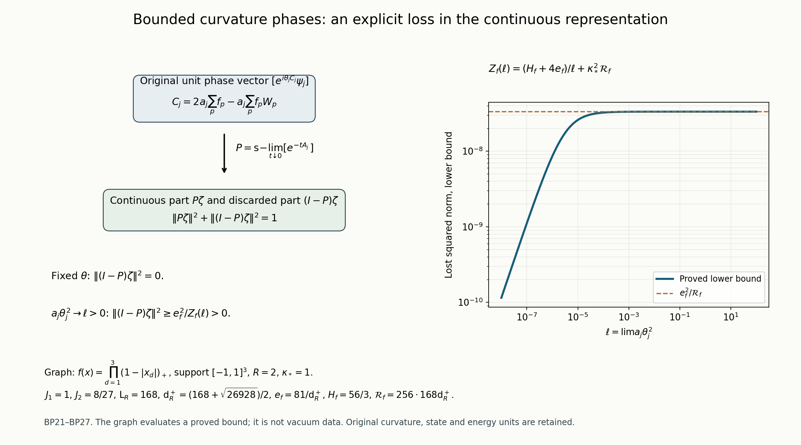

# Actual curvature phases: full energy matrices and a quantitative loss of continuous norm

This calculation keeps the original interacting vacuum, physical support, all three face orientations and the complete scalar in the curvature observable. It proves the full phase Gram and energy matrices, finite spectral receiving bounds and an explicit positive loss of norm in the continuous representation when the phase parameter grows sufficiently fast along the original regulator path. Fixed parameters retain their full norm. No original state or curvature observable is replaced by a comparison measure. A varying phase parameter is an explicit additional observable family; its conclusions are not substituted for the raw S6 shrinking-window calculation.

## 1. Original objects and the exact receiving constants

The original open box has vertices \(z\in\{0,\ldots,m_j\}^3\), \(m_j=2L_j\), all positive nearest-neighbour edges, and all elementary faces. Retain
\[
 L_j=j^4,\quad a_j=(100j)^{-1},\quad g_j^2=\kappa_*a_j/2,
 \quad\kappa_j=2g_j^2/a_j=\kappa_*,\quad
 b_j=(2g_j^2a_j)^{-1}=(\kappa_*a_j^2)^{-1},\quad s_j=\kappa_*/j.
 \tag{BP1}
\]
Each link is an \(SU(2)\) matrix with probability Haar measure and radius-two round metric. With \(T_\alpha=-i\sigma_\alpha/2\), the original edge derivative differentiates \(e^{tT_\alpha}U_e\). Write \(\Delta=\sum_{e,\alpha}X_{e,\alpha}^2\), \(\Gamma(C)=|\nabla C|^2\). For a face \(p=(z;d,e)\), \(d<e\), keep
\[
 \begin{gathered}
 U_p=U_d(z)U_e(z+e_d)U_d(z+e_e)^{-1}U_e(z)^{-1},\\
 W_p=\operatorname{Tr}U_p,\quad D_p=2-W_p,\quad
 H_j=-\kappa_*\Delta+b_j\sum_pD_p
      =-\kappa_*\Delta+2b_jM_j-b_j\sum_pW_p,\\
 M_j=3m_j^2(m_j+1),\quad
 H_j\psi_j=E_{0,j}\psi_j,\quad \|\psi_j\|=1,\quad\psi_j>0,\quad
 d\mu_j=\psi_j^2dU,\quad A_j=H_j-E_{0,j}.
 \end{gathered}\tag{BP2}
\]
All original vertex gauge transformations, including boundary vertices, are imposed. Compactness and ellipticity give a lowest eigenfunction. Replacing a minimizer by its absolute value does not increase the form; elliptic regularity and the strong maximum principle give a strictly positive smooth minimizer. The ground-transform identity (BP9) then makes every other ground vector a constant multiple of it. Every vertex gauge transformation commutes with the original Hamiltonian and preserves positivity and the unit norm, so uniqueness makes this vector gauge invariant. The full and physical ground energies coincide. No boundary gauge group is removed.

Fix a nonzero real \(f\in C_c(\mathbb R^3)\), with \(F=\|f\|_\infty\), and retain
\[
 \begin{gathered}
 x_{p,j}=o+a_j\bigl(z-L_j\mathbf1+(e_d+e_e)/2\bigr),\quad f_p=f(x_{p,j}),\\
 C_j=a_j\sum_p f_pD_p=2a_j\sum_pf_p-a_j\sum_pf_pW_p,\quad
 m_j^C=\mu_jC_j,\quad u_j=(C_j-m_j^C)\psi_j,\\
 G_j=\|u_j\|^2,\qquad E_j=\langle u_j,A_ju_j\rangle,
 \qquad E_{2,j}=\|A_ju_j\|^2.
 \end{gathered}\tag{BP3}
\]
The symbol \(m_j^C\) is distinct from the number \(m_j\) of intervals in the original box. All three orientations occur in these sums. A support cube \(\prod_d[c_d,c_d+R]\) is received by the exact patch
\[
 \begin{gathered}
 v_{d,j}=L_j+\lfloor(c_d-o_d)/a_j\rfloor-1,\qquad
 q_j=\lceil R/a_j\rceil+3,\qquad Q_j=v_j+\{0,\ldots,q_j\}^3,\\
 N_Q=3q_j(q_j+1)^2,\quad M_Q=3q_j^2(q_j+1),\quad
 C_Q=2q_j(q_j+1)\eta_Q,\\
 \eta_Q=\sum_{d=1}^3
  (\mathbf1_{v_{d,j}>0}+\mathbf1_{v_{d,j}+q_j<m_j}),\quad
 \Lambda_j=\min\{2M_Q,6g_j^2\sqrt{N_QM_Q}\}+2C_Q,\quad
 \rho_j^2=4\kappa_*/b_j=16(g_j^2)^2.
 \end{gathered}\tag{BP4}
\]
The patch is inside the original box for all sufficiently large \(j\); all subsequent finite assertions refer to those actual fitting patches. Its faces contain every supported face and all its edges. Put \(W_Q=\sum_{p\subset Q}D_p\), \(d_j=\mu_jW_Q\), \(\xi_j=b_j/\kappa_*\), and retain the complete roots
\[
 \begin{gathered}
 A_Q=9+64\xi_j,\quad B_Q=36M_Q+64\xi_j\Lambda_j,
 \quad\mathcal D_Q=B_Q^2-144A_QM_Q^2,\\
 d_j^-={72M_Q^2\over B_Q+\sqrt{\mathcal D_Q}},\qquad
 d_j^+={B_Q+\sqrt{\mathcal D_Q}\over2A_Q},\\
 0<d_j^-\le d_j\le d_j^+\le\Lambda_j,\quad d_j^-<\Lambda_j,\qquad
 \mu_jW_Q^2\le\Lambda_jd_j+\rho_j^2.
 \end{gathered}\tag{BP5}
\]
These are the original local budget and uncertainty roots, with their proofs in LC1–LC42 and PVC28–PVC29. The local comparison retains the outside ground energy, and every crossing face has one inside edge and exact trial cost \(2b_j\). The original kinetic term remains in \(\kappa_*\mu|\nabla_Q\log\psi_j|^2+b_jd_j\le b_j\Lambda_j\). Integration of \(\Delta W_Q=6M_Q-3W_Q\), followed by \(\Gamma(W_Q)\le16W_Q\), gives \((6M_Q-3d_j)^2\le64\xi_jd_j(\Lambda_j-d_j)\), whose two roots are (BP5). Applying the local form inequality to \(\sqrt{W_Q+\epsilon}\psi_j\) gives its second-moment bound with coefficient \(4\kappa_*/b_j\). These arguments preserve the full original scalar and all crossing incidences.

For \(A_{1,j}=\sum|f_p|\), \(A_{2,j}=\sum f_p^2\), and the global modulus of continuity \(\omega_f\), the proved signed-test estimates HVR19–HVR23 are
\[
 \begin{gathered}
 \mathfrak b_j=a_j[6A_{1,j}-3Fd_j^+-12M_Q\omega_f(a_j/2)]_+,\\
 \underline E_j={\kappa_*^2\mathfrak b_j^2\over4b_j(\Lambda_j-d_j^-)},
 \quad\overline E_j=16\kappa_*a_j^2F^2d_j^+,\\
 P_j=21\kappa_*^2a_j^2A_{2,j},\qquad Q_j^E=\kappa_*/2+4/a_j,\\
 \underline E_j\le E_j\le\overline E_j,\qquad
 E_{2,j}\le P_j+Q_j^EE_j,\qquad
 \mu_j\Gamma(C_j)^2\le\mathcal R_j
 :=256a_j^4F^4(\Lambda_jd_j^++\rho_j^2).
 \end{gathered}\tag{BP6}
\]
The last inequality follows directly from the complete edge derivative \(X_{e\alpha}C_j=a_j\sum_{p\ni e}f_pX_{e\alpha}D_p\): each edge has at most four incident faces and each face has four edges, so \(\Gamma(C_j)\le16a_j^2F^2W_Q\). Squaring and using (BP5) proves the coefficient \(256\). The first-energy lower bound uses the original edge weights \(\operatorname{sgn}f(x_e)\); their face-center discrepancy has distance exactly \(a_j/2\). Thus the estimate also covers signed tests of zero integral. The second-energy estimate uses the fully proved product-metric bound \(\nabla^2\log\psi_j\ge-2\sqrt{\xi_j}\,g\) and the exact face Hessian, retaining every mixed face-edge block. These complete provider proofs are included in the same repository.

The needed original-path constants are
\[
 \begin{gathered}
 J_1=\int_{\mathbb R^3}|f|,\quad J_2=\int_{\mathbb R^3}f^2,\quad
 \mathsf L_R=9\kappa_*R^3+24R^2,\quad
 \mathsf d_R^+={\mathsf L_R+\sqrt{\mathsf L_R^2-81\kappa_*^2R^6/4}\over2},\\
 e_f={81\kappa_*^3J_1^2\over\mathsf d_R^+}>0,\qquad
 E_f^{\rm up}=16\kappa_*F^2\mathsf d_R^+,\qquad H_f=63\kappa_*^2J_2,\\
 \underline E_j\to e_f,\quad \overline E_j\to E_f^{\rm up},\quad
 a_jP_j\to H_f,\quad a_jQ_j^E\to4,\quad
 \mathcal R_j\to\mathcal R_f:=256F^4\mathsf L_R\mathsf d_R^+.
 \end{gathered}\tag{BP7}
\]
The original translated mesh sums give \(a_j^3A_{1,j}\to3J_1\) and \(a_j^3A_{2,j}\to3J_2\). The full crossing term gives \(24R^2\). No actual mean or derivative expectation is set equal to one of these bounding constants.

## 2. Exact bounded phases and complete finite matrices

For every real parameter \(\theta\), define
\[
 \begin{gathered}
 b_{\theta,j}=e^{i\theta C_j}
   =e^{2i\theta a_j\sum_pf_p}
       e^{-i\theta a_j\sum_pf_pW_p},\quad
 \beta_{\theta,j}=\mu_jb_{\theta,j},\quad
 v_{\theta,j}=(b_{\theta,j}-\beta_{\theta,j})\psi_j,\\
 G_{\theta,j}=\|v_{\theta,j}\|^2=1-|\beta_{\theta,j}|^2,\quad
 E_{\theta,j}=\langle v_{\theta,j},A_jv_{\theta,j}\rangle,\quad
 E_{2,\theta,j}=\|A_jv_{\theta,j}\|^2.
 \end{gathered}\tag{BP8}
\]
Both the full scalar phase and the actual complex mean are retained. This phase is exactly the product over the three orientations of the original CP6 phases. Multiplication and its adjoint are the actual multiplier operations, whose products survive on the CP continuous cyclic space.

Let \(w_j=\log\psi_j\), \(\mathscr L_j=\Delta+2\nabla w_j\cdot\nabla\), and \(D_j=\mathscr L_jC_j\). Direct expansion of the full ground equation gives
\[
 A_j(h\psi_j)=-\kappa_*\psi_j\mathscr L_jh,\qquad
 \langle h\psi_j,A_jh\psi_j\rangle
   =\kappa_*\mu_j\Gamma(h,\overline h),\qquad
 \mathscr L_j b_{\theta,j}
   =b_{\theta,j}(i\theta D_j-\theta^2\Gamma(C_j)).
 \tag{BP9}
\]
The first identity includes cancellation of the identical \(E_{0,j}\) and full scalar terms on the two sides, rather than changing the Hamiltonian. Haar integration by parts proves the second. In the last identity the first summand is imaginary and the second real before multiplication by the common phase. Hence their pointwise mixed term is zero, and
\[
 \boxed{E_{\theta,j}=\theta^2E_j,\qquad
 E_{2,\theta,j}=\theta^2E_{2,j}
                   +\kappa_*^2\theta^4\mu_j\Gamma(C_j)^2.}
 \tag{BP10}
\]
This is an exact second moment, not a triangle-inequality estimate.

For any finite list of real parameters \(\theta_r\), the full complex Gram, first-energy and second-energy matrices are
\[
 \begin{aligned}
 \mathsf G_{rs}&=\mu_j e^{i(\theta_s-\theta_r)C_j}
                 -\overline{\beta_{\theta_r,j}}\beta_{\theta_s,j},\\
 \mathsf E_{rs}&=\kappa_*\theta_r\theta_s
        \mu_j[e^{i(\theta_s-\theta_r)C_j}\Gamma(C_j)],\\
 \mathsf E_{2,rs}&=\kappa_*^2\mu_j\bigl[e^{i(\theta_s-\theta_r)C_j}
   \{\theta_r\theta_sD_j^2+\theta_r^2\theta_s^2\Gamma(C_j)^2\\
 &\hspace{34mm}+i\theta_r\theta_s(\theta_s-\theta_r)D_j\Gamma(C_j)\}\bigr].
 \end{aligned}\tag{BP11}
\]
The second line follows from the ground form; the third follows by multiplying the two complete expressions in (BP9), conjugating the first. Interchanging \(r,s\) conjugates each entry. The block matrix \(\begin{pmatrix}\mathsf G&\mathsf E\\\mathsf E&\mathsf E_2\end{pmatrix}\) is the Gram matrix of all \(v_{\theta_r,j}\) and \(A_jv_{\theta_r,j}\), hence is positive semidefinite. This proves every mixed coefficient for arbitrary original linear combinations; their coefficients have not been rescaled.

## 3. Finite raw spectral and heat bounds

For \(\theta\ne0\) and a sufficiently large fitting regulator, \(\underline E_j>0\). Define
\[
 \begin{gathered}
 l_{\theta,j}=\theta^2\underline E_j,\qquad
 p_{\theta,j}=\theta^2P_j+\kappa_*^2\theta^4\mathcal R_j,\\
 R_{\theta,j}=2\left(Q_j^E+{p_{\theta,j}\over l_{\theta,j}}\right),\qquad
 q_{\theta,j}={l_{\theta,j}^2\over p_{\theta,j}+Q_j^El_{\theta,j}}.
 \end{gathered}\tag{BP12}
\]
Equations (BP6),(BP10) give \(E_{\theta,j}\ge l_{\theta,j}\) and \(E_{2,\theta,j}\le p_{\theta,j}+Q_j^EE_{\theta,j}\). The exact raw measure
\[
 \nu_{\theta,j}(B)=\|\mathbf1_B(A_j)v_{\theta,j}\|^2
 \tag{BP13}
\]
has zeroth, first and second moments \(G_{\theta,j},E_{\theta,j},E_{2,\theta,j}\). Its atom at zero vanishes by uniqueness of \(\psi_j\) and the retained subtraction in (BP8). Cauchy–Schwarz and the pointwise minorant \(\mathbf1_{(0,R]}(\lambda)\ge4\lambda/R-4\lambda^2/R^2\) give
\[
 \boxed{G_{\theta,j}\ge q_{\theta,j},\qquad
       \nu_{\theta,j}((0,R_{\theta,j}])\ge q_{\theta,j}.}
 \tag{BP14}
\]
For the first inequality use the increasing function \(x^2/(p_{\theta,j}+Q_j^Ex)\) on positive \(x\). For the second, substitution of the second-moment bound gives a linear function of \(E_{\theta,j}\) with coefficient \(4(R_{\theta,j}-Q_j^E)/R_{\theta,j}^2>0\); its value at \(l_{\theta,j}\) is exactly \(q_{\theta,j}\). Thus the stated explicit window does not require the unknown actual first moment.

Put
\[
 K_{\theta,j}(t)=\langle b_{\theta,j}\psi_j,e^{-tA_j}b_{\theta,j}\psi_j\rangle,
 \quad D_{\theta,j}(t)=1-K_{\theta,j}(t)
  =\int_{(0,\infty)}(1-e^{-t\lambda})\,d\nu_{\theta,j}(\lambda).
 \tag{BP15}
\]
This retains the vacuum contribution \(|\beta_{\theta,j}|^2\) in \(K\). The ground-transformed stationary reversible process has
\[
 K_{\theta,j}(t)=\mathbb E_{\mu_j}e^{i\theta(C_j(U_t)-C_j(U_0))},\quad
 D_{\theta,j}(t)=\mathbb E_{\mu_j}[1-\cos(\theta(C_j(U_t)-C_j(U_0)))].
 \tag{BP16}
\]
Reversibility makes the imaginary part zero. The same identity follows from the exact CP finite semigroup law.

For any positive measure with finite first and second moments, weighting by \(\lambda/E\) gives a probability measure. The function \(g_t(x)=(1-e^{-tx})/x=\int_0^t e^{-sx}ds\) is convex and decreasing on positive \(x\). Jensen therefore gives \(D(t)\ge E^2(1-e^{-tE_2/E})/E_2\). Its right side increases with \(E\) at fixed bound \(E_2\le p+QE\): write it as \(E g_t(Q+p/E)\) and differentiate, obtaining \(g_t-(p/E)g_t'>0\). Consequently
\[
 \boxed{q_{\theta,j}\bigl(1-e^{-tR_{\theta,j}/2}\bigr)
 \le D_{\theta,j}(t)
 \le\min\{G_{\theta,j},t\theta^2\overline E_j\}\qquad(t\ge0).}
 \tag{BP17}
\]
The lower expression is positive for every \(t>0\). The upper expression follows from \(1-e^{-t\lambda}\le\min\{1,t\lambda\}\).

The complete relation to the original unbounded curvature variance is
\[
 \begin{gathered}
 G_{\theta,j}=\tfrac12\mathbb E_{\mu_j\otimes\mu_j}
       |e^{i\theta C_j(U)}-e^{i\theta C_j(U')}|^2\le\theta^2G_j,\\
 \theta^2G_j-G_{\theta,j}
 =\tfrac12\mathbb E_{\mu_j\otimes\mu_j}
 [\theta^2(C_j(U)-C_j(U'))^2-2\{1-\cos(\theta(C_j(U)-C_j(U')))\}].
 \end{gathered}\tag{BP18}
\]
The bracket is nonnegative pointwise. This identifies exactly the variance lost by the bounded functional calculus; it does not identify the two variances.

## 4. Fixed parameters and original energy scales

For each fixed \(\theta\ne0\), (BP7),(BP12) imply
\[
 \begin{gathered}
 {q_{\theta,j}\over a_j}\longrightarrow
       {\theta^2e_f^2\over H_f+4e_f},\quad
 a_jR_{\theta,j}\longrightarrow2(H_f/e_f+4),\\
 \liminf_j{D_{\theta,j}(\tau a_j)\over a_j}
 \ge{\theta^2e_f^2\over H_f+4e_f}
      \bigl(1-e^{-\tau(H_f/e_f+4)}\bigr)>0\quad(\tau>0),\\
 \limsup_j{D_{\theta,j}(\tau a_j)\over a_j}
 \le\tau\theta^2E_f^{\rm up}.
 \end{gathered}\tag{BP19}
\]
The quartic contribution \(a_j\kappa_*^2\theta^4\mathcal R_j\) tends to zero here; its finite value remains in (BP12). Thus the actual bounded phases have explicit positive raw spectral weight in a window of order \(1/a_j\), and an evaluated short-time decrement. The window remains in the original energy units; it is not \(s_j\) from (BP1).

A further finite first-energy statement keeps a lower endpoint away from zero. Since \(G_{\theta,j}\le1\), let \(\delta_{\theta,j}=l_{\theta,j}/4\). Splitting the first moment below \(\delta\), on \([\delta,R_{\theta,j}]\), and above \(R_{\theta,j}\) gives
\[
 \int_{[\delta_{\theta,j},R_{\theta,j}]}\lambda\,d\nu_{\theta,j}
 \ge E_{\theta,j}-\delta_{\theta,j}
          -{p_{\theta,j}+Q_j^EE_{\theta,j}\over R_{\theta,j}}
 \ge l_{\theta,j}/4.
 \tag{BP20}
\]
The last expression is increasing in the actual \(E_{\theta,j}\), and its value at \(l_{\theta,j}\) is \(l_{\theta,j}/4\). The lower endpoint is no greater than the upper one: the moment inequalities and \(G_{\theta,j}\le1\) imply \(l_{\theta,j}^2\le p_{\theta,j}+Q_j^El_{\theta,j}\), hence \(R_{\theta,j}\ge2l_{\theta,j}\). This proves the entire finite interval statement. Its upper endpoint grows with the regulator, so it does not assert a fixed-energy continuum mass.

## 5. The continuous projection and a proved large-parameter loss

Use the actual Hilbert ultraproduct of the original physical spaces along any nonprincipal ultrafilter \(\mathcal U\). Every uniformly bounded sequence \(\zeta_j\) defines a vector \([\zeta_j]\) after quotienting the zero-norm sequences. Define \(T(t)=[e^{-tA_j}]\) for \(t>0\). These are commuting positive self-adjoint contractions and satisfy the exact semigroup law. If \(0<s<t\), then \(T(s)-T(t)=T(s)(I-T(t-s))\ge0\). Hence their increasing strong limit as \(t\downarrow0\) exists. Write
\[
 P=\operatorname*{s-lim}_{t\downarrow0}T(t),\qquad P^2=P,\qquad
 T(t)P=T(t),\qquad
 \|P[\zeta_j]\|^2=\lim_{t\downarrow0}\lim_{\mathcal U}
             \langle\zeta_j,e^{-tA_j}\zeta_j\rangle.
 \tag{BP21}
\]
The projection identity follows from \(T(t)^2=T(2t)\) and bounded strong-limit multiplication. For \(T(t)P=T(t)\), use the uniform scalar bound \(0\le e^{-t\lambda}-e^{-(t+s)\lambda}\le s/(et)\) for \(\lambda\ge0\). Its range is exactly the subspace on which the semigroup is continuous at zero: the strong limit equals the vector there, and the converse follows directly from the definition of \(P\). This is the complete continuous projection used in ASL and CP.

For fixed \(\theta\), the original unit vector \(\zeta_j=b_{\theta,j}\psi_j\) satisfies
\(0\le1-\langle\zeta_j,e^{-tA_j}\zeta_j\rangle\le t\theta^2\overline E_j\).
The upper constants are bounded, so (BP21) proves
\[
 P[b_{\theta,j}\psi_j]=[b_{\theta,j}\psi_j],\qquad
 \|P[b_{\theta,j}\psi_j]\|=1.
 \tag{BP22}
\]
This agrees with the exact CP product of the three single-orientation phases.

Now keep the same \(C_j,\psi_j,H_j,a_j,L_j,g_j\), and choose explicitly real phase parameters \(\theta_j\) with
\[
 a_j\theta_j^2\longrightarrow\ell\in(0,\infty],\qquad
 Z_f(\ell)={H_f+4e_f\over\ell}+\kappa_*^2\mathcal R_f,
 \quad {1\over\infty}:=0.
 \tag{BP23}
\]
This entails \(\theta_j^2\to\infty\). Divide the exact expressions (BP12) by their displayed powers of this parameter, retaining both contributions:
\[
 \begin{gathered}
 {l_{\theta_j,j}\over\theta_j^2}=\underline E_j\to e_f,\qquad
 {p_{\theta_j,j}+Q_j^El_{\theta_j,j}\over\theta_j^4}
 ={P_j+Q_j^E\underline E_j\over\theta_j^2}
                  +\kappa_*^2\mathcal R_j\longrightarrow Z_f(\ell),\\
 q_{\theta_j,j}\longrightarrow{e_f^2\over Z_f(\ell)},\qquad
 {R_{\theta_j,j}\over2\theta_j^2}
 \longrightarrow{Z_f(\ell)\over e_f}.
 \end{gathered}\tag{BP24}
\]
This is evaluation of the finite bound functions, not a change of the original curvature field. Since \(q_{\theta_j,j}\le G_{\theta_j,j}\le1\), its positive limit is at most one.

At the original positive times \(t_j=\tau/\theta_j^2\to0\), (BP17) proves
\[
 \liminf_jD_{\theta_j,j}(t_j)
 \ge {e_f^2\over Z_f(\ell)}
           \left(1-e^{-\tau Z_f(\ell)/e_f}\right)>0
 \qquad(\tau>0).
 \tag{BP25}
\]
For every fixed \(t>0\), eventually \(t_j<t\), and the positive spectral measure in (BP15) gives \(D_{\theta_j,j}(t)\ge D_{\theta_j,j}(t_j)\). The unit sequence \(\zeta_j=b_{\theta_j,j}\psi_j\) is therefore received by (BP21) with
\[
 \boxed{
 1-\|P[b_{\theta_j,j}\psi_j]\|^2
 \ge {e_f^2\over Z_f(\ell)} >0.}
 \tag{BP26}
\]
Indeed first take the ultralimit at fixed \(t\), then \(t\downarrow0\), and then the supremum over finite \(\tau>0\) in (BP25). No interchange of a moving time with a continuous limiting semigroup is made. Equation (BP26) holds for every nonprincipal ultrafilter on the original regulator sequence. It quantifies the part of the actual unit phase vector outside the continuous representation.

The explicit critical family \(\theta_j=\eta/\sqrt{a_j}\), \(\eta\ne0\), has \(\ell=\eta^2\), so its bound is
\[
 1-\|P[e^{i\eta C_j/\sqrt{a_j}}\psi_j]\|^2
 \ge {\eta^2e_f^2\over H_f+4e_f+\kappa_*^2\eta^2\mathcal R_f}.
 \tag{BP27}
\]
For \(a_j\theta_j^2\to\infty\), it is \(e_f^2/(\kappa_*^2\mathcal R_f)\). These are sufficient large-parameter loss estimates. No converse or sharp threshold is asserted for unbounded parameters with \(a_j\theta_j^2\to0\).

Finally, the full original scalar phase in (BP8), and the separate centering factor \(e^{-i\theta_jm_j^C}\), define diagonal unitary operators on the Hilbert ultraproduct. Each commutes with every \(T(t)\), hence with \(P\). Their exact multiplication maps therefore preserve the lost norm in (BP26). Centering changes the displayed one-point character by its retained scalar factor; it cannot remove this proved loss. The next original-state task is to evaluate spectral weight that survives in \(P\) at the prescribed low energies, while keeping this measured high-energy component and the CP initial-character defects.

## 6. The actual defect space and its exact multiplication map

The lost part determines a concrete space and map. Let \(\mathcal H_{\mathcal U}\) be the full physical Hilbert ultraproduct just used, \(\mathcal H_c=P\mathcal H_{\mathcal U}\), and \(\Omega=[\psi_j]\). The ground equation gives \(T(t)\Omega=\Omega\), so \(\Omega\in\mathcal H_c\) and \(\|\Omega\|=1\). For every specified real parameter sequence \(\boldsymbol\theta=(\theta_j)\), multiplication by its original phase defines the unitary
\[
 U_{\boldsymbol\theta}[\zeta_j]=[e^{i\theta_jC_j}\zeta_j],\quad
 U_{\boldsymbol\theta}^*=U_{-\boldsymbol\theta},\quad
 U_{\boldsymbol\theta}U_{\boldsymbol\varphi}
       =U_{\boldsymbol\theta+\boldsymbol\varphi}.
 \tag{BP28}
\]
The multiplier has norm one on every regulator, preserves physical gauge invariance, and maps zero-norm sequences to zero-norm sequences. Its inverse is the multiplier with negative parameter. These facts prove existence on the quotient and all identities in (BP28), including unbounded parameter sequences.

Define the compression, defect map, and defect space by
\[
 V_{\boldsymbol\theta}=PU_{\boldsymbol\theta}|_{\mathcal H_c},\quad
 K_{\boldsymbol\theta}=(I-P)U_{\boldsymbol\theta}|_{\mathcal H_c},\quad
 \mathcal D_{\boldsymbol\theta}
  =\overline{K_{\boldsymbol\theta}\mathcal H_c}
       \subset(I-P)\mathcal H_{\mathcal U}.
 \tag{BP29}
\]
These are bounded linear maps with their displayed domains and codomains. Orthogonality of the two projections gives, for every \(\zeta,\eta\in\mathcal H_c\),
\[
 \langle V_{\boldsymbol\theta}\zeta,V_{\boldsymbol\theta}\eta\rangle
 +\langle K_{\boldsymbol\theta}\zeta,K_{\boldsymbol\theta}\eta\rangle
 =\langle\zeta,\eta\rangle,\qquad
 I_{\mathcal H_c}-V_{\boldsymbol\theta}^*V_{\boldsymbol\theta}
       =K_{\boldsymbol\theta}^*K_{\boldsymbol\theta}\ge0.
 \tag{BP30}
\]
Inserting \(P+(I-P)\) between the two original multipliers in (BP28) gives the entire multiplication defect:
\[
 \begin{gathered}
 V_{\boldsymbol\theta+\boldsymbol\varphi}
       -V_{\boldsymbol\theta}V_{\boldsymbol\varphi}
   =PU_{\boldsymbol\theta}(I-P)U_{\boldsymbol\varphi}|_{\mathcal H_c},\\
 V_{-\boldsymbol\theta}=V_{\boldsymbol\theta}^*,\qquad
 \|K_{\boldsymbol\theta}\Omega\|^2
       =1-\|P[e^{i\theta_jC_j}\psi_j]\|^2.
 \end{gathered}\tag{BP31}
\]
For the actual families in (BP23), the evaluated original-state bound (BP26) therefore proves
\[
 \begin{gathered}
 \langle\Omega,(I_{\mathcal H_c}-
       V_{\boldsymbol\theta}^*V_{\boldsymbol\theta})\Omega\rangle
      \ge e_f^2/Z_f(\ell)>0,\\
 \|I_{\mathcal H_c}-V_{\boldsymbol\theta}^*V_{\boldsymbol\theta}\|
      \ge e_f^2/Z_f(\ell),\qquad
 \|K_{\boldsymbol\theta}\|\ge e_f/\sqrt{Z_f(\ell)},\qquad
 \mathcal D_{\boldsymbol\theta}\ne\{0\}.
 \end{gathered}\tag{BP32}
\]
Thus these actual compressed multipliers fail the unitary group law by a measured positive operator. Equations (BP28)–(BP31) give the exact relation to the original unitary multiplication algebra and its discarded sector, rather than merely observing that the presentations differ.

The defect vector has its entire original spectral mass escaping every fixed bounded energy interval. To see this directly, for \(M>0\) let \(E_M=[\mathbf1_{[0,M]}(A_j)]\). The uniform scalar bound \(\|(I-T(t))E_M\|\le tM\) gives \(PE_M=E_M\); hence \(E_MK_{\boldsymbol\theta}=0\). Also \(T(t)(I-P)=0\) by (BP21). Consequently
\[
 E_M\mathcal D_{\boldsymbol\theta}=\{0\}\quad(M>0),\qquad
 T(t)\mathcal D_{\boldsymbol\theta}=\{0\}\quad(t>0).
 \tag{BP33}
\]
This proves both the spectral and semigroup meanings of this nonzero space. It is an explicitly constructed high-energy sector; the next low-energy calculation must retain its exact complement and multiplication defect.

The figure shows the exact projection in BP21 and the lower bound in BP26 for a specified continuous compactly supported tent test. The curve evaluates that bound with every constant displayed; it is not a sample of the interacting vacuum. The reproducible source is bounded_phase_figure.py. BP28–BP33 identify the resulting nonzero defect space and its complete multiplication map.

## Sources and verification scope

The existing canonical disk indexes were queried before this receiving calculation; their returned records are preserved as routing only. No external theorem was imported from an unread record, and no PDF was read. Complete original providers are LC1–LC42, PVC28–PVC50, OS1–OS40, HVR1–HVR34, CP1–CP50 and ASL's full semigroup projection construction. The present note writes out its phase derivatives, every matrix entry, spectral inequalities and continuous-projection argument. Source versions, actual reading coverage and hashes are recorded beside it. No novelty claim is made.

Complete original programme providers: [LC1–LC42](https://github.com/KokunoYumeto/yang-mills-interacting-workbench/blob/31c54c8be35bdca87e42f591e2dd88704b5869f0/yang-mills/continuations/20261011-central-signs-shrinking-window/LOCAL_CURVATURE_BUDGET.md), [PVC1–PVC50](https://github.com/KokunoYumeto/yang-mills-interacting-workbench/blob/31c54c8be35bdca87e42f591e2dd88704b5869f0/yang-mills/continuations/20261011-central-signs-shrinking-window/PHYSICAL_LOCAL_COVARIANCE.md), [OS1–OS40](https://github.com/KokunoYumeto/yang-mills-interacting-workbench/blob/31c54c8be35bdca87e42f591e2dd88704b5869f0/yang-mills/continuations/20261011-central-signs-shrinking-window/ORIGINAL_SOURCE_COVARIANCE.md), [HVR1–HVR34](https://github.com/KokunoYumeto/yang-mills-interacting-workbench/blob/31c54c8be35bdca87e42f591e2dd88704b5869f0/yang-mills/continuations/20261011-central-signs-shrinking-window/HESSIAN_RECEIVING_REVIEW.md), [CP1–CP50](https://github.com/KokunoYumeto/yang-mills-interacting-workbench/blob/31c54c8be35bdca87e42f591e2dd88704b5869f0/yang-mills/continuations/20261011-central-signs-shrinking-window/CURVATURE_PHASE_RECONSTRUCTION.md), [ASL semigroup construction](https://github.com/KokunoYumeto/yang-mills-interacting-workbench/blob/31c54c8be35bdca87e42f591e2dd88704b5869f0/yang-mills/continuations/20261011-central-signs-shrinking-window/ACTUAL_SEMIGROUP_LIMIT.md), and [RH1–RH51](https://github.com/KokunoYumeto/yang-mills-interacting-workbench/blob/31c54c8be35bdca87e42f591e2dd88704b5869f0/yang-mills/continuations/20261011-central-signs-shrinking-window/RAW_S6_HESSIAN_RECEIVING.md). Exact versions and reading coverage are in the [source-use ledger](PHASE_DIRECTIONAL_SOURCE_USE_LEDGER.json).

## Complete spectral description of the discarded phase component

[BR16–BR18, BR22 and BR25](BOUNDED_PHASE_SPECTRAL_REVIEW.md) strengthen the phase result. The continuous projection equals the increasing strong limit of the original bounded-energy projections. Explicit finite-regulator tail and moving-band lower bounds locate positive spectral mass in the escaping sector. Every bounded parameter sequence retains its vacuum phase norm. The complete matrix of multiplication defects is the positive Gram matrix K_theta^* K_phi. These statements keep the original energies, state, scalars and all interval endpoints; they do not assert the prescribed low-energy mass.
