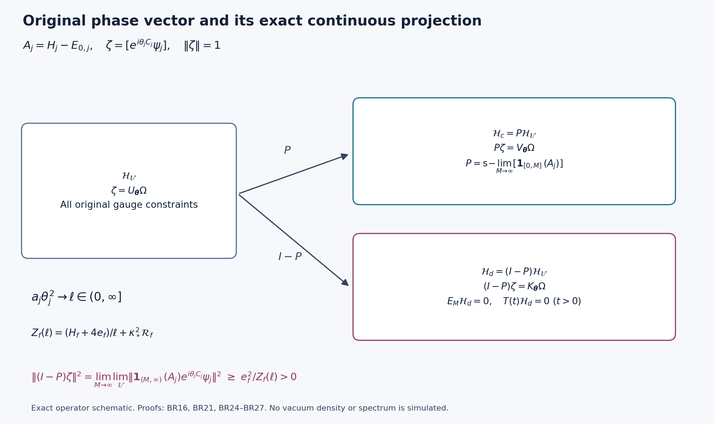

# Exact spectral escape and positive multiplication-defect matrices

This note verifies BP9–BP33 of [BP1–BP33](BOUNDED_PHASE_SPECTRAL_RECEIVING.md), as read on 11 October 2026. The reviewed source SHA256 is `c5ecf72cbce0b2d33771bf0c2132215d5dd5f09af50e39cb0c28d738d3b2aad1`; the exact reviewed version is retained in private provenance; the complete public source adds programme navigation. BP1–BP8 were read for the exact objects and constants. The derivation below verifies how the stated finite provider inequalities enter the receiver; it does not claim an independent re-review of all the earlier provider proofs. No defect was found in BP9–BP33.

In addition to the verification, BR16–BR19 identify the continuous projection with the increasing limit of the original bounded-energy projections, prove a direct finite spectral-tail lower bound, and locate a positive amount of mass in explicit moving energy bands. BR25 gives the full positive matrix of multiplication defects. Every statement uses the original interacting ground state.

## Original data and review boundary

Retain the open cubic lattice, all positive coordinate links, all faces in the three orientations, every vertex gauge constraint, probability Haar measure on each radius-two copy of \(SU(2)\), and
\[
 L_j=j^4,\quad a_j=(100j)^{-1},\quad g_j^2=\kappa_*a_j/2,
 \quad b_j=(\kappa_*a_j^2)^{-1},\quad s_j=\kappa_*/j.
 \tag{BR1}
\]
With \(T_\alpha=-i\sigma_\alpha/2\), \(X_{e\alpha}\) differentiates \(e^{tT_\alpha}U_e\), and \(\Delta=\sum_{e,\alpha}X_{e\alpha}^2\). The original face variables and full Hamiltonian are
\[
\begin{gathered}
 U_p=U_d(z)U_e(z+e_d)U_d(z+e_e)^{-1}U_e(z)^{-1},\quad d<e,\\
 W_p=\operatorname{Tr}U_p,\quad D_p=2-W_p,\\
 H_j=-\kappa_*\Delta+b_j\sum_pD_p
     =-\kappa_*\Delta+2b_jM_j-b_j\sum_pW_p,\\
 H_j\psi_j=E_{0,j}\psi_j,\quad\psi_j>0,\quad\|\psi_j\|=1,
 \quad\mu_j=\psi_j^2dU,\quad A_j=H_j-E_{0,j}\ge0.
\end{gathered}\tag{BR2}
\]
Here \(M_j=3m_j^2(m_j+1)\) and \(m_j=2L_j\). All operators in the spectral arguments below act on the original physical Hilbert space. The positive ground vector is physical, its eigenspace is one-dimensional, and the compact elliptic operator has the original spectral functional calculus.

For the given real nonzero \(f\in C_c(\mathbb R^3)\), keep the exact face centers
\[
 x_{p,j}=o+a_j\bigl(z-L_j\mathbf1+(e_d+e_e)/2\bigr),
 \quad f_p=f(x_{p,j}),\quad F=\|f\|_\infty,
\]
and the complete observable and mean
\[
\begin{gathered}
 C_j=a_j\sum_p f_pD_p
    =2a_j\sum_pf_p-a_j\sum_pf_pW_p,\quad m_j^C=\mu_jC_j,\\
 u_j=(C_j-m_j^C)\psi_j,\quad
 G_j=\|u_j\|^2,\quad E_j=\langle u_j,A_ju_j\rangle,
 \quad E_{2,j}=\|A_ju_j\|^2.
\end{gathered}\tag{BR3}
\]
The finite inequalities supplied in BP6 are used with their original constants:
\[
\begin{gathered}
 \underline E_j\le E_j\le\overline E_j,\qquad
 E_{2,j}\le P_j+Q_j^EE_j,\qquad
 \mu_j\Gamma(C_j)^2\le\mathcal R_j,\\
 \underline E_j={\kappa_*^2\mathfrak b_j^2\over4b_j(\Lambda_j-d_j^-)},
 \quad\overline E_j=16\kappa_*a_j^2F^2d_j^+,\\
 \mathfrak b_j=a_j[6A_{1,j}-3Fd_j^+-12M_Q\omega_f(a_j/2)]_+,\\
 P_j=21\kappa_*^2a_j^2A_{2,j},\quad
 Q_j^E=\kappa_*/2+4/a_j,\quad
 \mathcal R_j=256a_j^4F^4(\Lambda_jd_j^++\rho_j^2).
\end{gathered}\tag{BR4}
\]
The exact patch, crossing-face constants, roots \(d_j^\pm\), and \(\rho_j^2=4\kappa_*/b_j\) are BP4–BP5, retained in the source copy. In particular, no actual mean is identified with a root or an energy budget. We use the BP7 limits
\[
\begin{gathered}
 \underline E_j\to e_f>0,\quad\overline E_j\to E_f^{\rm up},\quad
 a_jP_j\to H_f,\quad a_jQ_j^E\to4,\quad\mathcal R_j\to\mathcal R_f,\\
 J_1=\int|f|,\quad J_2=\int f^2,\quad
 \mathsf L_R=9\kappa_*R^3+24R^2,\\
 \mathsf d_R^+={\mathsf L_R+\sqrt{\mathsf L_R^2-81\kappa_*^2R^6/4}\over2},\\
 e_f={81\kappa_*^3J_1^2\over\mathsf d_R^+},\quad
 E_f^{\rm up}=16\kappa_*F^2\mathsf d_R^+,\quad
 H_f=63\kappa_*^2J_2,\quad
 \mathcal R_f=256F^4\mathsf L_R\mathsf d_R^+.
\end{gathered}\tag{BR5}
\]
These are positive finite constants for the actual fixed test and support cube. The following calculations do not replace them by rescaled parameters.

## Phase derivatives, complex matrices, and finite spectral inequalities

Fix an allowed regulator and suppress only its subscript in this paragraph. Put \(w=\log\psi\), \(\mathscr L=\Delta+2\nabla w\cdot\nabla\), \(D=\mathscr LC\), and \(\gamma=\Gamma(C)\). Expansion of \(H(h\psi)-E_0h\psi\), with the full potential in BR2, yields
\[
 A(h\psi)=-\kappa_*\psi\mathscr Lh,\qquad
 \langle h\psi,A k\psi\rangle
 =\kappa_*\mu\sum_{e,\alpha}(X_{e\alpha}\overline h)(X_{e\alpha}k).
 \tag{BR6}
\]
Indeed the terms \(-\kappa_*h\Delta\psi+(b\sum_pD_p-E_0)h\psi\) vanish by the actual ground equation, and integration by parts against \(\psi^2dU\) proves the second identity. The compact product group has no boundary. Smooth gauge-invariant functions stay in the physical operator domain. Although \(f\) need only be continuous in space, its sampled coefficients are fixed numbers, so \(C\) and all its phases are smooth functions of the link variables.

For real \(\theta\), define
\[
 b_\theta=e^{i\theta C}
 =e^{2i\theta a\sum_pf_p}e^{-i\theta a\sum_pf_pW_p},\quad
 \beta_\theta=\mu b_\theta,\quad v_\theta=(b_\theta-\beta_\theta)\psi.
\]
The chain rule gives
\[
 \mathscr Lb_\theta=b_\theta(i\theta D-\theta^2\gamma),\quad
 A v_\theta=\kappa_*b_\theta\psi(-i\theta D+\theta^2\gamma).
\]
Since \(D\) and \(\gamma\) are real and \(|b_\theta|=1\), this proves the exact identities
\[
 G_\theta=1-|\beta_\theta|^2,\quad
 E_\theta=\theta^2E,\qquad
 E_{2,\theta}=\theta^2E_2+\kappa_*^2\theta^4\mu\gamma^2.
 \tag{BR7}
\]
In the last equality the real and imaginary summands are orthogonal pointwise; no mixed contribution was estimated or dropped. Centering subtracts a ground vector and therefore changes neither energy moment.

Use the convention that the first inner-product argument is conjugate-linear. For any finite real list \(\theta_r\), direct multiplication gives
\[
\begin{aligned}
 \langle v_r,v_s\rangle
 &=\mu e^{i(\theta_s-\theta_r)C}-\overline\beta_r\beta_s,\\
 \langle v_r,A v_s\rangle
 &=\kappa_*\theta_r\theta_s\mu[e^{i(\theta_s-\theta_r)C}\gamma],\\
 \langle A v_r,A v_s\rangle
 &=\kappa_*^2\mu\bigl[e^{i(\theta_s-\theta_r)C}
 \{\theta_r\theta_sD^2+\theta_r^2\theta_s^2\gamma^2
 +i\theta_r\theta_s(\theta_s-\theta_r)D\gamma\}\bigr].
\end{aligned}\tag{BR8}
\]
The sign of the mixed term follows from
\((i\theta_rD+\theta_r^2\gamma)(-i\theta_sD+\theta_s^2\gamma)\).
The off-diagonal blocks in the Gram matrix of \((v_r)_r,(A v_r)_r\) are both the Hermitian matrix \((\langle v_r,A v_s\rangle)\). Thus BP11 has the correct coefficients, signs, conjugations, and positive block matrix.

Restore the subscript \(j\). For \(\theta\ne0\) and \(\underline E_j>0\), retain exactly
\[
 l=\theta^2\underline E_j,\quad
 p=\theta^2P_j+\kappa_*^2\theta^4\mathcal R_j,\quad Q=Q_j^E,
 \quad R_{\theta,j}=2(Q+p/l),\quad q_{\theta,j}={l^2\over p+Ql}.
 \tag{BR9}
\]
Here the letters \(l,p,Q\) denote these finite quantities throughout the next arguments. Let
\(\nu(B)=\|\mathbf1_B(A_j)v_{\theta,j}\|^2\).
Its mass and first two moments are \(G_\theta,E_\theta,E_{2,\theta}\); \(\nu(\{0\})=0\) by the exact retained centering and uniqueness of the vacuum. BR4 and BR7 imply
\(E_\theta\ge l\), \(E_{2,\theta}\le p+QE_\theta\), and \(G_\theta\le1\).
Cauchy–Schwarz gives
\[
 G_\theta\ge{E_\theta^2\over E_{2,\theta}}
 \ge{E_\theta^2\over p+QE_\theta}\ge{l^2\over p+Ql}=q_{\theta,j}.
\]
The derivative of \(x^2/(p+Qx)\) is \(x(2p+Qx)/(p+Qx)^2>0\). Further, for every \(\lambda\ge0\),
\(\mathbf1_{(0,R]}(\lambda)\ge4\lambda/R-4\lambda^2/R^2\).
Integration and the moment upper bound give
\[
 \nu((0,R_{\theta,j}])\ge
 {4(R_{\theta,j}-Q)\over R_{\theta,j}^2}E_\theta
 -{4p\over R_{\theta,j}^2}\ge q_{\theta,j}.
 \tag{BR10}
\]
The coefficient is positive; substitution of \(E_\theta=l\) and BR9 gives precisely the last expression. These prove BP14. Also \(q_{\theta,j}\le1\) and \(R_{\theta,j}\ge2l\).

The full unit phase vector \(\zeta=b_{\theta,j}\psi_j\) has spectral measure
\(|\beta_{\theta,j}|^2\delta_0+\nu\). Consequently
\[
 K_{\theta,j}(t)=|\beta_{\theta,j}|^2+\int e^{-t\lambda}d\nu,
 \quad D_{\theta,j}(t)=1-K_{\theta,j}(t)
 =\int(1-e^{-t\lambda})d\nu.
 \tag{BR11}
\]
The ground transformation has generator \(\kappa_*\mathscr L_j\), since \(e^{-tA_j}(h\psi_j)=\psi_j e^{t\kappa_*\mathscr L_j}h\). Its stationary reversible process therefore gives
\(K_{\theta,j}(t)=\mathbb E_{\mu_j}e^{i\theta(C_j(U_t)-C_j(U_0))}\).
Reversing the two time endpoints changes this exponential into its conjugate while preserving the joint law, proving BP16 including its real cosine expression. There is no additional factor of \(\kappa_*\) in the time argument beyond the generator just displayed.

For \(t>0\), set \(g_t(x)=\int_0^t e^{-sx}ds\). Then \(g_t'(x)=-\int_0^t se^{-sx}ds<0\) and \(g_t''(x)=\int_0^t s^2e^{-sx}ds>0\). Applying Jensen to the probability \(\lambda d\nu/E_\theta\) gives
\[
 D_{\theta,j}(t)\ge E_\theta g_t(E_{2,\theta}/E_\theta)
 \ge E_\theta g_t(Q+p/E_\theta)
 \ge l g_t(Q+p/l)
 =q_{\theta,j}(1-e^{-tR_{\theta,j}/2}).
 \tag{BR12}
\]
The second inequality uses the decreasing function \(g_t\). The derivative with respect to \(x\) of \(xg_t(Q+p/x)\) is
\(g_t(Q+p/x)-(p/x)g_t'(Q+p/x)>0\), proving the third. At \(t=0\) every expression vanishes. The upper bound is
\(D_{\theta,j}(t)\le\min\{G_\theta,tE_\theta\}\le\min\{G_\theta,t\theta^2\overline E_j\}\).
This verifies every inequality and direction in BP17.

For independent \(U,U'\) with law \(\mu_j\), expansion of the two squares yields
\[
\begin{split}
 \theta^2G_j-G_{\theta,j}
 ={1\over2}\mathbb E\bigl[\theta^2(C_j(U)-C_j(U'))^2
 -2\{1-\cos(\theta(C_j(U)-C_j(U')))\}\bigr]\ge0.
\end{split}\tag{BR13}
\]
The last inequality follows from \(2(1-\cos x)=4\sin^2(x/2)\le x^2\). This proves BP18 while retaining the exact difference, rather than equating the two variances.

For fixed nonzero \(\theta\), multiplying the denominator of \(q\) by \(a_j\), and multiplying \(R\) by \(a_j\), gives from BR5
\[
 {q_{\theta,j}\over a_j}\to{\theta^2e_f^2\over H_f+4e_f},\quad
 a_jR_{\theta,j}\to2(H_f/e_f+4),
\]
and substituting \(t=\tau a_j\) in BR12 gives exactly BP19, with upper limit \(\tau\theta^2E_f^{\rm up}\). The finite term \(\kappa_*^2\theta^4\mathcal R_j\) remains in BR9; only its product with \(a_j\) vanishes in this fixed-parameter limit.

Finally let \(\delta=l/4\) and \(R=R_{\theta,j}\). The measure below \(\delta\) contributes at most \(\delta G_\theta\le\delta\) to the first moment, and the measure above \(R\) contributes at most \(E_{2,\theta}/R\). Thus
\[
 \int_{[\delta,R]}\lambda d\nu
 \ge E_\theta-\delta-(p+QE_\theta)/R
 \ge l-\delta-(p+Ql)/R=l/4.
 \tag{BR14}
\]
The coefficient \(1-Q/R\) is positive, and \(R\ge2l>\delta\), verifying BP20 and its endpoint ordering.

## Complete continuous projection and exact spectral receiver

Let \(\mathcal H_{\mathcal U}\) be the Hilbert ultraproduct of the original physical spaces along any nonprincipal ultrafilter, with bounded sequences quotiented by sequences whose norm has ultralimit zero. Define \(T(t)=[e^{-tA_j}]\) for \(t>0\). These are positive self-adjoint contractions satisfying the semigroup law. If \(0<s<t\), their difference is positive by scalar functional calculus at every regulator.

For completeness, the monotone strong limit needs no continuity hypothesis on the ultraproduct. For each vector \(x\), the increasing bounded numbers \(\langle x,T(1/n)x\rangle\) converge. For \(m>n\), \(0\le B=T(1/m)-T(1/n)\le I\), hence
\(\|Bx\|^2\le\langle x,Bx\rangle\to0\).
This makes \(T(1/n)x\) Cauchy and defines a positive self-adjoint contraction \(P\). Monotonicity brackets all sufficiently small positive times between this cofinal sequence and its limit, so \(T(t)\to P\) strongly as \(t\downarrow0\). Bounded strong-limit multiplication and \(T(t)^2=T(2t)\) imply \(P^2=P\).

For fixed \(t>0\) and \(s>0\), the exact scalar estimate
\[
 0\le e^{-t\lambda}-e^{-(t+s)\lambda}
 \le s\lambda e^{-t\lambda}\le{s\over et}\qquad(\lambda\ge0)
\]
proves \(T(t)P=T(t)=PT(t)\) by letting \(s\downarrow0\). Therefore
\[
\begin{gathered}
 \mathcal H_c=\operatorname{ran}P
 =\{x:\|T(t)x-x\|\to0\text{ as }t\downarrow0\},\\
 \|P[\zeta_j]\|^2
 =\lim_{t\downarrow0}\lim_{\mathcal U}
       \langle\zeta_j,e^{-tA_j}\zeta_j\rangle,\qquad
 T(t)(I-P)=0.
\end{gathered}\tag{BR15}
\]
This proves BP21 with the required order of limits and the actual Hilbert-space domain.

There is a stronger exact spectral description. For \(M>0\), define the bounded-energy projection
\(E_M=[\mathbf1_{[0,M]}(A_j)]\).
It is an orthogonal projection on the quotient, the projections are increasing in \(M\), and
\(\|(I-T(t))E_M\|\le1-e^{-tM}\le tM\).
Thus \(PE_M=E_M\). The same monotone strong-limit argument gives a projection \(Q_\infty=\operatorname{s-lim}_{M\to\infty}E_M\le P\). On the other hand,
\(\|(I-E_M)T(t)\|\le e^{-tM}\).
Since \((I-Q_\infty)E_M=0\), it follows that \((I-Q_\infty)T(t)=0\). Letting \(t\downarrow0\) yields \((I-Q_\infty)P=0\), proving
\[
 P=\operatorname{s-lim}_{M\to\infty}E_M,\qquad
 \|(I-P)[\zeta_j]\|^2
 =\lim_{M\to\infty}\lim_{\mathcal U}
       \|\mathbf1_{(M,\infty)}(A_j)\zeta_j\|^2.
 \tag{BR16}
\]
In particular, every vector killed by all \(E_M\) belongs to \((I-P)\mathcal H_{\mathcal U}\), so this description is an equality of spaces, not only the annihilation stated in BP33. The order of the two limits in BR16 is part of the assertion.

One can receive the escaping mass directly at each finite regulator. If \(E_\theta>M\), splitting the first moment and using \(G_\theta\le1\) gives
\(E_\theta-M\le\int_{(M,\infty)}\lambda d\nu\).
Cauchy–Schwarz on that tail yields
\(\nu((M,\infty))\ge(E_\theta-M)^2/E_{2,\theta}\).
For \(x>M\), the derivative of \((x-M)^2/(p+Qx)\) is
\((x-M)(2p+Qx+QM)/(p+Qx)^2>0\).
Consequently, including the case \(l\le M\) by the nonnegative part,
\[
 \boxed{\nu_{\theta,j}((M,\infty))
       \ge{(l_{\theta,j}-M)_+^2\over
                     p_{\theta,j}+Q_j^El_{\theta,j}}.}
 \tag{BR17}
\]
The full phase measure has the same tail because its additional atom is at zero. This bound uses no unknown actual phase mean.

The finite band statement also strengthens BP20. For \(0<r<1\), put
\(\delta=rl\) and \(R'=R_{\theta,j}/(1-r)=2(p+Ql)/(l(1-r))\).
The same first-moment split as BR14 gives
\[
 \int_{[rl,R']}\lambda d\nu\ge (1-r)l-(p+Ql)/R'=(1-r)l/2.
\]
Indeed \(1-Q/R'>0\), allowing the actual \(E_\theta\) to be replaced by its lower bound. Dividing by \(R'\) proves
\[
 \boxed{\nu_{\theta,j}([rl_{\theta,j},R_{\theta,j}/(1-r)])
       \ge{(1-r)^2\over4}q_{\theta,j}.}
 \tag{BR18}
\]
The endpoints are ordered because \(R_{\theta,j}\ge2l\). At the original BP20 endpoints, its own first-moment estimate already gives \(\nu([l/4,R_{\theta,j}])\ge q/8\). At \(r=1/4\), BR18 gives the larger coefficient \(9q/64\) on the explicitly larger interval \([l/4,4R_{\theta,j}/3]\); the changed upper endpoint is essential.

BR18 is the optimal lower expression within this particular first-moment splitting calculation with lower endpoint \(rl\): writing the upper endpoint as \(s(p+Ql)/l\), its mass bound is \(q((1-r)/s-1/s^2)\). Differentiating in \(s\) gives its maximum at \(s=2/(1-r)\), exactly the interval above. This assertion concerns the displayed calculation only; it makes no optimality claim among all spectral inequalities.

## Original-path limits and quantitative norm loss

If \((\theta_j)\) is any bounded real sequence, not necessarily constant, the original unit phases satisfy
\[
 0\le1-\langle b_{\theta_j,j}\psi_j,e^{-tA_j}b_{\theta_j,j}\psi_j\rangle
 \le t\theta_j^2\overline E_j.
\]
The constants on the right are bounded. Taking the ultralimit, then \(t\downarrow0\), gives \(P[b_{\theta_j,j}\psi_j]=[b_{\theta_j,j}\psi_j]\). This includes BP22 and strengthens its constant-parameter hypothesis to a bounded sequence. It is a statement about these vacuum phase vectors; it does not infer that the multipliers preserve every vector in \(\mathcal H_c\).

Now let \(a_j\theta_j^2\to\ell\in(0,\infty]\), retaining the original path BR1 and interpreting \(1/\infty=0\). Then \(\theta_j^2\to\infty\), and
\[
\begin{gathered}
 Z_f(\ell)={H_f+4e_f\over\ell}+\kappa_*^2\mathcal R_f>0,\\
 {l_{\theta_j,j}\over\theta_j^2}\to e_f,\qquad
 {p_{\theta_j,j}+Q_j^El_{\theta_j,j}\over\theta_j^4}
 ={a_jP_j+(a_jQ_j^E)\underline E_j\over a_j\theta_j^2}
   +\kappa_*^2\mathcal R_j\to Z_f(\ell),\\
 q_{\theta_j,j}\to{e_f^2\over Z_f(\ell)},\qquad
 {R_{\theta_j,j}\over2\theta_j^2}\to{Z_f(\ell)\over e_f}.
\end{gathered}\tag{BR19}
\]
Both terms in the denominator have been retained. For \(\ell=\infty\), its first term vanishes because its numerator converges to the finite number \(H_f+4e_f\).

At \(t_j=\tau/\theta_j^2\), BR12 yields
\[
 \liminf_jD_{\theta_j,j}(t_j)
 \ge{e_f^2\over Z_f(\ell)}
       (1-e^{-\tau Z_f(\ell)/e_f})>0\qquad(\tau>0),
 \tag{BR20}
\]
exactly BP25. For fixed \(t>0\), eventually \(t_j<t\), so monotonicity gives the same lower bound for the ultralimit of \(D_{\theta_j,j}(t)\). First taking that ultralimit, then \(t\downarrow0\), then the supremum over finite \(\tau>0\), proves
\[
 \boxed{1-\|P[e^{i\theta_jC_j}\psi_j]\|^2
 \ge{e_f^2\over (H_f+4e_f)/\ell+\kappa_*^2\mathcal R_f}.}
 \tag{BR21}
\]
No moving time is substituted into a strongly continuous limiting semigroup. An independent shorter proof fixes \(t>0\) directly in BR12: BR19 implies \(R_{\theta_j,j}\to\infty\), so its lower bound converges to \(e_f^2/Z_f(\ell)\). One then takes \(t\downarrow0\) in BR15.

A third proof uses BR17: for every fixed \(M>0\), its right side converges to \(e_f^2/Z_f(\ell)\); use BR16 to identify the lost norm. This also proves the explicit finite-energy escape statement
\[
 \liminf_j\|\mathbf1_{(M,\infty)}(A_j)e^{i\theta_jC_j}\psi_j\|^2
 \ge e_f^2/Z_f(\ell)\qquad(M>0).
 \tag{BR22}
\]
More precisely, BR18 gives a positive moving band with endpoints divided by \(\theta_j^2\) converging to \(re_f\) and \(2Z_f(\ell)/(e_f(1-r))\), and mass lower limit at least \((1-r)^2e_f^2/(4Z_f(\ell))\). These moving bands remain in the original energy units; no Hamiltonian or Hilbert space is rescaled.

The lower bound in BR21 lies in \((0,1]\). Besides \(q_{\theta,j}\le1\), its compatibility follows directly from
\(E_j^2=\kappa_*^2(\mu_j\Gamma(C_j))^2\le\kappa_*^2\mu_j\Gamma(C_j)^2\le\kappa_*^2\mathcal R_j\)
and \(\underline E_j\le E_j\): passing to limits gives \(e_f^2\le\kappa_*^2\mathcal R_f\le Z_f(\ell)\).
For \(\theta_j=\eta/\sqrt{a_j}\), \(\eta\ne0\), BR21 is exactly
\(\eta^2e_f^2/(H_f+4e_f+\kappa_*^2\eta^2\mathcal R_f)\).
For \(a_j\theta_j^2\to\infty\), it is \(e_f^2/(\kappa_*^2\mathcal R_f)\). Thus BP23–BP27 hold for every nonprincipal ultrafilter. None of these arguments asserts a converse threshold when the unbounded parameters satisfy \(a_j\theta_j^2\to0\).

## Exact compression, multiplication defect, and discarded sector

For every specified real sequence \(\boldsymbol\theta=(\theta_j)\), let
\[
 U_{\boldsymbol\theta}[\zeta_j]=[e^{i\theta_jC_j}\zeta_j].
 \tag{BR23}
\]
Each finite multiplier has norm one, preserves every original vertex gauge constraint, and preserves the norm of a zero sequence. Thus this is a well-defined unitary on \(\mathcal H_{\mathcal U}\), with
\(U_{\boldsymbol\theta}^*=U_{-\boldsymbol\theta}\) and
\(U_{\boldsymbol\theta}U_{\boldsymbol\varphi}=U_{\boldsymbol\theta+\boldsymbol\varphi}\), with no boundedness requirement on the parameters.

Set \(\mathcal H_d=(I-P)\mathcal H_{\mathcal U}\). The complete domains and codomains are
\[
\begin{gathered}
 V_{\boldsymbol\theta}=PU_{\boldsymbol\theta}|_{\mathcal H_c}:
       \mathcal H_c\longrightarrow\mathcal H_c,\qquad
 K_{\boldsymbol\theta}=(I-P)U_{\boldsymbol\theta}|_{\mathcal H_c}:
       \mathcal H_c\longrightarrow\mathcal H_d,\\
 \mathcal D_{\boldsymbol\theta}
       =\overline{K_{\boldsymbol\theta}\mathcal H_c}\subset\mathcal H_d.
\end{gathered}\tag{BR24}
\]
Orthogonality gives \(V_\theta^*V_\theta+K_\theta^*K_\theta=I_{\mathcal H_c}\). Taking adjoints with these actual subspaces gives \(V_\theta^*=V_{-\theta}\) and
\(K_{-\theta}^*=PU_\theta|_{\mathcal H_d}\).
Insert \(P+(I-P)\) between the two multipliers to obtain, with the indicated order and positive sign,
\[
\begin{gathered}
 V_{\boldsymbol\theta+\boldsymbol\varphi}
       -V_{\boldsymbol\theta}V_{\boldsymbol\varphi}
   =PU_{\boldsymbol\theta}(I-P)U_{\boldsymbol\varphi}|_{\mathcal H_c}
   =K_{-\boldsymbol\theta}^*K_{\boldsymbol\varphi},\\
 V_{\boldsymbol\varphi-\boldsymbol\theta}
       -V_{\boldsymbol\theta}^*V_{\boldsymbol\varphi}
   =K_{\boldsymbol\theta}^*K_{\boldsymbol\varphi}.
\end{gathered}\tag{BR25}
\]
In particular every finite operator matrix in the second line is positive: its quadratic form on \((x_r)_r\in\mathcal H_c^n\) equals
\(\|\sum_rK_{\boldsymbol\theta_r}x_r\|^2\ge0\).
This supplies the full positive matrix of compression defects, and verifies the signs in BP30–BP31.

The actual vacuum \(\Omega=[\psi_j]\) has norm one and lies in \(\mathcal H_c\), since every \(T(t)\) fixes it. Therefore
\[
\begin{gathered}
 \|K_{\boldsymbol\theta}\Omega\|^2
 =1-\|P[e^{i\theta_jC_j}\psi_j]\|^2,\\
 \langle\Omega,(I-V_{\boldsymbol\theta}^*V_{\boldsymbol\theta})\Omega\rangle
 \ge e_f^2/Z_f(\ell),\quad
 \|I-V_{\boldsymbol\theta}^*V_{\boldsymbol\theta}\|
 \ge e_f^2/Z_f(\ell),\quad
 \|K_{\boldsymbol\theta}\|\ge e_f/\sqrt{Z_f(\ell)}.
\end{gathered}\tag{BR26}
\]
Thus \(\mathcal D_{\boldsymbol\theta}\ne\{0\}\) for BR19's parameter families. Setting the first parameter to \(-\boldsymbol\theta\) and the second to \(\boldsymbol\theta\) in BR25 identifies precisely the failure of the unitary group relation: \(V_0-V_{-\theta}V_\theta=K_\theta^*K_\theta\ne0\).

By BR16 and BR15,
\[
 E_M\mathcal D_{\boldsymbol\theta}=\{0\}\quad(M>0),\qquad
 T(t)\mathcal D_{\boldsymbol\theta}=\{0\}\quad(t>0).
 \tag{BR27}
\]
The same equalities hold on the whole discarded subspace \(\mathcal H_d\), which is exactly \(\bigcap_{M>0}\ker E_M\). This proves BP33 and its strongest immediate exact converse. It does not assert that the finite Hamiltonians have a new zero-energy sector: the positive-time ultraproduct semigroup annihilates this sector because its energy escapes every fixed bounded interval.

Finally the full scalar phase \(e^{2i\theta_ja_j\sum_pf_p}\), and separately \(e^{-i\theta_jm_j^C}\), act on the ultraproduct as unitary scalar-sequence multipliers. They commute with each \(T(t)\), \(E_M\), and \(P\), so they preserve all the norms in BR21 and BR26. The actual complex mean remains the vacuum atom in BR11. No scalar or mean was set to zero.

## Verification record and consequences

This exact operator schematic displays the maps in BR16 and BR24–BR27 and the lower bound in BR21. The parameter sequence is the original sequence in BR19. The drawing introduces no density, numerical spectrum, or additional approximation; its reproducible source is `draw_projection_receiver.py`.

The exact second moment, every mixed-matrix coefficient, the spectral minorant, the Jensen directions, the finite interval endpoints, the fixed-parameter limits, the large-parameter limits, and all BP28–BP33 domains, adjoints, signs and annihilation statements are correct in the reviewed source. BR16–BR18, BR22, the bounded-sequence extension of BP22, and BR25's positive defect matrix are proved additional consequences. The original constant in BP26 is unchanged.

`check_phase_review.py` passed 1,542 bounded symbolic and finite spectral checks. They verify algebra and inequality implementations; they do not substitute a synthetic measure for the actual \(\mu_j\), or purport to prove an infinite-dimensional assertion by sampling. The proofs of those assertions are BR15–BR27. [claim ledger](CLAIM_LEDGER.md) records the reviewed statements, exact strengthenings and downstream receiving equations. The diagram was rendered and visually inspected. No owner or provider source was edited.

The complete provider proofs and exact reading versions are recorded in the [source-use ledger](PHASE_DIRECTIONAL_SOURCE_USE_LEDGER.json). The original phase projection and quantified lost norm are illustrated in [BP21–BP33](BOUNDED_PHASE_SPECTRAL_RECEIVING.md); BR16–BR18 and BR25 give the stronger spectral and matrix maps with complete proofs above.
