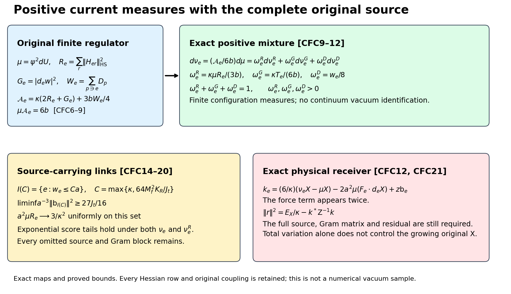
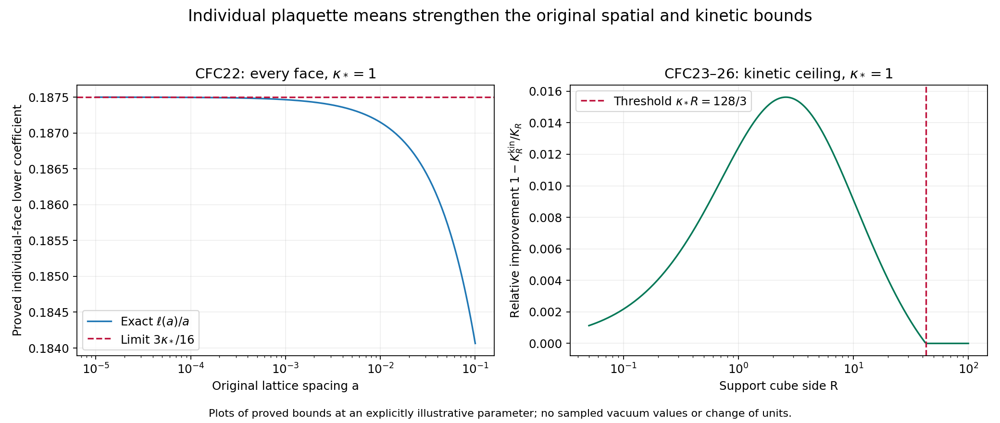

# Positive current comparison measures and the original source

This calculation constructs positive finite-regulator measures from the full ground-state Hessian, evaluates their exact mixture weights and proves score tails on a set carrying a positive fraction of the original source. It also proves a lower mean deficit for each individual plaquette and propagates that estimate through the spatial mean and energy budget. Every complementary direction and physical residual remains in the spectral calculation.

The complete providers are [TCR1–TCR21](https://github.com/KokunoYumeto/yang-mills-interacting-workbench/blob/173849baaeb4a50ea2847f8271f54e8a7b9c169f/yang-mills/continuations/20261011-central-signs-shrinking-window/TWO_SIDED_CURRENT_RESIDUAL.md), [SC23–SC24](https://github.com/KokunoYumeto/yang-mills-interacting-workbench/blob/173849baaeb4a50ea2847f8271f54e8a7b9c169f/yang-mills/continuations/20261011-central-signs-shrinking-window/STEREOGRAPHIC_CURRENT_AND_CUBIC.md), [SOM1–SOM24](https://github.com/KokunoYumeto/yang-mills-interacting-workbench/blob/173849baaeb4a50ea2847f8271f54e8a7b9c169f/yang-mills/continuations/20261011-central-signs-shrinking-window/ACTUAL_SCORE_MOMENTS_AND_SECOND_ENERGY.md), [CTI1–CTI39](https://github.com/KokunoYumeto/yang-mills-interacting-workbench/blob/173849baaeb4a50ea2847f8271f54e8a7b9c169f/yang-mills/continuations/20261011-central-signs-shrinking-window/CURRENT_TAILS_AND_RETAINED_SOURCE.md), [HVR17–HVR22](https://github.com/KokunoYumeto/yang-mills-interacting-workbench/blob/173849baaeb4a50ea2847f8271f54e8a7b9c169f/yang-mills/continuations/20261011-central-signs-shrinking-window/HESSIAN_RECEIVING_REVIEW.md), and [SG1–SG33](https://github.com/KokunoYumeto/yang-mills-interacting-workbench/blob/173849baaeb4a50ea2847f8271f54e8a7b9c169f/yang-mills/continuations/20261011-central-signs-shrinking-window/ACTUAL_GROUND_GRADIENT_TRIAL.md). The weighted-form human provenance remains Jon Johnsen, *On the spectral properties of Witten-Laplacians, their range projections and Brascamp-Lieb's inequality*, [arXiv:1703.10011v2](https://arxiv.org/abs/1703.10011v2), and Assane Lo, *Witten Laplacian Methods for the Decay of Correlations*, [arXiv:math-ph/0611002v9](https://arxiv.org/abs/math-ph/0611002v9). Their original-source reading records are retained; no additional reading of those works or novelty is claimed.

## Original objects and finite domains

Keep the open lattice with vertices \(\{0,\ldots,2L_j\}^3\), every positive edge, the original vertex gauge action, and probability Haar measure. The SU(2) edge metric has radius two and \(T_\alpha=-i\sigma_\alpha/2\) orthonormal. Retain
\[
\begin{gathered}
L_j=j^4,\quad a_j=(100j)^{-1},\quad g_j^2=\kappa_*a_j/2,\quad
b_j=(\kappa_*a_j^2)^{-1},\quad s_j=100\kappa_*a_j,\\
U_p=U_d(z)U_k(z+e_d)U_d(z+e_k)^{-1}U_k(z)^{-1}\quad(d<k),\\
D_p=2-\operatorname{Tr}U_p,\quad
V=b_j\sum_pD_p=2b_j|\mathcal P_j|-b_j\sum_p\operatorname{Tr}U_p,\\
H_j=-\kappa_*\Delta+V,\quad H_j\psi_j=E_{0,j}\psi_j,\quad
\psi_j>0,\quad \|\psi_j\|=1,\quad d\mu_j=\psi_j^2dU .
\end{gathered}
\]
The positive smooth gauge-invariant ground and its score bound are the original SOM1–SOM5. Suppress \(j\) only within finite formulas and write \(\kappa=\kappa_*\), \(w=\log\psi\), \(g_e=d_ew\), \(G_e=|g_e|^2\), \(T_e=\mu G_e\), \(F_e=d_eV\), and
\[
\mathscr D=\Delta+2dw\cdot d,\qquad
\mathscr L_0=-\kappa\mathscr D,\qquad
\mathscr L_1=\kappa(dd_\mu^*+d_\mu^*d).
\]
All are the original weighted operators on the compact full configuration manifold; no outside derivative is suppressed.

For the centered observable below, \(E_X=\kappa\mu|dX|^2\). For the original full test use \(A=H-E_0I\), \(u_{\mathbf f}=(C_{\mathbf f}-\mu C_{\mathbf f})\psi\), \(\zeta_{\mathbf f}=A^{1/2}u_{\mathbf f}\), and \(\mathcal R_{\mathbf f}(z)=\langle\zeta_{\mathbf f},(A+zI)^{-1}\zeta_{\mathbf f}\rangle=\kappa\langle dC_{\mathbf f},D_z^{-1}dC_{\mathbf f}\rangle_\mu\). SG12 proves this exact original-Hamiltonian map.

For a nonzero real continuous compactly supported triple \(\mathbf f=(f_{12},f_{13},f_{23})\), keep
\[
\begin{gathered}
x_p=o+a(z-L_j\mathbf1+(e_d+e_k)/2),\quad
x_e=o+a(z-L_j\mathbf1+e_d/2),\\
C_{\mathbf f}=a\sum_p f_{\sigma(p)}(x_p)D_p,\quad
X=a\sum_pu_pD_p-\mu\!\left(a\sum_pu_pD_p\right),\\
u_p=f_{\sigma(p)}(x_p)\ \hbox{for the full source},\qquad
u_p=f_{\sigma(p)}(x_p)\mathbf1_{\{e_0\notin\partial p\}}
\ \hbox{for its outside source},\\
M_f=\max_\sigma\|f_\sigma\|_\infty,\quad
t_1=f_{12}+f_{13},\quad t_2=f_{12}+f_{23},\quad
t_3=f_{13}+f_{23},\quad J_t=\sum_d\int_{\mathbb R^3}t_d^2>0 .
\end{gathered}
\]
The last strict inequality follows by the inverse relations \(2f_{12}=t_1+t_2-t_3\), \(2f_{13}=t_1+t_3-t_2\), \(2f_{23}=t_2+t_3-t_1\). Put \(v=dX\), \(J_X=dw\cdot dX\), \(\alpha_e=a^2\Pi_edw\), and \(D_z=\mathscr L_1+zI\), \(z>0\). For a deterministic finite edge list, \(\mathsf Cc=\sum_ec_e\alpha_e\), \(\mathsf N=\mathsf C^*\mathsf C\), \(\mathsf Z=(D_z\mathsf C)^*D_z\mathsf C\), \(\mathsf b=\mathsf C^*v\), \(k=(D_z\mathsf C)^*v\). The distinct sources \(k\) and \(\mathsf b\) are never identified.

Use the fitting cube \(Q=v_Q+\{0,\ldots,q\}^3\) for a physical support cube \(\prod_d[c_d,c_d+R]\), where \(q=\lceil R/a\rceil+3\), \((v_Q)_d=L_j+\lfloor(c_d-o_d)/a\rfloor-1\). Eventually it is strictly inside the full lattice. Its finite quantities, with boundary indicators retained, are
\[
\begin{gathered}
N_Q=3q(q+1)^2,\quad M_Q=3q^2(q+1),\quad
I=E_Q^\circ,\quad n=|I|=3q(q-1)^2,\\
C_Q=2q(q+1)\sum_d
[\mathbf1_{\{(v_Q)_d>0\}}+\mathbf1_{\{(v_Q)_d+q<2L_j\}}],\\
W_Q=\sum_{p\ {\rm inside}\ Q}D_p,\quad d_Q=\mu W_Q,\quad
T_Q=\sum_{e\ {\rm inside}\ Q}T_e,\quad E_Q=E_0-E_{\rm out},\\
\Lambda_Q=\min\{2M_Q,6g^2\sqrt{N_QM_Q}\}+2C_Q,\quad
\kappa T_Q+bd_Q\le E_Q\le b\Lambda_Q,\\
\mathsf L_R=9\kappa_*R^3+24R^2,\qquad
K_R=\frac{\mathsf L_R+\sqrt{\mathsf L_R^2-81\kappa_*^2R^6/4}}2 .
\end{gathered}
\]
Every edge in \(I\) has four incident faces, all inside \(Q\). HVR18–HVR22 prove both \(\limsup a_j^2d_Q\le K_R\) and \(\limsup a_j^2(\Lambda_Q-d_Q)\le K_R\). The inside, outside and crossing energies remain as displayed. All limits below use this same fitting prescription and original path.

## Exact source and its centered covariance

The complete source formula in TCR7 is equivalently
\[
k_e(z)=-a^2\{\mu(F_e\cdot d_eX)
+\operatorname{Cov}_\mu(G_e,\mathscr L_0X)\}
+z\mathsf b_e .
\tag{CFC1}
\]
Indeed \(\mu\mathscr L_0X=0\) by compact weighted integration, and
\(\mathscr L_0X=-\kappa(\Delta X+2J_X)\). Substitute these identities without changing \(G_e\), \(X\), the original force or the original \(\mathsf b_e\). Thus
\[
\mu\{G_e(\Delta X+2J_X)\}
=-3a\sum_pu_p\operatorname{Cov}_\mu(G_e,D_p)
+2\operatorname{Cov}_\mu(G_e,J_X).
\tag{CFC2}
\]
To prove this version, expand the two products into covariance plus product of means. The latter sum to \(T_e\mu(\Delta X+2J_X)=0\), exactly. In the remaining covariance use \(\Delta X=6a\sum_pu_p-3a\sum_pu_pD_p\); its original constant has zero covariance. The cancellation, rather than either large mean separately, is therefore the receiving quantity.

On a strict interior edge with its four incident original faces, the pointwise sum-of-vectors inequality and original norm identity prove
\[
\begin{gathered}
\mu|F_e|^2\le4b^2w_e,\qquad
\mu|d_eX|^2\le4a^2M_f^2w_e,\\
|\mu(F_e\cdot d_eX)|\le4abM_fw_e .
\end{gathered}\tag{CFC3}
\]
For the second bound some \(u_p\) may vanish, but there are still at most four terms and \(|u_p|\le M_f\). In both cases keep
\(|d_eD_p|^2=D_p-D_p^2/4\le D_p\), then integrate and apply Cauchy–Schwarz to the two complete gradients. This bounds the exact staple-loop expression SC24, without dropping a signed individual loop correlation.

For the original retained set \(I^+=\{e:w_e\le\delta^{\rm sel}\}\), CTI28 gives \(\sum_{e\in I^+}w_e\le4d_Q\). Hence the full retained force-source vector satisfies
\[
\begin{gathered}
\sum_{e\in I^+}|a^2\mu(F_e\cdot d_eX)|^2
\le16a^6b^2M_f^2\sum_{e\in I^+}w_e^2\\
\le64a^6b^2M_f^2\delta^{\rm sel}d_Q
=\frac{64a^2M_f^2}{\kappa^2}\delta^{\rm sel}d_Q .
\end{gathered}\tag{CFC4}
\]
Use the exact \(b=(\kappa a^2)^{-1}\) only in the last equality. With \(\delta^{\rm sel}=a\log(1/a)\), \(d_Q=O(a^{-2})\), the squared bound is \(O(a\log(1/a))\). This is an actual vector estimate on the selected links. It is not a bound on the distinct covariance term in CFC1.

For completeness the retained original source obeys \(|\mathsf b_e|\le3a^3M_f\), so
\[
\left\|k(z)+a^2
\big(\operatorname{Cov}_\mu(G_e,\mathscr L_0X)\big)_{e\in I^+}\right\|
\le\frac{8aM_f}{\kappa}\sqrt{\delta^{\rm sel}d_Q}
+3za^3M_f\sqrt{|I^+|}.
\tag{CFC5}
\]
This is the triangle inequality applied to CFC1, CFC4 and the unchanged source bound, with the original raw coefficient norm. At \(z=\theta s_j\), its two terms are respectively \(O(\sqrt{a_j\log(1/a_j)})\) and \(O(a_j^{5/2})\).

Next calculation: evaluate or sharpen the signed covariance vector in CFC1–CFC2 using the actual score identities and the full Gram matrix. The force-source estimate alone does not control its cancellation or the residual in TCR11. SC23 continues to hold with bounded gauge-invariant multipliers \(G_e\), \(J_X\) and \(\mathscr L_0X\) at each regulator, but it cannot turn their mixed moments into unweighted expectations.

## Full Bochner transfer with its actual signs

Retain \(R_e=\sum_r\|(\nabla^2w)_{er}\|_{\rm HS}^2\), with the sum over all configuration edges. The exact SOM9 identity has positive signs:
\[
\mathscr D G_e=2R_e+G_e+\frac2\kappa g_e\cdot F_e,
\qquad
\mathscr L_0G_e=-2\kappa R_e-\kappa G_e-2g_e\cdot F_e .
\tag{CFC6}
\]
It follows by differentiating the original ground equation and applying the radius-two Bochner identity; the Ricci term is \(G_e\). In particular it is not valid to change all signs on the right of the first equality.

For the centered original \(X\), self-adjointness and compact integration give
\[
\begin{aligned}
\operatorname{Cov}_\mu(G_e,\mathscr L_0X)
&=\mu(X\mathscr L_0G_e)\\
&=-\kappa\mu[X(2R_e+G_e)]-2\mu(Xg_e\cdot F_e),\\
-2\mu(Xg_e\cdot F_e)
&=\mu(d_eX\cdot F_e)+\mu(X\Delta_eV).
\end{aligned}\tag{CFC7}
\]
The last equality is the integral of \(\operatorname{div}_e(XF_e\psi^2)\) over the compact configuration space, divided by the probability-Haar density. No boundary term or outside Hessian row is removed. Define
\[
\begin{gathered}
\mathcal K_e=\Delta_eV-\kappa(2R_e+G_e),\qquad
\mu\mathcal K_e=0,\\
\operatorname{Cov}_\mu(G_e,\mathscr L_0X)
=\mu(F_e\cdot d_eX)+\mu(X\mathcal K_e),\\
k_e(z)=-a^2\{2\mu(F_e\cdot d_eX)+\mu(X\mathcal K_e)\}
+z\mathsf b_e .
\end{gathered}\tag{CFC8}
\]
To prove the mean-zero assertion, integrate CFC6 and use
\(-2\mu(g_e\cdot F_e)=\mu\Delta_eV\).
Equations CFC7 and CFC1 prove the other lines. The force appears twice; it does not cancel. Equivalently, for weighted divergence on the full space,
\(\mathcal K_e=\operatorname{div}_\mu(\Pi_edV)-\kappa\mathscr DG_e\).
Its integral is zero by either expression.

## A positive state map with every original coefficient

On the same strict interior edge, keep \(W_e^{\rm def}=\sum_{p\ni e}D_p\). The original Casimir gives \(\Delta_eV=(3b/4)(8-W_e^{\rm def})\). Thus
\[
\begin{gathered}
\mathcal A_e=\kappa(2R_e+G_e)+\frac{3b}{4}W_e^{\rm def}\ge0,\qquad
\mu\mathcal A_e=6b,\\
\mathcal K_e=6b-\mathcal A_e,\qquad
d\nu_e=\frac{\mathcal A_e}{6b}\,d\mu,\qquad \nu_e(1)=1 .
\end{gathered}\tag{CFC9}
\]
These are new comparison measures with explicitly retained density factors; the original \(\mu\), \(R_e\), \(G_e\) and \(W_e^{\rm def}\) remain. Positivity follows term by term. The exact mean follows from CFC8 and the original value of \(\Delta_eV\). Each density is smooth and gauge invariant at the finite regulator: the metric and the edge splitting are preserved by vertex gauges, so all the displayed scalar contractions are invariant. This assertion concerns a density on the original finite configuration manifold; no continuum state or invariant dynamics is inferred.

Writing \(\bar R_e=\mu R_e\), the exact mixture is
\[
\begin{gathered}
d\nu_e^R=(R_e/\bar R_e)\,d\mu,\quad
d\nu_e^G=(G_e/T_e)\,d\mu,\quad
d\nu_e^D=(W_e^{\rm def}/w_e)\,d\mu,\\
\nu_e=\omega_e^R\nu_e^R+\omega_e^G\nu_e^G+\omega_e^D\nu_e^D,\\
\omega_e^R=\frac{\kappa\bar R_e}{3b},\qquad
\omega_e^G=\frac{\kappa T_e}{6b},\qquad
\omega_e^D=\frac{w_e}{8},\qquad
\omega_e^R+\omega_e^G+\omega_e^D=1 .
\end{gathered}\tag{CFC10}
\]
The original \(T_e,w_e\) are strictly positive by CTI18–CTI20. Also \(\bar R_e>0\): otherwise the smooth nonnegative \(R_e\) vanishes everywhere since \(\mu\) has positive density. Then \(\nabla_e^2w=0\), hence \(\Delta_ew=0\). For each fixed outside configuration, compact integration of \(w\Delta_ew\) in ordinary Haar measure gives \(d_ew=0\), contradicting \(T_e>0\). All three measures and coefficients therefore exist. Multiplying their displayed densities by their weights proves the mixture without dropping any term.

For probability measures use \(d_{\rm TV}(\rho,\sigma)=\sup_A|\rho(A)-\sigma(A)|\). The mixture gives
\[
\begin{gathered}
d_{\rm TV}(\nu_e,\nu_e^R)
\le\omega_e^G+\omega_e^D
=\frac{\kappa T_e}{6b}+\frac{w_e}{8},\\
e\in I^+:\quad
d_{\rm TV}(\nu_e,\nu_e^R)
\le\frac{\kappa a}{2}+\frac{\delta^{\rm sel}}8 .
\end{gathered}\tag{CFC11}
\]
Each difference of probability measures has total variation distance at most one, proving the first line by the triangle inequality. SOM5 gives \(T_e\le3/(\kappa a)\); substitute \(b=1/(\kappa a^2)\) and \(w_e\le\delta^{\rm sel}\) to prove the second. In particular the distance tends to zero uniformly on the original retained links, whose sets may vary with \(j\). This is a comparison between the two explicitly constructed measures, not between either one and the vacuum.

The source receiver for this state map is exact:
\[
\begin{gathered}
k_e(z)=6a^2b\,\{\nu_e X-\mu X\}
-2a^2\mu(F_e\cdot d_eX)+z\mathsf b_e\\
=\frac6\kappa\,\{\nu_e X-\mu X\}
-2a^2\mu(F_e\cdot d_eX)+z\mathsf b_e,\\
|\nu_e X-\nu_e^R X|
\le2\|X\|_\infty
\left(\frac{\kappa T_e}{6b}+\frac{w_e}{8}\right).
\end{gathered}\tag{CFC12}
\]
Here \(6a^2b=6/\kappa\) is the unchanged original coupling identity. Since \(\mu\mathcal K_e=0\), \(\mu(X\mathcal K_e)=6b(\mu X-\nu_eX)\) even if a centering constant is written explicitly; CFC8 proves the first line. The probability-mixture identity and \(|\rho X-\sigma X|\le2\|X\|_\infty\) prove the final line.

The distinction in scale matters for the actual source. With its finite \(M_Q\) face count, \(\|X\|_\infty\le4aM_fM_Q\). Therefore the proved retained-link comparison for this source is only
\[
|\nu_e X-\nu_e^R X|
\le8aM_fM_Q\left(\frac{\kappa a}{2}+\frac{\delta^{\rm sel}}8\right).
\tag{CFC13}
\]
The right side is \(O(a^{-1}\log(1/a))\) on the original path, not a vanishing error. Consequently CFC11 cannot replace the original \(\nu_e X\) by \(\nu_e^R X\) in a small spectral-window calculation. The exact mixture CFC10 and full source CFC12 remain the receiving formulas. The next calculation must control the original observable under those actual measures, including its growing bound and the complete coefficient norm.

## A retained set with a fixed deficit coefficient

The same original score identities allow a stronger uniform statement on a subset which still carries a positive fraction of the original source. Keep all omitted directions as in CTI32–CTI33. For a fixed \(C>0\), define
\[
I_j(C)=\{e\in I_j:w_e\le Ca_j\}.
\tag{CFC14}
\]
This is a deterministic subset specified by the actual original state, not a new regulator, boundary condition or measure. At every regulator,
\[
\begin{gathered}
|I_j\setminus I_j(C)|Ca_j\le4d_Q,\qquad
\|\mathsf b_{I_j\setminus I_j(C)}\|^2
\le\frac{36a_j^5M_f^2d_Q}{C},\\
\liminf_j a_j^{-3}\|\mathsf b_{I_j(C)}\|^2
\ge\frac94J_t-\frac{36M_f^2K_R}{C}.
\end{gathered}\tag{CFC15}
\]
The first assertion is the full incident count; each face has at most four such edges. The original source bound \(|\mathsf b_e|\le3a_j^3M_f\) proves the second. Finally retain the established \(\limsup a_j^2d_Q\le K_R\) and \(a_j^{-3}\|\mathsf b_I\|^2\to9J_t/4\) from HVR18–HVR22 and SOM18–SOM22/CTI30, respectively, and subtract the exact squared norms of the disjoint edge sets. For the full source \(F\), the same source limit follows from HSF11: removing the original four-face star changes at most sixteen source entries, each by at most \(3a_j^3M_f\), so its vector difference has norm at most \(12a_j^3M_f\). This tends to zero after multiplication by \(a_j^{-3/2}\). Thus CFC15 applies to both original source choices.

In particular choose, with the original \(K_R,M_f,J_t,\kappa_*\) retained,
\[
C=\max\left\{\kappa_*,\frac{64M_f^2K_R}{J_t}\right\}.
\tag{CFC16}
\]
Then CFC15 gives a lower retained limit \(27J_t/16>0\), at least three quarters of the original \(9J_t/4\) source-norm limit. Hence \(I_j(C)\ne\varnothing\) eventually. The remaining quarter is not asserted to vanish and its full Schur-corrected contribution is retained. For all sufficiently large \(j\), this new set is contained in \(I_j^+\), because \(C\le\log(1/a_j)\).

## Actual Hessian mean and tilted score tails

The integrated CFC6 and original Casimir give the exact Hessian mean
\[
\begin{gathered}
\bar R_e=\frac{3b}{\kappa}\left(1-\frac{w_e}{8}\right)-\frac{T_e}{2},\\
e\in I_j(C):\quad
0\le\frac3{\kappa_*^2}-a_j^2\bar R_e
\le\frac{3Ca_j}{8\kappa_*^2}+\frac{3a_j}{2\kappa_*}.
\end{gathered}\tag{CFC17}
\]
The first line also follows by summing the three mixture weights in CFC10; it keeps both subtracted terms. The second follows by \(b=1/(\kappa a^2)\), \(w_e\le Ca\), \(T_e\le3/(\kappa a)\). Thus the actual full row-Hessian mean has a uniform leading coefficient on this source-carrying set; no Gaussian approximation is used.

For \(0<t<1/4\), the exact current identity CTI4 proves
\[
\begin{gathered}
\mu\{e^{t\kappa aG_e}R_e\}
\le\frac1\kappa(1-4t)^{-5/4}
\sqrt{T_e\,\mu|F_e|^2},\\
\nu_e^R(e^{t\kappa aG_e})
\le\frac{(2/\sqrt3)(1-4t)^{-5/4}\sqrt{C/\kappa}}
{1-Ca/8-\kappa a/2},
\quad e\in I_j(C),\quad 1-Ca/8-\kappa a/2>0 .
\end{gathered}\tag{CFC18}
\]
The first line drops only the other nonnegative terms on the left of CTI4. For the second use \(\mu|F_e|^2\le4b^2w_e\), \(T_e\le3/(\kappa a)\), and the actual lower mean
\(\bar R_e\ge(3b/\kappa)(1-Ca/8-\kappa a/2)\) from CFC17. Division by this explicitly positive quantity gives the stated bound. The positivity is verified, for example, at every regulator with \(a\le4/(C+4\kappa)\), where the denominator is at least one half.

There is also a bound directly in the full positive comparison state, with no denominator:
\[
\begin{aligned}
\nu_e(e^{t\kappa aG_e})
&\le\frac{2}{\sqrt3}\sqrt{\frac C\kappa}(1-4t)^{-5/4}\\
&\quad+\frac{\sqrt{Ca}}2(1-4t)^{-3/4},
\qquad e\in I_j(C).
\end{aligned}\tag{CFC19}
\]
For a proof, CTI4 gives
\(\kappa\mu[e^{t\kappa aG_e}(2R_e+G_e)]
\le2(1-4t)^{-5/4}\sqrt{T_e\mu|F_e|^2}
\le4b(1-4t)^{-5/4}\sqrt{T_ew_e}\).
Also \(0\le W_e^{\rm def}\le16\), so
\(\mu[(W_e^{\rm def})^2]\le16w_e\).
Cauchy–Schwarz and SOM6 at parameter \(2t\) yield
\(\mu(W_e^{\rm def}e^{t\kappa aG_e})
\le4\sqrt{w_e}(1-4t)^{-3/4}\).
Insert both estimates into the full density CFC9 and divide by its exact \(6b\). Substitution of \(T_e,w_e\) proves CFC19. All original \(G_e\), \(t\kappa a\), Hessian rows and probability-density factors remain. Markov's inequality consequently gives the full tail
\(\nu_e\{G_e>r/(\kappa a)\}\le e^{-tr}\) times the displayed right side for every \(r\ge0\); the analogous statement holds for \(\nu_e^R\) with CFC18. These are uniform tail bounds on a set carrying the proved positive source fraction.

## Original metric and complete omitted directions

For each regulator with \(Ca<8\), the same actual conditional information bound CTI18 gives
\[
\begin{gathered}
\mathsf N_{I(C)}\ge a^4\,\frac{9(8-Ca)^2}{256Ca}I,\qquad
\mathsf Z_{I(C)}(z)\ge\gamma_C(z)I,\\
\gamma_C(z)=z^2a^4\,\frac{9(8-Ca)^2}{256Ca},\qquad
\frac{\gamma_C(\theta s_j)}{a_j^5}
\longrightarrow\frac{22500\theta^2\kappa_*^2}{C}.
\end{gathered}\tag{CFC20}
\]
Indeed \(T_e\ge9(8-w_e)^2/(256w_e)\), and the right side decreases for \(0<w_e<8\). Orthogonality of the original forms gives the bound for \(\mathsf N\); \(D_z\ge zI\) gives the bound for \(\mathsf Z\). Substitution of \(s_j=100\kappa_*a_j\) proves the exact limit. TCR19 then bounds the column-cutoff amplitude by \(O(a_j^{\rho-3})\) on this fixed-\(C\) set, with no logarithmic factor, while preserving the same raw source and coefficient norms. TCR21's direct singular-value estimate again proves eventual cutoff invertibility whenever \(\rho>9/2\).

This restriction does not remove the complementary original directions. For the actual positive matrix \(\mathsf Z_I\), partition its indices into \(I(C)\) and its complement, with blocks \(\mathsf A,\mathsf B;\mathsf B^*,\mathsf D\), and write the actual source \(k=(k_+,k_-)\). Then
\[
\begin{gathered}
\mathsf S=\mathsf D-\mathsf B^*\mathsf A^{-1}\mathsf B>0,\\
k^*\mathsf Z_I^{-1}k
=k_+^*\mathsf A^{-1}k_+
+(k_--\mathsf B^*\mathsf A^{-1}k_+)^*
\mathsf S^{-1}(k_--\mathsf B^*\mathsf A^{-1}k_+).
\end{gathered}\tag{CFC21}
\]
Positivity follows by testing \(\mathsf Z_I\) on
\((-\mathsf A^{-1}\mathsf By,y)\) for nonzero \(y\).
Its triangular block factorization proves the inverse identity. If the complement is empty, keep only the first term; if the retained set is empty at an early regulator, use the original full matrix instead. In TCR2 the exact residual subtracts both terms from \(E_X/\kappa\); neither the source-norm fraction in CFC15 nor the exponential bounds in CFC18–CFC19 assign a value to this complement or to the remaining physical residual.

The next receiving calculation is the full original \(\nu_e X\) in CFC12 and the resulting signed source/Gram pairing. CFC17–CFC19 provide actual mean and tail control under the new state maps. They do not justify a small error for the growing original \(X\) from total variation alone; CFC13 remains in force with \(\delta^{\rm sel}\) replaced by \(Ca\) on the new set.

## An individual-face floor and its receiving energy bound

CTI19 already supplies a lower incident-deficit bound. There is a stronger spatial conclusion when the same argument is applied to each individual original face, rather than only to the sum around an edge. Write \(d_p=\mu D_p\), choose any \(e\in\partial p\), and retain the complete original derivative:
\[
\begin{gathered}
\mu(g_e\cdot d_eD_p)=-\frac38(2-d_p),\qquad
\mu|d_eD_p|^2=d_p-\frac14\mu D_p^2,\\
\frac9{64}(2-d_p)^2
\le T_e\left(d_p-\frac14\mu D_p^2\right)
\le\frac3{\kappa a}d_p,\\
3\kappa a(2-d_p)^2\le64d_p,\qquad d_p\ge\ell(a)>0,\\
\ell(a)=
\frac{24\kappa a}
{12\kappa a+64+\sqrt{(12\kappa a+64)^2-144\kappa^2a^2}},
\qquad \frac{\ell(a)}a\longrightarrow\frac{3\kappa_*}{16}.
\end{gathered}\tag{CFC22}
\]
The first identity is compact integration of \(\operatorname{div}_e(\psi^2d_eD_p)\), using \(\Delta_eD_p=(3/4)(2-D_p)\). Cauchy–Schwarz, the full norm identity and SOM5 prove the inequalities. The quadratic is
\(3\kappa a\,d_p^2-(12\kappa a+64)d_p+12\kappa a\le0\).
Its leading coefficient is positive and discriminant positive. Hence the actual \(d_p\) lies between its roots; the displayed rational expression is exactly its lower root after multiplying numerator and denominator by the conjugate. No moment term is removed from the exact first two lines; its sign is used only in the indicated upper estimate. This proof applies to each face separately, including finite boundary faces; it makes no independence assertion.

For the full fitting cube, summation and the original two uncertainty roots now give
\[
\begin{gathered}
A_Q=9+64b/\kappa,\quad
B_Q=36M_Q+64(b/\kappa)\Lambda_Q,\quad
\Delta_Q=B_Q^2-144A_QM_Q^2,\\
d_Q^\pm=\frac{B_Q\pm\sqrt{\Delta_Q}}{2A_Q},\qquad
d_Q^\sharp=\max\{d_Q^-,M_Q\ell(a)\},\\
d_Q^\sharp\le d_Q\le d_Q^+,\qquad
\kappa T_Q\le b(\Lambda_Q-d_Q^\sharp),\\
\mathsf d_R^\sharp=
\max\{\mathsf L_R-K_R,9\kappa_*R^3/16\},\qquad
a_j^2d_Q^\sharp\longrightarrow\mathsf d_R^\sharp,\\
\liminf_j a_j^2d_Q\ge\mathsf d_R^\sharp .
\end{gathered}\tag{CFC23}
\]
HVR18 proves the original roots from
\((6M_Q-3d_Q)^2\le64(b/\kappa)d_Q(\Lambda_Q-d_Q)\), with the full budget above. Summing CFC22 over all \(M_Q\) inside faces gives the second lower bound. Their maximum remains below the actual \(d_Q\); substitution in the unchanged energy inequality proves the kinetic bound. Finally \(a_j^3M_Q\to3R^3\), CFC22 gives \(\ell(a_j)/a_j\to3\kappa_*/16\), and HVR22 gives the other root limit. Continuity of the maximum proves the last two lines.

Define the additional kinetic ceiling without deleting the original \(K_R\):
\[
\begin{gathered}
K_R^{\rm kin}:=\mathsf L_R-\mathsf d_R^\sharp
=\min\{K_R,\mathsf L_R-9\kappa_*R^3/16\}>0,\\
\limsup_j a_j^2(\Lambda_Q-d_Q)\le K_R^{\rm kin},\qquad
\limsup_j a_j^4T_Q\le K_R^{\rm kin}/\kappa_*^2,\\
K_R^{\rm kin}<K_R\quad\Longleftrightarrow\quad
\kappa_*R<128/3 .
\end{gathered}\tag{CFC24}
\]
Both entries of the minimum are strictly positive. The first upper limit follows from CFC23 and \(a_j^2\Lambda_Q\to\mathsf L_R\); the second follows from \(\kappa T_Q\le b(\Lambda_Q-d_Q)\) and the original \(b\). For strictness put \(r=9\kappa_*R^3/16\) and \(c=81\kappa_*^2R^6/16\). The lower uncertainty root is below \(\mathsf L_R/2\), as is \(r\). On that interval \(x(\mathsf L_R-x)\) is strictly increasing, so \(r>\mathsf L_R-K_R\) exactly when \(r(\mathsf L_R-r)>c\). Direct expansion gives
\[
r(\mathsf L_R-r)-c
=\frac{81\kappa_*R^5}{256}\left(\frac{128}{3}-\kappa_*R\right).
\]
This proves the stated range and equality at its endpoint while retaining the finite roots, counts and crossing contribution.

There is a precise spatial receiving measure. For each face orientation \(\sigma\) define the deterministic vacuum mean measure on the original physical centers,
\[
\begin{gathered}
\mathfrak m_{\sigma,j}
=a_j^2\sum_{p:\sigma}(\mu_jD_p)\,\delta_{x_{p,j}},\\
\mathfrak m_{\sigma,j}(\varphi)
\ge\frac{\ell(a_j)}{a_j}
\left(a_j^3\sum_{p:\sigma}\varphi(x_{p,j})\right)
\quad(0\le\varphi\in C_c(\mathbb R^3)),\\
\mathfrak m_\sigma\ge\frac{3\kappa_*}{16}\,dx
\quad\hbox{for every simultaneous vague limit},\\
\sum_\sigma\mathfrak m_\sigma\ge\frac{9\kappa_*}{16}\,dx .
\end{gathered}\tag{CFC25}
\]
The second line is CFC22 multiplied by each nonnegative original test value. Every compact set is eventually inside the open lattice. A fitting cube and \(a_j^2d_Q\le a_j^2\Lambda_Q\) bound the masses locally uniformly, for all three orientations. A diagonal weak-* extraction on an exhaustion by compact cubes therefore gives a simultaneous subsequence of positive locally finite measures. This can be seen directly by taking a countable dense family of compactly supported continuous tests on each cube, extracting convergent scalar integrals, and extending the resulting positive locally bounded functional; the Riesz representation theorem gives each measure. Uniform continuity proves the original oriented Riemann sum in the second line tends to \(\int\varphi\,dx\). Passing to the vague limit gives the lower inequality for all nonnegative continuous tests, and regularity extends it to Borel sets. Summing gives the final line. The limit is of vacuum means, not an assertion about every vector or character in the earlier operator-measure construction. It supplies neither smoothness of a sample field nor a continuum vacuum or dynamics.

The new kinetic ceiling has an explicit receiver in the original gradient trials. Keep \(\alpha_h=a^2D_hdw\), its norm \(N_h\), full energy \(q_1(\alpha_h)\) and every Hessian row from SG2–SG10. For \(|h_e|\le1\) supported in \(Q\), and for fixed \(z>0\), the unchanged SG calculation now yields
\[
\begin{gathered}
\limsup N_h\le K_R^{\rm kin}/\kappa_*^2,\qquad
\limsup a_jq_1(\alpha_h)
\le9R^3/\kappa_*+4K_R^{\rm kin}/\kappa_*^2,\\
\liminf_j\frac{\mathcal R_{\mathbf f,j}(z)}{a_j}
\ge\frac{9\kappa_*^3J_{\rm edge}^2}
{4(9\kappa_*R^3+4K_R^{\rm kin})},\qquad
J_{\rm edge}=\sum_d\int|t_d|,\\
\liminf_j\frac{\mathcal R_{\mathbf f,j}(z)}{a_j}
\ge\frac{9\kappa_*^3J_t^2}
{4(3\kappa_*J_t+4H_t^2K_R^{\rm kin})},\qquad
H_t=\max_d\|t_d\|_\infty .
\end{gathered}\tag{CFC26}
\]
For the first norm bound use \(N_h=a^4\sum h_e^2T_e\le a^4T_Q\) and CFC24. The exact SG9 energy obeys
\(q_1(\alpha_h)\le (a^4/2)\mu\Delta_{h^2}V+(4/a)N_h\);
its original face incidence gives
\(\mu\Delta_{h^2}V\le(3b/2)(4M_Q+C_Q)\).
Multiplication by \(a\) proves the energy bound with its crossing term still present before the limit. For the third line choose \(h_e=\operatorname{sgn}t_d(x_e)\) and keep the SG15 overlap limit \(-3J_{\rm edge}/2\). In the exact Cauchy–Schwarz bound
\(\mathcal R_{\mathbf f,j}(z)\ge\kappa_*|b_{\mathbf f}(h)|^2/(q_1(\alpha_h)+zN_h)\),
multiply the denominator by \(a_j\); \(a_jzN_h\to0\) proves the result. For the last line choose the original unscaled \(h_d=t_d\); then \(\limsup N_h\le H_t^2K_R^{\rm kin}/\kappa_*^2\), the SG19 trace limit is \(3J_t/\kappa_*\), and the overlap is \(-3J_t/2\). The same calculation proves its exact constant. For both choices SG13 and SG24 retain the physical projection and full residual. The new inequalities strengthen coefficients at the original scale; they do not convert an \(O(a_j)\) lower response into a positive unscaled limit.

For matrix and tail work the same finite improvement is available before any limit:
\[
\sum_{e\in I}T_e\le
\min\left\{\frac{3|I|}{\kappa a},
\frac b\kappa(\Lambda_Q-d_Q^\sharp)\right\}.
\]
One may insert this proved bound wherever SOM14–SOM17 or CTI11 use the kinetic sum, while retaining the exact shared \(d_Q\) when known. The force-source bound CFC15 instead uses the upper bound for \(d_Q\); its \(K_R\) must remain unchanged. This distinguishes the two actual uses of the budget and propagates the strengthening without changing any source or force factor.

## Reproducible figures and diagnostics

The figures show exact maps and proved bounds, with every original factor retained. They are not measured vacuum values. [Reproducible checks and figure sources](check_centered_current.py) include curved positive comparison densities, group-gradient bounds and complete complementary Gram identities. Full [source-use record](CENTERED_CURRENT_SOURCE_USE_LEDGER.json).

## Exact density flux and stronger physical residual

[DF1–DF21](https://github.com/KokunoYumeto/yang-mills-interacting-workbench/blob/main/yang-mills/continuations/20261011-central-signs-shrinking-window/CURRENT_DENSITY_FLUX_AND_PROJECTED_RESIDUAL.md) evaluate the positive-density potential and its original-observable receiver:
\[
Y_e=\frac{\Delta_ew+2T_e}{6b},\qquad
\nu_eX-\mu X=\frac{\kappa}{6b}\mu\langle d\Delta_ew,dX\rangle .
\]
The proved mean difference is uniformly \(O(\sqrt{a_j})\) on the retained source set, using the unchanged bounded energy of the full growing observable. This requires no uniform spectral gap and retains every outside derivative.

The full collective calculation also gives
\[
\mathsf B_zc=(PD_z\mathsf Cc,zP^\perp\mathsf Cc),\qquad
z^2\mathsf N\le\mathsf Z_\star=\mathsf B_z^*\mathsf B_z\le\mathsf Z .
\]
The original force graph proves strict removal of the curl cost on every nonempty proper trial patch. The optimized augmented residual is strictly improved at at least two of the three original window shifts for all sufficiently large regulators. Complete gain formulas, projected physical norms, complementary penalties and actual cutoff errors remain in the two-sided spectral bounds. The signed window still requires the collective moments and full residual; no limiting spectral weight or smooth interacting no-gap endpoint is assumed.

## Quantitative force curl on the original patch

[QCF1–QCF16](https://github.com/KokunoYumeto/yang-mills-interacting-workbench/blob/main/yang-mills/continuations/20261011-central-signs-shrinking-window/QUANTITATIVE_FORCE_CURL.md) calculate the full ordered SU(2) mixed-face Hessian and weighted codifferential. They retain both inverse signs, the complete second face moment, every coface neighbor and outside score. The complete original face graph has the exact patch constant
\[
\mathcal G(c)\ge16\sin^2\!\left(\frac{\pi}{2q}\right)\|c\|^2,
\qquad q=\lceil R/a\rceil+3,
\]
with an explicit unscaled attaining field. The actual projected-current matrix then satisfies
\[
\mathsf Z-\mathsf Z_\star\ge m_{C,Q}(a)I,\qquad
\frac{m_{C,Q_j}(a_j)}{a_j^3}
\longrightarrow\frac{\pi^2}{32\kappa_*R^2}.
\]
The finite constant is given completely in QCF14, and the limit concerns that proved lower bound. QCF16 propagates it into the exact optimized residual gain while retaining its raw coefficient norm and both remaining positive terms. The collective signed source and physical residual still determine the original spectral window; no limiting mass or smooth interacting no-gap endpoint is assumed.

## Joint source graph and spatial force bounds

[QG1–QG20](https://github.com/KokunoYumeto/yang-mills-interacting-workbench/blob/main/yang-mills/continuations/20261011-central-signs-shrinking-window/THREE_SHIFT_GAINS_AND_SOURCE_GRAPH.md) quantify the original three-shift augmented gains and evaluate the actual raw-source graph:
\[
a_j^{-3}\mathcal G(\mathsf b_{I_j})\longrightarrow9J_{\rm an},
\qquad
J_{\rm an}=\int\sum_{d<k}(t_d-t_k)^2.
\]
The complete face incidence improves the graph-norm constant from24 to16 and strengthens the retained-source estimates. The exact joint leading matrix has the equal-component test space as its kernel. On that space, the full original summation-by-parts calculation gives
\[
\mathbf f=(\varphi,\varphi,\varphi):\qquad
\liminf a_j^{-5}\mathcal G(\mathsf b_{I_j})
\ge36\mathcal E(\varphi),
\]
where \(\mathcal E\) is the extended Dirichlet energy. No derivative regularity of the vacuum means is assumed. QG18–QG20 propagate these results into the full joint source-force matrices at their original \(a_j^4\) and \(a_j^6\) scales, preserving mixed entries, raw coefficient norms and the complete Hessian-pair term. The noncommuting inverse and signed physical residual still determine the spectral window; no limiting mass or smooth interacting no-gap endpoint is assumed.

## Actual kinetic profiles and joint shift moments

[KP1–KP17](https://github.com/KokunoYumeto/yang-mills-interacting-workbench/blob/main/yang-mills/continuations/20261011-central-signs-shrinking-window/ACTUAL_KINETIC_PROFILE_AND_SHIFT_MOMENTS.md) construct actual subsequential kinetic profiles and prove
\[
0<\tau_d\le3/\kappa_*,\qquad
\sum_d\int_{\mathcal Q}\tau_d^{-1}\le16K_R/9.
\]
The full first current-energy matrix obeys
\[
0\le Q_j\le15a_j^2/\kappa_*,
\]
with its entire positive Hessian remainder retained. One constructed actual subsequence carries the kinetic profiles, a bounded first-energy operator and every member of a finite original test family. KP11 evaluates four joint Green moments, including both mixed entries, at their unchanged \(a_j^5,a_j^6,a_j^7\) scales. KP16 gives the original source norm and energy matrices; KP15 proves their local relation to the plaquette-mean measures. The five remaining moments retain the complete current-span residual in KP13, and KP17 identifies the exact remainder-saturation space for further calculation. All raw coefficient factors, shift powers and physical residuals remain; the smooth interacting no-gap goal continues.
