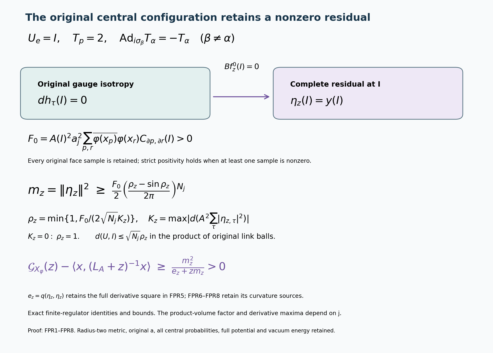

# Original central configurations and a strict physical resolvent gain

Reviewed derivation, 14 October 2026. This continues the complete CK and CFE calculations without altering the original state or test amplitude. [CK1–CK24](https://github.com/KokunoYumeto/yang-mills-interacting-workbench/blob/25cc399b2cfa6ac81b7d16df14112c61828061bc/yang-mills/continuations/20261011-central-signs-shrinking-window/CENTRAL_KINETIC_SOURCE.md) and [CFE1–CFE14](https://github.com/KokunoYumeto/yang-mills-interacting-workbench/blob/bad0139c4fe3892e3bca138488b3970b65fce829/yang-mills/continuations/20261011-central-signs-shrinking-window/CENTRAL_FLUCTUATION_ENERGY.md) are the complete source proofs. Reading coverage: complete CK/CFE owner sources, including CK7, CK24 and CFE1–CFE14. The earlier CK disk-index routes remain the routing record; no new external reading or novelty claim is asserted.

Keep the original path
\[
L_j=j^4,\quad a_j=(100j)^{-1},\quad
g_j^2=\kappa_*a_j/2,\quad b_j=(\kappa_*a_j^2)^{-1},
\quad s_j=100\kappa_*a_j,
\]
the open graph, every face and its ordered holonomy from CK, and the radius-two product metric on \(SU(2)^{N_j}\), where
\[
N_j=3(2L_j)(2L_j+1)^2,\qquad M_j=3(2L_j)^2(2L_j+1).
\]
At fixed \(j\) retain \(H=-\kappa_*\Delta+b_j\sum_p(2-T_p)\), its strictly positive smooth probability-normalized ground state \(\psi\), and its full original energy \(E_0\). Put \(n=2^{N_j}\),
\[
A^2=n^{-1}\sum_\tau\psi(D_\tau U)^2,\quad
p_\tau=\psi(D_\tau U)^2/(nA^2),\quad h_\tau=\sqrt{p_\tau},
\quad r_S=\sum_\tau\chi_S(\tau)p_\tau .
\]
The full physical isometry is
\((\mathcal T f)_\tau=f(D_\tau U)/(\sqrt n A)\), with
\(\mathcal T(H-E_0)=\mathcal M\mathcal T\).
Write \(\kappa=\kappa_*,a=a_j\) only at fixed \(j\).

For the original smooth complex test use every original sample
\[
x_p=o+a(z-L_j\mathbf1+(e_d+e_k)/2),\qquad
X_\varphi=\frac a2\sum_p\varphi(x_p)(2-T_p-\mu D_p).
\]
Let \(x=\sum_\tau p_\tau(X_\varphi)_\tau\), \(y_\tau=h_\tau((X_\varphi)_\tau-x)\),
\[
f_z^0=(L_A+z)^{-1}x,\quad
Bf=-2\kappa(\langle dh_\tau,df\rangle)_\tau,\quad
\eta_z=y-Bf_z^0,\qquad z>0.
\]
All these are smooth at the fixed regulator: \(A\) is positive on the compact configuration manifold, and the elliptic resolvent of \(L_A\) sends its smooth invariant source to a smooth invariant function. Its exact domains are those in CK.

## 1. The entire first derivative vanishes at every central configuration

Let \(U^\delta_e=\delta_e I\) for arbitrary original signs \(\delta_e\). For any smooth gauge-invariant scalar \(f\),
\[
df(U^\delta)=0.
\tag{FPR1}
\]
Here is a proof on the full unreduced tangent space. Every global gauge transformation \(g\) (the same \(g\) at every vertex) fixes \(U^\delta\) and acts on each positive-link tangent vector by \(\operatorname{Ad}_g\). Differentiate gauge invariance with only one link tangent nonzero. Its derivative is an adjoint-invariant linear form on \(\mathfrak{su}(2)\). In the original orthonormal basis \(T_\alpha=-i\sigma_\alpha/2\), conjugation by \(i\sigma_\beta\), \(\beta\ne\alpha\), sends \(T_\alpha\) to \(-T_\alpha\). Invariance therefore makes the derivative on \(T_\alpha\) its own negative. It vanishes for every basis direction on every link. This proves FPR1 for real or complex scalars without passing to a quotient or omitting a gauge direction.

Apply this to the original gauge-invariant \(\psi,A,p_\tau,h_\tau,r_S\). All their first derivatives vanish at \(U^\delta\). In particular
\[
Bf_z^0(U^\delta)=0
\tag{FPR2}
\]
for every positive \(z\), independently of any estimate for \(df_z^0\).

## 2. The full original residual is strictly nonzero

Use the configuration \(\mathbf I\) with every positive link equal to \(I\), retaining all its central translates. There \(T_p=2\) and \((T_p)_\tau=2\chi_{\partial p}(\tau)\). CFE13, or direct substitution into \(y\), gives
\[
\begin{gathered}
\frac{(\eta_z)_\tau(\mathbf I)}{h_\tau(\mathbf I)}
=-a\sum_p\varphi(x_p)
\big(\chi_{\partial p}(\tau)-r_{\partial p}(\mathbf I)\big),\\
\sum_\tau|(\eta_z)_\tau(\mathbf I)|^2
=a^2\sum_{p,r}\overline{\varphi(x_p)}\varphi(x_r)
\big[r_{\partial p\triangle\partial r}
-r_{\partial p}r_{\partial r}\big](\mathbf I).
\end{gathered}\tag{FPR3}
\]
The original constants \(2-\mu D_p\) cancel exactly in this conditional difference, and the original factor \(a/2\) multiplies the trace value \(2\), giving the displayed \(a\). Nothing is rescaled.

At \(\mathbf I\) all \(p_\tau\) are strictly positive. The complete nonempty-character covariance \(C\) is positive definite by CFE9. The original face boundaries are distinct nonempty edge subsets, so their matrix in FPR3 is a principal submatrix of \(C\), hence positive definite: extending a face coefficient vector by zero to the remaining subsets proves the assertion directly from its full quadratic form. Consequently FPR3 is strictly positive exactly when at least one original \(\varphi(x_p)\) is nonzero. When all samples vanish, \(X_\varphi\) and \(\eta_z\) are identically zero. In the nonzero case continuity and full support of the original Haar measure imply \(\|\eta_z\|>0\) for every \(z>0\).

## 3. Explicit retained-metric lower bound

For the nonzero case define actual original-state quantities
\[
\mathcal F_z(U)=A(U)^2\sum_\tau|(\eta_z)_\tau(U)|^2,\quad
F_0=\mathcal F_z(\mathbf I)>0,\quad
K_z=\max_U|d\mathcal F_z(U)|.
\]
Here \(F_0\) is the full right side of FPR3 times \(A(\mathbf I)^2\), and is independent of \(z\); \(K_z\) retains the actual shift dependence. The maximum is finite on the compact original manifold. Define the actual link radius
\[
\rho_z=
\begin{cases}
1,&K_z=0,\\
\min\{1,F_0/(2\sqrt{N_j}K_z)\},&K_z>0.
\end{cases}
\]
Then
\[
\boxed{
\|\eta_z\|^2\ge
\frac{F_0}{2}
\left(\frac{\rho_z-\sin\rho_z}{2\pi}\right)^{N_j}>0.
}\tag{FPR4}
\]
To prove the inequality, use the product of the \(N_j\) radius-\(\rho_z\) link balls centered at \(I\). Each point has product geodesic distance at most \(\sqrt{N_j}\rho_z\) from \(\mathbf I\). The derivative bound along a minimizing product geodesic gives \(\mathcal F_z\ge F_0/2\) throughout that product when \(K_z>0\). For \(K_z=0\), connectedness gives the stronger constant equality \(\mathcal F_z=F_0\).

The original \(SU(2)\) metric is the radius-two sphere, not a unit-radius replacement. Its polar volume at geodesic distance \(r\) is \(16\pi\sin^2(r/2)\,dr\); its total volume is \(16\pi^2\). Hence its probability Haar ball measure for \(0\le\rho\le2\pi\) is
\[
\frac1\pi\int_0^\rho\sin^2(r/2)\,dr
=\frac{\rho-\sin\rho}{2\pi}.
\]
Multiply these \(N_j\) exact factors and integrate the lower bound for \(\mathcal F_z\). This proves FPR4 with every dimensional, metric and volume factor retained. It supplies no regulator-uniform bound for \(K_z\), \(F_0\), or the displayed product.

## 4. Full residual energy and strict resolvent gain

The exact original scalar represented by \(\eta_z\) is the gauge-invariant smooth function \(Y_z\psi\), where
\[
(Y_z)_\tau=(X_\varphi)_\tau-x
+\kappa\langle d\log p_\tau,df_z^0\rangle,\qquad
\sum_\tau p_\tau(Y_z)_\tau=0 .
\]
Equivariance gives a single \(Y_z\) from the identity component; all remaining components are its original central translates. The last equality follows from the full conditional mean and \(\sum dp_\tau=0\). Thus, with \(m_z=\|\eta_z\|^2\),
\[
\begin{gathered}
e_z=q(\eta_z,\eta_z)
=\kappa\int A^2\sum_\tau p_\tau
|d(X_\varphi)_\tau-dx+\kappa\,\mathcal H_{\tau,z}|^2dU,\\
\mathcal H_{\tau,z}(u)
=\operatorname{Hess}(\log p_\tau)(u,\nabla f_z^0)
+\operatorname{Hess}(f_z^0)(u,\nabla\log p_\tau),\\
\mathcal G_{X_\varphi}(z)
-\langle x,(L_A+z)^{-1}x\rangle
=\langle\eta_z,(\mathcal M+z)^{-1}\eta_z\rangle
\ge\frac{m_z^2}{e_z+z m_z}>0 .
\end{gathered}\tag{FPR5}
\]
The Hessians and gradient contractions use the full original Levi-Civita connection; the derivative of the metric pairing gives exactly the two terms in \(\mathcal H_{\tau,z}\). The ground-state form of \(\mathcal T(Y_z\psi)\), followed by central averaging, proves the energy identity with all cross terms inside its full square.

CK24 proves the resolvent equality. For its lower bound let \(d\nu_{\eta_z}(\lambda)\) be the full spectral measure of the original nonnegative \(\mathcal M\), including its zero direction. Then \(\int d\nu=m_z\) and \(\int(\lambda+z)d\nu=e_z+zm_z\). Cauchy–Schwarz applied to \((\lambda+z)^{-1/2}\) and \((\lambda+z)^{1/2}\) gives
\[
m_z^2\le
\left(\int\frac{d\nu}{\lambda+z}\right)(e_z+zm_z).
\]
Smoothness makes \(e_z\) finite; FPR3 gives \(m_z>0\). This proves the strict inequality in FPR5, without a positive gap assumption or a discarded vacuum contribution.

## 5. Exact original curvature source at the central configuration

FPR1 makes every \(F_S(\mathbf I)=0\), as well as the first-order drift in \(L_A\) at that point. Consequently CFE14 gives
\[
\begin{gathered}
\Delta r_S(\mathbf I)
=-\frac{4b_j}{\kappa_*}\sum_p
\big(r_{S\triangle\partial p}-r_Sr_{\partial p}\big)(\mathbf I),\\
\Delta\log p_\tau(\mathbf I)
=\frac{2}{\kappa_*}(V_\tau-\overline V)(\mathbf I)
=-\frac{4b_j}{\kappa_*}
\sum_p\big(\chi_{\partial p}(\tau)-r_{\partial p}(\mathbf I)\big).
\end{gathered}\tag{FPR6}
\]
For the second line use CK7 at \(\mathbf I\):
\(-\kappa_*\Delta p_\tau=2(\overline V-V_\tau)p_\tau\).
Divide by \(p_\tau>0\); the extra term in the logarithmic Laplacian is zero because \(dp_\tau=0\). Insert the full original potentials with \(T_p(\mathbf I)=2\). Their identical \(2b_jM_j\) terms cancel in that difference. The original curvature factor is
\(4b_j/\kappa_*=4/(\kappa_*^2a_j^2)\), with no rescaling of the original state.

The scalar \(\mathcal F_z\) is gauge invariant, so \(d\mathcal F_z(\mathbf I)=0\) by FPR1. Define the actual full-metric Hessian bound
\[
J_z=\max_U\|\operatorname{Hess}\mathcal F_z(U)\|_{\rm op},\qquad
\widetilde\rho_z=
\begin{cases}
1,&J_z=0,\\
\min\{1,\sqrt{F_0/(N_jJ_z)}\},&J_z>0.
\end{cases}
\]
The original metric then also gives
\[
\|\eta_z\|^2\ge
\frac{F_0}{2}
\left(\frac{\widetilde\rho_z-\sin\widetilde\rho_z}{2\pi}\right)^{N_j}>0.
\tag{FPR7}
\]
Indeed along any unit-speed minimizing geodesic from \(\mathbf I\), the first derivative at its start vanishes and the absolute second derivative is at most \(J_z\). Integrating twice yields \(\mathcal F_z(U)\ge F_0-J_z\,d(U,\mathbf I)^2/2\). Apply this on the original product balls and use exactly the Haar volume already proved in FPR4. If \(J_z=0\), that same geodesic argument makes \(\mathcal F_z\) constant. This derives the bound from the actual Hessian rather than assigning it a limiting rate.

The Laplacian at the central configuration is also explicit. Let
\[
\zeta_\tau=(X_\varphi)_\tau(\mathbf I)-x(\mathbf I)
=-a\sum_p\varphi(x_p)
\big(\chi_{\partial p}(\tau)-r_{\partial p}(\mathbf I)\big).
\]
All quantities on the right of the following identity are evaluated at \(\mathbf I\):
\[
\begin{split}
\Delta\mathcal F_z={}&
\frac{2A^2}{\kappa}\sum_\tau
p_\tau|\zeta_\tau|^2(V_\tau-E_0)
-6A^2\sum_\tau p_\tau|\zeta_\tau|^2\\
&-4\kappa a A^2\operatorname{Re}
\sum_p\overline{\varphi(x_p)}
\langle\operatorname{Hess}r_{\partial p},
\operatorname{Hess}f_z^0\rangle .
\end{split}\tag{FPR8}
\]
The last pairing is the complex bilinear extension of the full original Hessian contraction; the conjugation of the test coefficient is displayed. In particular the full potential in the first sum is \(V_\tau=2b_jM_j-2b_j\sum_p\chi_{\partial p}(\tau)\), and the original \(E_0\) is retained.

Here is the calculation. All first derivatives of \(A,h_\tau,(X_\varphi)_\tau,x,f_z^0\) vanish at \(\mathbf I\). Write
\(\eta_\tau=h_\tau((X_\varphi)_\tau-x)+2\kappa\langle dh_\tau,df_z^0\rangle\).
The original product-rule Laplacian gives
\[
\Delta\eta_\tau=(\Delta h_\tau)\zeta_\tau
+h_\tau(\Delta(X_\varphi)_\tau-\Delta x)
+4\kappa\langle\operatorname{Hess}h_\tau,
\operatorname{Hess}f_z^0\rangle .
\]
For the last term, differentiating the two gradients twice leaves two Hessian contractions. The gradient-of-Laplacian and Ricci terms are all multiplied by a first derivative that vanishes at this point. No curvature term is discarded away from this point. CK6–CK7 give
\(\Delta A=(\overline V-E_0)A/\kappa\) and
\(\Delta h_\tau=(V_\tau-\overline V)h_\tau/\kappa\) there.
Thus
\[
\Delta\mathcal F_z
=2A\Delta A\sum_\tau|\eta_\tau|^2
+2A^2\operatorname{Re}\sum_\tau\overline{\eta_\tau}\Delta\eta_\tau .
\]
The \(\overline V\) terms cancel between these two displayed contributions, giving the first sum in FPR8. The \(\Delta x\) term vanishes by the exact identity \(\sum_\tau h_\tau\overline{\eta_\tau}=0\).

Each face trace satisfies \(\Delta T_p=-3T_p\) in the original metric: each of its four distinct links contributes the fundamental \(SU(2)\) Casimir \(-3/4\), since \(\sum_{\alpha=1}^3T_\alpha^2=-3I/4\). Inverse links give the same second derivative. Hence
\(\Delta(X_\varphi)_\tau(\mathbf I)=3a\sum_p\varphi(x_p)\chi_{\partial p}(\tau)\).
Its conditional covariance with \(\overline{\zeta_\tau}\) is
\(-3\sum_\tau p_\tau|\zeta_\tau|^2\), yielding the second term in FPR8 with the full factor \(-6A^2\).

Finally at this point
\(\operatorname{Hess}h_\tau=(h_\tau/2)\operatorname{Hess}\log p_\tau\) and
\(\operatorname{Hess}p_\tau=p_\tau\operatorname{Hess}\log p_\tau\).
Using \(\sum\operatorname{Hess}p_\tau=0\) and the full character definition gives
\[
\sum_\tau p_\tau\overline{\zeta_\tau}\operatorname{Hess}\log p_\tau
=-a\sum_p\overline{\varphi(x_p)}\operatorname{Hess}r_{\partial p}.
\]
Substitution into the Hessian term of \(\Delta\mathcal F_z\) proves the final term of FPR8. This completes the calculation with all three contributions.

The arrow records the exact implication from the original gauge isotropy to the vanishing coupling at the central configuration, leaving the full original fluctuation there. The lower formulas retain every face sample, covariance, derivative maximum and radius-two product volume. Proof: FPR1–FPR8. Reproducible source: [figure_central_fixed_point.py](figure_central_fixed_point.py). Inherited human center-multiplication provenance remains L. Li and Y. Meurice, arXiv:hep-lat/0410029v2, Sections II–IV and Appendix, through the author-source records in CK and CS.

The accompanying 96 diagnostics check the original Pauli adjoint factors, four-link trace Hessian, exact radius-two Haar volume, complete central residual Laplacian and the positive-matrix resolvent lower bound. The continuous loop fixture uses the explicitly constructed potential \(V=E+\kappa\Delta\psi/\psi\) and a specified smooth central-even test function. It is not a sampled Wilson vacuum or its resolvent solution. The complete proofs above establish the original-state statements; the diagnostics check coefficients, signs, metric factors and retained cross terms.

At \(z=\theta s_j,\varepsilon\theta s_j,R_{\rm win}\theta s_j\), FPR5 supplies three actual positive resolvent gains. The signed squared-resolvent combination from TSC and CFE8 still depends on their derivatives and relative sizes; strict gain separately does not determine its sign. The next calculation must bound the actual curvature and residual energy through FPR6–FPR8, with the full character equation CFE14 and residual square CFE13. The product volume retains its \(N_j\)-dependence, and a Laplacian trace does not bound the full Hessian without its other components. Thus this calculation has not supplied a nonzero limiting spectral weight. The smooth interacting global no-gap state and reconstruction remain the programme goal.

## Actual central Hessians and their full original face maps

[CHM1–CHM13](https://github.com/KokunoYumeto/yang-mills-interacting-workbench/blob/main/yang-mills/continuations/20261011-central-signs-shrinking-window/CENTRAL_HESSIAN_FACE_MAP.md) prove the complete central Hessian form \(\mathscr H^f=K^f\otimes I_3\), all original vertex constraints, an explicit integer face filling and the exact map \(K^f=R(FK^fF^{\mathsf T})R^{\mathsf T}\). Both face Gram factors and the full colour factor \(3\) remain in the FPR8 receiving contraction. The actual original conditional ground Hessians satisfy
\[
K^{\mathcal F}=2\mathfrak V,\qquad
\mathfrak V=\sum_\tau p_\tau(K_\tau-\overline K)^2\ge0,
\quad \Delta\mathcal F(\mathbf I)=6\operatorname{Tr}\mathfrak V.
\]
CHM9 proves its strict original-state curvature bound with the complete face covariance and circulation dimension. CHM10–CHM13 calculate every original second/fourth-derivative ground, marginal, test-source, resolvent and character term, including both matrix product orders. The global Wilson-word realization CHM6 does not assign an actual ground state. The actual matrix estimates and signed shrinking-window response, followed by reconstruction and the smooth global no-gap construction, remain active.

## Actual conditional Hessian bounds and complete response terms

[HCB1–HCB10](https://github.com/KokunoYumeto/yang-mills-interacting-workbench/blob/main/yang-mills/continuations/20261011-central-signs-shrinking-window/ACTUAL_HESSIAN_BOUNDS.md) apply the original global log-Hessian bound to every actual central translation. The resulting matrix and trace bounds retain all gauge directions, the full original potential, vacuum energy and a nonnegative remainder. The exact traceless defect strengthens CHM9, and the full face-covariance projection bounds the original FPR8 source contraction without assigning its remaining resolvent Hessian. PVI7's existing weighted identity gives the complete global conditional Hessian mean and variance squares, bounded by
\[
\frac{3b_jM_j}{\kappa_*}
=\frac{720000j^{14}+360000j^{10}}{\kappa_*^2}.
\]
Both localization derivatives are proved and retained. Every displayed growth rate belongs to an upper-bound function; the actual signed shrinking-window mass and smooth interacting no-gap state remain the continuing calculation.

## Actual resolvent derivatives and explicit residual gain

[RHB1–RHB13](https://github.com/KokunoYumeto/yang-mills-interacting-workbench/blob/main/yang-mills/continuations/20261011-central-signs-shrinking-window/ACTUAL_RESOLVENT_HESSIAN.md) evaluate the actual marginal resolvent derivatives using the original closed-geodesic, full-dimensional Hessian and weighted Bochner calculations. The heat-semigroup gradient estimate and original conditional-state derivatives remove the unevaluated maxima from a positive residual-mass bound. Every original source sample, vacuum-energy term, density factor and radius-two Haar-ball volume is retained. The resulting full residual energy and mass give
\[
\mathcal G_{X_\varphi}(z)-\langle x,(L_A+z)^{-1}x\rangle
\ge\frac{(m^-_{j,z})^2}{\mathcal E^+_{j,z}+z\,m^-_{j,z}}>0
\]
for nonzero original face samples. All constants are explicitly given in RHB9–RHB13. This is a finite-regulator gain; its signed differentiated three-shift response, limiting annular mass and the smooth interacting global no-gap state remain the continuing calculation.
