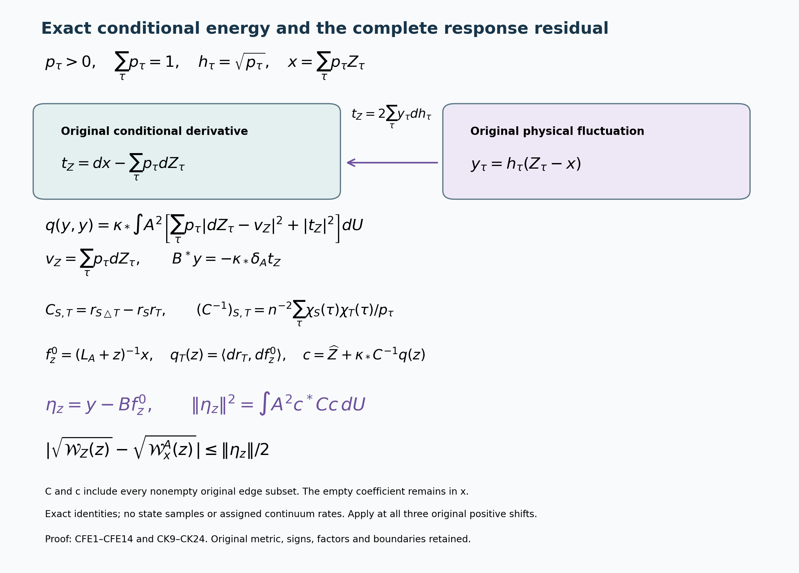

# Exact central fluctuation energy and the original response residual

Reviewed derivation, 14 October 2026. This continues [CK1–CK24](https://github.com/KokunoYumeto/yang-mills-interacting-workbench/blob/25cc399b2cfa6ac81b7d16df14112c61828061bc/yang-mills/continuations/20261011-central-signs-shrinking-window/CENTRAL_KINETIC_SOURCE.md), with the same original state, every original central component, and the full physical resolvent. The smooth interacting global no-gap state remains the goal.

Keep the original path \(L_j=j^4\), \(a_j=(100j)^{-1}\), \(g_j^2=\kappa_*a_j/2\), \(b_j=(\kappa_*a_j^2)^{-1}\), \(s_j=100\kappa_*a_j\). The open box has all vertices \(\{0,\ldots,2L_j\}^3\), \(N_j=3(2L_j)(2L_j+1)^2\) positive edges and \(M_j=3(2L_j)^2(2L_j+1)\) faces. Each link has the radius-two \(SU(2)\) metric with orthonormal \(T_\alpha=-i\sigma_\alpha/2\) and probability Haar measure. Keep the full ordered face
\[
U_p=U_d(z)U_k(z+e_d)U_d(z+e_k)^{-1}U_k(z)^{-1},\quad
T_p=\operatorname{Tr}U_p,\quad D_p=2-T_p,\quad d<k,
\]
the complete Hamiltonian \(H=-\kappa_*\Delta+b_j\sum_pD_p\), and
\(H\psi=E_0\psi\), \(\psi>0\), \(\int\psi^2dU=1\), \(\rho=\psi^2\), \(d\mu=\rho\,dU\).
At fixed \(j\), write \(a=a_j,\kappa=\kappa_*,b=b_j\).
The full finite central family is
\[
\begin{gathered}
n=2^{N_j},\quad(D_\tau U)_e=\tau_eU_e,\quad
\rho_\varnothing=n^{-1}\sum_\tau\rho\circ D_\tau,\quad
A=\sqrt{\rho_\varnothing},\\
p_\tau=\rho(D_\tau U)/(nA^2),\quad h_\tau=\sqrt{p_\tau},\quad
r_S=\sum_\tau\chi_S(\tau)p_\tau,\quad
\chi_S(\tau)=\prod_{e\in S}\tau_e .
\end{gathered}
\]
All sums over \(\tau\) include all \(2^{N_j}\) original signs. Thus \(\sum p_\tau=\sum h_\tau^2=1\), and every function is smooth at the fixed regulator. Let
\(\mathscr K=L^2(A^2dU;\mathbb C^{\mathfrak C})\) with the full sum in its norm.
CK9–CK11 prove the exact isometry
\((\mathcal T f)_\tau=f(D_\tau U)/(\sqrt n A)\)
and the full physical operator
\[
\begin{gathered}
\mathcal M_\tau=L_A+V_\tau-\overline V-\kappa F,\qquad
L_A=-\kappa(\Delta+2\langle d\log A,d\,\cdot\,\rangle),\\
F=\sum_\tau|dh_\tau|^2,\qquad
V_\tau=V\circ D_\tau,\qquad\overline V=\sum_\tau p_\tau V_\tau .
\end{gathered}
\]
The exact domains, equivariance, gauge constraints and original \(E_0\) are those proved there; in particular \(\mathcal T(H-E_0)=\mathcal M\mathcal T\).
Put \(Jf=hf\), \(P=JJ^*\), \(Q=I-P\) on that physical space. Its form is \(q(v,w)=\langle v,\mathcal Mw\rangle\) on smooth vectors.

## 1. The original conditional mean-gradient defect

For any smooth complex physical scalar \(Z\), set
\[
\begin{gathered}
Z_\tau=Z\circ D_\tau,\qquad
x=\sum_\tau p_\tau Z_\tau,\qquad
y_\tau=h_\tau(Z_\tau-x),\\
v_Z=\sum_\tau p_\tau dZ_\tau,\qquad
t_Z=dx-v_Z=\sum_\tau(Z_\tau-x)\,dp_\tau,\\
t_Z=2\sum_\tau y_\tau dh_\tau .
\end{gathered}\tag{CFE1}
\]
The second line is differentiation of the entire sum defining \(x\), using \(\sum dp_\tau=0\). Since \(dp_\tau=2h_\tau dh_\tau\), its last line follows without changing the conditional probabilities. The conditional mean and its one-forms are central invariant; the full change \(D_\sigma\) merely permutes the displayed terms. These are actual original-state functions, not replacement trial data.

The original full transformed vector is \(\mathbf Z=\mathcal T(Z\psi)=Jx+y\). CK15 proves \(y\in Q\mathscr K\), with
\[
\|y\|_{\mathscr K}^2=\int A^2\sum_\tau p_\tau|Z_\tau-x|^2dU.
\]
For the exact coupling \(Bf=-2\kappa(\langle dh_\tau,df\rangle)_\tau\), CFE1 gives every mixed first-energy term:
\[
q(Jf,y)=\langle Bf,y\rangle_{\mathscr K}
=-\kappa\int A^2\langle d\overline f,t_Z\rangle dU .
\tag{CFE2}
\]
Insert \(Bf\), conjugate the first entry and use the last line of CFE1. The metric pairing inside the integral is complex bilinear, with the displayed conjugation; Hilbert pairings are conjugate-linear in their first argument.

Define the exact weighted adjoint on one-forms by
\(\delta_A=d^*-2\iota_{\nabla\log A}\), so
\(\int A^2\langle d\overline f,\omega\rangle=\int A^2\overline f\,\delta_A\omega\).
It follows, on smooth \(Q\)-vectors, that
\[
B^*y=-\kappa\delta_A t_Z .
\tag{CFE3}
\]
Every smooth physical \(Q\)-vector has the displayed form: divide its components by the strictly positive \(h_\tau\); equivariance identifies the quotients with \(Z\circ D_\tau\), and \(J^*y=0\) says their conditional mean is zero. Smoothness is preserved at the fixed regulator because the compact configuration space gives a strictly positive minimum for each \(h_\tau\). Thus CFE3 covers every smooth vector in that physical complementary space. This proves the morphism from the retained physical cross term to the conditional mean-gradient defect. All derivatives and the full \(A^2\) drift remain.

## 2. The entire fluctuation first energy

The full ground transform gives
\(q(\mathbf Z,\mathbf Z)=\kappa\mu|dZ|^2\).
Changing variables in every central term yields
\(\mu|dZ|^2=\int A^2\sum_\tau p_\tau|dZ_\tau|^2dU\).
Use \(q(Jx,Jx)=\kappa\int A^2|dx|^2\) and CFE2 to subtract the entire marginal component and both mixed terms. Since \(dx=v_Z+t_Z\), this proves
\[
\boxed{
q(y,y)=\kappa\int A^2
\left[\sum_\tau p_\tau|dZ_\tau-v_Z|^2+|t_Z|^2\right]dU .
}\tag{CFE4}
\]
Indeed the unsquared intermediate integrand is
\[
\sum_\tau p_\tau|dZ_\tau|^2-|dx|^2
+2\operatorname{Re}\langle d\overline x,t_Z\rangle .
\]
Insert \(dx=v_Z+t_Z\). The mixed terms cancel exactly, leaving
\(\sum p_\tau|dZ_\tau|^2-|v_Z|^2+|t_Z|^2\).
Expanding the full conditional square gives the asserted expression, since \(\sum p_\tau(dZ_\tau-v_Z)=0\). Equivalently, the exact inverse map sends \(y\) to \((Z-x)\psi\), so its original ground-state form is \(\kappa\mu|dZ-dx|^2\). Central averaging gives the same positive decomposition with \(dx=v_Z+t_Z\). These two calculations retain every complex cross term before its exact cancellation.

For the original test \(\varphi\), let
\[
x_p=o+a(z-L_j\mathbf1+(e_d+e_k)/2),\qquad
X_\varphi=\frac a2\sum_p\varphi(x_p)(D_p-\mu D_p).
\]
The finite-\(j\) coefficients \(\varphi(x_p)\) are fixed in configuration space. Set \(r_p=r_{\partial p}\) only within the following formulas. Then
\[
\begin{gathered}
v_X=-\frac a2\sum_p\varphi(x_p)r_p\,dT_p,\qquad
t_X=-\frac a2\sum_p\varphi(x_p)T_p\,dr_p,\\
B^*y_X=\frac{\kappa a}{2}\delta_A
\left[\sum_p\varphi(x_p)T_p\,dr_p\right],\\
q(y_X,y_X)=\frac{\kappa a^2}{4}\int A^2
\left\{\sum_{p,r}\overline{\varphi(x_p)}\varphi(x_r)
[r_{\partial p\triangle\partial r}-r_pr_r]
\langle dT_p,dT_r\rangle
+\left|\sum_p\varphi(x_p)T_p\,dr_p\right|^2\right\}dU .
\end{gathered}\tag{CFE5}
\]
To prove these formulas, differentiate the full original transformed trace
\((T_p)_\tau=\chi_{\partial p}(\tau)T_p\), keeping its constant sign. Average with the actual \(p_\tau\) to obtain \(v_X\). Differentiate the first formula of CK16 to obtain \(dx\); its \(r_p\,dT_p\) contribution cancels precisely the already displayed \(v_X\), leaving \(t_X\). Apply CFE3 for \(B^*y_X\). Finally the conditional covariance of the two sign characters is
\(r_{\partial p\triangle\partial r}-r_pr_r\).
Expand every derivative product in CFE4 to get the last line. Faces with no common link have \(\langle dT_p,dT_r\rangle=0\) by the original product metric, while all shared-link and diagonal terms remain. Boundary incidences are the original ones.

## 3. Full residual norm at the original positive shift

For \(z>0\), let
\[
f_z^0=(L_A+z)^{-1}x,\qquad
\eta_z=y-Bf_z^0 .
\]
CK24 proves that this is the complete physical residual of the central-average trial. Its raw norm is exactly
\[
\begin{split}
\|\eta_z\|^2={}&\|y\|^2
+4\kappa^2\int A^2\sum_\tau
|\langle dh_\tau,df_z^0\rangle|^2dU\\
&+2\kappa\operatorname{Re}\int A^2
\langle\overline{t_Z},df_z^0\rangle dU .
\end{split}\tag{CFE6}
\]
Expand \(\|y-Bf_z^0\|^2\), insert the complete \(B\), and use
\(\sum\overline{y_\tau}dh_\tau=\overline{t_Z}/2\) from CFE1.
For \(Z=X_\varphi\), the cross term is
\[
-\kappa a\operatorname{Re}\int A^2
\sum_p\overline{\varphi(x_p)}T_p
\langle dr_p,df_z^0\rangle dU .
\]
Its sign is not assigned independently of the original actual functions.
The first norm is the full CK16 conditional covariance, and the second is the explicit positive conditional kinetic tensor. Thus CFE6 states the entire norm rather than dropping its possible cancellation.

Let
\[
\mathcal W_Z(z)=\langle\mathbf Z,z\mathcal M(\mathcal M+z)^{-2}\mathbf Z\rangle,\qquad
\mathcal W_x^A(z)=z\langle f_z^0,L_Af_z^0\rangle.
\]
The exact residual equation gives
\[
\begin{gathered}
\sqrt{z\mathcal M}(\mathcal M+z)^{-1}\mathbf Z
=\sqrt{z\mathcal M}Jf_z^0
+\sqrt{z\mathcal M}(\mathcal M+z)^{-1}\eta_z,\\
\left|\sqrt{\mathcal W_Z(z)}-\sqrt{\mathcal W_x^A(z)}\right|
\le\left\|\sqrt{z\mathcal M}(\mathcal M+z)^{-1}\eta_z\right\|
\le\frac12\|\eta_z\|.
\end{gathered}\tag{CFE7}
\]
The first norm on the right of the first line is
\(\sqrt{zq(Jf_z^0,Jf_z^0)}=\sqrt{\mathcal W_x^A(z)}\).
The triangle and reverse triangle inequalities give the first bound.
For the second, spectral calculus uses the exact scalar maximum
\(\sqrt{z\lambda}/(\lambda+z)\le1/2\) for \(\lambda\ge0\), with equality at \(\lambda=z\). This proof includes the zero eigenvalue and the whole original high-energy range.

At each original shift \(\beta s_j\), \(\beta\in\{\theta,\varepsilon\theta,R_{\rm win}\theta\}\), put
\(u_\beta=\sqrt{\mathcal W_x^A(\beta s_j)}\) and
\(\delta_\beta=\|\eta_{\beta s_j}\|/2\), with the complete norm CFE6.
Then, retaining all coefficients of CK14,
\[
\begin{split}
\mathcal C_{Z,j}(\theta s_j)\ge{}&
(u_\theta-\delta_\theta)_+^2
-\frac{4\varepsilon}{(1+\varepsilon)^2}
(u_{\varepsilon\theta}+\delta_{\varepsilon\theta})^2\\
&-\frac{4R_{\rm win}}{(1+R_{\rm win})^2}
(u_{R_{\rm win}\theta}+\delta_{R_{\rm win}\theta})^2,\\
\mathcal C_{Z,j}(\theta s_j)\le{}&
(u_\theta+\delta_\theta)^2
-\frac{4\varepsilon}{(1+\varepsilon)^2}
(u_{\varepsilon\theta}-\delta_{\varepsilon\theta})_+^2\\
&-\frac{4R_{\rm win}}{(1+R_{\rm win})^2}
(u_{R_{\rm win}\theta}-\delta_{R_{\rm win}\theta})_+^2 .
\end{split}\tag{CFE8}
\]
Apply CFE7 separately at the three shifts. Each term with a negative coefficient requires the opposite bound for its square; this gives the displayed signs. No value or rate is assumed for the actual \(u_\beta,\delta_\beta\).

## 4. Exact inverse covariance for the entire kinetic tensor

At each original configuration retain the covariance indexed by every nonempty original edge subset:
\[
C_{S,T}=r_{S\triangle T}-r_Sr_T,\qquad
S,T\ne\varnothing .
\]
It is strictly positive definite, with the complete inverse
\[
\boxed{
(C^{-1})_{S,T}=\frac1{n^2}\sum_{\tau\in\mathfrak C}
\frac{\chi_S(\tau)\chi_T(\tau)}{p_\tau}
\quad(S,T\ne\varnothing).
}\tag{CFE9}
\]
No cycle restriction or individual-character truncation is made. The conditional probabilities are positive for every original sign, including signs related by vertex gauge transformations.

Here is a full finite-matrix proof. Let \(\mathsf H_{S,\tau}=\chi_S(\tau)\), now including the empty row. Character orthogonality gives \(\mathsf H\mathsf H^{\mathsf T}=nI\). The positive matrix
\(\mathsf Q=\mathsf H\operatorname{diag}(p_\tau)\mathsf H^{\mathsf T}\)
has entries \(r_{S\triangle T}\) and inverse
\(\mathsf Q^{-1}=n^{-2}\mathsf H\operatorname{diag}(p_\tau^{-1})\mathsf H^{\mathsf T}\).
In the empty/nonempty decomposition it is
\[
\mathsf Q=
\begin{pmatrix}1&r^{\mathsf T}\\r&\mathsf Q_{11}\end{pmatrix},
\qquad C=\mathsf Q_{11}-rr^{\mathsf T}.
\]
For nonzero \(v\), the full vector \((-r^{\mathsf T}v,v)\) has positive \(\mathsf Q\)-quadratic form \(v^{\mathsf T}Cv\); this proves \(C>0\).
Solving
\(\mathsf Q\binom{u}{v}=\binom{0}{w}\)
gives \(u=-r^{\mathsf T}v\) and \(Cv=w\).
Therefore the lower-right block of the displayed \(\mathsf Q^{-1}\) is \(C^{-1}\), proving CFE9 with its full \(n^{-2}\) factor.
The covariance with the empty row included has zero empty row and column, and its Moore–Penrose inverse is exactly \(0\oplus C^{-1}\); this zero direction is retained rather than divided out without a map.

For any original real tangent vectors \(u,v\), define
\(\Xi(u,v)=\sum_\tau dh_\tau(u)\,dh_\tau(v)\).
The exact kinetic tensor is
\[
\Xi(u,v)=\frac14
\sum_{S,T\ne\varnothing}dr_S(u)(C^{-1})_{S,T}dr_T(v),\qquad
F=\frac14\sum_{S,T\ne\varnothing}
(C^{-1})_{S,T}\langle dr_S,dr_T\rangle .
\tag{CFE10}
\]
Insert the entire inverse CFE9 and interchange its finite sums. CK2 gives
\[
dp_\tau(u)=\frac1n\sum_{S\ne\varnothing}\chi_S(\tau)dr_S(u).
\]
The right side of the first formula in CFE10 becomes
\(\tfrac14\sum_\tau dp_\tau(u)dp_\tau(v)/p_\tau
=\sum_\tau dh_\tau(u)dh_\tau(v)\).
Take the trace in the full original orthonormal frame to obtain the second formula. This proves the exact morphism from all density-character derivatives to the conditional kinetic tensor and its inverse covariance, preserving every link and every character.

For each nonempty \(S\), \(|r_S|<1\) because the character has both signs and every \(p_\tau\) is positive. The pointwise derivative bound is
\[
|dr_S|^2\le4(1-r_S^2)F,\qquad
|t_Z|^2\le4F\sum_\tau p_\tau|Z_\tau-x|^2 .
\tag{CFE11}
\]
For the first, write
\(dr_S=2\sum_\tau(\chi_S(\tau)-r_S)h_\tau dh_\tau\),
using \(\sum h_\tau dh_\tau=0\). Cauchy–Schwarz bounds its full vector norm squared by
\(4[\sum p_\tau(\chi_S-r_S)^2]\sum|dh_\tau|^2
=4(1-r_S^2)F\).
For the second apply the same vector Cauchy–Schwarz to the last line of CFE1. These inequalities retain the actual \(F\) and conditional variances; no uniform derivative estimate is inferred from \(L^1\) density alignment.

## 5. The full score and residual square in character coordinates

Retain all original finite Fourier coefficients of the actual observable:
\[
\widehat Z_S=\frac1n\sum_\tau\chi_S(\tau)Z_\tau,\qquad
Z_\tau=\sum_S\widehat Z_S\chi_S(\tau).
\]
The empty coefficient remains in \(x=\sum_S\widehat Z_Sr_S\). Its contribution cancels in \(Z_\tau-x\), leaving every nonempty coefficient. For every original real tangent vector \(u\), the full logarithmic derivative is
\[
d\log p_\tau(u)=
\sum_{S,T\ne\varnothing}
(\chi_S(\tau)-r_S)(C^{-1})_{S,T}\,dr_T(u).
\tag{CFE12}
\]
To prove this identity, the \(n-1\) centered characters form a basis of the \(p\)-mean-zero functions: their Gram matrix is the strictly positive \(C\) of CFE9, and that mean-zero space has dimension \(n-1\). The left side has mean \(\sum_\tau dp_\tau(u)=0\). Its inner product with \(\chi_T-r_T\) is \(dr_T(u)\), by differentiating the exact moment and using the same zero sum. The unique coefficients in this basis are therefore \(C^{-1}dr(u)\). This proves CFE12 without omitting the probabilities or a character.

Define the full complex coefficient vector, indexed by nonempty subsets,
\[
q_T(z)=\langle dr_T,df_z^0\rangle,\qquad
c_S(z)=\widehat Z_S+\kappa\sum_{T\ne\varnothing}
(C^{-1})_{S,T}q_T(z).
\]
Since \(2dh_\tau/h_\tau=d\log p_\tau\), the exact residual has the following equivalent forms:
\[
\begin{gathered}
\frac{(\eta_z)_\tau}{h_\tau}
=Z_\tau-x+\kappa\langle d\log p_\tau,df_z^0\rangle
=\sum_{S\ne\varnothing}(\chi_S(\tau)-r_S)c_S(z),\\
\|\eta_z\|^2
=\int A^2\sum_{S,T\ne\varnothing}
\overline{c_S(z)}\,C_{S,T}\,c_T(z)\,dU\\
=\int A^2\left[
\widehat Z^*C\widehat Z
+2\kappa\operatorname{Re}(\widehat Z^*q(z))
+\kappa^2 q(z)^*C^{-1}q(z)\right]dU .
\end{gathered}\tag{CFE13}
\]
Divide \(y-Bf_z^0\) by \(h_\tau\), insert CFE12 and the full Fourier expansion, and sum its squared absolute value against \(p_\tau\). The resulting Gram matrix is exactly \(C\). Expanding that complete square gives the last equality, including the sign and factor of its complex cross term. Also \(t_Z=\sum_{S\ne\varnothing}\widehat Z_S\,dr_S\), so CFE13 recovers CFE6 term by term.

The original \(X_\varphi\) has
\(\widehat X_{\partial p}=-(a/2)\varphi(x_p)T_p\) and zero coefficient on every other nonempty subset. Distinct original open-box faces have distinct edge boundaries. Its empty coefficient is
\((a/2)\sum_p\varphi(x_p)(2-\mu D_p)\), which stays in its conditional mean. Thus the exact zero-residual equations are
\[
\kappa\langle dr_S,df_z^0\rangle
=\frac a2\sum_p\varphi(x_p)T_p
\big(r_{S\triangle\partial p}-r_Sr_p\big)
\quad\text{for every nonempty }S.
\]
These equations are an equivalent description of the actual residual being zero, not an assumption that it vanishes. Indeed the integrand in CFE13 is continuous and nonnegative, \(A>0\), Haar measure has full support, and \(C>0\). Its integral vanishes exactly when every \(c_S\) vanishes at every configuration. Multiplication by \(C\) gives the displayed equations, and the same steps in reverse prove their sufficiency.

## 6. The original ground equation supplies every character derivative source

Put \(F_S=\sum_\tau\chi_S(\tau)|dh_\tau|^2\), so \(F_\varnothing=F\), keeping all original derivatives. The complete Wilson ground-state equation implies
\[
\boxed{
L_A r_S
=2b\sum_p T_p
\big(r_{S\triangle\partial p}-r_Sr_p\big)
+2\kappa(r_SF-F_S).
}\tag{CFE14}
\]
Here the equation holds for every original subset, including the empty subset, whose two sides are both zero. CK7 gives
\[
L_Ah_\tau=(\overline V+\kappa F-V_\tau)h_\tau,\qquad
L_A(h_\tau^2)=2h_\tau L_Ah_\tau-2\kappa|dh_\tau|^2.
\]
Multiply the second equation by \(\chi_S\), sum all signs and insert the first. The potential term is
\[
2\sum_\tau\chi_Sp_\tau(\overline V-V_\tau)
=2b\sum_pT_p
\left(\sum_\tau\chi_S\chi_{\partial p}p_\tau-r_Sr_p\right).
\]
The constant \(2bM_j\) cancels here only by the exact difference of the two original potentials; it remains in the marginal ground equation. The kinetic terms are exactly \(2\kappa(r_SF-F_S)\). These identities prove CFE14, with its factor \(2b\), full drift, every original face and all boundary incidences.

Multiplying CFE14 by \(r_S\), integrating against \(A^2dU\) and using the full weighted adjoint yields the exact receiving energy identity
\[
\kappa\int A^2|dr_S|^2dU
=2b\sum_p\int A^2T_pr_S
\big(r_{S\triangle\partial p}-r_Sr_p\big)dU
+2\kappa\int A^2(r_S^2F-r_SF_S)dU .
\]
No sign is assigned to either term on the right without its actual original-state calculation.

The next estimate is the size of these full derivative and covariance contractions in CFE13 at all three original shifts. CFE14 supplies their exact ground-equation source, while CFE9 and CFE12 retain the \(p_\tau^{-1}\) contributions. The first-energy identity alone does not bound the pointwise inverse covariance. These are explicit current calculations; no unknown derivative term or small conditional probability has been removed.

The arrow sends the original physical fluctuation \(y\) to its conditional mean-gradient defect \(t_Z\), as proved in CFE1. It does not assert an inverse for that map. The lower formulas show the complete fluctuation energy, all-character covariance inverse, and residual square used in the three original spectral shifts. Proof locators: CFE1–CFE14 and CK9–CK24. Reproducible source: [figure_central_fluctuation.py](figure_central_fluctuation.py). The inherited human center-multiplication source remains L. Li and Y. Meurice, arXiv:hep-lat/0410029v2, Sections II–IV and Appendix, through the author-source record in CK and CS; no new external reading or novelty claim is asserted here.

## Central configurations and strict physical resolvent gain

[FPR1–FPR8](https://github.com/KokunoYumeto/yang-mills-interacting-workbench/blob/main/yang-mills/continuations/20261011-central-signs-shrinking-window/CENTRAL_FIXED_POINT_RESIDUAL.md) prove that global gauge isotropy makes every first derivative of a smooth physical scalar vanish at each original central configuration. Thus \(Bf_z^0(I)=0\), and every nonzero original sampled face test has the strictly positive residual
\[
\sum_\tau|\eta_{z,\tau}(I)|^2
=a_j^2\sum_{p,r}\overline{\varphi(x_p)}\varphi(x_r)
C_{\partial p,\partial r}(I)>0.
\]
The full original norm has the explicit radius-two product-ball bounds FPR4/FPR7. With \(m_z=\|\eta_z\|^2\) and the complete residual energy \(e_z\) in FPR5,
\[
\mathcal G_{X_\varphi}(z)-\langle x,(L_A+z)^{-1}x\rangle
\ge\frac{m_z^2}{e_z+zm_z}>0.
\]
FPR6–FPR8 calculate the exact covariance and residual-density curvature, retaining the original potential, vacuum energy, Casimir factor and Hessian cross term. This strengthens CK24 at each finite regulator. The product volumes and derivative maxima retain their full regulator dependence; the signed three-shift limit and the smooth global no-gap endpoint remain active.

## Actual central Hessians and their full original face maps

[CHM1–CHM13](https://github.com/KokunoYumeto/yang-mills-interacting-workbench/blob/main/yang-mills/continuations/20261011-central-signs-shrinking-window/CENTRAL_HESSIAN_FACE_MAP.md) prove the complete central Hessian form \(\mathscr H^f=K^f\otimes I_3\), all original vertex constraints, an explicit integer face filling and the exact map \(K^f=R(FK^fF^{\mathsf T})R^{\mathsf T}\). Both face Gram factors and the full colour factor \(3\) remain in the FPR8 receiving contraction. The actual original conditional ground Hessians satisfy
\[
K^{\mathcal F}=2\mathfrak V,\qquad
\mathfrak V=\sum_\tau p_\tau(K_\tau-\overline K)^2\ge0,
\quad \Delta\mathcal F(\mathbf I)=6\operatorname{Tr}\mathfrak V.
\]
CHM9 proves its strict original-state curvature bound with the complete face covariance and circulation dimension. CHM10–CHM13 calculate every original second/fourth-derivative ground, marginal, test-source, resolvent and character term, including both matrix product orders. The global Wilson-word realization CHM6 does not assign an actual ground state. The actual matrix estimates and signed shrinking-window response, followed by reconstruction and the smooth global no-gap construction, remain active.
