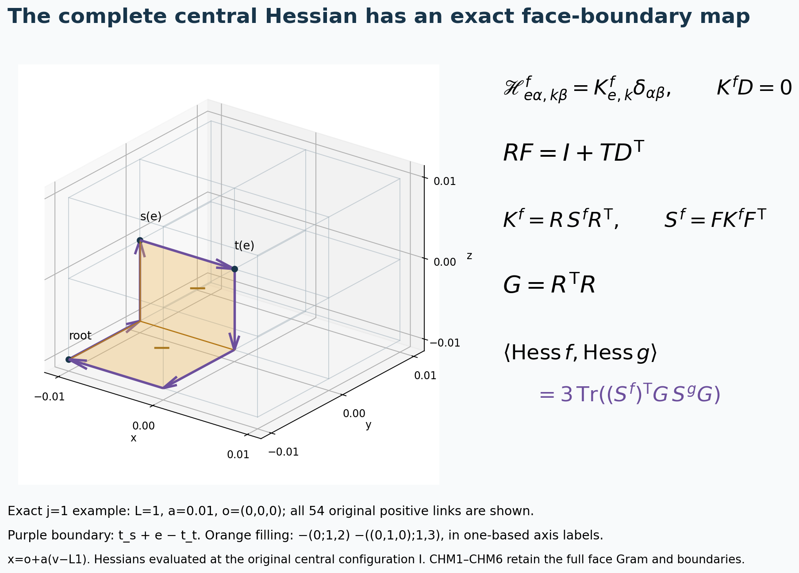
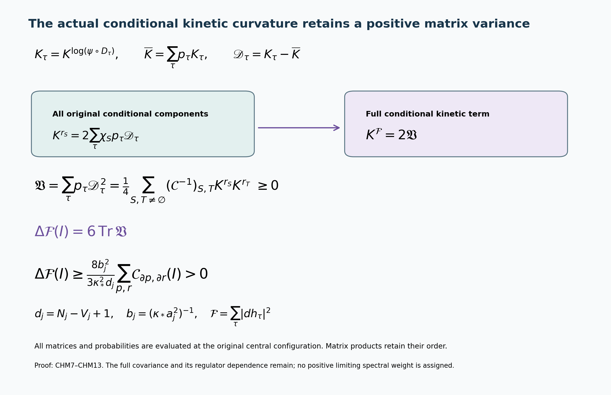

# The complete central Hessian and its original face-boundary map

Reviewed derivation, 14 October 2026. The receiving quantity is the complete Hessian contraction in FPR8. This source continues the actual original-state calculation; it does not replace the ground state by a prescribed Hessian. Current proof providers are [GWH1–GWH3](https://github.com/KokunoYumeto/yang-mills-interacting-workbench/blob/a576dd164e82c6e7fc6f00ac694d37e39145c6c7/yang-mills/continuations/20261011-central-signs-shrinking-window/GAUGE_HESSIAN_AND_COVARIANT_GRAPH.md), [FPR1–FPR8](https://github.com/KokunoYumeto/yang-mills-interacting-workbench/blob/a576dd164e82c6e7fc6f00ac694d37e39145c6c7/yang-mills/continuations/20261011-central-signs-shrinking-window/CENTRAL_FIXED_POINT_RESIDUAL.md), and [CFE1–CFE14](https://github.com/KokunoYumeto/yang-mills-interacting-workbench/blob/a576dd164e82c6e7fc6f00ac694d37e39145c6c7/yang-mills/continuations/20261011-central-signs-shrinking-window/CENTRAL_FLUCTUATION_ENERGY.md). The private source-use record distinguishes actual reading from nine disk-index routing hits; none of those nine hits is claimed read. No new external reading or novelty claim is asserted.

Keep \(L_j=j^4,a_j=(100j)^{-1},g_j^2=\kappa_*a_j/2,b_j=(\kappa_*a_j^2)^{-1},s_j=100\kappa_*a_j\), all vertices \(\{0,\ldots,2L_j\}^3\), positive edges, original ordered faces and all vertex gauge transformations. Let \(V_j=(2L_j+1)^3\) here denote the number of vertices only; the original potential is written \(V_{\rm pot}\) to avoid a name collision. Retain
\[
N_j=3(2L_j)(2L_j+1)^2,\quad M_j=3(2L_j)^2(2L_j+1),
\quad T_\alpha=-i\sigma_\alpha/2,
\]
with the original radius-two metric and right frames \(R_{e,\alpha}(U)=T_\alpha U_e\).
The central configuration \(\mathbf I\) has every link equal to \(I\). For a smooth complex gauge-invariant scalar \(f\), write its actual full Hessian as
\[
\mathscr H^f_{e\alpha,k\beta}
=\operatorname{Hess}f(\mathbf I)
(R_{e,\alpha},R_{k,\beta}).
\]
All statements about this matrix are at \(\mathbf I\). Away from that point GWH2 retains its original connection term.

## 1. Every colour component and every vertex constraint

There is an actual symmetric edge matrix \(K^f\), with entries
\(K^f_{e,k}=\mathscr H^f_{e1,k1}\), such that
\[
\mathscr H^f_{e\alpha,k\beta}=K^f_{e,k}\delta_{\alpha\beta},
\qquad (K^f)^{\mathsf T}=K^f,\qquad K^f D=0.
\tag{CHM1}
\]
Here the original incidence matrix is
\[
D_{e,v}=\mathbf1_{v=s(e)}-\mathbf1_{v=t(e)}.
\]
To prove the colour assertion, global gauge conjugation fixes \(\mathbf I\) and preserves the full metric. Its differential is the same adjoint rotation on each link. The Hessian is invariant under those rotations. For \(\alpha\ne\beta\), rotation by \(\pi\) around axis \(\alpha\) fixes \(T_\alpha\) and reverses \(T_\beta\), so the mixed component is its own negative and is zero. Rotation by \(\pi/2\) around the remaining axis identifies every pair of equal-colour components. This proves the full displayed matrix formula. Hessian symmetry gives the edge symmetry.

For the last identity use an arbitrary vertex parameter \(q_v\in\mathfrak{su}(2)\). Its original gauge vector at \(\mathbf I\) has coefficient \(q_{s(e)}-q_{t(e)}=(Dq)_e\). Differentiate the identity \(K_{\rm gauge}(q)f=0\) in any tangent direction. It gives
\[
\operatorname{Hess}f(u,K_{\rm gauge}(q))
+df(\nabla_uK_{\rm gauge}(q))=0.
\]
The second term is exactly zero at \(\mathbf I\), by FPR1, rather than being removed at a general configuration. The first term therefore vanishes for every \(u,q\). Inserting the colour formula gives \(K^fD=0\), retaining every boundary vertex.

Remove only the root column at \(0\) from \(D\), denoting the resulting matrix \(\widetilde D\). Its columns are independent: \(Dq=0\) says adjacent vertex values agree, and the coordinate paths make the original graph connected; the root value zero then forces all values zero. Thus
\[
P_{\rm cyc}=I-\widetilde D
(\widetilde D^{\mathsf T}\widetilde D)^{-1}
\widetilde D^{\mathsf T},\qquad
K^f=P_{\rm cyc}K^fP_{\rm cyc}.
\tag{CHM2}
\]
Indeed the displayed subtracted matrix is the orthogonal projection onto the full original gradient image, by direct squaring and symmetry. The root-removed columns span the same image as \(D\), since the sum of all columns is zero. Its complementary image is \(\ker D^{\mathsf T}\). CHM1 and its transpose now give the exact two-sided equality. No vertex zero direction has been hidden.

## 2. An explicit filling using every original face

Define the original oriented face-boundary matrix \(R:\mathbb R^{M_j}\to\mathbb R^{N_j}\) by
\[
R_{\cdot,(z;d,k)}
=\mathbf e_{(z,d)}+\mathbf e_{(z+e_d,k)}
-\mathbf e_{(z+e_k,d)}-\mathbf e_{(z,k)},\qquad d<k.
\]
Its signs are the signs in the full ordered original holonomy
\(U_d(z)U_k(z+e_d)U_d(z+e_k)^{-1}U_k(z)^{-1}\).
Direct endpoint cancellation gives \(D^{\mathsf T}R=0\).

For a vertex \(v\), let \(t_v\) be the edge chain of its canonical monotone path from \(0\), taking all axis-1 steps, then axis-2 steps, then axis-3 steps. Keep the full map \(T\mathbf e_v=t_v\), including \(t_0=0\). There is an explicit integer map \(F:\mathbb R^{N_j}\to\mathbb R^{M_j}\) with
\[
RF=I+TD^{\mathsf T},\qquad
RFu=u\quad(u\in\ker D^{\mathsf T}),\qquad
\operatorname{im}R=\ker D^{\mathsf T}.
\tag{CHM3}
\]
Construct its edge column as follows. For \(e=(v,d)\), the path \(t_v+e\) is a monotone path to \(v+e_d\). Move its final axis-\(d\) step to its canonical place by successively interchanging an adjacent pair \(k,d\) with \(k>d\). At the base vertex \(z\) of that pair, the old chain minus the new chain is
\[
\mathbf e_{(z,k)}+\mathbf e_{(z+e_k,d)}
-\mathbf e_{(z,d)}-\mathbf e_{(z+e_d,k)}
=-R_{\cdot,(z;d,k)}.
\]
Add the corresponding negative face column to \(F\mathbf e_e\) at each interchange. Every intermediate path remains monotone to the same endpoint, so each square lies in the original box, including its boundary. When sorting is finished, the chain is \(t_{v+e_d}\). Telescoping the displayed differences gives
\[
RF\mathbf e_e=t_v+\mathbf e_e-t_{v+e_d}
=\mathbf e_e+TD^{\mathsf T}\mathbf e_e.
\]
This proves the first identity on every basis edge. The second follows for a circulation \(u\). It proves \(\ker D^{\mathsf T}\subseteq\operatorname{im}R\); the already proved boundary cancellation gives the opposite inclusion. All faces, including their linear dependencies, are retained.

Consequently the actual full central Hessian has the exact face representation
\[
K^f=R\,S^fR^{\mathsf T},\qquad
S^f=FK^fF^{\mathsf T}.
\tag{CHM4}
\]
The columns of \(K^f\) lie in \(\ker D^{\mathsf T}\) by CHM1 and symmetry. Hence \(RFK^f=K^f\); transposition gives \(K^fF^{\mathsf T}R^{\mathsf T}=K^f\). These two equalities prove CHM4. They reconstruct the original Hessian exactly. No face dependency is interpreted as a missing contribution.

## 3. The full FPR8 receiving contraction

Let \(G=R^{\mathsf T}R\), the complete original face-boundary Gram matrix. For any two smooth complex gauge-invariant scalars \(f,g\), the complex bilinear Hessian contraction is
\[
\langle\operatorname{Hess}f,\operatorname{Hess}g\rangle(\mathbf I)
=3\operatorname{Tr}((K^f)^{\mathsf T}K^g)
=3\operatorname{Tr}((S^f)^{\mathsf T}G S^gG).
\tag{CHM5}
\]
CHM1 has exactly three equal-colour components for each edge pair and zero unequal-colour components, giving the first equality with its original factor \(3\). Insert CHM4 twice and take the trace by summing the finite edge indices; cycling the rectangular products gives the second equality with both full \(G\) factors.

In FPR8 this means that its complete last term is exactly
\[
-12\kappa_*a_j A(\mathbf I)^2\operatorname{Re}
\sum_p\overline{\varphi(x_p)}
\operatorname{Tr}\!\left[
(S^{r_{\partial p}})^{\mathsf T}G S^{f_z^0}G
\right].
\]
The original \(-4\kappa_*a_j\) multiplies the proved colour factor \(3\). All original face coefficients and all boundary incidences remain. The corresponding exact traces are
\[
\begin{gathered}
3\operatorname{Tr}K^{f_z^0}
=(zf_z^0(\mathbf I)-x(\mathbf I))/\kappa_*,\\
3\operatorname{Tr}K^{r_S}
=-\frac{4b_j}{\kappa_*}\sum_p \mathcal C_{S,\partial p}(\mathbf I),\\
3\operatorname{Tr}K^{\log\psi}
=-E_0/\kappa_* .
\end{gathered}
\]
The first is \((L_A+z)f_z^0=x\) at \(\mathbf I\), where its drift vanishes. The second is FPR6. The third is the full original ground equation at that point, where the original potential is exactly zero and \(d\psi=0\). These retain the scalar energy and potential factors; a trace identity alone has not determined the full \(S\) matrices.

## 4. Every matrix allowed by these gauge constraints has a global smooth realization

The allowed full central Hessian space is exactly the space of symmetric \(K\) with \(KD=0\), tensored with the colour identity as in CHM1. To prove the converse using original global gauge-invariant functions, keep the rooted tree formed by the canonical paths \(t_v\). Each nonroot vertex has the parent obtained by decreasing its last nonzero coordinate; this defines the tree, shows it has \(V_j-1\) edges, and shows its root path is \(t_v\).

For every chord \(e\) outside that tree, set \(c_e=t_{s(e)}+\mathbf e_e-t_{t(e)}\). These are a basis of \(\ker D^{\mathsf T}\). Their chord coefficients are the identity matrix because the other edges of each chain lie in the tree. For any circulation, subtract its chord coefficients times these cycles. The remainder is a circulation supported on the tree, and is zero by successively removing leaves: the divergence at a leaf forces its only remaining edge coefficient to vanish. This proves both spanning and independence.

Let \(C\) be the edge-by-chord matrix of these full integer cycles. It has full column rank. For a given symmetric \(K\) with \(KD=0\), put
\[
\Gamma=(C^{\mathsf T}C)^{-1}C^{\mathsf T}
K C(C^{\mathsf T}C)^{-1}.
\]
Then \(\Gamma^{\mathsf T}=\Gamma\) and \(K=C\Gamma C^{\mathsf T}\), since \(C(C^{\mathsf T}C)^{-1}C^{\mathsf T}\) is the full circulation projection proved above. This does not change the integer cycle vectors or their lengths.

Let \(\ell_i\) be the original rooted closed edge word going along \(t_{s(e_i)}\), then the chord \(e_i\), then the reversed \(t_{t(e_i)}\). Retain each complete word, including repeated links and inverse links. Let
\(D_{\ell}=2-\operatorname{Tr}U_\ell\). Concatenation \(\ell_i\ell_k\) is another actual rooted closed word. The global smooth gauge-invariant scalar
\[
f_K=
2\sum_i\Gamma_{ii}D_{\ell_i}
+2\sum_{i<k}\Gamma_{ik}
\big(D_{\ell_i\ell_k}-D_{\ell_i}-D_{\ell_k}\big)
\tag{CHM6}
\]
has exactly the prescribed Hessian \((K_{e,k}\delta_{\alpha\beta})\) at \(\mathbf I\).

For completeness, if a rooted closed word has signed traversal counts \(c_e\), its exact second derivative at \(\mathbf I\) is
\[
\operatorname{Hess}D_\ell(\mathbf I)_{e\alpha,k\beta}
=\tfrac12c_ec_k\delta_{\alpha\beta}.
\]
Expand its full product through its second derivative, keeping every repeated occurrence. The first derivative has zero trace. The same-occurrence and distinct-occurrence second derivatives use
\(\operatorname{Tr}(T_\alpha T_\beta)=-\delta_{\alpha\beta}/2\).
Every ordered pair of occurrences is present, with its two traversal signs; their sum is \(c_ec_k\). The negative trace in \(D_\ell\) supplies the displayed positive sign. All constants \(2\) remain in the global function, and all higher terms remain in its exact Wilson words; the Hessian identity does not replace those functions by a quadratic approximation.

The traversal vector of \(\ell_i\ell_k\) is \(c_i+c_k\). Inserting the just proved Hessians into CHM6 gives the diagonal terms \(\Gamma_{ii}c_ic_i^{\mathsf T}\) and the off-diagonal terms \(\Gamma_{ik}(c_ic_k^{\mathsf T}+c_kc_i^{\mathsf T})\), hence exactly \(C\Gamma C^{\mathsf T}=K\). This proves the global realization. It does not assert that \(f_K\) is an actual logarithmic ground state or a physical resolvent solution.

## 5. The actual conditional Hessians and their entire matrix variance

We now apply the map to the original state. Keep
\[
\begin{gathered}
H\psi=E_0\psi,\quad H=-\kappa_*\Delta+
2b_jM_j-b_j\sum_pT_p,\quad \psi>0,\quad\int\psi^2dU=1,\\
w_\tau=\log(\psi\circ D_\tau),\quad
A^2=n^{-1}\sum_\tau e^{2w_\tau},\quad u=\log A,\quad
p_\tau=e^{2w_\tau}/(nA^2),\quad h_\tau=\sqrt{p_\tau},\\
n=2^{N_j},\qquad r_S=\sum_\tau\chi_Sp_\tau,\qquad
\mathcal F=\sum_\tau|dh_\tau|^2 .
\end{gathered}
\]
The symbol \(\mathcal F\) here is exactly CK's \(F\); the letter \(F\) in CHM3 remains the integer face-filling map. At \(\mathbf I\), set
\[
K_\tau=K^{w_\tau},\qquad
\overline K=\sum_\tau p_\tau K_\tau,\qquad
\mathscr D_\tau=K_\tau-\overline K,\qquad
\mathfrak V=\sum_\tau p_\tau\mathscr D_\tau^2 .
\]
These are the actual original-state matrices, and all probabilities in these matrix formulas are evaluated at \(\mathbf I\). Every \(K_\tau\) is real symmetric and kills the full \(D\) of CHM1. The complete derivative formulas are
\[
\begin{gathered}
K^u=\overline K,\qquad
K^{\log p_\tau}=2\mathscr D_\tau,\qquad
K^{p_\tau}=2p_\tau\mathscr D_\tau,\\
K^{h_\tau}=h_\tau\mathscr D_\tau,\qquad
K^{r_S}=2\sum_\tau\chi_S(\tau)p_\tau\mathscr D_\tau .
\end{gathered}\tag{CHM7}
\]
To prove them, differentiate the entire finite sum defining \(A^2\) twice. All first derivatives of \(w_\tau,A,p_\tau,h_\tau\) vanish at \(\mathbf I\) by FPR1. Therefore
\(\operatorname{Hess}A^2=2\sum_\tau e^{2w_\tau}\operatorname{Hess}w_\tau/n\), whereas \(\operatorname{Hess}A^2=2A^2\operatorname{Hess}u\) there. Division by the actual \(2A^2\) gives the first formula. Differentiate \(\log p_\tau=2w_\tau-2u-\log n\), then \(p_\tau=e^{\log p_\tau}\) and \(h_\tau=e^{w_\tau-u}/\sqrt n\), to obtain the remaining probability formulas. The constant \(\log n\) has zero derivative but remains in the original identity. Finally differentiate the entire original character sum for \(r_S\).

Here \(\mathcal C_{S,T}=r_{S\triangle T}-r_Sr_T\), for all nonempty original subsets, is the complete conditional-character covariance. The integer cycle matrix \(C\) remains the distinct map in CHM6. The full conditional kinetic Hessian and its exact character representation are
\[
\begin{gathered}
K^{\mathcal F}=2\mathfrak V,\qquad
\Delta\mathcal F(\mathbf I)=6\operatorname{Tr}\mathfrak V,\qquad
\mathfrak V\ge0,\\
\mathfrak V=
\frac14\sum_{S,T\ne\varnothing}
(\mathcal C^{-1})_{S,T}K^{r_S}K^{r_T},\\
(\mathcal C^{-1})_{S,T}
=\frac1{n^2}\sum_\tau\frac{\chi_S(\tau)\chi_T(\tau)}{p_\tau}.
\end{gathered}\tag{CHM8}
\]
For a real smooth scalar \(g\) with \(dg(\mathbf I)=0\), differentiating its entire squared gradient twice gives
\(\operatorname{Hess}|dg|^2(v,w)=2\langle\operatorname{Hess}g(v,\cdot),\operatorname{Hess}g(w,\cdot)\rangle\) at that point. The terms containing \(dg\) vanish there. Apply this to each \(h_\tau\), insert CHM7 and the complete colour matrix CHM1, and sum all signs. It gives \(K^{\mathcal F}=2\sum_\tau p_\tau\mathscr D_\tau^2\). The trace has its full factor \(3\), giving \(6\operatorname{Tr}\mathfrak V\). Each \(\mathscr D_\tau^2\) is positive semidefinite because the actual matrix is real symmetric.

For the last representation, apply the centered-character basis of CFE12 entry by entry to the mean-zero matrix function \(\mathscr D_\tau\). Its character covariance is \(K^{r_S}/2\) by CHM7, so
\[
\mathscr D_\tau=
\frac12\sum_{S,T\ne\varnothing}
(\chi_S(\tau)-r_S)(\mathcal C^{-1})_{S,T}K^{r_T}.
\]
Multiply these entire matrices in their displayed order and take their conditional mean. The covariance of the centered characters is \(\mathcal C\), leaving the exact last formula of CHM8. Its matrix products have not been commuted or replaced by scalar traces; the symmetry of \(\mathcal C^{-1}\) makes the full sum symmetric.

## 6. A strict original-state curvature bound with all dimensional factors

Let \(d_j=N_j-V_j+1\), the full circulation dimension proved in CHM2–CHM3. The original translated ground equation at the central configuration gives
\[
3\operatorname{Tr}\mathscr D_\tau
=\frac{V_\tau(\mathbf I)-\overline V(\mathbf I)}{\kappa_*},
\quad
V_\tau(\mathbf I)=2b_jM_j-2b_j\sum_p\chi_{\partial p}(\tau).
\]
Consequently the complete positive curvature bound is
\[
\boxed{
\Delta\mathcal F(\mathbf I)
\ge\frac{8b_j^2}{3\kappa_*^2d_j}
\sum_{p,r}\mathcal C_{\partial p,\partial r}(\mathbf I)>0 .
}\tag{CHM9}
\]
The trace identity follows from
\(-\kappa_*(\Delta w_\tau+|dw_\tau|^2)+V_\tau=E_0\):
the gradient term is zero at \(\mathbf I\), and subtracting its conditional average cancels precisely the same \(E_0\). Each real symmetric \(\mathscr D_\tau\) is supported on the full \(d_j\)-dimensional circulation space. If its real eigenvalues there are \(\lambda_1,\ldots,\lambda_{d_j}\), Cauchy–Schwarz gives
\(\operatorname{Tr}\mathscr D_\tau^2=\sum\lambda_i^2\ge(\sum\lambda_i)^2/d_j\).
Multiply by the original \(p_\tau\), sum every sign, and use CHM8. This yields
\[
\Delta\mathcal F(\mathbf I)
\ge\frac{2}{3\kappa_*^2d_j}
\operatorname{Var}_{p}(V_\tau(\mathbf I)).
\]
The full displayed potential has variance
\(4b_j^2\sum_{p,r}\mathcal C_{\partial p,\partial r}\), including all mixed face pairs. This proves the first inequality of CHM9. Strictness follows from positive definiteness of the full face covariance (CFE9 and FPR3) applied to its nonzero all-ones coefficient vector. No positive lower bound independent of the regulator is assigned to that covariance. The conclusion is a positive Hessian trace at a zero of \(\mathcal F\), not positivity in every tangent direction.

## 7. The full actual ground and marginal fourth-derivative matrices

Write \(c_p=R_{\cdot,p}\). The complete original Wilson trace has
\(K^{T_p}=-c_pc_p^{\mathsf T}/2\) at \(\mathbf I\), by the full word calculation in CHM6. Differentiating the original logarithmic ground equation twice now gives
\[
\boxed{
K^{\Delta w_\tau}
=\frac{b_j}{2\kappa_*}
R\,\operatorname{diag}(\chi_{\partial p}(\tau))R^{\mathsf T}
-2K_\tau^2 .
}\tag{CHM10}
\]
Indeed the full potential Hessian is
\((b_j/2)R\operatorname{diag}(\chi_{\partial p}(\tau))R^{\mathsf T}\).
The Hessian of \(|dw_\tau|^2\) at its critical point is \(2K_\tau^2\) in the complete colour representation, as proved for CHM8. The scalar \(E_0\) and original \(2b_jM_j\) have zero second derivatives; both remain in the trace equation used for CHM9. These steps give CHM10 with no commutation of matrix products. Its fourth derivative is the Hessian of the original scalar Laplacian.

The exact marginal potential and marginal logarithmic equation yield
\[
\begin{gathered}
K^{\overline V}
=\frac{b_j}{2}R\,\operatorname{diag}(r_{\partial p})R^{\mathsf T}
-2b_j\sum_pK^{r_{\partial p}},\\
K^{\Delta u}
=\frac{b_j}{2\kappa_*}
R\,\operatorname{diag}(r_{\partial p})R^{\mathsf T}
-\frac{2b_j}{\kappa_*}\sum_pK^{r_{\partial p}}
+2\mathfrak V-2\overline K^{\,2}.
\end{gathered}\tag{CHM11}
\]
For the first line differentiate the original
\(\overline V=2b_jM_j-b_j\sum_pT_pr_{\partial p}\).
At \(\mathbf I\) every first derivative is zero and \(T_p=2\). Thus each product Hessian is
\(r_{\partial p}(-c_pc_p^{\mathsf T}/2)+2K^{r_{\partial p}}\), giving the entire first line. CK6 in logarithmic form is
\[
-\kappa_*(\Delta u+|du|^2)+\overline V+\kappa_*\mathcal F=E_0 .
\]
Differentiate it twice at \(\mathbf I\), use \(K^u=\overline K\), CHM8, and the first line of CHM11. This gives its second line with all four terms. In particular the positive conditional matrix variance is retained alongside the full original potential and marginal Hessian square.

## 8. The actual test source, resolvent and density-character receiving equations

For the original \(X_\varphi\), let \(x=\sum_\tau p_\tau(X_\varphi)_\tau\) and \(f_z^0=(L_A+z)^{-1}x\), with every sample \(\varphi(x_p)\) as in FPR. The complete matrix equations at each original positive shift are
\[
\begin{gathered}
K^x=\frac{a_j}{4}
R\,\operatorname{diag}(\varphi(x_p)r_{\partial p})R^{\mathsf T}
-a_j\sum_p\varphi(x_p)K^{r_{\partial p}},\\
\begin{aligned}
K^{\Delta f_z^0}
={}&\frac{z}{\kappa_*}K^{f_z^0}
-2\big(\overline K K^{f_z^0}+K^{f_z^0}\overline K\big)\\
&-\frac{a_j}{4\kappa_*}
R\,\operatorname{diag}(\varphi(x_p)r_{\partial p})R^{\mathsf T}
+\frac{a_j}{\kappa_*}\sum_p\varphi(x_p)K^{r_{\partial p}} .
\end{aligned}
\end{gathered}\tag{CHM12}
\]
Use the entire conditional mean
\[
x=\frac{a_j}{2}\sum_p\varphi(x_p)
\big(2-\mu D_p-T_pr_{\partial p}\big).
\]
Its constants remain in the original source; differentiating twice uses the same full product Hessian as CHM11 and proves the first line of CHM12. Next differentiate
\(-\kappa_*(\Delta f_z^0+2\langle du,df_z^0\rangle)+zf_z^0=x\).
The two first derivatives in the pairing vanish at \(\mathbf I\). Its Hessian is the matrix
\(\overline K K^{f_z^0}+K^{f_z^0}\overline K\), with both product orders. Rearranging the complete equation gives the second line. It holds at all \(z=\theta s_j,\varepsilon\theta s_j,R_{\rm win}\theta s_j\); none of their raw coefficients or fourth derivatives is replaced by a chosen value.

Finally, for each original character \(S\), define the actual matrix
\(\mathfrak V_S=\sum_\tau\chi_S(\tau)p_\tau\mathscr D_\tau^2\).
The full Hessian of CFE14 is
\[
\begin{split}
-\kappa_*K^{\Delta r_S}
-2\kappa_*\big(\overline K K^{r_S}+K^{r_S}\overline K\big)
={}&-b_jR\,\operatorname{diag}(\mathcal C_{S,\partial p})R^{\mathsf T}\\
&+4b_j\sum_p
\big(K^{r_{S\triangle\partial p}}
-r_{\partial p}K^{r_S}-r_SK^{r_{\partial p}}\big)\\
&+4\kappa_*\big(r_S\mathfrak V-\mathfrak V_S\big).
\end{split}\tag{CHM13}
\]
To prove the potential part, differentiate \(2b_j\sum_pT_p\mathcal C_{S,\partial p}\) twice. At the central configuration the product Hessian is
\(-c_pc_p^{\mathsf T}\mathcal C_{S,\partial p}/2+2K^{\mathcal C_{S,\partial p}}\), and
\[
K^{\mathcal C_{S,\partial p}}
=K^{r_{S\triangle\partial p}}
-r_{\partial p}K^{r_S}-r_SK^{r_{\partial p}}
\]
because the two first derivatives in each product vanish there. This gives the first two lines of the right side with their factors. The original character kinetic source is
\(\mathcal F_S=\sum_\tau\chi_S|dh_\tau|^2\). The proof of CHM8, with its actual character sign retained, gives \(K^{\mathcal F_S}=2\mathfrak V_S\); also \(\mathcal F_S(\mathbf I)=d\mathcal F_S(\mathbf I)=0\). Therefore the full Hessian of \(2\kappa_*(r_S\mathcal F-\mathcal F_S)\) is exactly the last line. The left side follows from the same differentiated weighted Laplacian used in CHM12.

CHM7–CHM13 apply the face map to the actual original state and its actual resolvent. They calculate the complete second/fourth-derivative equations, including a strictly positive conditional kinetic curvature trace. The remaining estimate concerns their actual matrix sizes and their contribution to the signed physical spectral window. CHM6 supplies no permission to choose those actual matrices freely; their original equations and all fourth derivatives remain in the calculation.

The two diagnostic scripts perform 222 checks. The first retains the original \(j=1\) box, its 27 vertices, 54 edges, 36 faces and 28 independent cycles, verifying exact integer filling and full Wilson-word Hessian realizations. The second uses all sixteen signs of a continuous four-link fixture with the original radius-two metric and an explicitly constructed potential \(V=E+\kappa\Delta\psi/\psi\). Its resolvent differential identity uses a specified smooth function and its computed source. These fixtures are not sampled Wilson vacua. They check the complete factors, noncommuting products and signs of the written proofs, including the positive matrix-variance representation.

This is the exact \(j=1\), \(o=(0,0,0)\) spatial box in the original coordinates \(x=o+a_j(v-L_j\mathbf1)\). Every positive edge is retained. The highlighted cycle is \(t_{s(e)}+e-t_{t(e)}\), with \(e=((0,1,1),1)\) in one-based axis labels. Its displayed filling has the two negative original faces \(((0,0,0);1,2)\) and \(((0,1,0);1,3)\). Their common edge cancels with its original orientation. All Hessians on the right are evaluated at the original central configuration \(\mathbf I\), as in CHM1–CHM6.

The full conditional Hessian covariance determines the positive matrix variance in CHM7–CHM9. Every matrix product keeps its order, and every inverse conditional probability is retained through \(\mathcal C^{-1}\). CHM10–CHM13 prove its exact original ground and resolvent receiving equations. Neither diagram is a sampled vacuum or an assigned continuum rate. Reproducible source: [figure_central_hessian.py](figure_central_hessian.py). The inherited human center-multiplication provenance remains L. Li and Y. Meurice, arXiv:hep-lat/0410029v2, Sections II–IV and Appendix, through the author-source records in CK and CS.

## Actual conditional Hessian bounds and complete response terms

[HCB1–HCB10](https://github.com/KokunoYumeto/yang-mills-interacting-workbench/blob/main/yang-mills/continuations/20261011-central-signs-shrinking-window/ACTUAL_HESSIAN_BOUNDS.md) apply the original global log-Hessian bound to every actual central translation. The resulting matrix and trace bounds retain all gauge directions, the full original potential, vacuum energy and a nonnegative remainder. The exact traceless defect strengthens CHM9, and the full face-covariance projection bounds the original FPR8 source contraction without assigning its remaining resolvent Hessian. PVI7's existing weighted identity gives the complete global conditional Hessian mean and variance squares, bounded by
\[
\frac{3b_jM_j}{\kappa_*}
=\frac{720000j^{14}+360000j^{10}}{\kappa_*^2}.
\]
Both localization derivatives are proved and retained. Every displayed growth rate belongs to an upper-bound function; the actual signed shrinking-window mass and smooth interacting no-gap state remain the continuing calculation.
