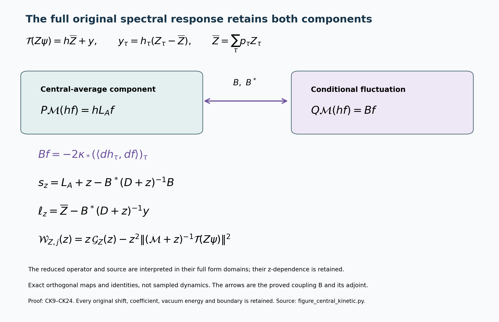

# The complete central kinetic source and its original spectral operator

Reviewed derivation, 14 October 2026. The original interacting smooth global no-gap state remains the goal. This calculation evaluates the exact terms remaining in the central density equations and carries the original scalar response into the resulting representation.

The providers are [DCH1–DCH22](https://github.com/KokunoYumeto/yang-mills-interacting-workbench/blob/4bdd3020127521955882fa93a96b7b01467ddb30/yang-mills/continuations/20261011-central-signs-shrinking-window/ACTUAL_DENSITY_CHARACTERS.md), [BM40](https://github.com/KokunoYumeto/yang-mills-interacting-workbench/blob/4bdd3020127521955882fa93a96b7b01467ddb30/yang-mills/continuations/20261011-central-signs-shrinking-window/BOUNDED_ENERGY_MULTIPLIER.md), [CG1–CG11](https://github.com/KokunoYumeto/yang-mills-interacting-workbench/blob/4bdd3020127521955882fa93a96b7b01467ddb30/yang-mills/continuations/20261011-central-signs-shrinking-window/CONDITIONAL_GROUND_CURRENT_TRIAL.md), and [TSC8–TSC12](https://github.com/KokunoYumeto/yang-mills-interacting-workbench/blob/4bdd3020127521955882fa93a96b7b01467ddb30/yang-mills/continuations/20261011-central-signs-shrinking-window/SCALAR_COMMON_SOURCE_RECONSTRUCTION.md). BM40 and CG use an inside/outside conditional integral. Here the exact finite central orbit is used; its map to the original Hilbert space is proved below. The differentiation of the full unit conditional mass is the common mechanism. No new reading of external literature or novelty claim is asserted. The inherited human center-multiplication source is L. Li and Y. Meurice, arXiv:hep-lat/0410029v2, Sections II–IV and Appendix, with author-source provenance retained in CS.

## 1. Original state and every central-orbit probability

Keep the original open graph with vertices \(\{0,\ldots,2L_j\}^3\), all positive edges \(\mathcal E_j\), all unit faces \(\mathcal P_j\), and every vertex gauge transformation. Write
\[
\begin{gathered}
L_j=j^4,\quad a_j=(100j)^{-1},\quad
g_j^2=\kappa_*a_j/2,\quad b_j=(\kappa_*a_j^2)^{-1},\quad
s_j=100\kappa_*a_j,\\
N_j=3(2L_j)(2L_j+1)^2,\quad M_j=3(2L_j)^2(2L_j+1),\\
U_p=U_d(z)U_k(z+e_d)U_d(z+e_k)^{-1}U_k(z)^{-1},\quad d<k,\\
x_p=o+a_j(z-L_j\mathbf1+(e_d+e_k)/2),\quad
T_p=\operatorname{Tr}U_p,\quad D_p=2-T_p,\\
W=\sum_pD_p,\quad V=b_jW=2b_jM_j-b_j\sum_pT_p,\\
H=-\kappa_*\Delta+V,\quad H\psi=E_0\psi,\quad
\psi>0,\quad\int\psi^2dU=1,\quad\rho=\psi^2,\quad w=\log\psi.
\end{gathered}
\]
The configuration space is \(SU(2)^{\mathcal E_j}\) with product probability Haar measure and the radius-two product metric; \(T_\alpha=-i\sigma_\alpha/2\) is orthonormal on each link. At fixed \(j\), write \(\kappa=\kappa_*\), \(b=b_j\), \(N=N_j\), \(M=M_j\). All original scalars are retained.

Let \(\mathfrak C=\{\pm1\}^{\mathcal E_j}\), \(n=2^N\), \(D_\tau U=(\tau_eU_e)_e\), and \(\chi_S(\tau)=\prod_{e\in S}\tau_e\). The finite central average and its positive square root are
\[
\begin{gathered}
\rho_\tau=\rho\circ D_\tau,\quad
\rho_\varnothing=\frac1n\sum_{\tau\in\mathfrak C}\rho_\tau,\quad
A=\sqrt{\rho_\varnothing},\quad u=\log A,\\
p_\tau=\frac{\rho_\tau}{n\rho_\varnothing}>0,\qquad
h_\tau=\sqrt{p_\tau}=\frac{\psi\circ D_\tau}{\sqrt n A},\\
\sum_\tau p_\tau=\sum_\tau h_\tau^2=1,\qquad
\int A^2dU=1 .
\end{gathered}\tag{CK1}
\]
These functions are smooth on the compact original configuration manifold because the denominators are strictly positive. The factors \(n\) and \(\sqrt n\) are part of the displayed exact map. In particular the original state remains \(\psi\); it has not been replaced by \(A\).

For \(\sigma,\tau\in\mathfrak C\),
\[
A\circ D_\sigma=A,\quad
p_\tau\circ D_\sigma=p_{\tau\sigma},\quad
h_\tau\circ D_\sigma=h_{\tau\sigma}.
\]
This follows by the permutation \(\tau\mapsto\tau\sigma\) in the full finite sum. The maps commute with the original gauge transformations, and \(\psi\) is gauge invariant, so \(A,p_\tau,h_\tau\) are gauge invariant. Differentiation uses the original metric isometries \(D_\tau\); inverse links and all boundary edges stay present.

For every edge subset \(S\), define \(r_S=\rho_S/\rho_\varnothing\), with \(\rho_S=n^{-1}\sum_\tau\chi_S(\tau)\rho_\tau\). Exact finite Fourier inversion gives
\[
r_S=\sum_\tau\chi_S(\tau)p_\tau,\quad
r_\varnothing=1,\quad
p_\tau=\frac1n\sum_S\chi_S(\tau)r_S .
\tag{CK2}
\]
To verify the inverse, substitute the first formula. The sum over \(S\) of \(\chi_S(\tau\eta)\) is \(n\) if \(\tau=\eta\) and zero otherwise. No character component is omitted.

## 2. Complete kinetic-density decomposition

For the original complex deterministic edge coefficients \(c_e\), set
\[
J_c=\sum_ec_e|d_e\psi|^2,\quad
J_{c,S}=\Pi_SJ_c,\quad
J_c^A=\sum_ec_e|d_eA|^2,\quad
F_{c,S}=\sum_\tau\chi_S(\tau)\sum_ec_e|d_eh_\tau|^2 .
\]
Only the original real squared derivatives are multiplied by the complex coefficients. All differential pairings in their expansion are the complex bilinear extension of the real metric. The complete formula is
\[
\begin{gathered}
J_{c,S}
=r_S J_c^A+\frac12\sum_ec_e
\langle d_e\rho_\varnothing,d_er_S\rangle
+\rho_\varnothing F_{c,S},\\
F_{c,S}
=\frac14\sum_\tau\chi_S(\tau)
\sum_ec_e\frac{|d_ep_\tau|^2}{p_\tau}.
\end{gathered}\tag{CK3}
\]
Indeed \(\psi\circ D_\tau=\sqrt n A h_\tau\). The full square is
\[
\frac1n|d_e(\psi\circ D_\tau)|^2
=h_\tau^2|d_eA|^2
+2Ah_\tau\langle d_eA,d_eh_\tau\rangle
+A^2|d_eh_\tau|^2.
\]
Multiply by \(\chi_S(\tau)c_e\), sum over \(\tau,e\), and use
\(\sum_\tau\chi_Sh_\tau d_eh_\tau=\tfrac12d_er_S\)
and \(A\,d_eA=\tfrac12d_e\rho_\varnothing\).
The identity \(d_ep_\tau=2h_\tau d_eh_\tau\) proves the second line. This gives every nonempty-character cross term as well as the central-average term.

For \(c=\mathbf1\) and \(S=\varnothing\), write
\[
F=\sum_{\tau,e}|d_eh_\tau|^2
=\frac14\sum_{\tau,e}\frac{|d_ep_\tau|^2}{p_\tau}\ge0 .
\]
Since \(r_\varnothing=1\), (CK3) gives
\[
J_{\mathbf1,\varnothing}=|dA|^2+A^2F,\qquad
\int|d\psi|^2dU=\int|dA|^2dU+\int A^2F\,dU .
\tag{CK4}
\]
The last integral in (CK4) is the exact conditional kinetic contribution. It is the quarter-weighted squared derivative of the entire probability family, often called its Fisher information. The displayed definition, all link derivatives and the probability factors specify that term completely.

It is strictly positive for \(b>0\). If its integral were zero, continuity, \(A>0\) and nonnegativity would give \(d h_\tau=0\) for every \(\tau\). Connectedness of the original product \(SU(2)^N\) makes each \(h_\tau\) constant. The permutation law in (CK1) then makes all constants equal, hence \(p_\tau=1/n\) and \(\rho=\rho_\varnothing\). Positivity makes \(\psi\) central invariant. Project the ground equation to a single face character \(\partial p\). Its kinetic and scalar terms vanish in that character, while its potential term is \(-bT_p\psi\): distinct unit faces have distinct four-edge boundaries, and \(\psi\) is central even. This term cannot vanish, since \(T_p=2\) at the identity and \(\psi>0\). The contradiction proves the strict assertion without a regulator-uniform lower bound.

## 3. Exact averaged and conditional equations

Define every original transformed potential and its full conditional mean by
\[
V_\tau=V\circ D_\tau
=2bM-b\sum_p\chi_{\partial p}(\tau)T_p,\qquad
\overline V=\sum_\tau p_\tau V_\tau
=2bM-b\sum_pT_pr_{\partial p}.
\tag{CK5}
\]
These identities retain the original scalar \(2bM\), all face traces, and the actual character ratios. The last equality uses (CK2) term by term.

The exact equation for \(A\) is
\[
[-\kappa\Delta+\overline V+\kappa F]A=E_0A,\qquad
E_0=\kappa\int|dA|^2dU+\kappa\int A^2F\,dU
+\int A^2\overline V\,dU .
\tag{CK6}
\]
Use DCH2 at the empty character:
\[
(-\kappa\Delta/2+\overline V-E_0)\rho_\varnothing
=-\kappa J_{\mathbf1,\varnothing}.
\]
Substitute \(\rho_\varnothing=A^2\),
\(\Delta A^2=2A\Delta A+2|dA|^2\), and (CK4).
The two copies of \(|dA|^2\) cancel with their displayed signs, leaving (CK6). Multiplication by \(A\) and integration over the compact product proves its second identity. Also
\(\int A^2\overline V=\int\rho V\), by changing variables in each central term. Thus (CK6) is the original ground energy, including the conditional kinetic term.

Let \(L_A=-\kappa(\Delta+2\langle du,d\,\cdot\,\rangle)\). Applying each original translated equation
\((-\kappa\Delta+V_\tau)(Ah_\tau)=E_0Ah_\tau\)
and subtracting (CK6) gives
\[
\begin{gathered}
L_Ah_\tau+(V_\tau-\overline V-\kappa F)h_\tau=0,\\
L_Ap_\tau
=2(\overline V+\kappa F-V_\tau)p_\tau
-2\kappa|dh_\tau|^2 .
\end{gathered}\tag{CK7}
\]
The second formula uses
\(L_A(h^2)=2hL_Ah-2\kappa|dh|^2\).
Summing it over every \(\tau\) gives zero on both sides: the potential mean cancels by (CK5), and the last two kinetic contributions are \(2\kappa F\) and \(-2\kappa F\). The conditional source is therefore fully retained, including its sign.

There is also an exact comparison with the same original Hamiltonian acting on \(A\):
\[
\begin{gathered}
\langle A,HA\rangle=\kappa\int|dA|^2dU+2bM,\\
\langle A,(H-E_0)A\rangle
=2bM-b\mu W-\kappa\int A^2F\,dU .
\end{gathered}\tag{CK8}
\]
Every \(T_p\) has a nonempty character, whereas \(A^2\) is central invariant; hence \(\int A^2T_p=0\). This proves the first line. Subtract (CK6), using its last equality with \(\int\rho V=b\mu W\), to obtain the second.
The original full-box bound \(E_0\le b\Lambda_{\rm all}\), with
\(\Lambda_{\rm all}=\min(2M,3\kappa a_j\sqrt{NM})\), then gives
\[
\langle A,(H-E_0)A\rangle\ge b(2M-\Lambda_{\rm all}),\qquad
\liminf_j\frac{\langle A,(H-E_0)A\rangle}{b_jM_j}\ge2 .
\]
This expectation statement does not assert a spectral concentration for \(A\). It proves why using its probability density in an exact integral is different from replacing the original ground state by \(A\); the full comparison is (CK8).

## 4. The full original spectral operator

Let \(\mathscr H=L^2(dU)\) and
\(\mathscr K=L^2(A^2dU;\mathbb C^{\mathfrak C})\), with
\[
\langle F,G\rangle_{\mathscr K}
=\int A^2\sum_\tau\overline{F_\tau}G_\tau\,dU.
\]
Define the map on the entire original Hilbert space by
\[
(\mathcal T f)_\tau(U)=\frac{f(D_\tau U)}{\sqrt n A(U)},\qquad
\mathscr R=\{F\in\mathscr K:
F_\tau(D_\sigma U)=F_{\tau\sigma}(U)\text{ a.e. for all }\tau,\sigma\}.
\tag{CK9}
\]
It is an isometry onto the closed subspace \(\mathscr R\).
For the norm, substitute its formula into the full inner product and change \(U\) to \(D_\tau U\) in each of its \(n\) integrals; this gives \(\|\mathcal Tf\|^2=\|f\|^2\).
The permutation law puts its image in \(\mathscr R\). Conversely, if \(F\in\mathscr R\), put \(f=\sqrt n A F_1\). Then \(F_\tau(U)=F_1(D_\tau U)\), so \(\mathcal Tf=F\); its norm identity also proves \(f\in\mathscr H\). The defining permutation equations are kernels of bounded operators, hence their finite intersection \(\mathscr R\) is closed. Original gauge invariance is preserved in both directions, by commutation of \(D_\tau\) with all vertex actions and invariance of \(A\). Thus the same isometry holds between the physical subspaces.

On smooth vector functions set
\[
(\mathcal M v)_\tau
=L_Av_\tau+(V_\tau-\overline V-\kappa F)v_\tau .
\tag{CK10}
\]
Here \(F\) is the scalar defined in (CK4). Equivalently the potential is
\(V_\tau-\overline V-\kappa\sum_{\eta,e}|d_eh_\eta|^2\).
All its coefficients are the actual functions in (CK1)–(CK7).

This operator is self-adjoint and nonnegative on the full vector Hilbert space with domain
\[
\{(v_\tau): (Av_\tau)_\tau\in
\textstyle\bigoplus_{\tau\in\mathfrak C}H^2(SU(2)^N)\}.
\]
Indeed multiplication of each component by \(A\) is a unitary from \(\mathscr K\) to \(\bigoplus_\tau L^2(dU)\). The product rule and (CK6) conjugate (CK10) to the direct sum of the original operators
\(-\kappa\Delta+V_\tau-E_0\).
Each is unitarily equivalent under \(D_\tau\) to \(H-E_0\), a nonnegative self-adjoint elliptic operator with that \(H^2\) domain, because its potential is smooth and bounded at fixed \(j\). The finite direct sum proves the stated properties and domain. The permutation action commutes with this operator; hence \(\mathscr R\) reduces it. On that subspace,
\[
\mathcal T(H-E_0)=\mathcal M\mathcal T,\qquad
\mathcal T\psi=(h_\tau)_\tau,\qquad
\|h\|_{\mathscr K}=1,\qquad \mathcal Mh=0 .
\tag{CK11}
\]
The first equality follows either from the same product rule or componentwise from the preceding unitary conjugations. It holds on the exact domains; bounded spectral calculus then intertwines every original spectral projection and positive-shift resolvent. The second and third equalities follow directly from (CK1); the last is (CK7).

## 5. Original observables and every response term

For any scalar observable \(Z\), write \(Z_\tau=Z\circ D_\tau\). The exact physical vector map is
\[
\mathcal T(Z\psi)=(h_\tau Z_\tau)_\tau,\qquad
\|E_{H-E_0}(B)Z\psi\|^2
=\|E_{\mathcal M}(B)(h_\tau Z_\tau)_\tau\|_{\mathscr K}^2 .
\tag{CK12}
\]
This holds whenever \(Z\psi\in\mathscr H\), for every Borel set \(B\), by (CK9) and (CK11). It includes the actual norm, zero-energy component and all cross covariances. In particular a centered \(Z\) maps to a vector orthogonal to \(h\); no extra projection or amplitude rescaling is introduced.

For the original real test \(\varphi\), keep
\[
\begin{gathered}
X_\varphi=\frac{a_j}{2}\sum_p\varphi(x_p)(D_p-\mu D_p),\quad
t_j=\kappa_*^2a_j^3/2,\quad
Q_\varphi=t_j(G_c-\mu G_c),\\
x_e=o+a_j(z-L_j\mathbf1+e_d/2),\qquad
c_e=a_j^{-3}\int_{x_e+[-a_j/2,a_j/2)^3}\varphi(x)\,dx,\qquad
G_c=\sum_ec_e|d_ew|^2 .
\end{gathered}
\]
The full component formulas are
\[
\begin{gathered}
(X_\varphi)_\tau
=\frac{a_j}{2}\sum_p\varphi(x_p)
[2-\chi_{\partial p}(\tau)T_p-\mu D_p],\\
(G_c)_\tau
=\sum_ec_e\big[
|d_eu|^2+2\langle d_eu,d_e\log h_\tau\rangle
+|d_e\log h_\tau|^2\big],\\
\mu G_c=\int A^2\big[\sum_ec_e|d_eu|^2+F_{c,\varnothing}\big]\,dU .
\end{gathered}\tag{CK13}
\]
For the first line use the original face-character rule. For the second use
\(w\circ D_\tau=\tfrac12\log n+u+\log h_\tau\).
Its constant differentiates to zero, and the entire square gives the displayed cross term. For the mean, sum with weights \(p_\tau=h_\tau^2\). The conditional cross term vanishes because
\(\sum_\tau h_\tau d_eh_\tau=0\); the last term becomes
\(\sum_\tau|d_eh_\tau|^2\). This is also (CK3) at the empty character.

Set \(\mathbf Z=(h_\tau Z_\tau)_\tau\), for \(Z=X_\varphi\) or \(Q_\varphi\). For every \(z>0\), the complete original squared-resolvent response is
\[
\begin{gathered}
\mathcal W_{Z,j}(z)
=\langle\mathbf Z,\ z\mathcal M(\mathcal M+z)^{-2}\mathbf Z\rangle_{\mathscr K},\\
\mathcal C_{Z,j}(\theta s_j)
=\mathcal W_{Z,j}(\theta s_j)
-\frac{4\varepsilon}{(1+\varepsilon)^2}
\mathcal W_{Z,j}(\varepsilon\theta s_j)
-\frac{4R_{\rm win}}{(1+R_{\rm win})^2}
\mathcal W_{Z,j}(R_{\rm win}\theta s_j),
\end{gathered}\tag{CK14}
\]
with \(0<\varepsilon<1<R_{\rm win}\) and \(\theta>0\).
The bounded spectral function \(z\lambda/(\lambda+z)^2\) and (CK11) prove the first equality; substituting it into all three original terms proves the second with every sign, shift and coefficient intact. The formula is on \(\mathscr R\), including its physical subspace, rather than an independently chosen vector ensemble.

## 6. The actual marginal projection and its retained coupling

In \(\mathscr K\), define the pointwise orthogonal projections
\[
(Pv)_\tau=h_\tau\sum_\eta h_\eta v_\eta,\qquad Q=I-P .
\]
They are bounded projections because \(\sum h_\tau^2=1\). Their smooth coefficients preserve the smooth and \(H^1\) domains. They also preserve \(\mathscr R\) and its physical subspace by the permutation and gauge laws in (CK1). Under the inverse of (CK9), the exact original projection is
\[
\begin{gathered}
\mathcal E Z=\frac{\Pi_\varnothing(\rho Z)}{\rho_\varnothing}
=\sum_\tau p_\tau Z_\tau,\qquad
\mathcal T((\mathcal EZ)\psi)=P\mathcal T(Z\psi),\\
\|Z\|_{L^2(\mu)}^2
=\int A^2|\mathcal EZ|^2dU
+\int A^2\sum_\tau p_\tau|Z_\tau-\mathcal EZ|^2dU .
\end{gathered}\tag{CK15}
\]
The conditional mean is central invariant, since a central change permutes the entire sum. It fixes every central-invariant scalar. For any such scalar \(f\), changing variables in each term gives
\(\mu(\overline f\,Z)=\mu(\overline f\,\mathcal EZ)\).
Thus it is the orthogonal projection in the original \(L^2(\mu)\) onto central-invariant scalars. The vector identity follows from (CK9), and the norm identity is the full orthogonal decomposition, including both terms.

For the unchanged original scalar, the projected function and its entire fluctuation covariance are
\[
\begin{gathered}
\overline X_\varphi:=\mathcal E X_\varphi
=\frac{a_j}{2}\sum_p\varphi(x_p)[2-T_pr_{\partial p}-\mu D_p],\\
(X_\varphi)_\tau-\overline X_\varphi
=-\frac{a_j}{2}\sum_p\varphi(x_p)T_p
[\chi_{\partial p}(\tau)-r_{\partial p}],\\
\sum_\tau p_\tau
\overline{[(X_\varphi)_\tau-\overline X_\varphi]}
[(X_\eta)_\tau-\overline X_\eta]\\
=\frac{a_j^2}{4}\sum_{p,r}
\overline{\varphi(x_p)}\eta(x_r)T_pT_r
[r_{\partial p\triangle\partial r}
-r_{\partial p}r_{\partial r}].
\end{gathered}\tag{CK16}
\]
The last formula also covers complex test functions by the indicated conjugation. Substitute (CK13), subtract the first line, and multiply the two full sums. The conditional expectation of
\((\chi_{\partial p}-r_{\partial p})(\chi_{\partial r}-r_{\partial r})\)
is the displayed difference by (CK2). This proves every mixed term and the exact \(a_j^2/4\) coefficient. The matrix of those character differences is positive semidefinite because it is their conditional covariance. It has not been replaced by independent face signs.

Let \(f\) be any smooth central-invariant physical scalar. Then \(hf\in\mathscr R\), and the entire operator action is
\[
\begin{gathered}
\mathcal M(hf)=hL_Af-2\kappa(\langle dh_\tau,df\rangle)_\tau,\\
P\mathcal M(hf)=hL_Af,\qquad
Q\mathcal M(hf)=-2\kappa(\langle dh_\tau,df\rangle)_\tau,\\
\|Q\mathcal M(hf)\|_{\mathscr K}^2
=4\kappa^2\int A^2\sum_\tau
|\langle dh_\tau,df\rangle|^2dU .
\end{gathered}\tag{CK17}
\]
Apply the product rule for \(L_A\) to each component in (CK10) and use (CK7). This leaves the first line with its exact coefficient \(-2\kappa\). Its last term is pointwise orthogonal to \(h\), since
\(\sum_\tau h_\tau dh_\tau=\tfrac12d\sum_\tau h_\tau^2=0\).
This proves both projections and the norm. The positive tensor receiving that norm is exactly \(\sum_\tau dh_\tau\otimes dh_\tau\), whose full trace is \(F\). It is the conditional kinetic tensor of this finite orbit, not an omitted correction to \(L_A\).

For completeness the complete first and second original energy moments of this projected vector are
\[
\begin{gathered}
\langle hf,\mathcal M(hf)\rangle_{\mathscr K}
=\kappa\int A^2|df|^2dU,\\
\|\mathcal M(hf)\|_{\mathscr K}^2
=\|L_Af\|_{L^2(A^2dU)}^2
+4\kappa^2\int A^2\sum_\tau
|\langle dh_\tau,df\rangle|^2dU .
\end{gathered}\tag{CK18}
\]
The first follows from (CK17), \(\sum h_\tau^2=1\), and weighted integration by parts. The second is the Pythagorean identity for the two explicitly orthogonal terms of (CK17). These identities apply to the actual \(\overline X_\varphi\) of (CK16), which is smooth and physical. For the full original vector \(h_\tau(X_\varphi)_\tau=h\overline X_\varphi+h_\tau((X_\varphi)_\tau-\overline X_\varphi)\), its energy, second moment and all resolvent covariances retain the two diagonal terms and both cross terms. Orthogonality of these vectors in their original norm does not make those energy cross terms vanish.

## 7. Complete two-component resolvent on the original domains

Work on the physical subspace of \(\mathscr R\), at the unchanged fixed regulator. Let \(\mathscr A\) be the central-invariant physical scalar subspace of \(L^2(A^2dU)\), and let \(Jf=hf\). Then \(J\) is unitary from \(\mathscr A\) onto the range of \(P\). The form domain of \(\mathcal M\) is \(H^1\cap\mathscr R_{\rm phys}\): multiplication by the smooth positive \(A\), whose minimum is positive at this finite regulator, identifies it with the usual finite direct-sum domain. Its full nonnegative form is
\[
q(v,w)=\int A^2\sum_\tau
\left[\kappa\langle d\overline{v_\tau},dw_\tau\rangle
+(V_\tau-\overline V-\kappa F)\overline{v_\tau}w_\tau\right]dU .
\]
Write \(\mathscr Q=Q\mathscr R_{\rm phys}\), and let \(D\) be the nonnegative self-adjoint operator of the restricted form \(q\) on \(H^1\cap\mathscr Q\). This domain is dense in \(\mathscr Q\): approximate by smooth equivariant physical vectors, then apply the smooth projection \(Q\). The restricted form is closed because its form norm plus the Hilbert norm is equivalent to the \(H^1\) norm at fixed regulator, and \(\mathscr Q\) is closed. These assertions preserve the complete gauge and central-equivariance constraints.

Define, initially on smooth functions and then on \(H^1\cap\mathscr A\),
\[
\begin{gathered}
Bf=-2\kappa(\langle dh_\tau,df\rangle)_\tau\in\mathscr Q,\qquad
a(g,f)=\kappa\int A^2\langle d\overline g,df\rangle dU,\\
q(Jf+v,Jf+v)
=a(f,f)+2\operatorname{Re}\langle Bf,v\rangle_{\mathscr K}
+q(v,v).
\end{gathered}\tag{CK19}
\]
The full coefficient functions \(dh_\tau\) are smooth and bounded, so \(B:H^1\cap\mathscr A\to\mathscr Q\) is bounded at fixed regulator. Equation (CK17) proves the mixed-form identity on smooth vectors. Density in the form domains extends it to all indicated \(f,v\). The operator associated with \(a\) is the restriction of \(L_A\) to \(\mathscr A\), with its exact scalar domain. Every coefficient and every outside-\(P\) direction is retained.

For \(z>0\), set \(R_z=(D+z)^{-1}\). Its norm is at most \(1/z\). The exact reduced form and effective source for
\(\mathbf Z=Jx+y\), \(x=J^*\mathbf Z\), \(y=Q\mathbf Z\), are
\[
\begin{gathered}
s_z(g,f)=a(g,f)+z\langle g,f\rangle
-\langle Bg,R_zBf\rangle_{\mathscr K},\\
\ell_z(g)=\langle g,x\rangle-\langle Bg,R_zy\rangle_{\mathscr K}.
\end{gathered}\tag{CK20}
\]
The source \(\ell_z\) is a continuous conjugate-linear functional on \(H^1\cap\mathscr A\); it is not assumed to be a bounded \(L^2\) multiplier. The full mixed source term is part of its definition.

The form \(s_z\) is closed and positive, and
\[
\begin{gathered}
s_z(f,f)=
\inf_{v\in H^1\cap\mathscr Q}
\left[q(Jf+v,Jf+v)+z\|Jf+v\|_{\mathscr K}^2\right]
\ge z\|f\|^2,\\
v_{\min}=-R_zBf .
\end{gathered}\tag{CK21}
\]
Complete the square in the \((D+z)^{1/2}\)-norm in (CK19) to prove the formula and minimizer. The minimizer is in the form domain because \(R_z\) maps \(\mathscr Q\) into \(\operatorname{Dom}D\). The lower bound follows from \(q\ge0\), orthogonality of \(Jf\) and \(v\), and the retained term \(z\|v\|^2\).

Here is also a direct closedness argument, needed to use the exact infinite-dimensional inverse. Put \(C=\max(0,\|\overline V+\kappa F-V_\tau\|_{\infty,\tau})\), which is finite. Then
\[
q(w,w)\ge\kappa\|dw\|_{L^2(A^2)}^2-C\|w\|_{\mathscr K}^2,\qquad q(w,w)\ge0 .
\]
Take \(t=\min(1/2,z/[2(C+1)])>0\). The convex combination of these two lower bounds gives
\[
q(w,w)+z\|w\|^2
\ge t\kappa\|dw\|^2+(z-tC)\|w\|^2
\ge t\kappa\|dw\|^2+(z/2)\|w\|^2 .
\]
The map \(w\mapsto J^*Pw=\sum_\tau h_\tau w_\tau\) is bounded from this weighted \(H^1\) space to scalar \(H^1\); the bound follows by differentiating its finite sum and using the bounded \(h_\tau,dh_\tau\). Thus the infimum in (CK21) controls the entire \(H^1\) norm of \(f\), with a positive constant at this fixed \(j,z\). Conversely choosing \(v=0\) bounds it above by \(a(f,f)+z\|f\|^2\). Its norm is therefore equivalent to \(H^1\cap\mathscr A\), proving closedness and coercivity. None of these finite-regulator constants is declared uniform in \(j\).

There is a unique \(f_z\in H^1\cap\mathscr A\) solving
\(s_z(g,f_z)=\ell_z(g)\) for every \(g\) in that domain. This follows by the Hilbert-space representation theorem in the complete \(s_z\)-norm; (CK20) makes the functional bounded in that norm. With
\[
v_z=R_z(y-Bf_z),
\]
the complete original resolvent is
\[
(\mathcal M+z)^{-1}\mathbf Z=Jf_z+v_z,\qquad
\mathcal G_Z(z):=\langle\mathbf Z,(\mathcal M+z)^{-1}\mathbf Z\rangle
=\langle y,R_zy\rangle+s_z(f_z,f_z).
\tag{CK22}
\]
To prove the first identity, the \(\mathscr Q\) test equation is, for every \(v\in H^1\cap\mathscr Q\),
\[
\langle v,Bf_z\rangle+q(v,v_z)+z\langle v,v_z\rangle=\langle v,y\rangle,
\]
which is exactly the weak form of
\((D+z)v_z=y-Bf_z\). Substituting this into the \(J\mathscr A\) test equation gives precisely (CK20). Hence \(Jf_z+v_z\) solves the full weak equation with form \(q+z\), whose unique solution is the resolvent vector. To prove the quadratic identity without losing a source cross term, maximize
\[
2\operatorname{Re}\langle\mathbf Z,Jf+v\rangle
-q(Jf+v,Jf+v)-z(\|f\|^2+\|v\|^2).
\]
For fixed \(f\), its maximizing \(v\) is \(R_z(y-Bf)\).
The remaining expression is
\(\langle y,R_zy\rangle+2\operatorname{Re}\ell_z(f)-s_z(f,f)\).
Its maximum is attained at \(f_z\) and equals the second expression in (CK22).

The full response in (CK14) is consequently
\[
\begin{gathered}
\mathcal W_{Z,j}(z)
=z\left[\langle y,R_zy\rangle+s_z(f_z,f_z)\right]
-z^2\left[\|f_z\|^2+\|R_z(y-Bf_z)\|^2\right],\\
\mathcal G_Z'(z)
=-\|f_z\|^2-\|R_z(y-Bf_z)\|^2,\\
\partial_zs_z(g,f)=\langle g,f\rangle+\langle Bg,R_z^2Bf\rangle,\qquad
\partial_z\ell_z(g)=\langle Bg,R_z^2y\rangle .
\end{gathered}\tag{CK23}
\]
For the derivative, use the norm-differentiable resolvent identity
\(\partial_z(\mathcal M+z)^{-1}=-(\mathcal M+z)^{-2}\), valid for every \(z>0\), then the orthogonal norm in (CK22). The first line uses the full scalar identity
\(z\lambda/(\lambda+z)^2=z/(\lambda+z)-z^2/(\lambda+z)^2\).
The last line follows from \(\partial_zR_z=-R_z^2\) in (CK20); all input functions there are held fixed. In particular the \(z\)-dependence of the reduced form and source cannot be dropped. Inserting the first line at the three original values \(\theta s_j,\varepsilon\theta s_j,R_{\rm win}\theta s_j\) retains all signs and factors of (CK14).

There is an exact evaluated gain over the central-average trial, including its residual. Let
\[
f_0=(L_A+z)^{-1}x,\qquad \eta_z=y-Bf_0 .
\]
Then
\[
\begin{gathered}
\mathbf Z-(\mathcal M+z)Jf_0=\eta_z\in\mathscr Q,\\
\mathcal G_Z(z)-\langle x,(L_A+z)^{-1}x\rangle
=\langle\eta_z,(\mathcal M+z)^{-1}\eta_z\rangle\ge0 .
\end{gathered}\tag{CK24}
\]
At this finite regulator the scalar elliptic resolvent maps \(L^2\) to \(H^2\); multiplication by the smooth \(h\) preserves that domain. Therefore the first line follows from (CK17) and the equation for \(f_0\). Apply the resolvent to it:
\((\mathcal M+z)^{-1}\mathbf Z=Jf_0+(\mathcal M+z)^{-1}\eta_z\).
Since \(\eta_z\perp Jf_0\), the mixed term between the candidate and its residual vanishes in the energy-norm square, giving the second line. Equivalently expand
\(\|(\mathcal M+z)^{1/2}Jf_0+(\mathcal M+z)^{-1/2}\eta_z\|^2\).
The first square is \(\langle x,(L_A+z)^{-1}x\rangle\). Strict positivity of the full inverse means that the gain vanishes exactly when \(\eta_z=0\). Its value has not been assumed positive for the original \(X_\varphi\).

## Receiving calculation

The two boxes are the orthogonal subspaces proved in CK15 and CK19. The arrows are the actual first-order operator \(B\) and its adjoint, with the exact coefficient \(-2\kappa_*\). The reduced form and source in the image have precisely the domain interpretation in CK20–CK22. They retain both original source components and the shift dependence in CK23. No part of the image represents sampled dynamics. Reproducible source: figure_central_kinetic.py.

The two diagnostic scripts check 1,268 identities and comparisons. check_central_kinetic.py uses a continuous radius-two one-face operator with the explicitly constructed potential \(V=E+\kappa\Delta\psi/\psi\), retaining the full Haar integral, and independent finite-character covariance data. That potential is not the original Wilson potential. check_central_resolvent.py uses complex positive finite matrices with a vacuum zero direction, nonzero coupling, both source components, and the original \(a_j,s_j\) in its fixtures. Neither set is a sampled Yang–Mills vacuum. The complete arguments above establish the results; the diagnostics check their coefficients, signs, mixed terms and inverse formulas.

The full central kinetic source, scalar covariance, two-component inverse and all three original shifted responses now have exact formulas. The original \(X_\varphi\) has
\(x=\overline X_\varphi\) and \(y=(h_\tau[(X_\varphi)_\tau-\overline X_\varphi])_\tau\), explicitly evaluated in (CK16). Its retained coupling is (CK17), and its residual in the central-average trial is (CK24). The next calculation is to bound these actual \(R_z\), \(s_z\), and source terms jointly on the unchanged shrinking scale; a gain at one shift alone does not control the signed three-shift expression.

The original \(X+Q\) residual, zero-energy analysis, five Green moments and J5 comparison remain. Strict positivity of the conditional kinetic integral in (CK4) alone gives neither a regulator-uniform lower bound nor positive weight in a specified shrinking annulus. Every comparison above preserves the full original operator and provides the explicit next terms to calculate.

## Exact central fluctuation energy and full response residual

[CFE1–CFE14](https://github.com/KokunoYumeto/yang-mills-interacting-workbench/blob/main/yang-mills/continuations/20261011-central-signs-shrinking-window/CENTRAL_FLUCTUATION_ENERGY.md) compute the original conditional mean-gradient defect \(t_Z=dx-\sum_\tau p_\tau dZ_\tau\), its complete adjoint coupling, and the full positive fluctuation energy
\[
q(y,y)=\kappa_*\int A^2\left[
\sum_\tau p_\tau|dZ_\tau-v_Z|^2+|t_Z|^2\right]dU,
\quad v_Z=\sum_\tau p_\tau dZ_\tau .
\]
Every nonempty original character is retained in \(C_{S,T}=r_{S\triangle T}-r_Sr_T\). Its exact inverse contains \(n^{-2}\sum_\tau\chi_S\chi_T/p_\tau\). The full physical residual \(\eta_z=y-B(L_A+z)^{-1}x\) has the exact Gram square in CFE13, including its possible cross-term cancellation. CFE7–CFE8 bound all three original signed responses, and CFE14 derives the density-character derivative source from the original Wilson ground equation. These formulas keep every raw coefficient, metric, boundary and inverse probability. The actual derivative estimates and nonzero shrinking-window weight, followed by reconstruction and the smooth global no-gap endpoint, remain the active calculation.

## Central configurations and strict physical resolvent gain

[FPR1–FPR8](https://github.com/KokunoYumeto/yang-mills-interacting-workbench/blob/main/yang-mills/continuations/20261011-central-signs-shrinking-window/CENTRAL_FIXED_POINT_RESIDUAL.md) prove that global gauge isotropy makes every first derivative of a smooth physical scalar vanish at each original central configuration. Thus \(Bf_z^0(I)=0\), and every nonzero original sampled face test has the strictly positive residual
\[
\sum_\tau|\eta_{z,\tau}(I)|^2
=a_j^2\sum_{p,r}\overline{\varphi(x_p)}\varphi(x_r)
C_{\partial p,\partial r}(I)>0.
\]
The full original norm has the explicit radius-two product-ball bounds FPR4/FPR7. With \(m_z=\|\eta_z\|^2\) and the complete residual energy \(e_z\) in FPR5,
\[
\mathcal G_{X_\varphi}(z)-\langle x,(L_A+z)^{-1}x\rangle
\ge\frac{m_z^2}{e_z+zm_z}>0.
\]
FPR6–FPR8 calculate the exact covariance and residual-density curvature, retaining the original potential, vacuum energy, Casimir factor and Hessian cross term. This strengthens CK24 at each finite regulator. The product volumes and derivative maxima retain their full regulator dependence; the signed three-shift limit and the smooth global no-gap endpoint remain active.
