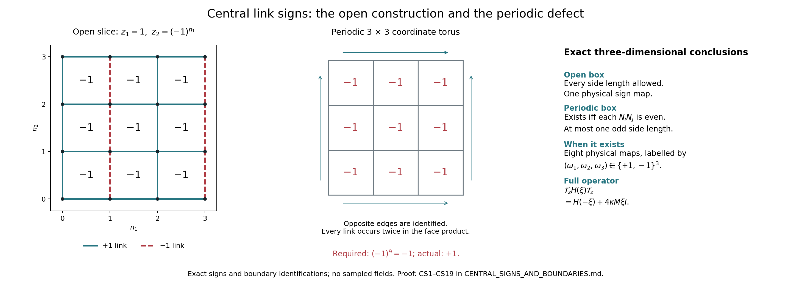

# Central link signs and the exact boundary obstruction

Multiplying selected \(SU(2)\) links by \(-I\) can reverse every elementary plaquette trace simultaneously. On the original open box this transformation exists and is unique on gauge-invariant functions. On a periodic rectangular box it exists exactly when at most one side has an odd number of links. When it exists there are eight distinct transformations on gauge-invariant functions, distinguished by the signs of the three winding loops. The following construction retains all links, faces, orientations and the full Hamiltonian scalar.

This result supplies the boundary domain of the central-sign symmetry used in the companion Jacobian calculation. It concerns the finite original operator; it does not supply its continuum limit. The original operator conventions are [PK25 and PK132](https://github.com/KokunoYumeto/yang-mills-interacting-workbench/blob/485b61423c1f4e1805deb453c1b6b342b27842b6/yang-mills/continuations/20260930-s6-ns-moment-map-bridge/PERIOD_COUPLING_AND_PHYSICAL_KERNELS.md). All sign constructions and classification arguments needed here are proved below.

L. Li and Y. Meurice already use center multiplication to reverse plaquette traces on even periodic cubes in [Lattice gluodynamics at negative \(g^2\), arXiv:hep-lat/0410029v2](https://arxiv.org/abs/hep-lat/0410029v2), Sections II–IV and the Appendix. Their Section III identifies one uniform set of elementary plaquette values and compares particular translated or rotated line constructions. Our classification below concerns all central link assignments and also retains winding traces. The center-reversal mechanism is therefore a literature input; the present proof gives its exact rectangular boundary conditions, winding classes and original Hamiltonian map. No novelty claim is made.

The left panel is an exact coordinate slice of CS6. The middle panel shows the proposed face signs on a periodic \(3\)-by-\(3\) coordinate torus, whose impossibility follows by multiplying all nine faces. The right panel records the complete three-dimensional conclusions proved in CS8–CS19. Figure source: central_signs_figure.py.

## 1. Original link and face maps

Let the open vertices be
\[
 V_{\rm op}=\prod_{i=1}^3\{0,\ldots,m_i\},\qquad m_i\ge1.
 \tag{CS1}
\]
A positive link \((n;i)\) goes from \(n\) to \(n+e_i\), and is present exactly when \(n_i<m_i\). The face \((n;i,j)\), \(i<j\), is present when both these inequalities hold. Its original ordered holonomy and trace are
\[
 U_{n;ij}=U_i(n)U_j(n+e_i)U_i(n+e_j)^{-1}U_j(n)^{-1},
 \qquad W_{n;ij}=\operatorname{Tr}U_{n;ij}.
 \tag{CS2}
\]
The original cubic box is obtained by \(m_1=m_2=m_3=2L\) and the exact coordinate change \(n=k+(L,L,L)\) from \(k\in\{-L,\ldots,L\}^3\). No physical coordinate, lattice spacing or edge midpoint is changed by this relabelling.

For a central sign assignment \(z_i(n)\in\{1,-1\}\), define
\[
 (D_zU)_i(n)=z_i(n)U_i(n),\qquad
 (\partial z)_{n;ij}
 =z_i(n)z_j(n+e_i)z_i(n+e_j)z_j(n).
 \tag{CS3}
\]
The missing inverse signs in the second formula are intentional: \(z^{-1}=z\). Centrality, without commuting any of the \(U\) factors, gives
\[
 U_{n;ij}(D_zU)=(\partial z)_{n;ij}U_{n;ij}(U).
 \tag{CS4}
\]
For any oriented edge word \(\gamma=(e_1^{\epsilon_1},\ldots,e_q^{\epsilon_q})\), where repetitions and \(\epsilon_l\in\{1,-1\}\) are retained,
\[
 U_\gamma(D_zU)=
       \left(\prod_{l=1}^q z_{e_l}^{\epsilon_l}\right)U_\gamma(U).
 \tag{CS5}
\]
This follows factor by factor from \((zU)^{-1}=z^{-1}U^{-1}\). In particular central signs do not change the order or support of a loop.

## 2. The open-box construction and its gauge class

Set, on every existing positive link,
\[
 z_i^0(n)=(-1)^{\,\sum_{k<i}n_k}.
 \tag{CS6}
\]
For \(i<j\), increasing coordinate \(i\) changes \(z_j^0\) by \(-1\), whereas increasing coordinate \(j\) leaves \(z_i^0\) unchanged. Consequently the four factors in CS3 have product \(-1\) on every existing face, including boundary faces. In the original \(k\) coordinates one may instead use \((-1)^{\sum_{h<i}k_h}\). The two assignments differ by direction-dependent constant signs \((-1)^{(i-1)L}\), which have zero face curvature; the argument below proves their physical equivalence.

We prove the complete uniqueness statement. If \(z,z'\) both have face product \(-1\), then \(h_e=z_ez'_e\) has face product \(+1\). Define \(a(n)\) as the product of \(h\) along the monotone root path from \(0\) to \(n\), taking the coordinate directions in the order \(1,2,3\). Set \(a(0)=1\). The equation on an \((i,j)\)-face says exactly that the product along its two monotone two-edge paths is equal. Adjacent exchanges of unlike steps therefore preserve a monotone path product. Every ordering of the same multiset of coordinate steps is obtained by finitely many such adjacent exchanges, and every intermediate path stays inside the box. Appending the edge \((n;i)\) to the chosen path to \(n\), and reordering its steps, gives the chosen path to \(n+e_i\). Thus
\[
 h_i(n)=a(n)a(n+e_i),\qquad
 z'_i(n)=a(n)z_i(n)a(n+e_i).
 \tag{CS7}
\]
Conversely every choice of vertex signs \(a\) in CS7 preserves all face products, because each of the four vertex signs occurs twice. The only assignments \(a\) producing the identity link change are constants: equality of adjacent vertex values and connectedness prove this. There are therefore exactly
\[
 2^{\,|V_{\rm op}|-1}
 \quad\hbox{face-reversing link assignments, and one vertex-sign gauge class.}
 \tag{CS8}
\]
The vertex signs \(a(n)I\) are actual \(SU(2)\) gauge transformations. Hence every face-reversing assignment induces the same transformation on the physical, gauge-invariant Hilbert space.

## 3. Periodic boxes and the necessary parity condition

Now take the vertices
\[
 V_{\rm per}=\prod_{i=1}^3\mathbb Z/N_i\mathbb Z,\qquad N_i\ge3.
 \tag{CS9}
\]
Every positive link and every positively based \((i,j)\)-face is retained, including links and faces crossing a periodic seam. The lower bound on \(N_i\) avoids any convention about parallel one-cell or two-cell presentations.

At fixed coordinate in the third direction, multiply \((\partial z)_{n;ij}\) over all \(N_iN_j\) faces of an entire coordinate two-torus. Each of its \(i\)-links occurs in exactly two factors, once at each adjacent \(j\)-position; each \(j\)-link likewise occurs twice. Thus the product is \(+1\) for every \(z\). If every face product were \(-1\), it would instead be \((-1)^{N_iN_j}\). Existence therefore requires
\[
 N_1N_2\equiv N_1N_3\equiv N_2N_3\equiv0\pmod2.
 \tag{CS10}
\]
These three conditions say exactly that at most one \(N_i\) is odd: two odd lengths violate their pair condition, and otherwise each pair contains an even length.

The condition is also sufficient. Choose an ordering \(r_1,r_2,r_3\) of the original coordinate directions with the odd length last if there is one. Each of \(N_{r_1},N_{r_2}\) is then even. For the standard representatives \(0\le n_i<N_i\), set
\[
 z_{r_l}^0(n)=(-1)^{\,\sum_{h<l}n_{r_h}},
       \qquad l=1,2,3.
 \tag{CS11}
\]
Consider a face in directions \(r_h,r_l\), \(h<l\). Its \(r_h\)-links have the same sign at both \(r_l\)-positions. The signs of its \(r_l\)-links differ by \(-1\) at an interior \(r_h\)-step. At a seam step from \(N_{r_h}-1\) to zero, their ratio is \((-1)^{-(N_{r_h}-1)}=-1\), because \(N_{r_h}\) is even. Thus CS3 equals \(-1\) also at every seam. Interchanging the two direction names reverses the oriented face but leaves its central sign \(-1\). The construction preserves the original coordinates and face orientation; the ordering only defines which coordinates occur in the exponent.

## 4. All periodic assignments and the eight physical maps

Let \(h\) be any flat periodic assignment, meaning \(\partial h=1\). Define its three winding signs by the original coordinate loops,
\[
 \omega_i(h)=\prod_{q=0}^{N_i-1}h_i(n+qe_i)\in\{1,-1\}.
 \tag{CS12}
\]
This product is independent of the starting coordinate \(n_i\) by cyclic permutation. It is independent of a shift of \(n\) in another direction by multiplying the flat face equations along the intervening full strip; the transverse edges cancel in pairs. Since such shifts connect all bases, CS12 is independent of every base coordinate.

For any \(\omega=(\omega_1,\omega_2,\omega_3)\), define the seam assignment
\[
 k_i^\omega(n)=
 \begin{cases}
 \omega_i,&n_i=N_i-1,\\
 1,&0\le n_i<N_i-1.
 \end{cases}
 \tag{CS13}
\]
It is flat: in each face the two \(i\)-signs are equal and the two \(j\)-signs are equal. Its winding signs are precisely \(\omega_i\).

We next prove, without identifying flatness with triviality, that a flat \(h\) with all three winding signs \(+1\) is a vertex-sign gauge change. Cut the torus at the three seams and use the open box with vertices \(0\le n_i<N_i\) and no seam edges. The open-box proof gives vertex signs \(a(n)\) such that \(h_i(n)=a(n)a(n+e_i)\) on all non-seam edges. For the seam in direction \(i\), fix the other two coordinates and multiply these \(N_i-1\) identities along the coordinate line. The resulting product is \(a(n_i=0)a(n_i=N_i-1)\). Since the complete winding product is \(1\), the missing seam edge has exactly this same sign. CS7 therefore holds on every periodic edge.

For general flat \(h\), the product \(hk^{\omega(h)}\) has trivial winding signs, so the preceding construction applies to it. Consequently the full set of face-reversing assignments, when nonempty, is
\[
 z_i(n)=z_i^0(n)\,k_i^\omega(n)\,a(n)a(n+e_i),
 \quad\omega\in\{1,-1\}^3,\quad a\in\{1,-1\}^{V_{\rm per}}.
 \tag{CS14}
\]
Two choices of \(a\) yield the same link assignment exactly when they differ by one global sign. Different \(\omega\) cannot be related by vertex signs, since vertex signs cancel in a closed-loop product. Thus there are exactly \(2^{|V_{\rm per}|+2}\) assignments and eight vertex-sign gauge classes.

These eight classes induce distinct maps even on physical \(SU(2)\) functions. If two classes differ in winding sign \(i\), apply their transformations to the trace of the winding loop in direction \(i\). By CS5 the two transformed trace functions have opposite signs. This trace is a nonzero continuous gauge-invariant function: at the identity link configuration its value is \(2\). Its nonzero set contains an open set of positive Haar measure. The two Hilbert-space maps therefore differ.

This classification is of central sign assignments. For the larger spaces of \(SU(2)\) fields, CS4 gives the exact additional map: \(D_{z^0}\) sends all configurations with every \(U_p=-I\) bijectively to all flat configurations with every \(U_p=I\), and its own inverse returns them. It commutes with the full vertex gauge group, so the bijection descends to their gauge quotients. The eight central classes above do not assert that these larger quotients have only eight points.

In additive notation \(z_e=(-1)^{t_e}\), the exact defect equation is \(\delta t=\mathbf1_{\rm faces}\) over \(\mathbb F_2\). The constant face assignment is closed, since every cube has six faces. Its three coordinate-torus evaluations are the retained integers \(N_iN_j\) modulo two. The necessity and explicit sufficiency above prove that its obstruction vanishes exactly under CS10; no unspecified cohomological test remains. When it vanishes, its solution space modulo vertex changes is the explicitly constructed eight-element space CS14. On the open box that space has one element.

## 5. Full Hamiltonian intertwining and path scope

Let \(\mathcal T_z f=f\circ D_z\) on the original product-Haar Hilbert space. Central multiplication preserves Haar measure, \(D_z^2=I\), and it commutes with every vertex gauge action. Hence \(\mathcal T_z\) is a self-adjoint unitary preserving the physical Hilbert space.

For the original left generators \(X_{e,\alpha}\), centrality gives
\[
 X_{e,\alpha}\mathcal T_z f=\mathcal T_zX_{e,\alpha}f
 \tag{CS15}
\]
on smooth functions, directly by differentiating
\(z_e\exp(tT_\alpha)U_e=\exp(tT_\alpha)z_eU_e\).
The same equality for the closed generators follows by transporting their graph closures; the unitary preserves smooth functions and their inverse images. Thus it preserves the electric form and self-adjoint operator \(K=-\sum_{e,\alpha}X_{e,\alpha}^2\) with their exact domains.

Write
\[
 S=\sum_pW_p,\qquad
 H(\xi)=\kappa K+\kappa\xi(2M-S),\quad \kappa>0,\quad \xi\in\mathbb R.
 \tag{CS16}
\]
Here \(M=\sum_{i<j}m_im_j(m_k+1)\), with \(k\) the remaining direction, on the open rectangular box, and \(M=3N_1N_2N_3\) on the periodic box. For the original open cube this is \(12L^2(2L+1)\). The magnetic multiplication operator is bounded, so the operator domain is that of \(K\) for every real \(\xi\). When the face-reversing assignment exists, CS4 and CS15 prove the full equality
\[
 \mathcal T_zH(\xi)\mathcal T_z
 =\kappa K+\kappa\xi(2M+S)
 =H(-\xi)+4\kappa M\xi I.
 \tag{CS17}
\]
No vacuum scalar is dropped. By unitary equivalence the ordered eigenvalues, with multiplicities on the physical subspace, satisfy
\[
 E_n(\xi)=E_n(-\xi)+4\kappa M\xi.
 \tag{CS18}
\]
Subtracting the \(n=0\) equality from the operator identity gives
\[
 \mathcal T_z[H(\xi)-E_0(\xi)]\mathcal T_z
       =H(-\xi)-E_0(-\xi).
 \tag{CS19}
\]
The complete spectral projections obey the corresponding unitary equality. This is an equality of the original centered operators, not an assertion that individual excited branches must be analytic through a degeneracy.

On the physical positive-coupling path, \(\kappa=2g^2/a\) and \(\xi=1/(4g^4)\). The auxiliary negative \(\xi\) in CS17 holds \(\kappa\) fixed and has no positive real \(g\) with these two same relations. CS17 therefore supplies exact parity of the coefficient problem and an operator comparison, while keeping the original positive-\(g\) regulator path unchanged. It cannot itself decide the shrinking-window four-loop difference or the continuum spectral gap.

## 6. The next comparison

The open-box transformation is an exact tool for the existing Jacobian return calculation. On a periodic replacement, CS10 must first be checked; treating an odd-by-odd two-torus as if the same transformation existed would erase the explicit defect proved in Section 3. When CS10 holds, the eight maps CS14 have the same plaquette reversal and full Hamiltonian identity, but their winding-loop actions differ by CS5 and CS12. A continuum comparison involving winding observables must retain which one of those maps is used. The companion calculation uses the original open box and its unique physical map throughout.

## Face action and the exact ground-density receiver

[FPA1–FPA11](https://github.com/KokunoYumeto/yang-mills-interacting-workbench/blob/main/yang-mills/continuations/20261011-central-signs-shrinking-window/FACE_FIELD_PHYSICAL_ACTION.md) calculate the original field action on every elementary face:
\[
Y_cD_q=\sum_{\substack{p\ne q\\p\cap q=\{g\}}}
(c_g-\bar c_p)\theta_{pq,g}.
\]
Independent central link characters isolate every term. Their exact Haar coefficient is \(3/16\), giving
\[
\sum_q\|Y_cD_q\|_{\rm Haar}^2
=\frac3{16}\sum_p\sum_{g\in\partial p}(m_g-1)|c_g-\bar c_p|^2 .
\]
Every nonconstant original coefficient array therefore changes at least one gauge-invariant face observable. The actual interacting form retains all cross terms through the exact density component \(\Pi_{\partial p\triangle\partial r}(\psi^2)\); it has not been replaced by Haar measure. FPA9–FPA11 derive the full score-source equation and kinetic-deformation cancellation, including the original Ricci coefficient \(1/2\). A possible nonconstant energy-kernel field preserves the ground density while acting on observables. Its density contributions and physical-window inverse moments remain the next calculation toward the smooth interacting global no-gap goal.
