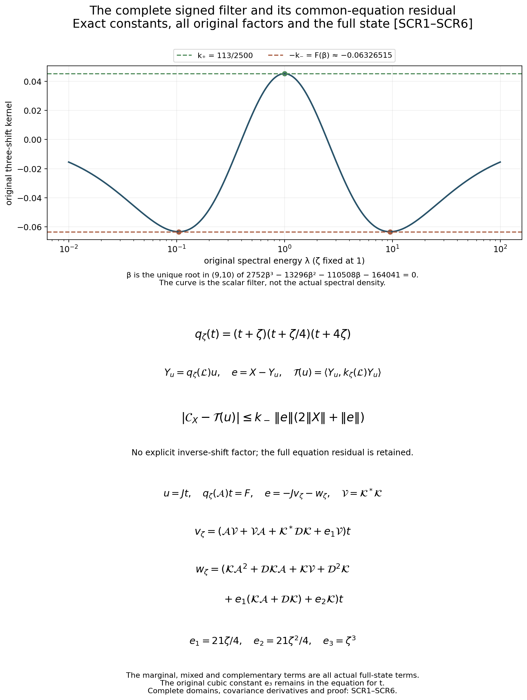
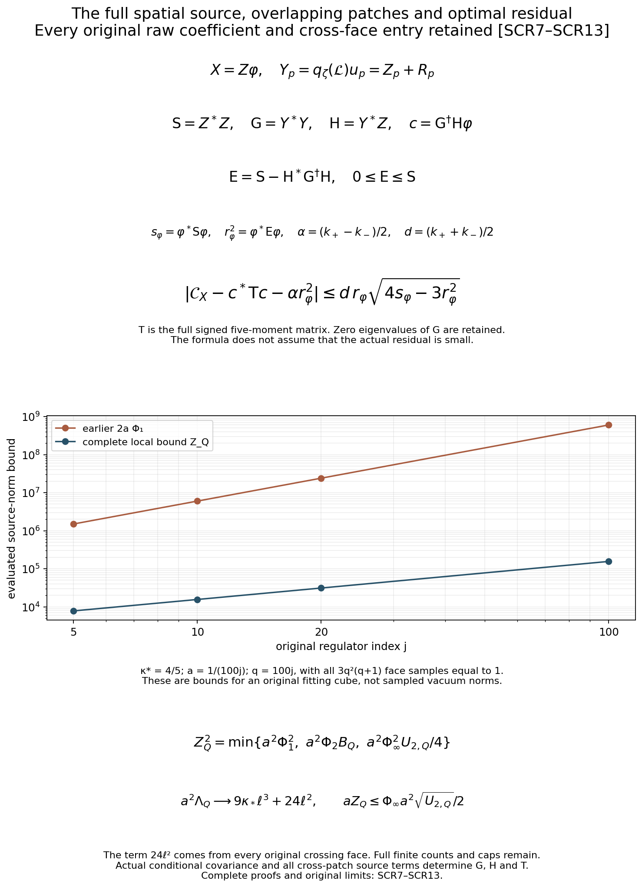

# The common cubic residual and the original spatial spectral response

Reviewed derivation, 15 October 2026. Complete SCR1–SCR13 proofs and 905 diagnostics checked; both figures inspected. This continues [JTR11–JTR13](https://github.com/KokunoYumeto/yang-mills-interacting-workbench/blob/3cc036c0b9f0692e2745d5b3a1556ada5eeaeaee/yang-mills/continuations/20261011-central-signs-shrinking-window/ACTUAL_TRACE_SIGNED_RESPONSE.md). The actual trace domains and conditional covariance are [FMP1–FMP9](https://github.com/KokunoYumeto/yang-mills-interacting-workbench/blob/3cc036c0b9f0692e2745d5b3a1556ada5eeaeaee/yang-mills/continuations/20261011-central-signs-shrinking-window/FULL_STATE_MARGINAL_GROUND.md). The original local source budget is [LC1–LC20](https://github.com/KokunoYumeto/yang-mills-interacting-workbench/blob/3cc036c0b9f0692e2745d5b3a1556ada5eeaeaee/yang-mills/continuations/20261011-central-signs-shrinking-window/LOCAL_CURVATURE_BUDGET.md). These programme proofs have been read for the stated uses. Sixteen bounded index hits are routing records, not newly read literature. No novelty or no-gap conclusion is asserted.

## 1. Original state, source and common equation

Keep the original box, every boundary link and face, and all parameters:
\[
\begin{gathered}
a=(100j)^{-1},\quad L=j^4,\quad g^2=\kappa_*a/2,\quad
b=(\kappa_*a^2)^{-1},\quad s_j=\kappa_*/j,\\
N=3(2L)(2L+1)^2,\quad M=3(2L)^2(2L+1),\\
H=-\kappa_*\Delta+2bM-b\sum_pT_p,\qquad H\psi=E_0\psi,\qquad
\psi>0,\quad\int\psi^2dU=1,\quad d\mu=\psi^2dU,\\
\mathcal L=\psi^{-1}(H-E_0)\psi
=-\kappa_*[\Delta+2\langle d\log\psi,d\,\cdot\,\rangle].
\end{gathered}
\]
Every original SU(2) factor has radius two, orthonormal generators -i sigma_alpha/2 and probability Haar measure. Work on its full gauge-invariant physical subspace. All original vertex gauge transformations, including boundary vertices, remain. The complete scalar 2bM and the vacuum E0 occur in the ground equation before the displayed product-rule cancellation.

For complex raw samples phi_p at the original face centers, retain the entire source
\[
\begin{gathered}
X=\frac a2\sum_p\varphi_p(D_p-\mu D_p),\qquad D_p=2-T_p,\\
T_p=\operatorname{Tr}[U_d(v)U_k(v+e_d)U_d(v+e_k)^{-1}U_k(v)^{-1}].
\end{gathered}
\]
All original orientations d<k, zeros, support labels and coefficient phases are kept. In particular X is centered. Put
\[
\begin{gathered}
\zeta_0=\zeta,\quad\zeta_-=\varepsilon\zeta,\quad
\zeta_+=R_{\rm win}\zeta,\quad
c_-=\frac{4\varepsilon}{(1+\varepsilon)^2},\quad
c_+=\frac{4R_{\rm win}}{(1+R_{\rm win})^2},\\
q_\zeta(t)=(t+\zeta_0)(t+\zeta_-)(t+\zeta_+)
=t^3+e_1t^2+e_2t+e_3,\\
e_1=\zeta(1+\varepsilon+R_{\rm win}),\quad
e_2=\zeta^2(\varepsilon+R_{\rm win}+\varepsilon R_{\rm win}),\quad
e_3=\varepsilon R_{\rm win}\zeta^3.
\end{gathered}
\]
Here zeta>0, 0<epsilon<1<R_win; the original target is zeta=theta s_j. Define the complete signed kernel
\[
k_\zeta(\lambda)=\frac{\zeta\lambda}{(\lambda+\zeta)^2}
-c_-\frac{\varepsilon\zeta\lambda}{(\lambda+\varepsilon\zeta)^2}
-c_+\frac{R_{\rm win}\zeta\lambda}{(\lambda+R_{\rm win}\zeta)^2}.
\]
The response is C_X=<X,k_zeta(L)X>. JTR11 proves, for the exact f=q_zeta(L)^(-1)X,
\[
\mathcal C_X=\zeta\sum_{k=0}^4p_k
\|\mathcal L^{(k+1)/2}f\|_\mu^2,\qquad
k_\zeta(\lambda)=\frac{\zeta\lambda P_\zeta(\lambda)}{q_\zeta(\lambda)^2}.
\tag{SCR1}
\]
All five coefficients and the complete polynomial P_zeta are those explicitly proved in JTR11. The inverse sends L2 to the third operator domain because lambda3/q_zeta(lambda) is bounded on the nonnegative axis. This proves existence and all five moment domains. The original common equation is q_zeta(L)f=X; it is not a truncated spectral expansion.

## 2. Exact extrema of the retained signed filter

Retain the original admissible choice epsilon=1/4,R_win=4. No change is made to lambda, zeta, the state or its spectral measure. For lambda>0 the auxiliary scalar Y=lambda/zeta+zeta/lambda satisfies Y>=2. Direct multiplication of the three original denominator factors gives
\[
\begin{gathered}
q_\zeta(\lambda)^2=(\lambda\zeta)^3(Y+2)(Y+17/4)^2,\\
k_\zeta(\lambda)=F(Y):=
\frac{-688Y^2+200Y+5177}{25(Y+2)(4Y+17)^2}.
\end{gathered}
\]
The full original kernel at lambda=0 is zero, its limit as lambda tends to infinity is zero, and no endpoint atom is lost. The exact maximum is
\[
k_+=\frac{113}{2500},\qquad
F(Y)-k_+=-\frac{(Y-2)(1808Y^2+91400Y+226193)}
{2500(Y+2)(4Y+17)^2}\le0 .
\]
It is attained precisely at lambda=zeta. The derivative is
\[
\begin{gathered}
F'(Y)=\frac{h(Y)}{25(Y+2)^2(4Y+17)^3},\\
h(Y)=2752Y^3-13296Y^2-110508Y-164041.
\end{gathered}
\]
There is exactly one root beta of h on [2,infinity), and 9<beta<10. To prove uniqueness, h''(Y)=16512Y-26592 is positive for Y>=2, while h'(2)=-130668. Thus h' increases strictly through exactly one zero, h first decreases and then increases, and h(2)<0. Since h tends to infinity, it crosses zero exactly once there. Direct integer evaluation gives h(9)<0<h(10), isolating that root. The derivative sign consequently shows that F has its unique minimum at beta. Define its entire algebraic value
\[
k_-=-F(\beta)>0,\qquad
\alpha=\frac{k_+-k_-}{2},\qquad d=\frac{k_++k_-}{2}.
\tag{SCR2}
\]
This is an explicit constant specified by an isolating interval and a polynomial with a unique root there. Since -F(10)=6847/108300>113/2500, k_->k_+. The exact complete operator bounds are therefore
\[
-k_-I\le k_\zeta(\mathcal L)\le k_+I,\qquad
\|k_\zeta(\mathcal L)\|\le k_-,\qquad
\|k_\zeta(\mathcal L)-\alpha I\|\le d.
\]
The two scalar extrema are sharp over nonnegative spectra. They need not be eigenvalues of the actual Yang–Mills generator. No positivity of the physical response follows from this scalar calculation.

For any other original admissible epsilon,R_win retain the elementary bound
\[
K_{\varepsilon,R}=\frac{1+c_-+c_+}{4},\qquad
|k_\zeta(\lambda)|\le K_{\varepsilon,R}.
\]
It follows term by term from 0<=t/(1+t)2<=1/4. The exact kernel remains the displayed three-term function; this upper bound does not replace it.

## 3. A complete residual estimate with no inverse shrinking-shift loss

Let u be any physical vector in the domain of L3 and define
\[
Y_u=q_\zeta(\mathcal L)u,\qquad e=X-Y_u,\qquad
\mathcal T(u)=\zeta\sum_{k=0}^4p_k
\|\mathcal L^{(k+1)/2}u\|_\mu^2.
\]
By spectral calculus T(u)=<Y_u,k_zeta(L)Y_u>; this includes the full cubic equation residual. Put B=k_zeta(L), and use the sharp constants of SCR2. Direct expansion with the Hermitian inner product, conjugate-linear in the first entry, proves
\[
\begin{gathered}
\mathcal C_X-\mathcal T(u)
=\alpha(\|X\|^2-\|Y_u\|^2)
+\operatorname{Re}\langle e,(B-\alpha I)(X+Y_u)\rangle,\\
\left|\mathcal C_X-\mathcal T(u)
-\alpha(\|X\|^2-\|Y_u\|^2)\right|
\le d\,\|e\|\,\|X+Y_u\|,\\
|\mathcal C_X-\mathcal T(u)|
\le k_-\,\|e\|(2\|X\|+\|e\|).
\end{gathered}\tag{SCR3}
\]
For the first identity expand e=X-Y_u. The two mixed terms in the inner product have opposite real parts because B-alpha I is self-adjoint. The remaining two diagonal terms give exactly the claimed difference. Cauchy–Schwarz and the operator bound prove the second line. Applying the same expansion directly to B gives the bound k_-||e||||X+Y_u||; use Y_u=X-e to obtain the last line. Thus both the source-norm difference and the full mixed orientation are retained before estimating them. The general epsilon,R_win version of the last line uses K_epsilon,R in place of k_-.

No factor zeta^(-1) occurs in this response error. The cubic operator q_zeta(L), its constant e3, and the actual norm of e are still present. Small residual norm has not been assumed or inferred from accuracy of a different projection. In particular SCR3 evaluates the response of the computed common-equation vector, not the response of its trace compression.

There is a full raw-coefficient matrix statement. For any finite source and trial columns X_r,u_r, put Y_r=q_zeta(L)u_r and E_r=X_r-Y_r. Let the capital letters X,Y,E denote these column maps. The response matrices C=X*BX and T=Y*BY obey, for every positive real t,
\[
\begin{aligned}
-\frac d2[tE^*E+t^{-1}(X+Y)^*(X+Y)]
&\le C-T-\alpha(X^*X-Y^*Y)\\
&\le\frac d2[tE^*E+t^{-1}(X+Y)^*(X+Y)].
\end{aligned}\tag{SCR4}
\]
For every raw coefficient vector gamma, the middle quadratic form is the real part of <E gamma,(B-alpha I)(X+Y)gamma>. Its absolute value is at most d times the product of the two norms. The scalar inequality 2ab<=t a2+t^(-1)b2 follows from the nonnegative square (sqrt(t)a-b/sqrt(t))2. Applying it proves both quadratic-form inequalities, which are exactly the displayed matrix order. No independence or orthogonality of source columns is required, and growing or dependent raw coefficients are retained.

## 4. Compute the entire cubic residual of the actual trace vector

For one selected adjacent-face patch use the exact FMP maps J,A,K and complementary operator D, with P=JJ*,Q=I-P. All operators in this section are actual operators in the same full state. On smooth vectors their full block action is
\[
\mathcal L(Jv+w_c)=J(\mathcal Av+\mathcal K^*w_c)+\mathcal Kv+\mathcal Dw_c,\qquad Qw_c=w_c.
\]
Indeed project L(Jv+w_c) with P and Q and use the definitions; self-adjointness and the smooth domain identify K* with J*LQ. The original conditional projection preserves smooth lifts and every Sobolev domain needed here, as proved in FMP3 and FMP9. Thus all following finite products act on smooth vectors and agree with their closed forms.

For the original one-face F=a xi(mu x-x)/2 set t=q_zeta(A)^(-1)F. The trace lift of t is smooth: on the original compact seven-link product the operator with drift -2kappa dlog(alpha) is a uniformly elliptic operator with smooth coefficients and positive smooth weight alpha squared. Its compact vertex-gauge isometries commute with that operator, since alpha is gauge invariant. Its positive-shift resolvents preserve this invariant subspace and send smooth right sides to smooth functions by elliptic regularity, iterated through all Sobolev orders. Their product is q_zeta(A)^(-1), by the inherited trace restriction. Thus t satisfies q_zeta(A)t=F on the required smooth lifted domain. Write V=K* K. Iterating the complete block action gives
\[
\begin{aligned}
\mathcal L^2Jt={}&J(\mathcal A^2+\mathcal V)t
+(\mathcal K\mathcal A+\mathcal D\mathcal K)t,\\
\mathcal L^3Jt={}&J(\mathcal A^3+\mathcal A\mathcal V+
\mathcal V\mathcal A+\mathcal K^*\mathcal D\mathcal K)t\\
&+(\mathcal K\mathcal A^2+\mathcal D\mathcal K\mathcal A
+\mathcal K\mathcal V+\mathcal D^2\mathcal K)t .
\end{aligned}
\]
All products are ordered as written. Subtract J q_zeta(A)t from q_zeta(L)Jt. The exact residual e=JF-q_zeta(L)Jt is
\[
\begin{gathered}
e=-Jv_\zeta-w_\zeta,\qquad \|e\|^2=\|v_\zeta\|_\rho^2+\|w_\zeta\|_\mu^2,\\
v_\zeta=(\mathcal A\mathcal V+\mathcal V\mathcal A+
\mathcal K^*\mathcal D\mathcal K+e_1\mathcal V)t,\\
w_\zeta=(\mathcal K\mathcal A^2+\mathcal D\mathcal K\mathcal A+
\mathcal K\mathcal V+\mathcal D^2\mathcal K\\
\hspace{30mm}+e_1(\mathcal K\mathcal A+\mathcal D\mathcal K)+e_2\mathcal K)t .
\end{gathered}\tag{SCR5}
\]
The constant e3 cancels only in the subtraction of the identical marginal term; it remains in the exact equation determining t. Orthogonality of Jv_zeta and w_zeta proves the norm identity, not an estimate discarding mixed terms inside either square. For epsilon=1/4,R_win=4 the original coefficients are e1=21zeta/4,e2=21zeta2/4,e3=zeta3.

This calculates the full forcing in JTR13 without omitting its inverse tail. Indeed f-Jt=q_zeta(L)^(-1)e. Multiplication of JTR13 by the same q_zeta(L), using only its full ordered resolvent identity, gives SCR5 as well. SCR3 now controls the signed response from the norm of this exact forcing; it never substitutes ||KF|| for ||e||.

## 5. Evaluate the residual covariance operator and its conditional adjoint

Retain the original three trace coordinates pi_i, h_i=<dlog psi,dpi_i>, their actual conditional means hbar_i, and Sigma_ik=E_mu[(h_i-hbar_i)(h_k-hbar_k)|pi]. Put r_i=h_i-hbar_i. FMP9 gives Kt=-2kappa sum_i r_i (partial_i t)circpi. For any smooth complementary w_c define its full conditional vector
\[
c_i(w_c)=\mathbb E_\mu[r_iw_c\mid\pi].
\]
Direct integration of <Kt,w_c>, with every actual density factor retained, gives the weak adjoint and covariance operator
\[
\begin{gathered}
\mathcal K^*w_c=2\kappa_*\rho^{-1}\sum_i\partial_i[\rho c_i(w_c)],\\
\mathcal Vt=-4\kappa_*^2\rho^{-1}
\sum_{i,k}\partial_i[\rho\Sigma_{ik}\partial_kt],\\
\langle t,\mathcal Vt\rangle_\rho
=4\kappa_*^2\int_\Omega\rho
\sum_{i,k}\overline{\partial_it}\Sigma_{ik}\partial_kt\,d\nu_\Omega.
\end{gathered}\tag{SCR6}
\]
Here c_i is complex-linear in w_c. To check the sign, <Kt,w_c>=-2kappa integral rho sum_i partial_i conjugate(t) c_i(w_c). Moving the derivative gives the positive sign in K*. Substituting w_c=Kt gives c_i(Kt)=-2kappa sum_k Sigma_ik partial_k t and the negative divergence in V. The positive form follows by reversing this integration. These are inherited weak identities on the full compact link product; in the interior they are the displayed divergence formulas with constant Haar density dnu_Omega. No extra boundary condition or vanished boundary flux is assumed at a singular trace orbit.

For a smooth complementary w_c, Dw_c=Q Lw_c and K*w_c=J*Lw_c. Thus the term K*DK in SCR5 is exactly
\[
\begin{aligned}
\mathcal K^*\mathcal D\mathcal Kt
={}&2\kappa_*\rho^{-1}\sum_i\partial_i
\left[\rho\,\mathbb E_\mu[r_i\mathcal D\mathcal Kt\mid\pi]\right],\\
\mathcal D\mathcal Kt
={}&Q\{-\kappa_*[\Delta+2d\log\psi\cdot d]\}
\left(-2\kappa_*\sum_k r_k\partial_kt\right).
\end{aligned}
\]
All products, density derivatives, original Laplacian and conditional expectation are retained. This is a direct original-state realization of the residual, including the fluctuation derivatives absent from a scalar marginal potential.

## 6. Receive the full spatial source without deleting overlapping-patch terms

For each original face p choose an adjacent coplanar face inside the original box. Such a neighbor always exists: the plane contains 2L>=2 faces along each coordinate direction, so increase the smaller plane coordinate when permitted and otherwise decrease it. This deterministic choice retains boundary faces. The two faces have seven distinct links and six vertices. Their trace projection J_p is exactly the original compact-vertex average and outside-link integral of FMP3, with the same actual full density; it has all the same domain properties. No reflection symmetry or equality of different patch marginals is needed.

For Z_p=a(mu T_p-T_p)/2 let F_p be its trace representative in that patch, t_p=q_zeta(A_p)^(-1)F_p and u_p=J_p t_p. Define e_p=Z_p-q_zeta(L)u_p by SCR5 with that patch's full A_p,K_p,D_p. Then
\[
\begin{gathered}
u_\varphi=\sum_p\varphi_pu_p,\qquad e_\varphi=X-q_\zeta(\mathcal L)u_\varphi
=\sum_p\varphi_pe_p,\\
\|e_\varphi\|^2=\sum_{p,q}\overline{\varphi_p}\varphi_q
\langle e_p,e_q\rangle_\mu .
\end{gathered}\tag{SCR7}
\]
These are finite sums at every original regulator, with no division by source norms. The exact residual entries, writing e_p=-J_pv_p-w_p, are
\[
\begin{aligned}
\langle e_p,e_q\rangle
={}&\langle J_pv_p,J_qv_q\rangle+\langle J_pv_p,w_q\rangle\\
&+\langle w_p,J_qv_q\rangle+\langle w_p,w_q\rangle.
\end{aligned}
\]
Only the two middle terms at p=q vanish by that one patch's orthogonality. Overlapping patches do not supply orthogonal subspaces, so no cross-face entry is removed. The full trial response matrix is likewise
\[
\mathsf T_{pq}=\zeta\sum_{k=0}^4p_k
\langle\mathcal L^{(k+1)/2}u_p,\mathcal L^{(k+1)/2}u_q\rangle .
\]
Apply SCR3 to these exact sums, or SCR4 directly to all their columns. This is a map to the original spatial Wilson source, including every interference term, rather than a replacement by isolated-face responses.

## 7. Apply the original local curvature budget to the source norm

Let the support faces lie in an original induced cube Q of q edges per side as in LC4, with all face incidences retained. Set
\[
\begin{gathered}
N_Q=3q(q+1)^2,\quad M_Q=3q^2(q+1),\quad
C_Q=2q(q+1)\eta,\quad0\le\eta\le6,\\
\Lambda_Q=\min\{2M_Q,6g^2\sqrt{N_QM_Q}\}+2C_Q,\quad
B_Q=\min\{4M_Q,\Lambda_Q\},\\
U_{2,Q}=\min\{(4M_Q)^2,\Lambda_Q^2+16(g^2)^2\},\\
\Phi_1=\sum_p|\varphi_p|,\quad\Phi_2=\sum_p|\varphi_p|^2,\quad
\Phi_\infty=\max_p|\varphi_p|.
\end{gathered}
\]
The exact side count eta is the sum of indicators of existing outward sides; a cube meeting the original box boundary uses those indicators, not the value six. LC15 and LC19–LC20 prove for the actual W_Q=sum_inside D_p that mu W_Q<=B_Q and mu W_Q2<=U2,Q. Their proof keeps the outside ground energy, full crossing cost 2bC_Q, and original coefficient 16(g2)2=4kappa/b.

The exact source norm and three evaluated bounds are
\[
\begin{gathered}
\|X\|_\mu^2
=\frac{a^2}{4}\left[
\mu\left|\sum_p\varphi_pD_p\right|^2
-\left|\sum_p\varphi_p\mu D_p\right|^2\right],\\
\|X\|_\mu^2\le Z_Q^2:=
\min\left\{a^2\Phi_1^2,\quad
a^2\Phi_2B_Q,\quad\frac{a^2\Phi_\infty^2}{4}U_{2,Q}\right\}.
\end{gathered}\tag{SCR8}
\]
The centered mean remains in the equality before each inequality. For the first bound use Var(sum phi D)=Var(sum phi T) and |sum phi T|<=2Phi1. For the second use |sum phi D|2<=Phi2 sum D_p2<=4Phi2 W_Q, keeping the subset of support faces inside Q. For the third use |sum phi D|<=Phi_infty W_Q. Integration and the actual local budgets prove all three bounds without independence, translation invariance or positivity of the coefficient phases.

The resulting entire response error is
\[
|\mathcal C_X-\mathcal T(u_\varphi)|
\le k_-\,\|e_\varphi\|(2Z_Q+\|e_\varphi\|).
\tag{SCR9}
\]
The sharper centered interval in SCR3 and every raw matrix entry in SCR4 remain available. This explicit norm factor improves the earlier bound 2aPhi1 while preserving the true centered source and all cross-face terms. It does not evaluate e_phi by assumption.

For a fixed physical fitting cube with aq tending to a positive length ell and eventually six available outward sides, the exact original counts prove
\[
\begin{gathered}
a^2\Lambda_Q\longrightarrow9\kappa_*\ell^3+24\ell^2=:\Lambda_\ell,\\
a^4U_{2,Q}\longrightarrow\Lambda_\ell^2,\qquad
\frac{a^2}{2}\sqrt{U_{2,Q}}\longrightarrow\frac{\Lambda_\ell}{2}.
\end{gathered}\tag{SCR10}
\]
Indeed sqrt(N_Q M_Q)=3q^(3/2)(q+1)^(3/2), so the two entries of the original minimum are 6q2(q+1) and 9kappa a q^(3/2)(q+1)^(3/2). Their ratio, second divided by first, is (3kappa a/2)sqrt((q+1)/q), tending to zero. Thus the second is eventually selected, while 2C_Q=24q(q+1) keeps every boundary face. Multiplication by a2 gives the first limit. In U2,Q the pointwise cap has order a^(-6), whereas Lambda_Q2 has order a^(-4) and 16(g2)2=4kappa2a2 remains negligible only in this quotient limit. This proves the second and third statements without changing any finite formula.

For bounded original sample amplitudes this gives Z_Q<=Phi_infty sqrt(U2,Q)a/2 of order a^(-1), while 2aPhi1 can have order a^(-2) on a full physical support. For arbitrary growing raw samples the displayed Phi_infty and complete finite quantities remain. No convergence rate for the actual e_phi is asserted. SCR9 shows the retained product that must be evaluated at the original shrinking shifts; a small error in a different coefficient norm does not evaluate it.

## 8. What the local result can and cannot contribute to a spatial limit

For a single original face, without any local-budget assumption, Var_mu T_p<=4 because |T_p|<=2. Thus its complete spectral mass and every signed response satisfy
\[
\|Z_p\|^2\le a^2,\qquad
|\mathcal C_{Z_p}|\le k_-a^2.
\tag{SCR11}
\]
For a fixed finite list and arbitrary coefficients this gives
\(|\mathcal C_{\sum_p\xi_pZ_p}|\le k_-a^2(\sum_p|\xi_p|)^2\)
by the triangle inequality in the actual Hilbert space. These bounds hold at every positive shift, including the shrinking shifts; they do not say that the general spatial sum vanishes. A nonzero macroscopic response must therefore be tested with its full growing support and original raw coefficients. SCR7–SCR9 supply that exact receiver.

The next actual quantity is the full Gram matrix of the two source components in SCR5 over all selected faces, together with the signed trial matrix in SCR7. SCR6 specifies the conditional covariance and derivative operators from the original state, so those entries can be attacked without replacing psi by a patch ground. The present work proves a joint error estimate with no inverse-shift prefactor, its complete original-state residual, and a sharper spatial source bound. It does not assume the residual is small or claim survival of annular weight, continuum reconstruction, intended-theory identification or the smooth global no-gap endpoint.

## 9. Evaluate the best common-equation residual in the full patch trial space

The preceding residual entries also determine the best fit within the entire overlapping-patch trial space. Keep every original source column Z_p and every trial column u_p. Write R_p=J_pv_p+w_p, so Y_p=q_zeta(L)u_p=Z_p+R_p. No sign is changed: e_p=-R_p. The exact finite matrices are
\[
\begin{gathered}
\mathsf S=Z^*Z,\qquad
\mathsf G=Y^*Y=\mathsf S+Z^*R+R^*Z+R^*R,\\
\mathsf H=Y^*Z=\mathsf S+R^*Z,\qquad
\mathsf E=\mathsf S-\mathsf H^*\mathsf G^\dagger\mathsf H .
\end{gathered}
\]
Here all entries are the original actual-state integrals from SCR5–SCR8. The source matrix in particular is
\(\mathsf S_{pq}=a^2\operatorname{Cov}_\mu(T_p,T_q)/4\),
with the ordered Hermitian convention for complex coefficients. The original face traces are real. The full R*R is the four-term overlapping-patch matrix displayed in SCR7.

Define G dagger exactly by the finite spectral decomposition of the positive Hermitian G: invert each strictly positive eigenvalue, leave each zero eigenvalue zero, and retain its full orthogonal eigenspaces. Since ker(G)=ker(Y), every column of H lies in ran(G). Indeed a coefficient v in ker(G) has ||Yv||2=v*Gv=0 and therefore v*H=<Yv,Z>=0. In a finite-dimensional Hermitian space the orthogonal complement of the kernel is the range, as follows directly from that same full spectral decomposition.

For every original raw source vector phi, put c=G dagger H phi and u_opt=sum_p c_p u_p. These are trial coefficients only; the original source X=Z phi has not changed. The normal equation Gc=H phi follows from the proved range statement. Hence Yc is orthogonal to e_opt=X-Yc. For any other trial coefficients c+d, expansion gives
\[
\|X-Y(c+d)\|^2=\|e_{\rm opt}\|^2+\|Yd\|^2.
\]
This proves the minimum and its entire kernel: all minimizers differ by ker(Y), and their original trial vectors can differ by a vector annihilated by q_zeta(L). That last kernel is zero because q_zeta(lambda)>=e3>0; therefore all minimizing trial functions themselves coincide. Direct multiplication proves
\[
\begin{gathered}
\|e_{\rm opt}\|^2=\varphi^*\mathsf E\varphi,\qquad
0\le\mathsf E\le\mathsf S,\\
\|Yc\|^2=\varphi^*\mathsf H^*\mathsf G^\dagger\mathsf H\varphi,\qquad
\mathcal T(u_{\rm opt})=c^*\mathsf T c .
\end{gathered}\tag{SCR12}
\]
The last matrix T is the full signed five-moment matrix of SCR7, not G or S. The minimum residual is no larger than the residual of the original coefficients c=phi; every original cross-face contribution stays in G,H and T. Dependent trial columns do not obstruct this construction and no conditioning bound is assumed.

Put s_phi=phi* S phi and r_phi2=phi* E phi. Orthogonality gives
\(\|X\|^2-\|Yc\|^2=r_\varphi^2\) and
\(\|X+Yc\|^2=4s_\varphi-3r_\varphi^2\).
Thus the exact centered error interval is
\[
\left|\mathcal C_X-c^*\mathsf T c-\alpha r_\varphi^2\right|
\le d\,r_\varphi\sqrt{4s_\varphi-3r_\varphi^2}.
\tag{SCR13}
\]
The radicand is nonnegative because r_phi2<=s_phi. This improves SCR3 using the defining orthogonality of the particular chosen coefficients, retaining its entire source-norm correction. In matrix form let C_opt=H*G dagger T G dagger H. Applying the proof of SCR4 to the minimizing source columns gives, for every t>0,
\[
\begin{aligned}
-\frac d2[t\mathsf E+t^{-1}(4\mathsf S-3\mathsf E)]
&\le\mathsf C-\mathsf C_{\rm opt}-\alpha\mathsf E\\
&\le\frac d2[t\mathsf E+t^{-1}(4\mathsf S-3\mathsf E)].
\end{aligned}
\]
Every raw phi, including regulator-dependent and growing vectors, is covered by the same matrix inequality.

This completes the finite optimization and its joint signed error formula. It reduces the remaining actual calculation to the explicitly given full matrices S,G,H,T, rather than treating a proposed small residual as an assumption. Their entries still contain the actual ground and the filtered conditional sources. SCR6, the original marginal equation, the full covariance entries in SCR7 and the local source bound in SCR8 are the receiving formulas to evaluate next. Neither the existence of this optimum nor the finite error interval proves a positive limiting spectral window.

The graph evaluates the original scalar kernel at zeta=1, epsilon=1/4 and R_win=4. SCR2 proves both extrema with the full algebraic minimum; no actual spectral density is shown. SCR5–SCR6 calculate every ordered residual term and its actual conditional covariance. SCR3 keeps the source-norm difference and mixed inner product before bounding them.

SCR7 and SCR12–SCR13 retain the complete overlapping-patch matrices and original raw source coefficients, including dependent trial columns. The graph compares the evaluated source-bound formulas at kappa=4/5, q=100j and unit face coefficients; it does not measure an actual ground-state norm. SCR8–SCR10 retain the exact counts and the full boundary contribution 24 ell squared. Reproducible sources: [figure_common_residual.py](figure_common_residual.py) and [check_common_residual.py](check_common_residual.py). The 905 diagnostic identities and inequalities include finite matrix fixtures, constructed positive non-Yang–Mills densities and exact source-bound evaluations; the preceding proofs establish the actual-state statements.
