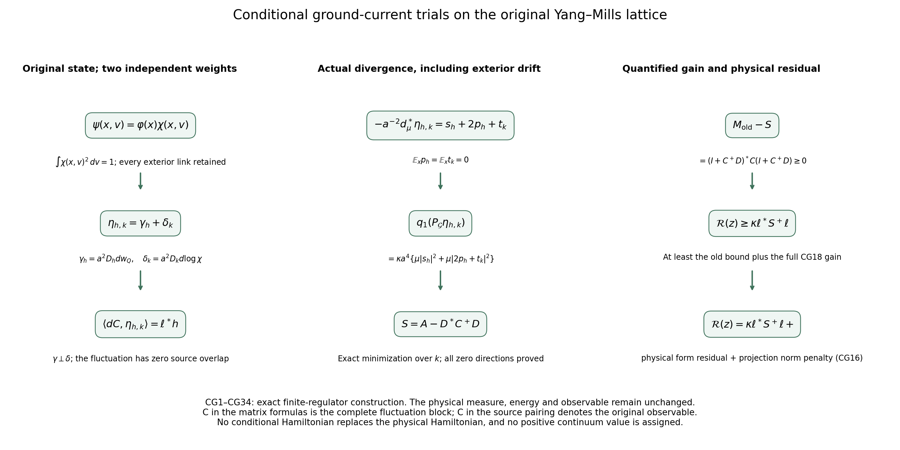
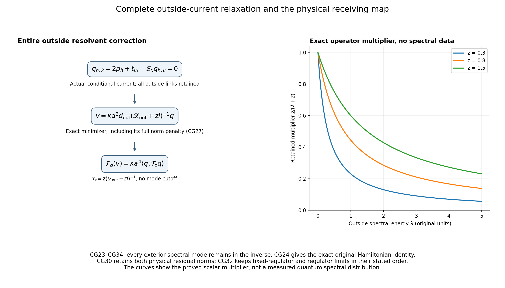

# Conditional ground currents and an enlarged physical variational space

This proof continues [SG1–SG33](https://github.com/KokunoYumeto/yang-mills-interacting-workbench/blob/38db74e953474e60bd0f1cadd7b1eec4f37e2631/yang-mills/continuations/20261011-central-signs-shrinking-window/ACTUAL_GROUND_GRADIENT_TRIAL.md), using the original conditional ground equation [BM40–BM43](https://github.com/KokunoYumeto/yang-mills-interacting-workbench/blob/38db74e953474e60bd0f1cadd7b1eec4f37e2631/yang-mills/continuations/20261011-central-signs-shrinking-window/BOUNDED_ENERGY_MULTIPLIER.md) and its earlier derivation [LR34–LR36](https://github.com/KokunoYumeto/yang-mills-interacting-workbench/blob/38db74e953474e60bd0f1cadd7b1eec4f37e2631/yang-mills/continuations/20261011-central-signs-shrinking-window/LOWER_SIDE_RETAINED_ENERGY.md). It evaluates the signed conditional current covariance, constructs a larger family of actual trial forms, and optimizes its complete matrix. No conditional ground state is substituted for the original state. Every expectation below uses the same original ground density or its exact disintegration. The result is an improved finite-regulator lower bound with its complete physical residual; the value of its continuum limit remains to be calculated.

## 1. Original lattice, state and conditional density

For \(j\ge2\), retain the open cubic vertices \(\{0,\ldots,2L_j\}^3\), every positive edge, every original vertex gauge transformation, and
\[
\begin{gathered}
L_j=j^4,\qquad a_j=(100j)^{-1},\qquad
g_j^2=\kappa_*a_j/2,\qquad \kappa_j=\kappa_*,
\qquad b_j=(\kappa_*a_j^2)^{-1},\\
U_p=U_d(z)U_k(z+e_d)U_d(z+e_k)^{-1}U_k(z)^{-1},
\quad D_p=2-\operatorname{Tr}U_p,\quad d<k,\\
x_{p,j}=o+a_j\{z-L_j\mathbf1+(e_d+e_k)/2\},\\
H_j=-\kappa_*\Delta+b_j\sum_pD_p,\qquad
H_j\psi_j=E_{0,j}\psi_j,\quad \psi_j>0,\quad
\int\psi_j^2\,dU=1,\\
d\mu_j=\psi_j^2dU,\quad w_j=\log\psi_j,\quad
C_{\mathbf f,j}=a_j\sum_{\sigma,p}f_\sigma(x_{p,j})D_p,\quad
s_j=\kappa_*/j=100\kappa_*a_j .
\end{gathered}\tag{CG1}
\]
The generators \(T_\beta=-i\sigma_\beta/2\) are orthonormal; each edge has the original radius-two metric and Haar probability. Thus its Ricci tensor is one half the metric. The scalar \(2b_j|\mathcal P_j|\) in the potential and the vacuum energy remain present. Suppress \(j\) only inside finite-regulator formulas.

Choose the original finite inside edge set \(Q\) to contain all links of the faces used by \(C_{\mathbf f}\). Write \(x\) for those links and \(v\) for all remaining links. The full physical space is not factored. Set
\[
\begin{gathered}
n(x,v)=\psi(x,v)^2,\quad m(x)=\int n(x,v)\,dv,\quad
\varphi(x)=\sqrt{m(x)},\quad w_Q=\log\varphi,\\
\chi(x,v)=\psi(x,v)/\varphi(x),\qquad
\int\chi(x,v)^2\,dv=1,\\
\mathbb E_x F=\int F(x,v)\chi(x,v)^2\,dv,\quad
\bar g_e=\nabla_e w_Q,\quad
\xi_e=\nabla_e\log\chi,\quad
g_e=\nabla_e w=\bar g_e+\xi_e\quad(e\in Q).
\end{gathered}\tag{CG2}
\]
All these functions are smooth at fixed regulator: \(\psi\) and \(m\) are strictly positive on their compact spaces. Differentiation under the finite integral is justified in every order. Every original gauge transformation changes \(x\) and \(v\) by separate Haar isometries. Changing \(v\) in the integral proves that \(m,\varphi,\chi\) have their stated invariant scalar transformation laws, and their gradients transform by the original tangent isometries. In particular all trial forms below are invariant.

Differentiating the unit-slice identity gives
\[
\begin{gathered}
\mathbb E_x\xi_e=0,\quad
\mathbb E_x|g_e|^2=|\bar g_e|^2+\mathbb E_x|\xi_e|^2,\\
\mathcal G_{ef}(x)=\mathbb E_x(\xi_e\otimes\xi_f),\quad
\mathcal G\ge0,\qquad
\bar H_{ef}:=\nabla_e\nabla_f w_Q
=\mathbb E_x H_{ef}+2\mathcal G_{ef}.
\end{gathered}\tag{CG3}
\]
The tensor convention is the one making
\(\mathcal G(u,u)=\mathbb E_x|\sum_e\langle u_e,\xi_e\rangle|^2\).
To prove the last identity, differentiate
\(\bar g_f=\mathbb E_xg_f\); differentiation of the conditional density gives \(2\xi_e\chi^2\), and its contraction with the constant \(\bar g_f\) vanishes by the first identity. The connection on each original edge is unchanged. This proves the covariant identity as well as its sign. The proved full-ground estimate \(H\ge-2(\kappa a)^{-1}I\) from BM16 therefore gives
\(\bar H\ge-2(\kappa a)^{-1}I\) on inside tangent vectors, with the complete positive tensor \(2\mathcal G\) retained.

## 2. Exact conditional currents with arbitrary edge weights

For \(e\in Q\), define real smooth scalars
\[
\begin{gathered}
S_e=\Delta_e w+2|g_e|^2,\qquad
s_e=\Delta_e w_Q+2|\bar g_e|^2
=\frac{\Delta_e m}{2m},\\
p_e=\langle\bar g_e,\xi_e\rangle,\qquad
t_e=\Delta_e\log\chi+2|\xi_e|^2+2p_e,\\
S_e=s_e+2p_e+t_e,\qquad
\mathbb E_xp_e=\mathbb E_xt_e=0,\qquad
\mathbb E_xS_e=s_e .
\end{gathered}\tag{CG4}
\]
The expansion follows from \(w=w_Q+\log\chi\), retaining both cross terms from \(2|g_e|^2\). The identity
\[
\int\chi^2(\Delta_e\log\chi+2|\xi_e|^2)\,dv
=\int\{\chi\Delta_e\chi+|\nabla_e\chi|^2\}\,dv=0
\]
is differentiation in \(x_e\) of \(\int\chi^2dv=1\), not integration in the wrong variable: its right side is \(\tfrac12\Delta_e\int\chi^2dv\). It proves the conditional mean of \(t_e\). Also \(\mu s_e=\mu S_e=0\), by integration of \(\Delta_e m\) on the compact edge.

For real edge weights \(h=(h_e)_{e\in Q}\), put
\(s_h=\sum h_es_e,\ p_h=\sum h_ep_e,\ t_h=\sum h_et_e\), and similarly \(S_h\). Every weight is constant in configuration space. Conditional orthogonality gives the full matrix identity
\[
\mu S_eS_f=\mu s_es_f+
\mu(2p_e+t_e)(2p_f+t_f),\qquad
\mu s_ep_f=\mu s_et_f=0.
\tag{CG5}
\]
It holds for arbitrary signed weights after contraction, with the full conditional covariance on the right. Moreover
\[
\mu s_es_f=\frac14\int\frac{(\Delta_em)(\Delta_fm)}m\,dx,\quad
\ell_e:=-\frac{a^2}{2}\mu\Delta_eC_{\mathbf f}
=-a^2\mu(C_{\mathbf f}s_e)
=-a^2\mu(C_{\mathbf f}S_e).
\tag{CG6}
\]
Two integrations by parts in \(x_e\) prove the first equality for \(\ell_e\); \(C_{\mathbf f}\) depends on \(x\), so (CG4) proves the last. Its original evaluated value is
\[
\ell_e=\frac{3a^3}{8}
\sum_{p:\,e\in\partial p}f_{\sigma(p)}(x_p)(\mu D_p-2).
\tag{CG7}
\]
Indeed \(\Delta_eD_p=\tfrac34(2-D_p)\) for each incident original face and zero otherwise. Every incidence, orientation test and scalar 2 is retained.

## 3. Two independent actual trial families

Let \(D_h\) multiply each inside cotangent summand by \(h_e\) and every outside summand by zero. On the full original configuration space set
\[
\gamma_h=a^2D_hdw_Q,\qquad
\delta_h=a^2D_hd\log\chi,\qquad
\alpha_h=\gamma_h+\delta_h=a^2D_hdw .
\tag{CG8}
\]
The old trial is recovered by taking identical weights in the two families. We now allow \(\eta_{h,k}=\gamma_h+\delta_k\) with independent \(h,k\). Define
\[
\begin{gathered}
N^\gamma_{ef}=a^4\mathbf1_{e=f}\mu|\bar g_e|^2,\qquad
N^\delta_{ef}=a^4\mathbf1_{e=f}\mu|\xi_e|^2,\\
\langle\gamma_h,\delta_k\rangle_\mu=0,\qquad
\|\eta_{h,k}\|_\mu^2=h^*N^\gamma h+k^*N^\delta k,\qquad
N^\gamma+N^\delta=N,\\
\langle dC_{\mathbf f},\gamma_h\rangle_\mu=\ell^*h,\qquad
\langle dC_{\mathbf f},\delta_k\rangle_\mu=0 .
\end{gathered}\tag{CG9}
\]
Here and below the inner product is conjugate-linear in its first entry, and real formulas extend to complex weights by sesquilinearity. Distinct edge components are pointwise orthogonal. In the same component, conditional expectation of \(\xi_e\) is zero. These facts prove every norm and overlap in (CG9); the source identity for \(\gamma\) is integration by parts with density \(m\). No division by a possibly zero norm is used.

The full weighted divergence \(d_\mu^*=d^*-2\iota_{\nabla w}\) acts as
\[
d_\mu^*\gamma_h=-a^2(s_h+2p_h),\qquad
d_\mu^*\delta_k=-a^2t_k,\qquad
d_\mu^*\eta_{h,k}=-a^2(s_h+2p_h+t_k).
\tag{CG10}
\]
For \(\gamma\), the full drift is \(2(\bar g+\xi)\), giving the retained \(2p_h\). For \(\delta\), differentiate \(\log\chi\) and use the same drift; this is exactly \(t_k\). Conditional averaging would remove \(p_h\), but it is present in the actual physical trial and in all subsequent energy formulas.

For completeness extend \(\bar H\) by zero on outside tangent summands and put \(\widetilde H=H-\bar H=\nabla^2\log\chi\). In a product orthonormal frame normal at the point, with \(r,s\) denoting individual configuration coordinates and the edge weight repeated on its three coordinates,
\[
(d\eta_{h,k})_{rs}
=a^2\{(h_s-h_r)\bar H_{rs}
+(k_s-k_r)\widetilde H_{rs}\}.
\tag{CG11}
\]
This follows by differentiating the components; both Hessians are covariantly symmetric and the component multipliers are parallel. For an outside-inside pair, \(\bar H_{rs}=0\) and \(\widetilde H_{rs}=H_{rs}\), so its complete original mixed Hessian remains. Outside-outside terms vanish because both weights are zero, not because their Hessians were assumed zero.

## 4. Projection, full current matrix and all residual norms

Use the original physical exact-form projection \(P_{\mathcal G}\) and
\(\mathscr L_0=-\kappa(\Delta+2\nabla w\cdot\nabla)\).
On invariant mean-zero scalars it has its finite-regulator positive inverse. Equation (CG10) has zero global mean by divergence integration. Thus the exact projection proved in SG29 gives
\[
\begin{gathered}
P_{\mathcal G}\eta_{h,k}
=-\kappa a^2d\mathscr L_0^{-1}(s_h+2p_h+t_k),\\
q_1(P_{\mathcal G}\eta_{h,k})
=\kappa a^4\mu|s_h+2p_h+t_k|^2
=\kappa a^4\{\mu|s_h|^2+\mu|2p_h+t_k|^2\},\\
q_1(\eta_{h,k})-q_1(P_{\mathcal G}\eta_{h,k})
=\kappa\|d\eta_{h,k}\|_\mu^2 .
\end{gathered}\tag{CG12}
\]
To verify the projection independently, its displayed right side is exact, invariant, smooth and has the same weighted divergence as \(\eta\), since \(d_\mu^*d=\mathscr L_0/\kappa\). Their difference pairs to zero with every invariant exact form. The form energy is \(\kappa(\|d\eta\|^2+\|d_\mu^*\eta\|^2)\), which proves both energy identities. Equation (CG11) specifies the entire removed exterior-derivative norm.

For real scalar families use \(G_{uv,ef}=\mu(u_ev_f)\); in particular write \(G_s=G_{ss}\), \(G_p=G_{pp}\), \(G_t=G_{tt}\). For \(z>0\), define the actual finite matrices
\[
\begin{gathered}
A=\kappa a^4(G_s+4G_p)+zN^\gamma,\qquad
C=\kappa a^4G_t+zN^\delta,\qquad
D=2\kappa a^4G_{tp},\\
M_{\rm joint}(z)=
\begin{pmatrix}A&D^*\\D&C\end{pmatrix},\qquad
b_{\rm joint}=\binom{\ell}{0},\\
\binom{h}{k}^{*}M_{\rm joint}\binom{h}{k}
=q_1(P_{\mathcal G}\eta_{h,k})+
z\|\eta_{h,k}\|_\mu^2 .
\end{gathered}\tag{CG13}
\]
The star on the stacked column denotes its conjugate transpose. The zero conditional means in (CG4) eliminate exactly the \(s\)-noise cross terms, retaining all \(p,t\) terms.

Here is the full treatment of zero directions. Since \(z>0\),
\[
\ker M_{\rm joint}
=\ker N^\gamma\oplus\ker N^\delta,\qquad
\ker C=\ker N^\delta,\qquad
\operatorname{ran}D\subseteq\operatorname{ran}C .
\tag{CG14}
\]
A zero quadratic value forces both nonnegative squared form and norm to be zero; (CG9) then makes both trial forms zero. Conversely a zero norm gives zero form and divergence, hence a zero matrix vector. The same argument applies to \(C\). If \(Ck=0\), the form \(\delta_k\) is zero, so \(t_k=0\), proving \(k^*D=0\). Finite-dimensional orthogonal complements give the range inclusion. Also \(\ell\) is orthogonal to \(\ker N^\gamma\), by its source pairing in (CG9).

Let \(C^+\) denote its Moore–Penrose inverse, defined by diagonalizing the finite positive matrix, inverting positive eigenvalues and leaving its zero eigenspace zero. Completing the square, with no invertibility assumption on \(C\), gives
\[
\begin{gathered}
S=A-D^*C^+D,\qquad S\ge zN^\gamma\ge0,\qquad
\ker S=\ker N^\gamma,\qquad \ell\in\operatorname{ran}S,\\
\binom{h}{k}^{*}M_{\rm joint}\binom{h}{k}
=h^*Sh+(k+C^+Dh)^*C(k+C^+Dh).
\end{gathered}\tag{CG15}
\]
Range inclusion in (CG14) justifies the expansion. Minimizing over \(k\) proves the inequality \(S\ge zN^\gamma\), since the full energy is at least \(z h^*N^\gamma h\). Conversely a zero \(\gamma_h\) has \(Ah=Dh=0\), so \(\ker N^\gamma\subseteq\ker S\). This proves the kernel statement and the assertion about \(\ell\).

Write \(h_*=S^+\ell\), \(k_*=-C^+Dh_*\), and \(\eta_*=\eta_{h_*,k_*}\). The exact source optimization and its complete physical residual are
\[
\begin{gathered}
\sup_{h,k}\left\{2\operatorname{Re}\ell^*h
-\binom{h}{k}^{*}M_{\rm joint}\binom{h}{k}\right\}
=\ell^*S^+\ell,\\
\beta_z=(\mathscr L_1+zI)^{-1}dC_{\mathbf f},\qquad
\mathcal R_{\mathbf f}(z)
=\kappa\langle dC_{\mathbf f},(\mathscr L_1+zI)^{-1}dC_{\mathbf f}\rangle_\mu,\\
\mathcal R_{\mathbf f}(z)=
\kappa\ell^*S^+\ell
+\kappa\|(\mathscr L_1+zI)^{1/2}
(\beta_z-P_{\mathcal G}\eta_*)\|_\mu^2
+\kappa z\|(I-P_{\mathcal G})\eta_*\|_\mu^2 .
\end{gathered}\tag{CG16}
\]
To prove the supremum, first use (CG15), then complete the square on the positive eigenspaces of \(S\); \(\ell\) has no component in its kernel. For the last identity expand the squared form norm against \(\beta_z\). Its cross term is the unchanged source pairing in (CG9), because \(dC_{\mathbf f}\) is exact. The difference between the unprojected norm used in \(M_{\rm joint}\) and the projected norm in that expansion is precisely \(z\|(I-P_{\mathcal G})\eta_*\|^2\). This proves every term. The physical scalar receiver remains the original ground transform and the exact-form isometry of PT14–PT16. No marginal Hamiltonian replaces it.

## 5. Quantified improvement over the previous actual trial

Restricting to \(k=h\) recovers the original \(\alpha_h\). Therefore its SG30 matrix is exactly
\[
M_{\rm old}=\widehat{\mathsf K}+z\mathsf N
=A+D^*+D+C,\qquad
M_{\rm old}-S=(I+C^+D)^*C(I+C^+D)\ge0 .
\tag{CG17}
\]
Expand the right side using \(CC^+D=D\). This proves the identity with the full original current covariance, not a selected subset. The old matrix is strictly positive by SG21 and \(zN>0\).

Take the actual old optimizer \(h_0=M_{\rm old}^{-1}\ell\). The enlarged variational bound satisfies the explicit inequality
\[
\begin{gathered}
\mathcal R_{\mathbf f}(z)\ge\kappa\ell^*S^+\ell\\
\ge\kappa\ell^*M_{\rm old}^{-1}\ell+
\kappa\|C^{1/2}(I+C^+D)h_0\|^2,\\
\ker(M_{\rm old}-S)=\ker(C+D).
\end{gathered}\tag{CG18}
\]
Evaluate the new variational expression \(2\operatorname{Re}\ell^*h-h^*Sh\) at \(h=h_0\). Its value is the old optimum plus \(h_0^*(M_{\rm old}-S)h_0\), proving the second line. The kernel identity follows because \(C^{1/2}y=0\) is equivalent to \(Cy=0\), and \(C(I+C^+D)=C+D\). This specifies exactly all weights for which the additional freedom gives no fixed-\(h\) improvement. The gain is an actual matrix expression; no positive limiting value is assigned to it.

The remaining matrix has a useful complete evaluation:
\[
\begin{gathered}
h^*Sh=\kappa a^4\mu|s_h|^2+z\|\gamma_h\|_\mu^2+\mathcal E_z(h),\\
\mathcal E_z(h)=
\min_k\{\kappa a^4\mu|2p_h+t_k|^2+z\|\delta_k\|_\mu^2\}\\
=4\kappa a^4h^*G_ph-h^*D^*C^+Dh\ge0 .
\end{gathered}\tag{CG19}
\]
The minimizing \(k\) is \(-C^+Dh\) modulo \(\ker C\). This is the actual conditional fluctuation energy with its full norm penalty. For \(z>0\), its exact zero space is \(\{h:p_h=0\ \mu\text{-almost everywhere}\}\): a zero minimum forces \(\delta_k=0\), hence \(t_k=0\), and then \(p_h=0\); conversely take \(k=0\). This does not discard the exterior fluctuations in any nonzero direction.

## 6. Retained ground energy evaluates the marginal part

Write \(\mathcal W_Q=\sum_{p:\partial p\subseteq Q}D_p\), \(\mathcal W_\times\) for every crossing face deficit, and \(V_{\rm out}=b\sum_{p:\partial p\cap Q=\varnothing}D_p\). Let \(E_{\rm out}\) be the actual ground energy of \(-\kappa\Delta_{\rm out}+V_{\rm out}\). Set
\[
\begin{gathered}
E_Q=E_0-E_{\rm out},\qquad
\mathcal T_Q(x)=\mathbb E_x\sum_{e\in Q}|\xi_e|^2,\\
R_Q(x)=\mathbb E_x\{\kappa|\nabla_{\rm out}w|^2
+V_{\rm out}-E_{\rm out}+b\mathcal W_\times\}\ge0,\\
U_Q=b\mathcal W_Q+R_Q+\kappa\mathcal T_Q,\qquad
-\kappa\Delta_Q\varphi+U_Q\varphi=E_Q\varphi .
\end{gathered}\tag{CG20}
\]
Every crossing face and every constant in the original potential remains. The outside quadratic-form inequality at each fixed \(x\) proves \(R_Q\ge0\); it does not assign a pointwise sign to \(V_{\rm out}-E_{\rm out}\). Expand the original ground equation for \(\varphi\chi\), multiply by \(\chi\), and integrate in \(v\). The identities \(\int\chi\nabla_Q\chi=0\) and \(\int\chi\Delta_Q\chi=-\int|\nabla_Q\chi|^2\) give exactly (CG20), reproducing BM40 with the same energy.

For a real weight \(h\), retain \(\Delta_{h^2}=\sum_{e\in Q}h_e^2\Delta_e\), \(\bar F_h=\sum h_e|\bar g_e|^2\), and
\[
\begin{gathered}
\bar{\mathcal J}(h)=
\sum_{\substack{e<f\\e,f\in Q}}
(h_e-h_f)^2\mu\|\bar H_{ef}\|_{\rm HS}^2,\qquad
\bar{\mathcal S}=\bar H+\frac2{\kappa a}I\ge0,\\
\kappa a^4\mu s_h^2
=\frac{a^4}{2}\mu\Delta_{h^2}U_Q
-2\kappa a^4\mu\bar H(D_h\bar g,D_h\bar g)
-\kappa a^4\bar{\mathcal J}(h)\\
=\frac{a^4}{2}\mu\Delta_{h^2}U_Q
+\frac4a\|\gamma_h\|_\mu^2
-2\kappa a^4\mu\bar{\mathcal S}(D_h\bar g,D_h\bar g)
-\kappa a^4\bar{\mathcal J}(h).
\end{gathered}\tag{CG21}
\]
Here is the full derivation. Differentiate
\(\Delta_Qw_Q+|\nabla_Qw_Q|^2=(U_Q-E_Q)/\kappa\).
For \(Z_{h^2}=\sum h_e^2|\bar g_e|^2\), the product rule and radius-two Ricci term give
\[
(\Delta_Q+2\bar g\cdot\nabla_Q)Z_{h^2}
=2\sum_{e,f\in Q}h_e^2\|\bar H_{fe}\|^2+Z_{h^2}
+\frac2\kappa\sum_{e\in Q}h_e^2
\langle\bar g_e,\nabla_eU_Q\rangle .
\]
Its mean is zero. Integration by parts gives
\(\mu\sum h_e^2\langle\bar g_e,\nabla_eU_Q\rangle
=-\mu\Delta_{h^2}U_Q/2\).
Thus the mean Hessian-square sum plus \(\mu Z_{h^2}/2\) equals \(\mu\Delta_{h^2}U_Q/(2\kappa)\).
The weighted one-form identity on the inside product gives the form energy of \(a^2D_hdw_Q\) as
\(\kappa a^4[\sum_{e,f}h_e^2\mu\|\bar H_{fe}\|^2+\mu Z_{h^2}/2
-2\mu\bar H(D_h\bar g,D_h\bar g)]\).
Its exterior derivative has squared norm \(a^4\bar{\mathcal J}(h)\), and its divergence for the marginal density is \(-a^2s_h\). Subtract that complete exterior term to prove the first equality in (CG21); (CG3) proves the second with its sign. The original \(E_Q\) was retained before differentiation and has zero derivative.

The potential trace in that formula is explicitly
\[
\begin{gathered}
\mu\Delta_{h^2}U_Q
=\frac{3b}{4}\sum_{p:\partial p\subseteq Q}
\left(\sum_{e\in\partial p}h_e^2\right)(2-\mu D_p)
+\mu\Delta_{h^2}R_Q+\kappa\mu\Delta_{h^2}\mathcal T_Q,\\
\|\gamma_h\|_\mu^2+\|\delta_h\|_\mu^2=N_h,\qquad
\|\delta_h\|_\mu^2=a^4\sum_{e\in Q}h_e^2\mu\mathbb E_x|\xi_e|^2 .
\end{gathered}\tag{CG22}
\]
The derivatives of \(R_Q\) and \(\mathcal T_Q\) have not been suppressed or assigned signs. They contain the actual outside and crossing dependence. Equations (CG19), (CG21) and (CG22) therefore evaluate all three contributions to the new optimized matrix in the original conditional ground data.

The former SG17 and SG20 order-\(a_j\) bounds remain available because their trial family is contained here. The next section evaluates a further correction of the full outside current, preserving the same physical resolvent and all its residuals.

## 7. Exact optimization over all outside-link corrections

The conditional fluctuation in (CG19) can be reduced further without changing its source. Define the fiber operator, with \(x\) retained as a parameter,
\[
\begin{gathered}
\mathscr L_{{\rm out},x}
=-\kappa\{\Delta_{\rm out}
+2\nabla_{\rm out}\log\chi(x,\cdot)\cdot\nabla_{\rm out}\},\\
\langle u,\mathscr L_{{\rm out},x}u\rangle_{\chi^2dv}
=\kappa\int|\nabla_{\rm out}u|^2\chi^2\,dv,\qquad
\mathscr L_{{\rm out},x}1=0,\\
\mathcal T_z=z(\mathscr L_{\rm out}+zI)^{-1},\qquad
0\le\mathcal T_z\le I,\qquad z>0 .
\end{gathered}\tag{CG23}
\]
This uses all original outside links. The operator acts in the direct integral with measure \(m(x)dx\); it does not factor the physical subspace. Its closed form and self-adjoint operator are obtained by completing smooth fiber functions in the displayed gradient norm. At fixed regulator, \(\chi\) is smooth and bounded above and below by positive constants on the full compact product. Consequently this form has the usual fiber \(H^1\) domain with equivalent norms; integration by parts proves the displayed operator on smooth functions. Its shifted inverse exists everywhere with norm at most \(1/z\), by the positive spectral calculus. The same construction after integration in \(x\) defines the direct-integral operator.

For smooth \(q(x,v)\), its fiber resolvent solution is smooth in both \(x,v\). Here are the parameter details needed for the subsequent forms. Conjugating by multiplication by \(\chi(x,\cdot)\) gives the uniformly elliptic operator
\(-\kappa\Delta_{\rm out}+\kappa\Delta_{\rm out}\chi/\chi+z\)
on the fixed outside Haar space. Its smooth coefficients and all their derivatives are bounded uniformly in \(x\) at this fixed regulator. Its inverse has a uniform bound because multiplication by \(\chi\) is unitary between the fiber weighted space and Haar space. Difference quotients in \(x\), applied to this equation, give successive \(x\)-derivatives by the same inverse with differentiated coefficients on the right; ordinary elliptic regularity in \(v\), iterated with those equations, gives every mixed derivative. Thus every trial and derivative below is in the full finite-regulator form domain. There is no estimate uniform in \(j\) implicit in this argument.

The fiber operator has this exact map to the original Hamiltonian:
\[
\chi\mathscr L_{\rm out}\chi^{-1}
=-\kappa\Delta_{\rm out}
+\kappa\frac{\Delta_{\rm out}\chi}{\chi}
=-\kappa\Delta_{\rm out}
+V-E_0-\kappa\frac{\Delta_Q\psi}{\psi}.
\tag{CG24}
\]
Apply both sides to a smooth function and expand the two first derivatives to prove the first identity. Since \(\varphi\) is independent of outside coordinates,
\(\Delta_{\rm out}\chi/\chi=\Delta_{\rm out}\psi/\psi\).
The original ground equation gives the second identity. In particular all inside, crossing and outside contributions to \(V=b\sum_p(2-\operatorname{Tr}U_p)\), and \(E_0\), remain. Equation (CG24) is an exact receiving map, not an assertion that the conditional generator equals the isolated outside Hamiltonian.

For the arbitrary signed or complex pair of weights in (CG13), set
\[
q_{h,k}=2p_h+t_k,\qquad \mathbb E_xq_{h,k}=0,\qquad
v_{h,k,z}=\kappa a^2d_{\rm out}
(\mathscr L_{\rm out}+zI)^{-1}q_{h,k}.
\tag{CG25}
\]
Here \(v_{h,k,z}\) is an outside one-form, extended by zero on inside components. The conditional resolvent preserves the mean-zero fiber space, since it is self-adjoint and its action on the constant function is multiplication by \(1/z\). Gauge changes in \(x,v\) conjugate the fiber equation by the original outside isometry; uniqueness of the inverse proves gauge invariance of \(v\). Its source pairing is zero pointwise because \(dC_{\mathbf f}\) has only inside components. Its norm is orthogonal to both \(\gamma_h\) and \(\delta_k\).

The weighted outside divergence, computed with the full \(\mu\), is the same fiber divergence, since \(m\) has no outside derivative. Therefore
\[
\begin{gathered}
d_\mu^*v_{h,k,z}
=a^2\mathscr L_{\rm out}
(\mathscr L_{\rm out}+zI)^{-1}q_{h,k},\\
d_\mu^*(\eta_{h,k}+v_{h,k,z})
=-a^2(s_h+\mathcal T_zq_{h,k}),\\
\|v_{h,k,z}\|_\mu^2
=\kappa a^4
\langle q_{h,k},
\mathscr L_{\rm out}(\mathscr L_{\rm out}+zI)^{-2}q_{h,k}
\rangle_\mu .
\end{gathered}\tag{CG26}
\]
The first line uses \(d_{\mu,{\rm out}}^*d_{\rm out}=\mathscr L_{\rm out}/\kappa\). The second uses (CG10) and the resolvent identity, keeping its minus sign. One outside integration by parts proves the norm formula. The mean-zero noise remains orthogonal to every inside function, including \(s_h\), after application of \(\mathcal T_z\).

In fact this is the exact minimizer over all outside one-forms \(v\) in the weighted-divergence domain:
\[
\begin{gathered}
\mathcal F_q(v)=
\kappa\|d_{\mu,{\rm out}}^*v-a^2q\|_\mu^2+z\|v\|_\mu^2,\\
\mathcal F_q(v)=\kappa a^4\langle q,\mathcal T_zq\rangle_\mu
+\kappa\|d_{\mu,{\rm out}}^*(v-v_{q,z})\|_\mu^2
+z\|v-v_{q,z}\|_\mu^2,\qquad
v_{q,z}=\kappa a^2d_{\rm out}(\mathscr L_{\rm out}+zI)^{-1}q .
\end{gathered}\tag{CG27}
\]
For a direct proof, the residual divergence at \(v_{q,z}\) is
\(-a^2z(\mathscr L_{\rm out}+zI)^{-1}q\).
The cross term in expanding the first norm is
\(-2\kappa a^2z\operatorname{Re}
\langle d_{\rm out}(\mathscr L_{\rm out}+zI)^{-1}q,v-v_{q,z}\rangle\).
It cancels the cross term from the second norm exactly. The remaining value at \(v_{q,z}\), computed from (CG26), is
\[
\kappa a^4\langle q,
[z^2+z\mathscr L_{\rm out}]
(\mathscr L_{\rm out}+zI)^{-2}q\rangle
=\kappa a^4\langle q,\mathcal T_zq\rangle .
\]
This proves (CG27) first for smooth forms and then for the weighted-divergence graph domain by approximation and the closed adjoint relation. Since \(z>0\), the minimizer is unique. No finite-mode exterior cutoff was used.

For scalar families define
\(G^{(z)}_{uv,ef}=\langle u_e,\mathcal T_zv_f\rangle_\mu\).
The exact minimized joint matrix is
\[
\begin{gathered}
A_z=\kappa a^4(G_s+4G^{(z)}_{pp})+zN^\gamma,\quad
C_z=\kappa a^4G^{(z)}_{tt}+zN^\delta,\quad
D_z=2\kappa a^4G^{(z)}_{tp},\\
M_z=\begin{pmatrix}A_z&D_z^*\\D_z&C_z\end{pmatrix},\qquad
S_z=A_z-D_z^*C_z^+D_z,\\
\binom{h}{k}^{*}M_z\binom{h}{k}
=q_1\!\left(P_{\mathcal G}(\eta_{h,k}+v_{h,k,z})\right)
+z\|\eta_{h,k}+v_{h,k,z}\|_\mu^2\\
=\kappa a^4\mu|s_h|^2
+z(h^*N^\gamma h+k^*N^\delta k)
+\kappa a^4\langle q_{h,k},\mathcal T_zq_{h,k}\rangle_\mu .
\end{gathered}\tag{CG28}
\]
In this display the stacked columns have the same conjugate-transpose convention as (CG13). Equation (CG27), the pointwise inside-outside norm orthogonality and the zero fiber means prove the identity. The complete matrix improvement is
\[
\begin{gathered}
0\le M_z\le M_{\rm joint},\\
\binom{h}{k}^{*}(M_{\rm joint}-M_z)\binom{h}{k}
=\kappa a^4\langle q_{h,k},
\mathscr L_{\rm out}(\mathscr L_{\rm out}+zI)^{-1}q_{h,k}\rangle_\mu\ge0,\\
S_z\ge zN^\gamma,\qquad
\ker S_z=\ker N^\gamma,\qquad
\operatorname{ran}D_z\subseteq\operatorname{ran}C_z,\qquad
\ker C_z=\ker N^\delta .
\end{gathered}\tag{CG29}
\]
The first two lines follow from \(I-\mathcal T_z=\mathscr L_{\rm out}(\mathscr L_{\rm out}+zI)^{-1}\).
For the kernels, a zero value of \(M_z\) forces the original inside norm to vanish, so \(\gamma_h=\delta_k=0\), implying \(s_h=p_h=t_k=0\) and \(v=0\). The converse is immediate. This proves the joint kernel and the \(C_z\) kernel. The range and Schur kernel arguments in (CG14)–(CG15), now with this proved norm identity, give the last line without a positive-definiteness assumption on the individual blocks.

Set \(h_z=S_z^+\ell,\ k_z=-C_z^+D_zh_z\) and
\(\Theta_z=\eta_{h_z,k_z}+v_{h_z,k_z,z}\). The stronger bound and complete physical residual are
\[
\begin{gathered}
\mathcal R_{\mathbf f}(z)\ge\kappa\ell^*S_z^+\ell
\ge\kappa\ell^*S^+\ell
\ge\kappa\ell^*M_{\rm old}^{-1}\ell,\\
\mathcal R_{\mathbf f}(z)=\kappa\ell^*S_z^+\ell+
\kappa\|(\mathscr L_1+zI)^{1/2}
(\beta_z-P_{\mathcal G}\Theta_z)\|_\mu^2+
\kappa z\|(I-P_{\mathcal G})\Theta_z\|_\mu^2 .
\end{gathered}\tag{CG30}
\]
Minimize (CG28) in \(k\), then complete the square in \(h\), exactly as in (CG15)–(CG16). This proves the first bound and the equality. The next inequality follows by taking suprema of the variational expressions and using \(M_z\le M_{\rm joint}\), which is valid also with all their kernels. Thus (CG18)'s explicit improvement is retained as well.

There is a further quantified gain at the already defined CG16 optimizer
\(y_*=(h_*,k_*)\):
\[
\kappa\ell^*S_z^+\ell
\ge\kappa\ell^*S^+\ell+
\kappa^2a^4\langle q_{h_*,k_*},
\mathscr L_{\rm out}(\mathscr L_{\rm out}+zI)^{-1}
q_{h_*,k_*}\rangle_\mu .
\tag{CG31}
\]
Evaluate the new joint variational expression at \(y_*\); its old value is \(\ell^*S^+\ell\), and (CG29) computes its exact increase. No state or coefficient norm is rescaled.

Finally the operator in (CG28) has a complete spectral and energy interpretation. At this fixed regulator,
\[
\begin{gathered}
\langle q,\mathcal T_zq\rangle_\mu
=\int_{[0,\infty)}\frac{z}{\lambda+z}\,
d\langle q,E_{\mathscr L_{\rm out}}(\lambda)q\rangle_\mu,\\
\ker\mathscr L_{\rm out}
=\{u(x,v):u(x,v)\ \hbox{is constant in }v
\text{ for almost every }x\},\\
\mathbb E_xq=0
\quad\Longrightarrow\quad
\lim_{z\downarrow0}\langle q,\mathcal T_zq\rangle_\mu=0 .
\end{gathered}\tag{CG32}
\]
The kernel assertion follows because zero form energy forces the outside weak gradient to vanish, and the outside product of \(\mathrm{SU}(2)\) is connected; a Sobolev function with zero gradient is constant on each connected fiber. The converse follows directly from the form. The last line is dominated convergence in the displayed spectral integral; its zero-energy mass vanishes by conditional orthogonality. This order is fixed \(j\) followed by \(z\downarrow0\). It does not interchange with \(j\to\infty\) or prove a value at the original shrinking energy \(s_j\).

The complete removed exterior derivative is also explicit. Put \(u=(\mathscr L_{\rm out}+zI)^{-1}q_{h,k}\). Then
\[
\begin{gathered}
d(\eta_{h,k}+v_{h,k,z})=d\eta_{h,k}+\kappa a^2d\,d_{\rm out}u,\\
(d\,d_{\rm out}u)_{rs}=\nabla_r\nabla_su
\quad(r\text{ inside},\ s\text{ outside}),\\
q_1(\eta_{h,k}+v_{h,k,z})-q_1(P_{\mathcal G}(\eta_{h,k}+v_{h,k,z}))
=\kappa\|d\eta_{h,k}+\kappa a^2d\,d_{\rm out}u\|_\mu^2 .
\end{gathered}\tag{CG33}
\]
The reversed mixed component has the opposite sign; inside-inside and outside-outside components of \(d\,d_{\rm out}u\) vanish. These assertions follow by differentiating its outside gradient and commuting the two scalar covariant derivatives. Together with (CG11) they retain every mixed derivative of the full conditional inverse. The last line is the weighted form identity used in (CG12).

The zero space of the matrix improvement in (CG29) has the exact description
\[
\ker(M_{\rm joint}-M_z)
=\{(h,k):2p_h+t_k=0\ \mu\text{-almost everywhere}\}.
\tag{CG34}
\]
Indeed the multiplier \(\lambda/(\lambda+z)\) is strictly positive for positive \(\lambda\). Its zero quadratic value forces \(q_{h,k}\) into the fiber-constant kernel, while its conditional mean is zero. Hence that current is zero; the converse follows directly. This identifies the complete defect space rather than presuming a strictly positive gain for every source direction.

The next actual receiving quantity is now the complete conditional outside spectral measure of \(q_{h,k}\), together with the marginal current Gram in (CG21) and the two physical residuals in (CG30). Equations (CG24) and (CG26)–(CG34) construct and optimize its exact link to the original Hamiltonian rather than replacing that link by an assumed smallness condition. All original continuum, smoothness, reconstruction, theory-identification and no-gap objectives remain active.

Complete reproducible diagnostics and figure sources are in check_conditional_current.py. The curved conditional-density checks and finite-matrix checks, including singular blocks, are not quantum ground-state samples. Exact provider editions and reading coverage are in [the source-use ledger](CONDITIONAL_CURRENT_SOURCE_USE_LEDGER.json). The second figure plots the proved operator multiplier, not an actual quantum spectral distribution.
