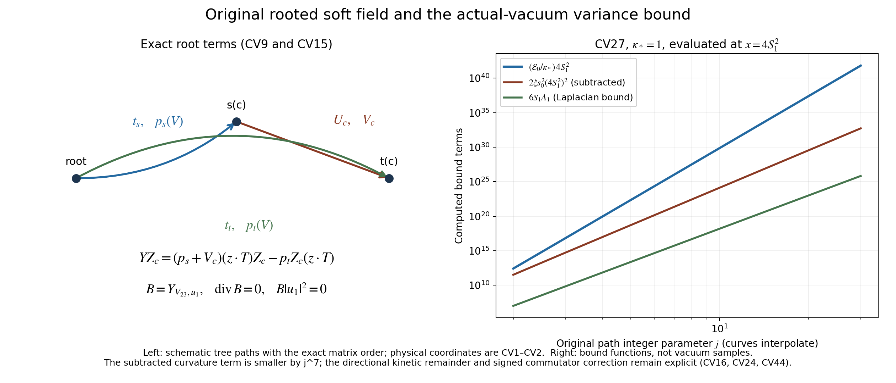

# Physical soft fields and the actual vacuum variance

This is an independent continuation of CW1–CW49. The original observable,
reflection, Hamiltonian, root, open boundaries and simultaneous path are
retained. The calculation gives a divergence-free physical conjugate
operator, its full commutator and double commutator, and a quantitative
variance bound in the actual vacuum. It also computes the terms that stop
this particular bound from proving the proposed spectral endpoint.
No alternative state or observable is used as the receiving object.

## CV1. Original data and conventions

Let \(L\ge2\), \(m=2L\), \(n=m+1\), and let a vertex with indices
\((i,k,l)\in\{0,\ldots,m\}^3\) have original physical coordinate
\(o+a(i-L,k-L,l-L)\). Every positive link has its starting coordinate in
its direction less than \(m\). Every elementary face is included. Their
counts, the probability Haar measure, and the full Hamiltonian are
\[
 N=3mn^2,\quad M=3m^2n,\quad dH=\bigotimes_e dH_e,
 \quad H=\kappa K+bW,
 \quad K=-\sum_{e,\alpha}X_{e\alpha}^2,
 \quad W=\sum_pD_p,
 \quad D_p=2-\operatorname{tr}P_p,                         \tag{CV1}
\]
where \(T_\alpha=-i\sigma_\alpha/2\),
\(X_{e\alpha}f(U)=\partial_t f(\ldots,e^{tT_\alpha}U_e,\ldots)|_0\),
\(\kappa=2g^2/a\), \(b=1/(2g^2a)\), and \(\xi=b/\kappa=1/(4g^4)\).
The metric has radius two on every link. In particular
\([X_{e\alpha},X_{e\beta}]=-\epsilon_{\alpha\beta\gamma}X_{e\gamma}\):
applying two derivatives to the matrix \(U_e\) gives the products in
the order \(T_\beta T_\alpha U_e\). Different-link fields commute.
We write \(U=c(U)I+q(U)\cdot T\); hence
\(c^2+|q|^2/4=1\), \(q^\alpha=-2\operatorname{tr}(T_\alpha U)\),
and \(0\le D_p\le4\).

The unit vacuum is the positive smooth solution
\(H\psi=E_0\psi\), and \(d\mu=\psi^2dH\). Its gauge invariance and
reflection invariance follow from uniqueness: those transformations
preserve \(H\), positivity, and the unit norm. Put \(v=\log\psi\).

The tree and all its products are
\[
 t_{i,k,l}=
 \left(\prod_{r=0}^{l-1}U_3(0,0,r)\right)
 \left(\prod_{b=0}^{k-1}U_2(0,b,l)\right)
 \left(\prod_{a'=0}^{i-1}U_1(a',k,l)\right),
 \qquad Z_e=t_{s(e)}U_et_{t(e)}^{-1}.                    \tag{CV2}
\]
Products increase from left to right; empty products are \(I\).
Tree \(Z_e\)'s equal \(I\). The chord classes are
\(C_2=\{(i,k,l;2):1\le i\le m,0\le k<m,0\le l\le m\}\) and
\(C_3=\{(i,k,l;3):(i,k)\ne(0,0),0\le i,k\le m,0\le l<m\}\).

Put \(h_0=\pi/(2n)\), \(s_0=\sin h_0\), \(c_0=\cos h_0\),
\(C_0=\cot h_0\), and retain the original counting-space functions
\[
 v_0(r)=n^{-1/2},\quad
 v_1(r)=\sqrt{2/n}\cos(\pi(r+1/2)/n),\quad
 w_1(r)=-\sqrt{2/n}\sin(\pi(r+1)/n).                    \tag{CV3}
\]
The vertex index runs from 0 to \(m\); the edge index runs from 0 to
\(m-1\). Set \(w_1(-1)=w_1(m)=0\). The two full physical cochains,
with their zero components displayed, are
\[
\begin{array}{lll}
 V_{1,1}=w_1(i)v_1(k)/\sqrt{2n},&
 V_{1,2}=-v_1(i)w_1(k)/\sqrt{2n},&V_{1,3}=0,\\
 V_{3,1}=0,&V_{3,2}=w_1(k)v_1(l)/\sqrt{2n},&
 V_{3,3}=-v_1(k)w_1(l)/\sqrt{2n}.
\end{array}                                                    \tag{CV4}
\]
These are the source's \(V_{12},V_{23}\). They are orthonormal,
divergence free in the open-box counting inner product, and
\(\|d_1V_3\|^2=\|d_1V_1\|^2=\sigma_*^2=8s_0^2\).
For verification, \(v_1(r+1)-v_1(r)=2s_0w_1(r)\),
\(w_1(r-1)-w_1(r)=2s_0v_1(r)\), including both endpoints;
their squared counting norms are one and their sums against \(v_0\)
are zero. Substituting these four finite identities in the divergence,
inner product, and curl gives the stated equalities. In the curl of
\(V_3\), the 23 component has squared norm \(8s_0^2\), and the 12 and
13 components vanish. No periodic boundary convention is involved.

The original chord rows are \(a_c=V_{1,c}\), \(b_c=V_{3,c}\), and
\[
 u_1=\sum_ca_cq(Z_c),\quad u_3=\sum_cb_cq(Z_c),\quad
 S=u_1\cdot u_3,\quad S_R=S\circ R,\quad D=S+S_R,
 \quad F=\beta_0(S-S_R),\quad \beta_0={\sqrt8s_0\over2g^2}.
                                                               \tag{CV5}
\]
Reflection is the original signed link map
\((RU)_1(i,k,l)=U_1(m-i-1,k,l)^{-1}\),
\((RU)_d(i,k,l)=U_d(m-i,k,l)\), \(d=2,3\).
Every reflected word means precisely this substitution in CV2.
For example its root path is
\[
 t^R_{i,k,l}=
 \left(\prod_{r<l}U_3(m,0,r)\right)
 \left(\prod_{b<k}U_2(m,b,l)\right)
 \left(\prod_{a'<i}U_1(m-a'-1,k,l)^{-1}\right).            \tag{CV6}
\]
In particular all boundary products on the far side of the box remain.
Set \(G=\mu(F^2)\), \(C_F=\kappa\mu\sum(XF)^2\), and
\(\mathscr E(s)=G-C_F/s\).

## CV2. Exact physical lifts, including both root terms

For a real cochain \(V\), let \(p_x(V)\) be its signed additive tree
integral from the root to \(x\); all CV2 tree orientations are positive.
Define the frame and the soft fields
\[
 E_{e\alpha}=\sum_\gamma
  (\operatorname{Ad}_{t_{s(e)}^{-1}})_{\gamma\alpha}X_{e\gamma},
 \quad Y_{V,\alpha}=\sum_e V_eE_{e\alpha},
 \quad Y_{V,z}=\sum_\alpha z_\alpha Y_{V,\alpha}.          \tag{CV7}
\]
The last expression permits a variable color vector \(z(U)\); when
differentiating a function once it uses its current value.
Each \(E_{e\alpha}\) has Haar divergence zero, because its coefficients
do not depend on \(U_e\). Orthogonality of the adjoint matrices proves
\[
 \sum E_{e\alpha}^2=\sum X_{e\alpha}^2,\qquad
 \langle Y_{V_\nu,\alpha},Y_{V_\lambda,\beta}\rangle
       =\delta_{\nu\lambda}\delta_{\alpha\beta},
 \qquad\operatorname{div}Y_{V_\nu,\alpha}=0.              \tag{CV8}
\]
The absence of a derivative term in the first equality follows again
from the absence of \(U_e\) in its own coefficient matrix.

For a fixed color \(z\), differentiating each occurrence in the tree
product gives \(Y_{V,z}t_xt_x^{-1}=p_x(V)z\cdot T\). Consequently
\[
 Y_{V,z}Z_c=(p_s(V)+V_c)(z\cdot T)Z_c
                    -p_t(V)Z_c(z\cdot T).               \tag{CV9}
\]
This is an identity in the original physical variables, before any
gauge fixing. Define
\(d_{Vc}=p_s(V)+V_c-p_t(V)\), \(r_{Vc}=p_s(V)+V_c+p_t(V)\).
Quaternion multiplication gives the complete differential
\[
 Y_{V,z}q(Z_c)=c(Z_c)d_{Vc}z+\tfrac12r_{Vc}z\times q(Z_c),
 \quad Y_{V,z}c(Z_c)=-\tfrac14d_{Vc}z\cdot q(Z_c).        \tag{CV10}
\]
This proves rather than assumes the comparison with the original
additive map \(T\): its matrix is \(d_{Vc}=(TV)_c\). The second term
in CV10 is present even when that additive image vanishes.

Write \(W_r=\sum_{a'<r}w_1(a')\) and \(v_*=v_1(0)\). The full root
integrals of CV4 are
\[
 p_{i,k,l}(V_1)={v_1(k)W_i-v_*W_k\over\sqrt{2n}},\qquad
 p_{i,k,l}(V_3)={v_1(l)W_k-v_*W_l\over\sqrt{2n}}.         \tag{CV11}
\]
Using \(v_1(r)=v_*+2s_0W_r\), including \(r=0,m\), yields
\[
\begin{array}{ll}
 d_{1,(i,k,l;2)}=2(v_*-v_1(i))w_1(k)/\sqrt{2n},&d_{1,C_3}=0,\\
 d_{3,C_2}=0,&d_{3,(i,k,l;3)}=2(v_*-v_1(k))w_1(l)/\sqrt{2n}.
\end{array}                                                    \tag{CV12}
\]
In particular \(\sum a_cd_{1c}=\sum b_cd_{3c}=1\) and
\(\sum a_cd_{3c}=\sum b_cd_{1c}=0\). These are exact finite sums,
not a chart limit. For example the first is
\(\sum_{i=1}^m[v_1(i)^2-v_*v_1(i)]=1\).

For \(\nu,\lambda\in\{1,3\}\), with \(M_{1c}=a_c,M_{3c}=b_c\), put
\[
 A_{\nu\lambda}=\sum_cM_{\nu c}d_{\lambda c}c(Z_c),\quad
 B_{\nu\lambda}=\sum_cM_{\nu c}r_{\lambda c}q(Z_c).
 \quad Y_{V_\lambda,z}u_\nu
       =A_{\nu\lambda}z+\tfrac12z\times B_{\nu\lambda}.   \tag{CV13}
\]
All these are explicit finite functions of the original words.

## CV3. A divergence-free physical conjugate field

Choose the original soft direction \(V_3=V_{23}\) and contract it with
the original \(u_1\):
\[
 B=Y_{V_3,u_1},\qquad P=-iB,\qquad h=|u_1|^2.            \tag{CV14}
\]
This is a differential operator on the original physical Hilbert space.
Indeed under a gauge transformation, \(t_x\mapsto h_ot_xh_x^{-1}\),
the vectors \(q(Z_c)\) rotate by \(\operatorname{Ad}_{h_o}\), and
the contraction in CV7 cancels this root rotation. Hence \(B\) maps
gauge-invariant smooth functions to gauge-invariant smooth functions.
Since \(a\) has only \(C_2\) entries, CV12 gives \(A_{13}=0\)
identically, not just in expectation. Taking the color trace in CV13
therefore proves
\[
 \operatorname{div}B=\sum_\alpha Y_{V_3,\alpha}u_1^\alpha=0,
 \quad Bu_1=\tfrac12u_1\times B_{13},\quad Bh=0,
 \quad |B|^2=h.                                        \tag{CV15}
\]
The norm statement uses the orthonormality in CV8. The field is smooth
on a compact manifold, so its flow exists for all real times. Its
Jacobian preserves Haar by the divergence equation. Pullback by the
flow is thus a unitary group; differentiating gives the symmetric
operator \(P=-iB\) on smooth functions and its generator extension.
All operator identities below hold on smooth functions, which include
every function and vector used in their vacuum expectations.

Define the exact scalar correction
\[
 \Xi=2(A_{33}-1)h+u_3\cdot(u_1\times B_{13})-BD.          \tag{CV16}
\]
The full reflected \(D=S+S_R\), with CV6, occurs in the last term.
Using CV13 in \(BS=(Bu_1)\cdot u_3+u_1\cdot Bu_3\) proves
\[
 BF=\beta_0(2h+\Xi),\qquad [P,F]=-i\beta_0(2h+\Xi).
                                                               \tag{CV17}
\]
The contribution \(BD\) is neither set to zero nor assigned a
reflection sign. Although \(D\) is even, \(B\) itself need not be
reflection odd away from the identity configuration.

For complete evaluation of \(BD\), apply CV9 to every unreflected
word and the following original-link insertion rule to CV6. If
\(A_e=V_{3e}\operatorname{Ad}_{t_s^{-1}}u_1\cdot T\), then
\[
 BU_e=A_eU_e,\qquad B(U_e^{-1})=-U_e^{-1}A_e,\qquad
 B(A_1\cdots A_q)=\sum_{j=1}^q A_1\cdots(BA_j)\cdots A_q.
                                                               \tag{CV18}
\]
Every letter in CV6 and every chord letter is included, with its
displayed sign and position. Thus CV16 is a finite polynomial
receiving term with no differential equation left to define it.

The original receiving energy is equally explicit. Put
\(\ell_c=a_cu_3+b_cu_1\), and use the same \(T_{ce},R_{ce}\) as in
CV30. The gradient of \(S\) in the orthonormal root frame is
\[
 g_e=\sum_c\left[T_{ce}c(Z_c)\ell_c+
                       {R_{ce}\over2}q(Z_c)\times\ell_c\right].
                                                               \tag{CV18a}
\]
This follows by taking the dot product of CV10 with \(\ell_c\) for
the cochain supported at \(e\). For reflection, let \(e'\) be the
reflected positive edge and set
\[
 \Omega_e(U)=
 \begin{cases}
 -\operatorname{Ad}_{\,t_{s(e')}(RU)U_e^{-1}t_{s(e)}(U)^{-1}},
                                                   &d(e)=1,\\
 \operatorname{Ad}_{\,t_{s(e')}(RU)t_{s(e)}(U)^{-1}},
                                                   &d(e)=2,3 .
 \end{cases}
\quad
 C_F=\kappa\beta_0^2\mu\sum_e
       |g_e(U)-\Omega_e(U)^Tg_{e'}(RU)|^2.              \tag{CV18b}
\]
For a reversed edge the physical left infinitesimal coefficient
changes from \(A\) to \(-U_e^{-1}AU_e\); for the other two directions
it is unchanged. Conversion to the target root frame gives precisely
the two displayed matrices. Each \(\Omega_e\) is orthogonal,
including its minus sign. Thus CV18b retains the original kinetic
metric and every reflected boundary path, rather than replacing
\(C_F\) by a soft-direction energy.

Let \(x=\mu(h)\), \(V_B=\mu((Bv)^2)=\|P\psi\|^2\), and
\(J=\mu(BF)=\beta_0(2x+\mu\Xi)\). Integration of
\(B(F\psi^2)\) gives \(J=-2\mu(FBv)\), while
\(\mu(Bv)=\frac12\int B(\psi^2)dH=0\). Cauchy--Schwarz yields the
actual-vacuum covariance inequality
\[
             4G V_B\ \ge\ \beta_0^2(2x+\mu\Xi)^2.       \tag{CV19}
\]
There is no division by a possibly zero variance. If
\(B^-=(B-R_*B)/2\), its divergence is also zero, it is physical,
\(\mu(B^-F)=J\), and \(\mu((B^-v)^2)\le V_B\): reflection is an
isometry of \(L^2(\mu)\), so its odd projection is a contraction.
Thus odd projection can strengthen CV19 without changing its numerator.

## CV4. Using the full vacuum equation rather than a trial density

The source's Section 12 gives
\[
 \mathcal E_0=\min\{2bM,3\sqrt{NM}/a\},\qquad
 E_0\le\mathcal E_0,\qquad
 d:=\mu W\le B_W:=\min\{2M,6g^2\sqrt{NM}\}.             \tag{CV20}
\]
For completeness, its comparison integral uses the probability Haar
marginal \(2\sqrt{1-z^2}\,dz/\pi\) of \(z=\operatorname{tr}U/2\),
the unit factor \(f_t=Z_t^{-1/2}e^{tz}\),
\(Z_t=\int e^{2tz}dH\), and \(q_t=\int zf_t^2dH\).
Writing \(y=1-z\), its density is proportional to
\(e^{-2ty}y^{1/2}\sqrt{2-y}\mathbf1_{[0,2]}\).
Multiplication of the gamma density \(e^{-2ty}y^{1/2}\) by the
decreasing factor \(\sqrt{2-y}\mathbf1_{[0,2]}\) decreases its mean:
the covariance is half the integral of
\((y-y')(w(y)-w(y'))\le0\). Integration by parts gives the gamma
mean \(3/(4t)\), so \(1-q_t\le3/(4t)\).
Pairing \(z\) with \(-z\) in its defining integral gives \(0<q_t<1\).
The radius-two identities \(|\nabla z|^2=(1-z^2)/4\) and
\(\Delta z=-3z/4\) give
\(\int|\nabla f_t|^2=3tq_t/8\le3t/8\).
The product comparison has face trace \(2q_t^4\), hence energy at most
\(3\kappa Nt/8+6bM/t\). At
\(t=4\sqrt{bM/(\kappa N)}\), this is \(3\sqrt{NM}/a\).
The constant comparison gives \(2bM\). Since the actual positive
ground state is physical, this proves CV20 without replacing its
density by either comparison. Positivity of \(K\) gives the bound on
\(d\). Cube symmetries additionally give
\(\mu W_{12}=\mu W_{13}=\mu W_{23}=d/3\), since these three sums
are permuted and add to \(W\); individual face means are not identified.

The first signed CW identity, proved here by finite summation, is
\[
 u_1=-{1\over2s_0\sqrt{2n}}
  \sum_{a',k,l}w_1(a')w_1(k)
        [qZ_2(a'+1,k,l)-qZ_2(a',k,l)].                  \tag{CV21}
\]
Indeed the coefficient of \(qZ_2(i,k,l)\) is
\(-[w_1(i-1)-w_1(i)]w_1(k)/(2s_0\sqrt{2n})=a_c\);
the two endpoint values of \(w_1\) include the boundary terms and
\(Z_2(0,k,l)=I\). The exact face relation
\(Z_2(a'+1,k,l)=\widehat P_{12}(a',k,l)Z_2(a',k,l)\),
\(\widehat P_{12}=tPt^{-1}\), follows by cancellation in CV2.
For \(U,V\in SU(2)\), \(|q(U)-q(V)|\le2\|U-V\|_{op}\)
by quaternion coordinates; \(\|P-I\|_{op}^2=2-\operatorname{tr}P\).
The sum of the squared weights in CV21 is \(1/(8s_0^2)\).
Cauchy--Schwarz therefore proves the pointwise and vacuum bounds
\[
 h\le{W_{12}\over2s_0^2},\qquad
 0\le x\le x_{\max}:=\min\{4S_1^2,B_W/(6s_0^2)\},
 \quad S_1=\sqrt{2/n}C_0(C_0-c_0).                       \tag{CV22}
\]
The value of \(S_1=\sum|a_c|\) follows from the finite sine and cosine
sums; \(\sum|w_1|=\sqrt{2/n}C_0\) and
\(\sum_{i=1}^m|v_1(i)|=\sqrt{2/n}(C_0-c_0)\).

Let \(\nabla v\) mean the full original physical gradient and define
the nonnegative complementary kinetic quantity
\[
 T_{3|1}=\mu\{h|\nabla v|^2-(Bv)^2\}\ \ge0.              \tag{CV23}
\]
The sign follows pointwise from \(|B|^2=h\). Multiplying the original
vacuum equation \(-\Delta\psi=(E_0/\kappa-\xi W)\psi\)
by \(h\psi\), and integrating by parts twice, gives the exact identity
\[
 V_B={E_0\over\kappa}x-\xi\mu(Wh)
                 +\tfrac12\mu(\Delta h)-T_{3|1}.        \tag{CV24}
\]
Both the scalar part \(2bM\) of the potential and the full \(E_0\)
are present: \(W=2M-\sum\operatorname{tr}P_p\).
For clarity, the intermediate identity is
\(\int h|\nabla\psi|^2=(E_0/\kappa)\mu h-\xi\mu(Wh)
+\frac12\mu\Delta h\). It fixes the sign of the Laplacian term.

Every term in \(\Delta h\) is also explicit. For the original word
occurrence count \(n_{ce}\), including both simple root paths, put
\[
 D_{1e}=\sum_c|a_c|n_{ce},\quad
 J_{1e}=\tfrac12\sum_c|a_c|n_{ce}^2,\quad
 A_1=m\sqrt{2/n}C_0(5C_0-4c_0).                         \tag{CV25}
\]
Differentiate each letter with CV18 but with \(A_e=T_\alpha\) for
the chosen physical derivative. Its first derivative is one half
times a unit quaternion, and a second differentiated occurrence or
pair is one quarter times one. Thus
\(|X_{e\alpha}u_1|\le D_{1e}\),
\(|X_{e\alpha}^2u_1|\le J_{1e}\), and exactly
\[
 \Delta h=2\sum_{e,\alpha}
       (|X_{e\alpha}u_1|^2+u_1\cdot X_{e\alpha}^2u_1).
                                                               \tag{CV26}
\]
Here \(n_{ce}\le2\), \(\sum_eJ_{1e}=A_1/2\), and
\(\sum_eD_{1e}^2\le S_1 A_1\), by Cauchy--Schwarz with measure
\(|a_c|\): its right side is exactly
\(S_1\sum_c|a_c|\sum_en_{ce}^2\).
For a \(C_2\) chord the full length is \(2(i+k+l+1)\), while
the squared-occurrence sum is \(2i+4k+4l+2\); the shared root
prefix has \(k+l\) edges, each counted twice. With respect to
the first-row absolute weights, the averages of \(i,k,l\) are
\(mC_0/[2(C_0-c_0)],(m-1)/2,m/2\), respectively. Inserting them
in that squared-occurrence sum proves the expression for \(A_1\)
in CV25. No word or common prefix has been removed.
Consequently
\[
 \tfrac12\mu\Delta h\le6S_1A_1,
 \qquad
 V_B\le U(x):=\min\left\{4S_1^2{\mathcal E_0\over\kappa},
 {\mathcal E_0\over\kappa}x-2\xi s_0^2x^2+6S_1A_1\right\}.
                                                               \tag{CV27}
\]
The first alternative uses \(h\le4S_1^2\) and
\(\int|\nabla\psi|^2=(E_0-bd)/\kappa\le\mathcal E_0/\kappa\).
The second uses CV22, \(W\ge W_{12}\ge2s_0^2h\),
\(\mu h^2\ge x^2\), and drops only the nonnegative CV23 term.
Thus CV19 with \(V_B\le U(x)\) is a concrete actual-vacuum lower
bound for \(G\), including a computed negative curvature contribution
to the denominator. CV24 gives the exact remaining directional
kinetic quantity rather than replacing it by a directional assumption.

## CV5. The full double commutator

The following formulas specify every coefficient by finite operations
on the original tree and words. Write \(e\prec f\) if tree edge \(e\)
is in the root path to \(s(f)\); chords never satisfy this relation.
Differentiating the adjoint matrices in CV7, with the sign fixed in
CV1, gives
\[
 [E_{e\alpha},E_{f\beta}]
  =-\epsilon_{\alpha\beta\gamma}
  [\delta_{ef}E_{e\gamma}
      +\mathbf1_{e\prec f}E_{f\gamma}
      +\mathbf1_{f\prec e}E_{e\gamma}].                  \tag{CV28}
\]
For example an ancestor variation gives
\(E_{e\alpha}\operatorname{Ad}_{t_s^{-1}}e_\beta
=-\operatorname{Ad}_{t_s^{-1}}(e_\alpha\times e_\beta)\).
This verifies both ancestor terms and proves CV28 in all three cases.
Let
\[
 L_3(f,e)=[V_{3f}+p_{s(f)}(V_3)]\delta_{fe}
                              +\mathbf1_{f\prec e}V_{3e}.
                                                               \tag{CV29}
\]
The exact commutator \([B,E_{f\beta}]=\sum_{e,\gamma}
C_{f\beta,e\gamma}E_{e\gamma}\) has coefficients
\[
 C_{f\beta,e\gamma}
  =-V_{3e}E_{f\beta}u_1^\gamma
       -\sum_\alpha\epsilon_{\alpha\beta\gamma}
                    u_1^\alpha L_3(f,e),\qquad
 E_{f\beta}u_1
  =\sum_ca_c[c(Z_c)T_{cf}e_\beta
                         +\tfrac12R_{cf}e_\beta\times q(Z_c)].
                                                               \tag{CV30}
\]
Here \(T_{cf}=\mathbf1_{f\in t_s}+\delta_{cf}-\mathbf1_{f\in t_t}\)
and \(R_{cf}=\mathbf1_{f\in t_s}+\delta_{cf}+\mathbf1_{f\in t_t}\).
Their full root occurrences, including coincidences, are retained.
With \(i,a,b'\) denoting link/color pairs, put
\[
 A_i=[B,E_i]=\sum_aC_i^aE_a,\qquad
 Q_i=[B,A_i]=\sum_a Q_i^aE_a,\qquad
 Q_i^a=BC_i^a+\sum_{b'}C_i^{b'}C_{b'}^a.                \tag{CV31}
\]
To calculate \(BC_i^a\), use CV10, CV13, and CV30; \(T,R,L_3,V_3\)
are constant finite arrays. Thus even this derivative has an explicit
polynomial rule and involves no derivative of the unknown vacuum.
All \(E_i,A_i,Q_i\) are anti-symmetric in Haar, since they are
commutators of divergence-free fields.

Expanding the two commutators of \(-\kappa\sum E_i^2+bW\) gives
\[
 [P,[H,P]]
  =-\kappa\sum_i(Q_iE_i+E_iQ_i+2A_i^2)+bB^2W.           \tag{CV32}
\]
There is no potential-free substitution for \(H\). The scalar commutes,
but remains in \(H\psi=E_0\psi\). Integrating CV32 yields
\[
 \begin{split}
 \langle\psi,[P,[H,P]]\psi\rangle
 &=2\kappa\mu\sum_i
   \left[(\sum_aC_i^aE_av)^2
          +(E_iv)\sum_aQ_i^aE_av\right]+b\mu(B^2W)\\
 &=2\langle P\psi,(H-E_0)P\psi\rangle\ge0 .
 \end{split}                                                   \tag{CV33}
\]
For the second equality expand
\([P,[H,P]]=2PHP-P^2H-HP^2\) and use the full eigenfunction equation.
The mixed kinetic term in the first line has no asserted sign. In
particular CV20 controls its trace norm only through the total
electric energy; it does not set this tensor to zero.

## CV6. The receiving potential term and its curvature remainder

For a face \(p\) starting at \(x\), write its four rooted letters as
\(Z_d(x),Z_e(x+d),Z_d(x+e)^{-1},Z_e(x)^{-1}\), and let \(A_j\)
be the prefix before letter \(j\). In the following finite matrix sum,
use \(A_j\) for a forward letter, and \(A_jZ_f^{-1}\) for a reversed
letter of its positive edge \(f\):
\[
 K_p=\sum_{j=1}^4 \varepsilon_j V_{3,f_j}
                   \operatorname{Ad}_{A_j^{\rm ins}},\qquad
 k_p=\sum_{j=1}^4\varepsilon_jV_{3,f_j}=(d_1V_3)_p.
                                                               \tag{CV34}
\]
The signs are \(+,+,-,-\). The rooted plaquette is
\(\widehat P_p=t_xP_pt_x^{-1}\); write its scalar and vector as
\(c_p,q_p\). Product differentiation, with every prefix retained,
proves
\[
 BW={1\over2}\sum_pq_p\cdot K_pu_1,
 \quad B^2W={1\over2}\sum_p
 \left[c_p|K_pu_1|^2+q_p\cdot
 \{(BK_p)u_1+\tfrac12K_p(u_1\times B_{13})
                 -p_x(V_3)u_1\times(K_pu_1)\}\right].   \tag{CV35}
\]
To check the last root term, the physical left logarithmic derivative
of \(P_p\), transported by \(t_x\), is \(K_pu_1\). Differentiating
this transported vector introduces
\(-p_x(V_3)u_1\times(K_pu_1)\). A physical left derivative satisfies
\(Bq(P)=c(P)J+J\times q(P)/2\); its cross term has zero dot product
with \(J\). This gives CV35 with the displayed factor \(1/2\).
In \(BK_p\), differentiate each prefix using CV9 and
\(B\operatorname{Ad}_A z=(BAA^{-1})\times\operatorname{Ad}_A z\)
for fixed \(z\). This is another finite insertion formula.

Since \(\sum_pk_p^2=\sigma_*^2\), CV35 can equivalently be evaluated as
\[
 B^2W={\sigma_*^2\over2}h+\mathcal R_V,                 \tag{CV36}
\]
where the complete, signed remainder is
\[
 \mathcal R_V={1\over2}\sum_p\left[
 (c_p-1)|K_pu_1|^2+|K_pu_1|^2-k_p^2h
 +q_p\cdot\{(BK_p)u_1+\tfrac12K_p(u_1\times B_{13})
                      -p_x(V_3)u_1\times(K_pu_1)\}\right].
                                                               \tag{CV37}
\]
Thus the soft curl term is present with its original frequency, and
CV37 is exactly the receiving curvature and transport correction.

Here is a numerical-free finite bound for it. Put
\[
 p_*=2\sqrt m/n,\quad r_*=2p_*+\sqrt2/n^{3/2},\quad
 R_{13}=\sum_{c\in C_2}|a_cr_{3c}|\le2p_*S_1,\quad
 \ell_p=\sum_{e\in\partial p}|V_{3e}|.                  \tag{CV38}
\]
CV11 and \(|W_r|\le\sqrt m\) give \(|p_x|\le p_*\);
CV4 gives the displayed \(r_*\). Since \(d_{3,C_2}=0\),
\(r_{3c}=2p_t(V_3)\), proving the bound on \(R_{13}\).
Also \(\sum_p\ell_p^2\le4\sum_er_eV_{3e}^2\le16\), including
the actual boundary incidence \(r_e\le4\). Hence
\(\|K_p\|\le\ell_p\), \(|B_{13}|\le2R_{13}\).
Every insertion prefix has at most four rooted letters; CV9 bounds
its left logarithmic derivative by \(4r_*|u_1|\). Thus
\(\|BK_p\|\le4r_*\ell_p|u_1|\). Finally
\(|q_p|\le2\sqrt{D_p}\). Applying Cauchy--Schwarz to the actual
face means, without making them equal, gives
\[
 |\mu\mathcal R_V|
 \le(8+\sigma_*^2/2)x
   +4\sqrt{B_W}\left[(4r_*+p_*)4S_1^2+2S_1R_{13}\right].
                                                               \tag{CV39}
\]
This explicitly evaluates a bound on the receiving potential term
in CV33. It is not an assertion that the remainder is small.

The kinetic receiving tensor can also be bounded with fully evaluated
constants. Let
\[
 L_*^2=2+2Np_*^2+3m,\quad
 C_*=\sqrt{3S_1A_1}+2\sqrt2S_1L_*,\quad
 C_*'=3r_*S_1\sqrt{3S_1A_1}+2\sqrt2S_1R_{13}L_*,\quad
 Q_*=C_*'+C_*^2.                                      \tag{CV39a}
\]
These stars denote the constants in this equation only. From CV29,
\(\sum_{f,e}L_3(f,e)^2
=\sum_f(V_{3f}+p_{s(f)})^2+\sum_e|t_{s(e)}|V_{3e}^2
\le L_*^2\), because every tree path has at most \(3m\) links.
CV30 and weighted Cauchy--Schwarz give
\(\|C(U)\|_{\rm Frob}\le C_*\). To differentiate its first term,
CV10 implies \(|Bc(Z_c)|\le r_*|u_1|/2\) and
\(|Bq(Z_c)|\le2r_*|u_1|\). Consequently
\(|B(E_{f\beta}u_1)|\le(3/2)r_*|u_1|D_{1f}\).
Its other term differentiates \(u_1\), with
\(|Bu_1|\le2S_1R_{13}\). Thus
\(\|BC\|_{\rm Frob}\le C_*'\) and
\(\|Q\|_{\rm Frob}\le Q_*\), by CV31 and
\(\|C^2\|_{\rm Frob}\le\|C\|_{\rm Frob}^2\).
The original electric trace is exactly
\(\mu|\nabla v|^2=(E_0-bd)/\kappa\). Hence, writing \(R_*(x)\)
for the entire right side of CV39, CV33 gives the completely finite
bound
\[
 0\le\langle\psi,[P,[H,P]]\psi\rangle
 \le2(C_*^2+Q_*)\mathcal E_0
                       +b[\sigma_*^2x/2+R_*(x)].       \tag{CV39b}
\]
This step bounds the full kinetic tensor, including its signed mixed
term, instead of silently treating the physical soft lift as a Killing
field. It is a coarse absolute bound; the exact tensor is CV30–CV33.

## CV7. Original-path evaluation and the next calculation

The unchanged path is
\[
 L=j^4,\quad m=2j^4,\quad n=2j^4+1,\quad a={1\over100j},
 \quad g^2={\kappa_*\over200j},\quad\kappa=\kappa_*,
 \quad\xi={10000j^2\over\kappa_*^2},\quad s={\kappa_*\over j}.
                                                               \tag{CV40}
\]
All following limits retain each finite formula CV20–CV39. Elementary
\(\sin t/t\to1\), \(\cos t\to1\), and \(n/(2j^4)\to1\) give
\[
 {S_1^2\over j^{12}}\longrightarrow {256\over\pi^4},\quad
 {S_1A_1\over j^{16}}\longrightarrow {2560\over\pi^4},\quad
 {\mathcal E_0/\kappa_*\over j^{13}}\longrightarrow{7200\over\kappa_*},
 \quad {B_W\over j^{11}}\longrightarrow {18\kappa_*\over25}.
                                                               \tag{CV41}
\]
The curvature alternative in CV22 is asymptotically larger than
\(4S_1^2\):
\[
 {B_W/(6s_0^2)\over4S_1^2j^7}
          \longrightarrow {3\pi^2\kappa_*\over1600}.
                                                               \tag{CV42}
\]
Thus this actual mean-curvature input does not improve the bound on
\(x\) on CV40. Evaluating the first denominator bound in CV27 gives
\[
 {4S_1^2\mathcal E_0/\kappa_*\over j^{25}}
       \longrightarrow{7372800\over\kappa_*\pi^4}.       \tag{CV43}
\]
At \(x=4S_1^2\), the retained negative curvature term relative to the
extensive term satisfies
\[
 j^7\,{2\xi s_0^2x^2\over (\mathcal E_0/\kappa_*)x}
       \longrightarrow {1600\over9\kappa_*\pi^2},
 \qquad {6S_1A_1\over(\mathcal E_0/\kappa_*)x}
                         =O(j^{-9}).                   \tag{CV44}
\]
The maximum of the second quadratic bound over the actual interval
\(0\le x\le x_{\max}\) is at its right endpoint for all sufficiently
large \(j\), because its vertex
\((\mathcal E_0/\kappa_*)/(4\xi s_0^2)\) divided by \(4S_1^2\)
tends to infinity as \(j^7\). Thus even this next use of the signed
curl and full vacuum equation does not remove the \(j^{25}\) scale.
The missing cancellation has a precise value in CV24: it is
\(T_{3|1}\), together with the signed weighted-potential and Laplacian
terms there. An extensive upper bound on total electric energy loses
this particular directional cancellation.

The numerator was also evaluated, rather than identified with its
identity-configuration expression. Write
\(\Lambda=\sum_c|b_cd_{3c}|=2c_0C_0/n\). To verify this, sum first
over \(i,l\) in CV12; the remaining sum is
\(\sum_k|v_1(k)|(v_*-v_1(k))=v_*\sum_k|v_1(k)|\),
since \(\sum|v_1(k)|v_1(k)=0\) by reflection.
Consequently \(|A_{33}-1|\le2\Lambda\). Define the full occurrence
sums \(D_{\nu e}=\sum|M_{\nu c}|n_{ce}\),
\(K_e=2S_3D_{1e}+2S_1D_{3e}\), and
\(\mathcal C=3\sum_eK_e^2\), where
\[
 S_3=\sqrt{2/n}[(2-1/n)C_0^2-(c_0/n)C_0],\quad
 A_3={m\over n}\sqrt{2/n}[(9m+5)C_0^2-2c_0C_0].        \tag{CV45}
\]
For a \(C_3\) word, \(\sum_en_{ce}^2=2i+2k+4l+2\):
only its \(l\)-edge prefix is shared. The absolute third-row mass
on \(C_2\) is \(\sqrt{2/n}(m/n)C_0^2\), with coordinate means
\((m+1)/2,(m-1)/2,m/2\); its squared-occurrence mean is \(5m+1\).
The unexcluded \(C_3\) rectangle has mass \(\sqrt{2/n}C_0^2\),
coordinate means \(m/2,m/2,(m-1)/2\), and squared-occurrence mean
\(4m\). Its excluded corner has mass
\(\sqrt{2/n}c_0C_0/n\) and squared-occurrence mean \(2m\).
Adding the first two contributions and subtracting exactly that
corner proves \(A_3\) in CV45, including all boundary counts.
The word derivative argument of CV25 proves
\(|\nabla S|^2\le\mathcal C\), hence
\(|BD|\le|u_1||\nabla D|\le4S_1\sqrt{\mathcal C}\).
With the full-occurrence estimate
\(\mathcal C\le12[S_3\sqrt{S_1A_1}+S_1\sqrt{S_3A_3}]^2\),
the numerator correction has the fully evaluated bound
\[
 |\mu\Xi|\le4\Lambda x+4S_3R_{13}\sqrt x
                               +2\sqrt{\mathcal C x}
 \le16\Lambda S_1^2+8S_1S_3R_{13}
                               +4S_1\sqrt{\mathcal C}.  \tag{CV46}
\]
For its first inequality use \(|A_{33}-1|\le2\Lambda\),
\(|B_{13}|\le2R_{13}\), \(|u_3|\le2S_3\), and
\(\mu|u_1|\le\sqrt x\). The last contribution follows from
\(|BD|\le|u_1||\nabla D|\) and Cauchy--Schwarz, with
\(\mu|\nabla D|^2\le4\mathcal C\). The second inequality uses
\(x\le4S_1^2\).
Its last term is of order \(n^5\), whereas \(2x\le8S_1^2\) has
order \(n^3\). Thus CV46 gives no positive lower bound on \(2x+\mu\Xi\)
on CV40. It would be incorrect to drop this signed correction from
CV19. Likewise the last term of CV39 has order \(j^{31/2}\), while
the soft term \(\sigma_*^2x/2\) is at most of order \(j^4\).
These statements concern the proved bounds, not asserted asymptotics
of the unknown actual vacuum correlations.
The kinetic part of the explicit double-commutator upper bound CV39b
has order \(j^{33}\), because \(L_*^2\) has order \(n^2\),
\(C_*^2\) has order \(n^5\), \(C_*'\) has at most order \(n^{7/2}\),
and \(\mathcal E_0\) has order \(j^{13}\). The potential part has
at most order \(j^{35/2}\). This additional calculation shows exactly
why dropping the root-dependent kinetic commutators would give an
unsupported soft-frequency conclusion.

For an exact endpoint relation, whenever \(V_B>0\), orthogonal
projection onto \(P\psi\) gives
\[
 G-{C_F\over s}
 ={\beta_0^2(2x+\mu\Xi)^2-4V_BC_F/s\over4V_B}
   +\left\|F\psi+{i\beta_0(2x+\mu\Xi)\over2V_B}P\psi\right\|^2.
                                                               \tag{CV47}
\]
Indeed \(\langle P\psi,F\psi\rangle=-iJ/2\) with the inner product
conjugate linear in its first argument, by the same integration used
in CV19. If \(V_B=0\), CV19 gives \(J=0\) and CV47 is replaced by
that undivided identity. Equations CV16, CV24, CV30–CV37 compute the
exact original receiving terms for this conjugate method. The full
vacuum equation and CW mean defect, with the explicit estimates
CV27, CV39 and CV46, do not prove that CV47 is nonnegative on CV40.
This is the outcome of the attempted calculation, not a claimed
spectral endpoint or a theorem with a missing assumption.

## CV8. Sources and scope

The source data are PK103–PK108, PK143/PK143a, PK158–PK177f,
and original spatial-continuum Section 12, equations (93)–(100),
at the retained original TeX source. PRE17–PRE31 and PRE44–PRE55
were checked before this derivation: they already give the Poisson
response and the wrong-direction susceptibility inequality. The new
calculations here are the physical soft lift, divergence cancellation,
full commutator, directional energy identity and their actual receiving
defects. No novelty relative to the external literature is asserted.
The indexed literature was searched first; routing records were not
treated as read papers and no outside theorem was imported.

The left panel is a schematic of the exact ordered identity CV9, with
both root contributions. The right panel plots the full finite bound
terms in CV27 at \(x=4S_1^2\), \(\kappa_*=1\); these are neither
vacuum samples nor estimates of its actual directional variance.
CV41–CV44 prove the displayed scaling comparison. Reproduction uses
the included draw_conjugate_variance.py script; the PNG was inspected
for readable labels, signs and source locators. A three-dimensional
scene is not needed to show this differential identity or these bounds.

The original public definitions can be checked in
[PK103–PK108 and PK143–PK177f](https://github.com/KokunoYumeto/yang-mills-interacting-workbench/blob/485b61423c1f4e1805deb453c1b6b342b27842b6/yang-mills/continuations/20260930-s6-ns-moment-map-bridge/PERIOD_COUPLING_AND_PHYSICAL_KERNELS.md)
and the full mean-defect proof in
[spatial-continuum TeX, Section 12, equations (93)–(100)](https://github.com/KokunoYumeto/yang-mills-interacting-workbench/blob/485b61423c1f4e1805deb453c1b6b342b27842b6/yang-mills/continuations/20260930-s6-ns-moment-map-bridge/sources/spatial/spatial_continuum.tex).
Exact files, hashes and actual reading coverage are in
`ACTUAL_LIMIT_SOURCE_USE_LEDGER.json`. The independent heat and CW proof files were
not edited by this continuation.

## Full raw-phase Hessian and a sharper physical conjugate estimate

[RH1–RH51, including RH36a and RH41a](RAW_S6_HESSIAN_RECEIVING.md), prove the complete root-frame connection, reflected raw-phase Hessian, and two-by-two Gram, first-energy and second-energy matrices. The original physical conjugate has an exact acceleration cancellation. Its remaining score variance contains a signed covariance contraction of rank at most three. Evaluating every root coefficient yields an explicit upper function of order j^13, with coefficient 102400/(kappa_* pi^4), improving the earlier j^25 function. The ratio of new to old bound, multiplied by j^12, tends to 1/72. These are bound functions, not asserted asymptotics of the actual variance.

RH48 retains the complete higher-row covariance hierarchy. RH50–RH51 calculate why substitution of the two unsigned bounds does not certify the original shrinking window. The signed block and the full original Gram/energy differences remain the next actual-state calculations; the raw phase and its norm are unchanged.
