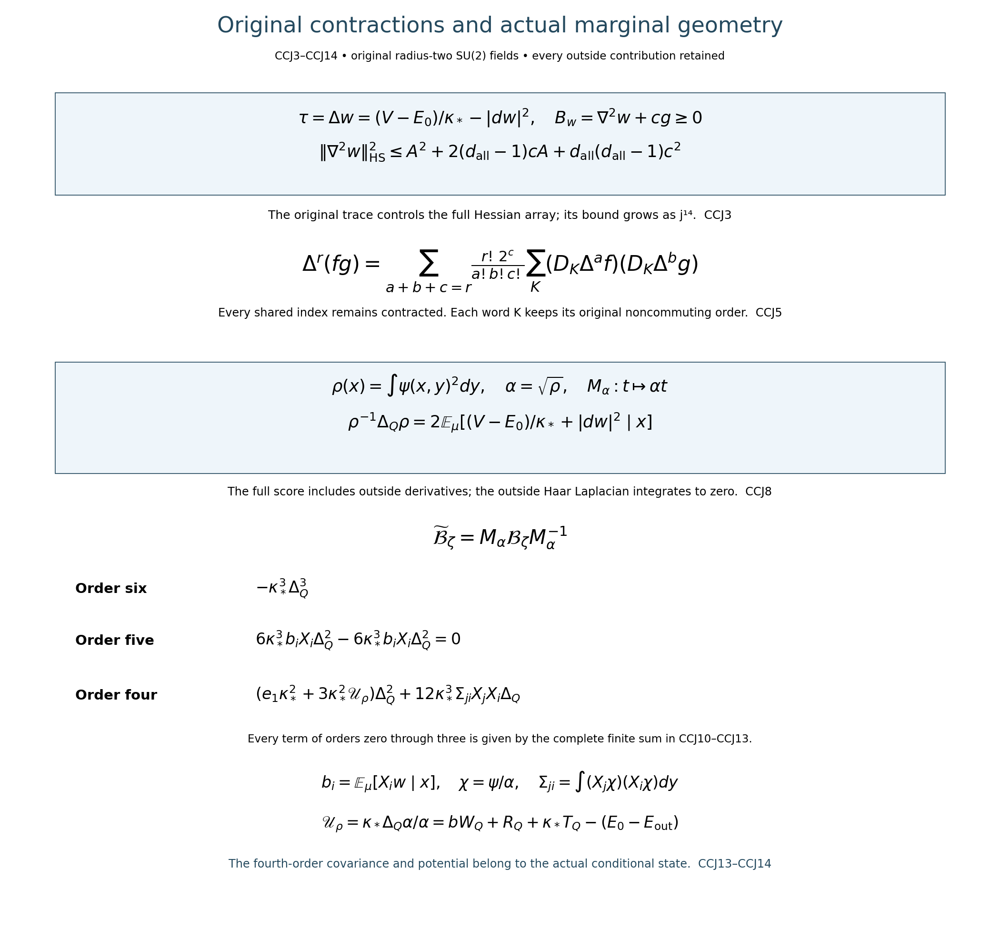
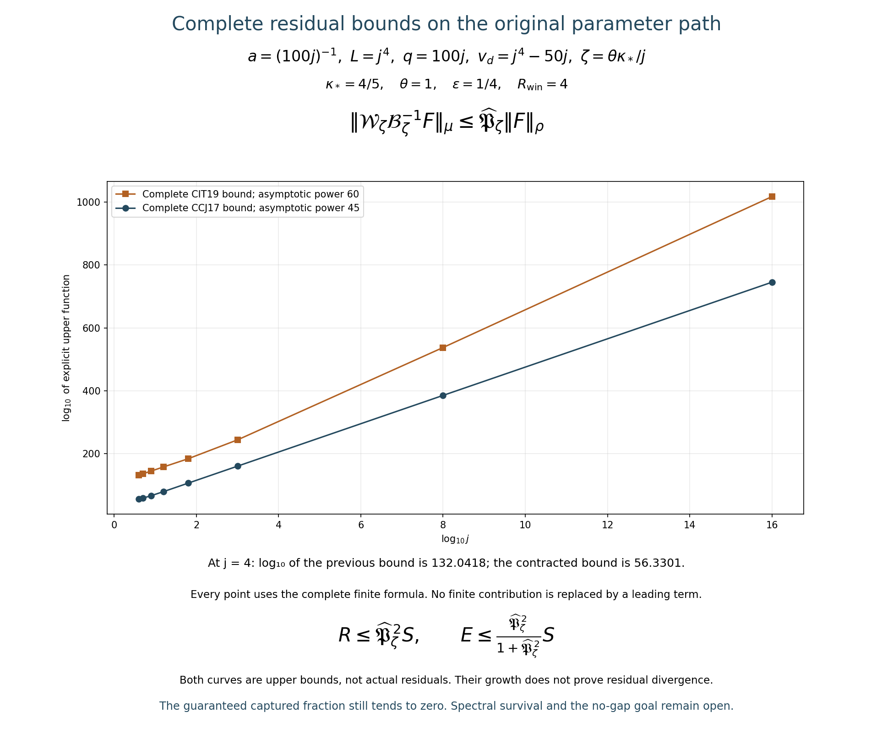

# Original contractions, marginal geometry and the full cubic bound

Reviewed derivation, 15 October 2026. The goal remains a smooth interacting globally gapless four-dimensional state with reconstruction and theory identification. This paper derives finite-regulator identities and bounds; it does not claim that endpoint.

The complete original operators and typed maps are [CDE1–CDE8](https://github.com/KokunoYumeto/yang-mills-interacting-workbench/blob/d2971f6cb7f870efa71fb986e5b8f2c694d7d91f/yang-mills/continuations/20261011-central-signs-shrinking-window/ORIGINAL_FRAME_CUBIC_RESIDUAL.md). The heat comparison and inverse-multiplier proofs are [CIT1–CIT20](https://github.com/KokunoYumeto/yang-mills-interacting-workbench/blob/d2971f6cb7f870efa71fb986e5b8f2c694d7d91f/yang-mills/continuations/20261011-central-signs-shrinking-window/CUBIC_INVERSE_TRIAL_BOUNDS.md). The full marginal equation, compression and residual receiver are [FCC1–FCC13](https://github.com/KokunoYumeto/yang-mills-interacting-workbench/blob/d2971f6cb7f870efa71fb986e5b8f2c694d7d91f/yang-mills/continuations/20261011-central-signs-shrinking-window/FULL_CUBIC_SOURCE_COMPRESSION.md). The global Hessian input is [HCB1](https://github.com/KokunoYumeto/yang-mills-interacting-workbench/blob/d2971f6cb7f870efa71fb986e5b8f2c694d7d91f/yang-mills/continuations/20261011-central-signs-shrinking-window/ACTUAL_HESSIAN_BOUNDS.md). These sections were read for their stated uses. Eleven disk-index hits are routing records only; no new external author-source reading or novelty is asserted.

## 1. Original state, counts, maps and the actual energy form

Retain the original radius-two SU(2) metric, probability Haar measure, generators
\(T_i=-i\sigma_i/2\), original oriented faces and every boundary incidence:
\[
\begin{gathered}
a=(100j)^{-1},\quad L=j^4,\quad g^2=\kappa_*a/2,\quad
b=(\kappa_*a^2)^{-1},\quad \zeta=\theta\kappa_*/j,\\
N=3(2L)(2L+1)^2,\quad M=3(2L)^2(2L+1),\quad d_{\rm all}=3N,\\
V=2bM-b\sum_pT_p,\quad H=-\kappa_*\Delta+V,\quad
H\psi=E_0\psi,\quad\psi>0,\quad\int\psi^2dU=1,\\
w=\log\psi,\quad d\mu=\psi^2dU,\quad
\mathcal L=\psi^{-1}(H-E_0)\psi
=-\kappa_*[\Delta+2dw\cdot d].
\end{gathered}
\]
Let \(Q=v+\{0,\ldots,q\}^3\) contain the entire original source support, q at least one. Its inside, face and crossing counts remain
\[
N_Q=3q(q+1)^2,\quad M_Q=3q^2(q+1),\quad
C_Q=2q(q+1)\sum_{d=1}^3
[\mathbf1_{\{v_d>0\}}+\mathbf1_{\{v_d+q<2L\}}].
\]
Here \(C_Q\) is an integer; the original inside Haar Casimir is
\(\mathsf C_Q=-\Delta_Q\), an operator. Keep all inside link/color indices I and all full indices \(\mathcal I\). The ordered fields satisfy
\([X_i,X_j]=-\epsilon_{ijk}X_k\) on each link and
\([\Delta,X_i]=[\Delta_Q,X_i]=0\) for inside i.

With x inside and y outside, the exact maps are
\[
\begin{gathered}
\rho(x)=\int\psi(x,y)^2dy,\quad\alpha=\sqrt\rho,\quad
J:L^2(\rho dx)\to L^2(\mu),\quad (Jt)(x,y)=t(x),\\
J^*f=\rho^{-1}\int\psi^2fdy,\quad J^*J=I,\quad
P=JJ^*,\quad Q_c=I-P,\\
M_\alpha:L^2(\rho dx)\to L^2(dx),\quad t\mapsto\alpha t,\quad
M_\alpha^{-1}v=\alpha^{-1}v .
\end{gathered}
\]
Fubini proves the adjoint and inclusion equalities; multiplication proves
\(\|M_\alpha t\|_{L^2(dx)}=\|t\|_\rho\). Smooth positive multiplication preserves all finite-regulator Sobolev domains. The original gauge restrictions are preserved by the outside Haar change of variables. No outside physical component is removed.

Keep every coefficient of
\[
q_\zeta(\lambda)=\lambda^3+e_1\lambda^2+e_2\lambda+e_3
=(\lambda+\zeta)(\lambda+\varepsilon\zeta)(\lambda+R_{\rm win}\zeta),
\]
where \(e_1=\zeta(1+\varepsilon+R_{\rm win})\),
\(e_2=\zeta^2(\varepsilon+R_{\rm win}+\varepsilon R_{\rm win})\),
\(e_3=\varepsilon R_{\rm win}\zeta^3\), \(0<\varepsilon<1<R_{\rm win}\).
The positive closed compression has operator domain H6 and is
\(\mathcal B_\zeta=J^*q_\zeta(\mathcal L)J\ge e_3I\).
For the actual \(t=\mathcal B_\zeta^{-1}F\), \(u=Jt\), its entire form is
\[
\langle t,F\rangle_\rho
=\|\mathcal L^{3/2}u\|_\mu^2
+e_1\|\mathcal Lu\|_\mu^2
+e_2\|\mathcal L^{1/2}u\|_\mu^2
+e_3\|t\|_\rho^2 .\tag{CCJ1}
\]
The left side is real and at most \(\|F\|_\rho\|t\|_\rho\). For each of the first three terms, retain the last term and use, with \(r=\|t\|_\rho\),
\[
\|F\|_\rho r-e_3r^2
=\frac{\|F\|_\rho^2}{4e_3}
-e_3\left(r-\frac{\|F\|_\rho}{2e_3}\right)^2.
\]
The other nonnegative energy terms remain in CCJ1. Therefore
\[
\|\mathcal L^{3/2}u\|_\mu\le\frac{\|F\|_\rho}{2\sqrt{e_3}},\quad
\|\mathcal Lu\|_\mu\le\frac{\|F\|_\rho}{2\sqrt{e_1e_3}},\quad
\|d_Qt\|_\rho\le\frac{\|F\|_\rho}{2\sqrt{\kappa_*e_2e_3}}.
\tag{CCJ2}
\]
The last step uses the exact ground-form identity
\(\|\mathcal L^{1/2}Jt\|_\mu^2=\kappa_*\int\rho|d_Qt|^2dx\).
Every source norm remains raw.

## 2. Retain the Hessian trace before bounding its full array

Set
\[
c=2/(\kappa_*a),\quad A=4bM/\kappa_*,\quad
G=4\pi^2Nc^2,\quad A_Q=2\pi c\sqrt{N_Q}.
\]
HCB1 gives \(\nabla^2w\ge-cg\); the original full ground equation gives
\[
\tau:=\operatorname{tr}\nabla^2w
=(V-E_0)/\kappa_*-|dw|^2,\quad
-d_{\rm all}c\le\tau\le(4bM-E_0)/\kappa_*\le A .
\]
Put \(B_w=\nabla^2w+cg\), a positive tangent endomorphism. Its exact inverse is
\(\nabla^2w=B_w-cg\). If \(\lambda_\nu\) are its eigenvalues, every
\(\lambda_\nu\ge0\), so
\[
\begin{aligned}
\|\nabla^2w\|_{\rm HS}^2
&=\operatorname{tr}B_w^2-2c\operatorname{tr}B_w+d_{\rm all}c^2\\
&\le\tau^2+2(d_{\rm all}-1)c\tau
+d_{\rm all}(d_{\rm all}-1)c^2 .
\end{aligned}
\]
The inequality follows from
\((\sum_\nu\lambda_\nu)^2-\sum_\nu\lambda_\nu^2
=2\sum_{\nu<\eta}\lambda_\nu\lambda_\eta\ge0\).
The quadratic in \(\tau\) is convex. On \([-d_{\rm all}c,A]\) its endpoint values are \(d_{\rm all}c^2\) and the same quadratic at A; the latter is larger because \(d_{\rm all}\ge3\) and \(A\ge0\). Thus
\[
\|\nabla^2w\|_{\rm HS}\le
H_2^+:=\sqrt{A^2+2(d_{\rm all}-1)cA
+d_{\rm all}(d_{\rm all}-1)c^2}.
\tag{CCJ3}
\]
Before the last comparison one may retain \((4bM-E_0)/\kappa_*\) instead of A. The vacuum energy and the negative shift of \(B_w\) have not been suppressed. This strengthens the dimension-times-operator-norm estimate used in CIT1.

Write \(a_J=X_J\psi/\psi\), with ordered subwords exactly as in CDE. Define full and inside bounds
\[
\begin{gathered}
U_0^{\rm all}=U_0^Q=1,\quad U_1^{\rm all}=\sqrt G,\quad U_1^Q=A_Q,\\
U_2^{\rm all}=H_2^++G+\sqrt{G/2},\qquad
U_2^Q=H_2^++A_Q^2+A_Q/\sqrt2 .
\end{gathered}
\]
Indeed \(X_jX_i\psi/\psi=\nabla^2w(X_j,X_i)+a_ja_i+
(\nabla_{X_j}X_i)w\). The original bi-invariant connection is
\(\nabla_{X_j}X_i=[X_j,X_i]/2\). Its full squared array contraction is
\(|dw|^2/2\); the inside restriction has \(|d_Qw|^2/2\).
CCJ3 and the unchanged score bounds prove these inequalities.

Keep CIT's complete incidence ceilings \(p_1,p_2,p_{1,\times},p_{2,\times},p_{2,+}\):
\[
\begin{gathered}
p_1=2b\sqrt{4M_Q+C_Q},\quad p_2=3b\sqrt{16M_Q+C_Q},\\
p_{1,\times}=2b\sqrt{C_Q},\quad p_{2,\times}=3b\sqrt{C_Q},\quad
p_{2,+}=6b\sqrt{4M_Q+C_Q},\quad
A_+^+=2\pi c\sqrt{N_Q+3C_Q}.
\end{gathered}
\]
For all original fields use
\[
v_1^{\rm all}=4b\sqrt M,\quad v_2^{\rm all}=12b\sqrt M,\quad
v_r^{\rm all}=2bM3^{r/2}\ (3\le r\le5),
\]
and for inside fields use
\(v_1^Q=p_1,v_2^Q=p_2,v_r^Q=2b(M_Q+C_Q)3^{r/2}\).
The first two full bounds follow from
\(\sum_e r_e=4M,\sum_{e,f}n_{ef}=16M\), with \(r_e,n_{ef}\le4\);
the second derivative color factor is \(3b/2\). For r at least three, each face has at most \(12^r\) nonzero ordered color/link words and each trace derivative has modulus at most \(2^{1-r}\), preserving all inverse-link signs before taking the modulus.

For \(\bullet\) equal to all or Q, define for m=3,...,6
\[
\begin{gathered}
B_{m-1}^\bullet=\kappa_*^{-1}
\sum_{r=1}^{m-1}\binom{m-1}{r}v_r^\bullet U_{m-1-r}^\bullet,\\
U_m^\bullet=\sqrt{2\pi U_{m-1}^\bullet
[(2A+G)U_{m-1}^\bullet+B_{m-1}^\bullet]} .
\end{gathered}\tag{CCJ4}
\]
These bound the actual ordered arrays \(a_J\) on the indicated indices.
The proof is CIT4–CIT7 applied to the complete commutator
\([V,X_J]\psi=-\sum_{\varnothing\ne S}(X_{J_S}V)(X_{J_{S^c}}\psi)\).
For clarity, with \(C=-\Delta,T=A+G\), the full original heat operator satisfies
\[
|d e^{-tC}F|/\psi\le D e^{Tt}/\sqrt{2t}
\quad\text{when the proved array bound is } |F|\le D\psi .
\]
This follows from the full vector heat variance and
\(e^{-tC}\psi^2\le e^{2Tt}\psi^2\), both proved in CIT4–CIT5.
Apply the resolvent to the commutator with
\(\tau=2T+A+B_{m-1}^\bullet/U_{m-1}^\bullet\);
its integral gives exactly CCJ4. The extra derivative is first full and then restricted as required. No higher derivative norm is assumed.

## 3. The exact contracted product map

For smooth scalar f,g and either original full or inside Casimir, let
\(D_K=X_{k_c}\cdots X_{k_1}\). Then
\[
\Delta^r(fg)=
\sum_{\substack{a+b+c=r\\a,b,c\ge0}}
\frac{r!2^c}{a!b!c!}
\sum_{k_1,\ldots,k_c}
(D_K\Delta^a f)(D_K\Delta^b g).
\tag{CCJ5}
\]
This includes r=0. To prove it, multiplication
\(\mathsf m:C^\infty\times C^\infty\to C^\infty\) intertwines \(\Delta\) with
\(\Delta\otimes I+I\otimes\Delta+2\sum_iX_i\otimes X_i\).
The three displayed operators commute pairwise because the original Casimir commutes with every field. Their multinomial expansion gives CCJ5. The power of the third operator is the ordered sum shown, without commuting its individual fields. Each contraction and every factor \(2^c\) is retained.

Set \(F_0=(V-E_0)/\kappa_*\). For nonnegative k,a define explicit bounds on
\(D^k\Delta^aF_0\):
\[
f_{0,0}^+=A,\quad
f_{0,a}^+=(6bM/\kappa_*)3^{a-1}\ (a\ge1),\quad
f_{k,a}^+=3^a v_k^{\rm all}/\kappa_*\ (k\ge1).
\]
Here only the finitely many entries occurring below are required.
The original identity \(\Delta V=6bM-3V\) proves these formulas;
for k positive its derivative kills the displayed constant, and for k=0
\(0\le V\le4bM\) gives \(|6bM-3V|\le6bM\).

Define \(E_{m,0}=U_m^{\rm all}\). For r at least one and \(m+2r\le6\), define recursively
\[
E_{m,r}=
\sum_{a+b+c=r-1}\frac{(r-1)!2^c}{a!b!c!}
\sum_{s=0}^m\binom ms
f_{s+c,a}^+ E_{m-s+c,b}.
\tag{CCJ6}
\]
Every b in this formula is smaller than r, so all entries are explicitly determined.
The exact identity \(\Delta\psi=F_0\psi\), CCJ5 applied to
\(\Delta^{r-1}(F_0\psi)\), and the complete ordered product rule for the remaining m derivatives give
\[
\sup_U\left\|\left(\psi^{-1}D_J\Delta^r\psi\right)_{|J|=m}\right\|
\le E_{m,r}.
\]
For each subset the shared c derivative indices are contracted. Cauchy–Schwarz on those indices and on the full free array gives the product in CCJ6. There are \(\binom ms\) subsets of size s; their original field order is unchanged. Thus this bounds contracted derivatives directly, without a dimension factor for a Kronecker tensor.

## 4. Every contracted marginal and inverse-multiplier derivative

For r=0 put
\[
R_{m,0}^+=\sum_{s=0}^m\binom ms U_s^Q U_{m-s}^Q .
\]
For r positive and \(m+2r\le6\), put
\[
R_{m,r}^+=
\sum_{a+b+c=r}\frac{r!2^c}{a!b!c!}
\sum_{s=0}^m\binom ms E_{s+c,a}E_{m-s+c,b}.
\tag{CCJ7}
\]
These are actual pointwise ceilings for the ordered inside arrays
\(\rho^{-1}D_J\Delta_Q^r\rho\). Indeed
\[
D_J\Delta_Q^r\rho=\int D_J\Delta^r(\psi^2)dy .
\]
To verify this exact equality, expand
\((\Delta_Q+\Delta_{Q^c})^r\). For every term containing an outside Laplacian, original compact Haar integration by parts gives zero, including its full boundary statement: the group factors have no boundary. The inside derivatives commute with that integral. CCJ5, the full product rule, and CCJ6 now prove CCJ7. For r=0 the original inside bounds are sharper and give the first formula. Outside ground derivatives remain in the r-positive expression.

In particular the full equation gives the exact lower-order identities
\[
\begin{gathered}
\frac{\Delta_Q\rho}{\rho}
=2\mathbb E_\mu[F_0+|dw|^2\mid x],\qquad
d_Q\log\rho=2\mathbb E_\mu[d_Qw\mid x],\\
\alpha\Delta_Q(\alpha^{-1})
=-\tfrac12\Delta_Q\rho/\rho+\tfrac34|d_Q\rho/\rho|^2 .
\end{gathered}\tag{CCJ8}
\]
Consequently \(|\alpha\Delta_Q(\alpha^{-1})|\le A+G+3A_Q^2\).
These identities include all outside scores and E0.

Here is a complete finite formula for every inverse-multiplier ceiling needed.
Arrange an ordered list of \(m+2r\) derivative positions with r adjacent pairs, representing the r original Laplacians, followed by m free positions. For each set partition \(\pi\) of these positions and each block B, let \(r_B\) be the number of pairs wholly in B, and \(m_B=|B|-2r_B\). Define
\[
I_{0,0}^+=1,\qquad
I_{m,r}^+
=\sum_{\pi\in\Pi_{m+2r}}
\left|(-\tfrac12)_{|\pi|}\right|
\prod_{B\in\pi}R_{m_B,r_B}^+
\quad(m+2r\ge1).
\tag{CCJ9}
\]
The falling coefficient is \((z)_k=z(z-1)\cdots(z-k+1)\).
This is a finite, explicitly specified partition sum, with no omitted partitions.

To prove it, apply CIT15's full ordered chain identity to
\(\alpha X_J(\alpha^{-1})\) before contracting the r pairs.
A pair wholly in a block stays adjacent after taking its subword; its summed fields are the original \(\Delta_Q\). Casimir commutation moves that entire Laplacian past the remaining fields of that block. A pair split between blocks is a shared tensor index, not a vanished term. A block therefore contributes the tensor
\(\rho^{-1}D^{m_B}\Delta_Q^{r_B}\rho\), in its original order.
Contract the tensors along all split pairs. The norm of a partial contraction of two tensors is at most the product of their Hilbert–Schmidt norms, by Cauchy–Schwarz. Contracting all shared indices at each step proves this for the entire finite network; isolated factors use the exact product norm. All within-block contractions were already kept as Laplacians. CCJ7 gives CCJ9 and
\[
\sup_x\|(\alpha D_J\Delta_Q^r\alpha^{-1})_{|J|=m}\|
\le I_{m,r}^+ .
\]
The equality with its signed falling coefficients and all contraction indices is the preceding construction; absolute values are taken only for this upper bound.

## 5. Complete mapped cubic and its actual fourth-order geometry

For any original inside derivative word J, put
\(\mathscr T_{J,r}v=\alpha X_J\Delta_Q^r(\alpha^{-1}v)\).
Its exact finite expansion is
\[
\mathscr T_{J,r}v=
\sum_{a+b+c=r}\frac{r!2^c}{a!b!c!}
\sum_K\sum_{S\subseteq\{1,\ldots,m\}}
[\alpha X_{J_S}X_K\Delta_Q^a(\alpha^{-1})]\,
X_{J_{S^c}}X_K\Delta_Q^b v .
\tag{CCJ10}
\]
Here m is the length of J, and each subword keeps its original order.
CCJ5 followed by the entire ordered product rule proves the formula.
For later bounds, introduce the finite polynomial
\[
\mathscr P_{m,r}(z)=
\sum_{a+b+c=r}\frac{r!2^c}{a!b!c!}
\sum_{s=0}^m\binom ms I_{s+c,a}^+ z^{m-s+c+2b}.
\tag{CCJ11}
\]
It records a norm estimate, not a replacement operator. The exact Haar identity
\(\sum_{|J|=n}\|X_J\Delta_Q^bv\|^2=h_{n+2b}(v)^2\),
where \(h_l(v)=\|\mathsf C_Q^{l/2}v\|_{L^2(dx)}\), and the same tensor contraction inequality give
\[
\|(\mathscr T_{J,r}v)_{|J|=m}\|_{L^2(dx)}
\le\sum_l[z^l]\mathscr P_{m,r}(z)\,h_l(v).
\]

For completeness, the whole original compressed cubic is
\[
\mathcal B_\zeta t
=\sum_{(m,r)}\sum_{|J|=m}b^{m,r}_J X_J\Delta_Q^r t .
\]
Its ten rows are listed here; a bar means the full original conditional integral:
\[
\begin{array}{c|l}
(m,r)&b^{m,r}_J\\\hline
(0,3)&-\kappa_*^3\\
(0,2)&e_1\kappa_*^2\\
(0,1)&-e_2\kappa_*\\
(0,0)&e_3\\
(1,2)&-6\kappa_*^3\overline a_i\\
(2,1)&-12\kappa_*^3\overline a_{ji}\\
(3,0)&-8\kappa_*^3\overline a_{kji}\\
(1,1)&-6\kappa_*^2\overline V_i+4e_1\kappa_*^2\overline a_i\\
(2,0)&-8\kappa_*^2\overline V_{ji}
-4\kappa_*^2\overline{V_ja_i+2V_ia_j}
+4e_1\kappa_*^2\overline a_{ji}\\
(1,0)&6\kappa_*^2\overline V_i
-4\kappa_*^2\overline{\sum_{j\in\mathcal I}a_jV_{ji}}
+2e_1\kappa_*\overline V_i-2e_2\kappa_*\overline a_i .
\end{array}\tag{CCJ12}
\]
Every row is exactly CDE2–CDE4, using the proved Wilson identity
\(\Delta V_i=-3V_i\). The explicitly full j sum remains.
Thus the complete mapped operator is the same sum with
\(X_J\Delta_Q^r t\) replaced by \(\mathscr T_{J,r}v\).
CCJ10 and CCJ12 specify every coefficient of every order.

Put \(b_i=X_i\log\alpha=\overline a_i\) and
\(\Sigma_{ji}=\overline{a_ja_i}-b_jb_i\).
Differentiating the full integral, with both numerator and denominator, gives
\[
X_jb_i=\overline a_{ji}+\overline{a_ja_i}-2b_jb_i,\qquad
\overline a_{ji}=\alpha^{-1}X_jX_i\alpha-\Sigma_{ji}.
\]
Also \(\alpha X_i\alpha^{-1}=-b_i\) and
\(\alpha X_jX_i\alpha^{-1}=-X_jb_i+b_jb_i\).
The order-five terms from the first and fifth rows of CCJ12 are respectively
\(6\kappa_*^3 b_iX_i\Delta_Q^2\) and
\(-6\kappa_*^3 b_iX_i\Delta_Q^2\). They cancel exactly.
Keeping all order-four contributions gives
\[
\begin{aligned}
\widetilde{\mathcal B}_\zeta
={}&-\kappa_*^3\Delta_Q^3+
(e_1\kappa_*^2+3\kappa_*^2\mathscr U_\rho)\Delta_Q^2\\
&+12\kappa_*^3\sum_{i,j\in I}\Sigma_{ji}X_jX_i\Delta_Q
+\text{the full orders zero through three in CCJ10–CCJ12},\\
\mathscr U_\rho={}&\kappa_*\Delta_Q\alpha/\alpha .
\end{aligned}\tag{CCJ13}
\]
The last line of the operator expression denotes the exact finite sum already specified by CCJ10–CCJ12 with those degrees, not an assumed or uncomputed remainder.

Explicitly, the retained orders zero through three are the following complete sum over the ten rows of CCJ12:
\[
\sum_{(m,r)}\sum_{|J|=m}b^{m,r}_J
\sum_{a+b+c=r}\frac{r!2^c}{a!b!c!}
\sum_K
\sum_{\substack{S\subseteq\{1,\ldots,m\}\\m-|S|+c+2b\le3}}
[\alpha X_{J_S}X_K\Delta_Q^a(\alpha^{-1})]
X_{J_{S^c}}X_K\Delta_Q^b v .
\]
Thus no lower-order coefficient is left to a prospective calculation.

To verify the fourth-order coefficients directly, the scalar coefficient from the first and fifth rows is
\(-3\kappa_*^3\alpha\Delta_Q\alpha^{-1}
-6\kappa_*^3\sum b_i\alpha X_i\alpha^{-1}
=3\kappa_*^2\mathscr U_\rho\).
Their second-derivative tensor and the sixth row combine as
\[
-12\kappa_*^3\alpha X_jX_i\alpha^{-1}
+24\kappa_*^3b_jb_i
-12\kappa_*^3\overline a_{ji}
=12\kappa_*^3\Sigma_{ji}.
\]
Only dummy indices are relabeled; no original fields are commuted.

These coefficients are actual marginal geometry. With
\(\chi=\psi/\alpha\), \(\int\chi^2dy=1\), one has
\[
\Sigma_{ji}=\int(X_j\chi)(X_i\chi)dy,\qquad
\mathscr U_\rho=bW_Q+R_Q+\kappa_*T_Q-(E_0-E_{\rm out}),
\tag{CCJ14}
\]
where \(R_Q,T_Q\) are the full original quantities in FCC1.
The first equality follows from \(X_i\chi=\chi(a_i-b_i)\);
the second is the exact FCC1 marginal equation. All outside energy and crossing contributions remain.

In particular
\[
\mathscr U_\rho
=\kappa_*\{\mathbb E[F_0+|dw|^2\mid x]-|b|^2\},\quad
-E_0\le\mathscr U_\rho\le4bM-E_0+\kappa_*G,\quad
\|\Sigma\|_{\rm HS}\le A_Q^2.
\]
For the potential inequality,
\(\mathbb E|dw|^2-|b|^2\) is the sum of the outside squared score and the inside score variance, hence belongs to \([0,G]\).
For the covariance inequality use its positive eigenvalues and
\(\operatorname{tr}\Sigma\le\mathbb E|d_Qw|^2\le A_Q^2\).
Thus \(|\mathscr U_\rho|\le\kappa_*(A+G)\), retaining the sharper E0 expression above.

## 6. An explicit graph bound with every contraction retained

Use the following original coefficient ceilings:
\[
\begin{gathered}
d_{1,2}=6\kappa_*^3U_1^Q,\quad
d_{2,1}=12\kappa_*^3U_2^Q,\quad
d_{3,0}=8\kappa_*^3U_3^Q,\\
d_{1,1}=6\kappa_*^2p_1+4e_1\kappa_*^2U_1^Q,\\
d_{2,0}=8\kappa_*^2p_2+12\kappa_*^2p_1A_Q
+4e_1\kappa_*^2U_2^Q,\\
d_{1,0}=6\kappa_*^2p_1+4\kappa_*^2p_{2,+}A_+^+
+2e_1\kappa_*p_1+2e_2\kappa_*U_1^Q .
\end{gathered}
\]
Let \(\mathcal J=\{(1,2),(2,1),(3,0),(1,1),(2,0),(1,0)\}\). Define
\[
\mathscr D(z)=
\kappa_*^3(\mathscr P_{0,3}(z)-z^6)
+e_1\kappa_*^2\mathscr P_{0,2}(z)
+e_2\kappa_*\mathscr P_{0,1}(z)+e_3
+\sum_{(m,r)\in\mathcal J}d_{m,r}\mathscr P_{m,r}(z).
\]
The subtracted monomial is the original principal term, whose coefficient is exactly one in CCJ11. Every remaining coefficient of this polynomial is nonnegative. Put
\[
\begin{gathered}
\widehat d_l=[z^l]\mathscr D(z)\quad(0\le l\le3),\\
\widehat d_4=\min\{[z^4]\mathscr D(z),
e_1\kappa_*^2+3\kappa_*^3(A+G)+12\kappa_*^3A_Q^2\}.
\end{gathered}\tag{CCJ15}
\]
The first quantity bounds the full expansion, and the second order-four quantity follows from CCJ13. Its fifth-order part is exactly zero by the proved cancellation, before taking any norms. The whole mapped equation consequently satisfies
\[
\widetilde{\mathcal B}_\zeta=\kappa_*^3\mathsf C_Q^3+
\widehat{\mathcal E}_\zeta,\qquad
\|\widehat{\mathcal E}_\zeta v\|_{L^2(dx)}
\le\sum_{l=0}^4\widehat d_l h_l(v).
\]
No lower-order row has been dropped. For l=1,...,4 set
\[
\begin{gathered}
\widehat\eta_l=\kappa_*^3/(8\widehat d_l),\quad
\widehat b_l=(1-l/6)[(l/6)/\widehat\eta_l]^{l/(6-l)},\\
\widehat K=2\kappa_*^{-3}
[\widehat d_0+\sum_{l=1}^4\widehat d_l\widehat b_l],\quad
\widehat L=2\kappa_*^{-3}+\widehat K/e_3,\quad
\widehat\Theta_l=\widehat L^{l/6}e_3^{-(1-l/6)} .
\end{gathered}
\]
The original scalar spectral inequality
\(h_l\le\widehat\eta_lh_6+\widehat b_lh_0\)
is proved by maximizing \(x^{l/6}-\widehat\eta_lx\).
The four resulting \(h_6\) contributions sum to \(\kappa_*^3h_6/2\).
Since \(v=M_\alpha\mathcal B_\zeta^{-1}F\) and
\(h_0(v)\le e_3^{-1}\|F\|_\rho\), the complete equation and spectral Hölder give
\[
h_l(v)\le\widehat\Theta_l\|F\|_\rho,\qquad0\le l\le6 .
\tag{CCJ16}
\]
This supplies every trial norm from original parameters.

## 7. Full residual and raw matrix receiver

Define \(r_{m,r}\) by the six displayed d rows, replacing p1 by
\(p_{1,\times}\) and p2 by \(p_{2,\times}\) only in the pure potential terms.
In particular the product \(12\kappa_*^2p_1A_Q\) and the full
\(4\kappa_*^2p_{2,+}A_+^+\) remain. Let
\[
\mathscr P_{m,r}(\widehat\Theta)
:=\sum_l[z^l]\mathscr P_{m,r}(z)\widehat\Theta_l .
\]
This notation is coefficientwise substitution, not evaluation at a scalar.
Then the entire original residual satisfies the explicit estimate
\[
\begin{gathered}
\|\mathcal W_\zeta\mathcal B_\zeta^{-1}F\|_\mu
\le\widehat{\mathfrak P}_\zeta\|F\|_\rho,\\
\widehat{\mathfrak P}_\zeta=
\sum_{\substack{(m,r)\in\mathcal J\\(m,r)\ne(1,0)}}
r_{m,r}\mathscr P_{m,r}(\widehat\Theta)
+r_{1,0}\min\left\{\mathscr P_{1,0}(\widehat\Theta),
\frac1{2\sqrt{\kappa_*e_2e_3}}\right\}.
\end{gathered}\tag{CCJ17}
\]
For proof, use the exact CDE4 complementary projection. For each original coefficient array c and inside derivative tensor Dt,
\[
\|\delta c\cdot Dt\|_\mu^2
=\int\rho\,\operatorname{Var}(c\cdot Dt\mid x)dx
\le\int\rho\,\mathbb E[|c\cdot Dt|^2\mid x]dx .
\]
The full covariance term is retained before using its sign.
Pure potential derivatives may be restricted to crossing faces because their inside-measurable parts have exactly zero complementary projection.
Apply CCJ10–CCJ11 and CCJ16 to every remaining term, retaining every outside coefficient. For the final first-derivative row also use CCJ2 and take the smaller of the two proved bounds. This gives CCJ17 without a density-ratio comparison.

For every unchanged raw source vector the matrix consequences are
\[
R\le\widehat{\mathfrak P}_\zeta^2 S,\qquad
0\le E\le
\frac{\widehat{\mathfrak P}_\zeta^2}{1+\widehat{\mathfrak P}_\zeta^2}S,\qquad
\|Yc_{\rm opt}\|_\mu^2\ge
\frac{\varphi^*S\varphi}{1+\widehat{\mathfrak P}_\zeta^2}.
\tag{CCJ18}
\]
Apply CCJ17 to \(F=\sum_p\varphi_pF_p\) to prove the first inequality.
Then \(S+R\le(1+\widehat{\mathfrak P}_\zeta^2)S\); inverse order and multiplication by S on both sides prove the second using FCC's
\(E=S-S(S+R)^{-1}S\). Its exact orthogonal projection identity proves the last. No commutation of S and R and no loss of a cross-face entry is assumed.

The entire signed filter, including both negative tails and all filtered source-complement terms, remains as in FCC11–FCC13. CCJ17 is an upper estimate, not an evaluation of its actual signed spectral mass.

## 8. Exact growth and leading coefficient on the original path

Use the same original side-one cube as CIT20:
\[
\begin{gathered}
q=100j,\quad v_d=j^4-50j,\quad j\ge4,\\
N_Q=300j(100j+1)^2,\quad M_Q=30000j^2(100j+1),\\
C_Q=1200j(100j+1).
\end{gathered}
\]
All finite expressions above keep these counts and the original full N,M.
The following powers denote the actual limits of the displayed upper functions, not replacement formulas for their finite values:
\[
\begin{gathered}
H_2^+:14,\qquad U_m^{\rm all}:7m\ (0\le m\le6),\\
U_0^Q:0,\quad U_1^Q:5/2,\quad U_m^Q:7m\ (2\le m\le6),\\
E_{m,r}:7(m+2r),\qquad
R_{m,r}^+,I_{m,r}^+:7(m+2r)\quad(m+2r\ge2),\\
R_{1,0}^+,I_{1,0}^+:5/2,\qquad
\widehat d_l:42-7l\ (0\le l\le4),\\
\widehat K:42,\quad\widehat L:45,\quad
\widehat\Theta_l:3+7l\ (0\le l\le6).
\end{gathered}\tag{CCJ19}
\]
Every listed limit coefficient is finite and strictly positive. Here is the complete calculation, including its coefficients.

Put
\[
\mathsf a=960000/\kappa_*^2,\qquad
\mathsf g=3840000\pi^2/\kappa_*^2,\qquad
\gamma=\sqrt{2\pi(2\mathsf a+\mathsf g)},\qquad
e_\infty=\varepsilon R_{\rm win}\theta^3\kappa_*^3 .
\]
The original formulas give \(A/j^{14}\to\mathsf a\),
\(G/j^{14}\to\mathsf g\), and \(e_3j^3=e_\infty\).
In CCJ3 the A-squared term has power28, while its other two terms have powers27 and26. Thus \(H_2^+/j^{14}\to\mathsf a\).
In CCJ4 every commutator term has strictly smaller power than
\((2A+G)U_{m-1}^\bullet\). Therefore the coefficients of
\(U_m^{\rm all}/j^{7m}\) and \(U_m^Q/j^{7m}\) are respectively
\[
\begin{gathered}
u_0=1,\quad u_1=\sqrt{\mathsf g},\quad
u_m=(\mathsf a+\mathsf g)\gamma^{m-2}\ (m\ge2),\\
u_0^Q=1,\quad u_1^Q=0,\quad
u_m^Q=\mathsf a\gamma^{m-2}\ (m\ge2).
\end{gathered}
\]
The zero in the second row is the limit at scale j7; the actual inside first derivative ceiling remains the positive full \(A_Q\), with power5/2. It is not removed from any finite formula.

CCJ6 gives
\(E_{m,r}/j^{7(m+2r)}\to\mathsf a^r u_m\).
Indeed its term \(a=c=s=0,b=r-1\) has that coefficient recursively; all terms differentiating the potential or applying another Laplacian to it have strictly smaller powers, by the displayed \(f_{k,a}^+\) formulas. Starting with CCJ7, define the following finite coefficients for all indices of total order at most six:
\[
\begin{aligned}
\mathsf R_{m,0}&=\sum_{s=0}^m\binom ms u_s^Q u_{m-s}^Q,\\
\mathsf R_{m,r}&=\sum_{a+b+c=r}\frac{r!2^c}{a!b!c!}
\sum_{s=0}^m\binom ms\mathsf a^{a+b}u_{s+c}u_{m-s+c}\quad(r\ge1),\\
\mathsf I_{0,0}&=1,\qquad
\mathsf I_{m,r}=\sum_{\pi\in\Pi_{m+2r}}
\left|(-\tfrac12)_{|\pi|}\right|
\prod_{B\in\pi}\mathsf R_{m_B,r_B}\quad(m+2r\ge1),\\
\mathsf P_{m,r}(z)&=\sum_{a+b+c=r}\frac{r!2^c}{a!b!c!}
\sum_{s=0}^m\binom ms\mathsf I_{s+c,a}z^{m-s+c+2b}.
\end{aligned}
\]
The block indices are exactly those of CCJ9. Division of each finite term by its displayed power proves these limits, including every zero coefficient from a singleton inside derivative. For order at least two the one-block partition has a positive coefficient, proving strict positivity at the stated order. This establishes the R and I rows of CCJ19 without assuming a derivative asymptotic of the actual state.

The coefficients of \(\widehat d_l/j^{42-7l}\) are
\[
\begin{gathered}
\mathsf d_l=\kappa_*^3[z^l]
\{\mathsf P_{0,3}(z)+12\mathsf a\,\mathsf P_{2,1}(z)
+8\mathsf a\gamma\,\mathsf P_{3,0}(z)\},\quad0\le l\le3,\\
\mathsf d_4=3\kappa_*^3(\mathsf a+\mathsf g).
\end{gathered}
\]
These are the principal, second-ground-derivative and third-ground-derivative rows of CCJ12. All other rows have strictly smaller powers. For l=4 the generic polynomial ceiling has coefficient
\(\kappa_*^3[3(\mathsf a+\mathsf g)+24\mathsf a]\), whereas the proved marginal-geometry ceiling has coefficient
\(3\kappa_*^3(\mathsf a+\mathsf g)\). Taking their minimum proves the last line. The l=0,...,3 coefficients are positive, since the partition consisting of the entire differentiated multiplier block contributes positively.

Define the explicit positive constant
\[
\mathsf K=2\kappa_*^{-3}
\left[\mathsf d_0+
\sum_{l=1}^4(1-l/6)
\left(\frac{8l}{6\kappa_*^3}\right)^{l/(6-l)}
\mathsf d_l^{6/(6-l)}\right].
\]
Each of its five terms has power42 in the finite formula, proving
\(\widehat K/j^{42}\to\mathsf K\), and then
\(\widehat\Theta_l/j^{3+7l}\to\mathsf K^{l/6}/e_\infty\).
This proves the remaining rows of CCJ19.

In the order of the six original residual rows
\((1,2),(2,1),(3,0),(1,1),(2,0),(1,0)\), their complete contributions to CCJ17 have powers
\[
81/2,\quad45,\quad45,\quad27,\quad30,\quad17/2 .
\]
For the first five, add the power of the original coefficient ceiling to
\(7(m+2r)+3\) from its full polynomial. The last uses the proved CCJ2 bound of power5/2 and the original full coefficient of power6. Thus the exact positive limit of the entire upper function is
\[
\boxed{\quad
\lim_{j\to\infty}\frac{\widehat{\mathfrak P}_{\theta\kappa_*/j}}{j^{45}}
=\frac{\kappa_*^3}{e_\infty}
\left[12\mathsf a\,\mathsf P_{2,1}(\mathsf K^{1/6})
+8\mathsf a\gamma\,\mathsf P_{3,0}(\mathsf K^{1/6})\right]>0 .
\quad}\tag{CCJ20}
\]
Every quantity on the right is a finite explicit sum given above. All original finite terms, including ones with zero coefficient in this separately derived limit, remain in CCJ17.

At the same finite parameters used in CIT20,
\(\kappa_*=4/5,\theta=1,\varepsilon=1/4,R_{\rm win}=4,j=4\), 80-digit evaluation of the entire CCJ17 expression gives
\(\log_{10}\widehat{\mathfrak P}_\zeta\approx56.3300887339194\), compared with approximately132.0418362644092 for CIT19. These are numerical evaluations of upper functions, not interval-certified constants used in the proof and not measured residuals. Even the new full value is about5007.44 times its leading asymptotic term at j=4. No finite term is replaced by that asymptotic term.

The guaranteed captured fraction from CCJ18 still tends to zero when this upper bound is used. This does not establish divergence of the actual residual or an obstruction to the target. It does establish the complete contracted operator, its exact fifth-order cancellation and fourth-order marginal geometry, and a stronger full residual estimate with every original contribution retained.

Both the complete CIT bounds and CCJ17 remain valid. Their pointwise minimum can therefore be used in CCJ18 at any finite regulator; no assertion that one particular upper formula is smaller at every parameter value is required.

The diagram retains the original trace in the Hessian estimate, every shared derivative index in the product rule, the full marginal ground equation, and the exact fifth-order cancellation. Its fourth-order coefficients are the actual marginal potential and conditional score covariance. Repeated i,j are summed over the original inside link/color pairs; K is the original ordered word of length c. The complete orders zero through three are the finite expression in CCJ10–CCJ13. Proof locators: CCJ3–CCJ14.

Every plotted point is the evaluation of the entire finite expression at the indicated original parameters. The curves are upper functions, not actual residual or spectral samples. Their exact asymptotic powers are proved in CIT20 and CCJ19–CCJ20. Figure source: [figure_contracted_cubic.py](figure_contracted_cubic.py); complete finite constants and their independent leading-coefficient calculation: [contracted_constants.py](contracted_constants.py).

The 209 checks in [check_contracted_cubic.py](check_contracted_cubic.py) cover exact rational noncommuting original SU(2) product and contracted inverse-partition identities, exact two-link fifth/fourth compressed coefficients in an explicitly constructed positive-ground potential, full Hessian trace estimates and their matrix equality case, the complete compressed energy form, and exact rational growth exponents with 80-digit finite evaluations. The constructed potential is not Wilson, and no test is presented as an evaluation of the original Wilson spectral measure. The complete written proofs above establish the results; the diagnostics check the stated algebra and estimates.

## Nested inverse-energy defects and signed response

[NSE1–NSE13](https://github.com/KokunoYumeto/yang-mills-interacting-workbench/blob/main/yang-mills/continuations/20261011-central-signs-shrinking-window/NESTED_INVERSE_ENERGY_AND_SIGNED_RESPONSE.md) prove the exact cubic inverse-energy defect and its complete signed-source comparison. Typed inclusions between the original nested cubes give every inverse increment and the entire remaining defect, with the full complementary state retained:
\[
\begin{gathered}
C(F)\ge T_r(F)-\frac{86}{25}\zeta\sqrt{m_1(F)\delta_r(F)}
-\zeta^3\delta_r(F),\\
\delta_r(F)=\sum_{s=r}^{L-1}
\|\mathscr A_\zeta^{1/2}(u_{s+1}-u_s)\|_\mu^2 .
\end{gathered}
\]
The original source budgets give a selected actual source-to-annular coupling bound of order j^(-1/2), with its full finite formula and parameter-dependent constant, and a one-sided signed quadratic ceiling of order j^(-2). The selected increment is not the whole remaining tail. Both negative spectral tails, all filtered mixed terms, raw coefficient and family-size factors remain. A positive shrinking-window response and the smooth global no-gap result are not yet established.

## Complete signed tail and its original residual energy

[PST1–PST11](https://github.com/KokunoYumeto/yang-mills-interacting-workbench/blob/main/yang-mills/continuations/20261011-central-signs-shrinking-window/POSITIVE_SIGNED_TAIL_AND_RESIDUAL.md) retain the whole signed tail as a positive Gram form, including every mixed face and annulus entry. The exact residual map is invertible between its stated Sobolev spaces, and its full quadratic form obeys
\[
\begin{gathered}
\mathcal R_\zeta=\zeta^3q_\zeta(\mathcal L)-q_\zeta(\mathcal L)^2k_\zeta(\mathcal L),\\
\frac{\zeta}{100}\mathfrak b_r
\le\|\mathcal R_\zeta^{1/2}h_r\|_\mu^2
\le\frac{43\zeta}{25}\mathfrak b_r,\qquad
\mathfrak b_r=\langle W_r,(\mathcal L+\zeta)^{-1}W_r\rangle_\mu .
\end{gathered}
\]
The complete polynomial certificates, six moment maps, original resolvent equation and both signed matrix comparisons are proved. This strengthens the lower bound for the full remaining tail. The original residual energy and signed trial response still require estimates that establish positive shrinking-window mass; the inherited upper function does not do so. The smooth global no-gap construction remains the goal.
