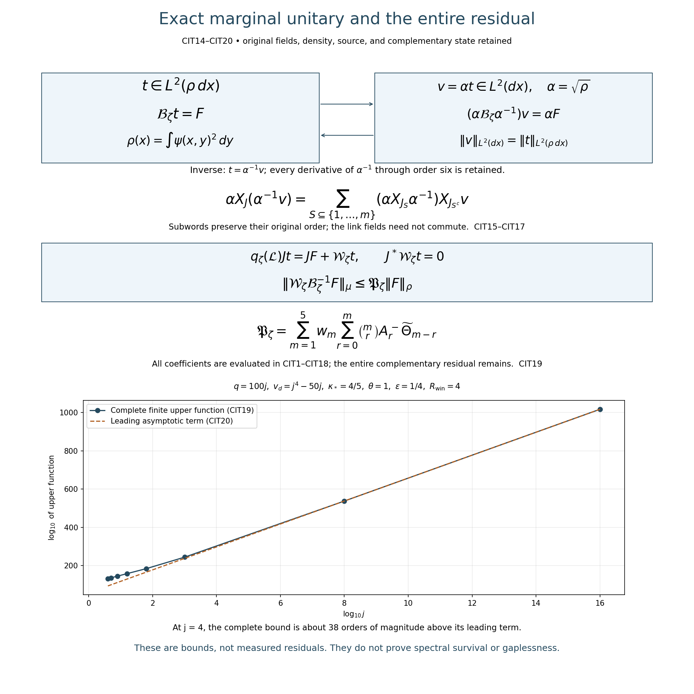

# Evaluated inverse-trial and full cubic residual bounds

Derivation, 15 October 2026. This completes the missing finite-regulator derivative estimate for the matched trial in FCC by deriving an upper bound from the original regulator data. Its size on the original shrinking path is evaluated below. The bound does not establish a small residual or surviving spectral mass. The full smooth global no-gap programme remains active.

Read this with the complete original-frame expansion [CDE1–CDE8](ORIGINAL_FRAME_CUBIC_RESIDUAL.md) and [FCC1–FCC13](https://github.com/KokunoYumeto/yang-mills-interacting-workbench/blob/059609ba52648a8c384db79df959c0e839f37ff0/yang-mills/continuations/20261011-central-signs-shrinking-window/FULL_CUBIC_SOURCE_COMPRESSION.md). The score and Hessian inputs are [RHB1–RHB3, RHB9](https://github.com/KokunoYumeto/yang-mills-interacting-workbench/blob/059609ba52648a8c384db79df959c0e839f37ff0/yang-mills/continuations/20261011-central-signs-shrinking-window/ACTUAL_RESOLVENT_HESSIAN.md) and HCB1. RHB9's full heat-variance proof was read; the unweighted vector version and its comparison with the original ground are proved here. Twelve new disk-index hits are routing records only. No new external source is claimed read and no novelty is asserted.

## 1. Original operators and all constants

Keep every original object and typed map in CDE. In particular
\[
\begin{gathered}
a=(100j)^{-1},\quad L=j^4,\quad
g^2=\kappa_*a/2,\quad b=(\kappa_*a^2)^{-1},\quad
\zeta=\theta\kappa_*/j,\\
N=3(2L)(2L+1)^2,\quad M=3(2L)^2(2L+1),\\
H=-\kappa_*\Delta+V,\quad V=2bM-b\sum_pT_p,\quad
H\psi=E_0\psi,\quad \psi>0,\quad\int\psi^2dU=1,\\
\mathcal L=\psi^{-1}(H-E_0)\psi,\quad
\rho(x)=\int\psi(x,y)^2dy,\quad Jt=t(x).
\end{gathered}
\]
The cube \(Q=v+\{0,\ldots,q\}^3\) includes all original source faces, with
\[
\begin{gathered}
N_Q=3q(q+1)^2,\quad M_Q=3q^2(q+1),\\
C_Q=2q(q+1)\sum_{d=1}^3
[\mathbf1_{\{v_d>0\}}+\mathbf1_{\{v_d+q<2L\}}].
\end{gathered}
\]
Here \(q\ge1\). Every derivative below uses the original radius-two link metric and its ordered fields. Retain the entire polynomial
\[
\begin{gathered}
q_\zeta(\lambda)=(\lambda+\zeta)(\lambda+\varepsilon\zeta)
(\lambda+R_{\rm win}\zeta)
=\lambda^3+e_1\lambda^2+e_2\lambda+e_3,\\
e_1=\zeta(1+\varepsilon+R_{\rm win}),\quad
e_2=\zeta^2(\varepsilon+R_{\rm win}+\varepsilon R_{\rm win}),\quad
e_3=\varepsilon R_{\rm win}\zeta^3 ,
\end{gathered}
\]
where \(0<\varepsilon<1<R_{\rm win}\) and \(\theta>0\).

For the coefficient bounds define
\[
\begin{gathered}
c=2/(\kappa_*a),\quad A=4bM/\kappa_*,\quad
G=4\pi^2Nc^2,\quad W^+=A+(3N-1)c,\\
A_Q=2\pi c\sqrt{N_Q},\qquad
A_+^+=2\pi c\sqrt{N_Q+3C_Q},\\
U_1=A_Q,\qquad
U_2=\sqrt{3N_Q}\,W^++A_Q^2+A_Q/\sqrt2 .
\end{gathered}\tag{CIT1}
\]
The original sharper quantities remain
\[
|V-E_0|/\kappa_*\le(4bM-E_0)/\kappa_*\le A,\quad
-cg\le\nabla^2w\le
[(4bM-E_0)/\kappa_*+(3N-1)c]g\le W^+g.
\]
The first follows from \(0\le E_0\le2bM\); the second is HCB1 and the full original logarithmic ground equation, as proved in QLR5. Thus the use of \(A,W^+\) is an explicit upper comparison, not a changed potential or discarded vacuum energy.

## 2. Every original incidence in the coefficient ceilings

Keep \(r_e,n_{ef},r_e^\times,n_{ef}^\times,Q^+\) from CDE7. A face crossing an induced cube and containing an inside edge has exactly one inside edge: the opposite edge lies outside the violated coordinate interval, while each joining edge has an outside endpoint. Internal faces have four inside edges. Therefore
\[
\begin{gathered}
\sum_{e\in Q}r_e=4M_Q+C_Q,\quad
\sum_{e\in Q}r_e^\times=C_Q,\quad |Q^+|\le N_Q+3C_Q,\\
\sum_{e,f\in Q}n_{ef}=16M_Q+C_Q,\quad
\sum_{e,f\in Q}n_{ef}^\times=C_Q,\quad
\sum_{\substack{e\in Q\\f\in Q^+}}n_{ef}=16M_Q+4C_Q .
\end{gathered}\tag{CIT2}
\]
All counts include e=f. Each incidence is at most four, so its square is at most four times itself. The exact CDE incidence constants consequently obey
\[
\begin{gathered}
P_{1,Q}\le p_1:=2b\sqrt{4M_Q+C_Q},\qquad
P_{1,\times}\le p_{1,\times}:=2b\sqrt{C_Q},\\
P_{2,QQ}:=\frac{3b}{2}\sqrt{\sum_{e,f\in Q}n_{ef}^2}
\le p_2:=3b\sqrt{16M_Q+C_Q},\\
P_{2,\times}\le p_{2,\times}:=3b\sqrt{C_Q},\qquad
P_{2,+}\le p_{2,+}:=6b\sqrt{4M_Q+C_Q}.
\end{gathered}\tag{CIT3}
\]
The exact incidence arrays remain in CDE7 and CIT2; these ceilings merely give a closed function of the original cube counts.

The ordered ground derivative array with i,j inside satisfies pointwise
\[
\left(\sum_{i,j\in I}|a_{ji}|^2\right)^{1/2}\le U_2 .
\]
Indeed
\(a_{ji}=\nabla^2w(X_j,X_i)+a_ja_i+(\nabla_{X_j}X_i)w\).
The restricted Hessian matrix has \(3N_Q\) eigenvalues of absolute value at most \(W^+\), giving the first term of U2. The rank-one score tensor has norm at most \(A_Q^2\). Finally
\(\nabla_{X_j}X_i=\tfrac12[X_j,X_i]\) on each original bi-invariant factor. The squared norm of its full color contraction is \(\tfrac12|d_Qw|^2\), since
\(\sum_{\alpha,\beta}\epsilon_{\alpha\beta\gamma}\epsilon_{\alpha\beta\delta}=2\delta_{\gamma\delta}\).
This proves the last term \(A_Q/\sqrt2\), including its connection contribution.

## 3. Original heat comparison and third ground derivatives

Let \(C=-\Delta\) on \(L^2(dU)\), and let \(P_t=e^{-tC}\) act componentwise on finite real or complex arrays. These are the original Haar Casimir and its heat operator, used to estimate coefficients of the actual ground. They are not substituted for \(\mathcal L\) or its physical spectral measure.

The original Ricci tensor is \(g/2\). For a smooth array F, summing the scalar Bochner identities over real and imaginary components gives
\[
|dP_tF|^2\le P_t|dF|^2,\qquad
P_t|F|^2-|P_tF|^2
=2\int_0^tP_s|dP_{t-s}F|^2ds
\ge2t|dP_tF|^2 .
\tag{CIT4}
\]
For the first inequality differentiate
\(P_s|dP_{t-s}F|^2\); its derivative is the sum of
\(2P_s(\|\nabla^2P_{t-s}F\|^2+\tfrac12|dP_{t-s}F|^2)\ge0\).
Integrating proves it. Differentiating \(P_s|P_{t-s}F|^2\) and integrating proves the variance equality. Applying the first inequality to
\(P_tF=P_sP_{t-s}F\) makes every integrand at least \(|dP_tF|^2\), giving the last inequality. Positivity and preservation of constants follow from the scalar parabolic maximum principle on the original compact product. Every negative squared term is retained before using its sign.

The full ground equation gives
\[
\Delta(\psi^2)=2[(V-E_0)/\kappa_*+|dw|^2]\psi^2
\le2(A+G)\psi^2 .
\]
Set \(T=A+G\). Positivity of \(P_t\) proves
\[
P_t(\psi^2)\le e^{2Tt}\psi^2 .
\tag{CIT5}
\]
Explicitly,
\[
e^{2Tt}\psi^2-P_t\psi^2
=\int_0^t e^{2T(t-s)}P_s(2T\psi^2-\Delta\psi^2)\,ds\ge0 .
\]
Thus for an array satisfying the proved pointwise bound \(|F|\le D\psi\),
CIT4–CIT5 give
\[
|dP_tF|/\psi\le D e^{Tt}/\sqrt{2t}.
\]
This is a comparison with the actual \(\psi^2\), without a global ground maximum-to-minimum ratio.

Apply the exact CDE commutator to \(v_{ji}=X_jX_i\psi\), i,j inside:
\[
(C+\tau)v_{ji}
=[\tau+(E_0-V)/\kappa_*]v_{ji}
-\kappa_*^{-1}(V_jX_i\psi+V_{ji}\psi+V_iX_j\psi)=:F_{ji}.
\tag{CIT6}
\]
The inside array bound and CIT3 give
\[
|F|\le D_\tau\psi,\qquad
D_\tau=(\tau+A)U_2+B,\qquad
B=\kappa_*^{-1}(2p_1A_Q+p_2).
\]
This bound is derived for the actual F, not assumed. For \(\tau>T\), the original resolvent identity
\(v=\int_0^\infty e^{-\tau t}P_tF\,dt\) and the preceding integrable derivative bound yield
\[
\sup_U\left(\sum_{\substack{i,j\in I\\k\in\mathcal I}}
|a_{kji}|^2\right)^{1/2}
\le D_\tau\sqrt{\frac{\pi}{2(\tau-T)}}.
\]
The full k index is retained. Differentiation of the integral is justified by its bound at both endpoints and smooth approximation; the integral
\(\int_0^\infty t^{-1/2}e^{-(\tau-T)t}dt=\sqrt{\pi/(\tau-T)}\)
follows by \(t=u^2/(\tau-T)\) and the Gaussian integral.

Because U2 is positive, the explicit choice
\(\tau=2T+A+B/U_2\) is larger than T. Substitution gives the evaluated bound
\[
\boxed{\quad
U_3=\sqrt{2\pi U_2[(2A+G)U_2+B]},\qquad
\sup_U\left(\sum_{i,j,k\in I}|a_{kji}|^2\right)^{1/2}\le U_3 .
\quad}\tag{CIT7}
\]
For verification write \(x=\tau-T>0\) and
\(D_\tau=U_2x+(T+A)U_2+B\). The squared upper function is
\(\pi[U_2^2x+2U_2D_0+D_0^2/x]/2\), with
\(D_0=(T+A)U_2+B\). Its minimum is at \(x=D_0/U_2\), since
\(U_2^2x+D_0^2/x-2U_2D_0=(U_2\sqrt x-D_0/\sqrt x)^2\).
All original terms in \(D_0\) remain in CIT7.

## 4. The full compressed equation in the original Haar graph norm

The integer \(C_Q\) continues to count crossing faces. Write \(\mathsf C_Q=-\Delta_Q\) for the original inside Haar Casimir on \(L^2(dx)\); these have different types. Keep the exact nonnegative norms
\[
h_m(t)=\|\mathsf C_Q^{m/2}t\|_{L^2(dx)},\qquad 0\le m\le6 .
\]
Repeated original Haar integration by parts, using the proved Casimir commutation, gives
\[
\sum_{i_1,\ldots,i_m\in I}
\|X_{i_m}\cdots X_{i_1}\Delta_Q^r t\|_{L^2(dx)}^2
=h_{m+2r}(t)^2
\]
whenever the displayed smooth derivatives occur. This is the same ordered-word argument as CDE5, applied to the actual t instead of the ground. It does not remove the lower Sobolev norms or replace the source.

The original equation is
\(\mathcal B_\zeta t=F\), with
\(\mathcal B_\zeta=J^*q_\zeta(\mathcal L)J\).
CDE2–CDE3, including every potential and outside-score term, express it as
\[
\mathcal B_\zeta
=q_\zeta(\kappa_* \mathsf C_Q)+\mathcal E_\zeta,\qquad
\|\mathcal E_\zeta t\|_{L^2(dx)}
\le\sum_{m=1}^5d_mh_m(t),
\tag{CIT8}
\]
where all coefficient ceilings are
\[
\begin{aligned}
d_5={}&6\kappa_*^3U_1,\\
d_4={}&12\kappa_*^3U_2,\\
d_3={}&8\kappa_*^3U_3+6\kappa_*^2p_1+4e_1\kappa_*^2U_1,\\
d_2={}&8\kappa_*^2p_2+12\kappa_*^2p_1A_Q
       +4e_1\kappa_*^2U_2,\\
d_1={}&6\kappa_*^2p_1+4\kappa_*^2p_{2,+}A_+^+
       +2\kappa_*e_1p_1+2\kappa_*e_2U_1 .
\end{aligned}
\]
To check every row, the ordered derivative degrees of the three ground terms in CDE3 are 5,4,3. The \(V_iX_i\Delta_Qt\) term has degree3, the \(V_{ji}\) and two score/potential products have degree2, and the two final original potential terms have degree1. The e1 multiple of CDE2 contributes degrees3,2,1; the e2 drift contributes degree1. All bare terms are retained in
\(q_\zeta(\kappa_* \mathsf C_Q)=\kappa_*^3\mathsf C_Q^3+e_1\kappa_*^2\mathsf C_Q^2+e_2\kappa_*\mathsf C_Q+e_3I\).
Conditional integration has array norm at most the original pointwise ceiling. Cauchy–Schwarz on each full derivative array and the exact Haar identities prove CIT8.

## 5. Derive the graph estimate without assuming a trial derivative bound

For \(m=1,\ldots,5\), set
\[
\alpha_m=m/6,\qquad
\eta_m=\frac{\kappa_*^3}{10d_m},\qquad
b_m=(1-\alpha_m)
\left(\frac{\alpha_m}{\eta_m}\right)^{\alpha_m/(1-\alpha_m)} .
\]
The elementary maximization of \(x^{\alpha_m}-\eta_mx\) over \(x\ge0\) gives \(b_m\). Applying that inequality with \(x=\lambda^3\) in the full spectral resolution of \(\mathsf C_Q\) proves
\[
h_m(t)\le\eta_mh_6(t)+b_mh_0(t).
\]
The norm step follows because the positive scalar multiplier
\(\lambda^{m/2}\) is bounded by \(\eta_m\lambda^3+b_m\), and then by the triangle inequality in \(L^2(dx)\). Every dm is positive, so the displayed constants are defined.

The positive coefficients of the original q give
\(\kappa_*^3h_6(t)\le\|q_\zeta(\kappa_*\mathsf C_Q)t\|_{L^2(dx)}\).
Use CIT8 and substitute all five inequalities:
\[
\begin{gathered}
\kappa_*^3h_6(t)
\le\|F\|_{L^2(dx)}+\tfrac12\kappa_*^3h_6(t)
+\sum_{m=1}^5d_mb_mh_0(t),\\
h_6(t)\le2\kappa_*^{-3}\|F\|_{L^2(dx)}+K_\zeta h_0(t),
\qquad
K_\zeta=2\kappa_*^{-3}\sum_{m=1}^5d_mb_m .
\end{gathered}\tag{CIT9}
\]
Thus the sixth derivative norm is derived from the original equation.

Let \(\rho_{\min},\rho_{\max}\) be the actual extrema. The typed identity maps between \(L^2(dx)\) and \(L^2(\rho dx)\) have norms
\(\rho_{\min}^{-1/2}\) and \(\rho_{\max}^{1/2}\), respectively, by integrating their defining inequalities. FCC4 gives
\(\|t\|_\rho\le e_3^{-1}\|F\|_\rho\). Consequently, with
\[
L_\zeta=2\kappa_*^{-3}+K_\zeta/e_3,\qquad
\Theta_m=L_\zeta^{m/6}e_3^{-(1-m/6)}\quad(0\le m\le6),
\]
CIT9 and spectral Hölder give
\[
h_m(t)\le\rho_{\min}^{-1/2}\Theta_m\|F\|_\rho .
\tag{CIT10}
\]
For the Hölder step,
\(\int\lambda^m d\nu_t\le
(\int\lambda^6d\nu_t)^{m/6}(\int d\nu_t)^{1-m/6}\);
taking square roots proves \(h_m\le h_6^{m/6}h_0^{1-m/6}\).
This includes zero spectral mass and the constant component. No Haar mean is substituted for the original \(\rho\) mean.

## 6. Apply the graph estimate to the complete complementary forcing

The full CDE4 residual obeys
\[
\|\mathcal W_\zeta t\|_\mu
\le\sqrt{\rho_{\max}}\sum_{m=1}^5 r_mh_m(t),
\tag{CIT11}
\]
where
\[
\begin{aligned}
r_5={}&6\kappa_*^3U_1,\\
r_4={}&12\kappa_*^3U_2,\\
r_3={}&8\kappa_*^3U_3+6\kappa_*^2p_{1,\times}
        +4e_1\kappa_*^2U_1,\\
r_2={}&8\kappa_*^2p_{2,\times}+12\kappa_*^2p_1A_Q
        +4e_1\kappa_*^2U_2,\\
r_1={}&6\kappa_*^2p_{1,\times}+4\kappa_*^2p_{2,+}A_+^+
        +2\kappa_*e_1p_{1,\times}+2\kappa_*e_2U_1 .
\end{aligned}
\]
In particular the full outside-score term remains in r1.
For an array coefficient c and its inside derivative array Dt,
\[
\|\delta(c\cdot Dt)\|_\mu^2
=\int\rho\,\operatorname{Var}(c\cdot Dt\mid x)\,dx
\le\int\rho\,\mathbb E[|c\cdot Dt|^2\mid x]dx
\le\|c\|_\infty^2\int\rho|Dt|^2dx .
\]
The conditional mean square is displayed in the variance before taking its upper bound. Thus no extra pointwise centering factor is required. For potential derivatives alone the inside-measurable contributions cancel by the exact projection, leaving precisely the crossing arrays from CDE7. Applying this argument to every CDE4 term proves CIT11.

Differentiating the actual marginal integral gives
\(d_e\log\rho=2\mathbb E[d_ew\mid x]\), so
\(|d_e\log\rho|\le4\pi c\).
Move each of the \(N_Q\) inside links along an original shortest geodesic of length at most \(2\pi\); integration gives
\[
\sqrt{\rho_{\max}/\rho_{\min}}\le e^{\Omega_Q},
\qquad \Omega_Q=4\pi^2cN_Q .
\]
The actual density ratio is retained before taking this upper comparison.
Combining with CIT10 proves the fully evaluated bound
\[
\boxed{\quad
\|\mathcal W_\zeta\mathcal B_\zeta^{-1}F\|_\mu
\le\mathfrak B_\zeta\|F\|_\rho,\qquad
\mathfrak B_\zeta=
e^{\Omega_Q}\sum_{m=1}^5 r_m\Theta_m .
\quad}\tag{CIT12}
\]
Every factor in \(\mathfrak B_\zeta\) is explicitly specified in CIT1–CIT11 by the original parameters and cube counts. No trial-function derivative norm, unknown ground extremum, unevaluated outside maximum or assumed smallness remains in this upper function. The actual ground, source, vacuum energy and full outside residual remain in the identities from which it was derived.

## 7. Full raw matrix consequences and original-path size

For the original source columns \(F_p\), set
\(t_p=\mathcal B_\zeta^{-1}F_p,\ W_p=\mathcal W_\zeta t_p\),
with the unchanged \(Z_p=JF_p\). For every raw complex coefficient vector \(\varphi\), apply CIT12 directly to
\(F=\sum_p\varphi_pF_p\). This proves
\[
\begin{gathered}
R=W^*W\le\mathfrak B_\zeta^2 S,\qquad S=Z^*Z,\\
0\le E=S-S(S+R)^{-1}S
\le\frac{\mathfrak B_\zeta^2}{1+\mathfrak B_\zeta^2}S,\\
\|Yc_{\rm opt}\|_\mu^2
=\varphi^*(S-E)\varphi
\ge\frac{\varphi^*S\varphi}{1+\mathfrak B_\zeta^2}.
\end{gathered}\tag{CIT13}
\]
The source vector is never divided by its norm. Every cross-face entry remains in R and S. For the second inequality,
\(S+R\le(1+\mathfrak B_\zeta^2)S\), so inverse order gives
\((S+R)^{-1}\ge(1+\mathfrak B_\zeta^2)^{-1}S^{-1}\).
Multiplying by S on both sides proves it; no commutation of S and R is used. The last equality is FCC's exact normal-equation orthogonality. Thus the previously unfinished residual estimate now has a closed finite-regulator upper bound.

Its size must still be evaluated. Take the original centered physical-side-one cube
\[
q=100j,\qquad v_d=j^4-50j,\qquad j\ge4 .
\]
It lies strictly inside the original box, so all six crossing sides occur:
\[
N_Q=300j(100j+1)^2,\quad
M_Q=30000j^2(100j+1),\quad
C_Q=1200j(100j+1),
\]
and the exact density-comparison exponent is
\[
\Omega_Q
=\frac{240000\pi^2j^2(100j+1)^2}{\kappa_*}.
\]
For fixed positive \(\kappa_*,\theta\) and fixed
\(0<\varepsilon<1<R_{\rm win}\), every factor in
\(\sum r_m\Theta_m\) is a finite positive sum, product or fixed power of the displayed polynomial counts and positive powers of j. Each is bounded above and below by positive polynomial powers of j for \(j\ge4\). Hence its logarithm divided by \(j^4\) tends to zero, and the complete explicit upper function satisfies
\[
\lim_{j\to\infty}\frac{\log\mathfrak B_{\theta\kappa_*/j}}{j^4}
=\frac{2400000000\pi^2}{\kappa_*}>0 .
\]
This conclusion concerns the displayed upper function, not the actual residual. In particular the upper function diverges; CIT13's guaranteed captured fraction tends to zero. It provides no nonzero limiting spectral mass.

The density-ratio ceiling removes the unevaluated derivative norms, but its growth is inadequate for the shrinking spectral window. Sections 8–11 below continue the actual calculation through the full marginal unitary. No inference about the sign of the actual filtered matrix, high-energy escape, zero-energy collapse, reconstruction or global gaplessness follows from this ceiling.

## 8. Continue the calculation through the exact marginal unitary

The density-ratio ceiling in CIT12 is not the only estimate available. The following continuation derives all coefficients required by the exact unitary
\[
M_\alpha:L^2(\rho dx)\longrightarrow L^2(dx),\quad
t\longmapsto v=\alpha t,\qquad
M_\alpha^{-1}v=\alpha^{-1}v,\quad \alpha=\sqrt\rho .
\]
Its norm equality is \(\|\alpha t\|_{L^2(dx)}^2=\int\rho|t|^2dx\).
Neither the source nor the density is replaced: the mapped source is explicitly
\(\widetilde F=\alpha F\), with inverse \(F=\alpha^{-1}\widetilde F\).
Smooth positive multiplication preserves the full finite-regulator Sobolev domains, and
\[
\widetilde{\mathcal B}_\zeta=M_\alpha\mathcal B_\zeta M_\alpha^{-1},
\qquad
\widetilde{\mathcal B}_\zeta v=\alpha F,\qquad
\widetilde{\mathcal B}_\zeta\ge e_3I .
\]
Every derivative of the inverse multiplier is retained below.

First extend the actual ground derivative ceilings to order six. Put \(U_0=1\), keep \(U_1,U_2,U_3\) from CIT1/CIT7, and define
\[
V_1^+=p_1,\quad V_2^+=p_2,\quad
V_r^+=2b(M_Q+C_Q)3^{r/2}\quad(3\le r\le5).
\]
For an r-fold inside derivative of a single original face trace, each ordered component has modulus at most \(2^{1-r}\). There are at most \(12^r\) nonzero color/link words, since only its four original links occur. Thus its full derivative array has norm at most \(2\,3^{r/2}\). Only the \(M_Q+C_Q\) faces touching Q contribute to an inside derivative of V. The triangle inequality proves the stated \(V_r^+\) ceilings, including every face and derivative word.

For \(m=3,4,5,6\), let
\[
B_{m-1}=\kappa_*^{-1}\sum_{r=1}^{m-1}
\binom{m-1}{r}V_r^+U_{m-1-r},\qquad
U_m=\sqrt{2\pi U_{m-1}[(2A+G)U_{m-1}+B_{m-1}]} .
\tag{CIT14}
\]
The m=3 expression agrees with CIT7. These explicit recursions bound the actual full inside ordered derivative arrays
\[
\sup_U\left(\sum_{i_1,\ldots,i_m\in I}
\left|\frac{X_{i_m}\cdots X_{i_1}\psi}{\psi}\right|^2\right)^{1/2}
\le U_m .
\]
Here is the exact induction. For a word J of length m−1, the ordered Leibniz expansion gives
\[
[V,X_J]\psi
=-\sum_{\varnothing\ne S\subseteq\{1,\ldots,m-1\}}
(X_{J_S}V)(X_{J_{S^c}}\psi).
\]
Each subword keeps its original order. For a subset of size r, summing squared entries over the whole ordered array factorizes its upper tensor norm as
\(V_r^+U_{m-1-r}\psi\). There are exactly \(\binom{m-1}{r}\) such subsets.
Thus the array \(v_J=X_J\psi\) solves the same original equation as CIT6, with right side bounded by
\([(\tau+A)U_{m-1}+B_{m-1}]\psi\).
CIT4–CIT7 applied to that array prove CIT14, including the full extra derivative index before restricting it to I. This constructs the higher bounds; none is an assumed regularity constant.

## 9. Every derivative of the actual inverse marginal multiplier

For m=1,...,6, define
\[
R_m^+=\sum_{r=0}^m\binom mr U_rU_{m-r}.
\]
Differentiating the entire original outside integral, with its ordered product rule, gives
\[
\rho^{-1}X_J\rho
=\mathbb E_\mu\left[
\sum_{S\subseteq\{1,\ldots,m\}}
a_{J_S}a_{J_{S^c}}\ \middle|\ x\right],
\qquad a_\varnothing=1 ,
\]
and hence the pointwise array bound
\(\|(\rho^{-1}X_J\rho)_{|J|=m}\|\le R_m^+\).
Every subset and its original factor is retained.

Let \(\Pi_m\) be the finite set of partitions of the ordered position set
\(\{1,\ldots,m\}\), with order inherited within each block. Repeated application of the chain and product rules proves the exact identity
\[
\alpha X_J(\alpha^{-1})
=\sum_{\pi\in\Pi_m}
(-\tfrac12)_{|\pi|}
\prod_{B\in\pi}\rho^{-1}X_{J_B}\rho ,
\qquad
(z)_k=z(z-1)\cdots(z-k+1).
\tag{CIT15}
\]
For an inductive verification, the next outer derivative either creates a new singleton block by differentiating the power of \(\rho\), or joins exactly one existing block by differentiating its factor. These are precisely all partitions of the enlarged position set, each once. This argument preserves the order of every derivative within a block and requires no commutation of the original fields.

The complete pointwise ceilings are therefore
\[
\begin{gathered}
A_0^-=1,\qquad
A_m^-=\sum_{\substack{n_1,\ldots,n_m\ge0\\
\sum_{\ell=1}^m\ell n_\ell=m}}
\frac{m!}{\prod_{\ell=1}^m(\ell!)^{n_\ell}n_\ell!}
\left|(-\tfrac12)_{\sum_\ell n_\ell}\right|
\prod_{\ell=1}^m(R_\ell^+)^{n_\ell},\\
\sup_x\|(\alpha X_J\alpha^{-1})_{|J|=m}\|\le A_m^-,
\qquad 1\le m\le6 .
\end{gathered}\tag{CIT16}
\]
The factorial counts every set partition with the given block sizes. For each partition the tensor norm factors after a permutation of its indices, which does not change the original derivative word within any block. Taking the absolute value of each displayed falling coefficient supplies the bound while the preceding identity retains its sign. No multiplier derivative has been omitted.

## 10. The complete transformed graph estimate

Put \(d=3N_Q\). Represent the original nondivergence expression for
\(\mathcal B_\zeta\) as contraction of coefficient arrays with the ordered tensors \(D^m t=(X_{i_m}\cdots X_{i_1}t)\), m=0,...,6. CDE2–CDE3 and CIT1–CIT7 give the following ceilings for their pointwise Hilbert–Schmidt norms:
\[
\begin{aligned}
c_6={}&\kappa_*^3d^{3/2},\\
c_5={}&6\kappa_*^3U_1d,\\
c_4={}&12\kappa_*^3U_2\sqrt d+e_1\kappa_*^2d,\\
c_3={}&8\kappa_*^3U_3+
       (6\kappa_*^2p_1+4e_1\kappa_*^2U_1)\sqrt d,\\
c_2={}&8\kappa_*^2p_2+12\kappa_*^2p_1A_Q
       +4e_1\kappa_*^2U_2+e_2\kappa_*\sqrt d,\\
c_1={}&d_1,\qquad c_0=e_3 .
\end{aligned}
\]
Every factor \(\sqrt d\) comes from one original contracted index pair in a power of \(\Delta_Q\). More precisely its Kronecker tensor has squared norm d. The full sixth-order array is exactly
\(-\kappa_*^3\delta_{i_1i_2}\delta_{i_3i_4}\delta_{i_5i_6}\);
it represents the original \(\kappa_*^3\mathsf C_Q^3\), not an altered principal operator. The e1, e2 and e3 terms are explicitly present in c4,c2,c0.

For each original m-fold derivative, the exact ordered product expansion is
\[
\alpha X_J(\alpha^{-1}v)
=\sum_{S\subseteq\{1,\ldots,m\}}
[\alpha X_{J_S}(\alpha^{-1})]\,X_{J_{S^c}}v .
\]
The term S empty in degree six is the unchanged principal operator.
All remaining terms have degree at most five, with explicit ceilings
\[
\widetilde d_\ell
=\sum_{m=\ell}^6\binom m\ell c_mA_{m-\ell}^-,
\qquad 0\le\ell\le5 .
\tag{CIT17}
\]
For every term Cauchy–Schwarz on the contracted indices bounds its coefficient norm by the product of the original coefficient norm and the displayed inverse-multiplier derivative norm. The binomial coefficient counts all choices of the derivative positions falling on v. Thus
\[
\widetilde{\mathcal B}_\zeta
=\kappa_*^3\mathsf C_Q^3+\widetilde{\mathcal E}_\zeta,\qquad
\|\widetilde{\mathcal E}_\zeta v\|_{L^2(dx)}
\le\sum_{\ell=0}^5\widetilde d_\ell h_\ell(v).
\]
This is a proved map with the entire product expansion retained.

Repeat the scalar interpolation argument of CIT9 with
\[
\begin{gathered}
\widetilde\eta_\ell=\kappa_*^3/(10\widetilde d_\ell),\qquad
\widetilde b_\ell=(1-\ell/6)
[(\ell/6)/\widetilde\eta_\ell]^{\ell/(6-\ell)}
\quad(1\le\ell\le5),\\
\widetilde K_\zeta
=2\kappa_*^{-3}
[\widetilde d_0+\sum_{\ell=1}^5\widetilde d_\ell\widetilde b_\ell],\\
\widetilde L_\zeta=2\kappa_*^{-3}+\widetilde K_\zeta/e_3,\qquad
\widetilde\Theta_\ell
=\widetilde L_\zeta^{\ell/6}e_3^{-(1-\ell/6)} .
\end{gathered}
\]
The actual equation and its lower bound give
\[
h_6(v)\le2\kappa_*^{-3}\|\alpha F\|_{L^2(dx)}
+\widetilde K_\zeta h_0(v),\qquad
h_0(v)\le e_3^{-1}\|F\|_\rho .
\]
Hölder exactly as in CIT10 proves, now without any density-ratio factor,
\[
h_\ell(v)\le\widetilde\Theta_\ell\|F\|_\rho,
\qquad 0\le\ell\le6 .
\tag{CIT18}
\]
The original source and its mapped version have exactly equal norms by the proved unitary, not by dropping a density.

## 11. Pull every term back to the actual residual

For each pure potential derivative, first retain the exact identity
\(\delta V_i=\delta V_i^\times\) and
\(\delta V_{ji}=\delta V_{ji}^\times\): the internal-face part is inside-measurable and is annihilated by the proved complementary projection. The score/potential products keep the full potential derivatives. The arrays representing the residual inside this projection then have ceilings
\[
\begin{aligned}
w_5={}&6\kappa_*^3U_1d,\qquad
w_4=12\kappa_*^3U_2\sqrt d,\\
w_3={}&8\kappa_*^3U_3+
 (6\kappa_*^2p_{1,\times}+4e_1\kappa_*^2U_1)\sqrt d,\\
w_2={}&8\kappa_*^2p_{2,\times}+12\kappa_*^2p_1A_Q
       +4e_1\kappa_*^2U_2,\qquad w_1=r_1 .
\end{aligned}
\]
Their full order and outside-score term are those of CDE4. The bare polynomial terms have zero complement by the proved original projection, as in CDE4.

For every original ordered m-derivative tensor, the complete product rule and CIT16 give
\[
\|\alpha D^m(\alpha^{-1}v)\|_{L^2(dx)}
\le\sum_{r=0}^m\binom mr A_r^-h_{m-r}(v).
\]
Each term follows by its pointwise multiplier bound and the exact Haar ordered-word identity; no derivative of v is omitted.
Apply the conditional-variance estimate in CIT11 before this product bound, then use CIT18. The result is the evaluated original-state estimate
\[
\boxed{\quad
\|\mathcal W_\zeta\mathcal B_\zeta^{-1}F\|_\mu
\le\mathfrak P_\zeta\|F\|_\rho,\qquad
\mathfrak P_\zeta=
\sum_{m=1}^5w_m\sum_{r=0}^m
\binom mr A_r^-\widetilde\Theta_{m-r}.
\quad}\tag{CIT19}
\]
All constants are specified by the original counts and parameters in CIT1–CIT18. The expression contains neither an unevaluated trial derivative nor a density maximum/minimum factor. Every inverse-multiplier derivative through order six was derived and retained before estimating it.

Consequently CIT13 also holds with \(\mathfrak P_\zeta\), or with
\(\min\{\mathfrak P_\zeta,\mathfrak B_\zeta\}\), in place of
\(\mathfrak B_\zeta\). This follows by applying both proved upper bounds to each unchanged raw source, so no comparison between unknown actual residuals is assumed.

Along the same original side-one cube and shrinking shifts, \(\mathfrak P_\zeta\) consists of finitely many positive sums, products and fixed powers of the original polynomial counts and positive powers of j. Thus it is bounded by a polynomial in j, instead of the exponential ceiling in CIT12. The complete finite expression is CIT19. Section 12 evaluates its degree and magnitude while retaining that entire expression.

There is also an exact boundary case: if Q is the full original box, J is the identity on the full original weighted space, \(Q_c=0\), and \(R=E=0\). The full source response then still contains the entire inverse \(q_\zeta(\mathcal L)^{-1}\), whose actual spectral distribution remains unevaluated. Thus divergence of an upper function is not an obstruction theorem about the actual residual or the research goal.

The continuing calculation is the signed matrix and the actual small-window behavior using these proved maps and bounds. No reconstruction, continuum limit or smooth global no-gap conclusion is asserted by the finite-regulator estimates.

## 12. Evaluate the complete upper function on the original path

Keep the original side-one cube of Section 7 and all its exact finite counts.
For a positive function f, an entry p in the following calculation means
\(\lim_{j\to\infty}f(j)/j^p\) exists and is finite and strictly positive.
It does not replace f by a power at any finite j. The original formulas give
\[
\begin{gathered}
N/j^{12}\to24,\quad M/j^{12}\to24,\quad
N_Q/j^3\to3000000,\quad M_Q/j^3\to3000000,\\
C_Q/j^2\to120000,\quad d/j^3\to9000000,\quad
A/j^{14}\to960000/\kappa_*^2,\\
G/j^{14}\to3840000\pi^2/\kappa_*^2,\quad
e_3j^3=\varepsilon R_{\rm win}\theta^3\kappa_*^3.
\end{gathered}
\]
All counts before taking these limits remain those of CIT1 and Section 7.
The following rows list p in increasing order of the displayed index:
\[
\begin{array}{c|c|l}
\text{quantity}&\text{indices}&\text{powers }p\\\hline
U_m&0,\ldots,6&0,\ 5/2,\ 31/2,\ 45/2,\ 59/2,\ 73/2,\ 87/2\\
R_m^+&1,\ldots,6&5/2,\ 31/2,\ 45/2,\ 31,\ 38,\ 45\\
A_m^-&0,\ldots,6&0,\ 5/2,\ 31/2,\ 45/2,\ 31,\ 38,\ 93/2\\
c_m&0,\ldots,6&-3,\ 6,\ 29/2,\ 45/2,\ 17,\ 11/2,\ 9/2\\
\widetilde d_m&0,\ldots,5&51,\ 85/2,\ 71/2,\ 27,\ 20,\ 7\\
\widetilde\Theta_m&0,\ldots,6&3,\ 13,\ 23,\ 33,\ 43,\ 53,\ 63
\end{array}
\]
Here are the derivations of the rows. CIT1 gives the first three entries of U;
the positive \(\sqrt{3N_Q}W^+\) term in U2 has strictly greater power than its other terms. In CIT14, \((2A+G)U_{m-1}\) has greater power than every term in \(B_{m-1}\), for m=3,...,6. The recursion therefore increases the U power by seven at each step. In \(R_m^+\) each subset contributes the sum of the powers of \(U_r,U_{m-r}\); taking the largest such sum gives its listed row. For \(A_m^-\), sum the R powers over every block of every partition in CIT16 and take the largest. In particular order six has power \(3(31/2)=93/2\) from three blocks of size two; it is larger than the power 45 of \(R_6^+\). Thus retaining only the sixth density derivative would give the wrong growth.

Insert these powers into each term of the full c row in Section 10. For
\(\widetilde d_\ell\) take the largest of
\(p(c_m)+p(A^-_{m-\ell})\), m=\(\ell,\ldots,6\).
Every summand is positive, so equal largest powers add and never cancel.
The six terms defining \(\widetilde K_\zeta\), starting with its order-zero term and then orders one through five, have powers
\[
51,\quad51,\quad213/4,\quad54,\quad60,\quad42.
\]
Indeed the order-\(\ell\) term has power
\(6p(\widetilde d_\ell)/(6-\ell)\).
It follows that \(\widetilde K_\zeta\) has power60,
\(\widetilde L_\zeta\) has power63, and
\(\widetilde\Theta_m\) has power \(3+10m\), as listed.
This proves every row using the exact recursions and positivity.

The powers of the residual coefficients \(w_1,\ldots,w_5\) are
\(6,29/2,45/2,17,11/2\). For each m=1,...,5,
the r=0 term in CIT19 has strictly greater power than every r>0 term.
Consequently the five complete m-summands in that formula have powers
\[
19,\quad75/2,\quad111/2,\quad60,\quad117/2.
\]
The fourth one gives the unique largest power60. Its exact leading coefficient can also be evaluated. Put
\(D_0=9000000\), \(A_0^\infty=960000/\kappa_*^2\) and
\(e_0^\infty=\varepsilon R_{\rm win}\theta^3\kappa_*^3\).
These are limiting coefficients, distinct from the retained finite vacuum-energy expression \(4bM-E_0\). The full formulas give
\[
\begin{gathered}
U_2/j^{31/2}\to\sqrt{D_0}\,A_0^\infty,\qquad
A_2^-/j^{31/2}\to\sqrt{D_0}\,A_0^\infty,\\
\widetilde d_4/j^{20}\to15\kappa_*^3D_0^2A_0^\infty,\qquad
w_4/j^{17}\to12\kappa_*^3D_0A_0^\infty.
\end{gathered}
\]
The factor15 counts all choices of the two derivatives of the inverse multiplier in the sixth-order principal term. For order four the complete interpolation factor is
\(\widetilde b_4=400\widetilde d_4^2/(27\kappa_*^6)\).
Thus the leading term of \(\widetilde K_\zeta\) is
\(800\widetilde d_4^3/(27\kappa_*^9)\), and that of
\(\widetilde\Theta_4\) is \(\widetilde K_\zeta^{2/3}/e_3\).
Combining exactly these factors proves
\[
\boxed{\quad
\lim_{j\to\infty}\frac{\mathfrak P_{\theta\kappa_*/j}}{j^{60}}
=\frac{2700(800/27)^{2/3}(9000000)^5(960000)^3}
{\varepsilon R_{\rm win}\theta^3\kappa_*^6}>0.
\quad}\tag{CIT20}
\]
This is a limit of the explicit upper function, not of the actual residual operator. The finite formula CIT19 remains in force with every term. As a numerical evaluation of that finite formula at \(\kappa_*=4/5,\theta=1,\varepsilon=1/4,R_{\rm win}=4,j=4\), 80-digit arithmetic gives
\(\log_{10}\mathfrak P_\zeta\approx132.0418362644092\).
This numerical value is a diagnostic evaluation, not an interval-certified constant used in a proof. At j=4 the complete value is about \(1.608\times10^{38}\) times its leading asymptotic term; even at \(j=10^8\) that ratio is about1.0681. Substituting the leading term for the finite expression would be unjustified.

CIT13's guaranteed captured fraction therefore still tends to zero when this bound is used. The actual residual has not been shown to diverge, and the target has not been ruled out. The established advance is a complete polynomial upper estimate for the full original residual, through proved typed maps, with all multiplier derivatives and all outside terms retained.

The exact ordered identities through order six and all their subset and partition contributions are checked by [check_inverse_unitary.py](check_inverse_unitary.py). Its noncommuting rational-jet fixtures test differential algebra, not the Wilson ground. The earlier geometric, heat, spectral interpolation and noncommuting matrix diagnostics are [check_inverse_trial.py](check_inverse_trial.py). The complete written arguments above establish the inequalities; those diagnostics do not replace them.

The figure displays the original weighted spaces, the unitary and its inverse, the full ordered product rule, and the retained complementary response. Its plot evaluates the complete CIT19 upper function at the displayed parameters and compares it with the independently proved CIT20 asymptotic term; it does not plot an actual Wilson residual. All counts and lower-order contributions remain in the finite calculation. Proof locators: CIT14–CIT20. Reproducible figure source: [figure_inverse_trial.py](figure_inverse_trial.py).

## Contracted cubic and actual marginal geometry

[CCJ1–CCJ20](https://github.com/KokunoYumeto/yang-mills-interacting-workbench/blob/main/yang-mills/continuations/20261011-central-signs-shrinking-window/CONTRACTED_CUBIC_BOUNDS.md) retain the original Hessian trace and every Laplacian contraction, derive all inverse-multiplier terms, and prove exact cancellation of the mapped fifth-order coefficient. The fourth-order terms are the actual marginal potential and conditional score covariance; the complete lower-order expression and all outside contributions remain. The resulting full residual and raw matrix bounds are
\[
\begin{gathered}
\|\mathcal W_\zeta\mathcal B_\zeta^{-1}F\|_\mu
\le\widehat{\mathfrak P}_\zeta\|F\|_\rho,\\
R\le\widehat{\mathfrak P}_\zeta^2S,\qquad
E\le\frac{\widehat{\mathfrak P}_\zeta^2}{1+\widehat{\mathfrak P}_\zeta^2}S .
\end{gathered}
\]
The complete finite upper function has exact original-path growth of degree45 with its positive leading coefficient proved, improving the preceding degree60 estimate. Its guaranteed captured fraction still tends to zero; neither divergence of the actual residual nor spectral survival follows. The entire signed response, both spectral tails and the smooth global no-gap goal remain.
