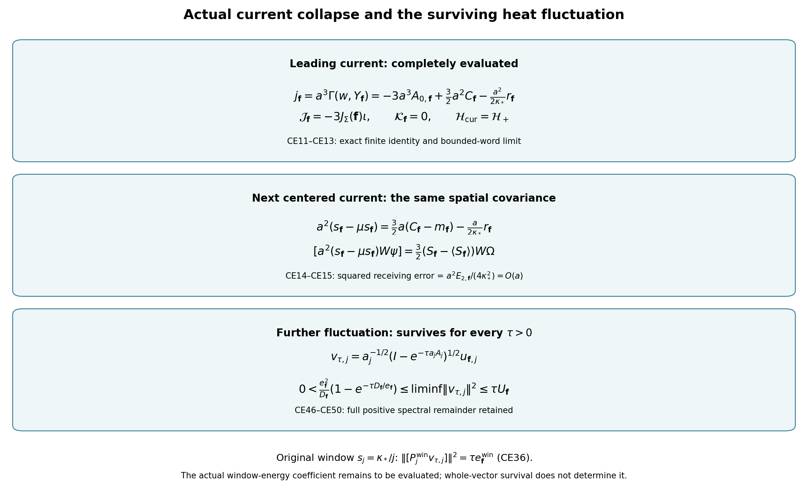

# Actual current collapse, retained covariance equality and surviving fluctuations

This proof uses the original states and the one ultrafilter of CM1–CM63. The complete providers are [CM1–CM63](SIMULTANEOUS_CENTRAL_MEASURE.md), [BM1–BM69](https://github.com/KokunoYumeto/yang-mills-interacting-workbench/blob/8881e58616267059c0461c8baec203e7c87d623e/yang-mills/continuations/20261011-central-signs-shrinking-window/BOUNDED_ENERGY_MULTIPLIER.md) and [OS1–OS40](https://github.com/KokunoYumeto/yang-mills-interacting-workbench/blob/8881e58616267059c0461c8baec203e7c87d623e/yang-mills/continuations/20261011-central-signs-shrinking-window/ORIGINAL_SOURCE_COVARIANCE.md). Original source versions are preserved and recorded in the source-use ledger. All new claims, including the next spectral fluctuation and its original-window projection, are proved below. No comparison probability law is introduced.

## 1. Original objects and quantitative finite inputs

Keep \(L_j=j^4\), \(a_j=(100j)^{-1}\), \(g_j^2=\kappa_*a_j/2\), \(\kappa_j=\kappa_*\), \(b_j=(\kappa_*a_j^2)^{-1}\) and \(\alpha_j=\kappa_*/b_j=\kappa_*^2a_j^2\). The full original open lattice, all positive edges, all vertex gauge constraints, Haar probability and radius-two \(\mathrm{SU}(2)\) metric remain. For \(d<k\),
\[
U_p=U_d(z)U_k(z+e_d)U_d(z+e_k)^{-1}U_k(z)^{-1},\quad
D_p=2-\operatorname{Tr}U_p,\quad
x_{p,j}=o+a_j(z-L_j\mathbf1+(e_d+e_k)/2).
\tag{CE1}
\]
The Hamiltonian, actual ground and ground measure are
\[
H=-\kappa\Delta+b\sum_pD_p,\quad H\psi=E_0\psi,\quad
\|\psi\|=1,\quad\psi>0,\quad\mu=\psi^2dU,\quad w=\log\psi,\quad A=H-E_0.
\tag{CE2}
\]
Here \(\Delta=\sum_{e,\beta}X_{e,\beta}^2\), with \(T_\beta=-i\sigma_\beta/2\) orthonormal. The ground transformation gives
\(q(G\psi)=\kappa\mu|\nabla G|^2\); the ground is unique and gauge invariant by positivity and the strong maximum principle, as fully proved in the included finite bases.

Let \(\mathbf f=(f_{12},f_{13},f_{23})\in C_c(\mathbb R^3;\mathbb R)^3\). Define
\[
\begin{gathered}
Y_{\mathbf f}=\sum_{\sigma,p:\sigma}f_\sigma(x_p)D_p,\quad
C_{\mathbf f}=aY_{\mathbf f},\quad m_{\mathbf f}=\mu C_{\mathbf f},\quad
u_{\mathbf f}=(C_{\mathbf f}-m_{\mathbf f})\psi,\\
A_{0,\mathbf f}=\sum_{\sigma,p:\sigma}f_\sigma(x_p),\quad
A_{1,\mathbf f}=\sum_{\sigma,p:\sigma}|f_\sigma(x_p)|,\quad
A_{2,\mathbf f}=\sum_{\sigma,p:\sigma}|f_\sigma(x_p)|^2,\\
F_\sigma=\|f_\sigma\|_\infty,\quad F=\max_\sigma F_\sigma,\quad
\chi=4+4\sum_\sigma F_\sigma/F\in[8,16],\\
G_{\mathbf f,\mathbf g}=\langle u_{\mathbf f},u_{\mathbf g}\rangle,\quad
E_{\mathbf f,\mathbf g}=\langle A^{1/2}u_{\mathbf f},A^{1/2}u_{\mathbf g}\rangle,\quad
E_{2,\mathbf f,\mathbf g}=\langle Au_{\mathbf f},Au_{\mathbf g}\rangle.
\end{gathered}\tag{CE3}
\]
A zero test contributes zero and no quotient by \(F\). Diagonal subscripts are abbreviated. The original scalar observable is precisely the diagonal triple \((f,f,f)\), retaining all three orientations.

For a support cube of side \(R\), the fitting patch is \(v_d=L+\lfloor(c_d-o_d)/a\rfloor-1\), \(q=\lceil R/a\rceil+3\), with counts and full comparison
\[
\begin{gathered}
N_Q=3q(q+1)^2,\quad M_Q=3q^2(q+1),\\
C_Q=2q(q+1)\sum_d
[\mathbf1_{\{v_d>0\}}+\mathbf1_{\{v_d+q<2L\}}],\\
H=\kappa K_Q+bW_Q+H_{\rm out}+bW_\times,\quad
E_Q=E_0-E_{\rm out},\quad
\Lambda_Q=\min\{2M_Q,6g^2\sqrt{N_QM_Q}\}+2C_Q,\\
T_Q=\mu|\nabla_Qw|^2,\quad d_Q=\mu W_Q,\quad
\alpha T_Q+d_Q\le E_Q/b\le\Lambda_Q .
\end{gathered}\tag{CE4}
\]
Every crossing face has exactly one inside edge. The scalar pieces of the potential are \(2bM_Q\), \(2b(M-M_Q-C_Q)\), \(2bC_Q\). The included BM5–BM6 prove the counts and comparison without modifying any gauge constraint. The roots in CM9, CM16 and OS13a imply
\[
\begin{gathered}
\mathsf L_R=9\kappa_*R^3+24R^2,\qquad
K_R={\mathsf L_R+\sqrt{\mathsf L_R^2-81\kappa_*^2R^6/4}\over2},\\
\limsup a^2d_Q\le K_R,\qquad
\limsup a^2(\Lambda_Q-d_Q)\le K_R,\qquad
\varepsilon_Q=\lim_{\mathcal U}a^2E_Q/b\in[\tfrac92\kappa_*R^3,\mathsf L_R].
\end{gathered}\tag{CE5}
\]
These statements retain both roots and the crossing coefficient \(24\).

We first strengthen the energy lower bound from a diagonal test to every orientation triple. Put
\[
t_1=f_{12}+f_{13},\quad t_2=f_{12}+f_{23},\quad
t_3=f_{13}+f_{23},\quad
J_{\rm edge}=\sum_{d=1}^3\int|t_d|,\quad
J_2^\Sigma=\sum_\sigma\int f_\sigma^2 .
\tag{CE6}
\]
The three-by-three map \(\mathbf f\mapsto(t_1,t_2,t_3)\) is invertible:
\(f_{12}=(t_1+t_2-t_3)/2\), and similarly for the other two entries. Thus \(J_{\rm edge}>0\) for every nonzero continuous triple.
On an inside edge of direction \(d\) with original center \(x_e\), choose the deterministic weight \(h_e=\operatorname{sgn}t_d(x_e)\), and zero outside. Write \(\sigma_p=\sum_{e\in\partial p}h_e\). The individual-edge Casimir and integration by parts give
\[
\begin{gathered}
B_{\mathbf f}(h)={3a\over4}\sum_p f_p(\mu D_p-2)\sigma_p
=2\mu\sum_eh_e\Gamma_e(w,C_{\mathbf f}),\\
B_{\mathbf f}(h)^2\le4T_Q\,\mu\Gamma(C_{\mathbf f}),\qquad
E_{\mathbf f}\ge{\kappa B_{\mathbf f}(h)^2\over4T_Q}
\ge{\kappa^2 B_{\mathbf f}(h)^2\over4b(\Lambda_Q-d_Q)} .
\end{gathered}\tag{CE7}
\]
All divisions are used only when their denominators are positive. The undivided inequality remains valid otherwise. To retain its exact Cauchy defect, put \(v=(h_e\nabla_ew)_e\), \(g=\nabla C_{\mathbf f}\). Then
\[
T_Q\mu|g|^2-B_{\mathbf f}(h)^2/4
=\{\mu|v|^2\mu|g|^2-|\mu\langle v,g\rangle|^2\}
+\mu|g|^2\,\mu\sum_e(1-h_e^2)|\nabla_ew|^2\ge0 .
\tag{CE8}
\]
The additional defect in the second bound of (CE7) is the actual local energy remainder in (CE4).

For each direction-\(d\) edge the sum of its incident face coefficients equals
\(2t_d(x_e)+O(\sum_\sigma\omega_{f_\sigma}(a))\) whenever its incident faces meet the fixed support; the outside coefficients are zero. The number of such edges is \(O(a^{-3})\). This proves the Riemann limit for the scalar part of \(B\), including sign changes and zeros, without differentiating a spatial test. Its potential part is bounded by \(3aF d_Q=O(a^{-1})\). Consequently
\[
a^2B_{\mathbf f}(h)\longrightarrow-3J_{\rm edge},\qquad
0<e_{\mathbf f}:={9\kappa_*^3J_{\rm edge}^2\over4K_R}
\le\liminf E_{\mathbf f}
\le\limsup E_{\mathbf f}\le
U_{\mathbf f}:=\kappa_*\chi F^2K_R.
\tag{CE9}
\]
The upper bound uses the full oriented incidence identity of CM4–CM5,
\(\Gamma Y_{\mathbf f}\le\chi F Y_{|\mathbf f|}\le\chi F^2W_Q\).
The modulus errors above remain \(o(a^{-2})\) in \(B\); no rate beyond continuity is imposed.

The original face Hessian and logarithmic ground Hessian give
\[
\begin{gathered}
\|\nabla^2C_{\mathbf f}\|_{\rm HS}^2\le21a^2A_{2,\mathbf f},\qquad
\nabla^2w\ge-{2\over\kappa_*a}g,\\
E_{2,\mathbf f}=\kappa^2\mu[
\|\nabla^2C_{\mathbf f}\|^2+\tfrac12\Gamma C_{\mathbf f}
-2\nabla^2w(\nabla C_{\mathbf f},\nabla C_{\mathbf f})]\\
\le21\kappa^2a^2A_{2,\mathbf f}+(\kappa/2+4/a)E_{\mathbf f},\\
\limsup aE_{2,\mathbf f}\le
D_{\mathbf f}:=21\kappa_*^2J_2^\Sigma+4U_{\mathbf f}.
\end{gathered}\tag{CE10}
\]
The finite proofs are BM13, BM16–BM17 and OS21–OS26, included in full. Their ordered face derivatives and Bochner identity do not require identical orientation coefficients. The exact nonnegative difference from the upper bound is
\(\kappa^2\mu[21a^2A_2-\|\nabla^2C\|^2]
+2\kappa^2\mu[(\nabla^2w+2(\kappa a)^{-1}g)(\nabla C,\nabla C)]\).
For the diagonal triple, (CE9)–(CE10) recover precisely
\(e_f=81\kappa_*^3(\int|f|)^2/K_R\) and
\(D_f=63\kappa_*^2\int f^2+64\kappa_*F^2K_R\).

## 2. The leading current defect vanishes

Define the actual multiplication functions
\[
s_{\mathbf f}=\Gamma(w,Y_{\mathbf f}),\qquad
r_{\mathbf f}={A(C_{\mathbf f}\psi)\over\psi},\qquad
j_{\mathbf f}=a^3s_{\mathbf f}.
\]
The complete ground-transform and face Laplacian give the exact identities
\[
\begin{gathered}
\Delta C_{\mathbf f}=6aA_{0,\mathbf f}-3C_{\mathbf f},\quad
r_{\mathbf f}=\kappa(3C_{\mathbf f}-6aA_{0,\mathbf f}-2a s_{\mathbf f}),\quad
\mu r_{\mathbf f}=0,\\
j_{\mathbf f}=-3a^3A_{0,\mathbf f}
+\tfrac32a^2C_{\mathbf f}-{a^2\over2\kappa}r_{\mathbf f},\\
\mu j_{\mathbf f}=-3a^3A_{0,\mathbf f}+\tfrac32a^2m_{\mathbf f}.
\end{gathered}\tag{CE11}
\]
The original scalar \(6aA_0\) is present. By the CM13 word receiver,
\(\|aC_{\mathbf f}\psi\|=O(1)\), and
\(\|r_{\mathbf f}\psi\|^2=E_{2,\mathbf f}=O(a^{-1})\). Therefore
\[
\|(j_{\mathbf f}+3a^3A_{0,\mathbf f})\psi\|
\le\tfrac32a\|aC_{\mathbf f}\psi\|
+{a^2\over2\kappa}\sqrt{E_{2,\mathbf f}}=O(a).
\tag{CE12}
\]
The second summand is \(O(a^{3/2})\). Replacing \(a^3A_0\) by
\(J_\Sigma(\mathbf f)=\sum_\sigma\int f_\sigma\) adds the exact scalar
\(3|a^3A_0-J_\Sigma(\mathbf f)|\), which tends to zero with the Riemann modulus; an \(O(a)\) rate for it is not asserted for merely continuous tests.

For every fixed bounded augmented heat word \(W_j\psi_j=G_{W,j}\psi_j\), CM11 gives \(\|G_{W,j}\|_\infty\le N_W\). Multiply the preceding pointwise difference by \(G_W\); its norm is at most \(N_W\) times (CE12). Passing to the same ultraproduct, then using the bounded extension of CM50 and density, proves
\[
\boxed{\quad
\mathcal J_{\mathbf f}=-3J_\Sigma(\mathbf f)\iota,\qquad
\mathcal K_{\mathbf f}=0,\qquad
\mathcal H_{\rm cur}=\mathcal H_+ .
\quad}\tag{CE13}
\]
Thus all mixed current-defect Gram entries vanish. The possible current module in CM61 is completely evaluated: its extra orthogonal space is zero. The central measure map of CM62 consequently restricts to its original action on \(\mathcal H_+\). This strengthens the sealed result; none of its positive geometric or outside-energy terms is set to zero.

The next centered current scale is also calculated exactly:
\[
\begin{gathered}
U_{\mathbf f,j}^{\rm cur}
=a_j^2(s_{\mathbf f,j}-\mu_js_{\mathbf f,j})
=\tfrac32a_j(C_{\mathbf f,j}-m_{\mathbf f,j})
-{a_j\over2\kappa_*}r_{\mathbf f,j},\\
\left\|\left[U_{\mathbf f,j}^{\rm cur}
-\tfrac32a_j(C_{\mathbf f,j}-m_{\mathbf f,j})\right]\psi_j\right\|^2
={a_j^2E_{2,\mathbf f,j}\over4\kappa_*^2}=O(a_j),\\
[U_{\mathbf f,j}^{\rm cur}W_j\psi_j]
=\tfrac32(S_{\mathbf f}-\langle S_{\mathbf f}\rangle)W\Omega .
\end{gathered}\tag{CE14}
\]
Every factor of \(a_j\) is retained. The bound by \(N_W\) proves the last line even though the finite current multiplier is not uniformly bounded. It supplies no independent new covariance: it receives the same centered central observable.

All mixed finite moments, with \(G,E,E_2\) from (CE3), are
\[
\begin{gathered}
\mu(U_{\mathbf f}^{\rm cur}U_{\mathbf g}^{\rm cur})
=a^2\!\left[\tfrac94G_{\mathbf f,\mathbf g}
-{3\over2\kappa}E_{\mathbf f,\mathbf g}
+{1\over4\kappa^2}E_{2,\mathbf f,\mathbf g}\right],\\
\mu[a(C_{\mathbf f}-m_{\mathbf f})U_{\mathbf g}^{\rm cur}]
=a^2\!\left[\tfrac32G_{\mathbf f,\mathbf g}
-{1\over2\kappa}E_{\mathbf f,\mathbf g}\right],\\
\operatorname{Cov}_\mu(j_{\mathbf f},j_{\mathbf g})
=a^4\!\left[\tfrac94G_{\mathbf f,\mathbf g}
-{3\over2\kappa}E_{\mathbf f,\mathbf g}
+{1\over4\kappa^2}E_{2,\mathbf f,\mathbf g}\right].
\end{gathered}\tag{CE15}
\]
These follow by expanding (CE11), using \(\mu r=0\),
\(\mu[(C_{\mathbf f}-m_{\mathbf f})r_{\mathbf g}]=E_{\mathbf f,\mathbf g}\)
and \(\mu r_{\mathbf f}r_{\mathbf g}=E_{2,\mathbf f,\mathbf g}\).
The actual centered current variance is \(O(a^2)\); its limiting zero is not an assumption about the raw covariance.

## 3. Full finite variance identity and its equality remainders

Fix a signed \(\mathbf f\), let \(Y=Y_{|\mathbf f|}\), \(d=\mu Y\),
\(e=FE_Q/b\), \(Z=|\nabla_Qw|^2\), and
\(h=3A_{1,\mathbf f}-3d/2\). Retain the nonnegative original operator form
\[
\mathcal R=b(W_Q-Y/F)+(H_{\rm out}-E_{\rm out})+bW_\times\ge0,
\quad
\mathfrak G=\mu[\chi F ZY-s_{\mathbf f}^2]\ge0,\quad
\mathfrak L={\chi F\over\kappa}
\langle\sqrt Y\psi,\mathcal R\sqrt Y\psi\rangle\ge0 .
\tag{CE16}
\]
The full geometric difference is
\(Z\Gamma Y_{\mathbf f}-\Gamma(w,Y_{\mathbf f})^2
+Z(\chi FY-\Gamma Y_{\mathbf f})\), the exact two positive terms of CM53. The weak gradient of \(\sqrt Y\) exists with
\(\Gamma\sqrt Y\le\chi F/4\); using \(\sqrt{Y+\delta}\) and form convergence retains every zero and critical set.

Apply the exact local decomposition (CE4) to \(\sqrt Y\psi\).
The identical \(\mu\Gamma\sqrt Y\) terms on the two sides cancel. The remaining cross term is
\(\mu\Gamma(w,Y)=-h\). This proves the finite identity
\[
\mu s_{\mathbf f}^2+\mathfrak G+\mathfrak L
={\chi\over\alpha}\{ed-\mu Y^2\}+\chi Fh .
\tag{CE17}
\]
In particular it is the complete vacuum specialization of CM54; no remainder of indeterminate sign has been discarded.
From (CE11) and (CE15),
\[
\mu s_{\mathbf f}=-3A_{0,\mathbf f}+{3m_{\mathbf f}\over2a},\qquad
\operatorname{Var}s_{\mathbf f}
={9\over4a^2}G_{\mathbf f}
-{3\over2\kappa a^2}E_{\mathbf f}
+{1\over4\kappa^2a^2}E_{2,\mathbf f}.
\tag{CE18}
\]
Substitution into (CE17), without changing the absolute-test law, yields
\[
\begin{split}
G_{|\mathbf f|}+{9\alpha\over4\chi}G_{\mathbf f}
={}&a^2d(e-d)+\alpha a^2Fh
-{\alpha a^2\over\chi}
\left(-3A_{0,\mathbf f}+{3m_{\mathbf f}\over2a}\right)^2\\
&+{3\alpha\over2\chi\kappa}E_{\mathbf f}
-{\alpha\over4\chi\kappa^2}E_{2,\mathbf f}
-{\alpha a^2\over\chi}(\mathfrak G+\mathfrak L).
\end{split}\tag{CE19}
\]
This identity couples the actual signed and absolute-test variances. It preserves both means, every local scalar, the entire second energy and the outside-energy form.

For a nonnegative \(\mathbf f\), put \(c=9\alpha/(4\chi)\), so \(m=ad\) and \(\mu s=-h\). Define the fully evaluated finite ceiling
\[
\mathcal U_{\mathbf f,j}
={a^2d(e-d)+\alpha a^2Fh-(\alpha a^2/\chi)h^2
+(3\alpha/(2\chi\kappa))E_{\mathbf f}
-(\alpha/(4\chi\kappa^2))E_{2,\mathbf f}\over1+c}.
\]
Then
\[
\boxed{\quad
G_{\mathbf f}
=\mathcal U_{\mathbf f,j}
-{\alpha a^2\over\chi(1+c)}(\mathfrak G+\mathfrak L)
\le\mathcal U_{\mathbf f,j}.
\quad}\tag{CE20}
\]
The exact upper-bound equality defect is displayed. Equality holds exactly when the two nonnegative terms vanish. This does not follow from leading covariance collapse.

For every nonzero triple and sufficiently large regulator, \(E_{\mathbf f}>0\), \(E_{2,\mathbf f}>0\), and spectral Cauchy–Schwarz gives the exact lower-bound defect
\[
\boxed{\quad
G_{\mathbf f}
={E_{\mathbf f}^2\over E_{2,\mathbf f}}
+\left\|u_{\mathbf f}-{E_{\mathbf f}\over E_{2,\mathbf f}}Au_{\mathbf f}\right\|^2,
\qquad
\liminf {G_{\mathbf f}\over a}\ge{e_{\mathbf f}^2\over D_{\mathbf f}}>0.
\quad}\tag{CE21}
\]
This is obtained by expanding the squared norm and using (CE3), then (CE9)–(CE10). It keeps the original covariance \(G_{\mathbf f}\); no amplitude redefinition is used.
Equality in the finite lower bound holds exactly when \(Au=\lambda u\) for \(\lambda=E_2/E\).
At a maximum and minimum of a nonconstant real \(C_{\mathbf f}\), \(\nabla C=0\). The equation
\(\kappa(3C-6aA_0-2\Gamma(w,C))=\lambda(C-m)\)
therefore forces \(\lambda=3\kappa\) and \(m=2aA_0\), and then forces \(\Gamma(w,C)=0\) everywhere. Conversely these two identities give \(Au=3\kappa u\). For a positive nonzero triple, \(m\le ae=O(a^{-1})\), while \(2aA_0=\Theta(a^{-2})\), so this finite equality is excluded eventually. No such exclusion is asserted for a zero-integral signed triple without checking its actual identities.

The signed finite covariance retains its cross term:
\[
G_{\mathbf f}=2G_{\mathbf f_+}+2G_{\mathbf f_-}-G_{|\mathbf f|},\qquad
G_{\mathbf f_+,\mathbf f_-}
={G_{|\mathbf f|}-G_{\mathbf f_+}-G_{\mathbf f_-}\over2}.
\tag{CE22}
\]
For any nonzero test write \(\mathcal L_{\mathbf h}=E_{\mathbf h}^2/E_{2,\mathbf h}\), with \(\mathcal L_0=\mathcal U_0=0\). Thus a set of finite quantitative bounds that keeps these signs is
\[
\begin{split}
\max\{\mathcal L_{\mathbf f},\,2\mathcal L_{\mathbf f_+}
+2\mathcal L_{\mathbf f_-}-\mathcal U_{|\mathbf f|},\,0\}
\le G_{\mathbf f}
\le\min\{&
2\mathcal U_{\mathbf f_+}+2\mathcal U_{\mathbf f_-}
-\mathcal L_{|\mathbf f|},\\
&(\sqrt{\mathcal U_{\mathbf f_+}}+\sqrt{\mathcal U_{\mathbf f_-}})^2\}.
\end{split}\tag{CE23}
\]
Each missing term in the first upper bound is exactly a positive combination of the defects (CE20)–(CE21). The second upper bound is the triangle inequality for \(u_+-u_-\); its equality additionally requires the actual centered vectors to be oppositely collinear. The lower cross bound has the corresponding same explicit defects. All displayed ceilings are nonnegative because they bound an actual nonnegative variance. These bounds remain \(O(a^{-2})\) in general, while (CE21) is \(\Omega(a)\).

## 4. What deterministic central mass means in the actual identity

All \(S_{\mathbf f}\), the measure \(\mathsf M\), the space \(\mathcal H_+\) and the actual vacuum are those of CM. With (CE13), its full retained-energy identity becomes
\[
D_{\rm geom}^{\mathbf f,Q}+D_{\rm loc}^{\mathbf f,Q}
={\chi\over\kappa_*^2}
S_{|\mathbf f|}(F\varepsilon_QI-S_{|\mathbf f|})
-9J_\Sigma(\mathbf f)^2I .
\tag{CE24}
\]
The two operators on the left are the ultralimits of \(a^6\mathfrak G\) and \(a^6\mathfrak L\) as quadratic forms on all bounded words, not just on the vacuum. Their complete construction and null-relation estimates are CM52–CM55. They still contain every geometric and outside-energy term of (CE16). Support changes obey CM59 unchanged.

For nonnegative \(\mathbf f\), let
\[
m=\langle S_{\mathbf f}\rangle,\quad E=F\varepsilon_Q,\quad
\rho_Q(m)={\chi\over\kappa_*^2}m(E-m)-9J_\Sigma(\mathbf f)^2,\quad
d_Q^{\rm ret}=\langle D_{\rm geom}+D_{\rm loc}\rangle .
\]
The exact covariance and the exact remaining slack are
\[
\boxed{\quad
v_{\mathbf f}:=\operatorname{Var}_\Omega S_{\mathbf f}
=\lim_{\mathcal U}a_j^2G_{\mathbf f,j}
={\kappa_*^2\over\chi}\{\rho_Q(m)-d_Q^{\rm ret}\},\qquad
0\le d_Q^{\rm ret}\le\rho_Q(m).
\quad}\tag{CE25}
\]
Thus the current term formerly present in CM58 has been evaluated to zero; the two other terms have not. The largest resulting scalar ceiling is
\[
0\le v_{\mathbf f}\le
m(E-m)-{9\kappa_*^2J_\Sigma(\mathbf f)^2\over\chi}
\le {E^2\over4}-{9\kappa_*^2J_\Sigma(\mathbf f)^2\over\chi}.
\tag{CE26}
\]
The defects in these two inequalities are, respectively,
\(\kappa_*^2d_Q^{\rm ret}/\chi\) and
\((m-E/2)^2+\kappa_*^2d_Q^{\rm ret}/\chi\).
For a signed test retain the exact polarization (CE22) with \(v\) replacing \(G\) and (CE25) separately on its three positive tests. This is the full CM60 signed contraction after the current defect has been evaluated.

There are also useful sharp interval forms. If
\(\ell_{\mathbf f}=\mathcal R_-(\mathbf f_+,Q)-\mathcal R_+(\mathbf f_-,Q)\) and
\(r_{\mathbf f}=\mathcal R_+(\mathbf f_+,Q)-\mathcal R_-(\mathbf f_-,Q)\), with the zero test having both endpoints zero, then
\[
\begin{gathered}
\ell_{\mathbf f}I\le S_{\mathbf f}\le r_{\mathbf f}I,\qquad
v_{\mathbf f}
=(m_{\mathbf f}^{S}-\ell_{\mathbf f})(r_{\mathbf f}-m_{\mathbf f}^{S})
-\langle(S_{\mathbf f}-\ell_{\mathbf f})(r_{\mathbf f}-S_{\mathbf f})\rangle,\\
v_{\mathbf f}\le(r_{\mathbf f}-\ell_{\mathbf f})^2/4,\qquad
|\operatorname{Cov}_\Omega(S_{\mathbf f},S_{\mathbf g})|
\le\sqrt{v_{\mathbf f}v_{\mathbf g}}.
\end{gathered}\tag{CE27}
\]
The quadratic product in the first line is nonnegative by functional calculus; this gives its exact equality defect. The quarter-width defect adds the squared distance of the mean from the midpoint. The mixed inequality is Cauchy–Schwarz for the actual centered vectors and has the usual squared orthogonal projection remainder. The local cube bound \(F^2K_R^2\), or \(F^2K_R^2/4\) for a positive test, can be included in the minimum with (CE26)–(CE27).

For any actual test,
\[
v_{\mathbf f}=0
\quad\Longleftrightarrow\quad
(S_{\mathbf f}-m_{\mathbf f}^{S})\Omega=0
\quad\Longleftrightarrow\quad S_{\mathbf f}=m_{\mathbf f}^{S}I
\ \text{on }\mathcal H_+ .
\tag{CE28}
\]
The final implication uses centrality: the operator annihilates every augmented word from the vacuum, hence its dense span. For a positive test these conditions are equivalently
\[
d_Q^{\rm ret}=\rho_Q(m),\qquad
D_{\rm geom}+D_{\rm loc}=\rho_Q(m)I .
\tag{CE29}
\]
Indeed the scalar equality in (CE25) gives (CE28), which substituted into (CE24) gives the operator equality. Conversely the operator equality and its expectation in (CE25) give zero variance. This is the exact deterministic equality condition for the actual state. It does not require \(\rho_Q(m)=0\), and therefore does not mean that both retained operators vanish.
The two retained operators vanish together exactly when
\(S_{\mathbf f}(EI-S_{\mathbf f})=9\kappa_*^2J_\Sigma(\mathbf f)^2I/\chi\);
its spectrum then lies in the two original roots. A deterministic test in this case lies at one root. These are different equality statements with their exact connecting maps.

Let \(\mathcal D_0\) be a countable uniformly dense test core on each compact cube, as in CM19. The whole actual spatial measure is deterministic precisely when all \(v_{\mathbf f}\), \(\mathbf f\in\mathcal D_0\), vanish. Equations (CE28), the local norm bounds and the unique Radon representation then give
\[
\mathsf M_\sigma(B)=m_\sigma(B)I
\quad\text{for every relatively compact Borel }B .
\tag{CE30}
\]
Conversely this equation makes every variance zero. The deterministic measure, when testing this exact equality, retains CM23–CM33 and CM63: its mass has the same cube bounds, no atoms, a positive absolutely continuous component, possible singular mass and the same inverse-density and low-density estimates. No free measure is chosen to satisfy them. The possible fitting-array boundary operator \(T_Q\) still has the exact CM24 sandwich; determinism of continuous-test integrals alone does not erase a cube-boundary allocation defect. Cubes with zero boundary mass have \(T_Q=m_{\rm tot}(Q)I\).

The actual calculations therefore do not establish that (CE29) is attained or violated. They establish its necessary and sufficient equality, and evaluate the former current defect. The positive finite bound (CE21) is compatible with \(a^2G\to0\), since its scaled lower bound is of order \(a^3\). No strictly positive lower bound for \(v_{\mathbf f}\) follows from that finite bound. The next fluctuation is calculated below without assigning either outcome.

## 5. A surviving fluctuation with original energies and original window

Let \(\nu_{\mathbf f,j}(B)=\|\mathbf1_B(A_j)u_{\mathbf f,j}\|^2\). It is the actual spectral measure in the original energy units, with no mass at zero because \(u\perp\psi\) and the finite ground is unique. For every fixed \(\tau>0\), construct the actual vector
\[
v_{\tau,\mathbf f,j}
={1\over\sqrt{a_j}}
(I-e^{-\tau a_jA_j})^{1/2}u_{\mathbf f,j}.
\tag{CE31}
\]
This is a displayed map from the unchanged centered observable and actual Hamiltonian, not a substitution for \(C_{\mathbf f,j}\). All gauge constraints remain because spectral calculus preserves the physical Hilbert space.
Its norm and first two energies are exactly
\[
\begin{gathered}
N_{\tau,j}={1\over a_j}\int(1-e^{-\tau a_j\lambda})\,d\nu_j(\lambda),\\
E_{\tau,j}^{(1)}={1\over a_j}\int\lambda(1-e^{-\tau a_j\lambda})\,d\nu_j(\lambda),\qquad
E_{\tau,j}^{(2)}={1\over a_j}\int\lambda^2(1-e^{-\tau a_j\lambda})\,d\nu_j(\lambda).
\end{gathered}\tag{CE32}
\]
The elementary inequalities \(x-x^2/2\le1-e^{-x}\le x\), and \(0\le1-e^{-x}\le1\), imply
\[
\begin{gathered}
\tau E_{\mathbf f,j}-{\tau^2a_j\over2}E_{2,\mathbf f,j}
\le N_{\tau,j}\le\tau E_{\mathbf f,j},\\
0\le E_{\tau,j}^{(1)}\le\tau E_{2,\mathbf f,j}=O(a_j^{-1}),\qquad
0\le E_{\tau,j}^{(2)}\le E_{2,\mathbf f,j}/a_j=O(a_j^{-2}).
\end{gathered}\tag{CE33}
\]
For \(0<\tau<2e_{\mathbf f}/D_{\mathbf f}\) this first bound proves a bounded nonzero ultraproduct vector. CE46–CE50 below strengthen survival to every positive heat parameter:
\[
0<\tau e_{\mathbf f}-\tfrac12\tau^2D_{\mathbf f}
\le\|[v_{\tau,\mathbf f,j}]\|^2
\le\tau U_{\mathbf f},\qquad
\limsup a_jE_{\tau,j}^{(1)}\le\tau D_{\mathbf f},\quad
\limsup a_j^2E_{\tau,j}^{(2)}\le D_{\mathbf f}.
\tag{CE34}
\]
At \(\tau=e_{\mathbf f}/D_{\mathbf f}\) the lower norm is \(e_{\mathbf f}^2/(2D_{\mathbf f})\). This surviving original-state fluctuation exists in particular when the leading central covariance collapses.

Every defect of (CE33) is an actual nonnegative spectral integral. The upper norm defect is
\(\int[\tau\lambda-(1-e^{-\tau a\lambda})/a]\,d\nu\);
the lower norm defect is
\(\int[(1-e^{-\tau a\lambda})/a-\tau\lambda+\tau^2a\lambda^2/2]\,d\nu\).
Multiply the first integrand by \(\lambda\) for the first-energy upper defect. The second-energy upper defect is
\(a^{-1}\int\lambda^2e^{-\tau a\lambda}\,d\nu\).
Their signs follow by two derivatives of the exponential inequalities. Thus no sign-dependent term is suppressed.

The original shrinking window is unchanged:
\[
s_j=\kappa_*/j=100\kappa_*a_j,\qquad
P_j^{\rm win}=\mathbf1_{(0,s_j]}(A_j),\quad
E_{\mathbf f,j}^{\rm win}
=\langle u_{\mathbf f,j},A_jP_j^{\rm win}u_{\mathbf f,j}\rangle .
\tag{CE35}
\]
The exact projection norm and its evaluated error are
\[
\begin{gathered}
\|P_j^{\rm win}v_{\tau,\mathbf f,j}\|^2
={1\over a_j}\int_{(0,s_j]}(1-e^{-\tau a_j\lambda})\,d\nu_j,\\
0\le\tau E_{\mathbf f,j}^{\rm win}
-\|P_j^{\rm win}v_{\tau,\mathbf f,j}\|^2
\le{\tau^2a_j\over2}\int_{(0,s_j]}\lambda^2\,d\nu_j
\le50\tau^2\kappa_*a_j^2E_{\mathbf f,j}^{\rm win},\\
\|[P_j^{\rm win}v_{\tau,\mathbf f,j}]\|^2
=\tau e_{\mathbf f}^{\rm win},\qquad
e_{\mathbf f}^{\rm win}:=\lim_{\mathcal U}E_{\mathbf f,j}^{\rm win}\in[0,U_{\mathbf f}].
\end{gathered}\tag{CE36}
\]
Its first and second energies are respectively bounded by
\(s_j\|P_j^{\rm win}v_{\tau,j}\|^2\) and
\(s_j^2\|P_j^{\rm win}v_{\tau,j}\|^2\), hence \(O(a_j)\) and \(O(a_j^2)\); both tend to zero. The limit vector lies in the kernel of the original continuous semigroup generator. Its norm is zero exactly when the displayed actual window-energy coefficient is zero. Whole-vector survival (CE34) does not assign that coefficient a positive value.

All tests and times have mixed maps. Define the signed spectral measure
\(\nu_{\mathbf f,\mathbf g,j}(B)=\langle u_{\mathbf f,j},\mathbf1_B(A_j)u_{\mathbf g,j}\rangle\); the matrix of such measures is positive. Then
\[
\begin{gathered}
\langle v_{\tau,\mathbf f,j},v_{\sigma,\mathbf g,j}\rangle
={1\over a_j}\int
\sqrt{(1-e^{-\tau a_j\lambda})(1-e^{-\sigma a_j\lambda})}
\,d\nu_{\mathbf f,\mathbf g,j},\\
\langle[P_j^{\rm win}v_{\tau,\mathbf f,j}],
[P_j^{\rm win}v_{\sigma,\mathbf g,j}]\rangle
=\sqrt{\tau\sigma}\,
\lim_{\mathcal U}\langle u_{\mathbf f,j},A_jP_j^{\rm win}u_{\mathbf g,j}\rangle .
\end{gathered}\tag{CE37}
\]
For the second equality use the estimate in (CE36) at the vector level:
\[
\left\|P_j^{\rm win}v_{\tau,\mathbf f,j}
-\sqrt\tau A_j^{1/2}P_j^{\rm win}u_{\mathbf f,j}\right\|^2
\le{\tau^2a_j\over2}\int_{(0,s_j]}\lambda^2d\nu_{\mathbf f,j}=O(a_j^2).
\tag{CE38}
\]
Indeed \((\sqrt x-\sqrt y)^2\le x-y\) for \(x\ge y\ge0\), with \(x=\tau\lambda\), \(y=(1-e^{-\tau a\lambda})/a\). Cauchy–Schwarz then proves every mixed limit, including zero coefficients.

The direct relation to the raw leading vector is also exact:
\[
\|a_ju_{\mathbf f,j}-a_jP_j^{\rm win}u_{\mathbf f,j}\|^2
\le{a_j^2\over s_j}E_{\mathbf f,j}
={a_j\over100\kappa_*}E_{\mathbf f,j}\longrightarrow0 .
\tag{CE39}
\]
Thus the entire leading central covariance is received in the original shrinking window. When it is zero, its vector and the next centered current (CE14) vanish, whereas (CE34) still produces a nonzero heat-increment fluctuation. Its allocation to that same window is calculated by (CE36), rather than assumed. In particular
\[
G_{\mathbf f,j}
=\|P_j^{\rm win}u_{\mathbf f,j}\|^2
+\|(I-P_j^{\rm win})u_{\mathbf f,j}\|^2,\qquad
\|(I-P_j^{\rm win})u_{\mathbf f,j}\|^2\le E_{\mathbf f,j}/s_j=O(a_j^{-1}).
\tag{CE40}
\]
The exact next quantity controlling a stronger source-zero upper exponent is the first term, the original low-window mass. Its energy coefficient in (CE36) is bounded above by \(s_j\) times that mass, but the reverse requires information not supplied by positivity alone.

For completeness the continuous-space and original cyclic maps of the new vector are also fixed. Let \(P\) be the same continuous ultraproduct projection as in CM, and \(R_+\) the projection onto \(\mathcal H_+\). For \(\eta_\tau=[v_{\tau,j}]\),
\[
\|\eta_\tau\|^2
=\|R_+\eta_\tau\|^2+\|(P-R_+)\eta_\tau\|^2+\|(I-P)\eta_\tau\|^2 .
\tag{CE41}
\]
The last component is killed by every positive-time original semigroup. Every visible matrix coefficient is the ultralimit of its original filtered inner product. For any finite bounded-word list \(w_i\), put
\(G^W_{ik}=\langle w_i,w_k\rangle\), \(c_{\tau,i}=\lim_{\mathcal U}\langle W_{i,j}\psi_j,v_{\tau,j}\rangle\). Then
\[
\|R_+\eta_\tau\|^2
=\sup_{\rm finite\ lists}c_\tau^*(G^W)^\dagger c_\tau .
\tag{CE42}
\]
Null word relations annihilate \(c_\tau\) by boundedness (CE34); finite-dimensional projection and increasing dense spans prove the formula. Polarization gives every mixed visible/hidden coefficient. This constructs the receiving defect even when a surviving fluctuation is not in the original cyclic representation. No value for any of these actual projections is inferred from the whole-vector lower bound.

## 6. The next derivative calculation and why its heat receiver is useful

One can calculate the unfiltered third energy without dropping the squared log-Hessian. Put \(g=\nabla C_{\mathbf f}\), \(h=\nabla^2w\), \(B=\nabla^2C_{\mathbf f}\). Differentiating the exact residual in (CE11) proves
\[
\begin{split}
E_{3,\mathbf f}&:=\langle Au_{\mathbf f},A^2u_{\mathbf f}\rangle
=\kappa^3\mu|3g-2hg-2B\nabla w|^2\\
&=\kappa^3\mu[
9|g|^2+4|hg|^2+4|B\nabla w|^2
-12h(g,g)-12B(\nabla w,g)
+8\langle hg,B\nabla w\rangle].
\end{split}\tag{CE43}
\]
The full \(B\nabla w\) has both components inside and outside the support through \(B\); in fact \(B\) has only supported edge rows and columns, so \(\nabla w\) here may be replaced exactly by \(\nabla_Qw\). No cross term is assigned a sign. All vectors are smooth at each finite regulator.

The exact original local Hessian trace identity, including the radius-two Ricci term and crossing deficit, is
\[
\begin{gathered}
\mathcal H_Q:=\mu\|\nabla\nabla_Qw\|_{\rm HS}^2,\qquad
2\kappa\mathcal H_Q+\kappa T_Q
=6bM_Q+\tfrac32bC_Q-3bd_Q-\tfrac34b\mu W_\times,\\
\sup\Gamma C_{\mathbf f}\le4\chi F a^2A_{1,\mathbf f},\qquad
\|B\|_{\rm op}\le8aF .
\end{gathered}\tag{CE44}
\]
The first line follows by differentiating the ground equation once, applying the product Bochner formula with \(\operatorname{Ric}=\tfrac12g\), integrating and using the face's inside edge counts \(4,1,0\); this is also the complete OS37 proof. For the operator bound on \(B\), differentiate every four-factor face along a product geodesic: the absolute second trace derivative is at most
\(\tfrac12(\sum_{e\in\partial p}|v_e|)^2\le2\sum_{e\in\partial p}|v_e|^2\).
Each edge belongs to at most four faces. Multiply by \(a|f_p|\), sum, and retain the full derivatives before bounding them. This yields the stated factor \(8\), including signed coefficients.
Minkowski in (CE43) now gives the completely evaluated but coarse bound
\[
\sqrt{E_{3,\mathbf f}}
\le\kappa^{3/2}\left[
3\sqrt{E_{\mathbf f}/\kappa}
+2\sqrt{4\chi F a^2A_{1,\mathbf f}\mathcal H_Q}
+16aF\sqrt{T_Q}\right]=O(a^{-3}).
\tag{CE45}
\]
Here (CE4), (CE44) evaluate \(T_Q=O(a^{-4})\), \(\mathcal H_Q=O(a^{-5})\). This bound does not yield a sharp unfiltered derivative fluctuation, and it does not estimate a fourth energy. Instead the actual heat-increment construction (CE31) already supplies a nonzero vector with both energies evaluated by the proved second energy, (CE32)–(CE38). Thus the next receiving map has been carried out, preserving the unresolved squared-Hessian contribution rather than hiding it.

The completed conclusions are exact equality and inequality statements about the original measure: the leading current defect vanishes; its next centered scale is the same central covariance; finite covariance retains explicit geometric and outside-energy remainders; every nonzero orientation triple has positive first-energy and variance lower bounds; and a further original heat-increment fluctuation survives with a completely specified original-window map. The actual deterministic equality (CE29), the low-window mass (CE40), and the corresponding visible/escape Gram remain unassigned. No free law, density ansatz, altered spectral window or smooth interacting four-dimensional theory has replaced them.

## 7. Survival at every positive heat parameter

The restriction on \(\tau\) in CE34 can be removed using the same actual first and second energies. At a sufficiently large finite regulator write \(E=E_{\mathbf f,j}>0\), \(E_2=E_{2,\mathbf f,j}>0\), \(a=a_j\), and retain the original spectral energy variable \(\lambda\). Define
\[
\begin{gathered}
h_{\tau,a}(\lambda)=\int_0^\tau e^{-sa\lambda}\,ds
=\frac{1-e^{-\tau a\lambda}}{a\lambda}\quad(\lambda>0),
\qquad h_{\tau,a}(0)=\tau,\\
h'_{\tau,a}(\lambda)=-a\int_0^\tau s e^{-sa\lambda}\,ds,\qquad
h''_{\tau,a}(\lambda)=a^2\int_0^\tau s^2 e^{-sa\lambda}\,ds>0,\qquad
\lambda_0=E_2/E .
\end{gathered}\tag{CE46}
\]
This auxiliary function leaves the original Hamiltonian, observable, energy units and vector CE31 unchanged. Taylor's formula with integral remainder gives, for every \(\lambda\ge0\),
\[
\begin{split}
R_{\tau,a}(\lambda,\lambda_0)
&=h_{\tau,a}(\lambda)-h_{\tau,a}(\lambda_0)
-h'_{\tau,a}(\lambda_0)(\lambda-\lambda_0)\\
&=(\lambda-\lambda_0)^2
\int_0^1(1-t)h''_{\tau,a}\bigl(\lambda_0+t(\lambda-\lambda_0)\bigr)\,dt
\ge0 .
\end{split}\tag{CE47}
\]
Integrate against the original positive measure \(\lambda\,d\nu_{\mathbf f,j}(\lambda)\). The linear term has integral \(E_2-\lambda_0E=0\). Each term is integrable because \(h\) is bounded, \(h'\) at \(\lambda_0\) is finite, and the first two original energies are finite. This proves the exact identity and lower bound
\[
\begin{gathered}
N_{\tau,j}
=\frac{E^2}{aE_2}\bigl(1-e^{-\tau aE_2/E}\bigr)
+\int_{(0,\infty)}\lambda
R_{\tau,a}(\lambda,E_2/E)\,d\nu_{\mathbf f,j}(\lambda),\\
N_{\tau,j}\ge
\frac{E^2}{aE_2}\bigl(1-e^{-\tau aE_2/E}\bigr).
\end{gathered}\tag{CE48}
\]
Strict convexity shows that its remainder vanishes exactly when the positive-energy spectral measure is concentrated at \(E_2/E\). There is no zero-energy atom by CE31. Thus equality has precisely the same eigenvector condition as CE21, including its exclusion for an eventually nonzero positive test proved there.

For fixed \(\tau>0\), put \(b=aE_2>0\), and define only for this scalar comparison
\[
\begin{gathered}
F_\tau(E,b)=\frac{E^2}{b}(1-e^{-\tau b/E}),\qquad x=\tau b/E,\\
\partial_EF_\tau(E,b)
=\frac{E}{b}\{2(1-e^{-x})-xe^{-x}\}>0,\\
\partial_bF_\tau(E,b)
=\frac{E^2}{b^2}\{(1+x)e^{-x}-1\}<0 .
\end{gathered}\tag{CE49}
\]
Both signs follow from \(e^x>1+x\) for \(x>0\); the first also uses \(2(e^x-1)>x\). By CE9–CE10, for every sufficiently small \(\epsilon>0\), eventually \(E\ge e_{\mathbf f}-\epsilon>0\) and \(aE_2\le D_{\mathbf f}+\epsilon\). Apply the two monotonicities to CE48 and then send \(\epsilon\) to zero. The complete strengthening is
\[
\boxed{\quad
0<\frac{e_{\mathbf f}^2}{D_{\mathbf f}}
\bigl(1-e^{-\tau D_{\mathbf f}/e_{\mathbf f}}\bigr)
\le \liminf_j N_{\tau,j}
\le\limsup_j N_{\tau,j}\le\tau U_{\mathbf f}
\qquad(\tau>0).
\quad}\tag{CE50}
\]
Every positive heat parameter therefore gives a bounded nonzero vector in the same ultraproduct. The original first and second energy estimates CE33–CE34, the unchanged window identity CE36, all mixed maps CE37–CE38 and the exact visible/escape decomposition CE41–CE42 still apply. The full retained Taylor remainder CE47–CE48 proves the strengthening without assigning a value to the actual shrinking-window energy coefficient.

The reproducible figure and bounded algebra checks are in check_current_covariance.py. Full source versions and reading coverage are in [the source-use ledger](CENTRAL_CURRENT_SOURCE_USE_LEDGER.json). No novelty claim is made.
