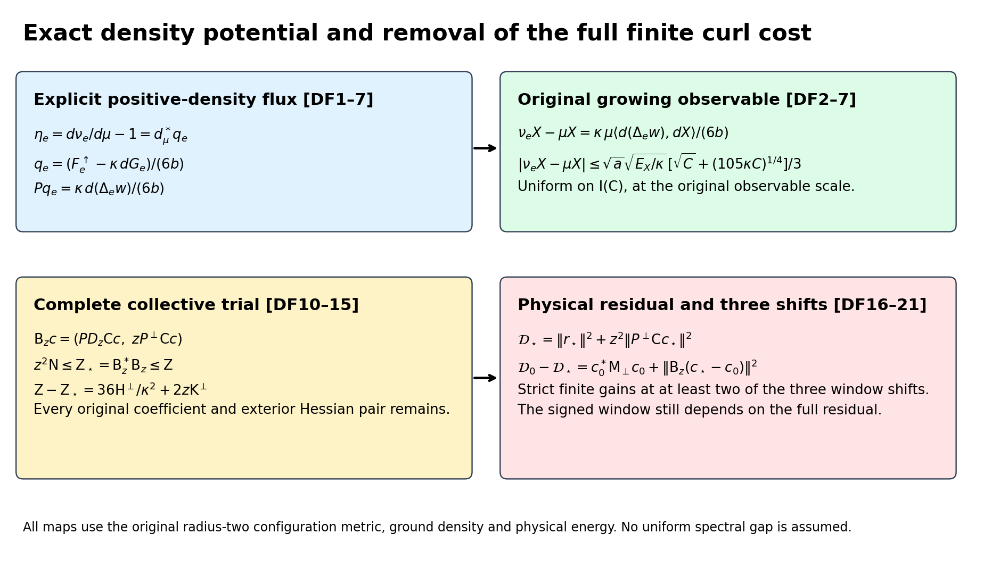
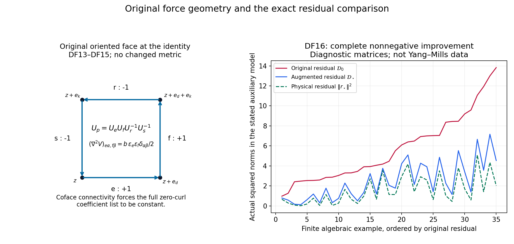

# Exact density flux and a stronger physical current residual

The positive comparison measures constructed in CFC can be tested against the full original growing observable using its unchanged energy. The density has an explicit partial-Laplacian potential; all of its collective flux moments are retained. Physical projection then removes a strictly positive force-curl cost on every proper trial patch, while keeping the full coefficient metric, complementary norm and physical residual. The resulting finite gains improve the original three-shift calculation without assigning a limiting spectral-window value.

Complete provider proofs: [CFC1–CFC26](https://github.com/KokunoYumeto/yang-mills-interacting-workbench/blob/7647ba0309b3eeb433af6e365ff548e15dc84080/yang-mills/continuations/20261011-central-signs-shrinking-window/CENTERED_CURRENT_COVARIANCE.md), [TCR1–TCR21](https://github.com/KokunoYumeto/yang-mills-interacting-workbench/blob/7647ba0309b3eeb433af6e365ff548e15dc84080/yang-mills/continuations/20261011-central-signs-shrinking-window/TWO_SIDED_CURRENT_RESIDUAL.md), [SOM1–SOM24](https://github.com/KokunoYumeto/yang-mills-interacting-workbench/blob/7647ba0309b3eeb433af6e365ff548e15dc84080/yang-mills/continuations/20261011-central-signs-shrinking-window/ACTUAL_SCORE_MOMENTS_AND_SECOND_ENERGY.md), [CTI1–CTI39](https://github.com/KokunoYumeto/yang-mills-interacting-workbench/blob/7647ba0309b3eeb433af6e365ff548e15dc84080/yang-mills/continuations/20261011-central-signs-shrinking-window/CURRENT_TAILS_AND_RETAINED_SOURCE.md), and [SG1–SG33](https://github.com/KokunoYumeto/yang-mills-interacting-workbench/blob/7647ba0309b3eeb433af6e365ff548e15dc84080/yang-mills/continuations/20261011-central-signs-shrinking-window/ACTUAL_GROUND_GRADIENT_TRIAL.md).

The retained weighted-form human provenance is Jon Johnsen, *On the spectral properties of Witten-Laplacians, their range projections and Brascamp-Lieb's inequality*, [arXiv:1703.10011v2](https://arxiv.org/abs/1703.10011v2), and Assane Lo, *Witten Laplacian Methods for the Decay of Correlations*, [arXiv:math-ph/0611002v9](https://arxiv.org/abs/math-ph/0611002v9). Original-author source versions and actual reading coverage remain in the source-use ledger. This increment is a direct calculation from the checked providers; it claims no additional external reading or novelty.

## Original objects and finite domains

Keep the open lattice with vertices \(\{0,\ldots,2L_j\}^3\), every positive edge, the original vertex gauge action, and probability Haar measure. The SU(2) edge metric has radius two and \(T_\alpha=-i\sigma_\alpha/2\) orthonormal. Retain
\[
\begin{gathered}
L_j=j^4,\quad a_j=(100j)^{-1},\quad g_j^2=\kappa_*a_j/2,\quad
b_j=(\kappa_*a_j^2)^{-1},\quad s_j=100\kappa_*a_j,\\
U_p=U_d(z)U_k(z+e_d)U_d(z+e_k)^{-1}U_k(z)^{-1}\quad(d<k),\\
D_p=2-\operatorname{Tr}U_p,\quad
V=b_j\sum_pD_p=2b_j|\mathcal P_j|-b_j\sum_p\operatorname{Tr}U_p,\\
H_j=-\kappa_*\Delta+V,\quad H_j\psi_j=E_{0,j}\psi_j,\quad
\psi_j>0,\quad \|\psi_j\|=1,\quad d\mu_j=\psi_j^2dU .
\end{gathered}
\]
The positive smooth gauge-invariant ground and its score bound are the original SOM1–SOM5. Suppress \(j\) only within finite formulas and write \(\kappa=\kappa_*\), \(w=\log\psi\), \(g_e=d_ew\), \(G_e=|g_e|^2\), \(T_e=\mu G_e\), \(F_e=d_eV\), and
\[
\mathscr D=\Delta+2dw\cdot d,\qquad
\mathscr L_0=-\kappa\mathscr D,\qquad
\mathscr L_1=\kappa(dd_\mu^*+d_\mu^*d).
\]
All are the original weighted operators on the compact full configuration manifold; no outside derivative is suppressed.

For the centered observable below, \(E_X=\kappa\mu|dX|^2\). For the original full test use \(A=H-E_0I\), \(u_{\mathbf f}=(C_{\mathbf f}-\mu C_{\mathbf f})\psi\), \(\zeta_{\mathbf f}=A^{1/2}u_{\mathbf f}\), and \(\mathcal R_{\mathbf f}(z)=\langle\zeta_{\mathbf f},(A+zI)^{-1}\zeta_{\mathbf f}\rangle=\kappa\langle dC_{\mathbf f},D_z^{-1}dC_{\mathbf f}\rangle_\mu\). SG12 proves this exact original-Hamiltonian map.

For a nonzero real continuous compactly supported triple \(\mathbf f=(f_{12},f_{13},f_{23})\), keep
\[
\begin{gathered}
x_p=o+a(z-L_j\mathbf1+(e_d+e_k)/2),\quad
x_e=o+a(z-L_j\mathbf1+e_d/2),\\
C_{\mathbf f}=a\sum_p f_{\sigma(p)}(x_p)D_p,\quad
X=a\sum_pu_pD_p-\mu\!\left(a\sum_pu_pD_p\right),\\
u_p=f_{\sigma(p)}(x_p)\ \hbox{for the full source},\qquad
u_p=f_{\sigma(p)}(x_p)\mathbf1_{\{e_0\notin\partial p\}}
\ \hbox{for its outside source},\\
M_f=\max_\sigma\|f_\sigma\|_\infty,\quad
t_1=f_{12}+f_{13},\quad t_2=f_{12}+f_{23},\quad
t_3=f_{13}+f_{23},\quad J_t=\sum_d\int_{\mathbb R^3}t_d^2>0 .
\end{gathered}
\]
The last strict inequality follows by the inverse relations \(2f_{12}=t_1+t_2-t_3\), \(2f_{13}=t_1+t_3-t_2\), \(2f_{23}=t_2+t_3-t_1\). Put \(v=dX\), \(J_X=dw\cdot dX\), \(\alpha_e=a^2\Pi_edw\), and \(D_z=\mathscr L_1+zI\), \(z>0\). For a deterministic finite edge list, \(\mathsf Cc=\sum_ec_e\alpha_e\), \(\mathsf N=\mathsf C^*\mathsf C\), \(\mathsf Z=(D_z\mathsf C)^*D_z\mathsf C\), \(\mathsf b=\mathsf C^*v\), \(k=(D_z\mathsf C)^*v\). The distinct sources \(k\) and \(\mathsf b\) are never identified.

Use the fitting cube \(Q=v_Q+\{0,\ldots,q\}^3\) for a physical support cube \(\prod_d[c_d,c_d+R]\), where \(q=\lceil R/a\rceil+3\), \((v_Q)_d=L_j+\lfloor(c_d-o_d)/a\rfloor-1\). Eventually it is strictly inside the full lattice. Its finite quantities, with boundary indicators retained, are
\[
\begin{gathered}
N_Q=3q(q+1)^2,\quad M_Q=3q^2(q+1),\quad
I=E_Q^\circ,\quad n=|I|=3q(q-1)^2,\\
C_Q=2q(q+1)\sum_d
[\mathbf1_{\{(v_Q)_d>0\}}+\mathbf1_{\{(v_Q)_d+q<2L_j\}}],\\
W_Q=\sum_{p\ {\rm inside}\ Q}D_p,\quad d_Q=\mu W_Q,\quad
T_Q=\sum_{e\ {\rm inside}\ Q}T_e,\quad E_Q=E_0-E_{\rm out},\\
\Lambda_Q=\min\{2M_Q,6g^2\sqrt{N_QM_Q}\}+2C_Q,\quad
\kappa T_Q+bd_Q\le E_Q\le b\Lambda_Q,\\
\mathsf L_R=9\kappa_*R^3+24R^2,\qquad
K_R=\frac{\mathsf L_R+\sqrt{\mathsf L_R^2-81\kappa_*^2R^6/4}}2 .
\end{gathered}
\]
Every edge in \(I\) has four incident faces, all inside \(Q\). HVR18–HVR22 prove both \(\limsup a_j^2d_Q\le K_R\) and \(\limsup a_j^2(\Lambda_Q-d_Q)\le K_R\). The inside, outside and crossing energies remain as displayed. All limits below use this same fitting prescription and original path.

Retain the complete Hessian row, incident deficit and positive density
\[
\begin{gathered}
H_{er}=(\nabla^2w)_{er},\quad R_e=\sum_{r\in\mathcal E_j}\|H_{er}\|_{\rm HS}^2,\quad
W_e^{\rm def}=\sum_{p\ni e}D_p,\quad w_e=\mu W_e^{\rm def},\\
\mathcal K_e=\Delta_eV-\kappa(2R_e+G_e),\quad \mu\mathcal K_e=0,\\
\mathcal A_e=\kappa(2R_e+G_e)+(3b/4)W_e^{\rm def}\ge0,\quad
\mu\mathcal A_e=6b,\quad d\nu_e=\frac{\mathcal A_e}{6b}d\mu,\\
I_j(C)=\{e\in I_j:w_e\le Ca_j\},\quad
C=\max\{\kappa_*,64M_f^2K_R/J_t\},\\
\liminf a_j^{-3}\|\mathsf b_{I(C)}\|^2\ge27J_t/16,\qquad
\gamma_C(z)=z^2a^4\,\frac{9(8-Ca)^2}{256Ca}\quad(Ca<8).
\end{gathered}
\]
CFC6–CFC20 prove these identities and bounds in the actual state, with no changed boundary or reference law. The ground log-Hessian bound and score estimate remain \(\nabla^2w\ge-2(\kappa a)^{-1}g\) and \(T_e\le3/(\kappa a)\).

## Exact density flux at the original observable scale

Let \(d_\mu^*=-\operatorname{div}_\mu\) on one-forms, let \(F_e^\uparrow=\Pi_edV\) denote the original edge force embedded in the full cotangent bundle, and retain the full derivative \(dG_e\). Define
\[
\begin{gathered}
\eta_e=\frac{d\nu_e}{d\mu}-1=-\frac{\mathcal K_e}{6b},\qquad
q_e=\frac{F_e^\uparrow-\kappa dG_e}{6b},\\
\mathcal K_e=\operatorname{div}_\mu F_e^\uparrow+\mathscr L_0G_e
=\operatorname{div}_\mu(F_e^\uparrow-\kappa dG_e),\\
\eta_e=d_\mu^*q_e,\qquad
\nu_eX-\mu X=\mu\langle q_e,dX\rangle .
\end{gathered}\tag{DF1}
\]
The first identity is CFC9. CFC8 gives the second line because \(\mathscr L_0=-\kappa\operatorname{div}_\mu d\); the original two force signs are retained. The last line is weighted compact integration by parts. It holds for every smooth \(X\), centered or not. In particular it applies to the full original Wilson observable despite its growing supremum. The density is the positive probability measure already proved in CFC9, not an arbitrary signed perturbation.

The exact finite bound is
\[
|\nu_eX-\mu X|
\le\frac1{6b}
\left(\sqrt{\mu|F_e|^2}+\kappa\sqrt{\mu|dG_e|^2}\right)
\sqrt{\frac{E_X}{\kappa}},\qquad E_X=\kappa\mu|dX|^2.
\tag{DF2}
\]
Cauchy–Schwarz applied to DF1 and the triangle inequality for its complete flux prove this. Outside Hessian rows are included in \(dG_e\).

SOM11, CFC3 and SOM5 give
\[
\begin{gathered}
\mu|dG_e|^2
\le\frac{2\sqrt{35}}{\kappa^2a}
\sqrt{T_e\,\mu|F_e|^2}
\le\frac{4\sqrt{35}\,b}{\kappa^2a}\sqrt{T_ew_e},\\
e\in I(C):\qquad
\|q_e\|_\mu
\le\frac{\sqrt a}{3}
\left\{\sqrt C+(105\kappa C)^{1/4}\right\},\\
|\nu_eX-\mu X|
\le\frac{\sqrt a}{3}\sqrt{\frac{E_X}{\kappa}}
\left\{\sqrt C+(105\kappa C)^{1/4}\right\}.
\end{gathered}\tag{DF3}
\]
For the force part use \(\sqrt{\mu|F_e|^2}/(6b)\le\sqrt{w_e}/3\le\sqrt{Ca}/3\). For the derivative part use the first line and \(T_ew_e\le3C/\kappa\). The resulting term is
\[
\frac{35^{1/4}}{3\sqrt{ba}}(3C/\kappa)^{1/4}
=\frac{\sqrt a}{3}(105\kappa C)^{1/4},
\]
using the original \(b=(\kappa a^2)^{-1}\). This proves all constants. For the original full and outside sources, \(E_X\le16\kappa a^2M_f^2d_Q\) by TCR8, hence \(E_X=O(1)\). Thus the exact state-mean difference tends to zero uniformly on the fixed-\(C\) source-carrying set at rate \(O(\sqrt a)\), even though the total-variation estimate CFC13 alone diverges. The original state, observable and its amplitude have not been rescaled. On the earlier \(I^+\), the same finite formula with \(C=\log(1/a)\) proves an \(O(\sqrt{a\log(1/a)})\) bound.

For completeness the finite source has the new explicit receiving estimate
\[
\begin{gathered}
|k_e(z)|
\le \frac{2\sqrt a}{\kappa}
\sqrt{\frac{E_X}{\kappa}}
\left\{\sqrt C+(105\kappa C)^{1/4}\right\}
+\frac{8CM_fa^2}{\kappa}+3za^3M_f,\qquad e\in I(C).
\end{gathered}\tag{DF4}
\]
Insert DF3 in CFC12. For the force term retain CFC3:
\(2a^2|\mu(F_e\cdot d_eX)|\le8a^3bM_fw_e\le8CM_fa^2/\kappa\).
The source bound \(|\mathsf b_e|\le3a^3M_f\) proves the last term. This is a per-edge bound; taking the raw vector norm also retains \(\sqrt{|I(C)|}\). It does not evaluate the signed vector/Gram pairing or turn this estimate into a surviving original spectral-window mass.

There is also an exact minimal-gradient map, without an assumed uniform spectral gap. At each finite regulator, the compact connected configuration space and positive smooth density give a positive first nonzero eigenvalue for \(\mathscr L_0\). The mean-zero \(\eta_e\) therefore has the unique smooth mean-zero solution
\[
\begin{gathered}
Y_e=\mathscr L_0^{-1}\eta_e,\qquad
P_{\rm ex}=d(\kappa d_\mu^*d)^{-1}d_\mu^*\kappa,\\
\kappa dY_e=P_{\rm ex}q_e,\qquad
\nu_eX-\mu X=\kappa\mu\langle dY_e,dX\rangle,\\
\kappa^2\|dY_e\|_\mu^2
=\|P_{\rm ex}q_e\|_\mu^2\le\|q_e\|_\mu^2 .
\end{gathered}\tag{DF5}
\]
The scalar inverse in the displayed projection is on mean-zero functions; \(d_\mu^*q_e\) has zero mean. Hodge orthogonal decomposition at this finite compact regulator, or direct adjoint calculation, proves that \(d(d_\mu^*d)^{-1}d_\mu^*\) is the orthogonal projection onto the closed exact one-form space. Its equality to the displayed expression keeps the original \(\kappa\). Applying it to DF1 proves the gradient identity and norm bound. Indeed \(q_e-\kappa dY_e\) has zero weighted divergence and is orthogonal to every gradient. No estimate divides by a regulator-uniform gap, and no such gap is assumed. The next calculation is collective: retain all \(\mu\langle q_e,q_f\rangle\), exact projections, original raw coefficients and the full CFC21 complement when inserting the new map in the TCR residual.

For an explicit finite existence bound, let \(m_j=\min\psi_j^2>0\) and \(M_j=\max\psi_j^2<\infty\) on the compact configuration manifold. The original probability-Haar product has first nonzero scalar Laplacian eigenvalue \(3/4\). Subtracting the Haar mean of a smooth scalar \(u\) and using the variational characterization of its \(\mu\)-variance gives
\[
\operatorname{Var}_\mu u
\le \frac{4M_j}{3m_j}\mu|du|^2.
\]
Indeed the \(\mu\)-mean minimizes the mean square; compare its value with the Haar mean, then use \(\psi^2\le M_j\), the product Haar Poincaré inequality, and \(\psi^2\ge m_j\), in that order. Hence \(\mathscr L_0\) is invertible on mean-zero scalars with lower eigenvalue at least \(3\kappa m_j/(4M_j)\). Elliptic regularity gives the smooth solution in DF5. These actual finite constants are not bounded uniformly in \(j\) anywhere below.

## The density potential and force projection are explicit

Write \(\tau_e=\Delta_ew\), retaining its original sign. The partial Laplacian of the full ground equation gives
\[
\begin{gathered}
\Delta_e|dw|^2
=2\langle dw,d\tau_e\rangle+2R_e+G_e,\\
\kappa\mathscr D\tau_e=\Delta_eV-\kappa(2R_e+G_e)
=\mathcal K_e,\qquad
\mathscr L_0\tau_e=-\mathcal K_e=6b\eta_e,\\
\mu\tau_e=-2T_e,\qquad
Y_e=\frac{\tau_e+2T_e}{6b}.
\end{gathered}\tag{DF6}
\]
To verify the first line in a product orthonormal frame, apply \(\Delta_e\) to the squared norm of every gradient component. The norm-derivative terms sum to \(2\sum_r\|(\nabla^2w)_{er}\|^2=2R_e\). The differentiated Laplacian term is \(2\langle dw,d\Delta_ew\rangle\). The only curvature contribution comes from the \(e\) component and equals \(2\operatorname{Ric}_e(g_e,g_e)=G_e\) for radius two. Product scalar Laplacians commute, so applying \(\Delta_e\) to \(\kappa(\Delta w+|dw|^2)=V-E_0\) gives the next line with the full vacuum energy annihilated only by this differentiation. Compact weighted integration of \(\operatorname{div}_\mu g_e\) gives the mean. The displayed centered solution satisfies the exact equation and the uniqueness just proved, establishing the last line.

Let \(P=P_{\rm ex}\) and \(P^\perp=I-P\). Combining DF5–DF6 evaluates both projections:
\[
\begin{gathered}
Pq_e=\frac{\kappa}{6b}d\tau_e,\qquad
PF_e^\uparrow=\kappa d(\tau_e+G_e),\\
P^\perp q_e=\frac1{6b}P^\perp F_e^\uparrow,\qquad
q_e=\frac{\kappa}{6b}d\tau_e+\frac1{6b}P^\perp F_e^\uparrow,\\
\nu_eX-\mu X=\frac{\kappa}{6b}\mu\langle d\tau_e,dX\rangle,\\
\|q_e\|_\mu^2=
\frac{\kappa^2}{36b^2}\mu|d\tau_e|^2
+\frac1{36b^2}\|P^\perp F_e^\uparrow\|_\mu^2 .
\end{gathered}\tag{DF7}
\]
The two summands are orthogonal because the second is divergence-free and the first exact. Apply \(P\) to DF1's flux and use \(PdG_e=dG_e\); this gives the force formula and all remaining lines. Thus the minimum-norm flux with weighted divergence \(\eta_e\) is explicitly \(\kappa d\tau_e/(6b)\): every other solution differs by a divergence-free form, and Pythagoras proves its minimality. All projection formulas preserve gauge invariance. The original vertex action commutes with the metric, weighted operators and scalar inverse; the mean-zero scalar solution to invariant data is consequently invariant. On these invariant inputs \(P\) is exactly the physical exact-space projection of SG29.

## Full collective flux Gram

For a deterministic finite set \(J\subset I\), and raw coefficients \(c\in\mathbb C^J\), put
\[
\begin{gathered}
\mathsf Qc=\sum_{e\in J}c_eq_e,\qquad
\mathsf H=\mathsf Q^*\mathsf Q,\quad
\mathsf H^{\rm ex}=\mathsf Q^*P\mathsf Q,\quad
\mathsf H^\perp=\mathsf Q^*P^\perp\mathsf Q,\\
\mathsf H=\mathsf H^{\rm ex}+\mathsf H^\perp,\qquad
\mathsf H^{\rm ex}_{ef}
=\frac{\kappa^2}{36b^2}\mu\langle d\tau_e,d\tau_f\rangle
=\kappa\langle\eta_e,\mathscr L_0^{-1}\eta_f\rangle_\mu,\\
\mathsf H^\perp_{ef}
=\frac1{36b^2}
\langle P^\perp F_e^\uparrow,P^\perp F_f^\uparrow\rangle_\mu .
\end{gathered}\tag{DF8}
\]
The original objects are real; their Hermitian extension to complex coefficients conjugates the first coefficient in each pairing. DF7 and \(\langle du,dv\rangle_\mu=\kappa^{-1}\langle u,\mathscr L_0v\rangle_\mu\) prove the matrix identities. In particular, for \(m_X=(\nu_eX-\mu X)_{e\in J}\),
\[
|c^*m_X|^2\le\frac{E_X}{\kappa}\,c^*\mathsf H^{\rm ex}c
\le\frac{E_X}{\kappa}\,c^*\mathsf Hc .
\]
This follows from \(m_X=\mathsf Q^*dX=(P\mathsf Q)^*dX\). No individual diagonal estimate has replaced the complete matrix.

Its entries can also be written entirely as original force, score and Hessian moments. Put \(J_e^V=g_e\cdot F_e\), with the superscript distinguishing this scalar from the edge set \(J\). Then
\[
\begin{aligned}
36b^2\mathsf H_{ef}
={}&\delta_{ef}\mu|F_e|^2
+\kappa\mu(G_f\Delta_eV+G_e\Delta_fV)\\
&+\kappa\mu(G_fJ_e^V+G_eJ_f^V)
-\kappa^2\mu(G_eR_f+G_fR_e)-\kappa^2\mu G_eG_f .
\end{aligned}\tag{DF9}
\]
Expand the full norm of \(F^\uparrow-\kappa dG\); the force blocks for distinct edges are orthogonal. Weighted integration gives
\(\mu\langle F_e^\uparrow,dG_f\rangle=-\mu[G_f(\Delta_eV+2J_e^V)]\).
Polarizing the full Bochner identity gives
\[
\mu\langle dG_e,dG_f\rangle
=-\mu(G_eR_f+G_fR_e)-\mu G_eG_f
-\kappa^{-1}\mu(G_eJ_f^V+G_fJ_e^V).
\]
Substitution proves DF9, including the positive coefficient of the remaining force-score term. For a real list \(h\), the equivalent directional formula is
\[
36b^2\|\mathsf Qh\|_\mu^2
=\mu\sum_eh_e^2|F_e|^2+2\kappa\mu(G_h\Delta_hV)
+2\kappa\mu(G_hJ_h^V)-2\kappa^2\mu(G_hR_h)-\kappa^2\mu G_h^2 .
\]
Here \(G_h=\sum h_eG_e\), \(R_h=\sum h_eR_e\), \(J_h^V=\sum h_eJ_e^V\) and \(\Delta_h=\sum h_e\Delta_e\), with signs retained. Positive semidefiniteness follows from the original Gram representation, not from separately signing these contractions.

## A stronger complete squared-current trial

Retain \(\mathsf Cc=\sum_{e\in J}c_e\alpha_e\), \(\alpha_e=a^2\Pi_edw\), \(D_z=\mathscr L_1+zI\), \(v=dX\), and \(\mathsf A_z=D_z\mathsf C\). Write
\(\widehat{\mathsf C}=P\mathsf C\), \(\mathsf C^\perp=P^\perp\mathsf C\),
\(\widehat{\mathsf N}=\mathsf C^*P\mathsf C\), \(\mathsf N^\perp=\mathsf C^*P^\perp\mathsf C\).
The exact-space projection reduces the nonnegative Hodge operator. On the direct sum of two full one-form Hilbert spaces define
\[
\begin{gathered}
\mathsf B_zc=(P D_z\mathsf Cc,\ z\mathsf C^\perp c),\qquad
\mathsf Z_\star(z)=\mathsf B_z^*\mathsf B_z,\\
k(z)=\mathsf A_z^*v=\mathsf B_z^*(v,0),\qquad
\mathsf N=\widehat{\mathsf N}+\mathsf N^\perp,\\
z^2\mathsf N\le\mathsf Z_\star(z)\le\mathsf Z(z)=\mathsf A_z^*\mathsf A_z,\qquad
\mathsf Z-\mathsf Z_\star
={\mathsf C^\perp}^*(\mathscr L_1^2+2z\mathscr L_1)\mathsf C^\perp .
\end{gathered}\tag{DF10}
\]
The source equality uses \(Pv=v\). For the lower bound, \(D_z^2\ge z^2I\) on the first summand; add the exact \(z^2\|\mathsf C^\perp c\|^2\) from the second. For the difference, split \(D_z\mathsf C\) into its two orthogonal invariant components and subtract the retained \(z^2\) term. Thus no independence of projected columns is required: \(\mathsf N\) is positive definite by CTI20, and \(\mathsf Z_\star\) remains strictly positive. All raw coefficient norms are unchanged.

If an early retained set is empty, use the zero trial and the exact interval \(0\le\mathcal W_X(z)\le E_X/z\). The nonempty \(I(C)\) used in the limiting calculations exists eventually by CFC16; no inverse on an unavailable list is needed.

Let \(S_e=\tau_e+2G_e\), \(\mu S_e=0\). SG29 and DF7 give the explicit matrix:
\[
\begin{gathered}
P\alpha_e=-\kappa a^2d\mathscr L_0^{-1}S_e,\qquad
P\mathscr L_1\alpha_e=-\kappa a^2dS_e,\\
(\mathsf Z_\star)_{ef}
=\kappa^2a^4\mu\langle dS_e,dS_f\rangle
+2z\kappa a^4\mu S_eS_f+z^2a^4\delta_{ef}T_e,\\
k_e(z)=-a^2\mu[S_e(\mathscr L_0+z)X],\qquad
\widehat{\mathsf N}_{ef}
=\kappa a^4\langle S_e,\mathscr L_0^{-1}S_f\rangle_\mu .
\end{gathered}\tag{DF11}
\]
To prove the first projection, its weighted divergence equals that of \(\alpha_e\), namely \(-a^2S_e\); their difference is orthogonal to exact forms. The scalar inverse preserves invariant smooth functions. Commutation of \(d\) with the weighted Hodge operators proves the next equality, also obtained by inserting \(PF_e^\uparrow=\kappa d(\tau_e+G_e)\) in the original \(\mathscr L_1\alpha_e=-a^2(F_e^\uparrow+\kappa dG_e)\). Expanding DF10 and integrating the cross term gives the matrix and source exactly. The inverse in \(\widehat{\mathsf N}\) remains its original finite-regulator norm, not a substitute for \(z^2\mathsf N\).

The removed matrix has a geometric expression retaining every external pair:
\[
\begin{gathered}
\mathsf M_\perp(z):=\mathsf Z-\mathsf Z_\star
=\frac{36}{\kappa^2}\mathsf H^\perp+2z\mathsf K^\perp,\\
c^*\mathsf K^\perp c
=\kappa a^4\sum_{e<f}|c_e-c_f|^2\mu\|H_{ef}\|_{\rm HS}^2,\\
\frac{36}{\kappa^2}c^*\mathsf H^\perp c
=a^4\|P^\perp F_c^\uparrow\|_\mu^2\\
=a^4\left\{\mu\sum_e|c_e|^2|F_e|^2
-\kappa^2\mu\left|d\sum_ec_e(\tau_e+G_e)\right|^2\right\},
\qquad F_c^\uparrow=\sum_ec_eF_e^\uparrow .
\end{gathered}\tag{DF12}
\]
Extend every coefficient by zero to all original edges in the pair sum. SG32 proves \(\mathsf K^\perp=\mathsf C^*P^\perp\mathscr L_1\mathsf C\) with the displayed complete Hessian graph. Furthermore \(P^\perp\mathscr L_1\alpha_e=-a^2P^\perp F_e^\uparrow\), so its squared norm gives \(a^4(6b)^2\mathsf H^\perp=36\mathsf H^\perp/\kappa^2\). The original relation \(b=(\kappa a^2)^{-1}\) is used only in this last equality. DF7 and Pythagoras give the final force difference. Each retained graph weight and projection norm is nonnegative; the difference of the two original force expressions is not assigned a sign without that projection proof.

## Strict removal of the finite curl cost

The force graph can be determined from the original potential, without sampling the ground. For distinct edges \(e,f\),
\[
(dF_c^\uparrow)_{(e,\alpha),(f,\beta)}
=(c_f-c_e)(\nabla^2V)_{(e,\alpha),(f,\beta)}.
\tag{DF13}
\]
The formula follows by differentiating the parallel edge projections; different product factors have zero connection cross terms. If two distinct edges occur in one elementary face \(p\), no other elementary face contains both. At the configuration with every link the identity,
\[
(\nabla^2V)_{(e,\alpha),(f,\beta)}
=\frac b2\,\epsilon_{p,e}\epsilon_{p,f}\delta_{\alpha\beta},
\qquad \epsilon_{p,e},\epsilon_{p,f}\in\{1,-1\}.
\]
Indeed the mixed derivative of \(\operatorname{Tr}U_p\) is
\(\epsilon_{p,e}\epsilon_{p,f}\operatorname{Tr}(T_\alpha T_\beta)
=-\epsilon_{p,e}\epsilon_{p,f}\delta_{\alpha\beta}/2\).
The original minus sign in \(D_p=2-\operatorname{Tr}U_p\) and factor \(b\) give the stated Hessian. Distinct-edge pairs in the cubic open lattice share at most one elementary unit square: perpendicular coface edges share its vertex and determine both directions and sides; parallel coface edges determine its transverse unit direction. Noncoface pairs have zero mixed potential Hessian everywhere.

The graph whose vertices are the positive lattice edges, with adjacency for sharing an elementary face, is connected. Any perpendicular incident pair belongs to the unit face determined by their two directions; all its corners remain in the open cube. A collinear incident pair connects through a valid perpendicular incident edge. Such an edge exists also at a boundary vertex of the three-dimensional cube. Thus the face graph connects every incident-edge pair by a path. Since the original vertex-edge lattice is connected, its incident-edge graph and hence this face graph are connected.

Consequently, for coefficients on the full edge set,
\[
P^\perp F_c^\uparrow=0
\quad\Longleftrightarrow\quad
c_e\ \hbox{is the same constant on every edge}.
\tag{DF14}
\]
For the forward direction, \(PF_c^\uparrow=\kappa d\sum c_e(\tau_e+G_e)\) is smooth and exact. Equality to \(F_c^\uparrow\) in \(L^2(\mu)\) is equality everywhere by smoothness and strictly positive density, so its exterior derivative vanishes. DF13 at the identity forces equality of coefficients on every face pair, and connectivity forces the constant. Conversely a constant coefficient gives \(F_c^\uparrow=c\,dV\), which is exact. This also covers complex coefficients. For a nonempty proper finite trial subset \(J\), extended by zero outside, only the zero list has this property. Therefore
\[
\mathsf H^\perp>0,\qquad
\mathsf M_\perp(z)>0,\qquad
0<\mathsf Z_\star(z)<\mathsf Z(z)
\quad(J\ne\varnothing,\ J\ne\mathcal E_j).
\tag{DF15}
\]
Every original fixed-support fitting trial set is proper eventually, since \(a_jL_j\to\infty\). The source-carrying set \(I(C)\) is also nonempty eventually by CFC16. These conclusions hold for the actual ground state; no uniform lower eigenvalue for the removed matrix is claimed.

## Optimized residual and exact finite gain

Define the existing TCR coefficient \(c_0=\mathsf Z^{-1}k\) and the new coefficient \(c_\star=\mathsf Z_\star^{-1}k\). With \(r_\star=v-PD_z\mathsf Cc_\star\),
\[
\begin{gathered}
\mathcal D_\star
:=\|v\|_\mu^2-k^*\mathsf Z_\star^{-1}k
=\|r_\star\|_\mu^2+z^2\|\mathsf C^\perp c_\star\|_\mu^2\ge0,\\
\mathcal D_0:=\|v\|_\mu^2-k^*\mathsf Z^{-1}k,\qquad
\mathcal D_0-\mathcal D_\star\\
=k^*(\mathsf Z_\star^{-1}-\mathsf Z^{-1})k\\
=c_0^*\mathsf M_\perp c_0
+(c_\star-c_0)^*\mathsf Z_\star(c_\star-c_0)\ge0 .
\end{gathered}\tag{DF16}
\]
The equation \(\mathsf Z_\star c_\star=k\) makes the augmented residual \((v,0)-\mathsf B_zc_\star\) orthogonal to every augmented column. Pythagoras gives the first identity and nonnegativity. Completing the quadratic with \(c_0\), or inserting
\(\mathsf Z_\star(c_\star-c_0)=\mathsf M_\perp c_0\), proves the last equality. In a proper nonempty trial subset the improvement vanishes exactly when \(k=0\), by DF15. All quantities are finite actual matrices; the two residual norms and their coefficients stay explicit.

For the three distinct original window shifts, at least two of these gains are strictly positive on \(I(C)\), for every sufficiently large regulator. Indeed
\[
k(z)=k(0)+z\mathsf b,\qquad
z_1\ne z_2,\quad k(z_1)=k(z_2)=0
\ \Longrightarrow\ \mathsf b=0 .
\tag{DF17}
\]
CFC15–CFC16 prove \(\mathsf b_{I(C)}\ne0\) eventually, so two zero sources are impossible. This proves the stated finite improvement at at least two shifts. It assigns neither its asymptotic size nor the sign of a three-shift spectral difference.

The physical response has a complete receiving map. For any coefficient list \(c\), put
\[
\begin{gathered}
\beta_z=D_z^{-1}v,\qquad
r_c=v-PD_z\mathsf Cc,\qquad
\beta_z-P\mathsf Cc=D_z^{-1}r_c,\\
\mathcal W_X(z)=z\kappa\|\beta_z\|_\mu^2,\qquad
p_c(z)=\sqrt{z\kappa\,c^*\widehat{\mathsf N}c},\qquad
\delta_c(z)=\sqrt{\kappa/z}\,\|r_c\|_\mu,\\
[p_c(z)-\delta_c(z)]_+^2
\le\mathcal W_X(z)\le[p_c(z)+\delta_c(z)]^2 .
\end{gathered}\tag{DF18}
\]
The inverse identity uses commutation with \(P\) and \(Pv=v\). The bound \(\|D_z^{-1}\|\le z^{-1}\), followed by the two triangle inequalities, proves the final line. At \(c=c_\star\), the exact squared residual is
\(\|r_\star\|^2=\mathcal D_\star-z^2c_\star^*\mathsf N^\perp c_\star\).
Thus the norm in the physical amplitude is the actual projected norm \(\widehat{\mathsf N}\); the retained positive \(z^2\mathsf N^\perp\) in the finite inversion is explicitly subtracted from the residual rather than hidden.

## Original current cutoffs still control the stronger trial

Retain the original CTI column cutoff \(\widetilde{\mathsf A}_{z,R}\), with its full error
\(\|\mathsf A_z-\widetilde{\mathsf A}_{z,R}\|_{\rm HS}\le\epsilon_R\).
It cuts each original current column on \(G_e\le R/(\kappa a)\). To keep the complete finite error, for \(0<t<1/4\) retain
\[
\begin{gathered}
\mathcal T_I=\min\{3|I|/(\kappa a),(b/\kappa)(\Lambda_Q-d_Q)\},\\
\mathcal F_t=16b^2\left\{|I|+\frac{\kappa a\mathcal T_I}{3}
[(1-2t)^{-3/2}-1]\right\},\qquad
\mathcal G_t=\mathcal T_I(1-2t)^{-5/2},\\
\mathcal H_t=\frac{8b}{t\kappa^2a}(1-4t)^{-5/4}
\sqrt{\mathcal T_Id_Q},\\
\epsilon_R=a^2e^{-tR/2}
(\sqrt{\mathcal F_t}+\kappa\sqrt{\mathcal H_t}+z\sqrt{\mathcal G_t}).
\end{gathered}
\]
CTI2–CTI11 prove this full-column error by compact weighted integration and the actual score moment series; restricting from \(I\) to \(J\) can only decrease it. The additional CFC23 kinetic ceiling is available, but the exact shared \(d_Q\) has been kept here. Define
\[
\begin{gathered}
\widetilde{\mathsf B}_{z,R}c
=(P\widetilde{\mathsf A}_{z,R}c,\ z\mathsf C^\perp c),\qquad
\|\mathsf B_z-\widetilde{\mathsf B}_{z,R}\|\le\epsilon_R,\\
\widetilde{\mathsf Z}_\star=\widetilde{\mathsf B}_{z,R}^*
\widetilde{\mathsf B}_{z,R},\qquad
\widetilde k=\widetilde{\mathsf B}_{z,R}^*(v,0)
=\widetilde{\mathsf A}_{z,R}^*v .
\end{gathered}\tag{DF19}
\]
Projection is a contraction, proving the error bound; the second column component is unchanged. The source equality again uses \(Pv=v\), so it is the actual TCR cutoff source with no additional replacement. On \(J=I(C)\), CFC20 gives \(\mathsf Z_\star\ge\gamma_C(z)I\) from DF10. Therefore
\[
\begin{gathered}
\epsilon_R\le(1-1/\sqrt2)\sqrt{\gamma_C(z)}
\ \Longrightarrow\ \widetilde{\mathsf Z}_\star\ge\gamma_C(z)I/2,\\
\widetilde c=\widetilde{\mathsf Z}_\star^{-1}\widetilde k,\quad
\widetilde r=(v,0)-\widetilde{\mathsf B}_{z,R}\widetilde c,\\
\|\widetilde c\|\le
\sqrt{\frac{2}{\gamma_C(z)}}
\sqrt{\|v\|^2-\|\widetilde r\|^2}
\le\sqrt{\frac{2}{\gamma_C(z)}}\|v\|,\\
\|r_{\widetilde c}\|
\le\sqrt{\|\widetilde r\|^2-z^2\|\mathsf C^\perp\widetilde c\|^2}
+\epsilon_R\|\widetilde c\| .
\end{gathered}\tag{DF20}
\]
For the first line apply the reverse triangle inequality to the two column operators. The coefficient estimate uses their lower singular value and orthogonality of the augmented least-squares residual. In the last line the expression under the square root is exactly
\(\|v-P\widetilde{\mathsf A}_{z,R}\widetilde c\|^2\), so it is nonnegative; add the complete first-component error to get the true residual. Thus the displayed threshold is verified eventually by the actual CTI cutoff, not assumed as missing mathematics. With \(z=\theta s_j\), \(\gamma_C\) is of order \(a_j^5\), and \(\epsilon_{R_j}=O(a_j^\rho)\) for
\(R_j=(3+2\rho)t^{-1}\log(1/a_j)\), \(0<t<1/4\). Consequently the cutoff contribution to DF18 is
\[
\sqrt{\kappa/z}\,\epsilon_{R_j}\|\widetilde c\|
=O(a_j^{\rho-3})=o(a_j^{3/2})
\quad(\rho>9/2).
\]
All original raw coefficients, projected norms, remaining residuals and finite threshold constants remain in the receiving bound.

Finally use the three unchanged shifts \(z=\theta s_j\), \(\varepsilon z\), \(R_{\rm win}z\), where \(0<\varepsilon<1<R_{\rm win}\). At each shift let \(L_\star,U_\star\) be the full bounds in DF18, using either the exact coefficient or DF20's certified cutoff residual. Then
\[
\begin{gathered}
V_\star(z)=L_\star(z)
-\frac{4\varepsilon}{(1+\varepsilon)^2}U_\star(\varepsilon z)
-\frac{4R_{\rm win}}{(1+R_{\rm win})^2}U_\star(R_{\rm win}z),\\
\nu_{X,j}\big([\varepsilon z,R_{\rm win}z]\big)
\ge4[V_\star(z)]_+ .
\end{gathered}\tag{DF21}
\]
Here \(\nu_{X,j}\) is the original spectral measure of \(X\psi\) for \(H_j-E_{0,j}I\), with its original amplitude. TCR13–TCR17 prove this elementary spectral-filter inequality for these same three shifts; inserting the proved lower bound for the positive term and upper bounds for both subtracted terms preserves its direction. DF16–DF17 remove an actual nonnegative curl cost and give strict finite gains at at least two shifts. The remaining signed moments in DF9–DF11 and the full physical residual still determine the value of \(V_\star\). No positive value, interacting continuum construction, reconstructed dynamics or no-gap endpoint has been assumed.

## Reproducible figures and checks

The face arrows show ordered traversal; their signs are relative to the original positive-edge orientation. The matrix plot tests the complete identity and is not Yang–Mills spectral data. Every exterior Hessian pair and raw coefficient remains in the proof. [Reproducible symbolic, curved, incidence and operator checks](check_density_flux.py) and the [source-use record](DENSITY_FLUX_SOURCE_USE_LEDGER.json) accompany the full derivation.

## Quantitative force curl on the original patch

[QCF1–QCF16](https://github.com/KokunoYumeto/yang-mills-interacting-workbench/blob/main/yang-mills/continuations/20261011-central-signs-shrinking-window/QUANTITATIVE_FORCE_CURL.md) calculate the full ordered SU(2) mixed-face Hessian and weighted codifferential. They retain both inverse signs, the complete second face moment, every coface neighbor and outside score. The complete original face graph has the exact patch constant
\[
\mathcal G(c)\ge16\sin^2\!\left(\frac{\pi}{2q}\right)\|c\|^2,
\qquad q=\lceil R/a\rceil+3,
\]
with an explicit unscaled attaining field. The actual projected-current matrix then satisfies
\[
\mathsf Z-\mathsf Z_\star\ge m_{C,Q}(a)I,\qquad
\frac{m_{C,Q_j}(a_j)}{a_j^3}
\longrightarrow\frac{\pi^2}{32\kappa_*R^2}.
\]
The finite constant is given completely in QCF14, and the limit concerns that proved lower bound. QCF16 propagates it into the exact optimized residual gain while retaining its raw coefficient norm and both remaining positive terms. The collective signed source and physical residual still determine the original spectral window; no limiting mass or smooth interacting no-gap endpoint is assumed.

## Joint source graph and spatial force bounds

[QG1–QG20](https://github.com/KokunoYumeto/yang-mills-interacting-workbench/blob/main/yang-mills/continuations/20261011-central-signs-shrinking-window/THREE_SHIFT_GAINS_AND_SOURCE_GRAPH.md) quantify the original three-shift augmented gains and evaluate the actual raw-source graph:
\[
a_j^{-3}\mathcal G(\mathsf b_{I_j})\longrightarrow9J_{\rm an},
\qquad
J_{\rm an}=\int\sum_{d<k}(t_d-t_k)^2.
\]
The complete face incidence improves the graph-norm constant from24 to16 and strengthens the retained-source estimates. The exact joint leading matrix has the equal-component test space as its kernel. On that space, the full original summation-by-parts calculation gives
\[
\mathbf f=(\varphi,\varphi,\varphi):\qquad
\liminf a_j^{-5}\mathcal G(\mathsf b_{I_j})
\ge36\mathcal E(\varphi),
\]
where \(\mathcal E\) is the extended Dirichlet energy. No derivative regularity of the vacuum means is assumed. QG18–QG20 propagate these results into the full joint source-force matrices at their original \(a_j^4\) and \(a_j^6\) scales, preserving mixed entries, raw coefficient norms and the complete Hessian-pair term. The noncommuting inverse and signed physical residual still determine the spectral window; no limiting mass or smooth interacting no-gap endpoint is assumed.

## Exact source Green limit and physical inverse receiver

[GG1–GG15](https://github.com/KokunoYumeto/yang-mills-interacting-workbench/blob/main/yang-mills/continuations/20261011-central-signs-shrinking-window/EXACT_PATCH_GREEN_AND_PHYSICAL_RECEIVER.md) give the complete original patch Green matrix, including every longitudinal boundary mode and its raw sine norm. They evaluate the actual interacting source form:
\[
a_j^{-1}\mathsf b_{I_j}^*\mathsf G_{I_j}^{-1}\mathsf b_{I_j}
\longrightarrow
\frac94\langle h,\mathcal T_Rh\rangle,
\qquad h=f_{12}+f_{13}+f_{23},
\]
where \(\mathcal T_R\) is the fully specified Dirichlet inverse on the original physical support cube. The proof retains the full vacuum error and bounds every high and boundary mode before taking the limit. Together with QG's angular graph form, the joint limit detects every original test combination except exact zero relations. GG6–GG8 and GG14 construct the exact noncommuting map through the actual physical matrix \(Z\), preserving its nine shift-moment terms, dependent-frame kernel, graph projection residual, full Hessian-pair term and remaining optimized residual. The retained-set correction is explicit in GG13. Evaluation of the signed physical window and construction of the smooth interacting no-gap state continue.

## Actual kinetic profiles and joint shift moments

[KP1–KP17](https://github.com/KokunoYumeto/yang-mills-interacting-workbench/blob/main/yang-mills/continuations/20261011-central-signs-shrinking-window/ACTUAL_KINETIC_PROFILE_AND_SHIFT_MOMENTS.md) construct actual subsequential kinetic profiles and prove
\[
0<\tau_d\le3/\kappa_*,\qquad
\sum_d\int_{\mathcal Q}\tau_d^{-1}\le16K_R/9.
\]
The full first current-energy matrix obeys
\[
0\le Q_j\le15a_j^2/\kappa_*,
\]
with its entire positive Hessian remainder retained. One constructed actual subsequence carries the kinetic profiles, a bounded first-energy operator and every member of a finite original test family. KP11 evaluates four joint Green moments, including both mixed entries, at their unchanged \(a_j^5,a_j^6,a_j^7\) scales. KP16 gives the original source norm and energy matrices; KP15 proves their local relation to the plaquette-mean measures. The five remaining moments retain the complete current-span residual in KP13, and KP17 identifies the exact remainder-saturation space for further calculation. All raw coefficient factors, shift powers and physical residuals remain; the smooth interacting no-gap goal continues.
