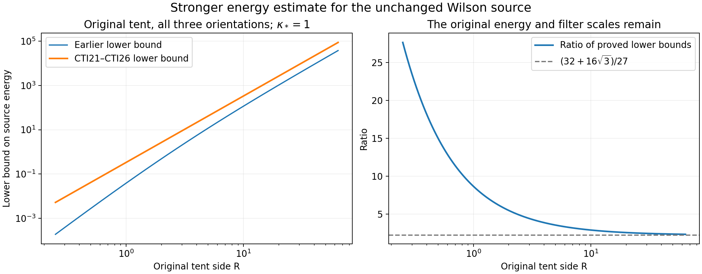
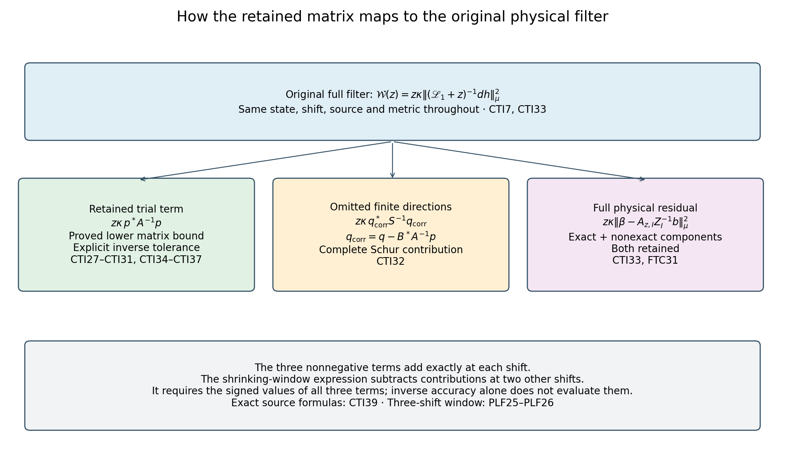

# Full current tails, retained sources and stable matrix inverses

This calculation bounds exponential tails of the full ground-state current, proves a stronger lower energy for the original Wilson source, and retains a source-carrying set of links with a quantitative trial-matrix inverse. The omitted finite directions and the complete physical remainder stay explicit. A controlled inverse approximation does not assign a value to the remaining interacting spectral contribution.

The complete provider proofs are [SOM1–SOM24](https://github.com/KokunoYumeto/yang-mills-interacting-workbench/blob/0da4c83ec72507e0465877c6c30a5c04cccac82c/yang-mills/continuations/20261011-central-signs-shrinking-window/ACTUAL_SCORE_MOMENTS_AND_SECOND_ENERGY.md), [FTC1–FTC33](https://github.com/KokunoYumeto/yang-mills-interacting-workbench/blob/0da4c83ec72507e0465877c6c30a5c04cccac82c/yang-mills/continuations/20261011-central-signs-shrinking-window/ACTUAL_FILTERED_CURRENT_AND_TAIL.md), [SG1–SG33](https://github.com/KokunoYumeto/yang-mills-interacting-workbench/blob/0da4c83ec72507e0465877c6c30a5c04cccac82c/yang-mills/continuations/20261011-central-signs-shrinking-window/ACTUAL_GROUND_GRADIENT_TRIAL.md), and [CE1–CE10](https://github.com/KokunoYumeto/yang-mills-interacting-workbench/blob/0da4c83ec72507e0465877c6c30a5c04cccac82c/yang-mills/continuations/20261011-central-signs-shrinking-window/CURRENT_COVARIANCE_EQUALITY.md). Their pinned source versions and reading coverage are recorded in the source-use ledger. The weighted-form human provenance remains Jon Johnsen, *On the spectral properties of Witten-Laplacians, their range projections and Brascamp-Lieb's inequality*, [arXiv:1703.10011v2](https://arxiv.org/abs/1703.10011v2), and Assane Lo, *Witten Laplacian Methods for the Decay of Correlations*, [arXiv:math-ph/0611002v9](https://arxiv.org/abs/math-ph/0611002v9). No additional author-source reading or novelty is claimed.

Keep the original open lattice \(L_j=j^4\), all positive edges, all vertex gauge constraints, the radius-two SU(2) metric with \(T_\alpha=-i\sigma_\alpha/2\) orthonormal, and probability Haar measure. The original face word and state are
\[
\begin{gathered}
U_p=U_d(z)U_k(z+e_d)U_d(z+e_k)^{-1}U_k(z)^{-1}\quad(d<k),\\
D_p=2-\operatorname{Tr}U_p,\quad
V=b_j\sum_pD_p=2b_j|\mathcal P_j|-b_j\sum_p\operatorname{Tr}U_p,\\
H_j=-\kappa_*\Delta+V,\quad H_j\psi_j=E_{0,j}\psi_j,\quad
\psi_j>0,\quad\|\psi_j\|=1,\quad d\mu_j=\psi_j^2dU,\\
a_j=(100j)^{-1},\quad g_j^2=\kappa_*a_j/2,\quad
b_j=(\kappa_*a_j^2)^{-1},\quad s_j=\kappa_*/j=100\kappa_*a_j .
\end{gathered}
\tag{CTI1}
\]

Write \(a=a_j,\kappa=\kappa_*,b=(\kappa a^2)^{-1}\), \(w=\log\psi\), \(g_e=\nabla_ew\), \(G_e=|g_e|^2\), \(H_{er}=(\nabla^2w)_{er}\), \(R_e=\sum_r\|H_{er}\|_{\rm HS}^2\), \(F_e=d_eV\), and \(\mathscr D=\Delta+2\nabla w\cdot\nabla\). The actual conditional measure \(\mu_e^x\) fixes every link outside \(e\), as in SOM3. Put \(T_e(x)=\mu_e^xG_e\) and \(T_e=\mu G_e\). All configuration derivatives and outside Hessian rows remain. Throughout, the inverse shift satisfies \(z>0\), and the real original test triple \(\mathbf f\) is nonzero and continuous with compact support. The fitting cube and source definitions are given in CTI38–CTI39.

## 1. Exponential derivative identity

For \(0<t<1/4\), put \(r=t\kappa a\), without changing the original score or energy unit. The full compact weighted integration and SOM9 give
\[
\begin{aligned}
0&=\mu\mathscr D e^{rG_e}
=r\mu\{e^{rG_e}(\mathscr DG_e+r|dG_e|^2)\},\\
r\mu(e^{rG_e}|dG_e|^2)+2\mu(e^{rG_e}R_e)+\mu(e^{rG_e}G_e)
&=-\frac2\kappa\mu(e^{rG_e}g_e\cdot F_e).
\end{aligned}
\tag{CTI2}
\]
Every left term is nonnegative. The SOM5 moment series, with its coefficients evaluated directly rather than differentiating a one-sided inequality, proves
\[
\begin{gathered}
\mu_e^x\{G_e e^{u\kappa aG_e}\}
\le T_e(x)(1-2u)^{-5/2}
\le\frac3{\kappa a}(1-2u)^{-5/2},\\
\mu_e^x e^{u\kappa aG_e}
\le1+\frac{\kappa aT_e(x)}3[(1-2u)^{-3/2}-1],
\qquad0\le u<1/2 .
\end{gathered}
\tag{CTI3}
\]
To check both series while retaining the first moment, iterate SOM5 from \(p=1\): \(\mu_e^xG_e^p\le(2p+1)!!\,T_e(x)/[3(\kappa a)^{p-1}]\). The first series then has coefficient at most \((2n+3)!!\,T_e(x)/(3n!)\), and the second follows by separating its constant term. Their sums are obtained from the explicit comparison series in SOM6. Integrating the actual outside marginal and applying Cauchy–Schwarz yields
\[
\begin{aligned}
&r\mu(e^{rG_e}|dG_e|^2)+2\mu(e^{rG_e}R_e)+\mu(e^{rG_e}G_e)\\
&\quad\le\frac2\kappa(1-4t)^{-5/4}\sqrt{T_e\,\mu|F_e|^2}\\
&\quad\le\frac{2\sqrt3}{\kappa^{3/2}a^{1/2}}
(1-4t)^{-5/4}\sqrt{\mu|F_e|^2}.
\end{aligned}
\tag{CTI4}
\]
Consequently
\[
\mu(e^{t\kappa aG_e}|dG_e|^2)
\le\frac2{t\kappa^2a}(1-4t)^{-5/4}\sqrt{T_e\,\mu|F_e|^2}.
\tag{CTI5}
\]
For \(B_e(R)=\{G_e>R/(\kappa a)\}\), multiplying by the exponential threshold gives the same bound for \(\mu(\mathbf1_{B_e(R)}|dG_e|^2)\) with the factor \(e^{-tR}\). Also
\[
\begin{gathered}
\mu(\mathbf1_{B_e(R)}G_e)
\le e^{-tR}T_e(1-2t)^{-5/2},\\
\mu B_e(R)\le e^{-tR}
\left\{1+\frac{\kappa aT_e}3[(1-2t)^{-3/2}-1]\right\},
\qquad R\ge0 .
\end{gathered}
\tag{CTI6}
\]
These bounds retain the full derivative \(dG_e\), including every exterior link.

## 2. Full finite-column cutoff and the original metric

Use SOM13's strict interior set \(I=E_Q^\circ\), \(n=|I|\), actual \(d_Q=\mu W_Q\), and the unchanged full budget \(\Lambda_Q\). The weighted one-form operator is the nonnegative self-adjoint \(\mathscr L_1=\kappa(dd_\mu^*+d_\mu^*d)\), with \(d_\mu^*\) the adjoint in \(L^2(\mu)\) on the original compact configuration manifold. The exact staple identity in SOM12 gives \(|F_e|^2\le b^2\rho_e^2\le16b^2\) for \(m_e=4\); its full mean bound is \(\sum_{e\in I}\mu|F_e|^2\le16b^2d_Q\). Define the original Hilbert-space column operator on raw coefficients \(c\in\mathbb C^I\) by
\[
\begin{gathered}
A_zc=\sum_{e\in I}c_eD_z\alpha_e,\qquad
D_z=\mathscr L_1+zI,\quad \alpha_e=a^2\Pi_edw,\\
D_z\alpha_e=a^2(-\Pi_edV-\kappa dG_e+z\Pi_edw),\qquad
A_z^*A_z=\mathsf Z(z).
\end{gathered}
\tag{CTI7}
\]
The column cutoff is an \(L^2\) comparison map only:
\[
\widetilde A_{z,R}c=\sum_{e\in I}c_e\mathbf1_{B_e(R)^c}D_z\alpha_e,
\qquad E_{z,R}=A_z-\widetilde A_{z,R}.
\tag{CTI8}
\]
No derivative is taken through the indicator, and no domain membership beyond \(L^2\) is asserted for these cutoff columns. The masks differ between columns; in particular, \(\mathsf Z-\widetilde A^*\widetilde A\) need not be positive.

For an exact counterexample to positivity for general differing column masks, take the one-point Hilbert space, \(A=(1\ \ 1)\), and retain the first column only: \(\widetilde A=(1\ \ 0)\). The Gram difference is \(\left(\begin{smallmatrix}0&1\\1&1\end{smallmatrix}\right)\), whose determinant is \(-1\). This example concerns the general masking operation; no such sign is assigned to the actual interacting matrix.

The exact Hilbert–Schmidt error is
\[
\|E_{z,R}\|_{\rm HS}^2
=\sum_{e\in I}\mu\{\mathbf1_{B_e(R)}|D_z\alpha_e|^2\}.
\tag{CTI9}
\]
Keep its original force/score cross terms in this equality. Triangle inequality in the full direct sum and the proved exponential bounds then give
\[
\|E_{z,R}\|_{\rm HS}
\le a^2e^{-tR/2}\big(\sqrt{\mathcal F_t}
+\kappa\sqrt{\mathcal H_t}+z\sqrt{\mathcal G_t}\big),
\tag{CTI10}
\]
where every constant is
\[
\begin{gathered}
\mathcal T_I=\min\left\{\frac{3n}{\kappa a},
\frac b\kappa(\Lambda_Q-d_Q)\right\},\\
\mathcal F_t=16b^2
\left\{n+\frac{\kappa a\mathcal T_I}3[(1-2t)^{-3/2}-1]\right\},\\
\mathcal G_t=\mathcal T_I(1-2t)^{-5/2},\qquad
\mathcal H_t=\frac{8b}{t\kappa^2a}
(1-4t)^{-5/4}\sqrt{\mathcal T_I d_Q}.
\end{gathered}
\tag{CTI11}
\]
Both SOM5 and the full local energy budget give \(\sum_{e\in I}T_e\le\mathcal T_I\). For \(\mathcal H_t\), sum CTI5 and use \(\sum_e\sqrt{T_e\,\mu|F_e|^2}\le\sqrt{\mathcal T_I\sum_e\mu|F_e|^2}\le4b\sqrt{\mathcal T_I d_Q}\). The other two terms follow by summing CTI6, with the full pointwise force bound just proved. Thus both the original count and the shared actual deficit remain.

The full Gram comparison, preserving cross terms, is
\[
\begin{aligned}
\mathsf Z-\widetilde A^*\widetilde A
&=A_z^*E_{z,R}+E_{z,R}^*A_z-E_{z,R}^*E_{z,R},\\
\|\mathsf Z-\widetilde A^*\widetilde A\|
&\le(2\sqrt{\operatorname{tr}\mathsf Z}+\|E_{z,R}\|_{\rm HS})
\|E_{z,R}\|_{\rm HS},\\
|c^*(\mathsf Z-\widetilde A^*\widetilde A)c|
&\le\|c\|_{\ell^2(I)}^2
(2\sqrt{\operatorname{tr}\mathsf Z}+\|E_{z,R}\|_{\rm HS})
\|E_{z,R}\|_{\rm HS}.
\end{aligned}
\tag{CTI12}
\]
The factor \(\|c\|^2\) must remain when coefficients vary with the regulator. No lower eigenvalue or inverse error is inferred from this estimate alone.

At \(z=\theta s_j\), SOM13 gives \(n=O(a^{-3})\), \(d_Q=O(a^{-2})\), while SOM17 gives \(\operatorname{tr}\mathsf Z=O(a^{-2})\). The displayed three squared contributions to the Hilbert–Schmidt error are \(O(a^{-3})\), \(O(a^{-2})\), and \(O(a^2)\), respectively, before the exponential factor. Thus choosing
\[
R_j=\frac{3+2\rho}{t}\log(1/a_j),\qquad \rho>0,
\tag{CTI13}
\]
gives \(\|E_{z,R_j}\|_{\rm HS}=O(a_j^\rho)\). For \(\rho>1\), the Gram operator error is \(O(a_j^{\rho-1})\); the actual raw coefficient norm multiplies this error in every quadratic evaluation. Retain the full finite formula when computing an actual tolerance. This is a score-support cutoff with explicit error, not a finite matrix-value evaluation or a pointwise Hessian cutoff.

The untouched original source vector is SOM18. If a source pairing with the cutoff columns is needed, its exact difference is \(E_{z,R}^*\beta\), \(\beta=D_z^{-1}dh_{e_0}\), bounded by \(\|E_{z,R}\|_{\rm HS}\|\beta\|_\mu\). Use the actual \(\|\beta\|_\mu^2=\mathcal W(z)/(z\kappa)\), or the complete available upper bound \(\|\beta\|_\mu\le\sqrt{E_h/\kappa}/z\); do not identify the cutoff pairing with the original \(\mathsf b\).

## 3. Complete signed directional second energy

For a real deterministic edge list \(h\), let \(D_h\) multiply the full three-component edge cotangent summand by \(h_e\), and let \(\alpha_h=\sum_eh_e\alpha_e=a^2D_hdw\). Define
\[
G_h=\sum_eh_eG_e,\quad R_h=\sum_eh_eR_e,\quad
J_h=\sum_eh_e g_e\cdot F_e,\quad \Delta_h=\sum_eh_e\Delta_e .
\tag{CTI14}
\]
Linearity of SOM9 and weighted integration give
\[
\mu|dG_h|^2=-2\mu(G_hR_h)-\mu G_h^2-\frac2\kappa\mu(G_hJ_h).
\tag{CTI15}
\]
Retain the signs of \(h\); \(G_hR_h\) is not generally nonnegative. SOM15 yields the full directional second energy
\[
\begin{aligned}
a^{-4}\|\mathscr L_1\alpha_h\|_\mu^2
={}&\mu\sum_eh_e^2|F_e|^2
-2\kappa\mu(G_h\Delta_hV)-6\kappa\mu(G_hJ_h)\\
&-2\kappa^2\mu(G_hR_h)-\kappa^2\mu G_h^2 .
\end{aligned}
\tag{CTI16}
\]
To verify the cross coefficient, integrate
\(\mu\langle D_hdV,dG_h\rangle=-\mu\{G_h(\Delta_hV+2J_h)\}\)
and substitute the preceding exact derivative identity. This preserves the large signed contributions which the trace bound cannot evaluate. The identity applies in particular to the original continuous \(t_d\) weights and to the actual finite inverse coefficients. Its signed expectations remain exact; no term is estimated by dropping its sign.

## 4. Actual one-edge information and its full mean-deficit bound

For any edge with incidence \(m\), write \(w_e=\mu W_e^{\rm def}>0\), \(T_e=\mu|\nabla_e\log\psi|^2\). Compact integration by parts and the original Casimir give
\[
\mu(g_e\cdot d_eW_e^{\rm def})=-\frac38(2m-w_e),\qquad
T_e\,\mu|d_eW_e^{\rm def}|^2\ge\frac9{64}(2m-w_e)^2.
\tag{CTI17}
\]
SOM12 keeps the exact staple terms before \(\mu|d_eW_e^{\rm def}|^2\le m w_e\), hence
\[
T_e\ge\frac{9(2m-w_e)^2}{64m w_e}.
\tag{CTI18}
\]
All \(w_e>0\), because the actual density has full support and the incident deficit is a nonconstant nonnegative function. For strict interior edges \(m=4\).

SOM5 also proves \(T_e\le3/(\kappa a)\). Thus, independently at every edge,
\[
\begin{gathered}
3\kappa a(2m-w_e)^2\le64m w_e,\\
w_e\ge
\frac{24\kappa a m}{12\kappa a+64+\sqrt{(12\kappa a+64)^2-144\kappa^2a^2}}.
\end{gathered}
\tag{CTI19}
\]
The rationalized positive root follows from the full quadratic
\(3\kappa a w_e^2-m(12\kappa a+64)w_e+12\kappa a m^2\le0\).
For \(m=4\), \(w_e/a\) has liminf at least \(3\kappa/4\). This is an edgewise lower incident-deficit estimate. The earlier full local-budget roots remain available and are not replaced by it.

## 5. A lower source energy without an enclosing-cube constant

For \(I=E_Q^\circ\), the exact original trial metric is diagonal:
\[
\mathsf N_{er}=a^4\delta_{er}T_e,\qquad
0<\mathsf N\le\frac{3a^3}{\kappa}I.
\tag{CTI20}
\]
For strict positivity, \(T_e=0\) would make \(d_ew=0\) everywhere, by smoothness and the strictly positive density. Thus \(\psi\), its outside derivatives and \(-\kappa\Delta\psi/\psi\) would be independent of \(U_e\). The ground-state equation would force \(V\) to be independent of \(U_e\). Setting the outside links to the identity instead gives the nonconstant incident contribution \(b(2m-m\operatorname{Tr}U_e)\), a contradiction for \(m>0\). The component forms \(\alpha_e=a^2\Pi_edw\) are mutually orthogonal. Bessel's inequality applied to the actual \(dh_{e_0}\), with the complete original source vector \(\mathsf b\) from SOM18, proves
\[
E_h=\kappa\|dh_{e_0}\|_\mu^2
\ge\kappa\sum_{e\in I}\frac{|\mathsf b_e|^2}{a^4T_e}
\ge\frac{\kappa^2}{3a^3}\|\mathsf b\|_{\ell^2(I)}^2.
\tag{CTI21}
\]
SOM22 therefore yields
\[
\liminf_jE_{h,j}\ge\frac34\kappa_*^2J_t,\qquad
J_t=\sum_{d=1}^3\int t_d^2>0.
\tag{CTI22}
\]
This does not use the enclosing cube's volume or crossing constant. Retain both lower bounds:
\(e'_{\mathbf f}=\max\{e_{\mathbf f},3\kappa_*^2J_t/4\}\).
FTC3 transfers the same bound to the original full source. FTC12's filter constant strengthens to \(100\theta\kappa_*(e'_{\mathbf f})^3/D_{\mathbf f}^2\); every original \(D_{\mathbf f},U_{\mathbf f},K_R\) remains. The complete constants are retained below.

For completeness, the unchanged FTC5 constants in this strengthened estimate are
\[
\begin{gathered}
t_1=f_{12}+f_{13},\quad t_2=f_{12}+f_{23},\quad t_3=f_{13}+f_{23},\\
J_{\rm edge}=\sum_d\int|t_d|,\quad
J_2^\Sigma=\sum_\sigma\int f_\sigma^2,\quad
M_f=\max_\sigma\|f_\sigma\|_\infty,\quad
\chi=4+4\sum_\sigma\|f_\sigma\|_\infty/M_f,\\
\mathsf L_R=9\kappa_*R^3+24R^2,\quad
K_R=\frac{\mathsf L_R+\sqrt{\mathsf L_R^2-81\kappa_*^2R^6/4}}2,\\
e_{\mathbf f}=\frac{9\kappa_*^3J_{\rm edge}^2}{4K_R},\quad
U_{\mathbf f}=\kappa_*\chi M_f^2K_R,\quad
D_{\mathbf f}=21\kappa_*^2J_2^\Sigma+4U_{\mathbf f},\\
e'_{\mathbf f}=\max\{e_{\mathbf f},3\kappa_*^2J_t/4\},\qquad
\liminf_j\frac{\mathcal W_{h_{e_0}\psi_j}(\theta s_j)}{a_j^3}
\ge\frac{100\theta\kappa_*(e'_{\mathbf f})^3}{D_{\mathbf f}^2}.
\end{gathered}
\tag{CTI23}
\]
Here \(R=R_{\rm cube}\) is the original support-cube side in these energy constants. The last step is the unchanged finite inequality FTC10, with the original full Hessian and upper denominator from FTC11–FTC12. Its numerator now receives both proved energy bounds. The corresponding full original source \(F=h_{e_0}+q_{e_0}\) has the same energy lower bound, because FTC3 bounds the difference of the square roots of its two energies by \(4\sqrt{7\kappa_*}a_jM_f\).

There is an exact multi-source version. For a fixed finite list of original tests, put \(v_r=dh_{e_0,r}\), \(\mathsf B_{er}=\langle\alpha_e,v_r\rangle_\mu\), and \(\mathsf E_{rs}=\kappa\langle v_r,v_s\rangle_\mu\). Orthogonal projection onto the span of the actual \(\alpha_e\) gives
\[
\begin{gathered}
\mathsf E-\kappa\mathsf B^*\mathsf N^{-1}\mathsf B
=\big(\kappa\langle(I-P_\alpha)v_r,(I-P_\alpha)v_s\rangle_\mu\big)_{rs}\ge0,\\
\mathsf E\ge\frac{\kappa^2}{3a^3}\mathsf B^*\mathsf B,\qquad
a_j^{-3}(\mathsf B_j^*\mathsf B_j)_{rs}
\longrightarrow\frac94\sum_d\int t_{r,d}t_{s,d},\\
\liminf_j\lambda_{\min}
\left[\mathsf E_j-\frac34\kappa_*^2
\left(\sum_d\int t_{r,d}t_{s,d}\right)_{rs}\right]\ge0 .
\end{gathered}
\tag{CTI24}
\]
The source-vector error in SOM21, before taking its norm, tends to zero in the scaled \(\ell^2\) norm for every test. Applying Cauchy–Schwarz to each cross product proves the displayed cross limit; finitely many entries give matrix-norm convergence. This proves the last line by the preceding matrix order. No entrywise order is substituted for matrix order.

The orientation map itself satisfies the full exact formula
\[
J_t=\int_{\mathbb R^3}\left[
f_{12}^2+f_{13}^2+f_{23}^2+(f_{12}+f_{13}+f_{23})^2\right].
\tag{CTI25}
\]
It follows by expanding the original three \(t_d^2\); all orientation cross terms remain.

For a concrete original test, take all three orientations equal to
\(f(x)=\prod_{k=1}^3(1-2|x_k|/R)_+\), without changing its amplitude or coordinates. Direct one-dimensional integration and multiplication give
\[
\begin{gathered}
\int|f|=R^3/8,\quad \int f^2=R^3/27,\quad
J_{\rm edge}=3R^3/4,\quad J_t=4R^3/9,\\
e_{\mathbf f}=\frac{81\kappa_*^3R^6}{64K_R},\qquad
\frac34\kappa_*^2J_t=\frac{\kappa_*^2R^3}{3},\\
\frac{3\kappa_*^2J_t/4}{e_{\mathbf f}}
=\frac{64K_R}{243\kappa_*R^3}
>\frac{32+16\sqrt3}{27}>2 .
\end{gathered}
\tag{CTI26}
\]
Indeed \(\mathsf L_R>9\kappa_*R^3\), and the function \((x+\sqrt{x^2-81\kappa_*^2R^6/4})/2\) is increasing on this range. Therefore \(K_R>(9/2+9\sqrt3/4)\kappa_*R^3\), giving the exact strict ratio. Cubing this ratio strengthens the FTC12 lower coefficient by more than \(((32+16\sqrt3)/27)^3\), with the original factor \(a_j^3\) still present.

## 6. Retaining the original source with a proved lower trial norm

Set \(\ell_j^{\rm sel}=\log(1/a_j)\), \(\delta_j^{\rm sel}=a_j\ell_j^{\rm sel}\). On the original path \(0<a_j\le1/100\), so \(0<\delta_j^{\rm sel}\le(\log100)/100<4\). Let
\[
I_j^+=\{e\in I_j:w_e\le\delta_j^{\rm sel}\},\qquad I_j^-=I_j\setminus I_j^+.
\tag{CTI27}
\]
These are deterministic subsets specified by the actual state, not new boundary conditions. The incident count gives
\[
|I_j^-|\delta_j^{\rm sel}\le\sum_{e\in I_j}w_e\le4d_Q.
\tag{CTI28}
\]
For every original source entry, \(|\mathsf b_e|\le3a^3M_f\), since \(|\mu D_p-2|\le2\) and at most four faces meet the edge. Thus
\[
\|\mathsf b_{I^-}\|^2\le36a^6M_f^2d_Q/\delta_j^{\rm sel},\qquad
a_j^{-3}\|\mathsf b_{I^-}\|^2
\le36M_f^2a_j^2d_Q/\ell_j^{\rm sel}\longrightarrow0,
\tag{CTI29}
\]
and
\[
a_j^{-3}\|\mathsf b_{I^+}\|^2\longrightarrow9J_t/4.
\tag{CTI30}
\]
In particular \(I_j^+\) is nonempty for all sufficiently large original regulators. The function \((8-w)^2/w\) decreases on \((0,8)\), so
\[
\tau_j=\frac{9(8-\delta_j^{\rm sel})^2}{256\delta_j^{\rm sel}},\qquad
\mathsf N_{I^+}\ge a_j^4\tau_j I,\qquad
\mathsf Z_{I^+}(z)\ge\gamma_j(z)I,\quad
\gamma_j(z)=z^2a_j^4\tau_j .
\tag{CTI31}
\]
At \(z=\theta s_j\), \(\ell_j^{\rm sel}\gamma_j(z)/a_j^5\to22500\theta^2\kappa_*^2\). This proves the lower matrix bound from the original interacting state. It is not an assumption on a trial inverse.

## 7. Complete omitted-direction and physical remainders

Write the complete finite \(\mathsf Z_I\) in blocks on \(I^+\oplus I^-\), with blocks \(A,B;B^*,D\), and original \(\mathsf b=(p,q)\). All these are the same actual matrix entries from FTC26. Its exact Schur complement is \(S=D-B^*A^{-1}B\). For nonzero \(y\), pairing \(\mathsf Z_I\) with \((-A^{-1}By,y)\) gives \(\langle y,Sy\rangle>0\), proving its positivity. Factoring \(\mathsf Z_I\) as the product of the lower triangular block matrix with lower-left entry \(B^*A^{-1}\), the diagonal block matrix \(\operatorname{diag}(A,S)\), and its upper triangular adjoint proves, by inversion,
\[
\mathsf b^*\mathsf Z_I^{-1}\mathsf b
=p^*A^{-1}p+(q-B^*A^{-1}p)^*S^{-1}(q-B^*A^{-1}p).
\tag{CTI32}
\]
Use the undivided first term when \(I^-=\varnothing\); if \(I^+=\varnothing\), retain the complete original inverse until the proved eventual nonemptiness applies. The small raw \(q\) alone does not control its Schur-corrected value.

Moreover FTC29 gives, without deleting its physical remainder,
\[
\begin{aligned}
\mathcal W(z)={}&z\kappa\,p^*A^{-1}p\\
&+z\kappa\,(q-B^*A^{-1}p)^*S^{-1}(q-B^*A^{-1}p)\\
&+z\kappa\|\beta-A_{z,I}\mathsf Z_I^{-1}\mathsf b\|_\mu^2 .
\end{aligned}
\tag{CTI33}
\]
The final norm still splits into the physical exact and nonexact norms of FTC31. These identities prove the complete relation of the retained set to the original physical filter.

## 8. Explicit inverse accuracy from the actual current tail

Restrict the full column map of Section 2 and its cutoff to \(I^+\). Its Hilbert–Schmidt error is bounded by
\[
\varepsilon_R=\mathcal B_t(z)e^{-tR/2},\quad
\mathcal B_t(z)=a^2(\sqrt{\mathcal F_t}+\kappa\sqrt{\mathcal H_t}+z\sqrt{\mathcal G_t}),
\tag{CTI34}
\]
with Section 2's full constants taken over the larger \(I\). Let \(\mathcal U_z\) be the complete finite upper bound for \(\operatorname{tr}\mathsf Z_I(z)\) in SOM17; keep the shared \(d_Q\) and every count. Then
\[
\eta_R=(2\sqrt{\mathcal U_z}+\varepsilon_R)\varepsilon_R
\tag{CTI35}
\]
bounds the actual retained Gram error in operator norm and its quadratic error times the original coefficient norm squared.

For any prescribed \(\epsilon>0\), use the explicit finite choices
\[
\begin{gathered}
B_b=9a^6M_f^2|I|>0,\qquad
\eta_*=\min\left\{\frac{\gamma_j(z)}2,
\frac{\epsilon\,\gamma_j(z)^2}{2z\kappa B_b}\right\},\\
e_*=\min\left\{1,\frac{\eta_*}{2\sqrt{\mathcal U_z}+1}\right\},\qquad
R_*=\frac2t\log\max\{1,\mathcal B_t(z)/e_*\}.
\end{gathered}
\tag{CTI36}
\]
Take \(R\ge R_*\). These choices prove \(\varepsilon_R\le e_*\), \(\eta_R\le\eta_*\le\gamma/2\). Consequently the cutoff Gram \(\widetilde A^*\widetilde A\) on \(I^+\) is positive with lower eigenvalue at least \(\gamma/2\); its inverse exists. The resolvent identity gives
\[
\left|z\kappa\,p^*
\left[A^{-1}-(\widetilde A^*\widetilde A)^{-1}\right]p\right|
\le\frac{z\kappa B_b\,\eta_R}{\gamma(\gamma-\eta_R)}
\le\epsilon.
\tag{CTI37}
\]
This is a proved comparison of the retained trial value using the unchanged original \(p\). It does not identify \(p\) with the cutoff column pairing. The latter has the exact error \(E^*\beta\), which remains controlled separately.

For fixed \(\theta,t\), the original path gives \(\|E\|_{\rm HS}=O(a^\rho)\) at the cutoff \(R=(3+2\rho)\log(1/a)/t\), retained Gram error \(O(a^{\rho-1})\), \(\gamma\) of order \(a^5/\ell_j^{\rm sel}\), and the filter-value error \(O(a^{\rho-7}(\ell_j^{\rm sel})^2)\). For \(\rho>7\), the Gram error is eventually less than \(\gamma/2\) and the last absolute error tends to zero. Use the full finite \(R_*\) to certify any actual target tolerance.

The original local quantities used in every cutoff and inverse estimate remain
\[
\begin{gathered}
N_Q=3q(q+1)^2,\quad M_Q=3q^2(q+1),\quad n=|E_Q^\circ|=3q(q-1)^2,\\
C_Q=2q(q+1)\sum_d[\mathbf1_{\{v_d>0\}}+\mathbf1_{\{v_d+q<2L_j\}}],\\
d_Q=\mu\sum_{p\ {\rm inside}\ Q}D_p,\qquad
\Lambda_Q=\min\{2M_Q,6g_j^2\sqrt{N_QM_Q}\}+2C_Q,\\
\mathcal U_z=
\frac{[4\sqrt{d_Q}+\sqrt{8\sqrt{35}}\{d_Q(\Lambda_Q-d_Q)\}^{1/4}]^2}{\kappa^2}\\
\hspace{4mm}
+2z\left[\frac{3a^2n}{\kappa}+\frac{4a(\Lambda_Q-d_Q)}{\kappa^2}\right]
+\frac{z^2a^2(\Lambda_Q-d_Q)}{\kappa^2}.
\end{gathered}
\tag{CTI38}
\]

Here \(Q=v+\{0,\ldots,q\}^3\), \(q=\lceil R_{\rm cube}/a_j\rceil+3\), and
\(v_d=L_j+\lfloor(c_d^{\rm cube}-o_d)/a_j\rfloor-1\).
The symbol \(R_{\rm cube}\) is the support-cube side; the cutoff threshold \(R\) in Sections 1–2 and 8 is a different parameter. Both complete definitions are retained.

The original source itself is
\[
\begin{gathered}
x_p=o+a_j(z-L_j\mathbf1+(e_d+e_k)/2),\quad f_p=f_\sigma(x_p)\ (p:\sigma),\\
F=a_j\sum_pf_p(D_p-\mu D_p),\quad
h_{e_0}=a_j\sum_{p\not\ni e_0}f_p(D_p-\mu D_p),\\
\mathsf b_e=\frac{3a_j^3}{8}\sum_{\substack{p\ni e\\p\not\ni e_0}}f_p(\mu D_p-2).
\end{gathered}
\tag{CTI39}
\]
The proof evaluates a stronger energy lower bound and a source-preserving matrix selection. Its full signed directional identity, finite Schur term and physical residual still require actual evaluation at all three shifts in PLF25–PLF26. The original four-loop/gradient difference remains a separate active calculation. The interacting continuum state, reconstruction, global smoothness, intended-theory identification and no-gap endpoint remain the programme goal.

Reproducible [diagnostics and figures](check_current_tail.py) and [source-use record](CURRENT_TAIL_SOURCE_USE_LEDGER.json). Analytic diagnostic densities, independent matrices and budget samples are not measurements of the original Yang–Mills vacuum.

## Original source Hessian and the stronger full-source response

[HSF1–HSF17](https://github.com/KokunoYumeto/yang-mills-interacting-workbench/blob/main/yang-mills/continuations/20261011-central-signs-shrinking-window/ORIGINAL_SOURCE_HESSIAN_AND_FILTER.md) evaluate the actual source-Hessian limit and retain the original energy inside the finite filter denominator. For both the full original Wilson observable \(X_j=F_j\) and its outside source \(X_j=h_{e_0,j}\), they prove
\[
\begin{gathered}
a_j\mu_j\|\nabla^2X_j\|^2\longrightarrow3J_t+9J_2^\Sigma,\\
\liminf_j\frac{\mathcal W_{X_j\psi_j}(\theta s_j)}{a_j^3}
\ge\frac{100\theta\kappa_*(e'_{\mathbf f})^3}
{\{\kappa_*^2(3J_t+9J_2^\Sigma)+4e'_{\mathbf f}\}^2}.
\end{gathered}
\]
HSF1–HSF6 retain all signed Hessian terms, original face counts and finite errors. HSF7–HSF9 prove the complete energy-dependent comparison; every original upper and lower constant remains available. HSF10 gives coefficient \(100\theta\kappa_*^3R^3/363\) for the unchanged three-orientation tent. HSF11–HSF15 apply the bound directly to the full original observable and retain every cross term in its exact relation to the outside source. This strengthens FTC12 and CTI23 while keeping the factor \(a_j^3\). The signed original-window response, full inverse and residual contributions, reconstruction and the smooth no-gap endpoint remain active calculations.

## Complete residual and exact stereographic current

[TCR1–TCR21](https://github.com/KokunoYumeto/yang-mills-interacting-workbench/blob/main/yang-mills/continuations/20261011-central-signs-shrinking-window/TWO_SIDED_CURRENT_RESIDUAL.md) give complete two-sided bounds for the original filtered response and its signed three-shift window. They retain the actual least-squares defect and the original uncut trial metric. Projection orthogonality and a direct singular-value estimate prove
\[
\|\widetilde c\|\le\sqrt{2q_R/\gamma},\qquad
\sqrt{\kappa_*/z}\,\epsilon_R\|\widetilde c\|
=O\!\left(a_j^{\rho-3}\sqrt{\log(1/a_j)}\right).
\]
With the original CTI13 cutoff, every \(\rho>9/2\) makes this cutoff contribution \(o(a_j^{3/2})\); the interacting residual remains to be evaluated.

[SC1–SC24](https://github.com/KokunoYumeto/yang-mills-interacting-workbench/blob/main/yang-mills/continuations/20261011-central-signs-shrinking-window/STEREOGRAPHIC_CURRENT_AND_CUBIC.md) supply the exact stereographic coordinate, density, radius-two metric and state maps for those integrals. Gauge invariance proves that each unfixed original link has a Haar marginal: its stereographic moments are finite exactly below order three. SC8–SC15 retain every rational face term and prove that the local density approximation in Chatterjee, [arXiv:2401.10507v4](https://arxiv.org/abs/2401.10507v4), label “approxdens”, omits a cubic nonabelian contribution. The full-density counterexample and corrected expression are proved without claiming that the source's main scaling theorem fails. This extends OW's ordered-action comparison and prevents an invalid polynomial-moment substitution in the current calculation. Actual window values, reconstruction, intended-theory identification and the smooth global no-gap endpoint remain active work.

The subsequent calculation [SC18–SC24](https://github.com/KokunoYumeto/yang-mills-interacting-workbench/blob/main/yang-mills/continuations/20261011-central-signs-shrinking-window/STEREOGRAPHIC_CURRENT_AND_CUBIC.md) evaluates all five rational action terms in the actual vacuum, including with bounded gauge-invariant score multipliers. Its original four-link tensor average is
\[
\mu(q_1^a q_2^b q_3^c q_4^d)
=\frac{\mu\operatorname{Tr}U_p}{128}\,
\frac12\operatorname{Tr}(E_aE_bE_cE_d).
\]
This determines every signed term in SC10 and their exact cancellation on the original coupling path. SC24 also gives the full force pairing in original staple-loop and two-plaquette expectations, with all orientations, original coefficients and remaining mixed score moments retained. These identities evaluate gauge averages; they do not yet evaluate the complete residual or establish the no-gap endpoint.

## Positive current measures and individual plaquette means

[CFC1–CFC26](https://github.com/KokunoYumeto/yang-mills-interacting-workbench/blob/main/yang-mills/continuations/20261011-central-signs-shrinking-window/CENTERED_CURRENT_COVARIANCE.md) construct the positive original-configuration measure
\[
d\nu_e=\frac{\kappa(2R_e+G_e)+(3b/4)\sum_{p\ni e}D_p}{6b}\,d\mu .
\]
Its exact mixture and full source retain twice the force pairing. A deterministic subset carrying at least three quarters of the original squared source-norm limit has uniform tilted score tails and a trial inverse lower bound without the earlier logarithmic loss. The full complementary block and physical residual remain.

CFC22–CFC26 prove an individual-face lower mean, the resulting lower density \(3\kappa_*/16\) for every orientation of the limiting spatial vacuum mean, and
\[
K_R^{\rm kin}=\min\{K_R,\mathsf L_R-9\kappa_*R^3/16\},\qquad
\limsup a_j^2(\Lambda_Q-d_Q)\le K_R^{\rm kin}.
\]
This strictly improves the kinetic ceiling when \(\kappa_*R<128/3\), and the original gradient-trial response constants are rederived. All finite roots, counts and crossing terms remain. The force upper bound uses the original \(K_R\), not this kinetic ceiling. Spatial mean domination is not an operator lower bound for every vector or a smooth continuum field. The signed interacting source/Gram evaluation, reconstruction and smooth global no-gap endpoint remain active calculations.
