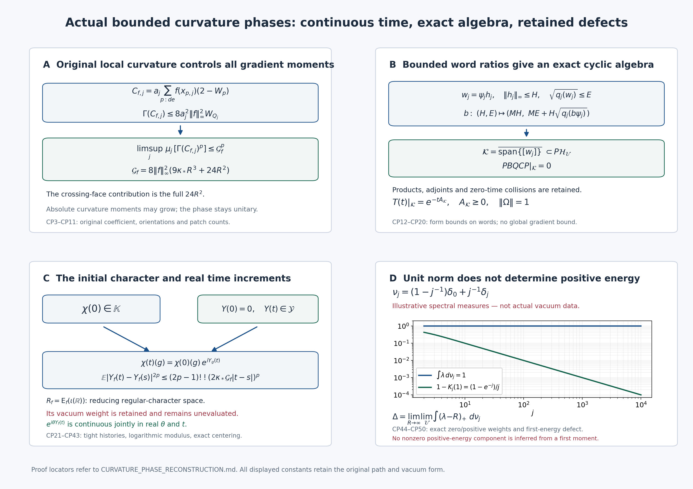

# Actual curvature phases, continuous histories and their remaining spectral defects

This construction uses the original finite physical vacua, Hamiltonians, time parameter and spatial coordinates. The working curvature observable is \(C_{f,j}^{de}=a_j\sum_{p:de}f(x_{p,j})(2-W_p)\), with precisely this coefficient. Its phase is bounded even though its absolute moments have no proved uniform bound. The completed [LEM proof](https://github.com/KokunoYumeto/yang-mills-interacting-workbench/blob/213bdaa7d5f2583ef938651ac6d882cc194db0e3/yang-mills/continuations/20261011-central-signs-shrinking-window/ACTUAL_LOW_ENERGY_MAPS.md) remains unchanged. The new [LC1–LC42 proof](https://github.com/KokunoYumeto/yang-mills-interacting-workbench/blob/213bdaa7d5f2583ef938651ac6d882cc194db0e3/yang-mills/continuations/20261011-central-signs-shrinking-window/LOCAL_CURVATURE_BUDGET.md), read in full, provides actual local moments, including every crossing face and the actual inside kinetic energy. Those moments suffice for an enlarged cyclic representation and continuous phase histories without a uniform gradient supremum.

The reversible argument is proved below with its full drift and constants. For comparison, Grothaus, Kondratiev, Lytvynov and Röckner, [original author source math/0211323](https://arxiv.org/abs/math/0211323), Section 6.1, theorem labelled pr777 and equation eq1605, also use a reversed martingale and random bracket moments to prove tightness. Their configuration space, Gibbs assumptions and scaling are not substituted here. The intact downloaded source and exact reading coverage are retained. Existing disk literature indexes were queried first. A routing hit is not treated as source evidence.

## 1. Original objects and the checked local moment input

For \(j\ge2\) and fixed \(\kappa_*>0\), retain
\[
\begin{gathered}
L_j=j^4,\quad m_j=2j^4,\quad n_j=2j^4+1,\quad
a_j=(100j)^{-1},\quad g_j^2=\kappa_*/(200j),\quad
b_j=(2g_j^2a_j)^{-1}=10000j^2/\kappa_*,\quad s_j=\kappa_*/j,\\
N_j=3m_jn_j^2,\quad M_j=3m_j^2n_j,\quad
H_j=\kappa_*K_j+b_j\sum_{p\in\mathcal P_j}(2-W_p),\\
K_j=-\sum_{e,\alpha}X_{e,\alpha}^2,\quad
T_\alpha=-i\sigma_\alpha/2,\quad
H_j\psi_j=E_j\psi_j,\quad\psi_j>0,\quad\|\psi_j\|=1,\quad
A_j=H_j-E_j,\quad d\mu_j=\psi_j^2dU_j .
\end{gathered}\tag{CP1}
\]
The original configuration manifold is \(\mathrm{SU}(2)^{E_j}\) with probability Haar and the radius-two edge metric. Every original vertex, including boundary vertices, acts in the physical gauge constraint. Explicitly \(W_{(z;d,e)}=\operatorname{Tr}[U_d(z)U_e(z+e_d)U_d(z+e_e)^{-1}U_e(z)^{-1}]\), and \(D_p=2-W_p\in[0,4]\). The scalar \(2b_jM_j\) and full vacuum energy remain in (CP1). The positive ground state is physical, its eigenspace is one-dimensional, and the exact original ground-state form is
\[
q_j(\psi_jh)=\|A_j^{1/2}\psi_jh\|^2
 =\kappa_*\mu_j\Gamma(h),\qquad
\Gamma(h)=\sum_{e,\alpha}|X_{e,\alpha}h|^2 .
\tag{CP2}
\]
Expand \(K_j(\psi_jh)\), substitute (CP1) and integrate against probability Haar to prove this identity, with the potential and scalar cancelling by the full eigen-equation. A second ground vector has constant ratio to \(\psi_j\), by (CP2) and connectedness. This also proves the equality of full and physical ground energies used in the local comparison.

For \(f\in C_c(\mathbb R^3;\mathbb R)\), choose a physical cube \(\prod_d[c_d,c_d+R]\) containing its support. Use exactly the LC patch
\[
v_{d,j}=L_j+\lfloor(c_d-o_d)/a_j\rfloor-1,\quad
q_j^{\rm side}=\lceil R/a_j\rceil+3,\quad
Q_j=v_j+\{0,\ldots,q_j^{\rm side}\}^3 .
\tag{CP3}
\]
The superscript distinguishes its side count from the form \(q_j\). For sufficiently large \(j\) it is strictly interior. Its lower corner is between \(c_d-2a_j\) and \(c_d-a_j\), and its upper corner exceeds \(c_d+R+a_j\), so every face whose center meets the support is inside. Put \(q=q_j^{\rm side}\). The original patch counts and full budget are
\[
\begin{gathered}
N_Q=3q(q+1)^2,\quad M_Q=3q^2(q+1),\quad
C_Q=12q(q+1),\quad W_Q=\sum_{p\subset Q}D_p,\\
\Lambda_j=\min\{2M_Q,6g_j^2\sqrt{N_QM_Q}\}+2C_Q,\quad
\rho_j=4g_j^2,\quad
\mu_jH_{\rm in}\le b_j\Lambda_j,\\
\mu_jW_Q^k\le\min\{(4M_Q)^k,U_{k,j}\},\quad
U_{0,j}=1,\ U_{1,j}=\Lambda_j,\quad
U_{k+1,j}=\Lambda_jU_{k,j}+\rho_j^2k^2U_{k-1,j}.
\end{gathered}\tag{CP4}
\]
Here \(H_{\rm in}=\kappa_*K_Q+b_jW_Q\); its kinetic part has not been discarded. To check the LC input, partition all original edges into those with both endpoints in \(Q\) and the complement. Every mixed face has one inside and three outside edges: two inside edges would put all four square vertices in the Cartesian patch. Each of six sides supplies \(2q(q+1)\) mixed faces. The outside positive ground vector is invariant under each restricted original vertex action. Its open three-edge path across a mixed face has expectation zero by the central gauge element \(-I\) at one endpoint. Thus the tensor trial pays exactly \(2b_jC_Q\), with the original outside energy retained on both sides. The inside product trial \(Z_t^{-N_Q/2}\prod_e\exp[t\,\operatorname{Tr}U_e/2]\) has energy at most \(3\kappa_*N_Qt/8+6b_jM_Q/t\). Its optimized value is \(3\sqrt{N_QM_Q}/a_j\); the constant trial has energy \(2b_jM_Q\). The same outside spectral lower bound in the actual vacuum proves the budget in (CP4).

The derivative calculation retains every incidence and gives \(\Gamma(W_Q)\le16W_Q\). The form inequality \(H_j-E_{\rm out}\ge b_jW_Q\), applied to \((W_Q+\epsilon)^{k/2}\psi_j\), consequently gives
\(b_j\mu W_Q^{k+1}\le b_j\Lambda_j\mu W_Q^k+4\kappa_*k^2\mu W_Q^{k-1}\).
The limit \(\epsilon\downarrow0\) uses the bound four for the derivative term at \(k=1\), and boundedness on the finite compact space for \(k\ge2\). Since \(4\kappa_*/b_j=16(g_j^2)^2=\rho_j^2\), induction proves (CP4), including its exact coefficient.

The eventual branch and the constants needed here are
\[
\begin{gathered}
\Lambda_j=18g_j^2[q(q+1)]^{3/2}+24q(q+1),\qquad
a_j^2\Lambda_j\longrightarrow
\mathcal L_R:=9\kappa_*R^3+24R^2,\\
a_j^2\rho_j\longrightarrow0,\qquad
U_{p,j}/\Lambda_j^p\longrightarrow1
\quad(p\ \hbox{fixed}),\qquad
U_{p,j}\le(\Lambda_j+p\rho_j)^p .
\end{gathered}\tag{CP5}
\]
These follow directly from \(a_jq\to R\), \(g_j^2=\kappa_*a_j/2\), and the finite recurrence. For the last inequality, insert the preceding majorants into its two terms and bound
\(\Lambda_j(\Lambda_j+p\rho_j)+p^2\rho_j^2\le(\Lambda_j+p\rho_j)^2\).
The next asserted majorant is larger. The \(24R^2\) contribution is the full crossing surface cost.

## 2. Curvature phases and all their actual gradient moments

For one orientation \(de\), keep the original physical face centers and observables
\[
\begin{gathered}
x_{p,j}=o+a_j(z-L_j\mathbf1+(e_d+e_e)/2),\quad
C_{f,j}^{de}=a_j\sum_{p:de}f(x_{p,j})D_p,\quad
B_{\theta,f,j}^{de}=\exp(i\theta C_{f,j}^{de}),\\
c_{f,j}^{de}=\mu_jC_{f,j}^{de},\qquad
\widehat B_{\theta,f,j}^{de}
 =e^{-i\theta c_{f,j}^{de}} B_{\theta,f,j}^{de}.
\end{gathered}\tag{CP6}
\]
The last line is a separate explicit centering factor, not a changed definition of \(C_{f,j}^{de}\). Every \(C\) is a real smooth gauge-invariant function of the link variables even when the fixed spatial test is only continuous: its sampled coefficients are constants in those variables. In the following displays write \(F=\|f\|_\infty\) and suppress \(de\) only in the notation.

For each incident edge, \(\sum_\alpha|X_{e,\alpha}D_p|^2=D_p-D_p^2/4\). The complete derivative sum and its bound are
\[
\begin{split}
X_{e,\alpha}C_{f,j}
 &=a_j\sum_{\substack{p:de\\e\in\partial p}}f(x_{p,j})X_{e,\alpha}D_p,\\
\Gamma(C_{f,j})
 &\le a_j^2\sum_e r_e^{de}
       \sum_{\substack{p:de\\e\in\partial p}}
             |f(x_{p,j})|^2(D_p-D_p^2/4)
 \le8a_j^2F^2W_Q .
\end{split}\tag{CP7}
\]
Here \(r_e^{de}\le2\) is the actual orientation incidence; each face has four edges. Thus every cross term and boundary incidence occurs before Cauchy–Schwarz. For every integer \(p\ge1\),
\[
\begin{gathered}
\mu_j[\Gamma(C_{f,j})^p]\le
G_{p,f,j}:=(8a_j^2F^2)^p
                   \min\{(4M_Q)^p,U_{p,j}\},\\
\sup_{j\ge j_0}G_{p,f,j}<\infty,\qquad
\limsup_j\mu_j[\Gamma(C_{f,j})^p]\le
\mathcal G_f^p,\quad
\mathcal G_f:=8F^2\mathcal L_R,\\
q_j(B_{\theta,f,j}\psi_j)
=\kappa_*\theta^2\mu_j\Gamma(C_{f,j})
\le\kappa_*\theta^2G_{1,f,j}.
\end{gathered}\tag{CP8}
\]
The form identity is exact, since \(XB=i\theta B\,XC\). The centered phase has the same energy and gradient moments. A finite initial segment before the patch is interior has finite constants at each original volume and does not affect the ultraproduct or asymptotic assertions.

The corresponding absolute curvature bounds remain
\[
|C_{f,j}|\le a_jF W_Q,\qquad
|c_{f,j}|\le a_jF\Lambda_j,\qquad
\mu_j|C_{f,j}|^p\le (a_jF)^p\min\{(4M_Q)^p,U_{p,j}\}.
\tag{CP9}
\]
Their available \(p\)-th roots grow like \(F\mathcal L_R/a_j\). They do not prove a finite limiting mean, variance, or continuous parameter field. The gradient supremum bound from (CP7) is \(32a_j^2F^2M_Q\), which grows like \(a_j^{-1}\). It is not the estimate used for histories below.

The exact phase algebra, with no removed scalar, is
\[
B_{\theta,f,j}B_{\eta,g,j}=e^{i(\theta C_{f,j}+\eta C_{g,j})},
\quad B_{\theta,f,j}^*=B_{-\theta,f,j},\quad
B_{\theta,f,j}B_{\eta,f,j}=B_{\theta+\eta,f,j},\quad
\|B_{\theta,f,j}\|=1 .
\tag{CP10}
\]
Curvatures add exactly within an orientation; products across orientations retain the sum of their full curvatures. For \(D_j=\sum_{\ell=1}^r\theta_\ell C_{f_\ell,j}^{d_\ell e_\ell}\), the gradient is the sum of those full gradients. Minkowski in \(L^{2p}(\mu_j;\mathbb C^{3N_j})\) gives
\[
\big(\mu_j\Gamma(D_j)^p\big)^{1/(2p)}
\le\sum_{\ell=1}^r|\theta_\ell|G_{p,f_\ell,j}^{1/(2p)}.
\tag{CP11}
\]
The exact square contains every diagonal term and
\(2\sum_{\ell<k}\theta_\ell\theta_k\Gamma(C_{f_\ell,j},C_{f_k,j})\);
none is assumed to vanish. The same formulas keep the scalar product of all centering factors.

## 3. Ground-state Markov words and an enlarged actual cyclic space

The full ground-state generator, including the vacuum drift, is
\[
\mathscr L_j=\kappa_*\sum_{e,\alpha}X_{e,\alpha}^2
 +2\kappa_*\sum_{e,\alpha}(X_{e,\alpha}\log\psi_j)X_{e,\alpha},
\qquad
S_j(t)h=\psi_j^{-1}e^{-tA_j}(\psi_jh).
\tag{CP12}
\]
Expanding the full Hamiltonian leaves the scalar bracket
\(\kappa_*\psi_j^{-1}\sum X^2\psi_j-b_j\sum_pD_p+E_j\), which is zero by (CP1), rather than being omitted. Integration by parts gives
\(\mu_j(\bar h\mathscr L_jk)=-\kappa_*\mu_j\Gamma(\bar h,k)\).
The smooth diffusion fields \(\sqrt{2\kappa_*}X_{e,\alpha}\) and the displayed smooth drift on a compact manifold give a global continuous diffusion at every \(j\). Its parabolic equation identifies its transition semigroup with \(S_j\). Consequently
\[
S_j(t)1=1,\quad S_j(t)\ge0,\quad
\|S_j(t)h\|_\infty\le\|h\|_\infty,\quad
\mu_jS_j(t)h=\mu_jh,\quad
q_j(e^{-tA_j}v)\le q_j(v).
\tag{CP13}
\]
No bound for the drift uniform in \(j\) is used.

Let \(b,h\) be original bounded smooth multipliers. The complete product form is
\[
\begin{split}
q_j(b\psi_jh)=\kappa_*\mu_j\big[
 |b|^2\Gamma(h)+|h|^2\Gamma(b)
 +2\operatorname{Re}(\bar b h\,\nabla b\cdot\overline{\nabla h})\big],\\
\sqrt{q_j(b\psi_jh)}
\le\|b\|_\infty\sqrt{q_j(\psi_jh)}
       +\|h\|_\infty\sqrt{q_j(b\psi_j)}.
\end{split}\tag{CP14}
\]
The second line is Minkowski applied to the two differentiated terms in the first, and implies the two-factor bound with coefficient two in each square. Smoothness holds for every finite word; extension to bounded form-domain ratios follows by approximation and the displayed bound.

Take any fixed finite word built from curvature phases, their adjoints, fixed-length original Wilson polynomials, and nonnegative physical semigroup times. Its vector is
\[
w_j=b_{0,j}e^{-t_1A_j}b_{1,j}\cdots e^{-t_kA_j}b_{k,j}\psi_j
 =\psi_jh_j,\qquad t_r\ge0 .
\tag{CP15}
\]
Starting at \(H=1,E=0\), propagate from the right to the left by
\[
\begin{array}{c|cc}
\hbox{operation}&\hbox{ratio bound }H&\hbox{form-root bound }E\\\hline
e^{-tA_j}&H&E\\
b_j&H\|b_j\|_\infty&
          \|b_j\|_\infty E+H\sqrt{q_j(b_j\psi_j)} .
\end{array}\tag{CP16}
\]
The old value of \(H\) is used in the last entry. Equations (CP8), (CP13) and (CP14) prove by induction that \(\|h_j\|_\infty\le H\) and \(\sqrt{q_j(w_j)}\le E\), uniformly in \(j\) for each word. Original fixed-length Wilson factors have their established uniform form bounds; growing physical loops are not inserted under that designation. For phase-only words \(H=1\) and \(E\le\sum_r\sqrt{q_j(b_{r,j}\psi_j)}\). Finite linear combinations keep the sum of their respective bounds.

Use the same actual ultraproduct, continuous projection \(P\), escape projection \(Q\), semigroup \(T(t)=e^{-tA}P\), and unit vacuum \(\Omega=[\psi_j]\) as ASL. Spectral calculus gives
\[
\|(I-e^{-tA_j})w_j\|^2\le tq_j(w_j)\le tE^2.
\tag{CP17}
\]
Every word class therefore belongs to \(P\mathcal H_{\mathcal U}\). Define \(\mathcal K\) to be the closure of all such word classes for the chosen phase family and chosen original Wilson family. It contains their vacuum cyclic space and is reducing for each bounded multiplier and its adjoint, because multiplication adds a factor to a word. It is also reducing for \(T(t)\): positive-time multiplication by \(T(t)\) adds a time factor, and \(T(t)\) is self-adjoint. Thus
\[
\mathcal K\subset P\mathcal H_{\mathcal U},\quad
T(t)|_{\mathcal K}=e^{-tA_{\mathcal K}},\quad
A_{\mathcal K}\ge0,\quad A_{\mathcal K}\Omega=0,\quad
B_{\theta,f}|_{\mathcal K}\ \hbox{is unitary}.
\tag{CP18}
\]
The products and adjoints are the exact original ones in (CP10). In particular, for this space the ASL product defect vanishes:
\[
PBQCP|_{\mathcal K}=0,\qquad
(PBP)(PCP)|_{\mathcal K}=PBCP|_{\mathcal K}.
\tag{CP19}
\]
Here \(B,C\) denote any two selected bounded multiplier operators. We have not proved that a curvature phase reduces \(P\) on the entire ultraproduct; the global ASL defect remains defined there.

Zero-time collisions in every finite correlation now hold exactly by (CP10), (CP17) and density. Inserting a time interval \(h\) in a word changes its acted-on vector by at most \(\sqrt h E\), times the norms of the preceding factors. Therefore all its original nonnegative-time correlations are continuous, including coincident times, and converge to the displayed represented products along the same ultrafilter. Vacuum norm, stationarity, time reflection and reflection positivity are retained. Explicitly, for a positive-time cylinder \(F\), its conditional expectation at time zero is a Markov word ratio \(g_{F,j}\), and
\[
\mathbb E_j[\overline{F\circ\vartheta}\,G]
=\mu_j(\overline{g_{F,j}}g_{G,j})
=\langle\psi_jg_{F,j},\psi_jg_{G,j}\rangle .
\tag{CP20}
\]
Detailed balance from (CP12) and the Markov property at zero prove the first equality, including all internal time factors. Its Gram matrix is positive at every \(j\), and its limit is the Gram matrix in \(\mathcal K\). The null quotient and completion of positive-time cylinders therefore map isometrically onto the cyclic space just constructed. No Markov property of the observed phase coordinates alone is asserted.

## 4. Reversible increments with random, moment-controlled brackets

Run the actual diffusion (CP12) in its stationary law \(\mu_j\), writing \(U_j(t)\). Symmetry of \(S_j\) reverses its finite-dimensional kernel products, so the reversed stationary process has the same generator. Fix a real original curvature combination \(D_j\), a horizon \(T\), and retain both terms of
\[
\ell_j(r)=\kappa_*\sum X^2D_j(U_j(r))
 +2\kappa_*\sum (X\log\psi_j)(U_j(r))XD_j(U_j(r)).
\tag{CP21}
\]
Its forward and reverse martingales are
\[
\begin{gathered}
M_t=D_j(U_j(t))-D_j(U_j(0))-\int_0^t\ell_j(r)\,dr,\\
N_r=D_j(U_j(T-r))-D_j(U_j(T))-\int_0^r\ell_j(T-v)\,dv,\\
\langle M\rangle_t=2\kappa_*\int_0^t\Gamma(D_j)(U_j(r))\,dr,\quad
\langle N\rangle_r=2\kappa_*\int_0^r\Gamma(D_j)(U_j(T-v))\,dv,\\
D_j(U_j(t))-D_j(U_j(0))
 ={M_t\over2}-{N_T-N_{T-t}\over2}.
\end{gathered}\tag{CP22}
\]
The reverse process is adapted to its own reverse filtration. Subtract its defining equations at \(T\) and \(T-t\): the remaining drift is precisely \(-\int_0^t\ell_j(r)dr\), with the same sign as in the forward definition. Subtraction therefore proves the last line. There is no independence assumption and no discarded drift. At the two endpoints of an interval of length \(h\), use that interval's reversal horizon, obtaining \((M_h-N_h)/2\).

Here is the needed moment estimate with its exact constant. For a real continuous martingale \(Z_0=0\) with bracket density \(a_r\), stopping, Itô and Hölder give
\[
\begin{split}
F_p(t)&:=\mathbb E|Z_t|^{2p},\\
F_p'(r)&\le p(2p-1)F_p(r)^{(p-1)/p}
                      (\mathbb E a_r^p)^{1/p},\\
F_p(t)&\le\left[(2p-1)\int_0^t
                         (\mathbb E a_r^p)^{1/p}dr\right]^p .
\end{split}\tag{CP23}
\]
For the second line, Itô contributes \(p(2p-1)|Z|^{2p-2}a_r\). Hölder has exponents \(p/(p-1)\) and \(p\). Integrate the differential inequality for \((F_p+\epsilon)^{1/p}\), then let \(\epsilon\downarrow0\). Stopping at \(|Z|=R\) proves it first with finite moments; the bracket moment bound still applies to the stopped density, and Fatou removes the stop. The case \(p=1\) is the bracket identity. Thus no deterministic bracket bound is required.

For \(D_j=C_{f,j}\), stationarity and (CP8), followed by convexity in the last line of (CP22), give
\[
\begin{gathered}
\mathbb E_j|C_{f,j}(U_j(t))-C_{f,j}(U_j(s))|^{2p}
\le[2\kappa_*(2p-1)]^pG_{p,f,j}|t-s|^p,\\
\mathbb E_j|B_{\theta,f,j}(U_j(t))-B_{\theta,f,j}(U_j(s))|^{2p}
\le\min\{2^{2p},
|\theta|^{2p}[2\kappa_*(2p-1)]^pG_{p,f,j}|t-s|^p\}.
\end{gathered}\tag{CP24}
\]
The scalar inequality \(|e^{i\theta x}-e^{i\theta y}|\le|\theta||x-y|\) proves the second line without a component factor. The centered phase has the identical increment bound. For any finite curvature combination replace \(G_{p,f,j}\) by the complete right side of (CP11) to the power \(2p\).

In particular the real anchored variables
\[
Y_{f,j}(t)=C_{f,j}(U_j(t))-C_{f,j}(U_j(0)),\qquad Y_{f,j}(0)=0
\tag{CP25}
\]
have uniformly bounded \(2p\)-th moments and time increments on every compact time interval. This is an actual difference of the two unchanged observables. It does not declare their individual time-zero values bounded or replace them by a new initial state.

The full all-order LC input yields a further strengthening for limiting laws. For \(V_j=\Gamma(C_{f,j})\), (CP8) gives
\[
\mu_j[(V_j-\mathcal G_f)_+^p]\longrightarrow0
\quad\hbox{for each fixed integer }p\ge1 .
\tag{CP26}
\]
To prove it, on \(V_j\le\mathcal G_f+\epsilon\) the integrand is at most \(\epsilon^p\). On the complement bound it by \(V_j^{p+k}/(\mathcal G_f+\epsilon)^k\). Its limiting upper mean is at most
\(\mathcal G_f^{p+k}/(\mathcal G_f+\epsilon)^k\) by (CP8). Let \(k\to\infty\), then \(\epsilon\downarrow0\). If \(\mathcal G_f=0\), (CP8) proves it directly.

Write the martingale bracket density as at most
\(2\kappa_*\mathcal G_f+2\kappa_*(V_j-\mathcal G_f)_+\).
Its second term, multiplied by \(|M_r|^{2p-2}\) in Itô's formula, has mean tending to zero uniformly for \(r\) in a fixed compact interval: apply Hölder, (CP23)'s uniform \(2p\) moment bound and (CP26). Induction in the Itô integral now gives the sharper limiting estimates
\[
\begin{gathered}
\limsup_j\mathbb E_j|M_h|^{2p}
\le(2p-1)!!(2\kappa_*\mathcal G_f)^p h^p,\\
\limsup_j\mathbb E_j|Y_{f,j}(t)-Y_{f,j}(s)|^{2p}
\le(2p-1)!!(2\kappa_*\mathcal G_f)^p|t-s|^p .
\end{gathered}\tag{CP27}
\]
For the induction, integrate the preceding moment bound:
\(p(2p-1)\int_0^h(2p-3)!!c^pr^{p-1}dr=(2p-1)!!c^ph^p\), with \(c=2\kappa_*\mathcal G_f\). The uniform moment majorant from (CP23) permits passing limiting upper bounds inside the integral. The two reverse moments obey the same estimate, so convexity proves the second line. This improves the limiting constant; it does not assert a finite-\(j\) deterministic gradient supremum.

## 5. One specified countable family and its continuous history law

Choose the countable real vector space \(\mathcal D_{\mathbb Q}\) of finite rational linear combinations of
\[
f_{v,r}(x)=\prod_{d=1}^3(1-|x_d-v_d|/r_d)_+,\qquad
v\in\mathbb Q^3,\quad r\in(\mathbb Q_{>0})^3 .
\tag{CP28}
\]
Each test is continuous and compactly supported. Include all three orientations and all rational \(\theta\), with their original phases (CP6). As an optional simultaneous original Wilson family, take all finite closed walks in the integer cubic graph translated by \(L_j\mathbf1\) into the finite box, their trace products and rational complex linear combinations; each fixed walk fits eventually and keeps its full original edge count. This is a concrete countable family. The previous cyclic argument also works for any enlarged family of these energy-bounded phase observables, without claiming that its uncountable path space is metrizable.

Put \(G=\mathcal D_{\mathbb Q}^{\oplus3}\) as an additive discrete countable group, and let
\[
\mathbb K=\{\chi:G\to\mathbb S^1:
 \chi(0)=1,\ \chi(g+h)=\chi(g)\chi(h)\}
 \subset(\mathbb S^1)^G .
\tag{CP29}
\]
This is a closed compact metrizable group, with the product topology. At finite \(j\) its actual random character is
\(\chi_j(t)(g)=\exp(i\sum_{de}C_{g_{de},j}^{de}(U_j(t)))\).
The use of \(G\) indexes the exact original product relations; it changes no curvature coefficient. Write \(Y_{g,j}\) for the corresponding sum of anchored variables (CP25), and
\(\mathcal Y=\{y:G\to\mathbb R:y(g+h)=y(g)+y(h)\}\), a closed subspace of \(\mathbb R^G\). The exact relation is
\[
\chi_j(t)(g)=\chi_j(0)(g)e^{iY_{g,j}(t)},\qquad
Y_{g+h,j}=Y_{g,j}+Y_{h,j},\qquad Y_{g,j}(0)=0 .
\tag{CP30}
\]

Here is a direct continuity and tightness proof, including its exponents. If a real or complex coordinate \(X_j\) satisfies
\(\mathbb E|X_j(t)-X_j(s)|^{2p}\le K_p|t-s|^p\), then on dyadic mesh \(T2^{-n}\), the probability of any adjacent increment exceeding \(R2^{-n\gamma}\) is at most
\[
K_pT^pR^{-2p}2^{-n[p-1-2p\gamma]} .
\tag{CP31}
\]
There are \(2^n\) adjacent increments; Markov's inequality proves the formula. Choose \(p>1\) and \(0<\gamma<(p-1)/(2p)\). Summing (CP31) bounds the failure probability of all dyadic increments by
\(K_pT^pR^{-2p}/(1-2^{-[p-1-2p\gamma]})\).
For paths satisfying those increments, approximate both times by successive dyadic points. The two geometric tails and at most one coarser increment give a Hölder bound with constant at most
\(2^\gamma[1+2\sum_{r\ge1}2^{-r\gamma}]R/T^\gamma\).
Each finite-\(j\) path is continuous already, so the inequality extends from dyadic to every time.

Apply this argument to every \(Y_{g,j}\) using (CP24)–(CP25), to the phases, and to any selected Wilson coordinates with their known gradient bounds. For each coordinate and each integer horizon choose thresholds with summable total failure probability. Anchored values are zero; phase values lie in the unit circle; the optional Wilson coordinates have their fixed finite range. Arzelà–Ascoli on each coordinate and time interval, followed by a diagonal extraction, proves tightness in
\[
\mathbb K\times C_0(\mathbb R,\mathcal Y),
\quad\hbox{and jointly in the chosen continuous phase/Wilson path coordinates}.
\tag{CP32}
\]
The topology is the product of compact-uniform coordinate topologies; the subscript zero fixes \(Y(0)=0\). It is Polish because \(G\) is countable and all additivity relations are closed. The finite exceptional volumes can be included individually without changing tightness.

One common subsequence realizes the same ultrafilter correlations as \(\mathcal K\). Choose a countable determining family of bounded continuous finite-coordinate functions at rational times for the tight laws in (CP32), and include all chosen rational-time word correlations and deterministic centering characters. For its first \(n\) members choose an increasing index from the common ultrafilter set where their errors from their ultralimits are less than \(1/n\). Tightness supplies weakly convergent subsubsequences. Their rational-time finite-dimensional laws agree, and these determine a continuous-path law: compact-uniform distances are suprema over rational times, so those evaluations generate its Borel sigma algebra. Thus all weak subsequential limits agree, proving convergence of the selected full subsequence.

Denote that actual law by \(\mathbb P\). Closedness of the character and additive relations and continuity of the finite-coordinate maps give, for all real times simultaneously,
\[
\boxed{\quad
\chi(t)(g)=\chi(0)(g)e^{iY_g(t)},\qquad
Y(t)\in\mathcal Y,\quad Y(0)=0 .
\quad}\tag{CP33}
\]
The equality is first simultaneous at rational times and all countably many \(g\), then extends by continuity. Its correlations are exactly the ultraproduct correlations in (CP20); hence its positive-time null quotient is the same chosen cyclic space. Stationarity, reversal, reflection positivity and all time collisions pass from the original bounded cylinder functions. The anchored process has stationary increments in the precise joint sense
\[
(\chi(r),\,Y(r+t)-Y(r))_{t\in\mathbb R}
\ \stackrel{\rm law}{=}\
(\chi(0),\,Y(t))_{t\in\mathbb R}.
\tag{CP34}
\]
This is the exact finite stationary identity passed to the tight joint limit. Independence, Gaussianity and a Markov property of the observed coordinates do not follow from it.

All exponents \(\gamma<1/2\) hold simultaneously for this countable family by taking a countable collection of \(p,\gamma\) in (CP31). There is also an explicit stronger limiting modulus. Truncated moments and (CP27) yield, with \(c_f=2\kappa_*\mathcal G_f\),
\[
\mathbb E_{\mathbb P}\cosh(\lambda[Y_f(t)-Y_f(s)])
\le e^{c_f\lambda^2|t-s|/2},\qquad
\mathbb P(|Y_f(t)-Y_f(s)|>r)
\le2e^{-r^2/(2c_f|t-s|)} .
\tag{CP35}
\]
Expand cosh in its nonnegative even series and use
\((2p-1)!!/(2p)!=1/(2^pp!)\) to prove the first inequality. Since \(\cosh(\lambda x)\ge e^{\lambda|x|}/2\), exponential Markov and \(\lambda=r/(c_f|t-s|)\) prove the second. The zero-constant case is deterministic. These are bounds, not an identification of Gaussian finite-dimensional laws.

Define \(H_{\log,T}\) as the supremum of all dyadic adjacent increments divided by \(\sqrt{T(n+1)2^{-n}}\). The union bound in (CP35) gives
\[
\begin{gathered}
\mathbb P(H_{\log,T}>r)
\le {2e^{-r^2/(2c_f)}\over1-2e^{-r^2/(2c_f)}}
\quad(r^2>2c_f\log2),\\
|Y_f(t)-Y_f(s)|
\le\sqrt2\,B\,H_{\log,T}
 \sqrt{|t-s|\,[1+\log_2(T/|t-s|)]},\\
B=1+2\sum_{r\ge1}\sqrt{r+1}\,2^{-r/2}
\le {2\over(1-2^{-1/2})^2}-1,\quad 0<|t-s|\le T .
\end{gathered}\tag{CP36}
\]
For the second line choose the mesh size between \(|t-s|\) and \(2|t-s|\), and sum the two dyadic approximation tails, using \(\sqrt{n+r+1}\le\sqrt{n+1}\sqrt{r+1}\). The first line tends to zero as \(r\to\infty\), so this modulus holds almost surely. It holds simultaneously on all chosen coordinates and integer horizons. Phase relative paths inherit it through their exact exponential in (CP33).

## 6. Exact parameter-continuity defect and explicit centering

Fix one nonzero test and orientation, and restrict its phase parameters to the specified \(\mathbb Q\). Write
\(\mathbb K_{\mathbb Q}=\operatorname{Hom}(\mathbb Q,\mathbb S^1)\)
with the pointwise topology, and
\[
\iota:\mathbb R\longrightarrow\mathbb K_{\mathbb Q},\qquad
\iota(x)(q)=e^{iqx},\qquad
\mathbb K_{\rm real}=\iota(\mathbb R)
  =\bigcup_{n=1}^{\infty}\iota([-n,n]).
\tag{CP37}
\]
The map is continuous and injective: equality for all rational \(q\to0\) forces the two real exponents to agree. Each compact interval maps homeomorphically to a compact set in the Hausdorff group, so the image is a Borel set. A character of \(\mathbb Q\) is continuous for its inherited real topology exactly when it is \(\iota(x)\): uniform continuity from the character identity extends it uniquely to \(\mathbb R\); on a small interval choose a continuous argument in \((-\pi,\pi)\), whose additive identity forces a linear argument, and then use the character identity globally.

The commuting unitaries \(B_{q,f}|_{\mathcal K}\) have a joint spectral measure \(\mathsf E_f\) on this compact group. One direct construction is the continuous functional calculus of their unital abelian algebra: evaluation at a character respects precisely \(B_qB_r=B_{q+r}\), and the coordinate characters separate the group. Their polynomials and conjugates are dense in its continuous functions; the spectral theorem supplies the projection measure, supported on the representation's actual spectrum. Define
\[
R_f=\mathsf E_f(\mathbb K_{\rm real}),\qquad
\mathcal K_f^{\rm reg}
=\{v\in\mathcal K:\|(B_{q,f}-I)v\|\longrightarrow0
                         \text{ as }q\in\mathbb Q,\ q\to0\}.
\tag{CP38}
\]
Then \(\mathcal K_f^{\rm reg}=R_f\mathcal K\). Indeed, a spectral measure supported on (CP37) gives strong continuity by dominated convergence. Conversely \(\mathcal K_f^{\rm reg}\) is closed and reducing for the commuting unitary group. Its rational group extends strongly to a continuous real unitary group, whose self-adjoint generator gives \(B_q=e^{iqX_f}\) there. Its real spectral measure pushes forward under \(\iota\); uniqueness on the dense character polynomials makes it exactly \(\mathsf E_f\), hence concentrated on (CP37).

For completeness, the generator assertion in that argument uses only the self-adjoint spectral theorem. For a strongly continuous real unitary group \(V(t)\), the norm-bounded strong integral \(R=\int_0^\infty e^{-t}V(t)\,dt\) has
\(R+R^*=2R^*R\), by multiplying the two integrals and changing their difference variable. It is normal. Also
\((V(h)R-R)/h\to R-I\), so \(R\) and \(R^*\) are injective and their ranges are dense. On \(\operatorname{ran}R\) put \(X=i(R^{-1}-I)\). The displayed identity proves symmetry, and \(X+iI=iR^{-1}\) is onto. Since \(I-2R\) is unitary, \(X-iI=iR^{-1}(I-2R)\) is onto too. These two range conditions prove self-adjointness. Differentiation on this invariant domain gives \(V(t)=e^{itX}\). Thus no continuity of the original phase group was silently assumed in (CP38); the argument applies exactly to the defined regular subspace.

This subspace is also reducing for the actual time semigroup. The needed estimate is on bounded word ratios, not on the whole gradient supremum. Conditional expectation in the original stationary process gives
\[
\begin{gathered}
[b,S_j(t)]h(U_j(0))
=\mathbb E_j[(b(U_j(0))-b(U_j(t)))h(U_j(t))\mid U_j(0)],\\
\|[B_{q,f,j},e^{-tA_j}]\psi_jh_j\|
\le |q|\,\|h_j\|_\infty
            \sqrt{2\kappa_*t\,\mu_j\Gamma(C_{f,j})},\\
\|[B_{q,f},T(t)]w\|
\le |q|H\sqrt{2\kappa_*t\mathcal G_f}
\quad\hbox{for a word ratio bounded by }H .
\end{gathered}\tag{CP39}
\]
Conditional Jensen and the \(p=1\) case of (CP24) prove the second line, and the actual ultralimit proves the third. By density and the bound \(2\|v-w\|\) for the commutator on an approximating difference, it follows that \([B_{q,f},T(t)]v\to0\) as \(q\to0\) for every \(v\in\mathcal K\). Hence \(T(t)\) preserves (CP38), and its self-adjointness makes that subspace reducing. All original multiplication operators commute with every \(B_{q,f}\), so they preserve it and its orthogonal complement as well. Consequently
\[
[R_f,T(t)]=0,\quad [R_f,B_{r,g}]=0,\quad
[R_f,W_\gamma]=0,\quad
A_{\mathcal K}R_f\Omega=0 .
\tag{CP40}
\]
Thus the parameter-continuity defect is a proved reducing space, with both its vacuum norm and dynamics retained.

Its exact vacuum weight and continuity criterion are
\[
\begin{gathered}
d_f^\theta:=\|(I-R_f)\Omega\|^2
=1-\lim_{n\to\infty}
 \langle\Omega,\mathsf E_f(\iota([-n,n]))\Omega\rangle,\\
\|(B_{q,f}-I)\Omega\|^2
=2\left[1-\operatorname{Re}\lim_{\mathcal U}
                         \mu_j e^{iqC_{f,j}}\right],\\
d_f^\theta=0
\ \Longleftrightarrow\
\lim_{q\in\mathbb Q,\ q\to0}\lim_{\mathcal U}
                         \mu_j e^{iqC_{f,j}}=1
\ \Longleftrightarrow\ R_f=I_{\mathcal K}.
\end{gathered}\tag{CP41}
\]
The first equivalence uses (CP38); the last follows from cyclicity and (CP40). The current local curvature bounds do not evaluate these quantities. In particular (CP9) is not a uniform covariance bound. The real-image spectral sets in (CP41) should not be replaced by raw amplitude tails: the real numbers \(2\pi j!\) diverge, while their characters on every fixed rational parameter are eventually one. This exact example shows the additional winding information lost by the selected rational character coordinates; it is not a proposed value of the actual curvature.

The deterministic original centering factors have the common character limit
\[
\sigma_f(q)=\lim_{\mathcal U}e^{-iqc_{f,j}},\qquad
\widehat B_{q,f}=\sigma_f(q)B_{q,f},\qquad
\widehat R_f=\mathsf E_f(\sigma_f^{-1}\mathbb K_{\rm real}).
\tag{CP42}
\]
Their product identity makes \(\sigma_f\) a character without assuming its continuity. The centered spectral measure is its explicit translation of \(\mathsf E_f\); (CP38) proves the last equality. Its commutator estimate differs only by the unit scalar \(\sigma_f(q)\), so \(\widehat R_f\) is reducing for all the same dynamics and observables. If \(\sigma_f=\iota(-c)\) for an actual real \(c\), the regular space is unchanged and its generator becomes \(X_f-cI\). Otherwise the regular space is the displayed translated real-character set, not automatically the old one. Distinct cosets of \(\mathbb K_{\rm real}\) give mutually orthogonal reducing spectral projections. No convergence of the actual means has been inferred.

In contrast, every relative phase has a proved continuous real-parameter limit:
\[
\begin{gathered}
B_{\theta,f,j}(U_j(t))\overline{B_{\theta,f,j}(U_j(0))}
=e^{i\theta Y_{f,j}(t)}
\ \Longrightarrow\ e^{i\theta Y_f(t)},\\
(\theta,t)\longmapsto e^{i\theta Y_f(t)}
\quad\hbox{is continuous on }\mathbb R^2,\\
\left|1-\mathbb E_{\mathbb P}e^{i\theta(Y_f(t)-Y_f(s))}\right|
\le\kappa_*\mathcal G_f\theta^2|t-s|.
\end{gathered}\tag{CP43}
\]
The first convergence is jointly in compact \((\theta,t)\) sets: the exponential map from a compact-uniform real path to that two-variable function is continuous. Thus it covers every real \(\theta\), not only those chosen for the absolute phase characters. Centering cancels from this ratio exactly. Stationarity gives zero mean to every finite-\(j\) anchored increment; its uniform second moment makes that mean pass to the limit. The Taylor remainder \(|e^{ix}-1-ix|\le x^2/2\) and (CP27) with \(p=1\) prove the last line. This continuity of actual relative phases is the exact map relating an unresolved initial character to a regular real time-increment process.

## 7. Positive energy, zero energy and possible loss of first energy

For \(v_{\theta,f}=B_{\theta,f}\Omega\in\mathcal K\) at a selected parameter, its norm is exactly one. There is no Hilbert mass escape, since (CP17) proves \(Pv_{\theta,f}=v_{\theta,f}\). Write \(Z=\mathbf1_{\{0\}}(A_{\mathcal K})\). The complete fixed-time correlation and zero-energy mass are
\[
\begin{gathered}
K_{\theta,f}(t)
=\langle v_{\theta,f},e^{-tA_{\mathcal K}}v_{\theta,f}\rangle
=\mathbb E_{\mathbb P}e^{i\theta Y_f(t)},\\
\|Zv_{\theta,f}\|^2=\lim_{t\to\infty}K_{\theta,f}(t),\qquad
\|(I-Z)v_{\theta,f}\|^2
=1-\lim_{t\to\infty}K_{\theta,f}(t).
\end{gathered}\tag{CP44}
\]
The first equality is the original two-time Markov identity, with the initial phase and its conjugate retained before their exact cancellation. The second follows by monotone spectral convergence of \(e^{-t\lambda}\). The vacuum component is \(|\lim_{\mathcal U}\mu_j e^{i\theta C_{f,j}}|^2\); the remaining part of \(\|Zv\|^2\) is its exact vacuum-orthogonal zero-energy mass.

For every selected nonzero \(\theta\) the following detection is exact:
\[
v_{\theta,f}\in\ker A_{\mathcal K}
\ \Longleftrightarrow\
\mathbb P(Y_f(t)=0\ \hbox{for every }t)=1 .
\tag{CP45}
\]
The reverse implication follows from (CP44), since equality \(K(t)=\|v\|^2=1\) at one positive time forces its spectral measure onto zero. In the forward direction \(K(t)=1\) for every \(t\), so
\(\mathbb E|e^{i\theta Y_f(t)}-1|^2=0\). This holds simultaneously at rational times and then at every time by continuity. A continuous path with values in the discrete set \((2\pi/\theta)\mathbb Z\) and value zero at time zero is identically zero. Thus every nonzero selected parameter has a positive-energy component exactly when the actual anchored process has positive probability of being nonconstant. Neither side has been presumed nonzero. If every chosen curvature coordinate has zero anchored path, the phase-only cyclic space has generator zero: its products are the characters indexed by \(G\), and every intermediate time factor then acts identically. This does not assert zero dynamics for additional Wilson coordinates.

The phase-energy upper bound passes to the reconstructed form, but a possible loss of its first spectral moment must be kept. Put \(e_{\theta,f}=\lim_{\mathcal U}q_j(B_{\theta,f,j}\psi_j)\), which is finite by (CP8). Then
\[
\begin{gathered}
q_{\mathcal K}(v_{\theta,f})\le e_{\theta,f}
\le\kappa_*\theta^2\mathcal G_f,\qquad
\Delta_{\theta,f}^{(1)}:=e_{\theta,f}
                         -q_{\mathcal K}(v_{\theta,f})\ge0,\\
\Delta_{\theta,f}^{(1)}
=\lim_{R\to\infty}\lim_{\mathcal U}
 \int_{(R,\infty)}(\lambda-R)\,
             d\nu_j^{B_{\theta,f}\psi_j}(\lambda).
\end{gathered}\tag{CP46}
\]
Indeed the continuous bounded function \(\min\{\lambda,R\}\) has its actual ASL functional-calculus limit on the vector already in \(P\). Subtract its expectation from the full first moment before taking either limit, and then increase \(R\). This proves the identity with no omitted endpoint contribution, since its integrand is zero at \(R\). Higher gradient moments in (CP8) do not control \(A_jB_{\theta,f,j}\psi_j\): the full drift (CP21) is still present in that operator action.

A first-energy lower bound alone cannot decide (CP45). The unit spectral measures
\((1-j^{-1})\delta_0+j^{-1}\delta_j\) have first moment one but converge under every bounded physical heat function to \(\delta_0\). Their complete first-energy defect is one. This is a direct spectral counterexample to that inference, not a substitute Hamiltonian for (CP1). The actual positive energy is instead detected without such an inference by
\[
\begin{gathered}
d_{t,\theta,f}=(e^{-tA_{\mathcal K}}-e^{-2tA_{\mathcal K}})
                         v_{\theta,f},\\
\|d_{t,\theta,f}\|^2
=K_{\theta,f}(2t)-2K_{\theta,f}(3t)+K_{\theta,f}(4t),\quad t>0 .
\end{gathered}\tag{CP47}
\]
Its spectral multiplier is strictly positive at every \(\lambda>0\) and zero at zero, so its norm is positive exactly when the right side of (CP45) fails. Its actual value remains a specified correlation, not an assumed positive number.

Every original finite interval keeps the LEM endpoint approach spaces. On the full ultraproduct let
\(E_c=[\mathbf1_{[0,c]}(A_j)]\), \(J_c=[\mathbf1_{\{c\}}(A_j)]\),
\(Z_c=\mathbf1_{\{c\}}(A)P\),
\(D_c^+=\mathbf1_{[0,c]}(A)P-E_c\), and
\(D_c^-=Z_c-D_c^+-J_c\). For \(0<\alpha<\beta\),
\[
\begin{gathered}
Z_c=D_c^-+J_c+D_c^+,\qquad
[\mathbf1_{(\alpha,\beta)}(A_j)]
=\mathbf1_{(\alpha,\beta)}(A)P+D_\alpha^++D_\beta^-,\\
\lim_{\mathcal U}\|\mathbf1_{(\alpha,\beta)}(A_j)
                        B_{\theta,f,j}\psi_j\|^2
=\|\mathbf1_{(\alpha,\beta)}(A)v_{\theta,f}\|^2
 +\|D_\alpha^+v_{\theta,f}\|^2+\|D_\beta^-v_{\theta,f}\|^2 .
\end{gathered}\tag{CP48}
\]
The three pieces in each atom and the displayed interval pieces are orthogonal. Including a lower or upper endpoint adds exactly \(J_\alpha\) or \(J_\beta\). LEM17–LEM20 prove these comparisons by the original cumulative cutoffs; replacing the test vector by the proved bounded phase vector changes none of them. Endpoint approach pieces need not lie in \(\mathcal K\); its orthogonal cyclic projection keeps their exact visible and invisible parts as in LEM20. The physical-time Bernstein sums LEM45–LEM47, now with \(K_{\theta,f}\), recover the reconstructed interior and total atoms, while these additional approach pieces remain explicit.

Finally the original shrinking projection \(L=[\mathbf1_{(0,s_j]}(A_j)]\) still satisfies \(L\le\mathbf1_{\{0\}}(A)P-|\Omega\rangle\langle\Omega|\). Its phase receiving norm
\[
\|Lv_{\theta,f}\|^2
=\lim_{\mathcal U}\|\mathbf1_{(0,\kappa_*/j]}(A_j)
                                  B_{\theta,f,j}\psi_j\|^2
\tag{CP49}
\]
is not evaluated by a first-energy bound or by the absence of Hilbert mass escape. Its exact map into the enlarged cyclic space is its orthogonal cyclic projection, with the same compression defect as LEM7–LEM9. The strict window, exact moving endpoint and missed-rate zero-energy space remain separate. No original raw phase \(F_j\), its amplitude or its norm has been changed anywhere in this construction.

## 8. Joint parameter space and the exact extent of the construction

Enumerate the chosen countable tests and orientations by \(f_1,f_2,\ldots\). The simultaneous regular space and its complementary vacuum defect are
\[
R_{\rm all}=\mathop{\rm s-lim}_{n\to\infty}\prod_{r=1}^nR_{f_r},
\qquad
\mathcal K_{\rm all}^{\rm reg}=R_{\rm all}\mathcal K,\qquad
\|(I-R_{\rm all})\Omega\|^2
=1-\lim_{n\to\infty}\left\|\prod_{r=1}^nR_{f_r}\Omega\right\|^2 .
\tag{CP50}
\]
The projections commute because all their phase multipliers commute. Decreasing orthogonal projections converge strongly: their squared norm differences are the differences of their squared norms, and their ranges intersect exactly. Each factor commutes with the dynamics and every selected observable, so the limit does too. The centered family has the identical formula with its explicitly translated projections \(\widehat R_{f_r}\).

On the joint character space the event defining (CP50) says that every map \(q\mapsto\chi(0)(qg)\) is a real character. Its unique real lift \(x_g\) satisfies \(x_{g+h}=x_g+x_h\), since the character identity holds for every rational \(q\) and \(\iota\) is injective. Its coordinate inverse is measurable, by the compact inverse maps on \(\iota([-n,n])\). Thus this regular event carries an actual measurable real additive initial functional on the specified test space. On that event (CP33) gives the real additive history \(x+Y(t)\). Its spectral coordinate operators are the commuting self-adjoint generators from (CP38), with all rational linear relations realized on their joint spectral domains. No finite second moment of those initial coordinates is required for this spectral construction, and none has been established here.

Every translated real-character coset is invariant under multiplication by the actual increment character \(\iota(Y_f(t))\). Therefore membership in the regular event, or in any explicitly centered translate, is constant along the phase histories. Its vacuum probability is exactly the corresponding spectral projection weight in (CP41), (CP42), or (CP50). This proves the connection between the static defect space, the cyclic spectral projection and the actual continuous time histories. It does not replace an irregular initial character by an arbitrary real representative.

The result is an actual bounded physical-curvature phase representation, with unit vacuum, exact multiplication and adjoints, collision continuity, nonnegative time generator, reflection-positive continuous history law, real continuous anchored increments and explicit parameter and energy defect spaces. The local scalar \(a_j^3\) quadratures from LC remain scalar on this enlarged space too: their finite word bound LC34 uses only bounded multipliers and its established operator-norm commutator, so it applies to the phase words in (CP15). Thus the present algebra extends that scalar family using different, explicitly specified original coefficients; it does not reverse the proved LC collapse.

The uncomputed quantities remain the actual character laws in (CP41)–(CP42), the positive interval correlations in (CP44)–(CP48), and the first-energy tail in (CP46). The construction neither asserts a nonzero positive-energy state nor identifies the intended interacting four-dimensional theory. It instead supplies exact spaces, actual maps and continuous paths on which those quantities are defined, and proves which field and time continuities already hold.

## Reproducible diagram and bounded checks

**Figure.** Panel A keeps the actual one-orientation curvature coefficient, all gradient moments and the complete crossing contribution (CP3–CP11). Panel B shows the bounded ratio and form-root map into the continuous cyclic space, where the original multiplication defect vanishes (CP12–CP20). Panel C records the exact compact initial character times real anchored increments, their limiting moment bounds, and the unevaluated regular-character vacuum weight (CP21–CP43). Panel D plots the explicitly labelled spectral measures of CP47, whose first energy is one while their positive-time heat defect tends to zero. Those measures are an algebraic example and are not actual-vacuum samples. All zero-energy, interval and weighted escape defects remain as in CP44–CP50.

The figure is generated by draw_curvature_phases.py in both PNG and SVG and was visually inspected. The separate check_curvature_phases.py performs 76 passing symbolic, pointwise SU(2), finite-algebra and source-integrity checks. CURVATURE_PHASE_CHECKS.json records every case. These bounded checks supplement the complete proofs above; they do not supply a missing physical-vacuum weight. The source-reading and claim-propagation ledgers give the exact provider hashes, original author TeX reading coverage and every receiving claim.

## Spatial distribution histories and recovery of their Hilbert representatives

[DH1–DH19 and DH9a](DISTRIBUTION_CURVATURE_HISTORIES.md) lift the original anchored curvature histories into continuous paths in explicit negative Hilbert spaces and glue their interior tests into a spatial distribution. Every coefficient, local patch and finite-volume moment is retained. [DR1–DR17](DISTRIBUTION_HISTORY_REVIEW.md) identify an infinite-dimensional ambient boundary kernel, then prove that the actual limiting histories have a unique measurable representative recovered from interior smooth cutoffs. The section is not continuous; the exact boundary-layer example is included. The actual limiting Hilbert moments give a Gaussian tail upper bound and an explicit logarithmic time modulus, without asserting a Gaussian law.

These are continuous distribution histories. They do not yet prove a nonzero limiting field, spatial smoothness, a regular initial character, or positive energy surviving the original shrinking window. The complete CP character and spectral-loss maps remain in force.

## Actual-source bounds and their sharper receiving constants

The full [OS1–OS40 calculation](ORIGINAL_SOURCE_COVARIANCE.md), including OS8a and OS13a, proves a volume-independent lower Hessian bound for the logarithm of the actual interacting vacuum. The exact face Hessian and sign-weighted integration identity give positive finite first-energy bounds for every nonzero signed test, including zero-integral tests. They also give a positive lower bound of order a_j for the original-source variance. No source average is substituted.

[HVR1–HVR34](HESSIAN_RECEIVING_REVIEW.md) sharpen the lower bound using the same lower first-energy constant in the denominator, construct an explicit raw spectral window, and give a sharp Jensen heat bound at every positive time. They compute the full leading face-Hessian term, retaining the remaining ground-state Hessian contraction. These spectral windows have energies of order 1/a_j. The original window kappa_*/j, the actual variance upper bound of order a_j, and surviving positive continuum weight are still calculations to be completed.

## Evaluated phase norm loss and the continuous defect space

[BP1–BP33](BOUNDED_PHASE_SPECTRAL_RECEIVING.md) prove complete actual curvature-phase Gram and energy matrices and explicit finite spectral and heat bounds. Fixed phase parameters retain their unit norm in the continuous Hilbert representation. On the original regulator path, parameter sequences with a_j theta_j^2 tending to a positive finite value or infinity lose a quantitatively positive amount of norm. The original curvature, state, scalar phase and energy units remain explicit.

BP28–BP33 construct the nonzero defect space and its exact maps to the original multiplication algebra. Compression fails the unitary multiplication law by a positive operator with an evaluated vacuum lower bound. Every fixed bounded-energy projection annihilates the defect space. These results quantify high-energy escape; they do not establish the prescribed low-energy mass or smooth continuum theory.

## Complete spectral description of the discarded phase component

[BR16–BR18, BR22 and BR25](BOUNDED_PHASE_SPECTRAL_REVIEW.md) strengthen the phase result. The continuous projection equals the increasing strong limit of the original bounded-energy projections. Explicit finite-regulator tail and moving-band lower bounds locate positive spectral mass in the escaping sector. Every bounded parameter sequence retains its vacuum phase norm. The complete matrix of multiplication defects is the positive Gram matrix K_theta^* K_phi. These statements keep the original energies, state, scalars and all interval endpoints; they do not assert the prescribed low-energy mass.
