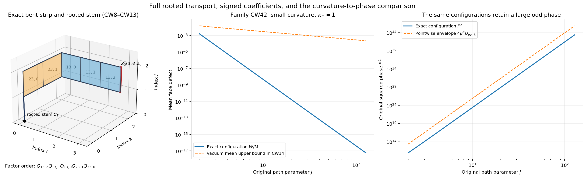

# Full rooted words, actual curvature, and the original phase

This note extends the existing PK177a–PK177f calculation. Those results
already give the two face supports, their unsigned incidence weights,
and a fourth-moment estimate. The additions here are the complete matrix
transport factors and their order, an exact signed summation identity,
a stronger actual-vacuum phase bound, and an explicit configuration
family showing why a mean curvature estimate by itself cannot force
the original rooted phase to be small. The actual vacuum is used in
every expectation stated as a vacuum expectation.

## CW1. The unchanged box, operator, vacuum and rows

Let \(L\ge2\) be an integer, \(m=2L\), \(n=m+1\), and
\(\Lambda=\{0,\ldots,m\}^3\). Its physical vertex is
\(o+a(i-L,k-L,l-L)\). A positively oriented link is
\((i,k,l;d)\), with coordinate \(d\) less than \(m\); reverse
traversal uses its inverse matrix. Write \(U_d(x)\in SU(2)\).
There are exactly
\[
 N=3mn^2,\qquad M=3m^2n.                                    \tag{CW1}
\]
The original generator has orthonormal
\(T_\alpha=-i\sigma_\alpha/2\), with the radius-two metric.
The original Hamiltonian and its positive unit vacuum are
\[
 \begin{split}
 H&=-\kappa\sum_{e,\alpha}X_{e,\alpha}^2+bW,\qquad
 W=\sum_{p\in\mathsf P}D_p,\quad D_p=2-\operatorname{tr}P_p,\\
 \kappa&=2g^2/a,\qquad b=1/(2g^2a),\qquad
 \xi=b/\kappa=1/(4g^4),\\
 H\psi&=E_0\psi,\quad \psi>0,\quad\int\psi^2dH^{\otimes N}=1,
 \qquad d\mu=\psi^2dH^{\otimes N}.
 \end{split}                                                 \tag{CW2}
\]
Every \(D_p\) is in \([0,4]\). The scalar \(2bM\) remains in
the potential and in the vacuum equation. All faces are present.

The tree consists of every direction-one link, direction-two links
at \(i=0\), and direction-three links at \(i=k=0\). Define the
following products in increasing order from left to right:
\[
 C_l=\prod_{r=0}^{l-1}U_3(0,0,r),\quad
 B_k(l)=\prod_{b=0}^{k-1}U_2(0,b,l),\quad
 A_i(k,l)=\prod_{a=0}^{i-1}U_1(a,k,l),\quad
 t_{i,k,l}=C_lB_k(l)A_i(k,l).                                \tag{CW3}
\]
Every empty product is \(I\). For **every** positive link define
\(Z_d(x)=t_xU_d(x)t_{x+e_d}^{-1}\). Tree values are identically
\(I\); all other values are the original chord words. In particular
\[
 \mathcal C_2=\{1\le i\le m,\ 0\le k<m,\ 0\le l\le m\},\quad
 \mathcal C_3=\{0\le i,k\le m,\ (i,k)\ne(0,0),\ 0\le l<m\}.
                                                               \tag{CW4}
\]
The rooted words are retained as the matrix expressions CW3–CW4,
including every repeated root segment.

For \(U=cI+\sum q^\alpha T_\alpha\), let
\(q(U)=(q^1,q^2,q^3)\), so \(|q(U)|\le2\). Put
\[
 \begin{gathered}
 h=\pi/(2n),\quad s=\sin h,\quad c=\cos h,\quad C=\cot h,\\
 v_0(r)=n^{-1/2},\quad v(r)=\sqrt{2/n}\cos[\pi(r+1/2)/n],\\
 w(r)=-\sqrt{2/n}\sin[\pi(r+1)/n]\quad(0\le r<m),
 \quad w(-1)=w(m)=0,\\
 a_{(i,k,l;2)}=-v(i)w(k)v_0(l)/\sqrt2,\quad a_{(i,k,l;3)}=0,\\
 b_{(i,k,l;2)}=v_0(i)w(k)v(l)/\sqrt2,\quad
 b_{(i,k,l;3)}=-v_0(i)v(k)w(l)/\sqrt2.
 \end{gathered}                                                \tag{CW5}
\]
The scalar \(c=\cos h\) in CW5 is not a chord label. Keep exactly
\[
 \begin{gathered}
 u_1=\sum_c a_cq(Z_c),\quad u_3=\sum_c b_cq(Z_c),\quad
 \mathcal S=u_1\cdot u_3,\quad
 \mathcal S_{\mathcal R}=\mathcal S\circ\mathcal R,\\
 D=\mathcal S+\mathcal S_{\mathcal R},\quad
 \beta_0=\sqrt8\sin h/(2g^2),\quad
 F=\beta_0(\mathcal S-\mathcal S_{\mathcal R}).
 \end{gathered}                                                \tag{CW6}
\]
Here \(\mathcal R\) is the original direction-one reflection,
including inverses on reflected direction-one links.

## CW2. Explicit ordered plaquette factorization

For \(d<e\), the positively oriented face based at \(x\) is
\[
 P_{de}(x)=U_d(x)U_e(x+e_d)U_d(x+e_e)^{-1}U_e(x)^{-1},
 \qquad \widehat P_{de}(x)=t_xP_{de}(x)t_x^{-1}.             \tag{CW7}
\]
The exact rooted identities, with decreasing indices from left
to right, are
\[
 \boxed{Z_2(i,k,l)=
 \widehat P_{12}(i-1,k,l)\widehat P_{12}(i-2,k,l)
       \cdots\widehat P_{12}(0,k,l),}                        \tag{CW8}
\]
\[
 \boxed{Z_3(i,k,l)=
 [\widehat P_{13}(i-1,k,l)\cdots\widehat P_{13}(0,k,l)]
 [\widehat P_{23}(0,k-1,l)\cdots\widehat P_{23}(0,0,l)].}  \tag{CW9}
\]
Every transport in these products is the full original \(t_x\)
in CW3. For example a direction-13 factor is
\(C_lB_k(l)A_a(k,l)P_{13}(a,k,l)
A_a(k,l)^{-1}B_k(l)^{-1}C_l^{-1}\).

Here is a direct proof that checks the order. Cancellation of
successive endpoint transports in CW7 gives
\[
 \widehat P_{de}(x)=
 Z_d(x)Z_e(x+e_d)Z_d(x+e_e)^{-1}Z_e(x)^{-1}.               \tag{CW10}
\]
Since every \(Z_1\) is \(I\), CW10 gives
\(Z_2(i+1,k,l)=\widehat P_{12}(i,k,l)Z_2(i,k,l)\), with
\(Z_2(0,k,l)=I\). Induction proves CW8. The same calculation
gives \(Z_3(i+1,k,l)=\widehat P_{13}(i,k,l)Z_3(i,k,l)\).
At \(i=0\), every \(Z_2\) is \(I\), so
\(Z_3(0,k+1,l)=\widehat P_{23}(0,k,l)Z_3(0,k,l)\), with
\(Z_3(0,0,l)=I\). These two inductions give CW9. They explain
why attaching 23 faces first and then 13 faces gives the latter
factors on the **left** of the final matrix product. Nothing is
commuted. The cancellations prove the identity between the full
rooted words and the full transported faces; they do not remove
root occurrences from any physical derivative count.

All boundary cases are included:

| Original link or face class | Exact range or value |
|---|---|
| Direction-two tree link | \(i=0\): CW8 is the empty product \(I\). |
| Direction-two chord | \(1\le i\le m\), \(0\le k<m\), \(0\le l\le m\), including both \(l=0,m\). |
| Direction-three tree link | \(i=k=0\): both products in CW9 are empty. |
| Direction-three chord at \(i=0,k>0\) | Only the full boundary-23 product remains. |
| Direction-three chord at \(k=0,i>0\) | Only the full 13 product remains. |
| Direction-three chord at \(i,k>0\) | Both products remain, in the displayed order, including \(i=m\) or \(k=m\). |
| Face-12 strip | \((a,k,l;12)\), \(0\le a<i\), including the two transverse boundary heights \(l=0,m\). |
| Face-13 strip | \((a,k,l;13)\), \(0\le a<i\), \(0\le l<m\), including \(k=0,m\). |
| Face-23 strip | \((0,b,l;23)\), \(0\le b<k\), \(0\le l<m\): the original boundary plane \(i=0\). |

Reversing any rooted chord gives exactly the reversed factor
order with every factor inverted. Face defects are unchanged
by inverse or conjugation because the \(SU(2)\) trace is real.

## CW3. Reflection with its original transports and orientations

Put \(\bar x=(m-i,k,l)\). The reflected link matrices are
\[
 U_1^{\mathcal R}(i,k,l)=U_1(m-i-1,k,l)^{-1},\quad
 U_d^{\mathcal R}(i,k,l)=U_d(m-i,k,l),\ d=2,3.              \tag{CW11}
\]
The full reflected root transport is
\[
 t^{\mathcal R}_{i,k,l}=
 \left[\prod_{r=0}^{l-1}U_3(m,0,r)\right]
 \left[\prod_{b=0}^{k-1}U_2(m,b,l)\right]
 \left[\prod_{a=0}^{i-1}U_1(m-a-1,k,l)^{-1}\right].        \tag{CW12}
\]
Thus no boundary chord in the first two products is fixed to
identity. For \(e=2,3\), and \(y=(m-a-1,k,l)\), direct insertion
in CW7 gives
\[
 P_{1e}^{\mathcal R}(a,k,l)
 =U_1(y)^{-1}P_{1e}(y)^{-1}U_1(y),\qquad
 P_{23}^{\mathcal R}(i,k,l)=P_{23}(m-i,k,l).                \tag{CW13}
\]
Applying CW8–CW9 to the matrices CW11 gives the full reflected
factorization with factors
\(t_x^{\mathcal R}P_{de}^{\mathcal R}(x)(t_x^{\mathcal R})^{-1}\)
in exactly the same decreasing index order. CW13 identifies their
original physical faces and orientations. In particular the 23
boundary strip moves to \(i=m\), and the 12 and 13 strips use
\(m-i\le a<m\), with reversed face orientation. These formulas
prove the actual reflection map rather than replacing it by a
sign on the quaternion coordinates.

## CW4. What the retained mean defect really states

Define the actual total expectation
\(\mathfrak d=\mu(W)\). The source's equations (93)–(99),
with \(r=N/M=n/m\), give
\[
 \mathfrak d\le B_{L,g}:=\min\{2M,6g^2\sqrt{NM}\},\qquad
 \mathfrak d/M\le\min\{2,6g^2\sqrt{n/m}\}.                \tag{CW14}
\]
For completeness, this is a bound on the actual vacuum obtained
as follows. Probability Haar has marginal
\((2/\pi)\sqrt{1-x^2}\,dx\) for \(x=\operatorname{tr}U/2\).
For \(Z_t=\int e^{2tx}dH\), let
\(f_t=Z_t^{-1/2}e^{tx}\) and
\(q_t=Z_t^{-1}\int xe^{2tx}dH\). Pairing \(x\) and \(-x\)
gives \(0<q_t<1\). With \(z=1-x\), the tilted density is a
Gamma density proportional to \(e^{-2tz}z^{1/2}\), multiplied
by the decreasing nonnegative factor
\(\sqrt{2-z}\mathbf1_{[0,2]}\). For independent \(z,z'\),
the integral of \((z-z')[w(z)-w(z')]\) is nonpositive; expanding
it proves that multiplication by \(w\) lowers the mean.
Integration by parts gives the Gamma mean \(3/(4t)\). Hence
\(1-q_t\le3/(4t)\).

The original radius-two identities are
\(|\nabla x|^2=(1-x^2)/4\), \(\Delta x=-3x/4\). Integrating
\(\operatorname{div}(e^{2tx}\nabla x)\) gives one-link kinetic
energy \(3tq_t/8\). The product comparison vector has exact
energy
\(3\kappa Ntq_t/8+2bM(1-q_t^4)\), at most
\(3\kappa Nt/8+6bM/t\). It is used **only** in the variational
principle, not as the density in any later expectation. The choice
\(t=4\sqrt{bM/(\kappa N)}\) and \(\kappa b=a^{-2}\) gives
\(E_0\le3\sqrt{NM}/a\); the constant comparison gives
\(E_0\le2bM\). Finally \(b\mathfrak d=\mu(V)\le E_0\)
proves CW14 with every face, boundary count and scalar retained.
If a gauge-invariant comparison vector is desired, average its
squared density over the vertex gauge group and take its positive
square root. Cauchy–Schwarz in that group integral bounds its
kinetic form by the original product form, while gauge invariance
leaves the potential integral unchanged.

There is an exact useful symmetry which is weaker than facewise
uniformity. Coordinate permutations act by link permutations and,
when needed, inversion. They preserve product Haar, the link
metric and the whole Hamiltonian. The strictly positive ground
state is unique: positivity improvement of the heat semigroup
with its bounded positive Feynman–Kac weight gives simplicity of
its largest eigenvalue, hence of the ground eigenvalue of \(H\).
Each coordinate symmetry therefore fixes the positive unit
\(\psi\). It follows that, with
\(W_{de}=\sum_{p\text{ of type }de}D_p\),
\[
 \mu(W_{12})=\mu(W_{13})=\mu(W_{23})=\mathfrak d/3.
                                                               \tag{CW15}
\]
This makes no assertion that two faces at inequivalent boundary
locations have the same expectation.

## CW5. Exact chord inequalities before a global budget is inserted

For any \(U\in SU(2)\),
\[
 \|I-U\|_{\rm op}^2=D(U),\quad
 \|I-U\|_{\rm HS}^2=2D(U),\quad
 |q(U)|^2=D(U)[4-D(U)].                                     \tag{CW16}
\]
These follow by diagonalizing its two eigenvalues
\(e^{i\theta},e^{-i\theta}\), or by its quaternion coordinates.
For a full ordered product of unitary matrices, iterating
\(I-AB=(I-A)+A(I-B)\) gives
\[
 \sqrt{D(Z_c)}\le\sum_{p\in\mathcal F(c)}\sqrt{D_p},
 \qquad
 \mathcal F(c_2)=\{(a,k,l;12):0\le a<i\},
\]
\[
 \mathcal F(c_3)=\{(a,k,l;13):0\le a<i\}
                \cup\{(0,b,l;23):0\le b<k\}.              \tag{CW17}
\]
CW8–CW9 prove exactly why these faces, with their conjugating
transports, occur. Their cardinalities are \(i\) and \(i+k\).

Let \(d_p=\mu(D_p)\) retain each individual face expectation.
Minkowski's inequality in \(L^2(\mu)\), applied before replacing
any \(d_p\), gives
\[
 \mu(D(Z_c))\le b_c:=
 \min\left\{4,\left(\sum_{p\in\mathcal F(c)}\sqrt{d_p}\right)^2\right\}.
                                                               \tag{CW18}
\]
Because \(x(4-x)\) is concave on \([0,4]\), Jensen's inequality
and CW16 imply the stronger quaternion estimate
\[
 \mu(|q(Z_c)|^2)\le Q(b_c),\qquad
 Q(b)=\begin{cases}4b-b^2,&0\le b\le2,\\4,&2\le b\le4.\end{cases}
                                                               \tag{CW19}
\]
Indeed maximize \(4d-d^2\) over \(0\le d\le b_c\).
CW15 gives the following completely evaluated alternatives:
\[
 b_{c_2}\le\min\{4,i\mathfrak d/3\},\qquad
 b_{c_3}\le\min\{4,(\sqrt i+\sqrt k)^2\mathfrak d/3\}.
                                                               \tag{CW20}
\]
For CW20, apply Cauchy–Schwarz within each of the two orientation
strips, then use its inclusion in the full orientation sum. The
same bounds hold for reflected chords by CW11–CW15. The more
informative CW18 keeps all individual boundary-face data.

The actual second moments of the original rows therefore also obey
\[
 \|u_\nu\|_{L^2(\mu)}
 \le\sum_c|\mathsf M_{\nu c}|\sqrt{Q(b_c)},\qquad \nu=1,3.
                                                               \tag{CW21}
\]
This is a quantitative result for the actual vacuum, with its
complete face-expectation vector still visible.

## CW6. A signed summation that improves the first original row

The exact one-dimensional identities are
\[
 \sum_{i=0}^m v(i)=0,\quad \sum_{r=0}^{m-1}w(r)^2=1,
 \quad v(i)=\frac{w(i-1)-w(i)}{2s},
 \quad \sum_{i=a+1}^m v(i)=\frac{w(a)}{2s}.                \tag{CW22}
\]
The difference identity follows from the sine subtraction formula;
the two sums follow by summing it and by the finite cosine
geometric series for \(\sin^2\). For any vector sequence
\(Q_0,\ldots,Q_m\), expansion of its successive differences gives
\[
 \sum_{i=0}^m v(i)Q_i
 =\frac1{2s}\sum_{a=0}^{m-1}w(a)(Q_{a+1}-Q_a).            \tag{CW23}
\]
Both boundary terms in the finite summation are retained through
\(w(-1)=w(m)=0\). Use \(Q_i=q(Z_2(i,k,l))\); its \(i=0\)
value is exactly zero because that link is a tree link. Then
the original first row, with no coefficient changed, is
\[
 \boxed{u_1=-\frac1{2s\sqrt{2n}}
 \sum_{a=0}^{m-1}\sum_{k=0}^{m-1}\sum_{l=0}^m
 w(a)w(k)[q(Z_2(a+1,k,l))-q(Z_2(a,k,l))].}                 \tag{CW24}
\]
CW8 implies
\(Z_2(a+1,k,l)=\widehat P_{12}(a,k,l)Z_2(a,k,l)\).
The quaternion-vector map is real linear and satisfies
\(|q(A)-q(B)|\le\sqrt2\|A-B\|_{\rm HS}\) for two quaternion
matrices. Unitary invariance and CW16 therefore give
\[
 |q(Z_2(a+1,k,l))-q(Z_2(a,k,l))|\le2\sqrt{D_{12}(a,k,l)}.
                                                               \tag{CW25}
\]
Define, on every actual 12 face,
\[
 K_{a,k,l}=\frac{|w(a)w(k)|}{2s\sqrt{2n}},\qquad
 \sum_{a,k,l}K_{a,k,l}^2=\frac1{8s^2}.                    \tag{CW26}
\]
The sum in CW26 uses \(m\) values of \(a,k\) and all \(n\)
values of \(l\), including both boundary heights. Equations
CW24–CW26 and Cauchy–Schwarz now prove the pointwise and actual
vacuum estimates
\[
 \boxed{|u_1|^2\le\frac{W_{12}}{2s^2},\qquad
 \mu(|u_1|^2)\le\frac{\mathfrak d}{6s^2}
                 \le\frac{B_{L,g}}{6s^2}.}               \tag{CW27}
\]
Before CW15 is used, the more precise bound is
\(\|u_1\|_{L^2}\le2\sum_{a,k,l}K_{a,k,l}\sqrt{d_{12}(a,k,l)}\).
This is stronger than taking absolute values of each original
coefficient before summing the full strip. The exact signed
tail in CW22 is the reason for the improvement.

## CW7. The complete third-row curl identity and its nonlinear term

One can perform signed summation for both differences in the
third row. Include tree values \(Z_2(0,k,l)=I\) and
\(Z_3(0,0,l)=I\); their \(q\) is zero, so this inclusion is
an exact notation for the original excluded entries. CW23 gives
\[
 u_3=\frac1{2s\sqrt{2n}}\sum_{i=0}^m\sum_{k,l=0}^{m-1}
 w(k)w(l)\{q(Z_2(i,k,l+1))-q(Z_2(i,k,l))
           -q(Z_3(i,k+1,l))+q(Z_3(i,k,l))\}.              \tag{CW28}
\]
For one summand put
\(A=Z_2(i,k,l)\), \(B=Z_3(i,k+1,l)\),
\(C'=Z_2(i,k,l+1)\), \(D'=Z_3(i,k,l)\), and
\(P=\widehat P_{23}(i,k,l)=AB(C')^{-1}(D')^{-1}\).
Then its braces are exactly
\[
 \boxed{-q((P-I)D'C')
       +q((A-I)(B-I))-q((D'-I)(C'-I)).}                   \tag{CW29}
\]
Here \(q\) denotes the same real-linear quaternion-vector map,
extended to the real quaternion matrix algebra. To prove CW29,
use \(AB=PD'C'\) and expand
\(AB=A+B-I+(A-I)(B-I)\) and
\(D'C'=D'+C'-I+(D'-I)(C'-I)\). Subtraction gives CW29
without interchanging any factors.

Let \(u_{3,\mathrm{curv}}\) be the full CW28 sum of the first
term of CW29, and \(R_3\) its full sum of the last two terms.
This defines an exact equality \(u_3=u_{3,\mathrm{curv}}+R_3\).
The first part obeys
\[
 |u_{3,\mathrm{curv}}|^2\le\frac{W_{23}}{2s^2},\qquad
 \|u_{3,\mathrm{curv}}\|_{L^2}\le\sqrt{\mathfrak d/(6s^2)}.
                                                               \tag{CW30}
\]
This follows by the same squared coefficient sum as CW26,
now summed over all \(n\) values of \(i\). The original
quadratic term \(R_3\) is not set to zero.

There is also a closed bound for that term. A quaternion matrix
has operator norm equal to its Euclidean quaternion norm, so
\[
 |q((A-I)(B-I))|\le2\sqrt{D(A)D(B)}\le4\sqrt{D(A)},
\]
and the other term is at most \(4\sqrt{D(C')}\). Insert the
complete 12 fillings CW17 for \(A,C'\). The resulting weights
on a face \((a,k,r;12)\) are
\[
 H_{a,k,r}=\frac{(m-a)|w(k)|(|w(r)|+|w(r-1)|)}{2s\sqrt{2n}}.
\]
All endpoint values use \(w(-1)=w(m)=0\). Thus
\[
 |R_3|\le4\sum_{a,k,r}H_{a,k,r}\sqrt{D_{12}(a,k,r)},\quad
 \sum H_{a,k,r}^2=\frac{m(2m+1)c^2}{12s^2}=:\mathcal H.
                                                               \tag{CW31}
\]
For the squared sum, \(\sum_{a=0}^{m-1}(m-a)^2=mn(2m+1)/6\),
\(\sum_kw(k)^2=1\), and
\(\sum_{r=0}^m(w(r)+w(r-1))^2=4c^2\). The latter identity
follows either from the sine addition formula or by expanding
the square and using \(\sum_{r=1}^{m-1}w(r)w(r-1)=\cos(2h)\).
Consequently
\[
 \boxed{\|R_3\|_{L^2}\le4\sqrt{\mathcal H\mathfrak d/3},\qquad
 \|u_3\|_{L^2}\le\sqrt{\mathfrak d/(6s^2)}
                          +4\sqrt{\mathcal H\mathfrak d/3}.}   \tag{CW32}
\]
This closes the estimate using the given mean defect. CW29
also identifies exactly which nonlinear rooted products a finer
calculation would have to control; none has been replaced by an
abelian expression in obtaining CW32.

## CW8. Concrete stronger bounds for the unchanged phase and endpoint

The exact absolute row sums, from CW5, are
\[
 S_1=\sqrt{2/n}\,C(C-c),\qquad
 S_3=\sqrt{2/n}[(2-1/n)C^2-(c/n)C].                       \tag{CW33}
\]
To verify them, finite geometric series give
\(\sum|v|=\sum|w|=\sqrt{2/n}C\); the omitted direction-two
tree value subtracts \(|v(0)|=\sqrt{2/n}c\), and the excluded
direction-three corner subtracts exactly
\(\sqrt{2/n}cC/n\). Thus \(|u_\nu|\le2S_\nu\).

Define the completely explicit numbers
\[
 \begin{split}
 U_1&=\min\{4S_1^2,B_{L,g}/(6s^2)\},\\
 U_3&=\min\{4S_3^2,
 B_{L,g}[1/(\sqrt6s)+4\sqrt{\mathcal H/3}]^2\},\\
 U_{\mathrm{new}}&=\min\{16S_1^2S_3^2,\ 4S_3^2U_1,\ 4S_1^2U_3\}.
 \end{split}                                                 \tag{CW34}
\]
Equations CW27 and CW32 imply
\[
 \boxed{\mathcal Q_4:=\mu(\mathcal S^2)\le U_{\mathrm{new}}
 \le\min\left\{16S_1^2S_3^2,
                \frac{2S_3^2}{3s^2}B_{L,g}\right\}.}     \tag{CW35}
\]
For example \(\mathcal S^2\le4S_3^2|u_1|^2\); integrating
and using CW27 proves the second branch. This replaces the
earlier use of \(\mu(W^2)\le4M\mu(W)\) by a direct linear
bound while also improving its coefficient by signed summation.
CW18, CW21 and the facewise form after CW27 may be inserted into
CW34 to give still more precise bounds when actual individual
face expectations are available. No such uniformity is assumed.

Reflection preserves \(\mu\). Expanding the two squares in CW6
therefore yields the exact simultaneous identity and bounds
\[
 \boxed{\mu(D^2)+\beta_0^{-2}\mu(F^2)=4\mathcal Q_4
 \le4U_{\mathrm{new}},\qquad
 G:=\mu(F^2)\le4\beta_0^2U_{\mathrm{new}}.}                \tag{CW36}
\]
There is no substitution \(\mathcal S_{\mathcal R}=-\mathcal S\)
in this actual-vacuum statement.

For a concrete accompanying energy bound, retain the full word
occurrence counts \(n_{ce}\) (both orientations counted) and set
\(D_{\nu e}=\sum_c|\mathsf M_{\nu c}|n_{ce}\). A unit generator
acting on one occurrence changes \(q\) by a vector of norm at
most one: the change of the unit-quaternion coordinates has
speed \(1/2\), and \(q\) is twice the vector coordinates.
The product rule, unitary multiplication and summing all
occurrences give \(|X_{e,\alpha}u_\nu|\le D_{\nu e}\).
Consequently
\[
 \mu(|\nabla\mathcal S|^2)
 \le3\left[\sqrt{U_3\sum_eD_{1e}^2}
           +\sqrt{U_1\sum_eD_{3e}^2}\right]^2=:\mathcal K_*.
                                                               \tag{CW37}
\]
To prove it, first bound each colour derivative of the dot
product by \(|u_3|D_{1e}+|u_1|D_{3e}\), then use the triangle
inequality in the combined \(L^2(\mu)\) and finite-link space.
The factor three retains all colours. This is a finite exact
sum on the original words; it requires no independence.

The ground-state form identity follows by expanding
\(H(f\psi)-fH\psi\) and integration by parts:
\(\langle f\psi,(H-E_0)f\psi\rangle=\kappa\mu(|\nabla f|^2)\).
The full potential and scalar cancel only after using the full
vacuum equation. Reflection is an isometry of that form, hence
\(C_F:=\kappa\mu(|\nabla F|^2)\le4\kappa\beta_0^2\mathcal K_*\).
The unchanged spectral endpoint therefore has the concrete bound
\[
 -\frac{4\kappa\beta_0^2}{s_{\rm spec}}\mathcal K_*
 \le\mathscr E(s_{\rm spec}):=G-C_F/s_{\rm spec}
 \le4\beta_0^2U_{\mathrm{new}}.                            \tag{CW38}
\]
Its exact expectation identity remains
\[
 \mathscr E(s_{\rm spec})
 =2\beta_0^2[\mathcal Q_4-\mu(\mathcal S\mathcal S_{\mathcal R})]
 -\frac{2\kappa\beta_0^2}{s_{\rm spec}}
 [\mu(|\nabla\mathcal S|^2)
      -\mu(\nabla\mathcal S\cdot\nabla\mathcal S_{\mathcal R})].
                                                               \tag{CW39}
\]
In particular, a positive upper bound for the first square cannot
give the sign of this difference. CW29, CW36 and CW39 retain
the precise nonlinear and reflected quantities involved.

## CW9. Evaluation on the unchanged simultaneous path

Keep, for every integer \(j\ge2\),
\[
 L_j=j^4,\quad a_j=1/(100j),\quad
 g_j^2=\kappa_*/(200j),\quad s_{{\rm spec},j}=\kappa_*/j,
 \quad\kappa_j=\kappa_*>0,\quad n_j=2j^4+1.               \tag{CW40}
\]
All finite formulas CW1–CW39 retain the corresponding
\(m_j=2j^4\), \(h_j=\pi/(2n_j)\), and
\(\beta_{0,j}=100j\sqrt8\sin h_j/\kappa_*\).
Write \(U_{\mathrm{point}}=16S_1^2S_3^2\) and
\(U_{\mathrm{linear}}=2S_3^2B_{L,g}/(3s^2)\), the new branch
in CW35. The exact limits are
\[
 \frac{U_{\mathrm{point},j}}{j^{24}}\longrightarrow\frac{2^{22}}{\pi^8},
 \qquad
 \boxed{\frac{U_{\mathrm{linear},j}}
 {j^7U_{\mathrm{point},j}}\longrightarrow
       \frac{3\pi^2\kappa_*}{1600}.}                     \tag{CW41}
\]
Indeed \(S_1/n^{3/2}\to4\sqrt2/\pi^2\),
\(S_3/n^{3/2}\to8\sqrt2/\pi^2\),
\(n\sin h\to\pi/2\), and
\(B_{L,g}/(g^2n^3)\to18\). The latter uses the smaller
variational branch, since \(3g_j^2\sqrt{n_j/m_j}\to0\).
Thus
\(U_{\mathrm{linear}}/U_{\mathrm{point}}
=B_{L,g}/(24s^2S_1^2)\sim(3\pi^2/32)g^2n^2\),
which gives CW41 after substituting CW40. This improves the
earlier PK177f comparison, whose excess factor was \(j^{19}\).
Both branches in CW34 eventually take their pointwise caps
on CW40: \(B/(24s^2S_1^2)\to\infty\), and the ratio of the
uncapped \(U_3\) branch to \(4S_3^2\) also tends to infinity,
already from its positive \(B/(6s^2)\) summand. Thus this
stronger mean-defect estimate still gives
\(U_{\mathrm{new}}=U_{\mathrm{point}}\) eventually.
This is a proved property of these upper-bound functions; it
does not state growth of the actual vacuum moment.

## CW10. Exact small-curvature configurations with a large original odd phase

The next calculation tests what information CW14 can imply by
itself. It is a deterministic configuration family, **not** a
replacement measure for the actual vacuum. Fix one of the
original \(T_\alpha\), write \(T=T_1\), and put
\[
 \theta_r=\frac{\pi r}{2m},\qquad
 U_1(i,k,l)=I,\quad
 U_2(i,k,l)=e^{2\theta_iT},\quad
 U_3(i,k,l)=e^{2\theta_kT}.                               \tag{CW42}
\]
The tree links in CW3 are exactly \(I\), including
\(U_2(0,k,l)\) and \(U_3(0,0,l)\). Thus CW42 gives the original
\(Z_2=e^{2\theta_iT}\), \(Z_3=e^{2\theta_kT}\), not an
altered chart. All factors happen to commute in this exhibited
configuration; none of the general identities assumes that.

With \(\alpha=\pi/(2m)\), direct multiplication gives every
face, including its orientation and boundary values:
\[
 P_{12}=e^{2\alpha T},\qquad P_{13}=I,\qquad
 P_{23}=e^{2\alpha T},\qquad
 W=4m^2n(1-\cos\alpha),\quad
 \frac WM=\frac43(1-\cos\alpha)\le\frac{\pi^2}{6m^2}.
                                                               \tag{CW43}
\]
There are \(m^2n\) faces of each orientation. The inequality
uses \(1-\cos\alpha\le\alpha^2/2\), which follows by
integrating \(\sin t\le t\).

Let
\[
 A_m=2\sqrt{2/n}\sum_{r=0}^m
 \cos\frac{\pi(r+1/2)}n\sin\frac{\pi r}{2m}.
                                                               \tag{CW44}
\]
This is an exact finite sum with its original central zero and
both endpoints. Writing \(b_0=\pi/n\), the sine-product sum gives
the equivalent full expression
\[
 A_m=\frac{\cos(n\alpha/2)}{\sqrt n}
 \left[\csc\frac{\alpha+b_0}{2}
       +\csc\frac{\alpha-b_0}{2}\right].                 \tag{CW45}
\]
To verify CW45, use
\(2\sin(\alpha r)\cos(b_0r+b_0/2)
=\sin((\alpha+b_0)r+b_0/2)
+\sin((\alpha-b_0)r-b_0/2)\), and then the finite formula
\(\sum_{r=0}^m\sin(tr+\phi)
=\sin(nt/2)\sin(\phi+mt/2)/\sin(t/2)\).
Its two second sine factors are \(\sin(3\pi/4)\) and
\(\sin(-\pi/4)\); the two first sine factors are opposite.
This proves the stated sum, with the negative denominator in
its second summand retained.

Summing all coefficients in CW5 gives exactly
\[
 u_1=A_mC\,e_1,\qquad u_3=A_mC\,e_1,\qquad
 \mathcal S=A_m^2C^2.                                     \tag{CW46}
\]
For the first equality use \(\sum w=-\sqrt{2/n}C\) and
\(\sum v_0=\sqrt n\). The direction-two contribution to
\(u_3\) vanishes because \(\sum_l v(l)=0\); its direction-three
contribution is the same complete product of sums as for \(u_1\).
Its excluded corner already has \(q(Z_3)=0\).

CW12 gives the reflected root factors
\(t^{\mathcal R}_{i,k,l}=e^{\pi kT}\); the reflected 3-axis
root factors are \(I\). Therefore the full reflected words are
\[
 Z_2^{\mathcal R}(i,k,l)=e^{-2\theta_iT},\qquad
 Z_3^{\mathcal R}(i,k,l)=e^{2\theta_kT}.
\]
The direction-two contribution to \(u_3^{\mathcal R}\) still
vanishes after summing \(v(l)\). It follows exactly that
\[
 \mathcal S_{\mathcal R}=-\mathcal S,\qquad
 D=0,\qquad F=2\beta_0A_m^2C^2.                           \tag{CW47}
\]
These signs are proved only for CW42; they are not installed
as a global reflection rule.

The full sums in CW45 give
\[
 \frac{A_m}{\sqrt n}\longrightarrow-\frac{4\sqrt2}{3\pi},
 \quad \frac{\mathcal S}{n^3}\longrightarrow\frac{128}{9\pi^4},
 \quad \frac{\mathcal S^2}{U_{\mathrm{point}}}\longrightarrow\frac1{324},
 \quad \frac{F^2}{\beta_0^2U_{\mathrm{point}}}\longrightarrow\frac1{81}.
                                                               \tag{CW48}
\]
For the first limit, \(n\alpha\to\pi/2\), and the two cosecants
divided by \(n\) tend to \(4/(3\pi)\) and \(-4/\pi\).
The remaining limits follow from \(C/n\to2/\pi\) and the
full constants preceding CW41. In particular the power \(n^5\)
in an inequality \(\mathcal S^2\le\mathrm{constant}\,n^5W\)
cannot be reduced to a smaller power uniformly in configurations:
CW43 gives \(W/n\to\pi^2/2\), whereas CW48 gives a positive
limit for \(\mathcal S^2/n^6\). More precisely,
\(\mathcal S^2/(n^5W)\to32768/(81\pi^{10})>0\).

On the exact path CW40, CW43 gives
\(W/M\le\pi^2/(24j^8)\). For every fixed \(\kappa_*>0\),
this is strictly below the source bound in CW14 for all
sufficiently large \(j\). Meanwhile CW47–CW48 retain an odd
phase of the same power as its global pointwise bound.
This makes the insufficiency of the mean-defect information
quantitative even when the original phase and reflection are kept.
The exact path constants for this exhibited family are
\[
 j^8\frac{W_j}{M_j}\longrightarrow\frac{\pi^2}{24},\qquad
 \frac{F_j^2}{j^{18}}\longrightarrow
       \frac{20000\,2^{20}}{81\kappa_*^2\pi^6}>0.          \tag{CW49}
\]
They follow from CW43, CW48, \(n_j/j^4\to2\), and
\(j^6\beta_{0,j}^2\to5000\pi^2/\kappa_*^2\).

One may also impose the symmetries used in CW15 without changing
that conclusion. Average the point mass of CW42 over its gauge
orbit and the finite cube symmetry group. There are at most
48 geometric images; all have the same \(W\). The gauge-invariant
nonnegative observable \(F^2\) has average at least its value
on CW42 divided by 48, since the identity symmetry occurs.
Reflection ensures \(F\) has mean zero. This comparison measure
is not the vacuum and is used solely to disprove an inference
from mean defect and symmetries alone. If a positive smooth
density is desired for that logical test, convolve the finite
symmetry average with a small positive group heat kernel and
average over the same symmetries. Compactness and continuity
make its \(W\) and \(F^2\) expectations converge to the values
just proved; the strict margin below CW14 survives at sufficiently
small smoothing time. No ground-state equation is asserted for
these comparison measures.

## CW11. Source use, checks and the precise endpoint consequence

The original programme sources read for this calculation are:

- [PK158–PK177f, original rows and existing face bounds](https://github.com/KokunoYumeto/yang-mills-interacting-workbench/blob/485b61423c1f4e1805deb453c1b6b342b27842b6/yang-mills/continuations/20260930-s6-ns-moment-map-bridge/PERIOD_COUPLING_AND_PHYSICAL_KERNELS.md#L3500).
- [Original spatial TeX, Section 12, equations (93)–(100)](https://github.com/KokunoYumeto/yang-mills-interacting-workbench/blob/485b61423c1f4e1805deb453c1b6b342b27842b6/yang-mills/continuations/20260930-s6-ns-moment-map-bridge/sources/spatial/spatial_continuum.tex#L1752).
- The local original-word occurrence calculation IP2–IP9 and
  the full reflection derivation PS36–PS39 were read for comparison;
  the identities used here are proved explicitly in CW3–CW13
  and CW22–CW39.

The existing machine-readable research and local-literature indexes
were queried before importing a new external theorem; no external
theorem beyond the retained programme source is required for the
new matrix and finite-sum calculations. `CURVATURE_SOURCE_USE_LEDGER.json`
records exact local files, hashes, reading coverage and result maps.
`verify_curvature_words.py` freely reduces every original and
factored noncommutative word on small complete boxes, checks the
reflected transports, tests the quadratic quaternion identity over
exact rational arithmetic, and checks the finite coefficients and
exhibited configurations numerically at high precision. These
checks supplement the proof and do not replace it.

`CURVATURE_ROOTED_WORDS_FIGURE.png`, reproduced by
`draw_curvature_words.py`, shows the exact five-face bent strip
for \(Z_3(3,2,1)\), with the shared rooted stem retained, and
the two quantitative properties of the explicit family CW42.
Its geometry axes are integer lattice indices; the physical
position is the full map \(o+a(i-L,k-L,l-L)\) in CW1.
The plotted phase values come from that deterministic family,
not from sampling the vacuum. CW8–CW13 and CW42–CW48 are the
complete proof locators for the geometry and plotted quantities.

The actual-vacuum conclusion is CW18–CW21, CW27, CW32, and
CW34–CW39, with the improved exact path comparison CW41.
The missing information in the spectral endpoint is now visible
as the actual joint rooted/reflected moments and their energy
difference in CW39, with the exact nonabelian remainder CW29
retained. CW42–CW48 prove that adding only the known mean defect
and the proved cube symmetries cannot control those quantities
well enough to make the large rooted phase small. They do not
assert any asymptotic behaviour of the actual interacting vacuum,
nor any sign for its full spectral endpoint.

In the factor-order label, Q13,a denotes the transported face in CW9 at (a,2,1), and Q23,b denotes the transported face at (0,b,1). The complete physical coordinate map is CW1.

## Evaluated local physical quadratures

The complete [local curvature calculation, LC1–LC42](LOCAL_CURVATURE_BUDGET.md), now determines the formerly unevaluated scalar component of LEM27–LEM29. LC4–LC15 partition every original edge and face and prove the exact outside-ground crossing cost 2b per crossing face. The local kinetic-plus-potential estimate retains its potential subtraction, and LC17–LC25 give actual local moments without translation invariance. LC26–LC39 prove that each original a_j³-weighted physical face quadrature acts on the entire cyclic reconstruction as exactly 2 times its test-function integral. Its centered zero-energy component is zero. LC34 retains the full finite-word error, LC35 includes the original shrinking window, and LC40–LC42 prove the complete time-interval bounds and specified coupled almost-sure limit. This strengthens the earlier positive-energy loss; it supplies neither an individual-face law nor the original raw-phase weight. Candidate fluctuating observables require their own actual covariance and spectral calculation.

## Actual curvature covariance and a larger continuous representation

The complete [PVC1–PVC50 calculation](PHYSICAL_LOCAL_COVARIANCE.md) adds exact original-face source-pulse receiving maps, a coupled positive lower mean, and positive finite first-energy bounds for tests with nonzero integral. Its source-averaged covariance is O(a_j); PVC47–PVC50 retain and bound the signed response needed to reach the original-source covariance. That covariance is not evaluated by substituting the source average.

The complete [CP1–CP50 construction](CURVATURE_PHASE_RECONSTRUCTION.md) now admits bounded phases of the original a_j-weighted curvature into a continuous cyclic space. Exact multiplication, adjoints and coincident-time products survive there, and the earlier compression product defect vanishes on that space. Actual stationary reversible histories have real continuous anchored increments and a compact initial character. CP38–CP43 construct the regular-character reducing space and the exact effect of centering. CP44–CP49 retain positive energy, zero-energy collapse, first-energy loss, interval endpoints and the original shrinking window. No positive limiting spectral weight is inferred from finite energy bounds. The LC a_j³ quadratures remain scalar on this enlarged space.
