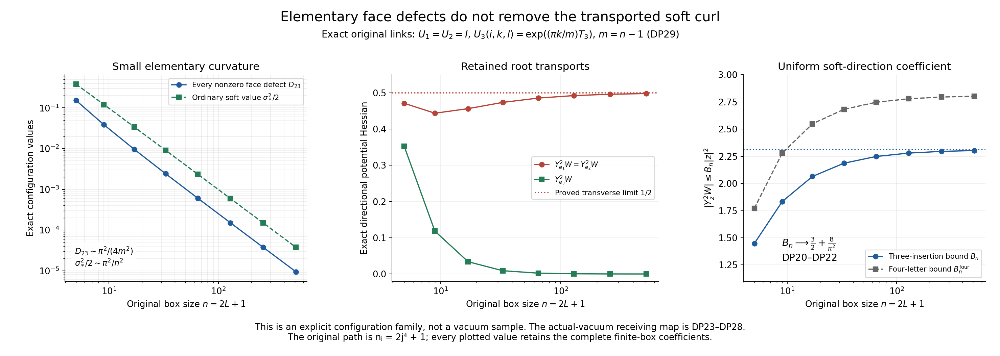

# The exact soft-direction potential Hessian and its root-transport defect

This is a continuation of the preserved complete proof
[RH1–RH51](https://github.com/KokunoYumeto/yang-mills-interacting-workbench/blob/31c54c8be35bdca87e42f591e2dd88704b5869f0/yang-mills/continuations/20261011-central-signs-shrinking-window/RAW_S6_HESSIAN_RECEIVING.md) (RH1–RH51). It keeps its original
configuration, metric, ground state, raw S6 phase, root, reflected words,
coefficients and path. The new calculation proves that the fixed soft
field leaves every 12- and 13-face trace invariant. The remaining
23-face Hessian has a smaller explicit uniform coefficient, tending to
\(3/2+8/\pi^2\), instead of the full tensor coefficient eight.
It also calculates all extra terms in the differentiated ground equation.
Those terms prevent substitution of this directional coefficient into
the earlier tensor minimum argument.

There is a substantive further consequence of the calculation. In the
actual vacuum, the directional potential Hessian is, up to an explicit
error of order \(j^{-1/2}\) before multiplication by \(b_j\), one half
the expected squared transported soft curl. This transported curl need
not be close to the ordinary soft curl merely because the elementary
face defects are small. An exact original-link family below has all
face defects tending to zero, but transverse directional Hessian tending
to \(1/2\). This family is a configuration calculation, not a substitute
for the actual vacuum or a claim about its limiting moments.

## 1. Retained definitions and the full directional connection

Let \(L\ge1\) be an integer and \(m=2L,n=m+1\), with vertices
\((i,k,l)\in\{0,\ldots,m\}^3\)
at physical positions \(o+a(i-L,k-L,l-L)\). Retain all positive
nearest-neighbour edges and all elementary faces of the open cube,
\(N=3mn^2,M=3m^2n\). Each edge carries probability Haar on \(SU(2)\)
with radius-two metric, \(T_\alpha=-i\sigma_\alpha/2\), and
\(X_{e\alpha}f=\partial_t f(\ldots,e^{tT_\alpha}U_e,\ldots)|_0\).
The entire Hamiltonian and actual positive unit ground state are
\[
 H=-\kappa\Delta+bW,\quad \Delta=\sum X_{e\alpha}^2,\quad
 W=\sum_p(2-\operatorname{tr}U_p),\quad
 H\psi=E_0\psi,\quad d\mu=\psi^2dU,\quad w=\log\psi,
 \quad\kappa=2g^2/a,\quad b=1/(2g^2a),\quad\xi=b/\kappa.
 \tag{DP1}
\]
The full scalar \(2bM\) is retained. Faces use
\(U_p=U_d(z)U_e(z+e_d)U_d(z+e_e)^{-1}U_e(z)^{-1}\).
The physical action is \(U_{st}\mapsto h_sU_{st}h_t^{-1}\), including
all boundary vertices. The ground state is physical and unique by RH4's
complete ground transform argument.

The original tree transport runs in directions three, two, one:
\[
 t_{i,k,l}=(\prod_{r<l}U_3(0,0,r))
           (\prod_{s<k}U_2(0,s,l))
           (\prod_{t<i}U_1(t,k,l)),\qquad Z_c=t_{s(c)}U_ct_{t(c)}^{-1}.
 \tag{DP2}
\]
All products are in their displayed increasing order. The chord sets are
\(\mathcal C_2=\{(i,k,l;2):1\le i\le m,0\le k<m,0\le l\le m\}\)
and \(\mathcal C_3=\{(i,k,l;3):(i,k)\ne(0,0),0\le i,k\le m,0\le l<m\}\).
Write \(U=cI+q\cdot T\), so \(c^2+|q|^2/4=1\).
Put \(h=\pi/(2n),s=\sin h,c_h=\cos h,C_h=\cot h\), and
\[
 v(r)=\sqrt{2/n}\cos\frac{\pi(r+1/2)}n,\quad
 w_1(r)=-\sqrt{2/n}\sin\frac{\pi(r+1)}n,\quad W_r=\sum_{t<r}w_1(t),
 \quad v_*=v(0).
 \tag{DP3}
\]
The retained soft cochain on all physical edges is
\[
 V_1=0,\qquad V_2(i,k,l)=w_1(k)v(l)/\sqrt{2n},\qquad
 V_3(i,k,l)=-v(k)w_1(l)/\sqrt{2n}.
 \tag{DP4}
\]
Its squared counting norm is one, and its ordinary curl has only a
23 component:
\[
 k_p:=(d_1V)_p=-4s\,w_1(k)w_1(l)/\sqrt{2n}\quad(p=(i,k,l;2,3)),
 \quad k_{12}=k_{13}=0,\quad \sum_pk_p^2=8s^2=\sigma_*^2.
 \tag{DP5}
\]
These follow from \(v(r+1)-v(r)=2s w_1(r)\) and the complete finite
squared sums \(\sum v^2=\sum w_1^2=1\). They include both endpoints.

The orthonormal root frame and the fixed-colour soft field are
\[
 E_{e\alpha}=\operatorname{Ad}_{t_{s(e)}^{-1}}\mathbf e_\alpha
                  \cdot X_e,\qquad
 Y_z=\sum_eV_e E_{e,z},\qquad
 p_{i,k,l}=\frac{v(l)W_k-v_*W_l}{\sqrt{2n}}.
 \tag{DP6}
\]
Each frame field is divergence free and \(\sum E_{e\alpha}^2=\Delta\).
Write \(f\prec e\) when tree edge \(f\) belongs to the path to
\(s(e)\), and \(d_e=|t_{s(e)}|\). Differentiating every transport in
(DP2) gives the full connection
\[
 \nabla_{E_{f\beta}}E_{e,z}
 =-(\mathbf1_{f\prec e}+\delta_{fe}/2)E_{e,\mathbf e_\beta\times z},
 \quad
 \nabla_{E_{f\beta}}Y_z
 =-\sum_eV_e(\mathbf1_{f\prec e}+\delta_{fe}/2)
                         E_{e,\mathbf e_\beta\times z}.
 \tag{DP7}
\]
The same-edge coefficient \(1/2\) is the original bi-invariant
connection; the other terms differentiate the root prefixes. In
particular
\[
 \operatorname{div}Y_z=0,\quad |Y_z|^2=|z|^2,\quad
 \nabla_{Y_z}Y_z=0,\quad
 \|\nabla Y_z\|^2=(2D_n+1/2)|z|^2=(3m-1/2)|z|^2,
 \quad D_n:=\sum_ed_eV_e^2=(3m-1)/2.
 \tag{DP8}
\]
To evaluate \(D_n\), both nonzero edge components have weighted mean
starting coordinates \(m/2,(m-1)/2,m/2\), with the last two interchanged
for direction three. Each component has squared mass \(1/2\).
Their complete sum gives \((3m-1)/2\). In the gradient norm,
\(\sum_\beta|\mathbf e_\beta\times z|^2=2|z|^2\); every ancestor
contributes once and the same-edge connection contributes \(1/4\).
Thus the geodesic property of this field does not make its transverse
frame derivatives vanish.

## 2. Complete commutators and both differentiated ground equations

For a fixed real vector \(z\), let \(Z_z\) be the three-by-three matrix
\(Z_zy=z\times y\). With combined indices \(i=(f,\beta)\),
\(a=(e,\gamma)\), direct frame differentiation gives
\[
 \begin{gathered}
 [Y_z,E_i]=\sum_a C_i^aE_a,\qquad C=L\otimes Z_z,\\
 L_{fe}=(V_f+p_{s(f)})\delta_{fe}+\mathbf1_{f\prec e}V_e,\qquad
 [Y_z,\Delta]=\sum_{i,a}C_i^a(E_aE_i+E_iE_a).
 \end{gathered}\tag{DP9}
\]
The entries of \(C\) are constant in the root frame. The sign is fixed
by \([X_\alpha,X_\beta]=-\epsilon_{\alpha\beta\gamma}X_\gamma\):
\(C_{f\beta,e\gamma}=-\sum_\alpha\epsilon_{\alpha\beta\gamma}
z_\alpha L_{fe}\). The diagonal-in-edge part of \(L\otimes Z_z\)
is skew in the two colour indices and cancels exactly against the
symmetric second derivatives in (DP9). Therefore
\[
 [Y_z,\Delta]
 =-\sum_{f\prec e}V_e\sum_{\alpha\beta\gamma}
 \epsilon_{\alpha\beta\gamma}z_\alpha
                   (E_{e\gamma}E_{f\beta}+E_{f\beta}E_{e\gamma}).
 \tag{DP10}
\]
In a covariant Hessian representation this is
\[
 [Y_z,\Delta]f
 =2\sum_{i,a}C_i^a\nabla^2f(E_a,E_i)
                         +2\sum_ed_eV_e E_{e,z}f.
 \tag{DP11}
\]
Indeed, for each ancestor pair, the connection terms in
\(E_aE_i+E_iE_a\) from (DP7) contract using
\(\sum_{\beta\gamma}\epsilon_{\alpha\beta\gamma}
\epsilon_{\beta\gamma\delta}=2\delta_{\alpha\delta}\).
This gives exactly the last sum, including the original root lengths.

Set \(\mathscr L=\Delta+2\sum_i(E_iw)E_i\), \(f_z=Y_zw\), and
\(\mathcal T_z=\psi^{-1}[Y_z,\Delta]\psi\). Differentiate
\(\Delta w+|\nabla w|^2=\xi W-E_0/\kappa\), retaining (DP9), to get
\[
 \begin{gathered}
 \mathcal T_z=[Y_z,\Delta]w+2\sum_{i,a}C_i^a(E_iw)(E_aw),\\
 \boxed{\mathscr L f_z=\xi Y_zW-\mathcal T_z,}\\
 [Y_z,\mathscr L]=[Y_z,\Delta]+2\nabla f_z\cdot\nabla
     +2\sum_{i,a}C_i^a[(E_aw)E_i+(E_iw)E_a].
 \end{gathered}\tag{DP12}
\]
For example \(Y_z(E_iw)=E_if_z+\sum_aC_i^aE_aw\); inserting this
in the derivative of the gradient square proves all signs and factors.
Since \(\nabla_{Y_z}Y_z=0\), \(h_z=Y_z^2w=\nabla^2w(Y_z,Y_z)\).
The full second differentiated equation is
\[
 \boxed{\begin{split}
 \xi Y_z^2W={}&\mathscr L h_z+2|\nabla f_z|^2
          +Y_z\mathcal T_z+[Y_z,\Delta]f_z\\
 &+2\sum_{i,a}C_i^a[(E_aw)(E_if_z)+(E_iw)(E_af_z)].
 \end{split}}\tag{DP13}
\]
Thus a minimum argument for \(h_z\) includes the last three terms of
(DP13). The positive contribution \(2|\nabla f_z|^2\) does not remove
them. Dropping them would change the actual equation. The full tensor
minimum proof RH18–RH20 instead minimizes over every tangent direction;
its positive curvature terms were proved there and do not follow from
minimizing only over this varying three-dimensional frame.

There is a useful exact check on the commutator, and a further
cancellation for the original row. For a chord word let \(T_{ce},R_{ce}\)
be the full signed and unsigned occurrences from RH11, and put
\(d_c=\sum_eV_eT_{ce}\), \(r_c=\sum_eV_eR_{ce}\). The full word
derivatives give
\[
 \begin{gathered}
 \Delta c(Z_c)=-\lambda_c^{(0)}c(Z_c),\quad
 \Delta q(Z_c)=-\lambda_c^{(1)}q(Z_c),\\
 \lambda_c^{(0)}=\tfrac34\sum_eT_{ce}^2,\quad
 \lambda_c^{(1)}=\tfrac14\sum_eT_{ce}^2+\tfrac12\sum_eR_{ce}^2,\\
 [Y_z,\Delta]q(Z_c)
 =d_c(\lambda_c^{(0)}-\lambda_c^{(1)})c(Z_c)z.
 \end{gathered}\tag{DP14}
\]
The first two identities follow by differentiating
\(E_{e\alpha}q=cT_{ce}\mathbf e_\alpha+R_{ce}\mathbf e_\alpha\times q/2\)
and \(E_{e\alpha}c=-T_{ce}q_\alpha/4\), then summing all three
colours and all edges. Each shared prefix link has \(T=0,R=2\),
so \(\lambda^{(0)}-\lambda^{(1)}\) is minus twice the number of shared
prefix links. For \(\mathcal C_3\) this is \(-2l\), and
\(d_c=2(v_*-v(k))w_1(l)/\sqrt{2n}\), generally nonzero. This explicitly
verifies that (DP10) is a nonzero operator.
For every \(\mathcal C_2\) chord, however, \(d_c=0\); therefore
\([Y_z,\Delta]u^{[r]}=0\) for every retained root row
\(u^{[r]}=\sum_{\mathcal C_2}a_cr_c^rq(Z_c)\),
\(a_c=-v(i)w_1(k)/\sqrt{2n}\). This is a proved row-specific
cancellation, not commutation on the actual ground function.

## 3. Face-by-face potential Hessian, with an exact orientation cancellation

At any fixed configuration apply the original vertex gauge map
\(h_x=t_x\), with root value identity. It makes every tree link
identity and sends all other links to the full words \(Z_c\).
It preserves the metric and all face traces. In that coordinate frame,
the product geodesic in direction \(Y_z\) has
\(U_e(t)=e^{tV_e(z\cdot T)}U_e\). The geodesic property (DP8)
justifies its use for the covariant directional Hessian; the root
coefficients are not differentiated as if frozen along a different curve.

For a 12 face, the two direction-one links are identity and have zero
variation. The two direction-two coefficients are equal, since (DP4)
is independent of \(i\). Their resulting face holonomy is conjugated
by \(e^{tV_2(z\cdot T)}\), so its trace is constant. The same argument
applies to each 13 face. Thus the exact identities are
\[
 Y_zW_{12}=Y_zW_{13}=Y_z^2W_{12}=Y_z^2W_{13}=0.
 \tag{DP15}
\]
All remaining faces are \(p=(i,k,l;2,3)\), with
\(0\le i\le m,0\le k,l<m\). For each such face retain the four
rooted factors
\(A=Z_2(i,k,l),B=Z_3(i,k+1,l),C=Z_2(i,k,l+1)^{-1},
D=Z_3(i,k,l)^{-1}\), including tree factors equal to identity.
Let \(P=ABCD\), \(c_p=\operatorname{tr}P/2\), \(q_p=q(P)\),
\(D_p=2-\operatorname{tr}P\). Its original four cochain values are
\[
 a_p=\frac{w_1(k)v(l)}{\sqrt{2n}},\quad
 b_p=-\frac{v(k+1)w_1(l)}{\sqrt{2n}},\quad
 c_p^{V}=\frac{w_1(k)v(l+1)}{\sqrt{2n}},\quad
 d_p=-\frac{v(k)w_1(l)}{\sqrt{2n}}.
 \tag{DP16}
\]
The superscript on \(c_p^V\) distinguishes the cochain coefficient
from the scalar quaternion \(c_p\). No face orientation has changed.

Cyclically moving the first exponential to the end of the trace combines
the two insertions at the original starting vertex. The trace of the
geodesic word is exactly the trace of
\[
 P(t)=A e^{t b_p(z\cdot T)}BC e^{-t c_p^V(z\cdot T)}
                         D e^{t(a_p-d_p)(z\cdot T)}.
 \tag{DP17}
\]
Thus define all three insertion coefficients and their full transports:
\[
 \begin{gathered}
 t_{p1}=b_p,\quad t_{p2}=-c_p^V,\quad t_{p3}=a_p-d_p,\quad
 G_{p1}=A,\quad G_{p2}=ABC,\quad G_{p3}=P,\\
 J_{pi}(z)=t_{pi}\operatorname{Ad}_{G_{pi}}z,\quad
 K_pz=\sum_{i=1}^3J_{pi}(z),\quad
 Q_p(z)=\sum_{1\le i<r\le3}J_{pi}(z)\times J_{pr}(z),\quad
 \ell_p=|t_{p1}|+|t_{p2}|+|t_{p3}|.
 \end{gathered}\tag{DP18}
\]
Directly differentiating the three prefixes in (DP17) gives the left
logarithmic derivative \(K_pz\) at zero and its derivative \(Q_p(z)\).
Since the vector quaternion derivative is
\(q'=cJ+J\times q/2\), the full exact potential formulas are
\[
 \boxed{Y_zW=\tfrac12\sum_{p\in23}q_p\cdot K_pz,\qquad
 Y_z^2W=\tfrac12\sum_{p\in23}
       [c_p|K_pz|^2+q_p\cdot Q_p(z)].}
 \tag{DP19}
\]
All root transport derivatives have been accounted for in this geodesic
calculation; the cross products in \(Q_p\) retain the original insertion
order. Replacing \(K_p\) by \(k_pI\) in this identity would discard a
configuration-dependent term.

The trace norm of the second derivative of (DP17) gives
\(|Y_z^2D_p|\le\ell_p^2|z|^2/2\). Indeed each generator has operator
norm \(|z|/2\), all other factors are unitary, and
\(|\operatorname{tr}T|\le2\|T\|_{\rm op}\). It includes three
same-insertion terms and six ordered distinct-insertion terms. Therefore
\[
 |Y_z^2W|\le B_n|z|^2,\qquad
 B_n=\frac n2\sum_{k,l=0}^{m-1}
      (|b_p|+|c_p^V|+|a_p-d_p|)^2.
 \tag{DP20}
\]
The displayed finite sum contains every boundary height and every
\(i\)-slice. It is an explicit number computed from (DP16).
The bound retains more cancellation than the independent bound
\[
 B_n\le B_n^{\rm four}:=
 2c_h^2\left(1-\frac2n+\frac{C_h^2}{n^2}\right),\qquad
 \max_p\ell_p^2=\frac{8c_h^4}{n^3}.
 \tag{DP21}
\]
Here is a complete verification. Put \(q_k=|w_1(k)|\) and
\(A_k=|v(k)|+|v(k+1)|\). The four-letter absolute sum is
\((q_kA_l+q_lA_k)/\sqrt{2n}\). Since \(n\) is odd, the single zero
of \(v\) lies between its two signs; adjacent nonzero terms have the
same sign. Hence
\(\sum A_k^2=4c_h^2(1-2/n)\) and
\(\sum q_kA_k=2c_hC_h/n\). The first follows by expanding the square
and using \(\sum(v(k+1)-v(k))^2=4s^2\). The second follows from
\(q_kA_k=(2c_h/n)|\sin(2\pi(k+1)/n)|\) and the full finite sum of
these absolute sines, equal to \(\cot(\pi/(2n))\). Since
\(\sum q_k^2=1\), summing the squared four-letter sum gives (DP21).
For its maximum, write \(x=\pi(k+1)/n,y=\pi(l+1)/n\). The bracket
\(\sin x|\cos y|+\sin y|\cos x|\) is at most one: on equal-sign
cosine regions it is \(|\sin(x+y)|\), and on opposite-sign regions
it is \(|\sin(x-y)|\). Here both arguments are integer multiples
of \(\pi/n\), so the maximum is actually \(c_h\), since \(n\)
is odd. At \(k=0,l=(n-3)/2\), a valid face for every odd \(n\ge3\),
one has \(x+y=\pi/2+h\), so the sum has this value and
\(a_p,d_p\) have opposite signs, so the three-insertion sum equals
the four-letter sum. At the smallest allowed box \(n=3\), this is
\(k=l=0\): \(a_p=-1/(2\sqrt6)\), \(b_p=c_p^V=0\),
\(d_p=1/(2\sqrt6)\), and hence
\(\ell_p^2=1/6=8\cos^4(\pi/6)/3^3\).
This proves the exact maximum in (DP21), including \(n=3\).

The smaller three-insertion coefficient has the exact limit
\[
 \boxed{B_n\longrightarrow B_*:=\frac32+\frac8{\pi^2},\qquad
 B_n^{\rm four}\longrightarrow2+\frac8{\pi^2}.}
 \tag{DP22}
\]
For the first limit, the complete sum in (DP20) is a Riemann sum on
\([0,\pi]^2\), with limiting integrand
\((|\cos x|\sin y+\sin x|\cos y|+|\sin(x+y)|)^2/\pi^2\).
All finite shifted endpoints remain in (DP16), and the integrand is
uniformly continuous, so convergence of this sum follows from uniform
continuity on the compact square. On the two equal-sign quadrants its
integral is \(\pi^2+4\). On the two opposite-sign quadrants it is
\(16\int_0^{\pi/2}\sin^2x(x/2+\sin(2x)/4)dx=\pi^2/2+4\).
Their sum divided by \(\pi^2\) proves (DP22).

## 4. An actual-vacuum curvature receiving estimate

Let
\(\eta=\mu\sum_{p\in23}\ell_p^2D_p\) and \(A_n=\sum_{p\in23}\ell_p^2=2B_n\).
Since \(|c_p-1|=D_p/2\), \(|q_p|\le2\sqrt{D_p}\),
\(|K_pz|\le\ell_p|z|\), and
\(|Q_p(z)|\le\sum_{i<r}|t_{pi}t_{pr}||z|^2\le\ell_p^2|z|^2/2\),
(DP19) and Cauchy–Schwarz give
\[
 \left|\mu Y_z^2W-\tfrac12\mu\sum_{p\in23}|K_pz|^2\right|
 \le|z|^2\left(\frac\eta4+\frac12\sqrt{2B_n\eta}\right).
 \tag{DP23}
\]
The expectation is always the actual \(\psi^2dU\). The root gauge
action conjugates each \(K_p\) by the same orthogonal rotation. Thus
its expected squared matrix is a scalar matrix. Define the actual scalar
\[
 \mathcal C_V:=\tfrac13\mu\sum_{p\in23}\operatorname{tr}(K_p^tK_p),
 \qquad0\le\mathcal C_V\le2B_n.
 \tag{DP24}
\]
Then the middle term of (DP23) is \(|z|^2\mathcal C_V/2\).
This is an exact colour covariance receiving map, proved by rotation
invariance and the trace, with no product assumption on chords.

For explicit constants, the retained actual-vacuum comparison bound is
\(\mu W\le B_W:=\min\{2M,6g^2\sqrt{NM}\}\). Cube orientation
symmetry, not translation invariance, gives \(\mu W_{23}=\mu W/3\).
Consequently
\[
 \eta\le\bar\eta:=\min\left\{8B_n,
      \frac{8c_h^4}{3n^3}B_W\right\}
 \le48c_h^4g^2(m/n)^{3/2},\quad
 \epsilon_n:=\bar\eta/4+\tfrac12\sqrt{2B_n\bar\eta}.
 \tag{DP25}
\]
The first branch uses \(D_p\le4\), and the other uses the exact maximum
from (DP21). The comparison bound follows by the retained product-Haar
test \(\prod_e Z_t^{-1/2}e^{t\operatorname{tr}U_e/2}\): its energy is
at most \(3\kappa Nt/8+6bM/t\), minimized at
\(t=4\sqrt{bM/(\kappa N)}\), giving \(3\sqrt{NM}/a\). Positivity of
the actual kinetic form then gives the displayed defect bound; the
constant test gives \(2M\). Its full finite proof is CV20/LC12–LC15.

The already proved local budgets also enter without changing the
receiving object. If the 23 faces are partitioned into classes
\(\mathcal A_\alpha\), each contained in the faces of an induced cube
\(Q_\alpha=v_\alpha+\{0,\ldots,q_\alpha\}^3\), then
\[
 \eta\le\sum_\alpha
    \left(\max_{p\in\mathcal A_\alpha}\ell_p^2\right)\Lambda_{Q_\alpha},
 \quad
 \Lambda_Q=\min\{2M_Q,6g^2\sqrt{N_QM_Q}\}+2C_Q,
 \tag{DP26}
\]
where \(N_Q=3q(q+1)^2,M_Q=3q^2(q+1)\) and
\(C_Q=2q(q+1)\sum_d[\mathbf1_{v_d>0}+\mathbf1_{v_d+q<m}]\).
It follows simply by retaining the nonnegative actual face terms and
applying \(\mu W_Q\le\Lambda_Q\) to each class. This formula includes
all crossing and original-boundary costs. Any such proved bound may
replace \(\bar\eta\) by its minimum with (DP25). The global branch in
(DP25) already supplies the following rate on the unchanged path.

For \(L_j=j^4,a_j=(100j)^{-1},g_j^2=\kappa_*/(200j)\),
\(n_j=2j^4+1\), the full explicit bound functions satisfy
\[
 \begin{gathered}
 j\bar\eta_j\longrightarrow6\kappa_*/25,\qquad
 \sqrt j\,\epsilon_{n_j}\longrightarrow\frac{\sqrt{3\kappa_*B_*}}5,\\
 \boxed{\left|\mu_jY_z^2W_j-\tfrac12|z|^2\mathcal C_{V,j}\right|
       \le\epsilon_{n_j}|z|^2,\qquad
       -\epsilon_{n_j}|z|^2\le\mu_jY_z^2W_j\le B_{n_j}|z|^2.}
 \end{gathered}\tag{DP27}
\]
The magnetic Hessian is obtained by multiplying every term by the
original \(b_j=10000j^2/\kappa_*\). Its error bound consequently has
ratio to \(j^{3/2}\) tending to \(2000\sqrt{3B_*/\kappa_*}\).
The ordinary soft comparison \(b_j\sigma_{*,j}^2/2\) instead has
\(j^6\) times its value tending to \(2500\pi^2/\kappa_*\).
The difference between these scales is not filled by an assumption
about the unknown actual \(\mathcal C_{V,j}\).

## 5. Exact root covariance defect and an original-link test of its scope

The transported curl is the finite map
\(\mathcal D_UV:z\mapsto(K_p(U)z)_{p\in23}\), with the original
Euclidean face/colour metric. The ordinary map is
\(z\mapsto(k_pz)_{p\in23}\). Their exact difference is
\(z\mapsto\sum_i t_{pi}(\operatorname{Ad}_{G_{pi}}-I)z\) in each face,
because \(\sum_it_{pi}=a_p+b_p-c_p^V-d_p=k_p\).
The full covariance difference has a scalar Wilson expression:
\[
 \boxed{\mathcal C_V-\sigma_*^2
 =\frac23\sum_{p\in23}\sum_{i<r}t_{pi}t_{pr}
      \mu\left[(\operatorname{tr}(G_{pi}^{-1}G_{pr}))^2-4\right].}
 \tag{DP28}
\]
To prove it, expand \(\operatorname{tr}K_p^tK_p\). Each diagonal term
is \(3t_{pi}^2\); each cross term is
\(2t_{pi}t_{pr}\operatorname{tr}\operatorname{Ad}_{G_{pi}^{-1}G_{pr}}\).
For a unit quaternion \(U=cI+q\cdot T\), its adjoint action fixes the
axis \(q\) and rotates its perpendicular plane through twice its
quaternion angle. Its trace is \(1+2(2c^2-1)=4c^2-1
=(\operatorname{tr}U)^2-1\). Subtracting \(3k_p^2\), then summing
and dividing by three, proves (DP28). All signs of the original
coefficients remain; all rooted segment products are not replaced
by elementary face holonomies.

The following exact configuration shows why (DP28) is an additional
quantity to calculate. For every \(m=2L\), set
\[
 U_1(i,k,l)=U_2(i,k,l)=I,\qquad
 U_3(i,k,l)=\exp((\pi k/m)T_3).
 \tag{DP29}
\]
Every original tree factor is identity, so these are already the
complete rooted coordinates. All 12 and 13 faces are identity; each
23 face equals \(\exp((\pi/m)T_3)\). Hence, at every original face,
\[
 D_{12}=D_{13}=0,\qquad D_{23}=2-2\cos\frac{\pi}{2m}
                 \sim\frac{\pi^2}{4m^2}.
 \tag{DP30}
\]
For the transverse unit colour \(z=e_1\), put
\(\delta=\pi/m,\phi_k=\pi(k+1)/m\) and let \(R_\theta\) rotate
the \((e_1,e_2)\)-plane through \(\theta\). At (DP29) the exact
three transported insertions are
\[
 J_{p1}=b_pe_1,\qquad J_{p2}=-c_p^V R_{\phi_k}e_1,\qquad
 J_{p3}=(a_p-d_p)R_\delta e_1.
 \tag{DP31}
\]
Thus (DP19) gives the finite original sum
\[
 Y_{e_1}^2W=n\sum_{k,l}
 \left[\tfrac12\cos(\delta/2)|J_{p1}+J_{p2}+J_{p3}|^2
       +\sin(\delta/2)\sum_{i<r}(J_{pi}\times J_{pr})\cdot e_3\right].
 \tag{DP32}
\]
No vacuum or small-angle chart is used. The same value holds for
\(e_2\), by rotations about \(e_3\). In the parallel colour all
insertions commute, and the exact value is
\[
 Y_{e_3}^2W=\tfrac12\sigma_*^2\cos(\delta/2).
 \tag{DP33}
\]

For completeness the transverse limit is proved directly. Let
\(J_p=\sum_iJ_{pi}\). Since
\(|a_p-c_p^V|+|b_p-d_p|\le4s|w_1(k)w_1(l)|/\sqrt{2n}\)
and \(\|R_\delta-I\|\le\delta\), its difference from
\(a_p(e_1-R_{\phi_k}e_1)\) has face-squared sum tending to zero.
Indeed the difference is exactly
\((b_p-d_p)e_1+(a_p-c_p^V)R_{\phi_k}e_1
 +(a_p-d_p)(R_\delta-I)e_1\). The first two summands each have
face-squared sum \(2s^2\), while
\(\sum_{p\in23}(a_p-d_p)^2\le2\sum_p(a_p^2+d_p^2)\le2\).
Thus the full difference has squared norm at most
\(12s^2+6\delta^2\). The comparison vector has squared norm at
most \(4\sum_pa_p^2\le2\). Consequently the difference of their
squared norms is at most
\(2\sqrt{2(12s^2+6\delta^2)}+12s^2+6\delta^2\), tending to zero.
Its exact squared sum is
\[
 n\sum_{k,l}a_p^2|e_1-R_{\phi_k}e_1|^2
 =\left(\sum_{l=0}^{m-1}v(l)^2\right)
     \sum_{k=0}^{m-1}w_1(k)^2(1-\cos\phi_k)
 \longrightarrow1.
 \tag{DP34}
\]
The first factor is \(1-v(m)^2\to1\). The second converges to
\(2\int_0^1\sin^2(\pi x)(1-\cos\pi x)dx=1\);
the cosine term integrates to zero under \(x\mapsto1-x\).
The cross-product term in (DP32) is bounded by
\(\sin(\delta/2)B_n\to0\). Therefore
\[
 \boxed{Y_{e_1}^2W\to\tfrac12,\qquad Y_{e_2}^2W\to\tfrac12,
        \qquad Y_{e_3}^2W\to0.}
 \tag{DP35}
\]
On the prescribed \(m_j=2j^4\), each nonzero defect in (DP30) is
asymptotic to \(\pi^2/(16j^8)\). Any fixed physical patch therefore
has a defect sum much smaller than its proved local curvature budget,
yet the transverse Hessian is not of order \(\sigma_*^2\).
This is a counterexample to that pointwise inference from local face
defects. It is not a counterexample about the actual vacuum.
If only colour/gauge invariance is additionally required, averaging the
configuration over its compact full vertex gauge orbit retains all
defects and makes the directional Hessian matrix scalar, with limit
\(I_3/3\). That orbit measure is explicitly not asserted to satisfy the
ground equation or the vacuum Hessian bound. Its role is to identify
exactly which implication needs the extra actual-state information.

## 6. Variable-colour fields, the score block, and the original window

Keep every original raw coefficient from RH7:
\(a_{(i,k,l;2)}=-v(i)w_1(k)/\sqrt{2n},a_{\mathcal C_3}=0\),
\(b_{(i,k,l;2)}=w_1(k)v(l)/\sqrt{2n}\),
\(b_{(i,k,l;3)}=-v(k)w_1(l)/\sqrt{2n}\).
The phase remains \(F=\beta_0(S-S_R)\),
\(S=(\sum a_cq_c)\cdot(\sum b_cq_c)\),
\(\beta_0=\sqrt8\sin h/(2g^2)\), with the complete original
direction-one reflection of RH7–RH8.
For \(r\ge0\), set \(u^{[r]}=\sum_{\mathcal C_2}a_cr_c^rq_c\)
and \(B_r=Y_{u^{[r]}}\). Their exact acceleration is
\(\nabla_{B_r}B_r=Y_{u^{[r]}\times u^{[r+1]}/2}\).
Consequently the full potential derivatives are
\[
 \begin{split}
 \nabla^2W(B_r,B_r)
 &=\tfrac12\sum_{p\in23}[c_p|K_pu^{[r]}|^2+q_p\cdot Q_p(u^{[r]})],\\
 B_r^2W&=\nabla^2W(B_r,B_r)
       +\tfrac14\sum_{p\in23}q_p\cdot K_p(u^{[r]}\times u^{[r+1]}),\\
 |\nabla^2W(B_r,B_r)|&\le B_n|u^{[r]}|^2.
 \end{split}\tag{DP36}
\]
The extra term is the original connection term, rather than a derivative
of a constant colour. All 12 and 13 terms remain zero, since both the
first field and its acceleration are linear combinations of the same
\(Y_\alpha\).

The higher local curvature moments have a precise variable-colour
receiving map as well. Write \(d(U)=\sum_{p\in23}\ell_p^2D_p(U)\),
\(\rho=4g^2\), and \(w_{\max}=8c_h^4/n^3\). Besides (DP25),
the following is an actual second-moment bound:
\[
 \begin{split}
 \mu d^2\le\bar\zeta:=\min\bigg\{&8B_n\bar\eta,\quad
 \frac{w_{\max}^2}{3}\min\{(4M)^2,B_W^2+\rho^2\},\\
 &\left[\sum_\alpha u_\alpha
       \sqrt{\min\{(4M_{Q_\alpha})^2,
                         \Lambda_{Q_\alpha}^2+\rho^2\}}\right]^2
                         \bigg\},\quad
 u_\alpha=\max_{p\in\mathcal A_\alpha}\ell_p^2.
 \end{split}\tag{DP36a}
\]
The last branch is available for any face partition in (DP26).
Here is a derivation of the moment input, including its coupling.
For an induced patch the exact inside/outside form comparison is
\(H-E_{\rm out}\ge bW_Q\), while
\(E_0-E_{\rm out}\le b\Lambda_Q\). Applying the ground transform
to \(f\psi\) gives
\(\mu(W_Q f^2)\le\Lambda_Q\mu f^2+(\kappa/b)\mu\Gamma(f)\).
The original incident-face calculation gives
\(\Gamma(W_Q)\le16W_Q\): each inside edge belongs to at most four
inside faces, each inside face has four edges, and its one-edge
squared gradient is \(D_p-D_p^2/4\le D_p\).
Use \(f=(W_Q+\delta)^{1/2}\), then let \(\delta\downarrow0\).
Its squared gradient is at most four. Thus
\(\mu W_Q^2\le\Lambda_Q\mu W_Q+4\kappa/b
 \le\Lambda_Q^2+16(g^2)^2=\Lambda_Q^2+\rho^2\).
The pointwise cap supplies the other term of the minimum. The same
calculation on the entire box uses \(\Lambda=B_W\).
Cube orientation symmetry and
\(W_{12}^2+W_{13}^2+W_{23}^2\le W^2\) give
\(\mu W_{23}^2\le\mu W^2/3\); it is not an equality or a patch
translation assertion. These facts prove the second branch of
(DP36a). Its first branch uses \(d\le8B_n\), and its last branch
uses \(d\le\sum_\alpha u_\alpha W_{Q_\alpha}\) and the triangle
inequality in the actual \(L^2(\mu)\). All crossing counts remain
inside the original \(\Lambda_{Q_\alpha}\).

For any finite real coefficient list \(\lambda=(\lambda_0,\ldots,
\lambda_R)\), retain
\(u_\lambda=\sum_r\lambda_ru^{[r]}\) and
\(R_\lambda=\sum_{c\in\mathcal C_2}|a_c\sum_r\lambda_rr_c^r|\).
This is an exact linear combination of the original receiving fields.
Define the two actual matrices
\(\mathcal H_{rs}=\mu\nabla^2W(B_r,B_s)\) and
\(\mathcal K_{rs}=\tfrac12\mu\sum_{p\in23}
                         (K_pu^{[r]})\cdot(K_pu^{[s]})\).
The full covariance error satisfies
\[
 \boxed{\quad
 |\lambda^t(\mathcal H-\mathcal K)\lambda|
 \le\min\left\{4R_\lambda^2\epsilon_n,
 \sqrt{\mu|u_\lambda|^4}
       \left[\frac{\sqrt{\bar\zeta}}4+
                    \frac{\sqrt{2B_n\bar\eta}}2\right]\right\}.
 \quad}\tag{DP36b}
\]
Indeed the pointwise error from (DP19) is at most
\(|u_\lambda|^2[d/4+\sqrt{2B_nd}/2]\).
Use \(|u_\lambda|\le2R_\lambda\) for the first branch and apply
Cauchy–Schwarz separately to its two summands for the second.
This proves the complete quadratic-form statement, including mixed
entries by polarization. It supplies a receiving map for the actual
local higher moments without assuming a value for
\(\mathcal K_{rs}\) or \(\mu|u_\lambda|^4\).

For these variable fields the complete commutator coefficients are
\[
 [B_r,E_{f\beta}]=\sum_{e,\gamma}C^{(r)}_{f\beta,e\gamma}E_{e\gamma},\quad
 C^{(r)}_{f\beta,e\gamma}
 =-V_eE_{f\beta}(u^{[r]})_\gamma
       -\sum_\alpha\epsilon_{\alpha\beta\gamma}(u^{[r]})_\alpha L_{fe}.
 \tag{DP37}
\]
The derivatives in the first term are the complete original word
derivatives (RH12), with coefficient \(a_cr_c^r\). In particular they
are explicit finite polynomials, not derivatives of an unknown vacuum.
For \(A_i^{(r)}=[B_r,E_i]\),
\[
 [B_r,\Delta]=\sum_i(A_i^{(r)}E_i+E_iA_i^{(r)}),\quad
 \mathcal T_r=\psi^{-1}[B_r,\Delta]\psi,\quad
 \mathscr L(B_rw)=\xi B_rW-\mathcal T_r.
 \tag{DP38}
\]
Here \(E_iA_i^{(r)}\) differentiates every entry of (DP37). The exact
second derivative equation is (DP13) with
\((Y_z,f_z,\mathcal T_z,C)\) replaced by
\((B_r,B_rw,\mathcal T_r,C^{(r)})\) and with
\(h_r=B_r^2w=\nabla^2w(B_r,B_r)
+\langle\nabla w,\nabla_{B_r}B_r\rangle\).
The derivation of (DP12) still applies term by term; no coefficient is
frozen inside (DP38). This specifies every extra ground-equation term
required for the variable-colour covariance block.

The previously proved actual soft-score bound remains
\[
 [\mu(Y_\alpha w)(Y_\beta w)]_{\alpha,\beta}
 =-\tfrac12[\mu\nabla^2w(Y_\alpha,Y_\beta)]_{\alpha,\beta}
 \preceq\sqrt\xi I_3=\frac{100j}{\kappa_*}I_3
 \quad\text{on the prescribed path}.
 \tag{DP39}
\]
It follows by divergence-free integration and (DP8), then the proved
full vacuum bound \(\nabla^2w\ge-2\sqrt\xi g\). Substitution of
(DP20) into that full tensor argument has not been justified; the
terms exhibited in (DP13) would first need to be estimated with their
actual signs.

There is a further finite actual-state check on those commutator terms.
For the full self-adjoint generator \(P_z=-iY_z\), put
\(\mathcal E_0=\min(2bM,3\sqrt{NM}/a)\). The full double commutator,
including every kinetic term, is
\[
 \begin{split}
 2\langle P_z\psi,(H-E_0)P_z\psi\rangle
 &=2\kappa\mu\sum_i[(\sum_aC_i^aE_aw)^2
                         +(E_iw)\sum_a(C^2)_i^aE_aw]
                       +b\mu Y_z^2W\ge0.
 \end{split}\tag{DP40}
\]
It follows by expanding \([P_z,[H,P_z]]\), or by twice differentiating
the unitary flow, then inserting \(H\psi=E_0\psi\). Write
\(L=D+A\), with diagonal \(D_{ee}=V_e+p_{s(e)}\), and
\(A_{fe}=\mathbf1_{f\prec e}V_e\). The kinetic coefficient matrix is
exactly
\[
 (L^tL-\tfrac12[L^2+(L^t)^2])\otimes(|z|^2I-zz^t).
 \tag{DP41}
\]
Indeed \(C=L\otimes Z_z\) and
\(Z_z^2=zz^t-|z|^2I\); expansion of
\(C^tC+\operatorname{sym}C^2\) proves (DP41).
This coefficient has no asserted sign. Its norm has the finite bound
\[
 \begin{gathered}
 \|A\|_{\rm Frob}^2=D_n,\quad
 \|A-A^t\|\le\sqrt{D_n},\quad
 \max_e|V_e+p_{s(e)}|\le \ell_n:=2\sqrt m/n+\sqrt2/n^{3/2},\\
 \|L^tL-\operatorname{sym}L^2\|
 \le K_n:=D_n+\ell_n\sqrt{D_n},\\
 0\le2\langle P_z\psi,(H-E_0)P_z\psi\rangle
     \le|z|^2[2K_n\mathcal E_0+bB_n].
 \end{gathered}\tag{DP42}
\]
The Frobenius identity counts every ancestor once. The real skew matrix
\(A-A^t\) has singular values in equal pairs, so its operator norm is
at most its Frobenius norm divided by \(\sqrt2\); its squared
Frobenius norm is \(2D_n\), since opposite ancestor relations do not
coexist. The root coefficient bound uses
\(|W_r|\le\sqrt m\) in (DP6).
Finally
\(L^tL-\operatorname{sym}L^2
=[(L^t-L)L+L^t(L-L^t)]/2\), giving the norm bound, and
\(\kappa\mu|\nabla w|^2\le E_0\le\mathcal E_0\) gives the last line.
Along the unchanged path its upper function divided by \(j^{17}|z|^2\)
tends to \(43200\): \(K_{n_j}/j^4\to3\),
\(\mathcal E_{0,j}/j^{13}\to7200\), while the potential term is only
of order \(j^2\). This controls all of the kinetic defect rather than
discarding it, but supplies no decaying spectral quotient. The
fixed-colour score vector is a full-space smooth vector and is not
substituted for the original physical raw vector \(F\psi\).

The signed original covariance block remains explicitly accessible.
For \(C_{rs}=\mu u^{[r]}\cdot u^{[s]}\), the root-rotation identities
give
\[
 \sum_\alpha Y_\alpha^2|u_1|^2
       =|u^{[1]}|^2-u_1\cdot u^{[2]},\qquad
 C_{02}-C_{11}=-2\mu[(u_1\times u^{[1]})\cdot(Y_\alpha w)_\alpha].
 \tag{DP43}
\]
To prove it, \(Y_\alpha u^{[r]}=\mathbf e_\alpha\times u^{[r+1]}/2\)
implies \(\sum Y_\alpha^2u^{[r]}=-u^{[r+2]}/2\) and
\(\sum|Y_\alpha u^{[r]}|^2=|u^{[r+1]}|^2/2\). Apply the product
rule to \(|u_1|^2\), then integrate by parts in each divergence-free
\(Y_\alpha\). This is an additional exact map from the signed RH47
defect to the actual soft score. It yields the valid bound
\(|C_{02}-C_{11}|\le2\sqrt{3\sqrt\xi\,\mu|u_1\times u^{[1]}|^2}\)
by (DP39). The deterministic root-moment estimate RH41a is smaller
on the present path if both are evaluated by their uniform coefficient
bounds. In fact, with the exact retained
\(S_1=\sum_c|a_c|\), \(t_0=(\sum_c|a_c|r_c)/S_1\), and
\(R_{2,c}=\sum_c|a_c|(r_c-t_0)^2\),
\[
 |u_1\times u^{[1]}|
 =|u_1\times(u^{[1]}-t_0u_1)|
 \le4S_1\sqrt{S_1R_{2,c}}.
\]
The new right side is therefore at most
\(8\sqrt3\,\xi^{1/4}S_1\sqrt{S_1R_{2,c}}\). Its ratio to
\(j^{21/2}\) tends to
\(20480\sqrt{26}/(\sqrt{\kappa_*}\pi^5)\), by RH39–RH42,
whereas the upper function RH41a divided by \(j^8\) tends to
\(26624/(3\pi^6)\). Their minimum is a valid upper bound for the
signed correction; no unknown cross moment is set equal to either
upper function.

The original window still receives exactly
\(G_F-E_F/s_j\), \(s_j=\kappa_*/j\). The proved RH41 denominator
\(U_H(x)\ge\sqrt\xi x\), \(x=\mu|u_1|^2\), and
\(J_F^2=|\mu BF|^2\le xE_F/\kappa\) continue to imply
\(J_F^2/[4U_H(x)]\le aE_F/4\). Thus the explicit lower certificate
from that denominator remains negative when \(400j^2>\kappa_*\).
The new directional potential formulas do not remove this calculation.
Their exact next receiving quantities are the actual rooted Wilson
covariances (DP28), the signed kinetic matrix (DP41), and the
score–root covariance (DP43). The configuration test (DP29)–(DP35)
proves why elementary curvature control alone cannot replace them.
None of these statements assigns a sign to the actual raw endpoint or
establishes a continuum or gapless theory.

## 7. Provenance, bounded verification, and illustration

The earlier proof remains unchanged. Source identities and read coverage
are recorded in [source-use ledger](PHASE_DIRECTIONAL_SOURCE_USE_LEDGER.json); the existing literature
index routes are retained with the earlier proof, and this continuation
imports no additional external-paper theorem. The full local-budget
provider read here is LC1–LC22 and its exact crossing count LC6. The
current result uses its stated finite scope, with no division of a local
mean by a translation-invariant volume. No PDF was read.

`check_directional.py` verifies the complete finite sums at
\(n=3,5,9,17,33,65,129,257,513\), including every 23-face coefficient,
the ordinary curl norm, exact four-letter coefficient, maximal face
weight, root-depth sum, full configuration Hessian, and the proved
error bound. The counterexample's exact word second derivatives are
also checked directly by quaternion products. The proofs above cover
all permitted boxes; these checks supplement them.
`audit_source.py` verifies every DP1–DP43 and DP36a–DP36b locator,
every displayed and inline math delimiter, all TeX environment pairs,
all mathematical braces, and the seven section headings directly from
the source bytes. `SOURCE_AUDIT.json` retains their line locations and
the exact source hash. The final file hashes are in `SEALED_MANIFEST.json`.

The figure evaluates the exact configuration (DP29), not a vacuum
sample. Its horizontal axis keeps \(n=2L+1\); the original path uses
\(n_j=2j^4+1\). The complete limiting integral and its original-word
receiving map are DP31–DP35. `directional_figure.py` is the reproducible
source. A three-dimensional scene is unnecessary for these coefficient,
curvature, and operator relations.

Complete original programme providers: [LC1–LC42](https://github.com/KokunoYumeto/yang-mills-interacting-workbench/blob/31c54c8be35bdca87e42f591e2dd88704b5869f0/yang-mills/continuations/20261011-central-signs-shrinking-window/LOCAL_CURVATURE_BUDGET.md), [PVC1–PVC50](https://github.com/KokunoYumeto/yang-mills-interacting-workbench/blob/31c54c8be35bdca87e42f591e2dd88704b5869f0/yang-mills/continuations/20261011-central-signs-shrinking-window/PHYSICAL_LOCAL_COVARIANCE.md), [OS1–OS40](https://github.com/KokunoYumeto/yang-mills-interacting-workbench/blob/31c54c8be35bdca87e42f591e2dd88704b5869f0/yang-mills/continuations/20261011-central-signs-shrinking-window/ORIGINAL_SOURCE_COVARIANCE.md), [HVR1–HVR34](https://github.com/KokunoYumeto/yang-mills-interacting-workbench/blob/31c54c8be35bdca87e42f591e2dd88704b5869f0/yang-mills/continuations/20261011-central-signs-shrinking-window/HESSIAN_RECEIVING_REVIEW.md), [CP1–CP50](https://github.com/KokunoYumeto/yang-mills-interacting-workbench/blob/31c54c8be35bdca87e42f591e2dd88704b5869f0/yang-mills/continuations/20261011-central-signs-shrinking-window/CURVATURE_PHASE_RECONSTRUCTION.md), [ASL semigroup construction](https://github.com/KokunoYumeto/yang-mills-interacting-workbench/blob/31c54c8be35bdca87e42f591e2dd88704b5869f0/yang-mills/continuations/20261011-central-signs-shrinking-window/ACTUAL_SEMIGROUP_LIMIT.md), and [RH1–RH51](https://github.com/KokunoYumeto/yang-mills-interacting-workbench/blob/31c54c8be35bdca87e42f591e2dd88704b5869f0/yang-mills/continuations/20261011-central-signs-shrinking-window/RAW_S6_HESSIAN_RECEIVING.md). Exact versions and reading coverage are in the [source-use ledger](PHASE_DIRECTIONAL_SOURCE_USE_LEDGER.json).
