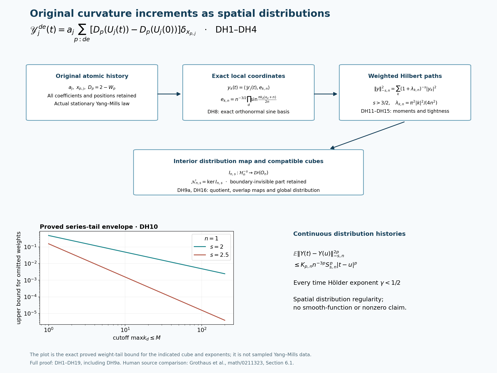

# Spatial distribution histories of the original curvature increments

The original curvature differences admit a continuous distribution-valued subsequential limit on physical space. The result strengthens the coordinatewise history construction in CP21–CP36: its test values belong to one random spatial distribution, with explicit local negative Sobolev bounds. It keeps the original lattice coefficient, time, state and spatial positions. It does not assert that the distribution is a function, smooth, or nonzero.

The argument below uses the actual local moment theorem LC1–LC42 and the complete reversible calculation CP21–CP27. Grothaus, Kondratiev, Lytvynov and Röckner, *Scaling limit of stochastic dynamics in classical continuous systems*, original author TeX arXiv:math/0211323, Section 6.1, theorem `pr777`, equations `eq1605` and `eq95`, provide a human-source comparison for lifting martingale coordinate bounds to a negative Hilbert space. Their Gibbs hypotheses, configuration space, initial law and scaling are different. The following receiving calculation is proved on the original Yang–Mills objects.

## 1. Original spatial distributions

For fixed \(\kappa_*>0\), keep
\[
 L_j=j^4,\quad m_j=2j^4,\quad n_j=2j^4+1,\quad
 a_j=(100j)^{-1},\quad g_j^2=\kappa_*a_j/2,
 \quad b_j=(\kappa_*a_j^2)^{-1},\quad s_j=\kappa_*/j.
 \tag{DH1}
\]
The original directed positive links carry \(U_e\in\mathrm{SU}(2)\), probability Haar and the radius-two metric with \(T_\alpha=-i\sigma_\alpha/2\). Every original vertex gauge action, including boundary vertices, is imposed in the physical space. Write
\[
 \begin{gathered}
 K_j=-\sum_{e,\alpha}X_{e,\alpha}^2,\qquad
 H_j=\kappa_*K_j+b_j\sum_p D_p,\qquad D_p=2-W_p,\\
 W_{(z;d,e)}=\operatorname{Tr}
 [U_d(z)U_e(z+e_d)U_d(z+e_e)^{-1}U_e(z)^{-1}],\\
 H_j\psi_j=E_j\psi_j,\quad \psi_j>0,\quad\|\psi_j\|=1,
 \quad d\mu_j=\psi_j^2dU,\quad A_j=H_j-E_j,\\
 x_{p,j}=o+a_j(z-L_j\mathbf1+(e_d+e_e)/2).
 \end{gathered}\tag{DH2}
\]
Here \(o\in\mathbb R^3\) is the fixed original physical origin. The scalar \(2b_jM_j\), with \(M_j=3m_j^2n_j\), remains in \(H_j\). The actual stationary reversible process \(U_j(t)\), \(t\in\mathbb R\), has generator
\[
 \mathscr L_j=\kappa_*\sum X^2+
               2\kappa_*\sum (X\log\psi_j)X.
 \tag{DH3}
\]
For each of the three orientations \(d<e\), define the finite atomic distributions
\[
 \begin{split}
 \mathscr C_j^{de}(t)&=a_j\sum_{p:de}D_p(U_j(t))\delta_{x_{p,j}},\\
 \mathscr Y_j^{de}(t)&=a_j\sum_{p:de}
       [D_p(U_j(t))-D_p(U_j(0))]\delta_{x_{p,j}},\\
 \langle\mathscr C_j^{de}(t),f\rangle&=C_{f,j}^{de}(U_j(t)),
 \quad C_{f,j}^{de}=a_j\sum_{p:de}f(x_{p,j})D_p,\\
 \langle\mathscr Y_j^{de}(t),f\rangle&=Y_{f,j}^{de}(t).
 \end{split}\tag{DH4}
\]
No mean or scalar term has been omitted from \(\mathscr C_j\). The difference defining \(\mathscr Y_j\) cancels its two identical \(2a_j\sum f(x_{p,j})\) contributions exactly. It is anchored at zero and uses the same actual stationary law at both times.

## 2. A uniform local test bound with every factor retained

Let \(O_n=(-n,n)^3\), \(R_n=2n\), and \(n\ge1\). For all sufficiently large \(j\), the LC patch covering \([-n,n]^3\) is strictly inside the original box. Its lower vertex in direction \(d\) is
\(L_j+\lfloor(-n-o_d)/a_j\rfloor-1\), and its side count is
\(q=\lceil R_n/a_j\rceil+3\). Retain
\[
 \begin{gathered}
 N_Q=3q(q+1)^2,\quad M_Q=3q^2(q+1),\quad C_Q=12q(q+1),\\
 \Lambda_{n,j}=\min\{2M_Q,6g_j^2\sqrt{N_QM_Q}\}+2C_Q,
 \quad\rho_j=4g_j^2=2\kappa_*a_j,\\
 U_{0,n,j}=1,\quad U_{1,n,j}=\Lambda_{n,j},\quad
 U_{p+1,n,j}=\Lambda_{n,j}U_{p,n,j}
                       +\rho_j^2p^2U_{p-1,n,j}.
 \end{gathered}\tag{DH5}
\]
LC proves \(\mu_jW_Q^p\le\min\{(4M_Q)^p,U_{p,n,j}\}\) and
\(U_{p,n,j}\le(\Lambda_{n,j}+p\rho_j)^p\), where \(W_Q=\sum_{p\subset Q}D_p\). It also retains the inside kinetic part in
\(\kappa_*\langle K_Q\rangle+b_j\mu_jW_Q\le b_j\Lambda_{n,j}\).

For one orientation and a real continuous \(f\) supported in \([-n,n]^3\), the exact face incidence calculation and the forward/reverse martingales of CP give
\[
 \begin{gathered}
 \Gamma(C_{f,j}^{de})\le8a_j^2\|f\|_\infty^2W_Q,\\
 V_{p,n,j}=8a_j^2\min\{4M_Q,U_{p,n,j}^{1/p}\},\\
 \mathbb E_j|Y_{f,j}^{de}(t)-Y_{f,j}^{de}(s)|^{2p}
 \le[2\kappa_*(2p-1)V_{p,n,j}]^p
          \|f\|_\infty^{2p}|t-s|^p .
 \end{gathered}\tag{DH6}
\]
Indeed the two martingales have bracket density \(2\kappa_*\Gamma(C_f)\); Itô and Hölder give
\(\mathbb E|M_h|^{2p}\le[(2p-1)h]^{p}\mu_j[2\kappa_*\Gamma(C_f)]^p\).
The original drift in (DH3) cancels in their exact half-difference, and convexity gives (DH6), without an independence assumption or a deterministic gradient bound.

The constants are uniformly finite. To exhibit one bound, put \(a_2=1/200\) and
\[
 \begin{gathered}
 B_n=9\kappa_*(R_n+4a_2)^{3/2}(R_n+5a_2)^{3/2}
                      +24(R_n+4a_2)(R_n+5a_2),\\
 \overline V_{p,n}=8(B_n+2\kappa_*p a_2^3),\qquad
 K_{p,n}=[2\kappa_*(2p-1)\overline V_{p,n}]^p,\\
 V_{p,n,j}\le\overline V_{p,n},\qquad
 \limsup_{j\to\infty}V_{p,n,j}\le8\mathsf L_{R_n},\quad
 \mathsf L_R=9\kappa_*R^3+24R^2.
 \end{gathered}\tag{DH7}
\]
To verify the finite bound, \(q\le R_n/a_j+4\), \(q+1\le R_n/a_j+5\), and
\(a_j^2\Lambda_{n,j}\le9\kappa_*[a_jq\,a_j(q+1)]^{3/2}+24a_jq\,a_j(q+1)\).
Use the monotonicity of this displayed expression in \(a_j\), followed by
\(a_j^2p\rho_j=2\kappa_*p a_j^3\). The minimum and original counts in (DH5) are retained before this estimate. Finitely many volumes before the patch fits do not affect subsequential tightness; each has a finite deterministic gradient bound from its finite face sum.

## 3. Exact local Hilbert spaces and the distribution map

For \(k\in\mathbb N^3\), with each \(k_d\ge1\), define
\[
 e_{k,n}(x)=n^{-3/2}\prod_{d=1}^3
       \sin\frac{\pi k_d(x_d+n)}{2n},\quad x\in O_n,
 \qquad\lambda_{k,n}=\frac{\pi^2|k|^2}{4n^2}.
 \tag{DH8}
\]
Extend \(e_{k,n}\) by zero outside \(O_n\). These extensions are continuous, their exact supremum is \(n^{-3/2}\), and they are an orthonormal basis of \(L^2(O_n)\). Orthogonality and the factor follow by integrating each sine product over an interval of length \(2n\). Completeness follows by odd reflection in each coordinate to the complete exponential Fourier basis on the corresponding torus; a function orthogonal to every sine product has every Fourier coefficient of its odd extension zero and hence has zero norm.

Define the spaces, rather than identifying them with an unspecified convention for boundary Sobolev norms:
\[
 \begin{gathered}
 \mathcal H_n^s=\{f=\sum_k f_ke_{k,n}:
                  \sum_k(1+\lambda_{k,n})^s|f_k|^2<\infty\},\\
 \mathcal H_n^{-s}=\{y=(y_k):
                  \|y\|_{-s,n}^2:=\sum_k(1+\lambda_{k,n})^{-s}|y_k|^2<\infty\},\\
 S_{s,n}:=\sum_{k\in\mathbb N^3}(1+\lambda_{k,n})^{-s}<\infty
                                 \quad(s>3/2).
 \end{gathered}\tag{DH9}
\]
The pairing is \(\sum_k y_k f_k\) on real functions; complexification uses the corresponding conjugate convention. The last series converges because the shell \(\max k_d=r\) has exactly \(r^3-(r-1)^3=3r^2-3r+1\) points and \(|k|^2\ge r^2\). Its tail after \(\max k_d\le M\) obeys
\[
 \sum_{\max k_d>M}(1+\lambda_{k,n})^{-s}
 \le\left(\frac{4n^2}{\pi^2}\right)^s
       \frac{3M^{3-2s}}{2s-3},\qquad M\ge1.
 \tag{DH10}
\]
Use \(3r^2-3r+1\le3r^2\) and the integral bound for the decreasing function \(x^{2-2s}\). For \(f\in\mathcal H_n^s\), Cauchy–Schwarz gives
\(\|f\|_\infty\le n^{-3/2}S_{s,n}^{1/2}\|f\|_{s,n}\); the series converges uniformly to a continuous function vanishing on the boundary. Thus each interior point mass has norm at most \(n^{-3/2}S_{s,n}^{1/2}\) in \(\mathcal H_n^{-s}\), with its original coefficient preserved.

Every \(y\in\mathcal H_n^{-s}\) defines a distribution on \(O_n\). For \(\phi\in C_c^\infty(O_n)\), repeated integration by parts gives
\(\lambda_{k,n}^r\phi_k=\langle(-\Delta)^r\phi,e_{k,n}\rangle\), with no boundary term because the support is interior. Taking \(2r\ge s\) shows
\(\|\phi\|_{s,n}\le c_{n,s,r}\|(-\Delta)^r\phi\|_2\), where
\(c_{n,s,r}^2=\sup_{\lambda\ge3\pi^2/(4n^2)}(1+\lambda)^s/\lambda^{2r}<\infty\).
This proves continuity for the test-function topology and the exact distribution pairing. Denote this map by \(I_{n,s}:\mathcal H_n^{-s}\to\mathcal D'(O_n)\). Its kernel must be retained:
\[
 \mathcal N_{n,s}=\{y:\sum_k y_k\phi_k=0
                           \text{ for every }\phi\in C_c^\infty(O_n)\},
 \qquad \mathcal V_n^{-s}=\mathcal H_n^{-s}/\mathcal N_{n,s}.
 \tag{DH9a}
\]
The kernel is closed as an intersection of kernels of continuous linear functionals. The quotient map into distributions is injective by its exact definition. Boundary-supported Hilbert functionals can be invisible to interior tests; no injectivity of the unquotiented map is asserted. The Hilbert representatives used below are kept explicitly before this quotient.

## 4. Hilbert moment bounds and tightness

For each orientation let \(Y_{j,n}^{de}(t)\) have coordinates
\(\langle\mathscr Y_j^{de}(t),e_{k,n}\rangle\). It is the restriction of the original finite atomic distribution, represented in (DH9), not a new random field. For \(s>3/2\), Minkowski in \(L^p\), followed by (DH6), gives
\[
 \begin{split}
 \mathbb E_j\|Y_{j,n}^{de}(t)-Y_{j,n}^{de}(u)\|_{-s,n}^{2p}
 &\le K_{p,n}\, n^{-3p}S_{s,n}^{p}|t-u|^p.
 \end{split}\tag{DH11}
\]
For finite sums, take the \(L^p\) norm of the sum of squared weighted coordinates and bound it by the sum of their \(L^p\) norms. Increase the number of coordinates and apply monotone convergence. This proves (DH11) and membership at each time directly.

The original paths are continuous in \(\mathcal H_n^{-s}\): there are finitely many point masses with fixed positions and continuous coefficients. Anchoring gives a useful maximal estimate for every integer \(p>1\):
\[
 \left(\mathbb E_j\sup_{0\le t\le T}
                         \|Y_{j,n}^{de}(t)\|_{-s,n}^{2p}\right)^{1/(2p)}
 \le\frac{K_{p,n}^{1/(2p)}n^{-3/2}S_{s,n}^{1/2}\sqrt T}
               {1-2^{-(p-1)/(2p)}}.
 \tag{DH12}
\]
At dyadic level \(r\), the \(L^{2p}\) norm of the largest adjacent increment is at most
\(K_{p,n}^{1/(2p)}n^{-3/2}S_{s,n}^{1/2}\sqrt T\,2^{-r(p-1)/(2p)}\).
This follows by bounding the maximum's \(2p\)-th power by the sum of the \(2^r\) powers. Every dyadic time can be connected to zero by at most one adjacent increment from each level; add the norms and then use continuity. Summing the geometric series proves (DH12). The same argument on negative times, or time reversal, covers \([-T,T]\), with the two halves retained if a single maximal bound is desired.

For \(\gamma<(p-1)/(2p)\), the probability that some adjacent level-\(r\) increment exceeds \(B2^{-r\gamma}\) is at most
\[
 K_{p,n}n^{-3p}S_{s,n}^{p}T^p B^{-2p}
                      2^{-r[p-1-2p\gamma]}.
 \tag{DH13}
\]
Its summable series and the same dyadic chains give a uniform probabilistic Hölder bound in \(\mathcal H_n^{-s}\), with all \(\gamma<1/2\) available by choosing \(p\) large.

If \(3/2<s_0<s\), the inclusion \(\mathcal H_n^{-s_0}\to\mathcal H_n^{-s}\) is compact. In fact on a ball of radius \(B\), its squared coordinate tail after \(\max k_d\le M\) is at most
\[
 B^2\left(1+\frac{\pi^2(M+1)^2}{4n^2}\right)^{-(s-s_0)}.
 \tag{DH14}
\]
Finite coordinate balls are compact and this tail is uniform, proving total boundedness and compact closure. Apply (DH12)–(DH13) at exponent \(s_0\). Outside a set of arbitrarily small probability the paths have bounded \(\mathcal H_n^{-s_0}\) norm and a common Hölder modulus there. Their values then lie in a compact subset of \(\mathcal H_n^{-s}\) and have a common modulus in that space. A finite time mesh and finite nets of values prove total boundedness in the uniform path norm; completeness gives compact closure. This proves tightness in
\[
 C([-T,T],\mathcal H_n^{-s}),\qquad s>3/2.
 \tag{DH15}
\]
It proves compactness, not merely boundedness of balls in the infinite-dimensional path space.

## 5. One compatible spatial distribution and all smooth tests

Take a countable collection of exponents \(s\downarrow3/2\), all \(n,T\in\mathbb N\), and all three orientations. Enlarge the CP countable family by every \(e_{k,n}\) and by countable dense subsets of the smooth tests supported in each interior compact subcube. Retain rational linear combinations and rational phase parameters. CP's word, character and time arguments apply to this enlarged family with the same finite local constants.

The product of the tight spaces (DH15), together with CP's compact initial character space, is tight: assign each factor a compact set whose failure probability is less than \(\epsilon2^{-r}\), and take their compact product. Its factors are separable complete metric spaces. Diagonal subsequence selection on finite nets of these compact sets gives a weakly convergent subsequence of the probability laws. Include the original CP determining correlations in that selection; if a specific ultrafilter construction is used, select each successive index from the corresponding finite intersection of ultrafilter sets. This gives the same CP correlations rather than selecting a different state.

The limit restrictions agree as distributions on overlapping cubes. At finite \(j\), their pairings with each interior smooth test agree exactly by (DH4). These pairings are continuous on both Hilbert spaces, so agreement passes to the limit. First impose it on the countable dense test subsets and rational times. Distribution continuity and Hilbert path continuity extend it to every smooth compactly supported test and every real time simultaneously. The interior distributions therefore glue to one
\[
 \mathscr Y^{de}\in C(\mathbb R,\mathcal D'(\mathbb R^3)),\qquad
 \mathscr Y^{de}(0)=0,
 \quad \mathscr Y^{de}|_{O_n}=I_{n,s}Y_n^{de},\quad
 Y_n^{de}\in C(\mathbb R,\mathcal H_n^{-s})\quad(s>3/2).
 \tag{DH16}
\]
Here the distribution continuity holds even for uniform convergence on bounded test sets locally: such a set has uniformly bounded \(\mathcal H_n^s\) norm, and dual Cauchy–Schwarz bounds the uniform pairings by the \(\mathcal H_n^{-s}\) path difference. No boundary trace of a distribution is being identified; equality is on interior test functions.

The Hilbert representatives, and hence their exact quotient classes in (DH9a), are locally Hölder of every exponent \(\gamma<1/2\) in every displayed space. Use (DH13) with \(p\) sufficiently large, pass the bounds through the Hilbert weak limit using bounded truncations, and intersect the countable exponent, cube and horizon events. Inclusion from any smaller selected \(s'>3/2\) gives every \(s>s'\).

For a fixed \(\phi\in C_c^\infty(O_n)\), the Fourier series in (DH8) converges uniformly to \(\phi\). Its finite sums are compactly supported continuous tests after extension by zero. Applying (DH6) and the scalar version of (DH12) to their difference from \(\phi\) shows convergence in \(L^{2p}\) of the entire anchored path on each finite horizon, uniformly in sufficiently large \(j\). In the Hilbert limit the same sums converge to the distribution pairing. Consequently the exact receiving identity is
\[
 Y_{\phi}^{de}(t)=\langle\mathscr Y^{de}(t),\phi\rangle,
 \qquad
 \chi(t)(\phi)=\chi(0)(\phi)
       \exp\bigl(i\langle\mathscr Y^{de}(t),\phi\rangle\bigr)
 \tag{DH17}
\]
whenever the absolute character coordinate \(\phi\) is in the chosen enlarged family. The real distribution pairing itself exists for every smooth compactly supported \(\phi\). For a new test, its relative phases for all real parameters are the continuous map
\(\exp(i\theta\langle\mathscr Y^{de}(t),\phi\rangle)\), obtained by the same joint approximation. No absolute initial character for an unchosen test is invented.

## 6. What the distribution construction receives

The original finite stationary identity passes to the distribution paths:
\[
 (\mathscr Y(r+t)-\mathscr Y(r))_{t\in\mathbb R}
       \stackrel{\rm law}{=}(\mathscr Y(t))_{t\in\mathbb R}.
 \tag{DH18}
\]
Indeed it holds on every finite collection of test values before taking the limit. Those values determine the glued distribution path law; continuity gives (DH18). The stronger determination of the actual Hilbert path laws follows from the explicit interior-cutoff recovery in [DR5–DR14](https://github.com/KokunoYumeto/yang-mills-interacting-workbench/blob/main/yang-mills/continuations/20261011-central-signs-shrinking-window/DISTRIBUTION_HISTORY_REVIEW.md), with the ambient boundary kernel retained. Joint stationarity with the CP initial characters has the full form CP34. Independence, Gaussianity and a Markov property for \(\mathscr Y\) are not consequences of (DH18).

For any smooth test in the selected phase algebra, CP44–CP47 now become the explicit distribution correlations
\[
 \begin{gathered}
 K_{\theta,\phi}(t)=\mathbb E\exp
       (i\theta\langle\mathscr Y^{de}(t),\phi\rangle),\\
 \|(e^{-tA_{\mathcal K}}-e^{-2tA_{\mathcal K}})
                     B_{\theta,\phi}\Omega\|^2
 =K_{\theta,\phi}(2t)-2K_{\theta,\phi}(3t)+K_{\theta,\phi}(4t).
 \end{gathered}\tag{DH19}
\]
This is an exact morphism from the constructed spatial distribution histories to the physical cyclic spectral test. Its right side is positive exactly when that scalar anchored history is not almost surely identically zero, for \(\theta\ne0\), by CP45 and continuity. Its value is still to be calculated. The original shrinking windows retain CP49 and are not evaluated by tightness.

The initial phase-character regularity defect of CP38–CP42 remains unchanged. Even a regular real additive initial functional on a countable family need not be continuous in the smooth test topology; no such initial spatial distribution has been proved here. The anchored differences have acquired that continuity because their uniform local test bounds were proved. The global smooth interacting Yang–Mills state and the no-gap result therefore remain the programme goal. The next receiving calculation is the actual distribution correlation (DH19), together with control of the initial character law and the first-energy loss CP46.

The figure depicts DH1–DH19 and DH9a: the original coefficients, local moment estimates, negative Hilbert spaces and interior distribution map. The nonzero ambient boundary kernel is retained. [DR1–DR17](https://github.com/KokunoYumeto/yang-mills-interacting-workbench/blob/main/yang-mills/continuations/20261011-central-signs-shrinking-window/DISTRIBUTION_HISTORY_REVIEW.md) give the exact recovery and stronger modulus for the actual limiting laws.

Complete programme providers: [LC1–LC42](https://github.com/KokunoYumeto/yang-mills-interacting-workbench/blob/471aca39662dea6c221c8c9c8a3dfcee195c25b6/yang-mills/continuations/20261011-central-signs-shrinking-window/LOCAL_CURVATURE_BUDGET.md), [PVC1–PVC50](https://github.com/KokunoYumeto/yang-mills-interacting-workbench/blob/471aca39662dea6c221c8c9c8a3dfcee195c25b6/yang-mills/continuations/20261011-central-signs-shrinking-window/PHYSICAL_LOCAL_COVARIANCE.md), and [CP1–CP50](https://github.com/KokunoYumeto/yang-mills-interacting-workbench/blob/471aca39662dea6c221c8c9c8a3dfcee195c25b6/yang-mills/continuations/20261011-central-signs-shrinking-window/CURVATURE_PHASE_RECONSTRUCTION.md). Human-source identities, exact versions and actual reading coverage are recorded in [the source-use ledger](https://github.com/KokunoYumeto/yang-mills-interacting-workbench/blob/main/yang-mills/continuations/20261011-central-signs-shrinking-window/DISTRIBUTION_HESSIAN_SOURCE_USE_LEDGER.json).
