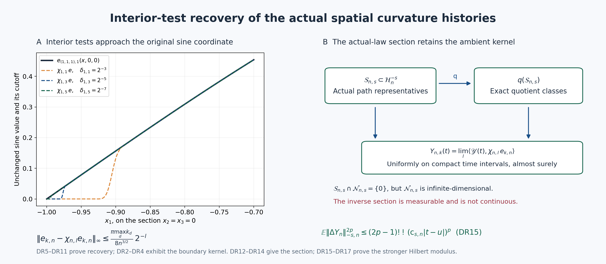

# Independent review and exact recovery of the spatial Hilbert representatives

This note reviews DH1–DH19 and DH9a in DISTRIBUTION_CURVATURE_HISTORIES.md and proves a strengthening of its distribution map. The reviewed source retains the original Yang–Mills Hamiltonians, actual vacua, spatial positions, coefficient \(a_j\), and anchored curvature differences. None is changed here. The accepted CP1–CP50 proof remains sealed and unchanged.

## 1. Review of the existing calculation

The following receiving calculations were read and independently checked in full.

* DH1–DH7: the original four-factor face traces, all three orientations, full drift, actual local moments and every coefficient agree with LC and CP. The uniform bound uses \(a_jq\le R_n+4a_2\), \(a_j(q+1)\le R_n+5a_2\) and \(a_j^2p\rho_j=2\kappa_*p a_j^3\). The two terms \(9\kappa_*R_n^3\) and \(24R_n^2\) are both retained. The quantities indexed by \(p\), including the recurrence defining \(U_{p,n,j}\), have integer \(p\ge1\); the maximal statements use integer \(p\ge2\).
* DH8–DH10 and DH9a: the three-dimensional sine coefficient is exactly \(n^{-3/2}\); its eigenvalue is \(\pi^2|k|^2/(4n^2)\). The shell contains \(3r^2-3r+1\) points, giving the displayed tail. The test-function map is continuous, but its ambient boundary kernel must indeed be retained.
* DH11–DH15: Minkowski is applied to the sum of squared weighted coordinates in \(L^p\), giving \(n^{-3p}S_{s,n}^p\), with no additional component factor. The maximal geometric denominator, dyadic probability exponent, compact embedding and compact path argument are correct. The finitely many initial volumes before a fixed patch fits do not affect tightness.
* DH16–DH17: agreement on countably many dense interior test sets passes through the Hilbert limits and extends to all test functions and real times. Bounded test sets have a common compact support and bounded derivatives, hence bounded \(\mathcal H_n^s\) norm. The resulting distribution paths are continuous for uniform convergence on bounded test sets locally. Smooth test Fourier sums converge in the exact Hilbert test norm and uniformly; the scalar maximal estimate identifies their original anchored limits. No unchosen absolute character is introduced.
* DH18–DH19: distribution stationarity and the full heat detector follow from the original finite identities. The heat expression is positive exactly for a nonconstant actual anchored coordinate at a selected nonzero parameter. Its value is not evaluated. The original first-energy loss, endpoint atoms and shrinking-window quantities remain unchanged.

There is no mathematical defect in these bounds or in the distribution construction. The sentence in DH18 saying that interior test values determine the Hilbert path laws requires the actual-law recovery argument below: for unrestricted elements of the ambient Hilbert space, DH9a's kernel prevents that inference. Alternatively that sentence can refer only to the glued distribution path law. The stronger statement is proved below for the actual limits.

## 2. The exact compact-embedding tail and a nonzero ambient kernel

Use the precise spaces \(\mathcal H_n^s,\mathcal H_n^{-s}\) and map \(I_{n,s}\) defined in DH8–DH9a. If \(3/2<s_0<s\), the squared tail operator norm of the inclusion after removing all coordinates with \(\max_d k_d\le M\) is exactly
\[
\left(1+\frac{\pi^2[(M+1)^2+2]}{4n^2}\right)^{-(s-s_0)}.
\tag{DR1}
\]
Indeed a coordinate in that tail has one index at least \(M+1\) and its other two indices at least one. Therefore its eigenvalue is at least the displayed value. The ratio of its two squared norm weights is \((1+\lambda)^{-(s-s_0)}\). This gives the upper bound, and a vector supported only at \((M+1,1,1)\) attains it. DH14 is valid; (DR1) is its sharp refinement, retaining the two other minimal indices.

The kernel in DH9a is nonzero for every displayed exponent \(s>3/2\). Define
\[
z^{(\ell_2,\ell_3)}_k
=\frac{\pi k_1}{2n^{3/2}}\,
       \mathbf1_{\{k_2=\ell_2,\ k_3=\ell_3\}},
\qquad \ell_2,\ell_3\ge1.
\tag{DR2}
\]
Its squared Hilbert norm is
\[
\frac{\pi^2}{4n^3}\sum_{r=1}^{\infty}
 r^2\left(1+\frac{\pi^2[r^2+\ell_2^2+\ell_3^2]}{4n^2}\right)^{-s},
\tag{DR3}
\]
which is finite exactly when \(s>3/2\), by comparison with \(\sum r^{2-2s}\). For an interior smooth test \(\phi\), the sine series and all its differentiated series converge uniformly, because repeated integration by parts makes its coefficients decrease faster than any fixed power. Pairing (DR2) with that series gives
\[
\sum_k z^{(\ell_2,\ell_3)}_k\phi_k
=\int_{(-n,n)^2}
 \partial_{x_1}\phi(-n,x_2,x_3)\,
 n^{-1}\sin\frac{\pi\ell_2(x_2+n)}{2n}
          \sin\frac{\pi\ell_3(x_3+n)}{2n}\,dx_2dx_3
=0.
\tag{DR4}
\]
Thus \(z^{(\ell_2,\ell_3)}\in\mathcal N_{n,s}\). These nonzero vectors have disjoint coordinate supports as \((\ell_2,\ell_3)\) varies, and are mutually orthogonal in \(\mathcal H_n^{-s}\). In particular the abstract kernel is infinite-dimensional. This is a boundary normal-derivative functional, not a proposed physical-vacuum component.

## 3. Recovering every actual Hilbert coordinate from interior tests

Fix a smooth function \(\eta:\mathbb R\to[0,1]\) equal to zero on \((-\infty,1/2]\) and one on \([1,\infty)\). Such a function can be defined explicitly: put \(h(u)=0\) for \(u\le0\), \(h(u)=e^{-1/u}\) for \(u>0\), and set
\(\eta(u)=h(u-1/2)/(h(u-1/2)+h(1-u))\).
For integers \(l\ge1\) let
\[
\begin{gathered}
\delta_{n,l}=n\,2^{-l-2},\\
\chi_{n,l}(x)=\prod_{d=1}^3
 \eta((x_d+n)/\delta_{n,l})\eta((n-x_d)/\delta_{n,l}),\\
\phi_{k,n,l}=\chi_{n,l}e_{k,n}\in C_c^\infty(O_n).
\end{gathered}\tag{DR5}
\]
The product is one whenever all six distances to faces are at least \(\delta_{n,l}\), and zero near every face. If \(1-\chi_{n,l}(x)\ne0\), at least one such distance is less than \(\delta_{n,l}\). The associated sine factor has absolute value at most \(\pi k_d\delta_{n,l}/(2n)\). Keeping the other two sine factors at their bound one gives the exact useful estimate
\[
\|e_{k,n}-\phi_{k,n,l}\|_\infty
\le \frac{\pi\,\max_d k_d}{2n^{5/2}}\,\delta_{n,l}
=\frac{\pi\,\max_d k_d}{8n^{3/2}}\,2^{-l}.
\tag{DR6}
\]
The extensions by zero are continuous, including their boundary values. They are therefore legitimate tests in DH6, regardless of the derivatives of the cutoff.

For integer \(p\ge2\), abbreviate only the displayed scalar maximal coefficient:
\[
\mathsf A_{p,n,T}
=\frac{K_{p,n}^{1/(2p)}\sqrt T}
       {1-2^{-(p-1)/(2p)}}.
\tag{DR7}
\]
Applying the scalar version of DH12 to \(e_{k,n}-\phi_{k,n,l}\), and retaining both halves of \([-T,T]\), gives
\[
\mathbb E_j\sup_{|t|\le T}
\left|Y^{de}_{e_{k,n},j}(t)-Y^{de}_{\phi_{k,n,l},j}(t)\right|^{2p}
\le 2\,\mathsf A_{p,n,T}^{\,2p}
       \left(\frac{\pi\,\max_d k_d}{8n^{3/2}}\,2^{-l}\right)^{2p}.
\tag{DR8}
\]
The factor two bounds the maximum of the two half-interval powers by their sum. The estimate holds at every sufficiently large original volume; their laws and test coefficients are unchanged.

Let \(Y_n^{de}\) be any actual Hilbert path limit constructed in DH15–DH16 along its common subsequence. The map
\[
y(\cdot)\longmapsto
\sup_{|t|\le T}|y_k(t)-\langle I_{n,s}y(t),\phi_{k,n,l}\rangle|
\]
is continuous in the uniform \(\mathcal H_n^{-s}\) path norm: both the coordinate functional and the interior test functional are continuous linear functionals on that Hilbert space. Truncate its \(2p\)-th power at a finite constant, pass expectations through the weak limit, and then increase the truncation. Equation (DR8) therefore holds for
\[
Y_{n,k}^{de}(t)
-\langle\mathscr Y^{de}(t),\phi_{k,n,l}\rangle
\tag{DR9}
\]
with exactly the same right side.

For \(p=2\), Markov's inequality at threshold \(2^{-l/2}\) bounds the probability that the supremum of (DR9) exceeds that threshold by
\[
2\,\mathsf A_{2,n,T}^{\,4}
 \left(\frac{\pi\,\max_d k_d}{8n^{3/2}}\right)^4 2^{-2l}.
\tag{DR10}
\]
The sum over \(l\) is finite. The probability of infinitely many failures is bounded by the tail sum and hence zero. Consequently, simultaneously for every \(k,n,T\), orientation and selected exponent \(s\),
\[
Y_{n,k}^{de}(t)
=\lim_{l\to\infty}
  \langle\mathscr Y^{de}(t),\phi_{k,n,l}\rangle,
\qquad\text{uniformly for }|t|\le T
\quad\text{almost surely}.
\tag{DR11}
\]
The countable intersection has probability one. Inclusion from a smaller selected exponent extends the statement to every \(s>3/2\), with the same coordinates. This proves recovery of the actual Hilbert representatives from the interior distribution path. It is stronger than identifying only their quotient classes.

## 4. The exact section space and its limits

Define the following actual receiving subspace of the original Hilbert space:
\[
\mathcal S_{n,s}
=\left\{y\in\mathcal H_n^{-s}:
 y_k=\lim_{l\to\infty}
        \langle I_{n,s}y,\phi_{k,n,l}\rangle
 \text{ for every }k\right\}.
\tag{DR12}
\]
It is linear. It is Borel: convergence of each sequence to its coordinate is a countable combination of inequalities between continuous linear functionals. If \(y\in\mathcal S_{n,s}\cap\mathcal N_{n,s}\), every pairing in (DR12) is zero, hence every \(y_k=0\); thus the intersection is zero. In particular \(I_{n,s}\) and the quotient map \(q:\mathcal H_n^{-s}\to\mathcal V_n^{-s}\) are injective on \(\mathcal S_{n,s}\). Equation (DR11) says that every actual path value belongs to this subspace, simultaneously in time, with probability one.

There is an explicit measurable inverse section on \(q(\mathcal S_{n,s})\). Each interior test functional annihilates \(\mathcal N_{n,s}\) and so descends to a continuous linear functional on the quotient. For \(v\) in that image, take the coordinate limits of those functionals along \(\phi_{k,n,l}\). They give exactly the coordinates of its unique representative in \(\mathcal S_{n,s}\). To see that both the domain and section are Borel without suppressing their domain, first require existence of every coordinate limit; then require finiteness of the weighted squared coordinate sum; construct the Hilbert vector as the norm limit of finite-coordinate vectors; finally require that its quotient equal \(v\). Each condition is Borel, and these conditions define precisely \(q(\mathcal S_{n,s})\). The finite-coordinate construction proves measurability of the section.

No continuous inverse or vanishing of the ambient kernel follows. For example fix \(\ell_2,\ell_3\) and the smooth tangential factor in (DR4). For \(0<\epsilon<n\), let \(z^\epsilon\) be the interior plane measure at \(x_1=-n+\epsilon\), paired against that tangential factor, with coefficient \(\epsilon^{-1}\). Its coefficients are
\[
z^\epsilon_k
=\frac{n^{-1/2}}{\epsilon}
 \sin\frac{\pi k_1\epsilon}{2n}\,
 \mathbf1_{\{k_2=\ell_2,\ k_3=\ell_3\}}.
\tag{DR13}
\]
For fixed \(\epsilon\), the cutoff factors in the normal direction are one once \(l\) is sufficiently large. The tangential factors tend to one at every interior point and are bounded by one. Dominated convergence in the finite tangential integral therefore proves \(z^\epsilon\in\mathcal S_{n,s}\). Its coefficients tend to (DR2) and have absolute value bounded by those of (DR2), using \(|\sin u|\le|u|\). The summable series (DR3) and dominated convergence give
\[
z^\epsilon\longrightarrow z^{(\ell_2,\ell_3)}
\quad\text{in }\mathcal H_n^{-s},
\qquad
qz^\epsilon\longrightarrow0
\quad\text{in }\mathcal V_n^{-s}.
\tag{DR14}
\]
Thus \(\mathcal S_{n,s}\) is not closed, and the section on its quotient image is not continuous at zero. This example concerns the exact ambient Hilbert map, not an asserted actual curvature law. It preserves the distinction between the proved measurable recovery and a stronger, unavailable topological isomorphism.

The actual-law consequence for DH18 is now exact. Interior test values determine every coordinate at every rational time by (DR11); continuity determines the Hilbert paths. Thus their laws determine the Hilbert path law within the actual limiting class. In an unrestricted Hilbert class this would fail by (DR2)–(DR4). The common ultrafilter/subsequence correlations, initial character defects, first-energy defect and heat detector of DH19 are not changed by this recovery.

## 5. Sharper limiting Hilbert moments and logarithmic modulus

The full all-order local input gives another strengthening of DH11–DH16. The limiting coordinate bound CP27 applied to \(e_{k,n}\), whose exact supremum is \(n^{-3/2}\), is
\(\mathbb E|\Delta Y_{n,k}|^{2p}\le(2p-1)!!(16\kappa_*\mathsf L_{2n}n^{-3}|t-u|)^p\).
Minkowski on the squared weighted coordinates, followed by monotone convergence, therefore gives
\[
\begin{gathered}
\mathbb E\|Y_n^{de}(t)-Y_n^{de}(u)\|_{-s,n}^{2p}
\le (2p-1)!!\,(\mathsf c_{s,n}|t-u|)^p,\\
\mathsf c_{s,n}
=16\kappa_*\mathsf L_{2n}\,n^{-3}S_{s,n},
\qquad \mathsf L_{2n}=9\kappa_*(2n)^3+24(2n)^2 .
\end{gathered}\tag{DR15}
\]
For each finite coordinate sum, its \(L^p\) root is at most the sum of the individual roots
\([(2p-1)!!]^{1/p}16\kappa_*\mathsf L_{2n}n^{-3}|t-u|(1+\lambda_{k,n})^{-s}\).
This proves every factor in (DR15). No independence or absence of spatial correlations is used. The estimate concerns the actual limiting law; the finite-volume constants remain those of DH6–DH12.

The nonnegative even series of cosh and
\((2p-1)!!/(2p)!=1/(2^pp!)\) give
\[
\begin{gathered}
\mathbb E\cosh\bigl(\lambda\|Y_n^{de}(t)-Y_n^{de}(u)\|_{-s,n}\bigr)
\le e^{\mathsf c_{s,n}\lambda^2|t-u|/2},\\
\mathbb P\bigl(\|Y_n^{de}(t)-Y_n^{de}(u)\|_{-s,n}>r\bigr)
\le2\exp\!\left(-\frac{r^2}{2\mathsf c_{s,n}|t-u|}\right).
\end{gathered}\tag{DR16}
\]
The second line follows from \(\cosh(\lambda x)\ge e^{\lambda|x|}/2\), Markov's inequality and \(\lambda=r/(\mathsf c_{s,n}|t-u|)\). It is a Gaussian tail upper bound, not a Gaussian-law assertion.

Let \(H_{n,s,T}\) be the supremum of all adjacent dyadic Hilbert-norm increments on \([0,T]\) divided, at level \(l\ge0\), by \(\sqrt{T(l+1)2^{-l}}\). Applying (DR16) to its \(2^l\) intervals, and summing the geometric series, proves
\[
\begin{gathered}
\mathbb P(H_{n,s,T}>r)
\le\frac{2e^{-r^2/(2\mathsf c_{s,n})}}
          {1-2e^{-r^2/(2\mathsf c_{s,n})}},
\qquad r^2>2\mathsf c_{s,n}\log2,\\
\|Y_n^{de}(t)-Y_n^{de}(u)\|_{-s,n}
\le\sqrt2\,B\,H_{n,s,T}
 \sqrt{|t-u|\,[1+\log_2(T/|t-u|)]},\\
B=1+2\sum_{l\ge1}\sqrt{l+1}\,2^{-l/2}
\le\frac{2}{(1-2^{-1/2})^2}-1,\qquad 0<|t-u|\le T.
\end{gathered}\tag{DR17}
\]
Choose a dyadic mesh length between \(|t-u|\) and \(2|t-u|\). One coarse adjacent increment and the two endpoint refinement tails, bounded by the Hilbert triangle inequality, give the second line exactly as in CP36. The first line tends to zero as \(r\to\infty\), so \(H_{n,s,T}\) is finite almost surely. Countable intersection gives this bound on every selected cube, exponent, orientation and integer horizon; negative horizons follow by reversal or a time translation. Every \(s>3/2\) is obtained by inclusion from a smaller selected exponent. This strengthens the Hölder assertions without changing their topology.

For the product Hilbert norm of all three original orientations, the same calculation retains their three contributions: replace \(\mathsf c_{s,n}\) by \(3\mathsf c_{s,n}\) in (DR15)–(DR17). This follows by a second application of Minkowski to the three squared norms and does not remove any cross-orientation dependence.

## Provenance and verification

Provider coverage is DH1–DH19 and DH9a in full; LC1–LC42 and CP1–CP50 were already fully checked in the preceding derivation. The same original author TeX comparison, arXiv:math/0211323v1, Section 6.1, remains the only external source used; the present cutoff and section proofs are written in full above and do not import a further external theorem. The reviewed source hash, sealed CP hash, individual bounded checks and reproducible diagram are retained beside this note. The source calculation is retained; its Hilbert-law assertion now cites the recovery proof above.

**Figure.** The left panel is the exact section \(x_2=x_3=0\) of the \(n=1,\ k=(1,1,1)\) sine and its specified cutoffs (DR5–DR6). The right panel shows the actual-law coordinate recovery and the restricted quotient map (DR11–DR14); the abstract boundary kernel remains infinite-dimensional. The displayed Hilbert moment bound below the map is DR15, which yields the logarithmic modulus in DR17. The rendering was inspected and is reproduced by draw_dh_recovery.py. The bounded check script records 50 passing cases; no sampled function or algebraic boundary example is presented as physical-vacuum data.

Complete programme providers: [LC1–LC42](https://github.com/KokunoYumeto/yang-mills-interacting-workbench/blob/471aca39662dea6c221c8c9c8a3dfcee195c25b6/yang-mills/continuations/20261011-central-signs-shrinking-window/LOCAL_CURVATURE_BUDGET.md), [PVC1–PVC50](https://github.com/KokunoYumeto/yang-mills-interacting-workbench/blob/471aca39662dea6c221c8c9c8a3dfcee195c25b6/yang-mills/continuations/20261011-central-signs-shrinking-window/PHYSICAL_LOCAL_COVARIANCE.md), and [CP1–CP50](https://github.com/KokunoYumeto/yang-mills-interacting-workbench/blob/471aca39662dea6c221c8c9c8a3dfcee195c25b6/yang-mills/continuations/20261011-central-signs-shrinking-window/CURVATURE_PHASE_RECONSTRUCTION.md). Human-source identities, exact versions and actual reading coverage are recorded in [the source-use ledger](https://github.com/KokunoYumeto/yang-mills-interacting-workbench/blob/main/yang-mills/continuations/20261011-central-signs-shrinking-window/DISTRIBUTION_HESSIAN_SOURCE_USE_LEDGER.json).
