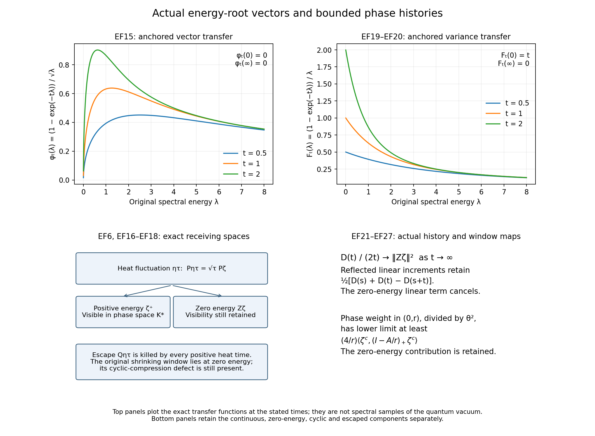

# Actual energy vectors, anchored histories and their complete receiving maps

The inputs are the actual ground states of [CE1–CE10](https://github.com/KokunoYumeto/yang-mills-interacting-workbench/blob/410cdfca685e896a353c9ddb1cb97b9d0a2eb168/yang-mills/continuations/20261011-central-signs-shrinking-window/CURRENT_COVARIANCE_EQUALITY.md), the heat-increment vectors CE31–CE50, the continuous semigroup of [LEM1–LEM6](https://github.com/KokunoYumeto/yang-mills-interacting-workbench/blob/410cdfca685e896a353c9ddb1cb97b9d0a2eb168/yang-mills/continuations/20261011-central-signs-shrinking-window/ACTUAL_LOW_ENERGY_MAPS.md), and the bounded phase histories of [CP12–CP27](https://github.com/KokunoYumeto/yang-mills-interacting-workbench/blob/410cdfca685e896a353c9ddb1cb97b9d0a2eb168/yang-mills/continuations/20261011-central-signs-shrinking-window/CURVATURE_PHASE_RECONSTRUCTION.md). All are in this repository, with complete proofs and their original sources. This note computes the maps between those constructions. The stationary comparison family of HP is not used as a probability law here.

## 1. Original objects and the actual energy-root vector

Retain the open lattice vertices \(z\in\{0,\ldots,2L_j\}^3\), all positive edges, every vertex gauge constraint, probability Haar measure, and radius-two edge metric with \(T_\beta=-i\sigma_\beta/2\) orthonormal. For \(d<k\),
\[
\begin{gathered}
L_j=j^4,\quad a_j=(100j)^{-1},\quad
g_j^2=\kappa_*a_j/2,\quad b_j=(\kappa_*a_j^2)^{-1},\\
U_p=U_d(z)U_k(z+e_d)U_d(z+e_k)^{-1}U_k(z)^{-1},\\
D_p=2-\operatorname{Tr}U_p,\qquad
x_{p,j}=o+a_j(z-L_j\mathbf1+(e_d+e_k)/2),\\
H_j=-\kappa_*\Delta+b_j\sum_pD_p,\quad
H_j\psi_j=E_{0,j}\psi_j,\quad
\psi_j>0,\quad\|\psi_j\|=1,\quad
A_j=H_j-E_{0,j}I,\quad d\mu_j=\psi_j^2dU .
\end{gathered}\tag{EF1}
\]
Here \(\Delta=\sum_{e,\beta}X_{e,\beta}^2\); the full scalar \(2b_j|\mathcal P_j|\) and full ground energy remain. For the unchanged real orientation triple \(\mathbf f\in C_c(\mathbb R^3;\mathbb R)^3\), put
\[
\begin{gathered}
C_{\mathbf f,j}=a_j\sum_{\sigma,p:\sigma}f_\sigma(x_{p,j})D_p,\quad
u_{\mathbf f,j}=(C_{\mathbf f,j}-\mu_jC_{\mathbf f,j})\psi_j,\\
\zeta_{\mathbf f,j}=A_j^{1/2}u_{\mathbf f,j},\qquad
d\nu_{\mathbf f,\mathbf g,j}(\lambda)
=d\langle u_{\mathbf f,j},\mathbf1_{(-\infty,\lambda]}(A_j)u_{\mathbf g,j}\rangle,\\
d\sigma_{\mathbf f,\mathbf g,j}(\lambda)
=\lambda\,d\nu_{\mathbf f,\mathbf g,j}(\lambda),\quad
E_{\mathbf f,j}=\|\zeta_{\mathbf f,j}\|^2
=\kappa_*\mu_j\Gamma(C_{\mathbf f,j}),\quad
E_{2,\mathbf f,j}=\|A_ju_{\mathbf f,j}\|^2 .
\end{gathered}\tag{EF2}
\]
The matrix measures are positive because their quadratic forms are spectral measures of the corresponding complete linear combinations. Inner products are conjugate-linear in their first argument. Every finite vector is smooth, gauge invariant, and orthogonal to \(\psi_j\); spectral calculus preserves these gauge constraints.

Here are the retained quantitative CE inputs. A cube of side \(R\) contains the three supports. Write \(F_\sigma=\|f_\sigma\|_\infty\), \(F=\max F_\sigma\), \(\chi=4+4\sum_\sigma F_\sigma/F\) for a nonzero test, and
\[
\begin{gathered}
\mathsf L_R=9\kappa_*R^3+24R^2,\quad
K_R=\frac{\mathsf L_R+\sqrt{\mathsf L_R^2-81\kappa_*^2R^6/4}}2,\\
t_1=f_{12}+f_{13},\quad t_2=f_{12}+f_{23},\quad
t_3=f_{13}+f_{23},\quad J_{\rm edge}=\sum_d\int|t_d|,\\
e_{\mathbf f}=\frac{9\kappa_*^3J_{\rm edge}^2}{4K_R}>0,\quad
U_{\mathbf f}=\kappa_*\chi F^2K_R,\quad
D_{\mathbf f}=21\kappa_*^2\sum_\sigma\int f_\sigma^2+4U_{\mathbf f},\\
e_{\mathbf f}\le\liminf E_{\mathbf f,j}
\le\limsup E_{\mathbf f,j}\le U_{\mathbf f},\qquad
\limsup a_jE_{2,\mathbf f,j}\le D_{\mathbf f}.
\end{gathered}\tag{EF3}
\]
CE7–CE10 prove these using the actual inside energy, outside ground energy, crossing faces, all oriented edge incidences and the full logarithmic Hessian. In particular \(\zeta_{\mathbf f}=[\zeta_{\mathbf f,j}]\) is an actual bounded nonzero vector in the same Hilbert ultraproduct. Its original first energy at regulator \(j\) is \(E_{2,\mathbf f,j}\), which need not be bounded. No replacement Hamiltonian or energy unit is introduced.

Use the same nonprincipal ultrafilter \(\mathcal U\), continuous projection \(P\), escape projection \(Q=I-P\), original-time generator \(A\) on \(P\mathcal H_{\mathcal U}\), and vacuum \(\Omega=[\psi_j]\). Thus \(T(t)=[e^{-tA_j}]=e^{-tA}P\) for \(t>0\). Set \(Z=\mathbf1_{\{0\}}(A)P\), \(\zeta^c=P\zeta\), \(\zeta^0=Z\zeta\), and \(\zeta^+=(P-Z)\zeta\). All three projections retain the original time. Every \(\zeta\) is orthogonal to \(\Omega\).

## 2. All heat parameters have one continuous receiver

For \(\tau>0\), the original CE vector and its exact relation to EF2 are
\[
\begin{gathered}
v_{\tau,\mathbf f,j}
=a_j^{-1/2}(I-e^{-\tau a_jA_j})^{1/2}u_{\mathbf f,j}
=h_{\tau,a_j}(A_j)^{1/2}\zeta_{\mathbf f,j},\\
h_{\tau,a}(\lambda)=\int_0^\tau e^{-sa\lambda}\,ds,\quad
h_{\tau,a}(0)=\tau,\quad
0\le\tau-h_{\tau,a}(\lambda)\le\tfrac12\tau^2a\lambda .
\end{gathered}\tag{EF4}
\]
This is an exact operation on the original vector and operator. Integrating \(0\le1-e^{-sa\lambda}\le sa\lambda\) proves the last bound. Since \((\sqrt{x}-\sqrt{y})^2\le x-y\) for \(x\ge y\ge0\), every fixed positive original time \(t\) gives
\[
\begin{split}
\|e^{-tA_j}(v_{\tau,\mathbf f,j}-\sqrt\tau\zeta_{\mathbf f,j})\|^2
&\le\frac{\tau^2a_j}2
\int\lambda e^{-2t\lambda}\,d\sigma_{\mathbf f,j}(\lambda)\\
&\le\frac{\tau^2a_j}{4\exp(1)t}E_{\mathbf f,j}
\longrightarrow0 .
\end{split}\tag{EF5}
\]
The last constant follows by maximizing \(\lambda e^{-2t\lambda}\) at \(\lambda=1/(2t)\); no energy contribution has been removed. For a finite combination
\[
\sum_r z_r(v_{\tau_r,\mathbf f_r,j}-\sqrt{\tau_r}\zeta_{\mathbf f_r,j}),
\]
the norm after heat is at most
\[
\sum_r|z_r|\tau_r\sqrt{a_jE_{\mathbf f_r,j}/(4\exp(1)t)} .
\]
This retains the actual coefficient vector.

Let \(\eta_{\tau,\mathbf f}=[v_{\tau,\mathbf f,j}]\). The common kernel of all \(T(t)\), \(t>0\), is exactly \(Q\mathcal H_{\mathcal U}\): on the continuous space the multiplier \(e^{-t\lambda}\) is strictly positive, hence has zero kernel. Consequently EF5 proves
\[
P\eta_{\tau,\mathbf f}=\sqrt\tau\,\zeta^c_{\mathbf f},
\qquad
P(\eta_{\tau,\mathbf f}/\sqrt\tau-\eta_{\rho,\mathbf f}/\sqrt\rho)=0 .
\tag{EF6}
\]
There is no claim that the two full vectors coincide. Their entire difference is an explicitly located escape vector. For \(t>0\), and also at \(t=0\) after continuous projection, every mixed coefficient is
\[
\langle P\eta_{\tau,\mathbf f},e^{-tA}P\eta_{\rho,\mathbf g}\rangle
=\sqrt{\tau\rho}\,
\langle\zeta^c_{\mathbf f},e^{-tA}\zeta^c_{\mathbf g}\rangle .
\tag{EF7}
\]
For any finite list of pairs \((\tau_r,\mathbf f_r)\), its complete escaped Gram is
\[
\begin{split}
\langle Q\eta_{\tau,\mathbf f},Q\eta_{\rho,\mathbf g}\rangle
={}&\lim_{\mathcal U}\int
\sqrt{h_{\tau,a_j}(\lambda)h_{\rho,a_j}(\lambda)}
\,d\sigma_{\mathbf f,\mathbf g,j}(\lambda)\\
&-\sqrt{\tau\rho}\,
\langle\zeta^c_{\mathbf f},\zeta^c_{\mathbf g}\rangle .
\end{split}\tag{EF8}
\]
The matrix in EF8 is positive, since it is the Gram of the displayed \(Q\)-vectors. It is not replaced by a difference of separately estimated diagonal bounds. For any chosen continuous cyclic projection \(R\le P\), EF6 also proves \(R\eta_{\tau,\mathbf f}=\sqrt\tau R\zeta_{\mathbf f}\).

The full nonzero-window projection still uses exactly \(s_j=\kappa_*/j=100\kappa_*a_j\):
\[
\begin{gathered}
\mathsf W=[\mathbf1_{(0,s_j]}(A_j)]\le Z-|\Omega\rangle\langle\Omega|,\\
\|\mathbf1_{(0,s_j]}(A_j)
(v_{\tau,\mathbf f,j}-\sqrt\tau\zeta_{\mathbf f,j})\|^2
\le50\tau^2\kappa_*a_j^2 E^{\rm win}_{\mathbf f,j},\\
E^{\rm win}_{\mathbf f,j}
=\int_{(0,s_j]}\lambda\,d\nu_{\mathbf f,j},\qquad
\mathsf W\eta_{\tau,\mathbf f}=\sqrt\tau\,\mathsf W\zeta_{\mathbf f}.
\end{gathered}\tag{EF9}
\]
Integrate EF4 over this window to prove the estimate. Its norm coefficient is exactly CE36. The endpoint \(s_j\) is included. The remaining zero-energy component is
\((Z-|\Omega\rangle\langle\Omega|-\mathsf W)\zeta_{\mathbf f}\), with the original rate defect of LEM5. No positive value is assigned to either component.

## 3. The actual phase cyclic space and a bounded approximation to anchored vectors

The CM space \(\mathcal H_+\) is generated by original Wilson words and its central bounded receiving multipliers. The CP space additionally uses curvature phases. These definitions must be retained: membership in one does not by itself mean membership in the other.

Define \(\mathcal K_*\) to be the closed span of finite words containing all these original multipliers, their adjoints, and nonnegative original heat times, applied to \(\Omega\). Include the rational phases of every test used below. A finite word has a ratio \(w_j/\psi_j\) bounded in supremum and a uniform form-root bound. Indeed the heat transform contracts that supremum and decreases its form; multiplication by \(b\) obeys the complete CP14 product rule
\[
\sqrt{q_j(b\psi_jh)}
\le\|b\|_\infty\sqrt{q_j(\psi_jh)}
 +\|h\|_\infty\sqrt{\kappa_*\mu_j\Gamma(b)} .
\tag{EF10}
\]
The underlying squared form is
\(\kappa_*\mu_j[|b|^2\Gamma(h)+|h|^2\Gamma(b)
+2\operatorname{Re}(\bar b h\,\nabla b\cdot\overline{\nabla h})]\);
Minkowski gives EF10 with every cross term retained first. Original phases have form \(\theta^2E_{\mathbf f,j}\); CM bounded multipliers have form \(O(a_j^2)\); the stated fixed-length Wilson words have their original finite form bounds. Induction from ratio one and energy zero proves the assertion. Thus
\(\|(I-e^{-tA_j})w_j\|^2\le t q_j(w_j)\)
places every word in \(P\). Left insertion proves reduction for the multipliers; self-adjointness of \(T(t)\) proves reduction for heat and its spectral projections. Write \(R_*\) for projection onto \(\mathcal K_*\). Then
\(\mathcal H_+\subset\mathcal K_*\), the selected CP space is contained in \(\mathcal K_*\), \(R_*\le P\), and \(R_*Z=ZR_*\).

The actual central CM receiving maps also extend to this space. The CM12 error on an arbitrary bounded-ratio word is its supremum bound times the same original residual norm. CM13 consequently gives
\([a_jC_{\mathbf f,j}W_j\psi_j]=S_{\mathbf f}W\Omega\)
on these words, with the same cube-independent linear map, root interval, mixed moments and centrality. The support statement follows by commuting a continuous cutoff through every generator before applying it to \(\Omega\), exactly as CM13. No new law or new central covariance is selected by this enlargement.

For \(t>0\) define the unchanged anchored vector
\[
\delta_{t,\mathbf f,j}=(I-e^{-tA_j})u_{\mathbf f,j},
\qquad
\|\delta_{t,\mathbf f,j}\|^2\le tE_{\mathbf f,j}.
\tag{EF11}
\]
The bound follows from \((1-e^{-x})^2\le x\), \(x\ge0\). There is a bounded phase-word approximation that does not require a bound on the time-zero value of \(C_{\mathbf f,j}\). In the actual stationary reversible diffusion put
\(Y_{\mathbf f,j}(t)=C_{\mathbf f,j}(U_j(t))-C_{\mathbf f,j}(U_j(0))\).
With \(B_{\epsilon,j}=e^{i\epsilon C_{\mathbf f,j}}\), its sine cylinder has conditional vector
\[
w_{\epsilon,t,\mathbf f,j}
=\frac{
B_{-\epsilon,j}e^{-tA_j}B_{\epsilon,j}
-B_{\epsilon,j}e^{-tA_j}B_{-\epsilon,j}}
{2i\epsilon}\psi_j
=\psi_j\,\mathbb E_j[
\sin(\epsilon Y_{\mathbf f,j}(t))/\epsilon\mid U_j(0)] .
\tag{EF12}
\]
The conditional vector of \(Y_{\mathbf f,j}(t)\) is
\((e^{-tA_j}-I)C_{\mathbf f,j}\psi_j=-\delta_{t,\mathbf f,j}\);
the original centering cancels exactly. Conditional Jensen and
\(|y-\sin(\epsilon y)/\epsilon|\le\epsilon^2|y|^3/6\)
therefore give
\[
\|w_{\epsilon,t,\mathbf f,j}+\delta_{t,\mathbf f,j}\|^2
\le\frac{\epsilon^4}{36}\,
\mathbb E_j|Y_{\mathbf f,j}(t)|^6 .
\tag{EF13}
\]
To check uniformity with all orientation constants, the full CM5 derivative sum gives
\(\Gamma(C_{\mathbf f,j})\le\chi F^2a_j^2W_{Q_j}\).
The original fitting cube has \(q=\lceil R/a_j\rceil+3\),
\(N_Q=3q(q+1)^2\), \(M_Q=3q^2(q+1)\), \(C_Q=12q(q+1)\) on its eventual interior tail, and
\[
\begin{gathered}
\Lambda_j=\min\{2M_Q,6g_j^2\sqrt{N_QM_Q}\}+2C_Q,\quad
\rho_j=4g_j^2,\quad U_{0,j}=1,\quad U_{1,j}=\Lambda_j,\\
U_{p+1,j}=\Lambda_jU_{p,j}+\rho_j^2p^2U_{p-1,j},\qquad
\mathcal G_{3,\mathbf f,j}
=(\chi F^2a_j^2)^3\min\{(4M_Q)^3,U_{3,j}\},\\
\mathbb E_j|Y_{\mathbf f,j}(t)|^6
\le(10\kappa_*)^3\mathcal G_{3,\mathbf f,j}t^3,\quad
\limsup\mathcal G_{3,\mathbf f,j}
\le(\chi F^2\mathsf L_R)^3 .
\end{gathered}\tag{EF14}
\]
CP4 proves the moment recurrence. For the increment bound, the forward and reversed martingales have bracket \(2\kappa_*\Gamma(C)\) and \(Y=(M-N)/2\), with no independence asserted. Itô and Hölder give
\(\mathbb E|M_t|^{2p}\le[(2p-1)\int_0^t(\mathbb E(2\kappa_*\Gamma(C))^p)^{1/p}dr]^p\).
Stationarity and convexity for \((M-N)/2\) give EF14 at \(p=3\). This repeats the CP22–CP24 argument on the complete oriented sum; neither its drift nor its crossing cost is omitted.

The full recurrence also gives the sharper limiting moments used below. Put \(\mathcal G_{\mathbf f}=\chi F^2\mathsf L_R\). All integer moments of \(V_j=\Gamma(C_{\mathbf f,j})\) have limiting upper bound \(\mathcal G_{\mathbf f}^p\). For \(\epsilon>0\), split at \(\mathcal G_{\mathbf f}+\epsilon\); on the upper part, the \(p\)-th power of the excess has mean at most \(\mu V_j^{p+k}/(\mathcal G_{\mathbf f}+\epsilon)^k\). Send \(j\) to the ultralimit, then \(k\to\infty\), then \(\epsilon\downarrow0\). This proves \(\mu(V_j-\mathcal G_{\mathbf f})_+^p\to0\). In the martingale Itô identity retain the bracket as its bound \(2\kappa_*\mathcal G_{\mathbf f}\) plus \(2\kappa_*(V_j-\mathcal G_{\mathbf f})_+\). Hölder, the already uniform higher martingale moments, and this vanishing excess make the latter integral tend to zero uniformly on compact time intervals. Induction in \(p\), integrating \(p(2p-1)(2\kappa_*\mathcal G_{\mathbf f})(2p-3)!!(2\kappa_*\mathcal G_{\mathbf f})^{p-1}s^{p-1}\), gives
\(\limsup\mathbb E|M_t|^{2p}\le(2p-1)!!(2\kappa_*\mathcal G_{\mathbf f})^pt^p\).
The reversed martingale obeys the same inequality; convexity for their half difference proves this bound for \(Y\) too. This is the full oriented version of CP26–CP27.

For each fixed nonzero rational \(\epsilon\), EF12 is a word combination in \(\mathcal K_*\). EF13–EF14 show that these classes converge in norm to \(-[\delta_{t,\mathbf f,j}]\) as \(\epsilon\to0\) through rationals. Hence the actual anchored vector belongs to \(\mathcal K_*\).

## 4. All surviving positive-energy components are visible in this phase space

Put
\[
\phi_t(\lambda)=\frac{1-e^{-t\lambda}}{\sqrt\lambda}\quad(\lambda>0),
\qquad \phi_t(0)=0,\qquad \phi_t(\infty)=0 .
\]
This function is continuous on \([0,\infty]\), positive on \((0,\infty)\), and has squared supremum at most \(t\). Its finite spectral identity and its actual receiving map are
\[
\delta_{t,\mathbf f,j}=\phi_t(A_j)\zeta_{\mathbf f,j},
\qquad
\delta_{t,\mathbf f}:=[\delta_{t,\mathbf f,j}]
=\phi_t(A)\zeta^c_{\mathbf f}\in\mathcal K_* .
\tag{EF15}
\]
For completeness the functional-calculus limit here follows directly from heat: write \(y=e^{-\lambda}\). A continuous function vanishing at infinity becomes a continuous function on \([0,1]\) vanishing at zero. It is uniformly approximated by polynomials in \(y\) with zero constant term. One explicit proof uses Bernstein polynomials: uniform continuity controls terms with \(|k/n-y|<\epsilon\), while their complementary binomial mass is at most \(1/(4n\epsilon^2)\). The value at zero is preserved. Each monomial has precisely the known heat limit, and uniform approximation proves EF15 on every bounded sequence of vectors.

Choose any fixed original time \(t_0>0\). For \(n\ge1\), the bounded Borel function
\(\mathbf1_{[1/n,n]}(\lambda)/\phi_{t_0}(\lambda)\)
applied to EF15 gives
\(\mathbf1_{[1/n,n]}(A)\zeta^c_{\mathbf f}\in\mathcal K_*\).
Increasing \(n\), spectral monotone convergence proves the exact result
\[
\zeta^+_{\mathbf f}\in\mathcal K_*,
\qquad
(P-R_*)\zeta_{\mathbf f}=(P-R_*)Z\zeta_{\mathbf f}.
\tag{EF16}
\]
Thus any continuous component still invisible to this specified enlarged phase space has zero original energy. This does not assert the same visibility for the smaller original CM space.

Combining EF6 and EF16 gives the full orthogonal decomposition
\[
\begin{split}
\|\eta_{\tau,\mathbf f}\|^2
={}&\tau\|\zeta^+_{\mathbf f}\|^2
+\tau\|R_*Z\zeta_{\mathbf f}\|^2\\
&+\tau\|(P-R_*)Z\zeta_{\mathbf f}\|^2
+\|Q\eta_{\tau,\mathbf f}\|^2 .
\end{split}\tag{EF17}
\]
Polarization gives every mixed Gram entry, and finite coefficient combinations retain their complete quadratic forms. The four summands are respectively positive energy in the phase cyclic space, zero energy there, zero energy outside it, and escape under every positive original heat time.

The original shrinking projection \(\mathsf W\) need not commute with \(R_*\). Its exact cyclic-compression defect remains
\[
R_*\mathsf W R_*-(R_*\mathsf W R_*)^2
=R_*\mathsf W(I-R_*)\mathsf W R_*\ge0 .
\tag{EF18}
\]
Insert \(I=R_*+(I-R_*)\) into \(\mathsf W^2=\mathsf W\) to prove it. In particular EF16 does not supply a positive original-window norm or erase the rate defect in EF9.

## 5. The complete anchored variance, including both spectral endpoints

For a fixed real test, let
\(D_{\mathbf f,j}(t)=\mathbb E_j|Y_{\mathbf f,j}(t)|^2\), \(t\ge0\).
Stationarity and reversibility give
\[
\begin{gathered}
D_{\mathbf f,j}(t)
=2\langle u_{\mathbf f,j},(I-e^{-tA_j})u_{\mathbf f,j}\rangle
=2\int F_t(\lambda)\,d\sigma_{\mathbf f,j}(\lambda),\\
F_t(\lambda)=\frac{1-e^{-t\lambda}}{\lambda}\quad(\lambda>0),
\qquad F_t(0)=t,\qquad F_t(\infty)=0 .
\end{gathered}\tag{EF19}
\]
The function \(F_t\) is continuous on the same compactification. The EF15 polynomial argument therefore evaluates the actual limit:
\[
\begin{split}
D_{\mathbf f}(t):=\lim_{\mathcal U}D_{\mathbf f,j}(t)
={}&2t\|\zeta^0_{\mathbf f}\|^2\\
&+2\int_{(0,\infty)}
\frac{1-e^{-t\lambda}}{\lambda}
\,d\sigma^c_{\mathbf f}(\lambda),\\
\sigma^c_{\mathbf f,\mathbf g}(B)
&=\langle\zeta^c_{\mathbf f},\mathbf1_B(A)\zeta^c_{\mathbf g}\rangle .
\end{split}\tag{EF20}
\]
The infinite-energy escaped part contributes zero because \(F_t(\infty)=0\). The zero endpoint contributes the full linear term because \(F_t(0)=t\). The uniform fourth moments proved by the EF14 argument at \(p=2\) give uniform integrability, so this is also the variance of the corresponding CP limiting anchored history.

Differentiation under the finite measure, using \(\lambda e^{-t\lambda}\le1/(\exp(1)t)\) for \(t>0\), proves
\[
\begin{gathered}
D'_{\mathbf f}(t)=2\langle\zeta^c_{\mathbf f},e^{-tA}\zeta^c_{\mathbf f}\rangle,\qquad
D''_{\mathbf f}(t)=-2\int_{(0,\infty)}\lambda e^{-t\lambda}\,d\sigma^c_{\mathbf f},\\
D'_{\mathbf f}(0+)=2\|\zeta^c_{\mathbf f}\|^2,\quad
\lim_{t\to\infty}D'_{\mathbf f}(t)=2\|\zeta^0_{\mathbf f}\|^2,\quad
\lim_{t\to\infty}\frac{D_{\mathbf f}(t)}{2t}
=\|\zeta^0_{\mathbf f}\|^2 .
\end{gathered}\tag{EF21}
\]
Dominated convergence proves the first endpoint; monotone or dominated convergence proves the other two. In the last limit, \(F_t(\lambda)/t\le1\) and tends to zero at every positive \(\lambda\). Thus the actual long-time slope measures all zero-energy collapse, including the original-window and its retained rate complement.

For different real tests define \(D_{\mathbf f,\mathbf g}(t)\) by polarization of EF19–EF20. The actual finite reversible covariances are symmetric in \(\mathbf f,\mathbf g\). Expanding their four terms gives both the same-side and reflected mixed laws:
\[
\begin{gathered}
\mathbb E[Y_{\mathbf f}(s)Y_{\mathbf g}(t)]
=\tfrac12\{D_{\mathbf f,\mathbf g}(s)+D_{\mathbf f,\mathbf g}(t)
-D_{\mathbf f,\mathbf g}(|t-s|)\},\\
\mathbb E[Y_{\mathbf f}(-s)Y_{\mathbf g}(t)]
=\tfrac12\{D_{\mathbf f,\mathbf g}(s)+D_{\mathbf f,\mathbf g}(t)
-D_{\mathbf f,\mathbf g}(s+t)\}\\
=\langle\delta_{s,\mathbf f},\delta_{t,\mathbf g}\rangle
\qquad(s,t\ge0).
\end{gathered}\tag{EF22}
\]
Uniform fourth moments pass these products to the limit. EF22 is a positive reflection Gram for every finite linear combination of anchored cylinders. Its zero-energy linear terms cancel exactly. Nonzero zero-energy collapse can therefore contribute to the variance of real increments while being absent from this linear reflected Gram. This statement concerns these linear cylinders; it does not discard nonlinear phase histories.

## 6. An explicit original-energy window bound from the phase histories

For a nonzero rational \(\theta\), \(b_{\theta,\mathbf f}=B_{\theta,\mathbf f}\Omega\) is a unit vector in \(\mathcal K_*\). Let
\(\rho_{\theta,\mathbf f}(B)=
\|\mathbf1_B(A|_{\mathcal K_*})b_{\theta,\mathbf f}\|^2\).
The actual finite ground form is exactly \(\theta^2E_{\mathbf f,j}\). Truncating the spectral function \(\lambda\) by \(\min\{\lambda,M\}\), taking its continuous functional-calculus limit and then increasing \(M\) proves
\[
\int\lambda\,d\rho_{\theta,\mathbf f}(\lambda)
\le\theta^2\bar E_{\mathbf f},\qquad
\bar E_{\mathbf f}:=\lim_{\mathcal U}E_{\mathbf f,j}
=\|\zeta_{\mathbf f}\|^2 .
\tag{EF23}
\]
The function \(\min\{\lambda,M\}\) has limit \(M\) at infinity; its possible \(Q\)-term is zero because the phase vector is already in \(P\). This argument retains possible first-energy loss rather than asserting equality.

The actual phase correlation is the characteristic function of the unchanged anchored increment, since
\(e^{-i\theta C(0)}e^{i\theta C(t)}=e^{i\theta Y(t)}\).
Reversibility makes it real. Hence its heat defect is
\(d_{\theta,\mathbf f}(t)=\mathbb E[1-\cos(\theta Y_{\mathbf f}(t))]\).
For any original energy threshold \(r>0\), split the full positive spectrum into \((0,r]\) and \((r,\infty)\). The first part of the heat defect is at most its mass, while the second is at most \(\theta^2\bar E_{\mathbf f}/r\) by EF23. Taylor's integral remainder gives
\(0\le y^2/2-(1-\cos y)\le y^4/24\).
The complete resulting bound is
\[
\begin{gathered}
\rho_{\theta,\mathbf f}((0,r])
\ge\theta^2\left[
\frac{D_{\mathbf f}(t)}2-\frac{\bar E_{\mathbf f}}r
-\frac{\theta^2}{24}\mathbb E|Y_{\mathbf f}(t)|^4
\right],\\
\mathbb E|Y_{\mathbf f}(t)|^4
\le3(2\kappa_*)^2(\chi F^2\mathsf L_R)^2t^2,\\
\liminf_{\substack{\theta\to0\\\theta\in\mathbb Q\setminus\{0\}}}
\frac{\rho_{\theta,\mathbf f}((0,r])}{\theta^2}
\ge \frac{D_{\mathbf f}(t)}2-\frac{\bar E_{\mathbf f}}r .
\end{gathered}\tag{EF24}
\]
The fourth-moment bound is the strengthened limiting calculation following EF14 at \(p=2\), passed to the history by uniform higher moments. All constants, both energy endpoints and the actual parameter norm remain. A negative right side is simply a valid lower bound; it is not reported as positive weight. The actual quantity \(D_{\mathbf f}(t)\) is the spectral integral EF20, not a chosen history variance.

## 7. The exact small-phase receiving measure and its low-energy mass

The spectral measure in EF23 gives a further exact receiving map. For \(\theta\ne0\) rational, \(d_{\theta,\mathbf f}(t)/\theta^2\) is differentiable and concave on \(t>0\), since
\[
\frac{d'_{\theta,\mathbf f}(t)}{\theta^2}
=\frac1{\theta^2}\int\lambda e^{-t\lambda}\,d\rho_{\theta,\mathbf f}(\lambda).
\]
The differentiation is justified by EF23. EF24 proves locally uniform convergence of \(d_{\theta,\mathbf f}(t)/\theta^2\) to \(D_{\mathbf f}(t)/2\). For a differentiable concave function, its derivative at \(t\) lies between its right and left secants of width \(h\), \(0<h<t\). Take the limit in these two secants, and then send \(h\downarrow0\). EF21 makes their limits equal. This proves
\[
\lim_{\substack{\theta\to0\\\theta\in\mathbb Q\setminus\{0\}}}
\frac1{\theta^2}\int\lambda e^{-t\lambda}\,d\rho_{\theta,\mathbf f}(\lambda)
=\langle\zeta^c_{\mathbf f},e^{-tA}\zeta^c_{\mathbf f}\rangle
\quad(t>0).
\tag{EF25}
\]
Every measure on the left has total mass at most \(\bar E_{\mathbf f}\), by EF23. Polynomials in \(e^{-\lambda}\) with zero constant term uniformly approximate every continuous \(F\) on \([0,\infty]\) with \(F(\infty)=0\), as proved in EF15. Apply EF25 to each monomial and control both approximation errors by the finite total masses. The complete receiving measure is therefore
\[
\lim_{\substack{\theta\to0\\\theta\in\mathbb Q\setminus\{0\}}}
\frac1{\theta^2}\int F(\lambda)\lambda\,d\rho_{\theta,\mathbf f}(\lambda)
=\int_{[0,\infty)}F(\lambda)\,d\sigma^c_{\mathbf f}(\lambda)
\quad(F(\infty)=0).
\tag{EF26}
\]
These measures use the actual phase states and unchanged generator \(A|_{\mathcal K_*}\); the multiplier \(\theta^{-2}\lambda\) is part of the displayed receiving map. It is not a substituted probability law. The zero endpoint on the right is retained even though every measure \(\lambda\,d\rho_{\theta,\mathbf f}\) has zero mass at zero. The formula is not asserted for \(F(\infty)\ne0\), since it would require the further total first-energy limit.

For each original energy threshold \(r>0\), take \(F_r(\lambda)=(1-\lambda/r)_+\) on \([0,\infty)\). Its support is \([0,r]\), its value at zero is one, and its endpoint value at \(r\) is zero. The exact maximum of \(\lambda F_r(\lambda)\) is \(r/4\), attained at \(\lambda=r/2\). Thus EF26 gives both the evaluated weighted coefficient and the positive-window bound
\[
\begin{gathered}
\lim_{\substack{\theta\to0\\\theta\in\mathbb Q\setminus\{0\}}}
\frac1{\theta^2}\int_{(0,r)}
\lambda(1-\lambda/r)\,d\rho_{\theta,\mathbf f}(\lambda)
=\langle\zeta^c_{\mathbf f},(I-A/r)_+\zeta^c_{\mathbf f}\rangle\\
=\|\zeta^0_{\mathbf f}\|^2+
\int_{(0,r)}(1-\lambda/r)\,d\sigma^c_{\mathbf f}(\lambda),\\
\liminf_{\substack{\theta\to0\\\theta\in\mathbb Q\setminus\{0\}}}
\frac{\rho_{\theta,\mathbf f}((0,r))}{\theta^2}
\ge\frac4r\left[
\|\zeta^0_{\mathbf f}\|^2+
\int_{(0,r)}(1-\lambda/r)\,d\sigma^c_{\mathbf f}(\lambda)
\right].
\end{gathered}\tag{EF27}
\]
The integration interval is open at both ends because its weighted integrand vanishes at both; no finite spectral endpoint has been assumed absent. The original regulator window \((0,s_j]\) remains the separate map EF9. Sending \(r\downarrow0\) on the first right side of EF27 gives exactly \(\|\zeta^0_{\mathbf f}\|^2\), by dominated convergence. This includes any continuous zero-energy component outside the phase cyclic space: the receiving limit of its phase energy measures still has that zero atom. Its location outside \(\mathcal K_*\) is not a reason to drop its contribution from EF27.

EF15–EF27 perform the next receiving calculation inside the actual construction. The positive-energy energy-root part is present in the specified phase cyclic space; its zero-energy part is the exact long-time variance slope; and the complete finite-energy measure, including the zero endpoint, is received by actual bounded phases with the quantitative positive-window bound EF27. The actual values of these coefficients, especially the original window in EF9, are not assigned by whole-vector survival. The smooth interacting four-dimensional no-gap endpoint remains the research objective. No novelty claim is made.

The reproducible figure and bounded checks are in check_energy_root.py. The [source-use ledger](ENERGY_ROOT_SOURCE_USE_LEDGER.json) records exact editions and actual reading coverage. Numerical samples test the displayed transfer functions and inequalities; no selected spectral quadrature is identified with the quantum state.

## Positive-time covariance and the full resolvent tail

[PT1–PT36](https://github.com/KokunoYumeto/yang-mills-interacting-workbench/blob/main/yang-mills/continuations/20261011-central-signs-shrinking-window/POSITIVE_TIME_COVARIANCE.md) prove the actual energy correlation’s exact weighted one-form representation on the original SU(2) lattice, including the radius-two Ricci term, gauge constraints and complete exterior Hessian inverse. The two-time current cancellation is evaluated. The full Hessian expansion has a proved finite-regulator remainder bound, and every truncation with a_j(N_j+1) tending to zero is proved to vanish. Any surviving response is received by its complete tail, whose spectral concentration near one and exact unitary map to the physical resolvent vector are established. The raw and energy-weighted original shrinking windows remain explicit. No positive value of an unfinished limiting coefficient is assumed.

The primary-source comparison uses original author TeX by Jon Johnsen and Assane Lo, with exact versions and bounded reading coverage. The compact-domain convexity obstruction is proved together with the curved weighted-form map that remains available. Complete proofs, reproducible figures and checks are included.

## Stronger source energy and retained current inverses

[CTI1–CTI39](https://github.com/KokunoYumeto/yang-mills-interacting-workbench/blob/main/yang-mills/continuations/20261011-central-signs-shrinking-window/CURRENT_TAILS_AND_RETAINED_SOURCE.md) prove exponential tails for the complete ground-state current and a stronger lower energy for the unchanged Wilson source:
\[
\begin{gathered}
e'_{\mathbf f}=\max\{e_{\mathbf f},3\kappa_*^2J_t/4\},\qquad
J_t=\sum_d\int t_d^2,\\
\liminf_jE_{h,j}\ge e'_{\mathbf f},\quad
\liminf_jE_{F,j}\ge e'_{\mathbf f},\qquad
\liminf_j\frac{\mathcal W_{h_{e_0}\psi_j}(\theta s_j)}{a_j^3}
\ge\frac{100\theta\kappa_*(e'_{\mathbf f})^3}{D_{\mathbf f}^2}.
\end{gathered}
\]
The full original upper constants and previous lower bound remain; CTI23–CTI26 give the complete formulas and exact strict improvement for the three-orientation tent. CTI24 also proves the finite-source matrix-order bound. This strengthens CE7–CE10, EF3 and FTC4–FTC12 without changing their source, metric or regulator. CTI27–CTI37 retain asymptotically all of the original source-vector norm in a set with a proved lower trial norm and explicit inverse accuracy. The complete omitted-direction Schur term and physical residual remain in CTI32–CTI33. Their signed three-shift contribution, reconstruction and the smooth no-gap endpoint remain active calculations.
